PLAN 9 DESKTOP GUIDE
---

[Reference](https://pspodcasting.net/dan/blog/2019/plan9_desktop.html)


# What is Plan 9?

간단히 말해, 벨 연구소의 ‘Plan 9’은 초기 UNIX 설계 팀이 개발한 컴퓨터 운영 체제입니다. 80년대 후반 수십 년에 걸쳐 ‘Research UNIX’를 개발해 온 이 팀은, 완전히 새로운 운영 체제를 처음부터 직접 개발하기로 결정했고, 1992년에 마침내 ‘Plan 9’을 출시했습니다. 그로부터 몇 년 후, 이들은 자매 프로젝트인 ‘Plan 9’과 많은 공통점을 지닌 또 다른 운영 체제인 ‘Inferno’를 출시했습니다. 이 시스템들과 그 파생 버전들은 그 이후로 대체로 지속적인 개발이 이루어져 왔습니다. 이러한 운영 체제의 역사와 설계 철학은 흥미롭지만, 여기서는 이에 대해 다루지 않겠습니다. 대신, 이 글에서는 Plan 9를 일상적인 데스크톱 시스템으로 사용하는 실용적인 측면에 초점을 맞출 것입니다.

유닉스(UNIX)에 대한 사전 지식이 양날의 검이 될 수 있다는 점에 유의하십시오. 두 플랫폼 간에는 비슷하게 들리는 명령어와 관례가 있으며, Plan 9는 유닉스의 철학을 따르고 있습니다(사실 유닉스보다 훨씬 더 그렇습니다). 그럼에도 불구하고, Plan 9는 유닉스가 아닙니다! 이 운영 체제는 완전히 처음부터 새로 작성된 것이며, 하위 호환성은 목표가 아니었습니다. 단순히 또 다른 우분투 파생판일 것이라고 기대한다면, 크게 실망하게 될 것입니다. 사실, 여기서 분명히 해두자면: 여러분은 실망하게 될 것입니다. 그건 확실합니다. 자, 이제 이러한 경고는 제쳐두고, 재미있게 시작해 봅시다!

2002년에 Plan 9의 4번째 버전이 출시되었는데, 이는 본질적으로 롤링 릴리스 방식이었으며, 2015년 프로젝트가 공식적으로 중단될 때까지 벨 연구소(Bell Labs)로부터 지속적으로 업데이트를 받았습니다. 하지만 2021년 중반, 벨 연구소는 기존의 모든 Plan 9 소스 코드의 소유권을 Plan 9 재단에 양도했습니다. 이 재단의 목표는 Plan 9의 개발을 계속하는 것이지만, 지금까지는 별다른 진전이 없습니다. 하지만 여러 커뮤니티 포크가 존재하며, 그중 9legacy와 9front는 2010년경에 등장했습니다. 이 글에서 중점적으로 다룰 것처럼 Plan 9를 일상적인 데스크톱 환경으로 사용하고 싶다면, 9front를 강력히 추천합니다. 9front는 여러분의 실제 하드웨어에서 실제로 구동될 가능성이 가장 높은 유일한 후보일 뿐만 아니라, USB 스틱 자동 마운트, Wi-Fi 지원, 정상 작동하는 오디오 및 비디오 재생, git 등 현대 사용자가 당연하게 여기는 많은 기능을 갖추고 있습니다. 9front는 훌륭한 FAQ와 커뮤니티 위키를 보유하고 있으며, 이 자료들은 제가 제공하는 것보다 훨씬 더 정확한 정보를 잘 전달해 줍니다(다만, 기발한 유머가 담겨 있으니 마음의 준비를 하세요!). 그럼에도 불구하고, 단지 역사적 호기심 차원이라도 9legacy를 직접 다뤄보는 것은 흥미로울 수 있습니다. 따라서 이 글에서는 9front와 현저히 다른 점에 대해 “클래식 Plan 9”(9legacy와 구 4판 Plan 9는 거의 동일합니다)에 대한 몇 가지 지침을 제공하겠습니다. 클래식 Plan 9의 경우, Bell Labs의 Plan 9 위키가 9front 자료보다 더 나은 문서 출처입니다.


# Limitations and Workarounds


무엇보다 Plan 9는 단순한 운영 체제입니다. 커널은 단 20만 줄의 코드로 구성되어 있고, 사용자 공간은 약 100만 줄 정도입니다. 이에 비해 파이어폭스 웹 브라우저의 소스 코드는 2,400만 줄이 넘습니다! 그러니 짐작하시겠지만, Plan 9에는 “현대적인” 웹 브라우저가 없습니다. 오피스 제품군, AAA급 게임, VOIP, 3만 개의 사전 컴파일된 패키지가 담긴 저장소도 없습니다. Plan 9는 겁이 많은 사람에게는 적합하지 않습니다!

물론 위의 제한 사항에 대한 해결책은 있습니다. 다음은 몇 가지 제안 사항입니다:


## Connecting to Other Systems

### VNC

Plan 9에서 VNC를 사용하여 원격 UNIX/Windows 시스템에 연결하거나, 그 반대의 경우도 매우 간단합니다(여기서 “UNIX”라는 용어는 광범위하게 사용되며, Mac, Android, Linux, BSD 등을 포함합니다...). Plan 9에서는 vncv를 사용하여 VNC 서버에 연결하거나, vncs를 사용하여 VNC 서버를 실행할 수 있습니다(다만 Plan 9에서 VNC 서버를 실행할 이유는 거의 없으므로, 대신 아래에서 언급할 drawterm을 사용하세요).

예를 들어, IP 주소가 192.168.0.1인 UNIX 시스템에 tigervnc가 설치되어 있고, 원하는 VNC 화면 해상도가 1366 x 768 픽셀이라고 가정해 보겠습니다: vncserver -geometry 1366x768 :1 명령을 실행하고 로그인 비밀번호를 입력하면 됩니다(비밀번호 입력을 요청받지 않는다면 먼저 vncpasswd를 실행해야 할 수도 있습니다). 이제 Plan 9 머신에서 vncv 192.168.0.1:1 명령을 실행하고 로그인하십시오. 기본적으로 매우 기본적인 twm 데스크톱이 실행될 텐데, 이로 인해 경험이 부족한 사용자들은 데스크톱이 제대로 작동하지 않는다고 오해하기 쉽습니다. 아마도 ~/.vnc/xstartup 파일을 수정하여 더 멋진 윈도우 매니저를 실행하고 싶을 것입니다. 예를 들어 twm 대신 openbox를 사용하려면, 파일에 다음 줄을 추가하세요:

exec /usr/bin/openbox-session

여기서는 원하는 데스크톱을 자유롭게 선택할 수 있지만, GNOME이나 KDE와 같이 부피가 크고 복잡한 환경을 사용할 경우 xstartup을 구성하는 작업이 훨씬 더 복잡해질 수 있으니 주의하십시오.

### RDP

RDP를 사용하여 원격 Windows 컴퓨터에 연결할 수 있습니다. 이와 같은 기능이 필요하면 rd를 참조하십시오.

### SSH

9front에는 정상적으로 작동하는 ssh 및 sshfs 클라이언트가 기본으로 포함되어 있습니다(sshfs는 원격 파일 시스템을 /n/ssh에 마운트합니다). 반면, 클래식 Plan 9에는 매우 오래된 버전의 ssh가 포함되어 있어, UNIX 시스템에 연결할 수 없을 가능성이 매우 높습니다(적어도 연결되어서는 안 됩니다).

### 9P

사실 Plan 9 기술을 타 시스템으로 가져오는 것이 그 반대의 경우보다 훨씬 쉬우며, UNIX 환경에서 Plan 9를 다루기 위한 훌륭한 솔루션들이 있습니다. plan9port나 drawterm과 같은 기술에 대해서는 나중에 다루겠지만, 지금은 9P 프로토콜을 사용하여 UNIX에서 Plan 9 파일 시스템을 네이티브로 마운트하는 방법에 대해 이야기해 보겠습니다. 이를 수행하는 방법에는 여러 가지가 있는데, 적어도 리눅스에서는 다음과 같이 직접 마운트할 수 있습니다: sudo mount -o rw -t 9p 192.168.0.1 /mnt (사용 중인 Plan 9 머신의 IP 주소로 대체하십시오). 하지만 plan9port 패키지의 9pfuse나 9pfs와 같이 시중에 나와 있는 다양한 9P 클라이언트 중 하나를 사용하는 것이 더 나은 결과를 얻을 수 있을 것입니다. 적절한 권한이 있다고 가정할 때, 다음과 같이 사용할 수 있습니다: 9pfs 192.168.0.1 /mnt.

### Other methods

Plan 9에서는 NFS와 SMB를 어느 정도 지원합니다(nfs(4) 및 cifs(4) 참조). 하지만 NFS 사용은 권장하지 않습니다. Plan 9의 클라이언트는 매우 구식이기 때문입니다. 구식이라고 하면, 당연히 ftpfs와 telnet도 있습니다.

## Porting Applications

Plan 9 사용자 공간 프로그램과 서비스를 UNIX용으로 꽤 잘 포팅한 ‘Plan9Port’(줄여서 p9p라고도 하며, 더 가벼운 대안으로는 9base가 있음)가 있으며, 이는 대부분의 주요 UNIX 시스템 저장소에서 구할 수 있습니다. 설치가 완료되면, UNIX의 해당 프로그램 대신 9 명령어를 사용하여 Plan9Port 프로그램을 실행하면 됩니다(예: 9 acme). 물론 Plan 9의 사용 경험을 완전히 재현하는 것은 아니지만, UNIX를 사용하는 데 따르는 번거로움을 줄여줍니다.

UNIX 명령어 대신 Plan9Port 명령어를 사용하여 완전한 Plan 9 셸을 실행하려면, `9 acme`를 실행한 후 그 안에서 `win`을 실행하고 `9 rc`를 실행하거나, `9 9term`을 실행한 다음 `9 rc`를 실행하면 됩니다. `~/.xinitrc` 파일을 구성하여 `exec 9 rio`를 통해 Plan 9와 유사한 창 관리자를 시작하고, 매우 정통한 Plan 9 데스크톱 환경을 설정할 수도 있습니다. 하지만 백그라운드에서 UNIX가 실행되고 있다는 사실을 정말로 숨기고 싶지 않은 이상, 이렇게 할 이유는 거의 없습니다. Plan9Port의 rio는 Plan 9 윈도우 매니저처럼 보일 뿐, 유용한 기능들은 동일하지 않을 뿐만 아니라 부팅 시에도 꽤 불안정합니다. 제 생각에는 Plan9에서 영감을 받은 wmii/dwm 윈도우 매니저나 그 변형 버전들을 포함하여, 훨씬 더 나은 네이티브 UNIX 대안들이 있습니다.

반대 방향으로 가는 것도 가능하지만 훨씬 더 어렵습니다. Plan 9에는 /bin/ape에 UNIX 호환 프로그램 및 라이브러리 모음이 있는데, 여기에는 ksh와 유사한 UNIX 셸을 제공하는 ape/sh가 포함되어 있습니다(VT-100 터미널을 에뮬레이트하려면 먼저 vt를 실행해야 합니다). 또한 ape/cc는 POSIX를 준수하는 C 컴파일러로, 이에 상응하는 UNIX 친화적인 라이브러리를 갖추고 있습니다. 그 외에도 몇 가지 UNIX 스타일의 유틸리티가 있습니다. 이 UNIX 호환 기능은 오래된 것이며 사실상 유지보수가 이루어지지 않고 있습니다. 9front에는 npe라는 자체적인 준공식 이식성 계층이 있으니, 자세한 팁은 [9front 이식 가이드](http://docs.9front.org/porting)를 참고하십시오.

다만, 단순히 UNIX 셸이 있다고 해서 모든 셸 스크립트가 마법처럼 작동하는 것은 아니라는 점에 유의하십시오. Plan 9에는 cat, echo, ls, sed 등과 같은 자체 버전의 명령어가 있습니다. 스크립트에서 이러한 프로그램을 사용하는 경우, Plan 9 버전을 사용하도록 수정해야 합니다. 언제나 그렇듯이, 매뉴얼 페이지를 주의 깊게 읽어보십시오(정말입니다—꼭 읽어보세요!).

마지막으로, Plan 9가 POSIX 규격을 매우 잘 준수하고 있기는 하지만, UNIX 프로그램이 컴파일될 것이라고 단정할 수는 없습니다. 대부분은 컴파일되지 않을 것입니다. 대다수의 UNIX 소프트웨어는 POSIX 규격에만 국한되지 않고, 광범위한 확장을 필요로 합니다. 그리고 그 중 대부분은 지원되지 않습니다. 예를 들어, Plan 9에는 (기본적으로) X, curses, 소켓, 숫자형 UID/GID 또는 링크가 없으므로, 이러한 요소에 의존하는 프로그램은 작동하기 전에 패치를 적용하거나 재작성해야 합니다. 실제로는 가장 단순한 프로그램만이 합리적인 노력으로 이식될 수 있습니다.


## Emulating other Operating Systems

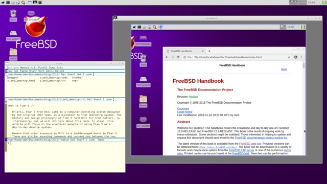

전통적인 Plan 9 네트워크에서는 하나 이상의 CPU 서버가 “터미널”이라고 불리는 여러 디스크리스 워크스테이션에 파일 및 인증 서비스를 제공합니다. 이러한 터미널은 CPU 서버에 연결된 데스크톱 시스템입니다. 이는 UNIX 사용자에게 다소 헷갈릴 수 있으므로, 이 글에서는 UNIX의 관례에 따라 디스크리스 워크스테이션을 ‘원격 데스크톱’이라 하고, 셸이 실행되는 창을 ‘터미널’이라 칭하겠습니다. Plan 9에서 CPU 서버를 물리적으로 또는 가상 머신 상에 설정했다면(9front fqa의 7.5절 및 7.6절 참조 — 아래의 ‘Quick CPU+AUTH+Qemu+Drawterm HOWTO’도 참조), drawterm을 사용하여 UNIX/Windows 머신에서 Plan 9 원격 데스크톱을 에뮬레이션할 수 있습니다(클래식 Plan 9의 경우 이 링크를 참조하십시오). drawterm은 매우 잘 작동하며, /mnt/term 아래에 있는 호스트 파일 시스템에 접근할 수 있어 운영 체제 간에 파일을 쉽게 다룰 수 있습니다.

Plan 9용 X의 타사 포트가 있으며, linuxemu와 함께 사용하면 리눅스 소프트웨어를 네이티브로 실행할 수 있습니다(9front FAQ의 8.7.1절 참조). 하지만 이 구현은 완벽하지 않으며, 구식이고 다루기 번거로워서 저 역시 이를 통해 큰 성과를 거두지는 못했습니다.


## Virtualizing other Operating Systems

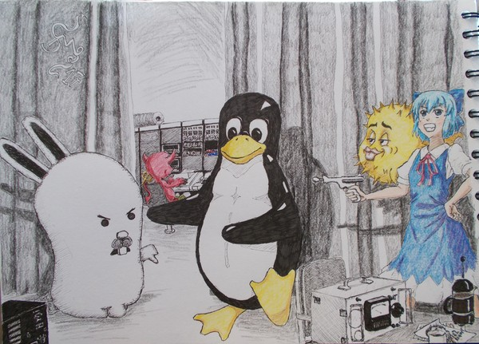

qemu나 VirtualBox와 같이 Plan 9를 실행할 수 있는 UNIX/Windows용 가상화 솔루션은 다양하게 제공됩니다. Plan 9는 하드웨어 지원 범위가 매우 제한적이며, 특히 이 운영 체제의 클래식 버전을 사용하려는 경우에는 더욱 그렇습니다. 가상화는 이러한 우려를 해소할 수 있는 실용적인 방법입니다.

9front에는 자체 하이퍼바이저인 vmx(자주 묻는 질문(FAQ)의 8.7.5절 참조)도 포함되어 있으며, 이를 통해 리눅스, OpenBSD, 소문에 따르면 윈도우, 그리고 아마도 다른 운영 체제들도 실행할 수 있습니다. PS: 이 기능을 사용하려면 최신 인텔 하드웨어가 필요합니다.


# Basics


여러분은 이미 물리적 시스템이나 가상 시스템에 Plan 9를 다운로드하여 설치하셨을 것으로 가정합니다. 아직 설치하지 않으셨다면 9front ISO 파일을 다운로드하고, 9front FAQ의 4절에 있는 설치 지침을 따르시면 됩니다. 다시 한 번 말씀드리지만, 이 글은 Plan 9 시스템의 설치 및 구성에 대한 안내서가 아니므로, 해당 내용은 9front FAQ를 참고하시기 바랍니다. 여기서는 초기 설정이 완료된 후의 일상적인 작업 수행에 초점을 맞출 것입니다.

PS: 이 내용은 9front FAQ의 8장 ‘9front 사용법’에서도 다루고 있습니다. 이 글은 그 내용 중 일부를 반복하고 좀 더 자세히 설명한 것입니다.

추신: 9legacy를 설치하려는 경우, 9front와 거의 동일한 단계를 따르지만 몇 가지 팁을 알려드립니다. “Location of archives [browse]:” 프롬프트에서 Return 키를 누르면 /%가 표시되는데, 이때 exit를 입력하여 설치를 계속하면 됩니다. “Enable boot method”를 묻는 메시지가 나타나면 plan9를 선택하고, 그 외에는 기본값을 따르며 예/아니오 프롬프트에서는 “y”를 선택하십시오. 마지막으로: qemu에서 9legacy를 설치할 때는 가상 하드 디스크를 첫 번째 디스크 드라이브로 설정해야 합니다(예: qemu-system-x86 -m 2G -hda 9legacy.img). -hdd나 이와 유사한 옵션을 사용하지 마십시오. 그렇지 않으면 설치 중 부팅 설정이 실패합니다.


## Window Management

Plan 9의 윈도우 매니저는 ‘rio’라고 불리며, UNIX의 twm과 다소 비슷하게 놀라울 정도로 깔끔하고 단순한 데스크톱 환경을 제공합니다. 하지만 twm과 달리 기본적으로 보기 흉하지 않으며, 소스 코드는 단 6,000줄에 불과합니다. 참고로 이 크기는 Plan 9의 그래픽 라이브러리인 libdraw의 크기와도 거의 비슷합니다. 반면 twm의 소스 코드는 30,000줄에 가깝고, X Window System 백엔드는 무려 800만 줄이 넘습니다!

창 관리는 매우 간단합니다. rio는 단 하나의 메뉴만 제공하며, 데스크톱 배경에서 마우스 오른쪽 버튼을 클릭하면 이 메뉴에 접근할 수 있습니다. 메뉴 항목을 선택할 때는 마우스 버튼을 누른 상태로 유지하다가, 선택을 마친 후에야 마우스 버튼을 놓으십시오. 항상 터미널 창으로 생성되는 새 창을 만들려면 ‘New’를 선택하십시오. 마우스 포인터가 십자 모양으로 바뀝니다. 모서리를 마우스 오른쪽 버튼으로 클릭한 후 마우스를 드래그하면 빨간색 직사각형 상자가 나타나며, 원하는 창 크기가 되면 마우스 버튼을 놓으십시오.

rio 메뉴에서 ‘삭제’ 옵션을 선택하면 마우스 포인터가 원이 달린 십자 모양으로 바뀝니다. 삭제하려는 창을 마우스 오른쪽 버튼으로 클릭하십시오. 창을 ‘숨기기’하면 rio 메뉴에 표시되며, 메뉴에서 해당 항목을 선택하면 다시 표시됩니다.

rio 메뉴를 사용하여 창 크기를 조정하거나 이동할 수도 있지만, 창을 직접 클릭하고 드래그하는 것이 더 쉽습니다. 창 크기를 조정하려면 파란색 테두리를 마우스 왼쪽 버튼으로 클릭한 채 드래그하고, 이동하려면 마우스 오른쪽 버튼을 클릭한 채 드래그하세요.

터미널 창에서 마우스 오른쪽 버튼을 클릭하면 rio 메뉴가 나타나지만, 다른 프로그램에서는 반드시 그런 것은 아닙니다. 예를 들어, 전체 화면으로 실행 중인 acme 창을 사용 중일 때 창 관리자 메뉴에 접근해야 한다면, 먼저 창을 축소하거나 다른 곳으로 옮긴 다음, 회색 rio 배경을 마우스 오른쪽 버튼으로 클릭해야 합니다. 기본적으로 rio를 제어하는 키 바인딩은 없으며, 마우스만 사용하여 조작할 수 있습니다(뭐라고요?!? 마우스 조작이 필요하다고요?!? 맞아요, Plan 9는 정말 파격적이죠. 하지만 아래의 ‘작업 공간’ 섹션을 한번 살펴보세요).


## Copy Pasting

Plan 9을 효과적으로 사용하려면 3버튼 마우스가 필요합니다. 요즘에는 스크롤 휠이 중간 마우스 버튼 역할을 겸하는 3버튼 마우스가 꽤 흔합니다(노트북의 경우 ThinkPad를 추천합니다). Plan 9 전반에 걸쳐 텍스트를 조작할 때 이 3개의 마우스 버튼과 클릭 조합이 사용됩니다. 3버튼 마우스가 없다면, Shift 키를 누른 상태에서 오른쪽 버튼을 클릭하여 중간 클릭을 시뮬레이션할 수 있습니다. 하지만 이 방법은 금세 번거로워질 테니, 가능한 한 빨리 3버튼 마우스를 구입하시기 바랍니다.

일반적인 방법인 왼쪽 클릭 후 드래그를 통해 텍스트를 선택할 수 있습니다. 또한 단어를 왼쪽 클릭 두 번 하면 해당 단어를 선택할 수 있습니다. 줄 끝을 두 번 클릭하면 해당 줄 전체가 선택되며, 괄호나 대괄호 같은 구분 기호를 두 번 클릭하면 그 안의 텍스트가 선택됩니다.

선택한 텍스트를 잘라내려면 왼쪽 버튼을 누른 상태에서 마우스 가운데 버튼을 클릭하세요. 텍스트를 붙여넣으려면 왼쪽 버튼을 클릭한 상태에서 누른 채로 오른쪽 버튼을 클릭하세요. 텍스트를 “복사”하려면 왼쪽 클릭 후 가운데 클릭을 하고, 가운데 마우스 버튼을 뗀 다음 오른쪽 버튼을 클릭하세요. 이러한 마우스 클릭 조합을 ‘마우스 코딩(mouse chording)’이라고 합니다. Plan 9 프로그램에서는 이러한 방식이 매우 일관되게 사용되며, 익숙해지면 꽤 직관적으로 느껴집니다.

## Essential Programs

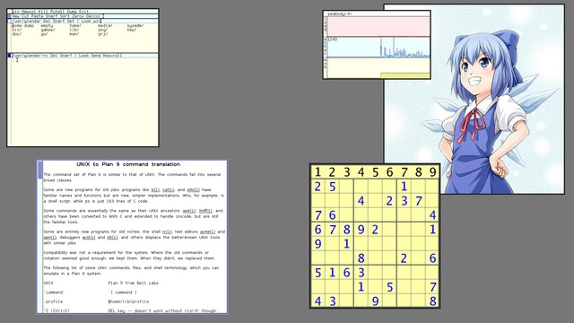

Plan 9에는 프로그램이 몇 개밖에 없지만, 배우기 쉽고 매우 잘 작동합니다. 몇 가지 필수 응용 프로그램은 다음과 같습니다.

- rio: 윈도우 매니저
- rc: 셸
- acme: 텍스트 편집기 등!
- mothra: 웹 브라우저 (클래식 Plan 9에서는 abaco를 사용하세요)
- page: 문서/이미지 뷰어
- play, zuke: 음악 플레이어 (클래식 Plan 9에서는 juke를 사용하세요)
- stats: 시스템 부하 모니터링

## Manipulating Text in the Terminal

Plan 9 터미널을 조금만 사용해 봐도 UNIX와는 작동 방식이 상당히 다르다는 것을 금방 깨닫게 됩니다. 놀라운 점 중 하나는 터미널이 자동 스크롤을 지원하지 않는다는 것입니다. 예를 들어, 매우 긴 파일을 `cat` 명령어로 출력하면 처음 한 화면 분량의 텍스트만 표시된 후, 사용자가 직접 PgDn 키나 아래쪽 화살표 키를 누를 때까지 기다립니다. 이 동작은 페이저를 사용할 필요가 없어지므로 사실 매우 편리합니다. 하지만 때로는 오히려 불편할 수도 있습니다. 예를 들어 소프트웨어를 컴파일할 때, 텍스트가 화면을 가득 채우면 컴파일이 중단되고, 사용자가 수동으로 아래로 스크롤해야만 계속 진행됩니다. 분명히, 이건 원하던 바가 아닐 것입니다! 터미널 창을 중간 클릭하고 ‘scroll’을 선택하면, 이제 UNIX 터미널과 마찬가지로 자동 스크롤이 작동합니다. 다시 기본 동작으로 되돌리려면 중간 클릭 후 ‘noscroll’을 선택하면 됩니다.

또 다른 불편한 점은 탭(Tab) 자동 완성 기능이 없다는 것입니다. 걱정하지 마세요. 대신 Ctrl-f를 사용하면 거의 동일한 기능을 수행할 수 있습니다. zsh나 fish 사용자들이 익숙해져 있을 법한 프로그램 이름이나 플래그에 대한 고급 자동 완성 기능은 없습니다. 하지만 Plan 9에는 언급할 만한 프로그램이나 플래그가 사실상 전혀 없기 때문에, 이는 실제로 큰 문제가 되지 않습니다. 곧 직접 확인하게 될 것입니다.

세 번째로 눈에 띄는 점은 터미널 텍스트를 자유롭게 편집할 수 있다는 것입니다. 어디에든 원하는 텍스트를 추가할 수 있고, 텍스트를 마음대로 복사하여 붙여넣을 수 있습니다. 따라서 Plan 9 터미널은 UNIX 터미널이라기보다는 텍스트 편집기에 훨씬 더 가깝게 느껴집니다(이러한 자유로운 텍스트 편집 방식의 결과로, Return 키를 눌러 명령을 실행하려면 마우스 커서를 마지막 줄의 끝 부분에 위치시켜야 합니다. 그렇지 않으면 텍스트에 그대로 줄바꿈 문자가 추가될 뿐입니다. 하지만 익숙해지면 그리 거슬리지 않습니다). 이 참신한 설계의 의도는 무엇일까요? 우선, UNIX에서 필요로 하는 수많은 특수 목적 프로그램을 없애줍니다. 예를 들어, Plan 9에는 ‘clear’ 명령어가 따로 없으며, 텍스트를 잘라내기만 하면 됩니다. ‘reset’이나 ‘readline’도 필요하지 않으므로 존재하지 않습니다. 둘째, 일단 익숙해지면 이 동작 방식이 매우 직관적으로 느껴집니다. 텍스트를 잘라 붙여넣고 터미널 출력에 마음대로 주석을 달 수 없는 이유가 무엇일까요? Plan 9에서 한동안 시간을 보낸 후 UNIX 터미널로 돌아가면, 마치 90년대를 떠나 70년대로 돌아간 듯한 느낌이 듭니다(재미있는 팁: /bin/hold를 확인해 보세요. Plan 9에서 기본적인 텍스트 편집기를 단 5줄의 쉘 스크립트로 어떻게 작성할 수 있는지 알 수 있습니다!).

마지막으로, Plan 9 터미널에는 히스토리 명령어가 없습니다. 키보드의 위쪽 화살표 키를 누르면 다른 텍스트 편집기와 마찬가지로 포인터가 한 줄 위로 이동할 뿐입니다. — 그 외에 뭘 기대하셨나요? 하지만 걱정 마세요. “”("를 입력하면 이전 명령을 다시 실행할 수 있습니다(이 명령은 해당 명령을 다시 출력해 줍니다).

잠깐만요! “ ” 명령어, 따옴표는 인용하는 데 쓰는 거 아니었나요?!? Plan 9에서는 아닙니다. Plan 9에서 큰따옴표는 그냥 일반 문자일 뿐입니다. UNIX에는 세 가지 이스케이프 문자가 있는 반면, Plan 9에는 단 하나, 즉 작은따옴표만 있습니다(뭐, 일부 상황에서는 백슬래시도 사용되긴 합니다). UNIX 명령어 “$message에는 리터럴 \$와 ‘ 기호가 있습니다”는 Plan 9에서는 ’'$message'에는 리터럴 $와 ‘’ 기호가 있습니다'가 됩니다(단일 따옴표 안에 단일 따옴표가 두 개 있으면 하나의 리터럴 단일 따옴표로 해석됩니다).

PS: “와 ”“는 사실 9front에서 제공하는 셸 스크립트이며, 고전적인 Plan 9 시스템에는 이러한 기능이 없습니다. (프로 팁: ”" mycmd를 실행하면 mycmd로 시작하는 이전 명령을 다시 실행합니다)

명령 재실행이라는 주제로 돌아가서, UNIX에서는 Plan 9보다 텍스트 자동 완성 및 명령 재실행의 필요성이 훨씬 더 크다는 점에 유의하세요. 터미널에서 텍스트를 복사하여 붙여넣는 것은 쉽기 때문에, 이 기능을 적극적으로 활용하세요! 이전 인수를 사용하여 ls를 실행하기 위해 ls !$ 같은 복잡한 구문을 사용할 필요도 없고, 마지막 인수의 철자를 수정하여 다시 실행하기 위해 ^foo^bar 같은 구문을 사용할 필요도 없습니다. 터미널에 ls를 입력하고 이전 인수를 복사하여 붙여넣기만 하면 되며, 마지막 인수의 철자를 수정해야 한다면 수정하고, 완료된 후 결과를 복사하여 붙여넣기만 하면 됩니다. 또한 /dev/text에는 터미널 텍스트의 전체 사본이 저장되어 있습니다. 따라서 cat /dev/text > transcript 명령어는 본질적으로 UNIX의 script와 동일하며, > /dev/text는 기본적으로 내용을 지우는 역할을 하고, grep ‘^; ’ /dev/text 명령어는 history와 동일합니다(물론 셸 프롬프트가 ; 인 경우를 가정합니다). 이 로그에서 이전 명령어뿐만 아니라 다른 항목도 검색할 수 있으며, 이 데이터를 다양한 흥미로운 방식으로 조작할 수도 있습니다. 예를 들어, 셸 히스토리에 대한 고급 검색이나 조작이 필요하신가요? 텍스트 편집기에서 /dev/text 파일을 열기만 하면 됩니다(예: sam /dev/text).

하지만 모든 창에 대한 시스템 전체의 실행 내역 로그를 원한다면 어떻게 해야 할까요? Plan 9에는 그런 파일이 없지만, 직접 만드는 것은 그리 어렵지 않습니다. 예를 들어, 다음 스크립트는 명령어 이력을 중앙 파일로 저장합니다. 중복되지 않은 명령어만 저장되는데, 만약 모든 텍스트를 저장한다면 중앙 이력 파일의 크기가 엄청나게 커질 것입니다. 예를 들어, 이력 로그에 ‘cd’ 명령어가 1만 개나 기록되어 있다면 상당히 중복된 정보가 될 것이며, 우리가 읽은 매뉴얼 페이지나 텍스트 파일의 수백 개 복사본은 말할 것도 없습니다.

```
#!/bin/rc
# savehist - prune and save command history
# usage: savehist

# set some defaults
rfork ne
temp=/tmp/savehist-$pid
hist=$home/lib/text
touch $hist

# rewrite history
cat <{grep '^; ' /dev/text} $hist | sort | uniq > $temp
mv $temp $hist
```

이 설정이 완료되면, 종료하기 전에 savehist를 실행하여 현재 히스토리를 저장할 수 있으며, 또는 $home/lib/profile 파일에 다음과 같은 내용을 추가하여 이 단계들을 하나로 묶을 수도 있습니다: fn quit{ savehist; exit } (PS: 정말 포크 폭탄을 일으키고 싶지 않다면 이 함수를 exit라고 부르지 마세요!)

/dev/text 외에도 /dev/snarf가 있는데, 여기에는 Plan 9 용어로 클립보드인 “snarf” 버퍼가 저장됩니다(창에 글을 쓰고 싶다면 /dev/cons를 사용하세요). 이 파일들은 모두 현재 창을 가리키므로, 다른 창에서 이 파일들을 사용하려면 아래의 rio 스크립팅 섹션을 참고하세요.

Plan 9에서 그래픽 데스크톱은 텍스트 콘솔 “내부”에서 실행되므로, 시스템 콘솔에 글을 쓰면 실제로 그 텍스트가 화면에 그대로 출력됩니다. 예를 들어, sleep 600; echo Bug Me! > '#c/cons'를 실행하면 10분 후에 화면에 꽤 거슬리는 알림이 표시됩니다. 초보자에게는 다소 당황스러울 수 있지만, 화면이 어수선해지는 것을 원치 않는다면 이러한 메시지를 쉽게 다른 곳으로 리디렉션할 수 있습니다. 창에서 cat /dev/kprint를 실행한 다음 창을 숨기기만 하면 됩니다. 이 기능을 피하거나 더 적극적으로 활용하는 방법에 대한 아이디어는 아래의 rio 스크립팅 섹션을 참조하십시오.


## Acme - The Do It All Application

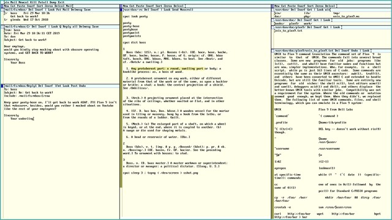

acme 텍스트 편집기는 Plan 9의 주요 사용자 애플리케이션이라고 할 수 있으며, 시스템 파일 관리자, 터미널, 메일 리더 등의 역할도 겸하고 있습니다. 심지어 $home/lib/profile 파일에서 rio를 acme로 대체하면 본격적인 윈도우 매니저로도 사용할 수 있습니다(하지만 권장하지는 않습니다. 다른 그래픽 프로그램을 전혀 실행할 수 없게 될 테니까요. 하지만 다시 생각해보면, 굳이 그럴 필요가 있을까요?).

acme를 빠르게 둘러보겠습니다. 첫 번째 파란색 행에는 acme 창 전체에 적용되는 명령어가 있습니다. 예를 들어, ‘Exit’ 버튼을 중간 클릭하면 acme가 종료됩니다. ‘Dump’는 acme.dump라는 파일을 생성하며, 이를 통해 특정 창 배치를 저장할 수 있고, acme -l acme.dump 명령어로 복원할 수 있습니다. ‘Putall’은 수정된 모든 텍스트 파일을 저장합니다.

Newcol을 중간 클릭하면 새로운 열이 나타납니다. 이 열에는 두 번째 파란색 행에 자체 명령어 행이 있습니다. Delcol은 해당 열을 삭제합니다. Cut, Paste, Snarf(예: “복사”)는 텍스트 조작 기능을 수행합니다. 하지만 이 작업에는 마우스 조합을 사용하는 것이 더 쉽습니다. 왼쪽 버튼과 중간 버튼을 동시에 클릭하면 ‘잘라내기’, 왼쪽 버튼과 오른쪽 버튼을 동시에 클릭하면 ‘붙여넣기’, 마지막으로 왼쪽 버튼과 중간 버튼을 동시에 클릭한 후 오른쪽 버튼을 클릭하면 ‘Snarf’(즉, ‘복사’)가 실행됩니다. 마우스 조합을 설명하기는 다소 까다롭지만, 직접 시도해 보시면 약간의 연습만으로도 매우 직관적으로 느껴질 것입니다.

‘New’를 중간 클릭하면 해당 열에 새 창이 생성됩니다. 이 창에도 역시 자체적인 명령어 행이 있습니다. ‘Del’을 누르면 창이 삭제됩니다. 창은 처음에는 비어 있으니, 임의의 텍스트를 입력해 보세요. 그러면 ‘Undo’라는 새로운 명령어가 나타나는 것을 볼 수 있습니다(그 의미는 자명할 것입니다). 텍스트를 입력한 후 Esc 키를 눌러 방금 추가한 텍스트를 선택할 수 있으며, Esc 키를 한 번 더 누르면 텍스트가 잘립니다. 파일을 어떻게 저장할까요? 먼저 파일 이름을 지정해야 합니다. 메뉴의 맨 왼쪽, Del 왼쪽을 클릭하고 /usr/glenda/testfile을 입력하세요(glenda는 Plan 9의 기본 사용자이며, /usr/glenda는 기본 홈 디렉터리입니다). 또 다른 명령어인 Put이 나타나면, 이를 중간 클릭하여 작업을 저장하세요. 입력할 게 참 많았네요! 더 쉬운 방법은 없을까요? 물론입니다. Plan 9에서는 거의 모든 것을 복사하여 붙여넣을 수 있다는 점을 기억하세요. 터미널에서 Ctrl-f 자동 완성 기능을 활용해 원하는 디렉터리를 찾은 다음, pwd 명령어로 디렉터리 이름을 출력하고, 이를 acme 창에 복사하여 붙여넣은 뒤 새 파일 이름을 추가하면 됩니다. 더 쉬운 방법은 터미널에서 `touch testfile; B testfile`을 실행하면 acme에서 파일이 자동으로 열립니다.

지금쯤이면 acme의 매우 독특한 특징을 눈치채셨을 겁니다. 바로 메뉴가 순수한 텍스트로 되어 있다는 점입니다. “버튼”은 그저 평범한 단어일 뿐입니다. 예를 들어 보겠습니다. 노란색 텍스트 창 어딘가에 Del(대소문자 구분!)을 입력한 다음, 그 부분을 중간 클릭해 보세요. 창이 사라질 것입니다. Del은 echo나 cat과 마찬가지로 단순한 명령어일 뿐입니다. 또 다른 테스트를 해 봅시다. 노란색 텍스트 창에 echo hi there를 입력한 뒤, 중간 마우스 버튼을 클릭하고 드래그하여 빨간색 표시가 세 단어 전체를 덮도록 하세요. 그러면 hi there가 새 창에 출력될 것입니다.

Look 명령어를 사용하면 창 안에서 단어를 검색할 수 있습니다. 노란색 텍스트 창에 monkey를 몇 번 입력한 다음, 파란색 창 메뉴에 Look monkey를 입력하고, 중간 마우스 버튼을 클릭한 채 드래그하여 두 단어를 선택하세요. 'monkey'가 처음 나타나는 부분이 강조 표시됩니다. 명령을 다시 실행하면 두 번째로 나타나는 부분이 강조 표시되며, 이 과정이 반복됩니다. 하지만 더 쉬운 방법은 텍스트의 어느 곳에서든 'monkey'라는 단어를 마우스 오른쪽 버튼으로 클릭하는 것입니다. 그러면 해당 단어가 다음에 나타나는 부분이 강조 표시되고, 마우스 포인터가 그 위치로 이동합니다. 다시 마우스 오른쪽 버튼을 클릭하면 그 단어가 다음에 나타나는 부분을 볼 수 있으며, 이 과정을 반복하면 됩니다.

열 메뉴의 Zerox 명령은 창을 복제합니다. 이 기능은 긴 파일을 편집할 때 파일의 서로 다른 부분을 동시에 확인하거나 편집해야 할 때 매우 유용하며, 한 창에서 변경한 내용은 다른 창에도 반영됩니다. Sort는 열 창을 이름 순으로 정렬하며, 창의 내용은 정렬하지 않습니다. 내용을 정렬하려면 텍스트를 선택한 후, 창 메뉴에서 |sort를 입력하고 중간 마우스 버튼을 클릭하십시오. 보시다시피, acme에서 텍스트를 조작하기 위해 임의의 Plan 9 명령어를 자유롭게 사용할 수 있습니다.

검색 및 바꾸기 작업을 수행하려면 ‘Edit’ 명령어를 사용하십시오. 이 명령어는 sam 텍스트 편집기의 백엔드 역할을 하며, ed(이는 다시 sed나 vi와 유사합니다)와 거의 동일한 텍스트 편집 명령어를 사용합니다. 예를 들어, ‘monkey’라는 단어 중 하나를 더블 클릭하여 강조 표시한 다음, Edit s/monkey/chimpanzee/를 입력하고, 중간 마우스 버튼을 누른 채 드래그하여 이 명령을 실행하세요. 강조 표시된 단어가 ‘chimpanzee’로 변경됩니다. ‘monkey’가 나타나는 모든 부분을 변경하려면 Edit ,s/monkey/chimpanzee/g를 입력하세요(vi에서는 :%s/monkey/chimpanzee/g와 같습니다).

참고: 위의 ed 스타일 치환은 sam에서도 작동하지만, sam은 ed와 같은 줄 단위 편집기가 아니므로, 위 작업에 더 적합한 sam 명령어는 다음과 같습니다: Edit ,x/monkey/c/chimpanzee/ (즉, /monkey/가 나오는 모든 곳을 /chimpanzee/로 변경합니다). sam 튜토리얼을 읽으려면 다음을 실행하십시오: page /sys/doc/sam/samtut.pdf

acme에는 UNIX 사용자가 기대할 만한 내장 기능이 많이 부족하지만, 표준 유틸리티를 통해 텍스트를 파이프 처리하기만 해도 이러한 기능의 상당 부분을 구현할 수 있습니다. 다음은 몇 가지 예시입니다:


- Edit = 현재 줄 번호 출력
- Edit ,|sort -r 파일 역순 정렬
- Edit ,|sed ‘s/^/ /g’|grep -n . 줄 번호 추가
- Edit ,s/^[^:]+: //g 줄 번호 제거
- Edit s/^/ /g 텍스트 들여쓰기
- Edit s/^ //g 텍스트 들여쓰기 해제
- Edit s/^/#/g 코드 줄 주석 처리
- Edit s/^#//g 코드 줄 주석 해제
- Edit ,|wc -c 파일 단어 수 계산
- Edit ,|fmt 파일 깔끔하게 서식 지정
- 편집 ,|cb C 소스 코드 미화
- 편집 s/./-/g 줄 복사 후 밑줄 긋기
- |tr A-Z a-z 텍스트 소문자로 변환
- |tr a-z A-Z 텍스트 대문자로 변환
- |tr a-zA-Z n-za-mN-ZA-M 텍스트 rot13 변환

새 창을 열고 가장 왼쪽에 파일 이름 /usr/glenda를 입력한 다음, 가장 오른쪽(Look의 오른쪽)에 Get을 입력하고 중간 마우스 버튼으로 클릭하세요. /usr/glenda 디렉터리의 내용이 창에 표시됩니다. 이 창에서 디렉터리를 마우스 오른쪽 버튼으로 클릭하면 해당 디렉터리의 내용이 새 창에 열립니다. 파일에 대한 작업을 수행하려면 명령어를 입력하고 실행하기만 하면 됩니다. 예를 들어, testfile 앞에 rm을 입력한 후 두 단어를 중간 클릭하면 이 파일이 삭제됩니다. 텍스트 파일을 마우스 오른쪽 버튼으로 클릭하면 해당 파일의 내용이 acme에서 편집할 수 있도록 열립니다.

acme에서 어떤 항목을 마우스 오른쪽 버튼으로 클릭했을 때 정확히 어떤 동작이 일어나는지는, 클릭한 단어의 종류에 따라 달라집니다. 예를 들어, /usr/glenda/pictures/cirno.png라는 단어를 클릭하면 이 사진이 이미지 뷰어 페이지에서 열리고, jazz.mp3를 클릭하면 play를 통해 오디오 파일 재생이 시작됩니다. 물론 해당 파일이 시스템에 존재해야 합니다. 마지막 예시는 jazz.mp3 파일이 acme를 실행한 디렉터리와 동일한 위치에 있다고 가정합니다. 그렇지 않은 경우 올바른 파일 경로를 지정해야 합니다. 적절한 단어를 적절한 프로그램과 연결하는 실제 작업은 plumber가 처리하며, 이에 대해서는 나중에 자세히 설명하겠습니다. 하지만 당장은 acme 내 어디서든 파일 이름을 마우스 오른쪽 버튼으로 클릭하면 대개 “적절한 동작”이 수행된다는 점만 알아두시면 됩니다(단, 동작은 파일이 아닌 단어를 기준으로 평가된다는 점에 유의하십시오).

각 창에는 메뉴 맨 왼쪽에 진한 파란색 사각형이 있습니다. 이 사각형을 클릭하고 드래그하여 창 크기를 조정하거나 다른 열로 이동할 수 있습니다. 열 자체에도 진한 파란색 사각형이 있는데, 이를 클릭하고 드래그하여 열의 크기를 조정하거나 위치를 이동할 수 있습니다.

또한 짙은 파란색 창 사각형을 마우스 오른쪽 버튼으로 클릭하면 해당 창을 제외한 모든 열 창을 숨길 수 있으며, 마우스 왼쪽 버튼으로 클릭하면 창을 다시 표시할 수 있습니다. 사각형을 마우스 왼쪽 버튼으로 클릭하면 창 크기가 약간 커지고, 가운데 버튼으로 클릭하면 창이 최대화됩니다.

스크롤 막대를 마우스 왼쪽 버튼으로 클릭하면 위쪽으로, 오른쪽 버튼으로 클릭하면 아래쪽으로 스크롤됩니다. 스크롤 막대 하단 쪽을 클릭하면 많이 스크롤되고, 상단 쪽을 클릭하면 조금만 스크롤됩니다. 마우스 휠을 클릭하면 파일의 해당 부분으로 바로 이동합니다. 이 마우스 동작들을 직접 사용해 보며 연습해 보세요. 금방 익숙해질 것입니다. 스크롤 막대가 있는 다른 Plan 9 애플리케이션들도 (적어도 9front에서는) 같은 방식으로 작동합니다.


## Multiple Workspaces

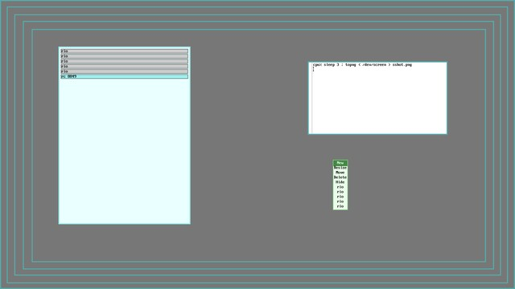

rio에는 엄밀히 말해 가상 작업 공간이 없지만, 9front에는 키보드로 제어되는 데스크톱에 의사 작업 공간을 설정할 수 있는 몇 가지 도구가 포함되어 있습니다. 예를 들어, $home/lib/profile 파일에 다음 코드 조각을 추가할 수 있습니다:

```
fn workspaces{
    </dev/kbdtap riow >/dev/kbdtap |[3] bar
}
```

이제 Win+n 키 조합(여기서 Win은 왼쪽 Ctrl 키와 Alt 키 사이에 있는 Windows 키이며, n은 0에서 9 사이의 숫자입니다)을 사용하여 작업 공간을 실행하고 새로운 “작업 공간”으로 전환할 수 있습니다. 또한 Win+화살표 키로 창을 이동하거나, Win+Shift+화살표 키로 창 크기를 조정할 수도 있습니다(자세한 내용은 riow(1) 및 bar(1)을 참조하십시오). 클래식 Plan 9에는 이러한 도구가 없지만, 가상 작업 공간을 포함하는 rio의 오래된 포크인 rio-virtual이 있습니다. 또한 9front 확장 기능 없이도 이러한 서비스를 생성하는 방법이 있습니다. 모든 riow “작업 공간”의 모든 창이 rio 메뉴에 나열되어 있으며, 숨김을 해제할 수 있다는 점을 알 수 있을 것입니다. 이는 riow가 실제로 워크스페이스를 추가하는 것이 아니라, 창 그룹을 숨기거나 다시 표시하는 영리한 방법을 제공함으로써 워크스페이스가 있는 듯한 착각을 주기 때문입니다. 이와 유사하지만 더 단순한 방법에 대해서는 아래의 rio 스크립팅 섹션을 참조하십시오.

사실 rio에서 수동으로 의사 작업 공간을 만드는 것은 꽤 간단합니다. 새 터미널 창을 열고 `plumber ; rio`를 실행하기만 하면 됩니다. 그러면 이 창에서 rio 데스크톱이 실행됩니다(여기서 plumber는 필수는 아니지만, 이를 사용하면 자동으로 열리는 파일이 이 격리된 rio 내에서만 열리고 외부에서는 열리지 않도록 보장할 수 있습니다). 이 “가상 작업 공간”을 최대화하여 작업을 수행하고, 원래 작업 공간으로 돌아가고 싶을 때는 이 창을 숨긴 다음, rio 메뉴에서 숨겨진 창을 선택하여 다시 전환할 수 있습니다. 이러한 작업 공간은 원하는 만큼 만들 수 있으며, rio 안에서 rio를, 그 안에서 또 다른 rio를 무한히 실행할 수 있습니다... 이 혼란을 조금 정리하기 위해 작업 공간에 수동으로 레이블을 지정할 수도 있습니다. 예를 들어, 백그라운드에 4개의 rio 작업 공간이 숨겨져 있다고 가정해 봅시다. rio 메뉴에는 단순히 rio, rio, rio, rio로만 나열될 것입니다. 이는 별로 도움이 되지 않습니다. grep rio /mnt/wsys/wsys/*/label 명령을 실행하면 이 작업 공간들의 창 ID를 확인할 수 있습니다. 그런 다음 레이블을 재정의할 수 있습니다. 예를 들어, `echo -n workspace1 > /mnt/wsys/wsys/3/label`을 실행하면 됩니다. 이제 rio 메뉴에는 이 창이 “rio” 대신 “workspace1”로 표시될 것입니다.

또 다른 간단한 작업 공간 해결책은 drawterm입니다. Plan 9 CPU 서버(9front FAQ의 7.5절 및 7.6절, 그리고 아래의 ‘Quick CPU+AUTH+Qemu+Drawterm HOWTO’ 섹션 참조)를 구성한 후에는 원하는 만큼의 drawterm 클라이언트를 연결할 수 있습니다(위에서 언급한 모든 작업 공간 관련 기법은 drawterm 내부에서도 작동합니다).


## Tiling Windows

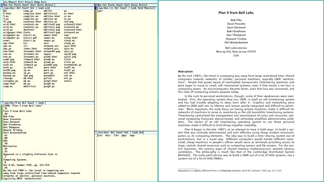

우선, acme는 타일링 방식의 윈도우 매니저입니다. 편집기를 최대화 창으로 만든 다음 작업을 진행하면 됩니다.

둘째, rio 시작 파일인 $home/bin/rc/riostart를 사용하여 사용자의 필요에 맞는 데스크톱 환경을 자동으로 설정할 수 있습니다. 예를 들어, 1366x768 해상도의 화면을 사용 중이라면 다음 명령어를 추가하여 화면 왼쪽 절반에 acme 창을, 오른쪽 절반에 터미널 창을 배치할 수 있습니다:

```
window 0,0,683,768 acme
window 683,0,1366,768
```

UNIX와 달리, Plan 9 터미널에서 실행되는 그래픽 프로그램은 새로운 창을 열지 않고, 대신 터미널 자체가 해당 프로그램으로 변형됩니다. 즉, 예를 들어 터미널에서 PDF/이미지 뷰어 페이지나 웹 브라우저인 mothra를 실행하더라도 창 배치에는 전혀 영향을 미치지 않습니다. 따라서 데스크톱에서 잘 작동하는 초기 창 배치를 설정해 두면, 자동 창 타일링 기능을 사용할 필요가 크게 줄어듭니다. 하지만 자동 타일링이 필요하다면 아래의 rio 스크립팅 섹션을 참고하십시오.


## Plumbing

이 가이드에서 Plan 9의 ‘플럼버(plumber)’에 대해 이미 몇 차례 간략히 언급한 바 있지만, 이제 좀 더 자세히 살펴보겠습니다. 플럼버는 본질적으로 간단한 프로세스 간 메시징 시스템입니다. 이를 통해 주어진 텍스트 패턴에 기반하여 일련의 동작을 정의할 수 있습니다. 예를 들어, /sys/lib/plumb/basic에 있는 시스템 전체에 적용되는 플럼버 규칙에서는 다음과 같은 섹션을 확인할 수 있습니다:

```
# open urls with web browser
type is text
data matches 'https?://[^ ]+'
plumb to web
plumb client window $browser
```

이 규칙은 매우 간단합니다. 메시지가 텍스트인 경우(항상 텍스트입니다), “http://”이나 “https://”과 같은 형식에 일치하면 이를 “웹” 관련으로 정의하고, 주어진 텍스트를 인수로 사용하여 “$browser”라는 새 프로그램을 실행합니다. 따라서 실질적으로, plumber에 URL이 전송될 때마다 기본 웹 브라우저에서 해당 URL이 열립니다. 즉, acme에서 http://9front.org을 마우스 오른쪽 버튼으로 클릭하면 해당 웹 페이지가 열리며, 아마도 mothra에서 열릴 것입니다. 터미널에서 plumb http://9front.org 명령을 실행해도 동일한 효과를 얻을 수 있습니다.

사용자만의 규칙을 정의할 수도 있습니다. 흔히 하는 방법 중 하나는 editor 및 browser 변수를 편집하여 기본 텍스트 편집기와 웹 브라우저를 변경하는 것입니다. 저는 또한 간단한 Epub 리더를 직접 작성했고, Epub 파일을 항상 사용자 정의 리더로 열 수 있도록 $home/lib/plumbing 파일에 다음 줄을 추가했습니다:

```
# change default apps
editor = acme
browser = 'mothra -a'

# open epubs with custom script
type is text
data matches '([a-zA-Z0-9_\-./]+).(epub|EPUB)'
arg isfile $0
plumb to image
plumb start window eread $file

# load default rules
include basic
```

여기서의 epub 규칙은 주어진 인수가 기존 파일인지 확인하는 검사를 추가하며, 만약 그렇다면 $file을 해당 파일 이름으로 설정하지만, 그 외의 논리는 위의 URL 규칙과 거의 동일합니다. 마지막에 있는 include basic 줄은 중요합니다. 이 줄이 없으면 모든 기본 시스템 파이프라인 규칙을 잃게 됩니다!

파일 처리 규칙은 파일 확장자에만 국한되지 않습니다. 현재 여러 문서를 읽고 있으며, 읽기 진행 상황을 추적하기 위해 이 문서들에 북마크를 추가하고 싶다고 가정해 봅시다. 해결책은 간단합니다. $home/lib/bookmarks라고 부를 데이터베이스를 만들고, 그 내용을 다음과 같이 작성하면 됩니다:

```
# work stuff
/usr/glenda/doc/papers/lengthy.pdf!123
/usr/glenda/doc/papers/plain.txt:206

# plan 9 stuff
/sys/doc/9.ps!3
/sys/doc/acme/acme.ps
acme(1)

# fun stuff
/usr/glenda/doc/books/peter_pan.txt:/Chapter 2/
/usr/glenda/music/podcasts/bsdnow/acdecc6a-f7b7-4d64-b64d-f7be713b78e2.mp3
```

acme에서 이러한 줄 중 하나를 마우스 오른쪽 버튼으로 클릭하면 해당 파일이 적절한 프로그램으로 열립니다. PDF 및 포스트스크립트 파일은 ‘page’로, 오디오 파일은 ‘play’로, 일반 텍스트 파일은 acme 내에서 직접 열립니다. 하지만 기본 파이프라인 규칙을 활용하면 이보다 훨씬 더 구체적으로 지정할 수 있습니다. 예를 들어 lengthy.pdf!123과 같이 파이프를 지정하면 PDF 파일이 page에서 열릴 뿐만 아니라 123페이지로 바로 이동합니다. 일반 텍스트 파일도 지정할 수 있는데, plain.txt:206은 해당 파일의 206번째 줄을, peter_pan.txt:/Chapter 2/는 피터 팬 책을 열어 “Chapter 2”라는 텍스트 문자열을 찾아줍니다. 일반적으로 이러한 텍스트 기반 파이프라인 규칙은 프로그래밍 시, 예를 들어 오류 진단 메시지를 마우스 오른쪽 버튼으로 클릭하여 해당 오류가 발생한 소스 파일의 줄을 여는 데 사용되지만, 우리 자신의 작업 진행 상황을 추적하는 데에도 활용할 수 있습니다.

말이 나온 김에, 우리 작업 흐름에 맞게 파이프라인 규칙을 수정하는 방법에 대한 또 다른 예를 살펴보겠습니다. 아래 PIM 섹션에서, que라는 스크립트에 대해 언급한 바 있습니다. 이 스크립트는 목록(큐)을 순회하며, que를 실행할 때마다 파일의 다음 줄을 출력합니다. $home/lib/que/peterpan이라는 목록이 있고, 그 내용이 다음과 같다고 가정해 봅시다:

```
/usr/glenda/doc/books/peter_pan.txt:/Chapter 1/
/usr/glenda/doc/books/peter_pan.txt:/Chapter 2/
/usr/glenda/doc/books/peter_pan.txt:/Chapter 3/
...
```

이제 que $home/lib/que/peterpan을 실행할 때마다, 책에서 다음에 읽어야 할 챕터가 표시될 것입니다. 물론, acme에서 이 출력 결과를 마우스 오른쪽 버튼으로 클릭하면 책이 해당 위치에서 열립니다(“Chapter x”에는 공백이 포함되어 있으므로, 마우스 오른쪽 버튼을 클릭한 채 드래그하여 전체 줄을 선택해야 합니다). 하지만 저처럼 게으른 사람에게는 이건 정말 너무 번거로운 작업이에요! 제가 정말 원하는 건, 제 북마크 데이터베이스에 다음과 같은 항목을 추가하는 것뿐입니다:

```
/usr/glenda/lib/que/peterpan:que
```

acme에서 이 항목을 마우스 오른쪽 버튼으로 클릭하면, 자동으로 que를 호출하여 해당 챕터를 열어주면 됩니다. 알고 보니 이런 자동화는 아주 간단하더군요. $home/lib/plumbing에 이 플러빙 규칙을 추가하기만 하면 되고(그리고 다음 명령어로 규칙 세트를 업데이트하면 됩니다: cp $home/lib/plumbing /mnt/plumb/rules):

```
# plumb the next item in a queue file
type is text
data matches '([a-zA-Z0-9_-./]+)(:que)'
arg isfile $1
plumb to none
plumb start rc -c 'plumb `{que '$file'}'
```

이 규칙은 plumber가 “something_something:que”를 수신했는지, 그리고 첫 번째 인자(:que 제외)가 실제 파일인지 확인합니다. 이 파일을 여는 것에는 관심이 없으므로, 이를 “none”으로 연결한 다음 쉘 명령어 `{que $file}`을 실행합니다. 물론 큐는 반드시 일반 텍스트 파일일 필요는 없습니다. 페이지 번호가 포함된 PDF나 팟캐스트의 연속 오디오 파일 등 무엇이든 될 수 있습니다.

우리는 이 플럼버를 온갖 재미있고 잠재적으로 파괴적인 방식으로 악용할 수 있습니다. 기본적으로 어떤 텍스트 패턴이든 정의하고 이를 어떤 명령어와도 연결할 수 있게 해줍니다. 비록 이 기능을 미친 듯이 남용하지 않더라도, /sys/lib/plumb/basic을 읽어보고 프로세스 간 메시징이 얼마나 간단한지 깨닫는 것만으로도 눈이 번쩍 뜨이는 경험이 될 것입니다!


# System Administration


## Basic System Administration

Plan 9 시스템을 종료하거나 재부팅하려면 fshalt 및 reboot 명령을 사용할 수 있습니다. drawterm과 같은 원격 Plan 9 데스크톱을 사용하는 경우, 해당 애플리케이션을 직접 종료해도 안전합니다. 원격 데스크톱은 상태 비저장형(stateless)이므로, 이를 종료하더라도 호스트 파일 시스템에는 전혀 영향을 미치지 않습니다. 사실, 이 시스템은 사용자가 실제 작업을 수행하는 디스크리스 클라이언트에 연결된 CPU 서버를 연중무휴(24/7)로 실행하도록 설계되었습니다. 아마도 이러한 설계 방식 때문인지, Plan 9 파일 시스템은 전통적으로 정전으로부터 복구하려고 시도하지 않으므로, 파일 서버의 전원을 무작정 뽑지 마십시오!

CPU 서버의 경우, 검증된 파일 시스템을 사용하는 것도 나쁘지 않지만, 전원 손실 위험이 높은 노트북의 경우 9front에서 제공하는 새로운 GEFS(A Good Enough File System) 파일 시스템을 사용하는 것이 현명할 수 있습니다. 이 파일 시스템은 괜찮은 크래시 복구 기능을 제공하며, 향후 자가 복구 및 기타 유용한 기능들이 추가될 예정입니다. (물론, 이는 여전히 백업을 대체할 수는 없습니다):

PS: 9legacy와 같은 클래식 Plan 9를 사용할 경우, qemu에서 fshalt가 제대로 작동하지 않습니다. 이러한 경우에는 다음과 같이 직접 종료 스크립트를 작성해야 합니다(참고: 9front에서는 이 문제가 발생하지 않습니다):

```
#!/bin/rc
# halt - shutdown file server
# usage: halt
echo fsys main sync >>/srv/fscons
sleep 5
echo Its now safe to turn off your computer
echo fsys main halt >>/srv/fscons
```

남은 배터리 잔량, 메모리 사용량, 이더넷 트래픽, 시스템 부하 및 기타 리소스를 모니터링하려면 stats 및 memory 명령어를 사용할 수 있습니다. 단순히 /dev 디렉터리를 cat 명령어로 확인하는 것만으로도 많은 시스템 정보를 얻을 수 있습니다. 예를 들어, cat /dev/kmesg는 본질적으로 UNIX의 dmesg와 동일합니다. 또한 plan9.ini 파일에 apm0= 값을 추가하면 서스펜드 및 하이버네이트에 대한 제한적인 지원이 제공됩니다(fqa의 9.2.3절 및 apm(8) 참조). 하지만 이 기능이 제대로 작동할 것이라고 기대하지는 마십시오. ACPI와 APM은 다루기 까다로운 문제입니다!

PS: 9front에서 `memory`는 /dev/swap을 cat 명령어로 읽어와 사람이 읽기 쉬운 형식으로 재구성하는 단순한 셸 스크립트일 뿐이며, 고전적인 Plan 9 시스템에는 이 스크립트가 없습니다.


## Battery Monitoring

작동하지 않는다고 말하자면, 제 경험상 배터리 모니터링 기능은 대개 작동하지 않습니다(사용자 컴퓨터에서 작동하는지 확인하려면 stats 명령어를 실행한 뒤, 마우스 오른쪽 버튼을 클릭하고 ‘battery’를 추가하면 됩니다). 또한 운이 아주 좋지 않은 한, 헤드셋을 연결해도 오디오 출력이 자동으로 전환되지 않습니다. 저렴한 에이서 노트북에서 이 두 가지 문제를 모두 겪었습니다(자신에게 주는 메모: 이제부터는 씽크패드만 사자). 마지막 문제는 아래 오디오 섹션에서 다시 다루겠지만, 배터리 모니터링의 경우 매우 간단한 해결 방법은 `sleep 7200; echo Warning: batteries about to go out! > ‘#c/cons’`를 실행하는 것입니다. 컴퓨터의 배터리 잔량이 2시간(7200초) 15분이라고 가정하고, 기기가 완전히 충전된 상태에서 이 명령을 실행하면 배터리가 방전되기 15분 전에 알림을 받게 됩니다.

이 우아한 해결책의 가장 큰 문제점은, 미래의 알 수 없는 시점에 컴퓨터를 재부팅할 예정이라면 전혀 작동하지 않는다는 점입니다. 저는 여행 중일 때, 즉 배터리 모니터링이 가장 필요한 상황에서 이런 경우가 자주 발생한다는 것을 알게 되었습니다. 따라서 재부팅 후에도 지속되는 2시간 카운트다운을 시작할 방법이 필요했고, 다음 스크립트가 그 역할을 해줍니다:

```
#!/bin/rc
# batt - print estimated remaining battery power
# usage: [battery=min] batt [-]
#
# bug: the script doesn't actually know anything about your battery,
#      the user is required to run batt - initially to set a timer.

# set some defaults
rfork e
if(~ $battery "") battery=120 # hardware dependent
capa=$battery
batt=$home/lib/battery
stat='Battery at %p%% estimated remaining time: %r min'
mesg='Your battery is about to run out!'
ping=$home/media/music/samples/mario.mp3

# parse arguments
switch($#*){
case 0
    if(! test -f $batt){
        echo 'batt: countdown hasn''t started, run batt - first!' >[1=2]
        exit notstarted
    }
    used = `{cat $batt}
    pros = `{echo 100 - ($used^00 / $capa) | hoc | sed 's/\..*//'}
    remn = `{echo $capa - $used | hoc}
    echo $stat | sed -e 's/%p/'$pros'/' -e 's/%r/'$remn'/' -e 's/%%/%/'
case 1
    # -, start or continue a countdown
    if(! test -f $batt) echo 0 > $batt
    while (sleep 60) {
        date > $home/lib/end
        used = `{echo `{cat $batt} + 1 | hoc}
        if (test $used -ge $capa) {
            echo $mesg >'#c/cons'
            if(test -f $ping) play $ping >[2]/dev/null
            rm -f $batt
            exit
        }
        echo $used > $batt
    }&
case *
    echo 'Usage: [battery=min] batt [-]' >[1=2]
    exit usage
}
```

이 간단한 카운트다운 스크립트가 시간을 분 단위로 측정한다는 점(7200이 아닌 120)을 눈치채셨을 겁니다. 이렇게 대략적인 시간 측정을 하는 주된 이유는 배터리와 관련이 있습니다. 만약 매초마다 카운트했다면, 스크립트가 배터리에 주는 부담이 60배나 더 컸을 테니까요. 어쨌든, 이 스크립트를 사용하면 배터리가 완전히 충전된 것을 확인한 후 batt - 명령어를 실행하여 카운트다운을 시작할 수 있습니다(또는 battery=80 batt -와 같이 입력하여 기본값인 120분이 아닌 다른 시간으로 카운트다운을 설정할 수도 있습니다). 데몬이 시작되면 batt 명령어를 실행하여 예상 남은 배터리 시간을 확인할 수 있습니다. 하지만 여기서 요령이 있습니다. 재부팅 후 batt - 명령어를 실행하면 배터리 카운트다운이 계속됩니다! 사실, $home/lib/profile 파일에 다음과 같은 내용을 추가하면 이 단계를 완전히 자동화할 수 있습니다:

```
battery=80 # default battery capacity
if (test -d /mnt/term/dev){
    # do drawterm stuff
    ...
}
if not {
    # do non-drawterm stuff
    if(test -f $home/lib/battery) batt -
    ...
}
```

여기 있는 상투적인 코드가 부담스럽게 느껴지지 않도록 하세요. drawterm을 사용하지 않는다면, 단순히 if(test -f $home/lib/battery) batt -를 추가하기만 하면 됩니다 (하지만 drawterm을 사용 중이라면, 당연한 이유로 배터리 관련 설정을 건드리고 싶지 않을 것입니다). 이 명령어는 batt 데몬이 배터리 잔량 카운트다운을 측정하는 데 사용하는 파일이 존재하는지 확인하는 것뿐입니다. 우리의 batt 스크립트는 카운트다운이 만료되면 이 파일을 삭제하기 때문에, 마지막 재부팅 전에 완료되지 않은 카운트다운이 진행 중이었음을 파악하고 데몬을 다시 시작합니다. 이곳은 기본 배터리 용량을 설정하기에도 편리한 곳입니다. 물론 batt 스크립트를 직접 편집할 수도 있지만, 여러 대의 노트북에서 이 기능을 사용한다면 $home/lib/profile에 해당 값을 설정하는 것이 더 실용적일 수 있습니다.

마지막으로, 방전된 배터리가 완전히 충전되는 데 걸리는 시간을 파악하려면 우분투나 다른 적합한 구형 배포판에서 소요 시간을 측정한 뒤, Plan 9에서 적절한 타이머를 설정하면 됩니다. 또한 배터리 카운트다운을 중단하고 임시 파일을 정리하는 간단한 스크립트로 이 과정을 묶어둘 수도 있습니다:

```
#!/bin/rc
# recharge - estimate when battery is recharged
# usage: recharge

slay batt | rc
rm -f $home/lib/battery
sleep 1800
echo 'Battery is fully charged!' > '#c/cons'
```

이 스크립트는 그다지 정교하지는 않지만, 제 생각에는 필수 기능이 부족하더라도 유닉스 계열 운영 체제에서 꽤 유용하고 간단한 해결책을 어떻게 만들 수 있는지 보여주는 좋은 예시라고 생각합니다. (혹시 이 임시방편적인 배터리 스크립트가 충분한 경고를 제공하지 못할 경우를 대비해, 노트북에서도 충돌에 강한 GEFS 파일 시스템을 사용하는 것이 좋을 것입니다.)


## Configuring Startup and Shutdown

Plan 9에는 UNIX와 같은 /etc 디렉터리가 없으며, 대신 소수의 파일을 통해 구성됩니다. 그중 가장 중요한 파일은 아마도 사용자 시작 파일인 $home/lib/profile일 것입니다. 이곳에서 사용자별 설정을 맞춤 설정할 수 있으며, 이는 UNIX의 ~/.profile과 다소 유사하지만, Plan 9에서는 데스크톱과 셸이 훨씬 더 긴밀하게 통합되어 있기 때문에 더 중요한 역할을 합니다. 개인적으로는 lib/profile에 . $home/lib/aliases라는 줄을 추가하는 것을 선호합니다. 이렇게 하면 lib/profile에는 시스템 관련 설정만 남겨두고, 별도의 파일에 사용자 정의 별칭을 추가할 수 있기 때문입니다. 하지만 이는 단지 취향의 문제일 뿐입니다.

$home/lib/profile의 설정은 매우 다양한 상황에 맞춰져야 한다는 점에 유의하십시오! CPU 서버, 독립형 “터미널”, 디스크리스 시스템을 부팅하든, 원격 연결(예: rcpu 또는 drawterm)을 통해 로그인하든, 모두 lib/profile을 읽지만 종종 서로 다른 맞춤 설정이 필요합니다. 요점은, 프로필을 편집할 때 주의해야 한다는 것입니다. 자만은 파멸을 부릅니다.

커널 구성 정보는 특수한 부팅 파티션에 있는 plan9.ini 파일에 저장되어 있습니다. 이 파티션의 내용을 읽으려면 먼저 9fs 9fat을 실행해야 합니다(클래식 Plan 9의 경우 9fat:) 그러면 /n/9fat/plan9.ini에서 이 파일을 읽을 수 있습니다(참고: 모든 Plan 9 명령과 마찬가지로 이 명령은 현재 프로세스의 네임스페이스를 조작하므로, 다른 프로세스에서는 이 파일을 볼 수 없습니다). 이 파일을 편집하여 시스템을 CPU 서버나 터미널로 실행하도록 구성할 수 있으며, 여기에서 하드웨어별 값을 약간 조정해야 할 수도 있습니다. plan9.ini(8) 및 fqa의 3절을 참조하십시오.

네트워크 구성은 /lib/ndb/local에서 처리되며, 해당 디렉토리에는 추가 관련 파일들이 있습니다. 하지만 노트북에서 빠르게 인터넷에 연결하기만 원한다면 이 파일을 건드릴 필요는 없습니다(fqa의 6절 참조). 메일 구성은 /mail/lib에 있는 여러 파일에서 처리됩니다(fqa의 7.7절 참조).

마지막으로, $home/bin/rc/riostart에는 데스크톱 전용 시작 파일이 있으며, 이는 어떤 프로그램과 창을 자동으로 실행할지 지정하는 데 유용합니다. 이에 대해서는 이 문서의 ‘타일링 창’ 섹션에서 다루고 있습니다.


## Wallpapers, themes, etc...


rio 윈도우 매니저는 가능한 한 지루해 보이도록 정성과 애정을 담아 꼼꼼하게 제작되었습니다. 이는 매우 중요한 점입니다. 방해 요소가 없는 환경이야말로 생산적인 환경이기 때문입니다. 하지만 정말로 그런 사치스러운 기능을 원하신다면, rio 테마를 사용자 정의하고 배경 화면을 설정할 수 있게 해주는 타사 패치를 설치할 수도 있습니다(단, 클래식 Plan 9에서는 작동하지 않습니다):

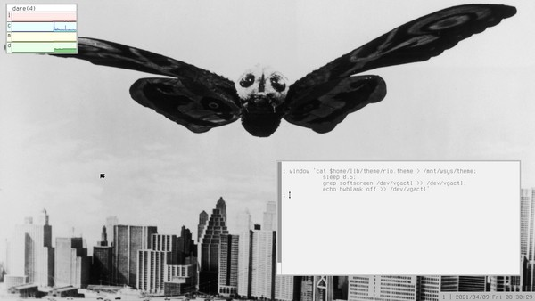

9front rio용 테마 및 배경화면 패치 설치 방법:

```
# install rio-themes
; bind -ac /dist/plan9front /
; cd /sys/src/cmd/rio
; hget https://ftrv.se/_/9/patches/rio-themes.patch | patch -p5
; mk install
; reboot # or otherwise restart rio

# write a theme, e.g. in $home/lib/theme/rio.theme
# ps: wallpaper must be in the plan 9 image format,
# e.g. jpg -9t <pic_1920x1080.jpg >$home/lib/1920x1080.img
rioback /usr/glenda/lib/1920x1080.img
back      f1f1f1
high      cccccc
border    999999
text      000000
htext     000000
title     000000
ltitle    bcbcbc
hold      000099
lhold     005dbb
palehold  4993dd
paletext  6f6f6f
size      000000
menubar   448844
menuback  eaffea
menuhigh  448844
menubord  88cc88
menutext  000000
menuhtext eaffea

# use your theme (add it to riostart if you want)
; window 'cat $home/lib/theme/rio.theme > /mnt/wsys/theme;
        sleep 0.5;
        grep softscreen /dev/vgactl >> /dev/vgactl;
        echo hwblank off >> /dev/vgactl'
``` 

추신: rio 윈도우 매니저는 훌륭하게 작동하지만, 이제 조금 구식이 되어가고 있습니다. 지난 몇 년간 이를 확장하거나 재구현하려는 시도가 여러 차례 있었습니다. 제 생각에 가장 유망한 대안은 lola입니다. 궁금하시다면 꼭 한번 사용해 보시기 바랍니다. 새로운 프로젝트이니 개발자가 여러분의 피드백을 반길 것입니다.


## Internationalization


좋든 싫든, 컴퓨팅 분야는 영어가 주를 이룹니다. 죄송하지만, 프로그래밍을 하거나 어떤 운영 체제를 전문적인 차원에서 사용하려면 영어를 배워야 합니다. 거의 모든 중요한 문서와 프로그래밍, 컴퓨터 과학, 컴퓨팅 역사에 관한 주요 저작들은 이 언어로 쓰여 있습니다. 제가 무심하게 말하는 건 아닙니다. 저 역시 영어가 모국어가 아니기 때문에 이것이 결코 쉬운 일이 아니라는 것을 잘 알고 있지만, 현실은 어쩔 수 없이 그렇습니다. (물론, 번역 도구가 계속 발전함에 따라 이 점은 점점 덜 해당되고 있습니다)*

그렇긴 하지만, 기술적인 측면에서 보면 Plan 9는 국제화 지원이 매우 훌륭합니다. 물론, 설치 과정에서 제공되는 모든 지침과 이용 가능한 모든 문서는 영어로 되어 있습니다. 하지만 시스템 자체는 모든 것이 유니코드로 구성되어 있어 대부분의 언어를 지원합니다.* 따라서 필요한 글꼴만 설치되어 있다면 어떤 언어든 읽고 쓸 수 있습니다(물론, 왼쪽에서 오른쪽으로 쓰이는 언어가 아닌 경우에는 약간의 작업이 필요할 수 있습니다). 사실 UTF-8은 Plan 9 개발자들이 발명했습니다! 예를 들어, 북부 노르웨이어 문장 “Æ e i Å æ å”(네, 이건 진짜 문장입니다*)를 입력하려면 Alt+Shift+a+e e i Alt+o+Shift+a Alt+a+e Alt+o+a를 입력하면 됩니다. Alt 키 조합으로 입력할 수 있는 국제 문자 목록은 /lib/keyboard에서 확인할 수 있습니다. 따라서 Plan 9에서 스마일 이모티콘을 입력하는 방법을 알아보려면, grep ☺ /lib/keyboard를 입력하기만 하면 됩니다(물론 ☺는 복사하여 붙여넣을 수 있습니다). 그러면 다음과 같은 결과가 출력됩니다:

```
263A  :)          ☺    smiley face
```

즉, Alt+:+)를 입력하면 유니코드 문자 0x263A, 일명 스마일 이모티콘이 생성됩니다. kbmap 명령어를 사용하여 기본 미국식 QWERTY 배열을 변경할 수 있습니다. 원하는 배열을 마우스 오른쪽 버튼으로 클릭한 다음, q를 입력하여 종료하세요. 이 변경 사항을 영구적으로 적용하려면:

```
# change dvorak to whatever layout you prefer
# setting layout in 9front:
; 9fs 9fat
; echo 'kbmap=dvorak' >> /n/9fat/plan9.ini

# setting layout in classic Plan 9:
; sam $home/lib/profile
# add the following line somewhere near the top
; cp /sys/lib/kbmap/dvorak /dev/kbmap
```

기존 키보드 레이아웃을 수정하는 것은 꽤 간단합니다. /sys/lib/kbmap에 있는 레이아웃 파일을 복사한 다음 텍스트 편집기로 열기만 하면 됩니다. 필드로는 “layer”(일반적으로 0은 키 직접 누름, 1은 Shift+키, 4는 Ctrl+키를 의미), 키코드, 문자(예: 문자 M은 ‘M’, ^M은 캐리지 리턴)입니다. 레이아웃을 처음부터 작성하는 것은 더 많은 작업이 필요하지만, 불가능한 일은 아닙니다. (자세한 내용은 kbdfs(8)을 참조하십시오)


### Working with Non-Latin alphabets

이전 섹션에서 언급했듯이, ru(러시아어)나 fa(파르시어, 즉 페르시아어)와 같은 비라틴 문자 키보드 배열을 선택할 수 있습니다. 하지만 때로는 선택한 입력 언어 이외의 언어로 작업해야 할 수도 있습니다. 예를 들어, 저는 일상적으로 시스템 언어로 영어를 사용하지만, 가끔씩 러시아어나 페르시아어 텍스트를 다뤄야 할 때가 있습니다. (제 아내는 러시아계/우크라이나계이고, 저는 취미로 페르시아어를 조금 배워본 적이 있습니다.) 러시아어 키보드 레이아웃을 터치 타이핑하는 법을 배울 수도 있겠지만, 당장은 너무 번거롭습니다. Alt 키 조합을 사용해 러시아어 단어를 입력할 수도 있습니다. 예를 들어, Alt+@P, Alt+@r, Alt+@i, Alt+@v, Alt+@e, Alt+@t를 누르면 ‘Привет’이 완성됩니다.* 하지만 이건 입력할 게 너무 많죠! sed를 사용하면 더 편리한 도구를 만들 수 있습니다:

```
#!/bin/rc
# cyr2utf - convert ASCII Cyrillic representations to UTF-8
# usage: cyr2utf < in > out
# bugs:  uses arbitrary non-standard conventions
#        use lat2utf if you need to *mix* Latin and Cyrillic!
#
# guide:
#  Most of the Cyrillic letters are mapped to their vocalization
#  equivalents in the Latin alphabet, eg: A, B, V, G, D, E, Z, K, L, M,
#  N, P, R, C/S, T, and F map perfectly to А, Б, В, Г, Д, Е, З, К, Л, М,
#  Н, П, Р, С, Т, and Ф. I, J, O, U, H and Y are fairly close to И, Й,
#  О, У , Х and Ы. A few letters are mapped to Cyrillic letters that
#  look like the Latin letters, such as X, Q and W correspond to Ж, Ц
#  and Ш.
#
#  Finally, some Cyrillic letters must be written by an escape '\'
#  character followed by one or two Latin letters, such as \E, \:E/\JO,
#  \Q, \W, \JU, \JA, \h/\hard and \s/\soft corresponding to: Э, Ё, Ч, Щ,
#  Ю, Я, ъ and ь.

sed -e 's/\\E/Э/g' \
    -e 's/\\e/э/g' \
    -e 's/\\:E/Ё/g' \
    -e 's/\\:e/ё/g' \
    -e 's/\\JO/Ё/g' \
    -e 's/\\Jo/Ё/g' \
    -e 's/\\jo/ё/g' \
    -e 's/\\Q/Ч/g' \
    -e 's/\\q/ч/g' \
    -e 's/\\W/Щ/g' \
    -e 's/\\w/щ/g' \
    -e 's/\\JU/Ю/g' \
    -e 's/\\Ju/Ю/g' \
    -e 's/\\ju/ю/g' \
    -e 's/\\JA/Я/g' \
    -e 's/\\Ja/Я/g' \
    -e 's/\\ja/я/g' \
    -e 's/\\hard/ъ/g' \
    -e 's/\\h/ъ/g' \
    -e 's/\\soft/ь/g' \
    -e 's/\\s/ь/g' \
    -e 's/A/А/g' \
    -e 's/a/а/g' \
    -e 's/B/Б/g' \
    -e 's/b/б/g' \
    -e 's/V/В/g' \
    -e 's/v/в/g' \
    -e 's/G/Г/g' \
    -e 's/g/г/g' \
    -e 's/D/Д/g' \
    -e 's/d/д/g' \
    -e 's/E/Е/g' \
    -e 's/e/е/g' \
    -e 's/Z/З/g' \
    -e 's/z/з/g' \
    -e 's/K/К/g' \
    -e 's/k/к/g' \
    -e 's/L/Л/g' \
    -e 's/l/л/g' \
    -e 's/M/М/g' \
    -e 's/m/м/g' \
    -e 's/N/Н/g' \
    -e 's/n/н/g' \
    -e 's/P/П/g' \
    -e 's/p/п/g' \
    -e 's/R/Р/g' \
    -e 's/r/р/g' \
    -e 's/S/С/g' \
    -e 's/s/с/g' \
    -e 's/C/С/g' \
    -e 's/c/с/g' \
    -e 's/T/Т/g' \
    -e 's/t/т/g' \
    -e 's/F/Ф/g' \
    -e 's/f/ф/g' \
    -e 's/I/И/g' \
    -e 's/i/и/g' \
    -e 's/J/Й/g' \
    -e 's/j/й/g' \
    -e 's/O/О/g' \
    -e 's/o/о/g' \
    -e 's/U/У/g' \
    -e 's/u/у/g' \
    -e 's/H/Х/g' \
    -e 's/h/х/g' \
    -e 's/Y/Ы/g' \
    -e 's/y/ы/g' \
    -e 's/X/Ж/g' \
    -e 's/x/ж/g' \
    -e 's/Q/Ц/g' \
    -e 's/q/ц/g' \
    -e 's/W/Ш/g' \
    -e 's/w/ш/g'         
```

이러한 도구가 마련되어 있다면, 다음과 같이 러시아어 인사를 작성할 수 있습니다: echo Privet | cyr2utf. 물론 언어는 복잡합니다. 단 하나의 언어만 아는 사람은 각 언어별로 사전 하나씩만 있고, 단어를 하나하나 대조하면 번역에 필요한 모든 것이 해결된다고 순진하게 믿을 수도 있습니다. 하지만 사실은 그렇지 않습니다. 두 언어는 결코 완벽하게 겹치지 않습니다. 알파벳도 마찬가지입니다. 따라서 우리의 cyr2utf 도구는 만능 해결책이 아닙니다. 키릴 문자에 대해 어느 정도 익숙해야 하며, 게다가 그 문자의 몇 가지 특이점도 익혀야 합니다. 하지만 가끔 러시아어 텍스트를 입력해야 하는 사람에게는 이 스크립트가 시간을 절약해 줄 수 있습니다.

페르시아어의 경우에도 위의 설명이 적용되지만, 그 정도가 더 심합니다. (서양인의 관점에서 볼 때) 특이한 알파벳일 뿐만 아니라, 오른쪽에서 왼쪽으로 쓰입니다. Plan 9에는 fribidi가 없지만, awk로 대충 비슷한 기능을 구현할 수 있습니다. 이를 바탕으로 sed 변환기 또한 작성할 수 있습니다:

```
#!/bin/rc
# bidi - print bidirectional text
# usage: bidi [files...]
# bugs: tabs are statically changed to four spaces
#       text alignment requires a fixed width font

# set some defaults
rfork e
if (~ $#* 0) files=/fd/0
if not files=($*)

# print bidirectional text
sed 's/    /    /g' $files | awk '
BEGIN { FS = "" }
{ row[NR] = $0
  if (length() > max) max = length()
} END {
  for(r=1;r<=NR;r++){
    split(row[r], l)
    line = ""
    for(i=length(l);i>0;i--) line = line l[i]
    printf("%" max "s\n", line)
  }
}'

#!/bin/rc
# far2utf - convert ASCII Persian representations to UTF-8
# usage: far2utf < in > out
# bugs:  basic implementation, non-standard conventions
#        annoyingly, an initial alef must be typed \i, not i
# depend: fribidi
#
# guide:
#  Most of the Persian letters are mapped to their vocalization
#  equivalents in the Latin alphabet, eg: b, p, t, s, j, c, x, d, r, z,
#  f, q, k, g, l, m, n, v/w, y map more or less to ب, پ, ت, س, ج, چ, خ,
#  د, ر, ز, ف, ق, ک, گ, ل, م, ن, و and ی. While some letters must be
#  escaped, such as \h, \j, \sh, \se/\th, \sd, \ta, \zl, \zd, \za, \e
#  and \q for ح, ژ, ش, ث, ص, ط, ذ, ض, ظ, ع and غ.
#
#  The alef ا, hamza ء, tasdid ّ and sukun ْ are written as i, \g, \w
#  and \o, since they look similar to these Latin letters. An initial
#  alef (آ) is written \i. The three vowel indicators are a, e, o for
#  َ, ِ, ُ. Letters with a hamza should be written \xg, e.g. \ig for أ.
#  Standalone madda, "flying" hamza and under hamza (\m, \fg, \ug) do
#  not have a practical use. The tavine nasb (ً), jarr and raf signs
#  are \tn/\n, \tj and \tr. Kasida is \-. The rare characters ة, إ and
#  ڤ are written \h:, \iu (or i\ug) and \b.
#
#  Note that و must be written as v or w, since o is used for ُ, and
#  that ی must be written y, not i (ا) or j (ج). Unfortunately,
#  "alternative" s/z/t letters must be written as three digits (\xx).

sed -e 's/\\ig/أ/g' \
    -e 's/\\vg/ؤ/g' \
    -e 's/\\wg/ؤ/g' \
    -e 's/\\yg/ئ/g' \
    -e 's/\\hg/ۀ/g' \
    -e 's/\\h:/ة/g' \
    -e 's/\\fg/ٔ/g' \
    -e 's/\\ug/ٕ/g' \
    -e 's/\\iu/إ/g' \
    -e 's/\\g/ء/g' \
    -e 's/\\i/آ/g' \
    -e 's/\\m/ۤ/g' \
    -e 's/\\n/ً/g' \
    -e 's/\\tn/ً/g' \
    -e 's/\\tj/ٍ/g' \
    -e 's/\\tr/ٌ/g' \
    -e 's/\\w/ّ/g' \
    -e 's/\\o/ْ/g' \
    -e 's/\\-/ـ/g' \
    -e 's/\\b/ڤ/g' \
    -e 's/\\h/ح/g' \
    -e 's/\\j/ژ/g' \
    -e 's/\\e/ع/g' \
    -e 's/\\q/غ/g' \
    -e 's/\\se/ث/g' \
    -e 's/\\th/ث/g' \
    -e 's/\\sh/ش/g' \
    -e 's/\\sd/ص/g' \
    -e 's/\\ta/ط/g' \
    -e 's/\\zl/ذ/g' \
    -e 's/\\zd/ض/g' \
    -e 's/\\za/ظ/g' \
    -e 's/i/ا/g' \
    -e 's/a/َ/g' \
    -e 's/e/ِ/g' \
    -e 's/o/ُ/g' \
    -e 's/b/ب/g' \
    -e 's/p/پ/g' \
    -e 's/t/ت/g' \
    -e 's/s/س/g' \
    -e 's/j/ج/g' \
    -e 's/c/چ/g' \
    -e 's/x/خ/g' \
    -e 's/d/د/g' \
    -e 's/r/ر/g' \
    -e 's/z/ز/g' \
    -e 's/f/ف/g' \
    -e 's/q/ق/g' \
    -e 's/k/ک/g' \
    -e 's/g/گ/g' \
    -e 's/l/ل/g' \
    -e 's/m/م/g' \
    -e 's/n/ن/g' \
    -e 's/v/و/g' \
    -e 's/w/و/g' \
    -e 's/h/ه/g' \
    -e 's/y/ی/g' \
    -e 's/1/۱/g' \
    -e 's/2/۲/g' \
    -e 's/3/۳/g' \
    -e 's/4/۴/g' \
    -e 's/5/۵/g' \
    -e 's/6/۶/g' \
    -e 's/7/۷/g' \
    -e 's/8/۸/g' \
    -e 's/9/۹/g' \
    -e 's/0/۰/g'
```

이제 echo slim | far2utf | bidi를 입력하면 مالس.*가 출력됩니다. 안타깝게도 이 간단한 양방향 텍스트 코드는 완벽하게 작동하지 않아, 페르시아어 글자들이 서로 자연스럽게 어우러지도록 형태를 재구성하지 못합니다. (이는 “Hello” 대신 “H E L L O”를 읽는 것과 같아서, 의미는 통하지만 보기 흉합니다.) 이를 해결하려면 C 언어로 더 정교한 양방향 텍스트 구현을 작성해야 합니다. 물론, UNIX 시스템이 있다면 fribidi를 사용하여 변환할 수도 있습니다. 올바르게 변환되면 Plan 9에서 텍스트를 문제없이 표시해 줄 것입니다.

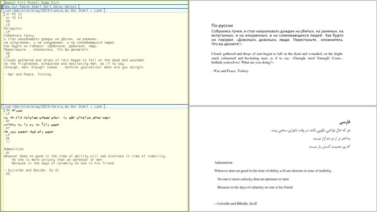

터미널에서 비라틴 문자를 다루는 것도 한 가지 방법이지만, 이를 본격적으로 활용하려면 해당 텍스트를 문서에 추가해야 합니다. 러시아어의 경우, troff에 직접 입력하기만 하면 되므로 아주 간단합니다. (자세한 내용은 아래 ‘문서 작성’ 섹션에서 다루겠습니다.) 하지만 페르시아어의 경우 좀 더 까다롭습니다. Plan 9 버전의 troff는 좌우 방향 입력을 지원하지 않습니다. (페르시아어 글꼴도 포함되어 있지 않습니다.) 이를 처리하는 가장 쉬운 방법은 역시 UNIX 시스템을 준비해 두는 것입니다. neatroff를 설치하고 간단한 시작 가이드를 읽어보시면 됩니다. 물론, Plan 9에서 ms 파일을 작성한 후 neatroff가 생성한 PDF를 표시할 수도 있습니다.

물론 노르웨이어는 말할 것도 없고, 러시아어나 페르시아어 문서는 여러분에게 전혀 상관없는 이야기일 테지만, 그게 요점이 아닙니다. 이것들은 단지 예시일 뿐입니다. 요점은 Plan 9에서도 비영어권 언어로 작업할 수 있다는 것입니다. 더 넓게 보면, Plan 9에 한계가 있더라도 대체 OS를 준비해 두면 대개 그 한계를 우회할 수 있습니다.


## User Management and Security


Plan 9에서 새 사용자를 추가하는 방법은 사용하는 파일 시스템에 따라 다릅니다. 예를 들어, 이메일 그룹(upas)과 관리 그룹(사용자 관리를 위한 adm, 시스템 파일 접근을 위한 sys)의 구성원인 bob이라는 새 사용자를 다양한 Plan 9 파일 시스템에 추가해 볼 수 있습니다:

```
# add user to a gefs file server
; mount /srv/gefs /adm adm
; sam /adm/users               # edit by hand
; echo users >> /srv/gefs.cmd  # refresh user db
; mount /srv/gefs /n/u %main   # create user dir
; mkdir /n/u/usr/bob
; chgrp -u bob /n/u/usr/bob
; chgrp bob /n/u/usr/bob
# optionally, set tmp so it doesn't take automatic snapshots
; echo snap -m main other >> /srv/gefs.cmd
; echo snap other retain '' >> /srv/gefs.cmd
; mount /srv/gefs /n/o %other
; mkdir -p bob /n/o/usr/bob/tmp
; chgrp bob /n/o/usr/bob^('' /tmp)
; chmod 700 /n/o/usr/bob^('' /tmp)

# add user to a hjfs/cwfs file server
# (replace hjfs.cmd with cwfs.cmd for cwfs server)
; echo newuser bob >> /srv/hjfs.cmd
; echo newuser upas +bob >> /srv/hjfs.cmd
; echo newuser adm +bob >> /srv/hjfs.cmd
; echo newuser sys +bob >> /srv/hjfs.cmd

# add user to the auth server (on any filesystem)
; auth/keyfs
; auth/changeuser bob
; auth/enable bob
```

9front의 기존 방식에 익숙한 사용자라면 새로운 GEFS 파일 시스템이 다소 헷갈릴 수 있습니다. 아래의 ‘버전 관리’ 섹션을 참고하면 상황을 이해하는 데 도움이 될 것입니다. (물론, gefs(8) 매뉴얼 페이지도 꼭 읽어보시기 바랍니다.) 클래식 Plan 9 시스템을 사용 중이라면 hjfs.cmd/cwfs.cmd 대신 fscons를, newuser 대신 uname 명령어를 사용해야 하지만, 그 외에는 hjfs/cwfs와 동일합니다. Bob이 Plan 9 시스템에 처음 로그인했을 때 가장 먼저 해야 할 일은 /sys/lib/newuser를 입력하는 것입니다. 이렇게 하면 lib/profile 및 tmp 디렉터리와 같은 기본 파일이 포함된 초기 홈 디렉터리가 생성됩니다. 왜 시스템이 이 작업을 기본적으로 수행하지 않을까요? 이를 보안 기능으로 생각하십시오. /sys/lib/newuser를 입력할 수 없는 사용자는 다른 사용자를 보호하기 위해 시스템에 대한 접근 권한이 제한됩니다. 참고로, 새 사용자를 secstore에도 추가하는 것이 좋습니다(fqa의 7.4.3.1절 참조).

Plan 9의 보안은 다음과 같은 통찰력 있는 관찰을 바탕으로 구축되었습니다. 디지털 세계(즉, 네트워크)를 보호하는 것은 운영 체제의 책임이지만, 물리적 존재로서 물리적 보안을 확보하는 것은 여러분의 책임입니다. 저처럼 마른 체형의 괴짜라면, 이 말이 다소 당혹스럽게 느껴질 수도 있습니다. 긴장 풀고, 근육을 키우려 하지 말고, 현명해지세요: 예를 들어, 여러 대의 디스크리스 터미널로 구성된 Plan 9 네트워크가 CPU 서버가 아닌 단일 파일 서버에 의해 서비스된다고 가정해 봅시다. 이 네트워크에서 파일 보안을 침해할 수 있는 유일한 실질적인 방법은 파일 서버 머신에 물리적으로 접근하는 것뿐입니다. 시스템 관리자는 이 머신을 서버실 문 뒤에, ‘죽음의 광선’이 장착된 돌연변이 상어 수조 뒤에, 혹은 사악한 상사가 마음 내키는 대로 어떤 물리적 제약 장치 뒤에라도 잠가 둘 수 있습니다.

시스템을 부팅하는 사용자는 해당 시스템에 물리적으로 접근할 수 있습니다. 이 호스트 소유자는 해당 시스템의 모든 자원을 소유하지만, 네트워크상에서 그에게 부여되는 권한의 범위는 전적으로 네트워크 구성 방식에 달려 있습니다. CPU 서버가 아닌 Plan 9 시스템은 원격으로 로그인할 수 없으며, 파일 서버가 아닌 시스템은 파일을 외부로 내보낼 수 없고, 인증 서버가 아닌 시스템은 원격 트랜잭션을 인증할 수 없습니다. 하지만 실제로는 9front 사용자가 대개 자신의 노트북을 CPU+인증+파일 서버가 모두 통합된 독립형 시스템으로 설정하는데, 이 경우 호스트 소유자는 UNIX의 전능한 root와 거의 동등한 권한을 갖게 됩니다. (비록 파일 권한에 대해서는 겉으로라도 존중해야 하지만요.) 반면, 단일 사용자용 “터미널”은 원래 디스크가 없었으며, 어떠한 자원도 외부로 노출하지 않습니다. 따라서 보호해야 할 대상이 없으며, Plan 9는 누구나 비밀번호 없이 해당 시스템에 로그인할 수 있도록 허용합니다. 기본 Plan 9 설치 시 “터미널”에 로컬 디스크 저장 공간이 제공되는 오늘날의 상황에서는 이 방식이 이상적이지 않습니다. 이 문제를 해결할 수 있는 몇 가지 방법이 있습니다: 1) 로그인 시 비밀번호가 필요한 CPU+AUTH 서버로 시스템을 구성합니다. 2) BIOS를 설정하여 부팅 비밀번호를 설정합니다. 3) 9front를 사용하면 하드 디스크를 암호화하여 로그인 시 암호 문구를 요구할 수 있습니다(fqa의 4.4절 참조).

다중 사용자 환경에서의 몇 가지 장난을 보여드리겠습니다:

```
# UNIX friendly aliases
fn su{
    rcpu -u $*
}
fn chown{
    chgrp -u $*
}

; su bob   # switch user on CPU server
...
ERROR ERROR ERROR # Oops, bobs profile is missconfigured
... 

# for CWFS just change hjfs.cmd to cwfs.cmd
; echo allow >> /srv/hjfs.cmd # fs hostowner: allow chown
; chown glenda /usr/bob/lib/profile
; B /usr/bob/lib/profile      # fix the problem
; chown bob /usr/bob/lib/profile
; su bob

# GEFS works a little differently
; mount /srv/gefs /n/u %main       # permissive mount point
; chown glenda /n/u/usr/bob/lib/profile
...
```


## Disk Management

Plan 9에는 디스크 사용량을 측정하는 df 명령어가 없지만, 다른 방법으로 해당 정보를 확인할 수 있습니다. hjfs 파일 시스템에서는 다음 명령어를 실행하세요: echo df >> /srv/hjfs.cmd. cwfs 및 gefs에서는 방법이 다소 번거롭습니다. 먼저 파일 서버에 명령을 작성한 다음, 제어 파일에서 읽어야 합니다. 예를 들어, `echo statw >> /srv/cwfs.cmd && cat /srv/cwfs.cmd`를 실행하면 cwfs에 대한 다양한 통계 정보를 확인할 수 있습니다. 현재 16 Kb 파일 시스템 블록을 사용하고 있습니다(작업이 끝나면 Del 키를 누르세요). 아마도 여러분이 원하는 것은 wmax 줄의 마지막 숫자일 텐데, 이는 디스크 사용량을 백분율로 나타냅니다(여기서 캐시 라인도 중요합니다. 캐시는 메인 저장 영역 크기의 1/5에 불과하지만, 공간이 부족해지면 문제가 발생합니다!). gefs도 비슷하게 작동하지만, 제공하는 통계 정보는 더 적습니다. 다음은 9front용으로 유용하게 사용할 수 있는 간단한 df 스크립트입니다:

```
#!/bin/rc
# df - print disk usage
# usage: df

if (test -f /srv/hjfs.cmd)
    echo df >> /srv/hjfs.cmd
if (test -f /srv/gefs.cmd) {
    echo df >> /srv/gefs.cmd
    dd -if /srv/gefs.cmd -bs 1024 -count 12 -quiet 1
}
if (test -f /srv/cwfs.cmd) {
    echo statw >> /srv/cwfs.cmd
    dd -if /srv/cwfs.cmd -bs 1024 -count 21 -quiet 1 |
    grep wmax | sed 's/.*\+//'
}
```

고전적인 Plan 9에서도 이 방법이 비슷할 것 같지만, 정확히 어떻게 해야 할지는 잘 모르겠습니다(방법을 아시는 분이나 제 글에서 다른 부족한 점을 발견하신 분은 언제든지 연락 주세요). 개별 파일이나 폴더의 크기를 측정하려면 물론 믿을 수 있는 오래된 du 명령어를 사용할 수 있습니다. 다음은 현재 디렉토리에 있는 파일과 폴더를 디스크 사용량 순으로 나열해 주는 간단하고 유용한 스크립트입니다:

```
#!/bin/rc
# dus - disk usage summary for current dir
# usage: dus

du -s * | sort -nrk 1 | awk '{
    if ($1 > 1073741824) printf("%7.2f %s\t%s\n", $1/1073741824, "Tb", $2)
    else if ($1 > 1048576) printf("%7.2f %s\t%s\n", $1/1048576, "Gb", $2)
    else if ($1 > 1024) printf("%7.2f %s\t%s\n", $1/1024, "Mb", $2)
    else printf("%7.2f %s\t%s\n", $1, "Kb", $2)
}'
```

물론, Plan 9의 핵심은 모든 디스크 관리를 하나의 시스템으로 중앙 집중화하고, 네트워크에서 사용하는 어떤 기기에서든 그 시스템에 접근할 수 있게 하는 것입니다. 그러니 대용량 디스크에 투자하고 시간을 들여 파일 서버를 설치하면, 다시는 디스크 관리에 대해 걱정할 필요가 없습니다. (예전 유닉스 팀의 72명이 5년 동안 “34,000개의 512바이트 보조 저장소 블록”을 모두 소진해 버렸다는 점을 감안하면, 수학적으로 말해서 1테라바이트 하드디스크는 2,200만 년 동안은 넉넉히 사용할 수 있을 것입니다)* 복잡한 파일 서버를 설정해야 한다면, /bin/inst에 있는 설치 스크립트를 살펴보며 수동으로 설정하는 방법을 익힐 수 있습니다. 또한 ‘adventuresin9’ 유튜브 채널을 확인해 보세요. 이 채널에는 이 주제와 다른 시스템 관리 관련 주제에 대한 유용한 동영상이 많이 있습니다. 부득이하게 ‘스니커넷(Sneakernet)’을 사용해야 한다면, 아래의 USB 메모리 섹션을 확인해 보세요.


## Backups


Plan 9 파일 시스템은 모두 스냅샷 기능을 갖추고 있으므로, 파일 시스템 자체가 정상적으로 작동하는 한 손상되거나 손실된 데이터를 별다른 어려움 없이 복원할 수 있습니다. 물론 여기에는 큰 ‘만약’이 따릅니다. 파일 시스템 자체가 손상될 수도 있고, 파일 시스템이 실행되는 컴퓨터가 손상될 수도 있으며, 컴퓨터가 있는 건물이 손상될 수도 있고, 컴퓨터가 있는 국가가 손상될 수도 있고, 심지어 컴퓨터가 있는 세상 전체가 손상될 수도 있습니다… 무슨 말인지 아시겠죠. 따라서 아무리 모든 기능을 갖춘 초정교하고 초안전한 파일 시스템을 가지고 있다 해도, 결코 안전하지 않습니다! 데이터를 오프사이트 위치에 백업해야 하며, 가급적이면 두 곳의 오프사이트 위치에 백업해야 합니다. 침입자가 한 곳의 데이터를 손상시킨 경우, 두 개의 백업이 있으면 어떤 데이터가 정확하고 어떤 데이터가 손상되었는지 확인할 수 있습니다.

백업이라는 개념에서 실제 실행으로 넘어가는 비결은 두 가지입니다. 첫째, 백업은 자동으로 수행되어야 합니다. 수동으로 백업을 하면 결국 제대로 이루어지지 않게 마련입니다. 둘째, 필수 파일만 백업하면 비용 효율성이 획기적으로 높아집니다. 정리 정돈을 잘하는 분이라면 중요한 파일 목록을 proto(2) 파일에 작성하고, cron(8)을 이용해 정기적인 mkfs(8) 작업을 예약하면 됩니다. 하지만 저는 정리 정돈을 잘하는 편이 아닙니다. 제 첫 번째 문제는 노트북을 그다지 규칙적으로 부팅하지 않는다는 점입니다. 따라서 “적어도” 하루, 일주일, 한 달에 한 번씩 작업을 예약할 수 있는 쉬운 방법이 필요합니다. 컴퓨터를 부팅했을 때 주간 작업이 일주일 이상 실행되지 않았다면, 다시 실행되어야 합니다. 이를 수행하는 간단한 스크립트는 다음과 같습니다:

```
#!/bin/rc
# schedule - run commands at scheduled intervals
# usage: schedule
# depend: window schedule in $home/bin/rc/riostart
#
# format: add commands to run in one of the following
# files in $home/lib; daily, weakly, monthly.

# set some defaults
rfork e
lock=$home/lib/lock
mkdir -p $lock
date=`{date}
datesec=`{date -n}
weekrun=Mon
daily=$home/lib/daily
weekly=$home/lib/weekly
monthly=$home/lib/monthly

# check monthly scripts
if(test -f $monthly){
    lockfile=monthly_$date(2)^_$date(6)
    if(! test -f $lock/$lockfile){
        rm -f $lock/monthly_*
        touch $lock/$lockfile
        @{rc $monthly}
    }
}

# check weekly scripts
if(test -f $weekly){
    lockfile=weekly_$datesec
    if(! test -f $lock/weekly_*) touch $lock/$lockfile
    oldlockfile=`{ls -p $lock/weekly_*}
    olddatesec=`{echo $oldlockfile | sed 's/weekly_//'}
    oldweeksec=`{echo $olddatesec + 604800 | bc}
    olddaysec=`{echo $olddatesec + 86400 | bc}
    # by default run weekly scripts on a certain day,
    # but make sure it runs at least once a week.
    if(~ $date(1) $weekrun || test $datesec -gt $oldweeksec){
        # also make sure it doesnt run twice in a single day
        if(test $datesec -gt $olddaysec){
            rm -f $lock/weekly_*
            touch $lock/$lockfile
            @{rc $weekly}
        }
    }
}

# check daily scripts
if(test -f $daily){
    lockfile=daily_`{date -i}
    if(! test -f $lock/$lockfile){
        rm -f $lock/daily_*
        touch $lock/$lockfile
        @{rc $daily}
    }
}

# respawn shell
rc
```

이 스크립트는 예약된 작업이 실행될 때마다 날짜가 포함된 “lock” 파일을 생성하는 방식으로 작동합니다. 이 날짜가 하루/일주일/한 달보다 오래된 경우(원한다면 분기별/반기별/연간 실행 작업을 포함하도록 스크립트를 자유롭게 확장해도 됩니다), 작업이 다시 실행되고 잠금 파일이 업데이트됩니다. 스케줄을 정확히 어떻게 실행할지는 사용자의 필요와 취향에 따라 다르겠지만, 한 가지 제안으로는 $home/bin/rc/riostart 파일에 실행 시간대를 추가하는 것입니다.

이제 두 번째 문제를 해결해 보겠습니다. 제 삶의 시간 관리가 무질서한 것처럼, 제 파일들도 마찬가지입니다. 백업해야 할 중요한 자료들이 어딘가에 흩어져 있다는 건 알지만, 그 위치를 찾는 건 너무 번거롭습니다. 하지만 홈 디렉토리에는 텍스트가 아닌 쓸모없는 파일들도 포함되어 있기 때문에 전체 백업을 하는 것은 매우 비효율적입니다. 제가 필요한 것은 ‘이것과 저것만 제외하고 나머지는 모두 백업해 달라’고 지시할 수 있는 빠른 방법입니다. 다음은 한 가지 제안입니다:

```
#!/bin/rc
# nom - no match, print all files except those given
# usage: nom files...

rfork ne
temp=/tmp/nom-$pid

fn sigexit{ rm -f $temp }
if(~ $* */*){
    echo 'nom quitting: can''t handle ''/''s.' >[1=2]
    exit slash
}

ls -d $* > $temp
ls | comm -23 - $temp
exit    # force file cleanup

#!/bin/rc
# backup - backup important files to offsite storage
# usage: backup

rfork ne

# backup semi-important files
mkdir -p /tmp/backup
fn copy{
    mkdir -p $2
    if (~ `{ls -ld $1} d*){
        mkdir $2/$1
        dircp $1 $2/$1
    }
    if not cp $1 $2
}
fn sigexit{ rm -rf /tmp/$backup /tmp/backup }
cd $home
for(file in `{nom bin doc games jw media pkg site tmp})
    copy $file /tmp/backup
cd $home/bin
for(file in `{nom 386 amd64})
    copy $file /tmp/backup/bin
cd $home/doc
for(file in `{nom books health os papers})
    copy $file /tmp/backup/doc

backup=9front-^`{date -i}^.tar.gz
tar czf /tmp/backup /tmp/$backup
cd /tmp
# PS: The first whitespace in sed here is a tab
md5sum $backup | sed 's/    / /' >> CHECKSUM

# copy backup to offsite locations
fn sshcopy{
    sshfs $1
    if(! test -d /n/ssh/backup) {
        echo Error: SSH failed!
        exit ssh
    }
    cp /tmp/$backup /n/ssh/backup
    cat /tmp/CHECKSUM >> /n/ssh/backup/CHECKSUM
}
sshcopy bkpserv1
sshcopy bkpserv2

exit    # force file cleanup
```

이 스크립트는 제 나름의 특이한 요구 사항에 맞춰 작성된 것이므로, 무턱대고 복사해서 붙여넣지 마세요! 예를 들어, 저는 $home에 있는 몇 가지 큰 디렉토리, 즉 텍스트가 아닌 잡다한 파일들을 모두 올려두는 ‘media’ 디렉토리나 제 웹사이트를 보관하는 ‘site’ 디렉토리는 제외합니다. ‘bin’과 ‘doc’ 디렉토리는 복사하지만, 그 중 일부만 복사합니다. 물론 이러한 세부 사항은 여러분의 환경과는 관련이 없을 것입니다. 하지만 이 예시가 여러분이 직접 유용한 백업 유틸리티를 작성하는 데 영감을 주었으면 합니다. 이러한 도구를 활용하면, $home/lib/weekly에 백업을 추가하기만 하면, 일주일에 한 번 이상 노트북을 부팅할 경우 약 10Gb*의 사용 중인 디스크 공간에 대한 주간 약 10Mb 규모의 백업이 자동으로 수행됩니다. 물론, $home /n/ssh/backup/9front-full.tgz와 같은 전체 tar czf 백업을 하나쯤 가지고 있는 것도 여전히 유용하지만, 제 경우 일 년에 한두 번 정도 이 명령을 수동으로 실행하는 것만으로도 충분합니다.

PS: 혹시 ZFS 사용자라면, 지금쯤 하품이 나올지도 모르겠습니다. ZFS에는 Plan 9 파일 시스템에 없는 멋진 기능들이 확실히 많지만, 제 개인적인 의견으로는 이러한 기능들의 실용성이 과대평가되어 있다고 봅니다. 데이터 보안을 제대로 하려면 ZFS를 사용하더라도 두 곳의 오프사이트 백업이 필요하며, 그런 구성을 갖추었다면 추가적인 데이터 무결성 및 중복성은 다소 과한 조치입니다. 중복 제거는 말할 것도 없고, 데이터 압축은 더욱 관련성이 낮습니다. 요즘은 일반 하드웨어에 테라바이트급 하드디스크가 장착되어 있어 디스크 공간이 무한한데, 무한한 공간에 50%를 더해도 여전히 무한할 뿐입니다. 게다가 공간이 정말로 그렇게 귀중하다면, 중복성은 오히려 해가 될 것입니다. 어쨌든, Plan 9에서 자가 복구 기능이나 그 밖의 온갖 기능을 원하고, GEFS가 그 수준에 도달할 때까지 기다리고 싶지 않다면, ZFS를 사용하는 UNIX 시스템에 파일을 백업하기만 하면 됩니다(아니면 더 나은 방법은, ZFS를 사용하는 UNIX 시스템에서 Plan 9를 가상으로 실행하는 것입니다).

```
ZFS primer for non-ZFS systems:

snapshots:     yesterday
integrity:     md5sum myfiles.tar.gz >> CHECKSUM
redundancy:    cp myfiles.tar.gz /n/ssh/backup
compression:   gzip myfile
encryption:    auth/secstore -p myfile
replication:   tar xzf myfiles.tar.gz
deduplication: <buy a disk man>
self healing:  tel mysysadmin/man gefs
```


## Package Management


Plan 9에는 UNIX 사용자가 기대하는 의미에서의 패키지 관리 기능이 사실상 없습니다. 이 시스템은 (비록 최소한의 기능만 갖추고 있기는 하지만) “모든 기능을 갖춘” 시스템으로 설계되었으며, 타사 소프트웨어는 거의 존재하지 않습니다. 존재하는 소수의 소프트웨어도 대개 순수한 소스 코드 형태로 배포되어 사용자가 직접 컴파일해야 합니다. Plan 9를 위한 몇 가지 패키지 관리 솔루션이 시도된 바 있지만, 대부분의 Plan 9 사용자는 필요한 소프트웨어를 직접 컴파일하여 사용합니다. 다음은 Plan 9에서 “패키지 관리”가 무엇을 의미하는지 보여주는 몇 가지 예시입니다:

PS: Plan 9 터미널에서 소프트웨어를 컴파일할 때는 창을 중간 클릭하여 ‘스크롤’을 선택하는 것을 잊지 마십시오. 그렇지 않으면 출력 결과가 창 하단에 도달하면 컴파일이 멈춰 버립니다(이는 버그가 아닌 “기능”입니다).

**9front 시스템 업데이트 - 상세히:**

```
; sysupdate    # download latest sources
; cd /         # rebuild system
; . /sys/lib/rootstub
; cd /sys/src
; mk nuke      # sometimes needed after library changes
; mk install
; mk clean
; cd /sys/man  # optionally rebuild documentation
; mk
; cd /sys/doc
; mk
; mk html
; cd /sys/src/9/pc64
; mk install   # optionally rebuild (64-bit) kernel
; 9fs 9fat
; rm /n/9fat/9bootfat
; cp /386/9bootfat /n/9fat
; chmod +al /n/9fat/9bootfat
; cp /amd64/9pc64 /n/9fat
; reboot # if you have installed a new kernel
```

32비트 또는 ARM의 경우 커널 설치 방법이 약간 다르므로, 자세한 내용은 FAQ의 7.2.5절을 참조하십시오. 물론, 사소한 업데이트가 있을 때마다 커널을 다시 설치하고 문서를 재컴파일할 필요는 없으며, 일반적으로 다음 단계만 수행하면 됩니다:

**9front 시스템 빠르게 업데이트하기:**

```
; sysupdate
; cd /sys/src
; mk install
```

**9front extras에서 xscreensaver 패키지를 설치합니다:**

```
; cd /tmp
; 9fs 9front     # download package
; tar xzf /n/extra/src/xscr.tgz
; cd xscr        # compile programs and install them
; mk
; for(f in 6.*){ mv $f $home/bin/$cputype/^`{echo $f | sed 's/6.//'} }
```

**vim 7.1 포트 설치 (구버전):**

```
; cd /tmp
; hget http://vmsplice.net/vim71src.tgz | gunzip -c | tar x
; cd vim71/src
; mk -f Make_plan9.mk install
```

**Bell Labs에서 포팅한 Perl을 설치하세요(구버전이며, 32비트 전용입니다):**

```
; 9fs sources    # download iso and mount it
; bunzip2 < /n/sources/extra/perl.iso.bz2 > /tmp/perl.iso
; mount <{9660srv -s >[0=1]} /n/iso /tmp/perl.iso
; cp /n/iso/386/bin/perl $home/bin/386    # install the binary
```

**git.sr.ht에서 Lua를 설치하려면:**

```
; cd /tmp
; git/clone https://git.sr.ht/~kvik/lu9
; cd lu9
; mk pull
; mk install
; lu9 script.lua # or interactively: lu9 -i
```

**빈 공간에서 Scheme 설치하기:**

```
; cd /tmp
; git/clone https://github.com/bakul/s9fes
; cd s9fes
; mk
; mk inst
; s9            # do some scheming
```

**9front를 amd64용으로 다시 컴파일하고 golang을 설치합니다:**

```
# go will only work on amd64 architecture, so if you are
# running 386, rebuilt to 64-bit first:
; cd /
; . /sys/lib/rootstub
; cd /sys/src
; objtype=amd64 mk install
; cd /sys/src/9/pc64        # build and install a 64-bit kernel
; mk install
; 9fs 9fat
; rm /n/9fat/9bootfat
; cp /386/9bootfat /n/9fat
; chmod +al /n/9fat/9bootfat
; cp /amd64/9pc64 /n/9fat
; sam /n/9fat/plan9.ini    # make sure bootfile=9pc64 (not 9pc!)
; reboot         # reboot to a 64-bit system, download Go stuff

# now, lets build go, we will bootstrap the latest version
# of go from 9legacy, then use that to build the go source
# (these instructions quickly get outdated):
; mkdir /sys/lib/go
; cd /sys/lib/go
; hget http://www.9legacy.org/download/go/go1.23.6-plan9-amd64-bootstrap.tbz |
;     bunzip2 -c | tar x
; hget https://golang.org/dl/go1.23.6.src.tar.gz |
;     gunzip -c  | tar x
; mv go amd64-1.23.6
; GOROOT_BOOTSTRAP=/sys/lib/go/go-plan9-amd64-bootstrap
; GOROOT=/sys/lib/go/amd64-1.23.6
; cd amd64-1.23.6/src
; make.rc
; bind -b $GOROOT/bin /bin
# get some recent certificates
; hget https://curl.haxx.se/ca/cacert.pem > /sys/lib/tls/ca.pem
; go get golang.org/x/tools/cmd/godoc

# to make the go environment permanent, add these
# instructions to your $home/lib/profile
; GOROOT=/sys/lib/go/amd64-1.23.6
; bind -b $GOROOT/bin /bin
```

PS: 기존 Plan 9에서는 replica/pull /dist/replica/network 명령을 실행하여 Bell Labs의 최신 소스 코드를, 9fs sources 명령을 실행하여 /n/sources 아래에 나열된 Bell Labs의 기여 소프트웨어 저장소를 가져왔습니다. 하지만 현재는 이러한 리소스가 더 이상 존재하지 않습니다. 여전히 `srv -nqC tcp!9p.io sources /n/sources` 명령을 실행하여 9legacy에서 contrib 저장소의 스냅샷을 마운트할 수 있습니다. Bell Labs의 공식 타사 소프트웨어는 `/n/sources/extra`에, 기여자들의 저장소는 `/n/sources/contrib`에 위치합니다. 또한 다음과 같이 9p.io의 Bell Labs 위키를 수동으로 마운트할 수 있습니다: srv -m ‘net!9p.io!wiki’ wiki /mnt/wiki. 그런 다음 acme /acme/wiki/guide를 실행하여 위키에 접속하고, 그곳의 지침을 따르시면 됩니다(9front에서는 9fs sources 및 9fs wiki 명령을 사용하여 이러한 리소스에 접근합니다). 다만, 이러한 오래된 리소스는 전혀 유지 관리되지 않으므로, 실용적인 용도보다는 고고학적 흥미를 위한 것이라고 보시면 됩니다. 9front 전용 스크립트 및 프로그램의 경우, 상당수가 9legacy나 다른 클래식 Plan 9 시스템에서도 문제없이 작동할 수 있습니다. 부담 없이 직접 시도해 보세요 :)


## File Management

Plan 9의 기본 “파일 관리자”는 acme입니다. 예를 들어 B path/mydir을 실행하면, mydir의 내용이 acme.*에 나열됩니다. 여기서 디렉터리를 마우스 오른쪽 버튼으로 클릭하면 해당 디렉터리의 내용이 표시되고, 텍스트 파일을 클릭하면 편집 모드로 열리며, PDF나 오디오 파일을 클릭하면 page 또는 play에서 열립니다. 파일 작업을 하려면 명령어를 입력하고 실행하기만 하면 됩니다. 예를 들어, `touch myfile`을 입력하고 마우스 중간 버튼을 클릭하면 `myfile`이 생성됩니다.

물론 셸을 사용하여 파일을 관리할 수도 있지만, UNIX와 Plan 9 사이에는 사용자를 당황하게 할 수 있는 몇 가지 차이점이 있습니다. 예를 들어, `rmdir` 명령어는 없으며, 디렉터리를 삭제하려면 `rm`을 사용하면 됩니다. 또한 `cp -r` 명령어가 없으며, 대신 디렉터리를 복사하는 `dircp` 명령어가 있습니다. 따라서 `mydir`을 `otherpath`로 복사하려면 `mkdir otherpath/mydir; dircp mydir otherpath/mydir`을 실행해야 합니다. 하지만 디렉터리 자체는 제외하고 `mydir`의 내용만 복사하려면 `dircp mydir otherpath`를 실행하면 됩니다. UNIX 사용자에게는 이 방법이 번거롭게 보일 수 있지만, 사실 몇 가지 장점이 있습니다. 구현이 더 간단할 뿐만 아니라, 이 방식은 오해의 여지가 없습니다. UNIX에서 실제로는 cp -r mydir/* otherpath(즉, mydir의 내용만 복사하고 싶었을 때)를 실행하려 했는데, 실수로 cp -r mydir otherpath를 실행한 적이 얼마나 많은지 모릅니다. Plan 9에서는 이런 문제가 발생하지 않습니다.

마지막으로, 정말로 GUI를 원하신다면 vdir이라는 훌륭한 타사 파일 관리자가 있습니다. 이 프로그램은 acme 파일 관리자와 매우 유사하게 작동하며, 항목을 마우스 오른쪽 버튼으로 클릭하면 열 수 있습니다.

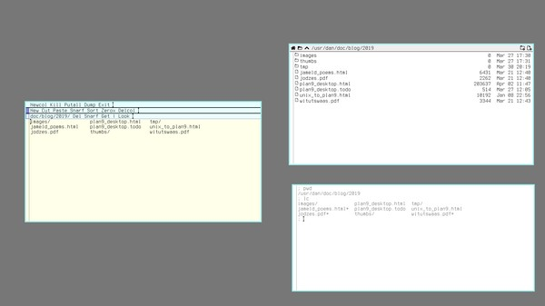


## Tips for UNIX Sysadmins

이전 섹션에서 살펴본 바와 같이, UNIX 유틸리티와 Plan 9의 해당 유틸리티 사이에는 몇 가지 근본적인 차이가 있습니다. 여기에서는 다양한 시스템 관리 명령어에 대한 UNIX에서 Plan 9로의 적절한 대응표를 제시합니다. *nix 베테랑들이 당연하게 여기는 find나 top과 같은 필수 도구 중 상당수가 Plan 9에서는 사용할 수 없다는 점을 알 수 있을 것입니다. 당연히 표준 도구들도 기대대로 작동하지 않을 수 있습니다. 셸에서는 Tab 키를 이용한 자동 완성 기능이 없고, cp는 재귀 복사를 지원하지 않으며, ls는 출력을 열 단위로 정렬하지 않는 등 여러 차이가 있습니다. 이는 노련한 UNIX 베테랑들에게는 상당히 당황스러울 수 있지만, 당황하지 마십시오. 시간을 두고 익숙해지면 Plan 9의 방식이 자연스럽게 이해될 것입니다. 덧붙여, `walk`(혹은 `du -a`)는 `find`의 가벼운 대안으로 사용할 수 있으며, `pstree`, `memory`, `winwatch`는 프로그램 모니터링에 도움이 될 것입니다. 셸에서 Ctrl-f를 누르면 파일명이 자동 완성되며, 앞서 살펴본 바와 같이 `dircp`는 재귀적으로 복사하고 `lc`는 파일을 여러 열로 나열합니다. Plan 9에서도 대개 원하는 목표를 달성할 수 있습니다. 단지 다른 길을 걷는 법을 배우기만 하면 됩니다...


## Digression on find and locate


유닉스 파워 유저들은 find 명령어를 매우 좋아하며, 요즘에는 점점 더 많은 유닉스 유틸리티에 -R 플래그가 포함되고 있습니다. 예전에는 이러한 기능들이 막대한 리소스를 소모하기 때문에 시스템 관리자들에게 정당한 두려움의 대상이었으며, Plan 9 유틸리티(예: grep, chmod)의 대부분이 재귀를 지원하지 않는다는 것을 알 수 있습니다. 이는 초보 사용자에게는 꽤나 골치 아픈 문제이지만, Plan 9에서도 수동으로 for 루프를 사용하거나 walk 명령어를 활용하여 재귀 작업을 수행할 수 있습니다:

```
# Method 1: du (simplistic)
; time du -a $home | grep plan9_desktop.html
367 /usr/dan/site/blog/2019/plan9_desktop.html
0.41u 0.32s 1.14r

# Method 2: walk or, without recursion, ls (complex)
; time walk $home | grep plan9_desktop.html
/usr/dan/site/blog/2019/plan9_desktop.html
0.13u 0.21s 0.62r

; walk -exp | grep rwxr-xr-x                      # find . -perm 755
; ls -l | grep rwxr-xr-x
; walk -d                                         # find . -type d
; ls -F | grep '/$'
; walk -eUp | grep myname                         # find . -user myname
; ls -l | awk '$4=="myname"'
; walk -esp | awk '$1 > 1000000'                  # find . -size +2000 (+1M)
; du -a | awk '$1 > 1000000'
; walk -emp | awk '$1<'`{date -n}^'-(30*3600*24)' # find . -mtime +30
; date=`{date} ; ls -l | grep -v $date(2)
; walk -emp | sort -n | sed /file/q               # find . -newer file
; ls -t | sed /file/q

# find . -atime +5 \( -name "*.out" -o -name "*.tmp" \) -print
; walk -eap | awk '$1<'`{date -n}^'-(5*3600*24) && $2 ~ /^*.(out|tmp)$/'

# find . -type d -a -exec chmod 771 {} \;
; chmod 771 `{walk -d}

# grep -R pattern
; grep pattern `{walk -f}

# Method 3: makeshift locate (fast)
; time locate plan9_desktop.html
/usr/dan/site/blog/2019/plan9_desktop.html
0.04u 0.00s 0.05r

# list files taking 100+ Mb of space
; locate -s '^[0-9][0-9][0-9][0-9][0-9][0-9]+' | sort -n
104895    /usr/dan/doc/os
109058    /usr/dan/site/images
...

# list files under site/blog
; locate -s site/blog | awk '{ print $2 }'
/usr/dan/site/blog/2019/thumbs/tiling.png
/usr/dan/site/blog/2019/thumbs/rio.png
...

; cat $home/bin/rc/locate
#!/bin/rc
# locate - search for files by name or size
# usage: locate -u | [-i|-s] file

# set defaults and check for errors
rfork ne
if (~ $#* 0) {
    sed -n '/^# usage/s/# u/U/p' $0 >[1=2]
    exit usage
}
db=$home/lib/locate
flag=()

# -u update database and quit
if(~ $1 -u){ du -a /root | sed 's/\/root//' | tr -d '''' > $db; exit }
# -i case insensitive search, -s search verbatim (e.g. file size)
if(~ $1 -i){ flag=-i && shift }
if(~ $1 -s){ grep $flag $2 $db }
if not grep $flag $1 $db | grep $flag -v ''$1'[^/]+/' | awk '{ print $2 }'
```

이 세 가지 명령어의 성능은 UNIX의 du, find, locate와 놀라울 정도로 비슷합니다. 사실 저는 습관 탓이기도 하고 그냥 대충 하는 성격 탓이기도 해서, 비효율적인 du/grep 방식을 항상 사용하고 있습니다. 그리고 $home처럼 터무니없이 방대한 디렉토리를 검색하는 게 아니라면, 지연 현상은 거의 느끼지 못할 것입니다.

하지만 복잡한 검색의 경우 walk는 그야말로 귀중한 도구입니다. 다만 UNIX 베테랑들은 주의해야 합니다. walk는 find를 Plan 9로 포팅하려는 시도가 아니라, 일종의 재귀적 ls로 설계된 것입니다. 좋은 점은 walk가 배우기 쉽다는 것입니다. ls의 기능에 익숙해지면 바로 사용할 수 있습니다. (`-e` 플래그 뒤에 오는 문자들은 나열할 파일 속성을 지정합니다. 예를 들어, `walk -exTDUGsmp`는 본질적으로 재귀적인 `ls -l`과 같습니다. ls(1) 및 walk(1)을 참조하십시오.) 하지만 복잡한 작업을 수행할 때는 이 명령을 awk나 다른 도구들과 함께 사용해야 할 수도 있습니다. 위의 -mtime 및 -atime 예제에서는 현재 시점부터 에포크(date -n)까지 걸린 시간을 초 단위로 계산하고 있습니다. 일이 이렇게 복잡해질 때마다 잠시 멈춰서 파일 시스템을 어떻게 간소화할 수 있을지 생각해 보는 것이 좋습니다. (시간 요소가 그토록 중요하다면, 예를 들어 파일 이름에 포함시키는 것은 어떨까요?) 물론, 복잡한 walk 명령을 자주 사용하게 된다면 몇 가지 별칭을 만들어 두는 것이 유용할 수 있습니다. 예:

```
fn ff{ walk -f -exTDUGsmp | grep $* }                # find file
fn rgrep{ grep $* `{walk -f} }
fn bigfiles{   walk -f -esp | awk '$1>100000000' }   # 100+ Mb
fn nullfiles{  walk -f -esp | grep '^0' }
fn duplicates{ walk -f -enp | sort -k 1 | awk '
{ if($1==dup) printf("%s\n%s\n", old, $2); dup=$1; old=$2 }'}
fn today{walk -emp | awk '$1>'`{date -n}^'-(3600*12)'}
fn week-{walk -emp | awk '$1>'`{date -n}^'-(7*3600*24)'}
fn week+{walk -emp | awk '$1<'`{date -n}^'-(7*3600*24)'}
```

마지막으로, du 명령어를 사용하여 임시로 locate 구현을 작성했습니다. -s 플래그를 사용하면 데이터베이스를 문자 그대로 검색할 수 있는데, 이를 활용하여 파일 크기나 디렉토리 내용을 검색할 수 있습니다. 이 마지막 방법은 빠르지만, locate -u 명령어로 주기적으로 데이터베이스를 업데이트해야 합니다. (팁: cron이나 예약 작업을 통해 매주 업데이트하세요)

grep 대신 look을 사용하면 locate 스크립트의 속도를 몇 배나 더 빠르게 만들 수 있습니다. 예: awk ‘{ path=$2; sub(/.*\//, “”, $2); print $2, $1, path }’ $home/lib/locate | sort > $home/lib/fastlocate; look myfile $home/lib/fastlocate 하지만 이 방법은 권장하지 않습니다. 이 기법에는 몇 가지 단점이 있는데, 우선 검색의 유연성이 떨어지고, 실제로 수십억 개의 파일을 정기적으로 검색하지 않는 한 시간을 절약할 수 없습니다.*

추신: 클래식 Plan 9에는 walk 명령어가 없습니다. 물론, 디렉터리 트리를 순회하며 ls 명령어로 디렉터리 정보를 확인하는 쉘 스크립트를 작성할 수는 있지만, 그다지 깔끔한 방법은 아닙니다.


## Quick CPU+AUTH+Qemu+Drawterm HOWTO


서두에서 언급했듯이, 이 가이드의 초점은 Plan 9의 설치 및 구성이 아니라 일상적인 데스크톱 환경으로 사용하는 데 있습니다. 그래서 사실 이 부분을 다루고 싶지는 않았지만… 어쩔 수 없는 것 같습니다. 문제는 Plan 9 CPU 서버를 설정할 때 고려해야 할 변수가 너무나 많다는 점입니다. 예를 들어, 시스템을 베어 메탈에서 구동할지 가상 환경에서 구동할지, 가상 환경이라면 어떤 가상 머신을 사용할지, 어떤 운영 체제에서 구동할지, 리눅스라면 어떤 배포판을 사용할지 등등... 게다가 Plan 9 자체를 구성할 수 있는 수많은 방법들은 아직 고려조차 하지 않았습니다! 따라서 여기서 소개하는 내용은 단지 간단한 사용법 안내일 뿐입니다. 저는 여러분이 리눅스나 다른 유닉스 머신의 QEMU에 Plan 9 CPU 서버를 설치하고자 하며, Plan 9 설치 과정에서 모든 기본 옵션을 선택하고, 예/아니오 질문에는 모두 “y”라고 답할 것이라고 가정합니다. 여기서 수행하는 단계에 대해서는 깊이 있게 설명하지 않을 것이며, 중요하지 않은 세부 사항은 생략하겠습니다. 하지만 지침을 주의 깊게 따르신다면, 결국 qemu에서 실행 중인 Plan 9 CPU+AUTH 서버에 연결된 drawterm을 얻게 될 것입니다. 뭐... 적어도 제 컴퓨터에서는 그렇습니다 ;)

이 작업을 수행하려면 지독할 정도로 상세한 qemu 플래그를 사용해야 하므로, qemu를 실행할 때는 다음 래퍼 스크립트를 사용하는 것을 권장합니다:

```
#!/bin/sh
# 9qemu: wrapper script for launching Plan 9 in qemu
# usage: 9qemu disk [args...]

disk=$1 && shift
if [ $(uname -s) = Linux ]; then
    # non-linux systems may not have this
    kvm=-enable-kvm
fi
flags="-net nic,model=virtio,macaddr=52:54:00:12:34:56 \
    -net user,hostfwd=tcp::17010-:17010,hostfwd=tcp::17019-:17019,\
    hostfwd=tcp::17020-:17020,hostfwd=tcp::12567-:567 \
    -device virtio-scsi-pci,id=scsi -device scsi-hd,drive=vd0 \
    -device sb16 -vga std -drive if=none,id=vd0,file=$disk"

qemu-system-x86_64 $kvm -m 2G $flags $*
```


### 9front

9front에서는 세 가지 파일 시스템 중에서 선택할 수 있습니다. 일반적으로 cwfs(기본값)는 빠르고 안정적이지만 대용량 디스크(30Gb 이상)가 필요하며, hjfs는 매우 간단하지만 약간 느리고, gefs는 새롭고 멋지지만 아직 완전히 안정화되지는 않았습니다. 초보자에게는 hjfs를 추천하지만, 기본 cwfs 파일 시스템을 선호한다면 주석 처리된 단계를 따르세요. (gefs의 경우 설정 방법은 hjfs와 거의 동일합니다.)

```
# Step 0: install qemu and drawterm (9front edition)
$ sudo apt install qemu # adjust to suit your system
$ firefox https://drawterm.9front.org # download drawterm
$ tar xzf drawterm-*.tar.gz
$ cd drawterm-*
$ CONF=linux386 make    # adjust to suit your system
$ cp drawterm $HOME/bin

# Step 1: install 9front and reboot
$ qemu-img create -f qcow2 9front.img 2G
#qemu-img create -f qcow2 9front.img 30G # cwfs needs a big disk!
$ 9qemu 9front.img -cdrom 9front.iso -boot d # use hjfs file system!
$ 9qemu 9front.img

# Step 2: configure boot
; 9fs 9fat
; sam /n/9fat/plan9.ini
# change bootargs and add this:
bootargs=local!/dev/sd00/fs -m 448 -A -a tcp!*!564
nobootprompt=local!/dev/sd00/fs -m 448 -A -a tcp!*!564
# for GEFS:
#bootargs=local!/dev/sd00/fs -A -a tcp!*!564
#nobootprompt=local!/dev/sd00/fs -A -a tcp!*!564
# for CWFS:
#bootargs=local!/dev/sd00/fscache -a tcp!*!564
# do not set nobootprompt yet for cwfs!
user=glenda
auth=10.0.2.15
cpu=10.0.2.15
authdom=virtual
service=cpu

# Step 3: write nvram and add user
; auth/wrkey
authid: glenda
authdom: virtual
secstore key: ******
password: ******

; auth/keyfs
; auth/changeuser glenda
password: ******
post id: glenda

# Step 4: configure network
; sam /lib/ndb/local
# change last line and add this:
sys=cirno ether=525400123456 authdom=virtual auth=10.0.2.15 ip=10.0.2.15

ipnet=qemu ip=10.0.2.0 ipmask=255.255.255.0
    ipgw=10.0.2.2
    auth=10.0.2.15
    authdom=virtual
    fs=10.0.2.15
    cpu=10.0.2.15
    dns=8.8.8.8

# Step 5: configure startup
; sam $home/lib/profile
# add these lines at the end of the cpu section, before "case con":
if (test -d /mnt/term/dev) {
    # cpu call from drawterm
    webfs
    plumber
    rio -i riostart
}

# reboot
; fshalt -r

# Step Z: enable auth services for cwfs, you only need to do this if you
# used the cwfs file system rather then hjfs during installation (ps: you
# may want to set nobootprompt in plan9.ini after this):
#bootargs:local!/dev/sd00/fscache -c
#config: noauth
#config: noauth
#config: end

# Connecting to the server with drawterm:
$ drawterm -a 'tcp!localhost!12567' -s localhost -h localhost -u glenda
```

PS: auth/wrkey 명령어를 실행할 때 nvram이 알 수 없는 장치라는 오류가 발생한다면, Plan 9에 nvram의 위치를 지정해 주어야 할 수도 있습니다. 예를 들어, ls /dev/*/nvram 명령어를 실행하면 /dev/sdN0/nvram과 같은 결과가 나올 수 있습니다. 이 정보를 바탕으로 plan9.ini 파일에 nvram=/dev/sdN0/nvram을 추가하면 됩니다.


### 9legacy

보시다시피, 9legacy CPU+AUTH 서버를 설정하는 방법은 9front와 상당히 다릅니다. 클래식 Plan 9 역시 qemu와 관련해 몇 가지 문제가 있는데, 우선 Bell Labs의 Plan 9는 이 설정에서 하드 디스크를 인식하지 못하지만, 9legacy는 인식합니다. 원래 Plan 9 시스템의 fshalt 스크립트는 qemu에서 제대로 작동하지 않기 때문에, 이 예제에서는 자체적인 종료 스크립트를 작성합니다. 마지막으로, 이 설정에서는 그래픽이 작동하지 않습니다. 하지만 설정이 완료된 후에는 그래픽 기반 drawterm을 통해 CPU 서버에 연결할 수 있으므로, (ed를 싫어하지 않는 한) 큰 문제는 아닙니다. 하지만 9legacy를 빠르게 설치하고 drawterm 없이 데스크톱에서 간단히 사용해 보고 싶다면, 대신 다음과 같은 명령을 실행하세요: qemu-systex-x86_64 -m 2G -hda 9legacy.img PS: 9front의 drawterm과 이름 충돌을 피하기 위해, 원래 버전의 drawterm을 “9drawterm”이라고 부릅니다.

```
# Step 0: install qemu and drawterm (original plan9 edition)
$ sudo apt install qemu # adjust to suit your system
$ firefox https://github.com/9fans/drawterm # download drawterm
$ unzip drawterm-master.zip
$ cd drawterm-master
$ CONF=unix make
$ cp drawterm $HOME/bin/9drawterm

# Step 1: install 9legacy and reboot
$ qemu-img create -f qcow2 9legacy.img 2G
$ 9qemu 9legacy.img -cdrom 9legacy.iso -boot d
# PS: choose /dev/sdD0/data as the distribution source, type exit at the
# /% prompt, and choose plan9 as the boot method.
$ 9qemu 9legacy.img

# Step 2: Do some initial configurations
; echo uname adm +glenda >>/srv/fscons
; cp /adm/timezone/GMT /adm/timezone/local # adjust to suit your needs
; mv /cfg/example /cfg/gnot
; echo ip/ipconfig >> /cfg/gnot/cpurc
; echo aux/listen -q -t /rc/bin/service.auth -d /rc/bin/service tcp >> /cfg/gnot/cpustart
; mv /rc/bin/service.auth/authsrv.tcp567 /rc/bin/service.auth/tcp567
; echo fsys main create /active/cron/glenda glenda glenda d775 >>/srv/fscons
; echo fsys main create /active/sys/log/cron glenda glenda a664 >>/srv/fscons
; ed /rc/bin/cpurc
g/^# auth/s/# (auth.+)/\1/
w
q

# Step 3: configure network
; ed /lib/ndb/local
$
a

sys=gnot ether=525400123456 authdom=virtual auth=10.0.2.15 ip=10.0.2.15

ipnet=qemu ip=10.0.2.0 ipmask=255.255.255.0
    ipgw=10.0.2.2
    auth=10.0.2.15
    authdom=virtual
    fs=10.0.2.15
    cpu=10.0.2.15
    dns=8.8.8.8
.
w
q
; ed /lib/ndb/auth
$
a
hostid=glenda
    uid=!sys uid=!adm uid=*
.
w
q

# Step 4: rebuild kernel
; cd /sys/src/9/pc
; mk 'CONF=pccpuf'
; 9fat:
; cp 9pccpuf /n/9fat
; ed /n/9fat/plan9.ini
/9pcf/s/9pcf/9pccpuf/
w
q

# Step 5: Setup nvram and users
; auth/wrkey
authid: glenda
authdom: virtual
password: ******

; auth/keyfs
; auth/changeuser glenda
password: ******
post id: glenda

# Step 6: Halt system and reboot
# PS: the classic fshalt script doesn't work in qemu
; ed /rc/bin/halt
a
#!/bin/rc
echo fsys main sync >>/srv/fscons
sleep 5
echo Its now safe to turn off your computer
echo fsys main halt >>/srv/fscons
.
w
q
; chmod +x /rc/bin/halt
; halt
# click Machine -> Reset in qemu when its safe to reboot

# Connecting to the server with (the original) drawterm:
$ 9drawterm -a 'tcp!localhost!12567' -s localhost -c localhost -u glenda
```


### CPU+Rio desktop

기본적으로 Plan 9의 CPU 서버는 그래픽 데스크톱을 실행하지 않습니다. 원래 의도대로라면 이 머신은 네트워크상의 여러 디스크리스 단일 사용자 원격 데스크톱(“터미널”)에 서비스를 제공해야 합니다. 하지만 노트북을 독립형 CPU+AUTH 서버로 설정했다면, 거의 확실하게 이를 대화형으로 사용하고 싶을 것입니다! 이를 위해, 시스템을 “터미널” 또는 CPU 서버로 실행하도록 구성하는 스크립트인 /bin/termrc와 /bin/cpurc의 차이점을 살펴볼 수 있습니다. 예를 들어, 9front에서는 /cfg/<mymachine>/cpustart 파일에 다음 내용을 추가하여 CPU 서버 <mymachine>에서 그래픽 데스크톱을 활성화할 수 있습니다:

```
aux/realemu
aux/vga -m vesa -l 1600x900x32 # screen dependent
bind -a '#m' /dev
aux/mouse ps2                  # mouse dependent

for(i in v m i A)              # add extra devices
    bind -a '#'^$i /dev >/dev/null >[2=1]
rc $home/lib/profile           # regular user setup
```

또한 CPU 서버와 drawterm 연결 모두에서 rio 등이 시작되도록 $home/lib/profile 파일을 약간 수정해야 할 수도 있습니다. (초기 설정 시 데스크톱이 시작되지 않으면, rio를 수동으로 실행한 후 프로필을 수정하세요)

9legacy의 경우 동일한 방법을 사용하지만 세부 사항은 약간 다릅니다. 하지만 9legacy CPU 서버는 가상 머신에서 그래픽을 실행할 수 없으며(적어도 제 실험 결과로는 그렇습니다), 베어 메탈에서 이러한 시스템을 실행할 가능성도 희박하므로 이는 별 의미가 없는 문제입니다.


### CPU+PXE terminals

개인용 컴퓨터나 그 밖의 일시적인 유행은 제쳐두고, 신이 의도한 대로 여러 대의 디스크리스 워크스테이션으로 구성된 Plan 9 네트워크를 운영할 수 있습니다. 약간의 조정만 거치면 위의 지침을 따라 실제 하드웨어에 CPU+AUTH+파일 서버를 설치할 수 있습니다. 일단 서버가 가동되면, 디스크리스 워크스테이션을 PXE로 부팅하기 위해 몇 가지 추가 설정만 더 하면 됩니다. 먼저, /cfg/<mymachine>/cpurc 파일에 다음 줄을 추가하여 서버에서 dhcp 및 tftp 데몬을 활성화하십시오.

```
ip/dhcpd
ip/tftpd
```

그런 다음, /lib/ndb/local 파일의 ipnet 튜플에 다음 줄을 추가하여 이러한 서비스를 사용하도록 네트워크를 구성하십시오.

```
...
ipnet=qemu ip=10.0.2.0 ipmask 255.255.255.0
    ...
    dns=10.0.2.15
    dnsdomain=qemu
    tftp=10.0.2.15

# add a line for each pxe booted client
sys=term1 dom=term1.qemu ether=8c1645bac636 ip=10.0.2.101 bootf=/386/9bootpxe
...
```

여기서는 authdom과 dnsdomain으로 “qemu”를 사용하는데, 물리적 설치를 할 계획이라면 다소 어이없는 이름입니다. 하지만 인증 서버를 고유하게 식별할 수만 있다면 어떤 이름을 붙이든 상관없습니다. 여기 있는 ether 줄은 PXE 부팅을 하려는 디스크리스 워크스테이션의 MAC 주소입니다. 마지막으로, /cfg/pxe/<MAC 주소> (이 예제의 경우 /cfg/pxe/8c1645bac636)에 클라이언트용 plan9.ini 파일을 지정해야 합니다:

```
bootfile=/amd64/9pc64
bootargs=tls
nobootprompt=tls
auth=10.0.2.15
fs=10.0.2.15
mouseport=ps2intellimouse
monitor=vesa
vgasize=1920x1080x32
user=dan
```

이제 서버를 재부팅하고, 클라이언트에 이더넷 케이블을 연결한 뒤 BIOS를 네트워크 부팅으로 설정하면 모든 것이 정상적으로 작동할 것입니다(만약 그렇지 않다면, 9front FAQ의 6.7절에서 도움을 얻을 수 있을 것입니다). 물론 네트워크 구성을 무한한 방식으로 더욱 세분화할 수도 있습니다. CPU, AUTH 및 파일 서버를 별도의 시스템에서 실행하거나, CPU/파일 서버를 두 대 이상 구성할 수도 있습니다. 또한 이 모든 것을 가상 환경에서 구현하거나, 가상 환경과 베어 메탈 구성을 혼합하여 사용할 수도 있으며, UNIX를 에뮬레이트된 9P 서버로 활용하는 것도 가능합니다. 자유롭게 실험해 보세요!


# Automation


컴퓨터의 근본적인 가치는 무엇일까요? 이런 말을 하면 논란의 여지가 있겠지만, 유튜브에서 스케이트보더들이 넘어지는 영상을 보거나 동료들에게 귀여운 고양이 사진을 이메일로 보내는 것이 아닙니다. 컴퓨터의 근본적인 가치는 바로 자동화입니다. 트랙터가 삽을 사용할 때보다 훨씬 적은 노력으로 밭을 갈 수 있게 해주는 것처럼, 컴퓨터는 펜과 종이를 사용할 때보다 훨씬 적은 노력으로 월별 회계 업무를 처리할 수 있게 해줍니다. 따라서 컴퓨터를 효율적이고 현명하게 사용하는 방법은, 결국 컴퓨터가 여러분의 잡무를 처리하도록 프로그래밍하는 것으로 귀결됩니다. 여러분이 무슨 생각을 하고 있는지 잘 알고 있지만, 안심하세요. ‘프로그래밍’에도 여러 수준이 있습니다. 여기서는 첫 번째 주제에 대해서만 다루고, 나머지 부분은 전문가들에게 맡기겠습니다 ;)


## Shell Scripting

Plan 9의 셸인 rc는 고전적인 UNIX 셸인 sh(Bourne 셸)에서 큰 영감을 받았습니다. 그럼에도 불구하고 rc는 완전히 새로 작성된 것이기 때문에 작동 방식이 상당히 다릅니다. 눈에 띄는 차이점 중 하나는 구문입니다. 원래 UNIX 셸은 ALGOL이라는 사용자 친화적인 프로그래밍 언어의 구문을 모방하도록 설계되었습니다. 돌이켜보면 이는 부인할 수 없는 실수였습니다. 반면 rc는 C 구문을 모방하는데, 이는 시스템의 다른 부분에서도 사용되는 프로그래밍 언어이므로 훨씬 더 합리적입니다.

또 다른 큰 차이점은 sh가 모든 것을 문자열로 취급하며, 배열 지원은 나중에 추가되었다는 점입니다. 이는 UNIX 셸에서 올바른 따옴표 사용이 매우 중요하며, 배열 처리가 번거롭다는 것을 의미합니다. 반면 Plan 9 셸은 모든 것을 리스트로 취급하므로 배열 처리가 매끄럽습니다. 또한 이스케이프 문자가 하나뿐(작은 따옴표)이기 때문에 인용 처리도 더 간단합니다.

이 글에서는 rc의 사용법을 보여주는 여러 rc 스크립트를 확인할 수 있지만, 여기서는 sh를 rc로 변환한 간단한 예시 목록을 소개합니다(C와 마찬가지로, rc에서 중괄호는 어느 정도 선택 사항입니다):

```
UNIX SHELL                  PLAN 9 SHELL
						    
mesg="Hello World"          mesg=(Hello World)
echo "$mesg's!"             echo $"mesg'''s!'
echo ${a}string             echo $"a^string
rm *.{mp3,ogg}              rm *.^(mp3 ogg)
						    
echo date: `date`           echo date: `{date}
list=(`ls`)                 list=`{ls}
echo 1st: ${list[0]}        echo 1st: $list(1)
echo all: ${list[@]}        echo all: $list
echo num: ${#list[@]}       echo num: $#list
						    
echo 2>/dev/null            echo >[2]/dev/null
echo >/dev/null 2>&1        echo >/dev/null >[2=1]
						    
if [ "$1" = yes ]; then     if(~ $1 yes){
    echo hi                     echo hi
else                        } if not {
    echo bye && exit 1          echo bye && exit bye
fi                          }
echo err: $? pid: $$        echo err: $status pid: $pid
						    
while true; do              while(){
    (subproc)                   @{subproc}
done                        }
						    
for i in "$@"; do           for(i in $*){
    echo ${i%.*}                echo $i | sed 's/\..*//'
    echo $(($i + 1))            echo $i + 1 | hoc
    let j++                     j=`{echo $j + 1 | hoc}
done                        }
						    
case in "$@"; do            switch($*){
    a) echo Abe             case a
       ;;                       echo Abe
    b) echo Bob             case b
       ;;                       echo Bob
    *) echo Who?            case *
       ;;                       echo Who?
esac                        }
						    
alias l='ls -l'             fn l{ ls -l }
f(){                        fn f{
    echo Funky!                 echo Funky!
}                           }
```

이 기사에 소개된 많은 짧은 스크립트는 함수 형태로 작성되어 있습니다. 이는 ‘시작 및 종료 설정’ 섹션에서 언급했듯이, 제가 보통 이러한 스크립트를 사용자 정의 별칭 파일에 추가하기 때문입니다. 하지만 원하신다면 이 함수들을 독립형 셸 스크립트로 쉽게 다시 작성할 수도 있습니다.


## Rio Scripting

Plan 9의 데스크톱은 완전히 스크립트로 제어할 수 있으며, 진정한 UNIX 방식에 따라 파일 인터페이스를 사용하여 제어합니다.

예를 들어, 열린 창이 하나뿐인 상태에서 ls /dev/wsys/wsys 명령을 실행하면 다음과 유사한 결과가 표시됩니다: /mnt/wsys/wsys/1/. 이는 현재 ID가 1인 창이 하나만 열려 있음을 의미합니다.

이제 `echo new sam > /mnt/wsys/wctl` 명령을 실행하면 새로운 sam 창이 열립니다. /mnt/wsys/wsys 디렉터리를 다시 `ls`로 확인하면 두 개의 창이 나열되어 있을 것입니다. sam 창의 ID가 2라고 가정할 때, `echo delete > /mnt/wsys/wsys/2/wctl` 명령을 사용하여 sam 창을 삭제할 수 있습니다. 첫 번째 터미널 창의 크기를 조정하려면 `echo resize -r 0 0 1360 1080 > /mnt/wsys/wsys/1/wctl`을 실행하거나, 더 간단하게 `echo resize -r 0 0 1360 1080 > /dev/wctl`을 실행하면 됩니다.


- /dev/wctl: 현재 창의 창 제어 파일
- /mnt/wsys/wctl: 시스템의 창 제어 파일
- /mnt/wsys/wsys/n/wctl: 창 n의 창 제어 파일

rio는 인터페이스를 제어하는 데 사용할 수 있는 다른 파일들도 제공하며, 이들 중 일부는 ‘터미널에서 텍스트 조작하기’ 및 ‘스크린샷 찍기’ 섹션에서 다루고 있습니다. 이 모든 파일에서, /dev에 있는 파일들은 현재 창을 가리키며, 다른 창을 조작하려면 /mnt/wsys/wsys/n/을 사용하십시오. 다음은 rio가 제공하는 파일의 전체 목록입니다:

- cons: 콘솔
- consctl: 콘솔 제어 파일
- kbd: 키보드 원시 이벤트
- cursor: 마우스 커서의 모양
- label: 창 레이블
- mouse: 마우스 원시 입력
- screen: 화면 이미지
- snarf: snarf 버퍼(또는 “클립보드”)
- text: 창 텍스트의 복사본
- wctl: 창 제어 파일
- wdir: 현재 작업 디렉터리
- winid: 창 ID 번호
- window: 창 이미지
- wsys: rio의 다른 창들이 들어 있는 하위 디렉터리

창 관리자를 표준 셸 도구로 쉽게 스크립트화할 수 있다는 사실은 이 도구에게 엄청난 유연성을 부여합니다. 흥미를 돋우기 위한 간단한 예시를 하나 들어보겠습니다: 다음 명령은 화면에 표시된 각 창의 창 ID 번호를 출력합니다: for (win in /mnt/wsys/wsys/*) cat $win/winid > $win/cons (보이는 창의 ID만 출력하려면 다음 명령을 사용하세요: for (win in /mnt/wsys/wsys/*) if (dd -if $win/wctl -bs 128 -count 1 -quiet 1 | grep -s visible) cat $win/winid > $win/cons) PS: acme와 같은 특정 애플리케이션의 창 ID를 빠르게 확인하려면 grep을 사용하면 됩니다: grep acme /mnt/wsys/wsys/*/label.


### Scrambling and Unscrambling a Rio Screen

텍스트 조작 섹션에서 언급했듯이, 시스템 콘솔에 출력된 텍스트는 화면에 바로 표시됩니다. 특히 버그가 있는 하드웨어를 사용하는 경우, 커널이 오류 메시지를 마구 쏟아내어 화면이 어수선해질 수 있어 매우 성가실 수 있습니다. 이러한 메시지를 모두 자동으로 무시하려면, $home/bin/rc/riostart 파일에 다음 줄을 추가하면 됩니다: window -hide -scroll cat /dev/kprint. 다음 스크립트도 유용할 수 있습니다. 이 스크립트는 기본적으로 활성화된 rio 창을 다시 그리므로 화면이 정상적으로 표시되도록 해줍니다:

```
#!/bin/rc
# unscramble - clear up a garbled rio screen
# usage: unscramble

rfork e
screensize=(`{echo $vgasize | sed 's/x/ /g'})
window -r 0 0 $screensize(1) $screensize(2) exit
for (win in /mnt/wsys/wsys/*) {
    if(dd -if $win/wctl -bs 128 -count 1 -quiet 1 | grep -s visible){
        echo hide > $win/wctl
        echo unhide > $win/wctl
    }
}
```

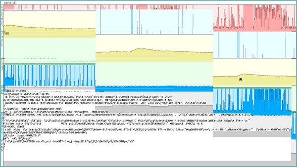

물론 저처럼 좀 특이한 사람이라면, 일부러 화면을 뒤죽박죽으로 만드는 걸 오히려 즐길 수도 있겠죠. 이 기능이 어떻게 간편한 알림 메커니즘을 제공하는지 이미 예시를 살펴봤지만, 다른 방식으로 악용할 수도 있습니다. 예를 들어, 저는 시스템 콘솔에 ASCII 배트 신호를 그리고 배트맨 주제가를 재생하는 배트 스크립트를 가지고 있습니다. 이 스크립트는 화면을 완전히 엉망으로 만들어 버리는데, 앞서 배터리 모니터링 섹션에서 언급한 ‘batt’를 실수로 잘못 입력했을 때 머리를 감싸쥐게 만드는 재미있는 상황이 됩니다. 여기 또 다른, 좀 더 “유용한” 예시가 있습니다. 이 스크립트는 빠르게 움직이는 전체 화면 통계 표시창을 그려낸 다음, 일정한 간격으로 화면을 뒤죽박죽으로 만듭니다. 제 생각에는 이 기능이 사실상 화면 잠금 장치 역할을 할 만큼 초보자를 효과적으로 쫓아내는 효과가 있습니다. Plan 9 사용자가 아닌 사람(즉, 모든 사람)이 이런 화면을 보면, 컴퓨터가 뭔가 끔찍하게 고장 났다고 생각하고 10피트 장대라도 뻗어 건드리지 않으려 할 것입니다. 물론, 통계 창을 닫으면 모든 것이 정상으로 돌아옵니다.

```
#!/bin/rc
# scramble - garbles up a rio screen
# usage: scramble

rfork e
fn sigexit{ kill stats | rc }
screensize=(`{echo $vgasize | sed 's/x/ /g'})
window -r 0 0 $screensize(1) $screensize(2) stats -T 0.01 -cflmsz &
while(sleep 3){
    if (! ps | grep -s stats) exit
    dd -if /dev/random -of '#c/cons' -bs 1024 -count 1 -quiet 1
}
```


### max - Maximizing Windows

다음 스크립트를 사용하면 다양한 방법으로 창을 최대화할 수 있습니다. 예를 들어, ‘max’를 입력하면 현재 창이 전체 화면으로 전환되고, ‘max u’를 입력하면 이전 크기로 복원됩니다. ‘max r 2’를 입력하면 ID가 2인 창이 화면 오른쪽 절반에 배치되는 식입니다. 즐겁게 사용해 보세요!

```
#!/bin/rc
# max - maximize windows
# usage: max [orientation] [winid]
#
# orientation can be: f (fullscreen), l (left), r (right), t (top), b (bottom),
# tl (top-left), tr (top-right), bl (bottom-left), br (bottom-right) or u
# (unmaximize), default is fullscreen.
#
# bugs: if you are maximizing another window, orientation is required
#       unmaximize is only useful right after maximizing a window.

# set some defaults
screensize=(0 0 `{echo $vgasize | awk -Fx '{ print $1, $2 }'})
if(~ $#windowsize 0)
    windowsize=`{dd -if /dev/window -bs 1 -count 70 -quiet 1 |
    awk '{ print $2, $3, $4, $5}'}
window=/dev/wctl
if(~ $#* 0) echo resize -r $screensize > $window
if(~ $#* 2) window=/mnt/wsys/wsys/$2/wctl
if(test $#* -gt 2){
    echo usage: max [orientation] [winid] >[1=2]
    exit
}

# maximize window
echo current > $window
switch $1 {
case f
    echo resize -r $screensize > $window
case l
    echo resize -r $screensize |
    awk '{ printf("%s %s %d %d %d %d", $1, $2, $3, $4, $5/2, $6) }' > $window
case r
    echo resize -r $screensize |
    awk '{ printf("%s %s %d %d %d %d", $1, $2, $5/2, $4, $5, $6) }' > $window
case t
    echo resize -r $screensize |
    awk '{ printf("%s %s %d %d %d %d", $1, $2, $3, $4, $5, $6/2) }' > $window
case b
    echo resize -r $screensize |
    awk '{ printf("%s %s %d %d %d %d", $1, $2, $3, $6/2, $5, $6) }' > $window
case tl
    echo resize -r $screensize |
    awk '{ printf("%s %s %d %d %d %d", $1, $2, $3, $4, $5/2, $6/2) }' > $window
case tr
    echo resize -r $screensize |
    awk '{ printf("%s %s %d %d %d %d", $1, $2, $5/2, $4, $5, $6/2) }' > $window
case bl
    echo resize -r $screensize |
    awk '{ printf("%s %s %d %d %d %d", $1, $2, $3, $6/2, $5/2, $6) }' > $window
case br
    echo resize -r $screensize |
    awk '{ printf("%s %s %d %d %d %d", $1, $2, $5/2, $6/2, $5, $6) }' > $window
case u
    echo resize -r $windowsize > $window
    windowsize=()
}
```


### ws - Multiple Workspaces

이 스크립트는 rio를 위한 가상 작업 공간과 유사한 서비스를 제공합니다. ws n을 입력하여 사용할 수 있으며, 여기서 n은 임의의 작업 공간 번호입니다. 이 스크립트는 어떤 창이 어떤 “작업 공간”에 속하는지 등록한 다음, 사용자가 작업 공간 간을 “전환”할 때 해당 창을 자동으로 숨기거나 표시하도록 작동합니다. 물론 이것은 단지 의사 가상 작업 공간일 뿐이며, 모든 창은 여전히 rio 메뉴에서 사용할 수 있고, 한 “작업 공간”에서 파일을 연결하면 다른 “작업 공간”에서 파일이 열릴 수도 있습니다. 더 나은 사용자 경험을 위해서는 위 작업 공간 섹션에서 언급한 riow를 권장하지만, 다음 스크립트는 유용한 통찰력을 제공할 수 있습니다.

```
#!/bin/rc
# ws - pseudo virtual workspaces for rio
# usage: ws n
#
# bugs: the ws workspaces are not isolated from each other, if you need
#       that open a fullscreen window in each ws workspace and run
#       plumber followed by rio in it. even then rio is still blissfully
#       unaware of such "workspaces".

# set some defaults
rfork ne
tmp=/tmp/ws
winid=`{cat /dev/winid}

# initialize 1st desktop on first run
if(! test -d $tmp){
    mkdir -p $tmp
    touch $tmp/1
    echo 1 > $tmp/currentws
    ls -np /mnt/wsys/wsys > $tmp/`{cat $tmp/currentws}
}

# update window lists
ls -np /mnt/wsys/wsys > $tmp/riowindows
cat $tmp/[0-9]* | sort -n > $tmp/wswindows
comm -23 $tmp/riowindows $tmp/wswindows >> $tmp/`{cat $tmp/currentws}
for(i in `{comm -13 $tmp/riowindows $tmp/wswindows}){
    for(w in $tmp/[0-9]*) sed '/^'$i'$/d' $w > $tmp/TMP && mv $tmp/TMP $w
}
currentws=`{cat $tmp/currentws}
# no args: echo current ws (after updating windows) and exit
if(~ $#* 0){ echo $currentws && exit }
touch $tmp/$1

# switch desktop
if(~ $1 $currentws){ echo this is workspace $1 && exit }
for(i in `{cat $tmp/`{cat $tmp/currentws} | sed '/^'$winid'$/d' })
    echo hide > /mnt/wsys/wsys/$i^/wctl
echo $1 > $tmp/currentws
for(i in `{cat $tmp/`{cat $tmp/currentws}}) echo unhide > /mnt/wsys/wsys/$i^/wctl
echo hide > /mnt/wsys/wsys/$winid^/wctl
```


### tile - Tiling Window Manager

'tile'은 창들을 타일 형태로 자동으로 배열해 줍니다. 알고리즘은 간단합니다. 먼저 화면 왼쪽 절반에 창 하나를 배치한 다음, 나머지 창들을 위해 화면 오른쪽 절반을 균등한 크기로 나누어 배열합니다. 이 스크립트는 의도적으로 간단하게 작성되었으므로, 필요에 따라 자유롭게 확장하거나 수정해 보세요.

```
#!/bin/rc
# tile - tile windows
# usage: tile

# gather some information
rfork e
screensize=(0 0 `{echo $vgasize | awk -Fx '{print $1, $2}'})
windows=`{for (win in /mnt/wsys/wsys/*)
    if(dd -if $win/wctl -bs 128 -count 1 -quiet 1|grep -s visible)
        echo `{basename $win}
}
fn left{awk  '{printf("%s %s %d %d %d %d",$1,$2,   0,   0,$5/2,$6 )}'}
fn right{awk '{printf("%s %s %d %d %d %d",$1,$2,$5/2,'$b',$5, '$e')}'}

# auto tile windows
if(~ $#windows 1)
    echo resize -r $screensize > /mnt/wsys/wsys/$windows/wctl
if not {
    echo current > /mnt/wsys/wsys/$windows(1)^/wctl
    echo resize -r $screensize | left > /mnt/wsys/wsys/$windows(1)^/wctl
    windows=`{echo $windows | sed 's/^[^ ]+ //'}    # shift windows
    step=`{ echo $screensize(4) / $#windows | bc }
    b=0; e=$step                # begin, end
    for(i in $windows){
        echo current > /mnt/wsys/wsys/$i/wctl
        echo resize -r $screensize | right > /mnt/wsys/wsys/$i/wctl
        b=`{ echo $b + $step | bc }
        e=`{ echo $e + $step | bc }
    }
}
```


## Acme Scripting

위 섹션에서는 몇 가지 창 관리자 스크립트를 시연했지만, acme에서 ‘tile’이나 다른 창 관리자 스크립트를 중클릭해도 아무 일도 일어나지 않습니다. 그 이유는 터미널 창과 acme의 네임스페이스가 다르기 때문입니다. ‘win’을 중클릭하고 /dev 및 /mnt를 살펴보면, 이 디렉터리의 내용이 일반 터미널의 동일한 디렉터리와 다르다는 것을 알 수 있습니다. 하지만 걱정하지 마세요. ‘Local’ 명령을 사용하면 acme가 자신을 호출한 셸의 네임스페이스를 사용하여 명령을 실행하도록 요청할 수 있습니다. 따라서 ‘Local’ 타일을 중간 클릭하면 rio 창을 문제없이 타일링할 수 있습니다(두 단어를 “중간 클릭”하려면 중간 클릭한 상태에서 드래그하여 텍스트를 선택해야 합니다).

acme에서 Tile을 자주 사용할 계획이라면, /acme/bin/Tile에 이를 위한 래퍼 스크립트를 작성하는 것도 또 다른 방법입니다:

```
#!/bin/rc
# Tile - wrapper for tile
tile $*
```

보시다시피, 이것은 그저 평범한 셸 스크립트일 뿐입니다. 유일한 차이점은 acme가 /acme/bin을 /bin에 바인딩하는 반면, 다른 프로그램들은 그렇지 않기 때문에 /acme/bin에 있는 파일들은 이 프로그램의 네임스페이스에 속한다는 점입니다. 여기서 tile을 실행하면 일반적인 셸 네임스페이스를 갖게 되므로, 예상대로 작동할 것입니다. 참고로, rio 타일링 스크립트와의 이름 충돌을 피하기 위해 acme 래퍼의 이름은 대문자 T로 시작합니다. /acme/bin에 추가하고 싶은 다른 간단한 셸 스크립트들도 있을 수 있습니다. acme에 대한 소개 섹션에서, 외부 도구를 사용하여 기본적인 텍스트 편집 작업을 수행하는 방법에 대한 몇 가지 예시를 나열한 바 있습니다. /acme/bin에 해당 셸 스크립트를 추가함으로써 이러한 예시들을 acme 명령어로 쉽게 만들 수 있습니다. 예를 들어, 텍스트의 들여쓰기를 추가하거나 제거하기 위해 다음과 같은 t+ 및 t- 스크립트를 작성할 수 있습니다:

```
#!/bin/rc
# t+ - indent text
sed 's/^/    /'

#!/bin/rc
# t- - unindent text
sed 's/^    //'
```

이제 acme에서 텍스트를 선택(왼쪽 클릭 후 드래그)하여 들여쓰기를 하고, 가운데 클릭으로 |t+를 실행해 새로운 스크립트로 전달할 수 있습니다. 물론 텍스트 주석 처리 및 주석 해제, 파일에 줄 번호 추가 및 제거, 텍스트 대소문자 변환, rot13을 이용한 텍스트 난독화 등의 명령어도 마찬가지로 쉽게 작성할 수 있습니다. 하지만 acme 자체를 스크립트로 제어하기 시작하면 진짜 재미가 시작됩니다! rio와 마찬가지로, acme도 일련의 제어 파일에 일반 텍스트를 작성하여 완전히 제어할 수 있습니다. 몇 가지 간단한 예제를 살펴보겠습니다:


### Coffee - Chill ASCII Animations

어떤 디렉터리에 일련의 ASCII 커피 머그잔 이미지를 만들었다고 가정해 봅시다. 첫 번째 작품인 $home/lib/animation/coffee/1은 대략 다음과 같이 보일 수 있습니다:

```
                (

              ) (
              ( ) (
            ,---------.__
            |         |  |
            |         |  |
            |         |  |
            |         |=='
            |         |
            `---------'

           COFFEE  BREAK
``` 

나머지 파일들에 대해서는 여러분의 상상력에 맡기겠지만, 요점은 이 파일들이 빠른 속도로 차례대로 표시되면 김이 모락모락 나는 커피잔을 묘사한 ASCII 애니메이션이 완성된다는 것입니다. 리오 터미널에서는 다음과 같이 애니메이션 스크립트를 작성할 수 있습니다:

```
#!/bin/rc
# coffee - print ASCII animation of steaming coffee mug
# usage: coffee

play $home/music/samples/coffee.mp3 >[2]/dev/null &
while()
    for(i in $home/lib/animation/coffee/*)
        > /dev/text && cat $i && sleep 1
```


하지만 ACME Win 터미널에서는 이 방법이 통하지 않습니다. 우리 네임스페이스에는 /dev/text가 없기 때문입니다. ACME 창에서 텍스트를 지우려면 Edit ,d 명령어를 입력한 뒤(vi 사용자분들께는 :%d와 같습니다), 이 명령어를 선택한 다음 마우스 중간 버튼으로 클릭해야 합니다. 이 작업을 프로그래밍 방식으로 수행할 수 있을까요? 물론입니다:

```
#!/bin/rc
echo -n Edit ,d   > /dev/acme/body
echo -n /Edit ,d/ > /dev/acme/addr
cat /dev/acme/addr | awk '{ print "MX", $1, $2 }' > /dev/acme/event
```

이는 기본적으로 앞서 언급한 세 단계를 따릅니다. 마지막 줄이 가장 이해하기 어렵습니다. 여기서 우리가 하는 일은 주소(표시된 텍스트)를 읽어들이는 것으로, 이를 통해 시작 위치와 끝 위치와 같은 정보가 반환되며, 이 정보를 awk에 전달합니다. 또한 event에 “MX” 명령을 추가하는데, 이는 acme에게 이 텍스트 영역에서 마우스 중간 버튼이 “클릭”되었다는 것을 알려줍니다.

이 스크립트의 이름을 /acme/bin/clear로 지정하고, $home/bin/rc/clear에 rio 터미널을 지우는 스크립트를 추가해 봅시다:

```
#!/bin/rc
# clear - clear up a rio terminal
# usage: clear (see also /acme/bin/clear)
> /dev/text
```

이제 커피 애니메이션 스크립트를 수정하여 리오 터미널과 ACME의 윈도우 터미널 모두에서 작동하도록 할 수 있습니다:

```
while()
    for(i in $home/lib/animation/coffee/*)
        clear && cat $i && sleep 1
```


### Slides - Acme Presentations

또 다른 간단한 예시를 들어보겠습니다. 1, 2, 3…이라는 이름의 파일들이 들어 있는 디렉터리가 있다고 가정해 봅시다. 각 파일은 텍스트 기반 슬라이드 쇼의 한 장을 구성합니다. '1'을 마우스 오른쪽 버튼으로 클릭하여 첫 번째 슬라이드를 열 수 있습니다. 그런 다음 파일 이름을 수동으로 '2'로 편집하고, 'Get'을 입력한 뒤 중간 버튼을 클릭합니다. 성가신 점은 acme가 이 파일을 불러오면 창 내용이 변경된다는 경고를 표시하기 때문에 'Get'을 두 번 클릭해야 한다는 것입니다. 이 과정을 자동화해 봅시다:

```
#!/bin/rc
# Slide[-+] - go back and forwards in a slide show
# usage: Slide[-+]
#
# bugs:  slides must be named 1, 2, 3...
#        to "install" the script copy it to /acme/bin/Slide^('' - +)
#        (that is to /acme/bin/Slide{,-,+} in UNIX speak)

switch($0){
case *Slide
    ls `{pwd}
    exit
case *Slide+
    page=`{echo `{basename $%} + 1 | hoc}
    if(! test -f $page) exit
case *Slide-
    page=`{echo `{basename $%} - 1 | hoc}
    if(! test -f $page) exit
case *
    echo Error: bogus program name!
    exit wrongname
}

echo 'name '`{pwd}^/$page'' > /mnt/acme/$winid/ctl
echo clean > /mnt/acme/$winid/ctl
echo get   > /mnt/acme/$winid/ctl
```

이 스크립트를 설치하려면 /acme/bin/Slide에 복사하고 실행 권한을 설정한 다음, 같은 위치에 있는 Slide+와 Slide-에도 이 스크립트를 복사하세요. 이제 acme에서 반복 슬라이드 중 하나를 열면, Slide+를 중간 클릭하여 다음 슬라이드로 넘어가고, Slide-를 클릭하여 이전 슬라이드로 돌아가거나, Slide를 클릭하여 슬라이드 목록을 볼 수 있습니다. Slide+나 Slide-를 반복해서 클릭할 수 있으며, 각각 끝이나 시작에 도달하면 슬라이드 쇼가 중지됩니다.

이 스크립트에는 몇 가지 특수 변수가 포함되어 있습니다. $0은 실행 중인 프로그램의 이름을 가리킵니다. 프로그램의 동작은 호출된 이름에 따라 달라지는데, Slide+로 호출되면 슬라이드가 다음으로 넘어가고, Slide-로 호출되면 슬라이드가 이전으로 돌아가는 식입니다. $%는 acme 고유의 변수로, 현재 acme 창의 태그에 지정된 파일 이름을 가리킵니다. 마지막 세 줄은 매우 간단합니다. 파일 이름을 변경하고, acme에 내용 변경에 대해 알리지 않도록 지시하며, 마지막으로 새 파일을 불러옵니다.

PS: 이 코드는 완전히 독창적인 것은 아니며, Russ Cox의 Slide 스크립트에서 큰 영감을 받았습니다.


### Chat - Simple Peer to Peer Chatting


IRC와 같은 현대적인 채팅 프로토콜이 등장하기 훨씬 전, 초기 유닉스 시스템에는 ‘write’라는 간단한 피어-투-피어 채팅 프로그램이 포함되어 있었습니다. 이 프로그램은 두 사용자 사이에 간단한 연결을 구축하고, 사용자가 입력한 내용을 그대로 공통 텍스트 창에 표시해 주었습니다. 두 사용자가 동시에 글을 쓰면 텍스트가 뒤섞여 버리기 때문에, 대화를 시작한 사용자가 먼저 글을 쓰고 입력을 (o)로 끝내는 것이 관례였습니다. (o)는 “끝(over)”을 의미합니다. 그러면 다른 사용자가 답장을 하고, 역시 (o)로 입력을 끝냈습니다. 그리고 마침내 대화가 끝났을 때, 한 사용자가 (oo)를 입력하여 대화를 종료한다는 신호를 보냈습니다. (oo)는 “끝, 이만(over and out)”을 의미합니다.

놀랍게도, 비록 아무도 사용하지는 않지만 오늘날 대부분의 최신 유닉스 시스템에서 이 50년 된 프로그램을 실제로 찾아볼 수 있습니다. 반면 Plan 9는 90년대를 위한 현대적인 운영 체제이므로, 이 구식 프로그램은 포함되어 있지 않습니다. 하지만 향수에 젖고 싶다면, 이를 구현하는 것은 아주 간단합니다:

```
; touch /usr/chat && chmod 666 /usr/chat
; tail -f /usr/chat &
; while(){ read >> /usr/chat }
```

임의의 수의 사용자가 동일한 명령을 입력하고 채팅에 참여할 수 있으며, 원격 Plan 9 사용자도 마찬가지입니다. 채팅 머신의 파일 시스템을 가져오기만 하면 바로 사용할 수 있습니다. 사용자가 파일에 입력한 내용은 그대로 모든 시청자에게 표시됩니다. 하지만 이 해결책은 다소 어색합니다. 우선, UNIX의 write 명령어는 대화 상대가 텍스트 콘솔에서 작업하고 있는 경우(점점 더 드문 일이 되었지만) 상대방에게 알림을 보냈지만, 우리 시스템은 그렇지 않습니다. 그 외에도 몇 가지 미흡한 점이 있습니다. 분명 이를 위해 더 훌륭한 acme 클라이언트를 만들 수 있지 않을까요? 간단한 알림 시스템을 구현하는 것부터 시작해 봅시다. 여러 가지 방법으로 구현할 수 있겠지만, 여기 간단한 제안이 있습니다:

```
; touch $home/lib/notify
; chmod 666 $home/lib/notify # allow everyone read/write access
; B $home/lib/profile
...
# notify daemon (see statusmsg(8))
while(sleep 5){
    if(test -s $home/lib/notify)
        @{cat $home/lib/notify; sleep 5} | aux/statusmsg
    > $home/lib/notify
}&

# usage: notify user message...
fn notify{
    recv=$1 && shift
    if(test -w /usr/$recv/lib/notify)
        echo $* >> /usr/$recv/lib/notify
}

# miscellaneous oldschool commands
fn write{
    echo 'Use Chat in acme you Neanderthal!'
}
fn wall{
    for(recv in `{who}) notify $recv $*
}
fn mesg{
    if(~ $1 y) chmod 666 $home/lib/notify
    if(~ $1 n) chmod 644 $home/lib/notify
}
fn finger{
    whois $1
    for(file in /usr/$1/lib/^(plan project))
        if(test -f $file) cat $file
}

# clean up old chat logs
rm -f $home/lib/chat    
...
; reboot
```

알림 메커니즘이 마련되었으니, 이제 ACME 채팅 클라이언트를 작성해 볼 수 있습니다(메시지 수신 변수로는 직관적이지 않은 $recv를 사용합니다. $user는 이미 사용 중이며, 이는 사용자를 가리키기 때문입니다). 이를 두 가지 명령어로 구현할 것입니다. 채팅 세션에 연결하는 ‘Chat’ 명령어와, 태그 라인에 입력한 내용을 가져와 채팅 로그에 추가하는 ‘Reply’ 명령어입니다.

```
#!/bin/rc
# Chat - open a new chat window
# usage: Chat user...

# are we host or client?
rfork ne
if(~ $#* 0) exit
if(~ $#* 1 && test -f /usr/$1/lib/chat) host=$1
if not host=$user
log=/usr/$host/lib/chat
tag=' ['$host'] Reply '
if(~ $host $user){
    touch $log && chmod 666 $log
    for(recv in $*) notify $recv $user wants to Chat!
}

# set up chat window
id=`{awk '{ print $1 }' /dev/new/ctl}
for(cmd in nomenu cleartag scratch) echo $cmd > /mnt/acme/$id/ctl
echo -n $"tag > /mnt/acme/$id/tag
tail -f $log > /mnt/acme/$id/body >[2]/dev/null

#!/bin/rc
# Reply - write tag comments to a chat log
# usage: Reply comment...

rfork ne
tag=`{sed 's/.*(\[.+\] Reply).*/\1/' /mnt/acme/$winid/tag}
host=`{echo $tag | sed 's/.*\[(.+)\].*/\1/'}
reply=`{sed 's/.*Reply //' /mnt/acme/$winid/tag}

echo $user: $reply >> /usr/$host/lib/chat
echo cleartag > /mnt/acme/$winid/ctl
echo ' '$"tag' ' > /mnt/acme/$winid/tag
```

채팅 프로그램은 먼저 사용자가 채팅 호스트인지 여부를 확인합니다. (호스트는 로그를 관리하고 게스트를 초대하는 역할을 합니다.) 다음으로, 프로그램은 /dev/new/ctl을 읽어 새로운 acme 창을 생성하며, 이 파일을 읽을 때 반환되는 첫 번째 인수는 새로 생성된 창의 ID 번호입니다. 그런 다음 새 창의 제어 파일에 몇 가지 명령을 기록하여, 태그 라인을 비워두고 이 창의 내용이 변경되더라도 acme가 경고를 표시하지 않도록 지정합니다. 마지막으로 태그 라인에 호스트 이름과 Reply 명령을 추가하고, 채팅 로그의 변경 사항을 수신 대기하기 시작하면 해당 내용이 새 창의 본문에 출력됩니다.

채팅 창에 무언가를 작성하려면, 파란색 태그 라인의 ‘Reply’ 명령어 뒤에 댓글을 추가한 후, 작성이 끝나면 ‘Reply’를 중간 클릭하기만 하면 됩니다. 그러면 댓글이 사용자 이름이 접두사로 붙은 채 채팅 로그에 추가되고, 태그 라인은 초기화됩니다. 이 명령어에는 다소 특이한 정규 표현식이 포함되어 있습니다. (.+) sed 인수는 UNIX에서는 \(..*\)에 해당합니다. Plan 9 유틸리티는 모두 정규 표현식을 처리하기 위해 egrep과 유사한 regexp(6) 라이브러리를 사용합니다. 또 한 가지 세부 사항: ‘ ’$"tag' '는 보기 흉하지만, 공백을 올바르게 보존하기 위해 필요합니다.

당연히, 우리의 채팅 프로그램은 놀라울 정도로 원시적입니다. 호스트를 선택하고 오래된 채팅 로그를 정리하는 방식이 엉성할 뿐만 아니라, 일반적인 기능들도 많이 빠져 있습니다. 하지만 UNIX의 write 함수와 비교하면 사실 꽤 진보된 편입니다. 보안 네트워크 프로토콜인 9P를 통해 임의의 인원과 채팅할 수 있고, 사용자는 식별되며 출력이 뒤섞이지 않고 동시에 글을 쓸 수 있으며, 심지어 GUI 알림 기능도 갖추고 있습니다. 나쁘지 않은 출발점이니, 필요에 따라 코드를 자유롭게 확장해 보세요 :)


### Play - Music Playlist in Acme

아래 오디오 섹션에서는 재생 중인 곡을 일시 정지, 재개 및 건너뛰기 위한 몇 가지 간단한 셸 함수를 소개합니다. 이 중 일부는 $home/bin/rc에 셸 스크립트로 쉽게 작성할 수 있으며, 이를 통해 acme에서도 사용할 수 있습니다(acme에서만 사용하려는 경우에는 /acme/bin에 배치할 수도 있습니다):

```
#!/bin/rc
# skip - skip a song that is playing
kill pcmconv | rc

#!/bin/rc
# pause - pause a song that is playing
stop pcmconv | rc

#!/bin/rc
# resume - resume a paused song
start pcmconv | rc

#!/bin/rc
# vol - adjust audio volume
# usage: vol n
echo master $1 $1 > /dev/volume
```

하지만 이 기능들에는 두 가지 한계가 있습니다. 첫째, 시각적인 재생 목록을 보여주지 않을 뿐만 아니라 재생 목록 내에서 자유롭게 앞뒤로 이동할 수도 없으며, 현재 재생 중인 곡을 건너뛰고 목록에 있는 다음 곡을 재생하는 것만 가능합니다. 하지만 생각해 보면, que(나중에 언급할 스크립트)는 재생 목록을 순회하는 데 필요한 기능을 갖추고 있고, acme는 어쨌든 텍스트 편집기인 만큼 그러한 목록을 시각화하고 편집하는 데 필요한 기능을 갖추고 있습니다. 이 두 가지를 하나의 일관된 GUI로 통합하는 것은 매우 쉬운 일로 밝혀졌습니다. acme의 Play 명령은 다음과 같습니다:

```
#!/bin/rc
# Play - play a list of audio files
# usage: Play
# bugs:  must run command in a window with audio filenames

echo cleartag > /mnt/acme/$winid/ctl
echo ' Play Quit Repeat ' > /mnt/acme/$winid/tag

while(){
    if(! test -d /mnt/acme/$winid) exit
    if(! grep -s '<--' /mnt/acme/$winid/body &&
         grep -s Norepeat /mnt/acme/$winid/tag) exit
    song=`{que $%}
    echo clean > /mnt/acme/$winid/ctl
    echo get   > /mnt/acme/$winid/ctl
    play $song > /dev/null >[2=1]
}
```

이 프로그램을 사용하려면 먼저 오디오 파일로 구성된 재생 목록을 작성해야 합니다. 다음과 같은 명령어를 실행하면 쉽게 재생 목록을 생성할 수 있습니다: du -a $home/music/creedence | awk ‘/\.mp3/ { print $2 }’ | sort > $home/lib/playlist/creedence acme에서 다음과 같은 재생 목록을 열었다고 가정해 봅시다:

```
/usr/glenda/music/creedence/01_pagan_baby.mp3
/usr/glenda/music/creedence/02_sailors_lament.mp3
/usr/glenda/music/creedence/03_chameleon.mp3
...
```

태그 라인에 “Play now”라고 입력한 뒤 중간 클릭하면, 태그 라인에 “Quit” 및 “Repeat” 명령이 추가되고, “01_pagan_baby.mp3” 재생이 시작된 후 재생 목록이 다음과 같이 업데이트됩니다:

```
/usr/glenda/music/creedence/01_pagan_baby.mp3
/usr/glenda/music/creedence/02_sailors_lament.mp3<--
/usr/glenda/music/creedence/03_chameleon.mp3
...
```

01_pagan_baby.mp3의 재생이 끝나면 02_sailors_lament.mp3의 재생이 시작되고, “<--” 마커는 다음에 재생될 곡인 03_chameleon.mp3로 이동하며, 이 과정이 계속 반복됩니다. 이렇게 하면 재생 목록이 끝없이 반복됩니다. 하지만 ‘반복(Repeat)'을 중간 클릭하면 '반복 안 함(Norepeat)'으로 변경되어 재생 목록이 한 번만 재생된 후 멈춥니다. (이는 대기열이 완료되면 'que’ 명령어가 “<--” 마커를 제거한다는 규칙에 기반합니다.) 마지막으로, 이 창을 Del 키로 닫는 것도 어느 정도는 작동하지만, 마지막 곡은 재생이 끝날 때까지 계속 재생됩니다. 이 창과 재생 중인 오디오를 모두 정상적으로 종료하려면 '종료(Quit)'를 중간 클릭하세요. 다음은 지원 스크립트입니다:

```
#!/bin/rc
# Quit - quit Play
stop pcmconv  | rc
echo clean > /mnt/acme/$winid/ctl
echo del   > /mnt/acme/$winid/ctl
start pcmconv | rc
kill pcmconv  | rc

#!/bin/rc
# Repeat - toggle norepeat for Play
echo cleartag > /mnt/acme/$winid/ctl
echo ' Play Quit Norepeat ' > /mnt/acme/$winid/tag

#!/bin/rc
# Norepeat - toggle repeat for Play
echo cleartag > /mnt/acme/$winid/ctl
echo ' Play Quit Repeat '   > /mnt/acme/$winid/tag
```

여기서 주목해야 할 점은, 재생 목록이 단순한 텍스트 파일이라는 사실입니다. 따라서 필요에 따라 자유롭게 줄을 추가하거나 삭제할 수 있으며, “<--” 화살표를 원하는 줄로 자유롭게 이동시킬 수도 있습니다. ‘Put’을 중간 클릭하여 변경 사항을 저장하면, 화살표가 가리키는 줄에 있는 곡이 다음으로 재생됩니다. 그렇다면 재생 목록을 셔플하려면 어떻게 해야 할까요? 리눅스에서 Plan9Port와 함께 acme를 사용하는 경우, 재생 목록을 선택한 뒤 중간 클릭으로 |shuf를 입력하면 됩니다(재생 목록이 매우 긴 경우에는 Edit ,|shuf를 입력하면 됩니다). 하지만 Plan 9에는 shuf 명령어가 없습니다! 상관없습니다. 그냥 직접 만들면 됩니다. 다음의 간단한 해결책이면 우리의 목적에 충분할 것입니다:

```
#!/bin/rc
# shuf - shuffle input lines
# usage: shuf < input > output

ifs='
'
fn sigexit{ rm -f /tmp/shuf-$pid }
for(line in `{cat /fd/0}){
    for(i in 1 2 3) awk '{ printf("%d", substr($2,19)) }' /dev/time
    echo @@@$line
} >> /tmp/shuf-$pid
sort -n /tmp/shuf-$pid | sed 's/^[0-9]+@@@//' > /fd/1
exit    # force clean up
```

이 스크립트에서는 컴퓨터 시계의 마지막 나노초를 활용하여 상당히 무작위적인 숫자들을 생성합니다. /fd/0, /fd/1, /fd/2는 UNIX의 /dev/stdin, /dev/stdout, /dev/stderr과 동일하며(당연히 IFS와도 동일합니다. Plan 9는 UNIX보다 소문자 사용에 훨씬 더 중점을 둡니다), 여기서의 마지막 종료 방식은 보기 흉하지만, sigexit 트랩이 작동하도록 하기 위해서는 필수적입니다(Plan 9는 신뢰할 수 없는 UNIX 신호에 경의를 표합니다).

이 섹션에서는 몇 가지 간단한 스크립트만 소개했지만, 이 스크립트들이 소수의 작은 셸 스크립트만으로도 acme의 기능을 얼마나 쉽게 확장할 수 있는지 잘 보여주었기를 바랍니다. 어차피 acme가 있는데, 누가 부피만 큰 그래픽 툴킷이 필요하겠습니까!


## Web Scripting

앞서 언급했듯이, Plan 9 네트워크는 일반 파일을 통해 제어됩니다. 이러한 구현 방식은 다소 특이하므로, /sys/doc/net/net.ps 문서를 읽어 해당 개념에 익숙해지시기 바랍니다. 데스크톱을 파일에 텍스트 문자열을 기록하여 제어한다는 개념과 마찬가지로, 이 아이디어도 처음에는 기이하거나 심지어 우스꽝스럽게 느껴질 수 있습니다. 하지만 rio 스크립팅 섹션에서 간단한 셸 스크립트로 고급 데스크톱 기능을 개발하는 방법을 설명하면(Windows 7에서 CMD로 가상 작업 공간을 활성화해 보세요!), 그런 비웃음이 금세 사라질 것입니다. 웹 스크립팅도 마찬가지일 것이라고 생각합니다. 여러분의 호기심을 자극해 드리기 위해, 다음은 완전한 기능을 갖춘 텔넷 구현 예시입니다:

```
#!/bin/rc
clonefile=/net/tcp/clone
<[4] $clonefile {
    netdir=`{basename -d $clonefile} ^ / ^ `{cat /fd/4}
    echo connect $1|$2 >$netdir/ctl || exit 'cannot connect'
    cat $netdir/data &
    cat >$netdir/data
}
```

### 9front Web Scripts

9front에는 IRC 클라이언트인 ircrc, 페이스트빈 명령어인 webpaste, 그리고 hget 및 hpost 명령어가 포함되어 있습니다. 이 프로그램들은 모두 셸 스크립트입니다. hget과 hpost는 UNIX의 wget 및 curl과 다소 비슷하지만, 각각 100줄과 200줄에 불과한 셸 스크립트입니다(반면 wget과 curl은 각각 30만 줄의 C 언어로 작성되었습니다!). 여기서는 소스 코드를 모두 소개하지는 않겠지만, Plan 9에서 직접 웹 스크립트를 작성할 계획이라면 이 프로그램들을 연구해 볼 가치가 있습니다. webpaste의 경우 코드가 불과 몇 줄에 불과하며, 웹 서비스로 데이터를 전송하는 방법을 잘 보여주는 예시입니다(hpost에 의존합니다):

```
#!/bin/rc
if(~ $#* 0)
    file=/fd/0
if not
    file=$1
hpost -u http://okturing.com -p / a_body@file submit:submit fake:fake a_func:add_post url: |
grep -e '\/body\"' |
sed 1q | sed 's/^.*href=\"//g; s/body\".*$/body/g'
```

PS: Classic Plan 9에는 앞서 언급한 스크립트들이 포함되어 있지 않습니다.

ircrc 역시 약 200줄 정도의 코드로 구성되어 있으며, 공부해 볼 만한 가치가 충분합니다. 하지만 여기서는 Plan 9에서 어떤 것이 가능한지 보여주기 위해 간소화된 버전을 소개합니다. 이 프로그램은 몇 가지 IRC 명령어만 지원하고 닉네임과 채널이 하드코딩되어 있는 매우 초보적인 IRC 클라이언트이지만, 그럼에도 불구하고 정상적으로 작동하는 IRC 클라이언트입니다. 게다가 쉘 코드가 70줄도 채 되지 않는다는 점을 고려하면 결코 나쁘지 않은 성과입니다:

```
#!/bin/rc
rfork ne
server=irc.oftc.net
port=6667
realname=myrealname
target='#cat-v'
netdir=()
nick=mynick

fn sighup {
    exit 'hang up'
}
fn sigint sigterm {
    if (! ~ $#netdir 0)
        echo QUIT : Leaving... > $netdir/data
}
fn mshift {
    shift
    echo $*
}
fn etime {
    date | awk '{print $4}' | awk -F ':' '{print "[" $1 ":" $2 "]"}'
}

fn work {
    echo USER $user foo bar :$realname > $netdir/data
    echo NICK $nick > $netdir/data
    echo PRIVMSG 'nickserv :'identify $"pass > $netdir/data
    echo JOIN $target > $netdir/data
    while (cmd=`{read}) {
        s=$status
        if(~ $s *eof) {
            echo QUIT : Leaving... > $netdir/data
            exit
        }
        msg=()
        out=()
        switch ($cmd(1)) {
        case /j
            if (~ $#cmd 2) {
                target=$cmd(2)
                msg = (JOIN `{mshift $cmd})
            }
        case /q
            msg = `{mshift $cmd}
        case /x
            echo QUIT : Leaving... > $netdir/data
            exit
        case /*
            echo unknown command
        case *
            msg = 'PRIVMSG '^$target^' :'^$"cmd
            out = '('^$target^')    ⇐    '^$"cmd
        }
        echo $msg > $netdir/data
        echo `{etime}^' '^$out
    }
}

userpass=`{auth/userpasswd 'server='^$server^' service=irc user='^$nick >[2]/dev/null}
if(~ $#userpass 2) {
    nick=$userpass(1)
    pass=$userpass(2)
}

p='/n/ircrc'
bind '#|' $p
echo connecting to tcp!$server!$port...
aux/trampoline tcp!$server!$port <>$p/data1 >[1=0] &
netdir=$p
work
```


# Development


이 글은 Plan 9를 데스크톱으로 사용하는 방법에 관한 것이므로, 개발에 대해서는 간략히만 언급하겠습니다. 시스템 전반에 걸쳐 사용되는 프로그래밍 언어는 C이며, 더 구체적으로는 Plan 9 전용 C 방언입니다. 또한 이 시스템은 지원하는 각 아키텍처마다 별도의 컴파일러와 링커 세트를 갖추고 있습니다. Plan 9에서 프로그래밍이 어떻게 이루어지는지 보여주기 위해, 『The C Programming Language』(15쪽)에 나오는 고전적인 화씨-섭씨 변환 프로그램을 예로 들어보겠습니다. units(1) 명령어는 이 특정 변환을 처리하지 않기 때문에 이 프로그램은 어느 정도 유용합니다. 고전적인 버전은 사실 약간의 수정만 거치면* Plan 9에서도 문제없이 컴파일되지만, 재미 삼아 화씨에서 섭씨로 변환할 때 사용하는 -c 플래그와, 값 표를 출력하는 대신 특정 온도를 변환할 때 사용하는 -d degree 플래그를 추가해 볼 수 있습니다:

```
; ed fahcel.c
?fahcel.c
a # ed: append text

#include <u.h>
#include <libc.h>

#define LOWER -50
#define UPPER 150
#define STEP 10
#define F2C(deg) (5.0/9.0)*(deg-32)
#define C2F(deg) (deg*(9.0/5.0))+32

void usage(void);

/* Fahrenheit-Celsius converter */
void
main(int argc, char* argv[])
{
    int cflag = 0;
    int dflag = 0;
    double deg;
    
    /* parse arguments */
    ARGBEGIN{
    case 'c':
        /* Celsius to Fahrenheit */
        cflag = 1;
        break;
    case 'd':
        /* specify a temperature to convert */
        dflag = 1;
        deg = atof(EARGF(usage()))
        break;
    default:
        usage();
    }ARGEND;
    if (argc)
        usage(); /* no more args! */
    
    /* print temperature conversion */
    if (dflag) {
        print("%4s", cflag ? "Fahr" : "Cel ");
        print("%6.1f\n", cflag ? C2F(deg) : F2C(deg));
    } else {
        print("%10s\n", cflag ? "Fahr   Cel" : "Cel   Fahr");
        for (deg = LOWER; deg <= UPPER; deg = deg + STEP)
            print("%3.0f %6.1f\n", deg, cflag ? C2F(deg) : F2C(deg));
    }
    exits(nil);
}

/* exit with a usage statement */
void
usage(void)
{
    sysfatal("usage: fahcel [-c] [-d deg]");
}
. # ed: end text input
w # ed: write file
938
q # ed: quit
; 6c fahcel.c
; 6l -o fahcel fahcel.6
; fahcel -c -d -12.3
Fahr   9.9
; fahcel
Cel   Fahr
-50  -45.6
-40  -40.0
-30  -34.4
...
```

이 편집기에 익숙하지 않더라도 편집 관련 내용은 걱정하지 마세요. Plan 9에는 여러분에게 낯설게 느껴질 다른 텍스트 편집기들도 있습니다. Plan 9 사용자들은 종종 B 명령어를 사용하여 파일을 엽니다. 이 명령어는 현재 실행 중인 텍스트 편집기가 있다면 그 편집기에서 파일을 열거나, 실행 중인 편집기가 없으면 기본 편집기를 실행합니다(보통 sam입니다. acme를 선호한다면 $home/lib/plumbing 파일에 editor=acme를 추가하세요).

이 프로그램은 프로그래밍을 하지 않는 사람에게는 다소 어려워 보일 수 있지만, 노련한 개발자에게는 아주 간단하게 느껴질 것입니다. C 코드가 UNIX의 코드와 매우 비슷해 보이지만, 주의 깊게 살펴보면 놀라운 차이점들을 많이 발견할 수 있습니다. 대부분의 Plan 9 프로그램은 아키텍처 의존 코드인 u.h와 표준 라이브러리인 libc.h, 이 두 개의 헤더만 포함합니다. 또한 main 함수가 void를 반환하는 것이 완전히 허용되며, exit가 아닌 exits가 문자열을 반환한다는 점에도 주목하십시오. atof라니, 뭐라고요?!? 그건 안전하지 않아요! Plan 9에서는 그렇지 않습니다.* 제 생각에 Plan 9의 ARGBEGIN/ARGEND* 매크로와 sysfatal 함수는 명령줄 인자와 치명적인 오류를 처리하는 우아한 방법입니다. Plan 9에서 플래그가 두 개 이상인 모든 프로그램이 이 매크로를 사용하기 때문에, 옵션 처리가 일관적입니다. 긴 옵션은 없지만, 한 글자 플래그는 어떤 조합으로든 입력할 수 있습니다. 또한 플래그에 대한 인수도 어떤 조합으로든 입력할 수 있습니다. 예를 들어, -c -d -12.3, -cd -12.3, -c -d-12.3, -cd-12.3은 모두 유효합니다. 해석되지 않는 플래그를 입력해야 하는 경우, 예를 들어 파일 이름이 문자 그대로 -rf인 파일을 삭제해야 할 때는, 그 앞에 더블 대시를 붙여 입력하면 됩니다: rm -- -rf UNIX만이라도 이렇게 일관성이 있었더라면...

그 밖에도 몇 가지 차이점이 있습니다. 우선, 현재 디렉토리에 있는 프로그램은 이름만 지정해도 실행할 수 있는데, 유닉스에서는 일반적으로 이런 방식이 허용되지 않거나 적어도 바람직하지 않은 것으로 간주됩니다. 유닉스 방식대로 동작하게 하려면, $home/lib/profile.* 파일에 path=/bin을 설정하기만 하면 됩니다. 또 다른 차이점은 컴파일러와 링커가 서로 다른 두 개의 프로그램이며, 각 아키텍처마다 고유한 세트가 있다는 점입니다. 이 덕분에 프로그램의 크로스 컴파일이 매우 쉽습니다. 예를 들어, 위의 예제에서는 64비트 PC 아키텍처를 가정하고 있지만, 64비트 PC에서도 8c와 8l을 사용하여 32비트 프로그램을 쉽게 컴파일할 수 있으며, 5c와 5l을 사용하여 ARM 프로그램을 컴파일할 수도 있습니다(2c(1) 참조). 물론 PC 하드웨어에서는 ARM 프로그램을 실행할 수 없지만, Plan 9가 실행되는 라즈베리 파이(Raspberry Pi)는 Plan 9가 실행되는 PC에서 소프트웨어를 쉽게 컴파일할 수 있습니다(반대의 경우도 마찬가지입니다). 사실 32비트 Plan 9 시스템을 64비트로 크로스 컴파일하는 것은 아주 간단합니다(9front FAQ의 5.2.2.1절 참조).

Plan 9에서 개발을 시작하려면, 아마도 ‘Plan 9에서의 C 프로그래밍(C Programming in Plan 9)’이라는 문서를 읽어보는 것이 가장 좋은 출발점이 될 것입니다. Plan 9의 C 방언에 대한 구체적인 내용은 /sys/doc/comp.ps에서 다루고 있습니다. 이 디렉토리에 있는 다른 중요한 문서로는 acid 디버거에 관한 문서인 acidpaper.ps와 mk에 관한 문서인 mkfiles.ps(UNIX의 make와 동일)가 있습니다. 이 디렉토리에 있는 다른 논문들도 유용한 힌트를 제공해 주겠지만, 일부는 상당히 오래된 내용이라는 점을 유의하시기 바랍니다. 마지막으로, Plan 9에서는 매뉴얼 페이지와 소스 코드를 매우 쉽게 읽을 수 있으니, 이를 적극 활용하시기 바랍니다! src 명령어를 사용하면 주어진 명령어(예: src echo)에 대한 소스 코드를 빠르게 찾아볼 수 있습니다. 제가 강력히 추천하는 또 다른 자료는 Francisco J. Ballesteros가 쓴 Bell Labs의 『Plan 9를 이용한 운영 체제 추상화 입문(Introduction to Operating Systems Abstractions Using Plan 9)』입니다. 인터넷에서 PDF 파일을 무료로 다운로드할 수 있으며, 다소 지루해 보이는 제목과는 달리 Plan 9를 배우는 데 있어 훌륭한 프로그래밍 입문서입니다. 당연히 앞서 언급한 커니건(Kernighan)과 파이크(Pike)의 『C 프로그래밍 언어』, 같은 저자들의 『UNIX 프로그래밍 환경』, 아호(Aho), 커니건(Kernighan), 와인버거(Weinberger)의 『AWK 프로그래밍 언어』와 같이, 세부 사항 중 상당수는 직접 적용하기 어렵더라도 많은 고전적인 UNIX 자료들이 Plan 9에도 유용합니다.

셸 및 awk 프로그래밍 외에도, POSIX C 및 sh(/sys/doc/ape.ps 참조), Perl, Python, Go, Scheme, Lua, 그리고 Inferno를 설치할 경우 Limbo와 같은 외부 프로그래밍 언어에 대한 일부 지원도 제공됩니다(9fronts FAQ의 부록 L 참조). 하지만 일반적으로 C와 셸 프로그래밍이 가장 잘 지원되는 언어입니다. 예를 들어, Perl 포트는 매우 오래된 것이며, Python은 최근 9front에서 지원이 중단되었습니다(원한다면 여전히 구할 수 있습니다. 아래 지침을 참조하십시오).


## Version Control

모든 Plan 9 파일 시스템(9front의 cwfs, hjfs 또는 gefs, 혹은 클래식 Plan 9의 fossil 또는 kfs)은 스냅샷 기능을 기본적으로 지원합니다. 또한 스냅샷 기능을 갖춘 모든 파일 시스템과 마찬가지로, 버전 간의 차이만 저장되므로, 10Kb의 차이가 있는 1Gb 파일의 스냅샷은 디스크 공간을 10Kb만 차지합니다. 스냅샷은 일반적으로 정해진 간격으로 자동으로 생성되지만, 원할 경우 수동으로 생성할 수도 있습니다. 예를 들어, `echo dump >>/srv/hjfs.cmd`와 같이 입력하면 됩니다(cwfs 파일 시스템을 사용하는 경우 `/srv/cwfs.cmd`를 사용하십시오). 스냅샷을 읽으려면 `9fs dump`를 실행하면 되며, 파일은 `/n/dump`에 위치합니다. 예를 들어, 2020년 2월 23일에 생성된 /usr/glenda/prj/code.c의 스냅샷을 찾고 있다면, 해당 파일은 /n/dump/2020/0223/usr/glenda/prj/code.c에 위치해 있습니다. `yesterday` 명령어는 가장 최근 스냅샷의 경로를 빠르게 확인하는 방법입니다. `history` 명령어는 파일 내용이 다른 모든 사용 가능한 스냅샷을 표시합니다.

GEFS는 작동 방식이 약간 다릅니다. 스냅샷을 마운트하려면 `mount /srv/gefs /n/dump dump` 명령을 실행하면 됩니다. 일반적으로 파일 소유권을 변경하거나 보안을 위협할 수 있는 기타 관리 작업을 수행하는 것은 허용되지 않습니다. adm 그룹에 속한 사용자는 파일 시스템을 임시 위치에 허용 모드로 마운트하여 해당 제한을 우회하고, 그곳에서 필요한 관리 작업을 수행할 수 있습니다. 예: mount /srv/gefs /n/u %main; chgrp -u bob /n/u/usr/tom 기본적으로 GEFS는 스냅샷을 매우 빠르게 생성하지만, 이 동작을 조정하여 스냅샷에 직접 레이블을 지정할 수도 있습니다. 또한 스냅샷당 자동 체크포인트 생성 빈도를 조절하여 파일 시스템의 특정 부분이 백업되는 빈도를 제어할 수도 있습니다. 일반적인 사용 사례로는 main의 스냅샷을 other라는 이름으로 생성하고, 해당 스냅샷에서 자동 체크포인트를 비활성화하는 것입니다. 이러한 설정을 통해 다음과 같이 $home/tmp에서 스냅샷을 비활성화할 수 있습니다: mount /srv/gefs /n/o %other; mkdir -p /n/o/$home/tmp GEFS의 몇 가지 작동 방식을 예시로 들어보겠습니다:

```
; con -C /srv/gefs.cmd
gefs# snap -l                # list snapshots
gefs# set retain @d          # only take one snapshot daily
gefs# snap main keep         # make an read-only snapshot called "keep"
gefs# snap -m main fork      # make a mutable (changeable) snapshot called "fork"
gefs# set fork retain ''     # don't take automatic checkpoints of this snapshot
gefs# snap -d fork           # delete the "fork" snapshot
gefs# Ctrl - \
>>> q                        # quit con
```

벨 연구소(Bell Labs)의 개발자들은 Plan 9에 내장된 스냅샷 기능을 버전 관리 시스템으로 사용했는데, 개인적인 용도로는 이 방법이 아주 효과적입니다. 하지만 다른 프로그래머들과 온라인으로 협업하거나 Plan 9가 아닌 소프트웨어를 개발하는 경우에는, 좀 더 전통적인 버전 관리 소프트웨어를 사용하는 것이 좋을 것입니다. 이전에는 9front 개발자들이 프로젝트 관리를 위해 머큐리얼(Mercurial)을 사용했지만, 최근에는 git9라는 Plan 9용 포트를 사용하여 git으로 전환했습니다(정말 필요한 경우 여전히 머큐리얼을 구할 수 있습니다):

**파이썬과 hg(머큐리얼) 설치:**

```
; cd /tmp
; git/clone gits://git.9front.org/plan9front/pyhg
; cd pyhg
; install.rc
```


## Files and Namespaces

UNIX와 Plan 9의 가장 큰 차이점, 특히 개발자들이 유의해야 할 점은, UNIX에서는 “모든 것”이 파일인 반면, Plan 9에서는 정말로 모든 것이 파일이라는 사실입니다! 예를 들어 소켓이나 ioctl 같은 것은 없으며, 모든 네트워크와 장치는 일반 파일을 통해 제어됩니다. 이것이 프로그래밍을 얼마나 더 단순하게 만드는지 아무리 강조해도 지나치지 않지만, 위의 ‘자동화’ 섹션에서 이를 잘 보여주는 몇 가지 예시를 찾아볼 수 있습니다.

이처럼 역동적이고 복잡한 세상에서 모든 것이 파일처럼 작동하도록 하기 위해, Plan 9는 UNIX 사용자에게는 낯선 몇 가지 관례와 메커니즘을 사용합니다. 예를 들어, 장치에는 종종 입출력 인터페이스뿐만 아니라 제어 인터페이스도 필요하기 때문에, Plan 9에서는 장치를 여러 파일이 포함된 디렉토리로 구현하는 경우가 많습니다. 예를 들어 오디오 입출력은 /dev/audio를 통해 처리되지만, 제어 인터페이스는 /dev/audioctl이며, 하드웨어 통계는 /dev/audiostat를 통해 확인할 수 있습니다(9front의 경우). 또 다른 예로는 /bin 디렉터리가 있는데, UNIX와 달리 이 디렉터리에는 시스템에서 사용할 수 있는 모든 프로그램이 포함되어 있습니다. 하지만 이것이 의미하는 바는 프로그램마다, 특히 프로세스마다 다를 수 있습니다. /bin에 있는 파일은 관련 프로그램을 한데 묶은 디렉터리일 수도 있습니다. 예를 들어 모든 게임은 /bin/games에 있으므로, /bin/games/sudoku를 실행하려면 games/sudoku를 입력해야 합니다.

Plan 9에는 링크가 없으며, 대신 bind 명령을 사용하여 파일과 디렉터리를 서로 다른 위치에 바인딩할 수 있습니다. 다시 /bin을 예로 들어 보겠습니다. 프로그램들은 실제로 시스템 곳곳에 흩어져 있는데, 32비트 PC 바이너리는 /386/bin에 있고, acme용 64비트 PC 바이너리는 /acme/bin/amd64에 있습니다. 셸 스크립트는 /rc/bin에, 개인 셸 스크립트는 $home/bin/rc에 위치하는 식입니다. 시스템이 부팅되면 관련 프로그램 디렉터리가 모두 /bin에 바인딩됩니다. 시스템이 32비트 PC인 경우 /386/bin이 /bin에 바인딩되고, 64비트 Sparc 시스템인 경우 /sparc64/bin이 대신 바인딩되는 식입니다. 프로그램은 이를 기반으로 자유롭게 빌드할 수 있습니다. 예를 들어, acme는 /acme/bin을 추가하지만, sam은 추가하지 않습니다. 여기서 중요한 점은 올바른 파일 구조가 부팅 과정에서 조립된다는 것입니다. 파일 구조가 어떻게 조립되는지에 대한 자세한 내용을 확인하려면 ns 명령을 사용하십시오. 이 네임스페이스는 자유롭게 조작할 수 있으며, 현재 프로세스(및 이후에 실행되는 모든 자식 프로세스)에만 영향을 미칩니다.

예를 들어, 앞서 버전 관리 섹션에서 특정 파일의 이전 버전을 조회하는 방법에 대해 언급한 바 있습니다. 하지만 특정 날짜의 파일을 다수 확인해야 할 경우 이 방법은 번거로울 수 있습니다. 이러한 경우 네임스페이스를 조작하는 것이 더 간단합니다. 2020년 2월 23일 당시의 상태로 모든 프로젝트 파일을 확인하고 싶다면, 다음 명령어를 사용하면 됩니다:

```
; 9fs dump
; bind /n/dump/2020/0223/usr/glenda/prj $home/prj

# for gefs
; mount /srv/gefs /n/dump dump
; bind /n/dump/main@day.2020.02.23_12:00:00/usr/glenda/prj $home/prj
```

이제 이 창에 있는 $home/prj 내의 모든 파일은 2020년 버전의 오래된 사본을 가리킵니다. 이 디렉터리의 현재 버전으로 돌아가려면, unmount $home/prj를 실행하기만 하면 됩니다(umount가 아니라 unmount입니다). bind 명령어는 UNIX의 ln과 매우 유사하게 사용되어, 파일 시스템 내의 한 지점에서 다른 지점으로의 바로가기를 생성할 수 있습니다. 하지만 이 명령어는 훨씬 더 강력합니다. 우선, 파일이 같은 파일 파티션에 있는지, 심지어 같은 물리적 시스템에 있는지 여부는 상관없습니다. 또한, 디렉터리를 대체할 필요 없이 병합할 수 있습니다. Plan 9가 /bin에서 바로 그렇게 처리하는데, 이 위치에는 여러 디렉터리가 하나로 결합되어 있습니다. bind 명령어의 다양한 플래그를 사용하면 디렉터리를 앞에 추가할지 뒤에 추가할지, 그리고 이러한 결합된 디렉터리 내에서 파일 생성을 허용할지 여부를 지정할 수 있습니다.

이러한 네임스페이스 조작의 또 다른 예로는 rcpu(클래식 Plan 9에서는 cpu) 명령어가 있는데, 이 명령어는 원격 CPU 서버의 프로세서를 현재 프로세스에 바인딩하는 한편, 키보드와 같은 로컬 파일 및 장치는 변경되지 않은 상태로 유지합니다. 창은 여전히 일반적인 Plan 9 터미널처럼 보이고 작동하지만, 이제는 원격 머신의 프로세서를 사용하고 있습니다. 이 기능은 로컬 머신이 느리거나 과부하 상태인 반면 원격 머신이 빠를 때 유용합니다. 또한 PC에서 ARM 프로그램을 실행하거나 그 반대의 경우처럼, 다른 아키텍처용 소프트웨어를 테스트할 때도 유용합니다. 외부 오디오 장치나 이더넷 장치와 같은 다른 원격 리소스도 가져올 수 있으며(이를 통해 매우 간단한 MPD/VPN 서비스를 구축할 수 있습니다), 이 경우에도 해당 프로세스만 조작되며 다른 실행 중인 프로세스에는 영향을 미치지 않습니다. 네임스페이스는 Plan 9 기능의 핵심이지만, UNIX 사용자들이 이 개념을 이해하기는 어렵습니다. 이해에 도움이 된다면, 각 Plan 9 프로세스가 자체적인 미니-제일(mini-jail) 안에서 실행된다고 생각하면 됩니다. 다만 차이점은 Plan 9의 네임스페이스가 주로 자원을 격리하기 위한 수단이 아니라, 자원을 분배하기 위한 수단으로 고안되었다는 점입니다.

만약 정말로 제일을 원한다면, 구현하는 것은 충분히 간단합니다:

```
; rcpu -u loser    # unprivileged user
; plumber          # isolated inter-proc messaging
; auth/factotum -n # isolated auth services
; rio              # isolated desktop
; mkdir fake
; bind fake $home  # sandbox home directory
; rfork n          # isolated namespace
; rfork e          # isolated environment variables
; rfork s          # isolated signals
; rfork f          # isolated file descriptor table
; rfork m          # disallow mounts
```

이 명령어들을 조합하여 jail의 권한을 늘리거나 줄일 수 있으며, /dev 및 /net 디렉터리의 파일을 조작하여 다양한 장치와 네트워크에 대한 접근을 허용하거나 거부할 수 있습니다. 자세한 내용은 fork(2) 문서를 참고하십시오.

참고: 이 문서에 소개된 많은 스크립트가 rfork e로 시작하는 것을 볼 수 있습니다. 이는 스크립트에서 사용되는 변수가 실수로 부모 프로세스와 혼합되는 것을 방지하기 위함입니다. 드물게는 의도적으로 그렇게 하고 싶을 수도 있습니다. 예를 들어, 위의 max 스크립트는 환경 변수를 부모 프로세스와 공유합니다. 이 스크립트는 windowsize 변수가 아직 설정되지 않은 경우, 현재 창 크기로 설정합니다. 이 값은 나중에 max를 다시 호출할 때 창을 이전 크기로 복원하는 데 사용됩니다. (즉, 창을 “최대화 해제”하는 것입니다.) 하지만 일반적으로 전역 변수를 사용하는 것은 위험하므로, 스크립트는 rfork e로 시작하십시오. /mnt나 /tmp와 같이 변경될 가능성이 있는 디렉터리를 다루는 경우에는 rfork ne를 사용하는 것이 현명하며, 드물게는 스크립트를 더욱 철저히 격리하기 위해 일반 rfork(기본값은 rfork nes)를 실행하고 싶을 수도 있습니다. 이렇게 하면 부모 프로세스가 할복하더라도 전혀 동요하지 않게 됩니다.


# The Web


인터넷에 유선으로 연결되어 있다면(가상 머신을 사용 중이라면 이미 연결되어 있을 것입니다), 이미 인터넷에 접속된 상태여야 합니다. 그렇지 않다면 ip 또는 ipconfig 명령을 실행해 보세요. 문제가 발생하면 netaudit 스크립트를 실행하여 네트워크 상태가 정상인지 확인해 볼 수 있습니다(클래식 Plan 9에는 이 스크립트가 없습니다).


## Wireless Network

무선 네트워킹은 9front에서만 지원됩니다. 부팅 중에 #l1: '/lib/firmware/iwn-6005'가 존재하지 않는다는 내용의 메시지가 표시될 수 있습니다(나중에 cat /dev/kmesg 명령을 사용하여 부팅 메시지를 확인할 수 있습니다). 이는 무선 장치 #l1에 대한 펌웨어가 없다는 것을 의미합니다.

9front는 OpenBSD의 펌웨어를 사용하므로, firmware.openbsd.org에서 사용 중인 장치에 맞는 패키지를 다운로드하여 /lib 디렉터리에 압축을 풀어주세요(유선 인터넷에 접속할 수 없는 경우, Ubuntu나 Windows 등 어떤 운영체제를 사용하든 FAT32로 포맷된 USB 메모리에 파일을 저장한 후 해당 방식으로 전송하세요). 재부팅하면 무선 네트워크에 연결할 수 있습니다. 예를 들어:

```
; cd /lib
; hget http://firmware.openbsd.org/firmware/7.7/iwn-firmware-5.11p1.tgz | tar xz
; reboot
; bind -a '#l1' /net    # you might want to add this to $home/lib/profile
; aux/wpa -s mynetwork -p /net/ether1
!Adding key: proto=wpapsk essid=mynetwork
password: ******
!
; ip/ipconfig ether /net/ether1
            
You can easily automate the last two steps with a short script, and thus connect to a wireless network with wifi mynetwork:


fn wifi{
    aux/wpa -s $1 -p /net/ether1
    ip/ipconfig ether /net/ether1
}
fn wifiscan{
    # scan for available networks
    cat /net/ether1/ifstats
}
```

일반적으로 9front는 이더넷을 기본 네트워크 카드로 사용하지만, 이 설정을 변경할 수 있습니다. plan9.ini 파일에 ether0=type=iwl을 추가하면 시스템이 무선 네트워크 카드를 /net/ether0으로 사용하도록 지시합니다. (자세한 내용은 plan9.ini(8)을 참조하십시오)

PS: 펌웨어 패키지에 필요한 파일(위 예시의 경우 iwn-6005)이 포함되어 있는지 확인하십시오. 최신 버전이 아닐 수도 있습니다. 또한 부팅 시 네트워크 카드가 활성화되도록 하려면 커널을 재컴파일해야 합니다.


## Browsing The Web

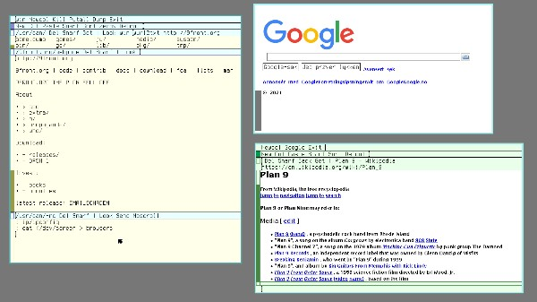

9front에서 권장하는 웹 브라우저는 mothra이지만, Plan 9의 고전적인 브라우저인 abaco도 사용할 수 있습니다. 이 두 웹 브라우저 모두 HTML을 기본적으로만 지원하며, CSS는 물론 자바스크립트도 전혀 지원하지 않습니다. 또한, wikipedia.org와 같이 부분적인 주소만 입력해서는 안 되며, https://www.wikipedia.org와 같이 프로토콜 접두사가 포함된 전체 URL을 입력해야 합니다. (자바스크립트를 지원하지 않는 웹사이트 목록을 미리 준비해 두면 도움이 될 수 있습니다)

mothra에서 로컬 HTML 파일을 열려면 file:///path/to/file을 입력하세요. 웹사이트에서 콘텐츠를 다운로드하려면 마우스 오른쪽 버튼을 클릭하고 ‘moth mode’를 선택하세요. 마우스 커서가 나방 모양으로 바뀌면, 이제 링크나 이미지를 클릭하여 다운로드할 수 있습니다. 다시 ‘moth 모드’를 선택하면 기본 모드로 돌아갑니다. 이 모드에서는 링크를 클릭하면 다운로드 대신 해당 링크로 이동합니다(abaco는 로컬 파일을 열거나 콘텐츠를 다운로드할 수 없습니다).

acme의 경우, 이를 사용하여 대화형으로 웹을 탐색할 수는 없지만, wurl2txt(http://9front.org)와 같은 명령을 중간 클릭하여 웹 페이지의 기본 텍스트 덤프를 생성할 수 있습니다.

최근 9front 개발자들이 NetSurf를 Plan 9로 포팅했습니다. 이 브라우저는 속도가 느리고 오류가 잦으며 버그가 산더미처럼 쌓여 있어, 오히려 꽤 설득력 있는 웹 2.0 경험을 제공합니다. 하지만 여전히 매우 단순한 브라우저이므로, 당분간 Plan 9에서 온라인 쇼핑을 할 수 있을 거라고 기대하지는 마세요(유튜브는 이용할 수 있지만, 브라우저 내에서는 불가능합니다).

**GitHub에서 Plan 9용 NetSurf 포트를 설치하려면:**

```
; cd $home/src
; git/clone https://github.com/netsurf-plan9/nsport
; cd nsport
; fetch clone http
; mk
; mk install
; netsurf   # browse! (make sure webfs is running)
```

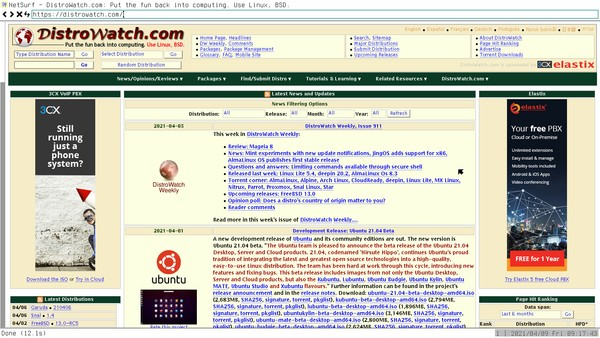


## Downloading

브라우저를 통해 직접 파일을 다운로드하는 것 외에도, hget을 사용하여 파일을 가져올 수 있습니다(이 명령어는 UNIX의 wget과 매우 유사하게 작동합니다). 또한 토렌트를 다운로드하기 위한 ip/torrent도 있습니다.


## Email

이메일 서버 설정에 대한 팁은 9front FAQ의 7.7절에서 확인할 수 있습니다. 또한 Plan 9 메일 서버를 GMail과 연동하는 방법에 대한 팁은 8.4.1.1절을 참고하십시오. 필요에 맞게 설정을 마친 후에는 Plan 9에서 제공하는 몇 가지 대체 이메일 클라이언트를 사용할 수 있습니다. 아마도 가장 유용한 것은 acme의 메일 클라이언트인 ‘Mail’일 것이지만, 원하신다면 ‘faces’와 ‘nedmail’도 확인해 보실 수 있습니다.


## Chatting

9front 개발자들이 주로 활동하는 irc.oftc.net의 꽤 활발한 #cat-v 채널에 참여하려면, 다음 명령어를 실행하세요: ircrc -n mynick -t ‘#cat-v’. 그 외에도 몇 가지 타사 IRC 클라이언트와 xmpp(jabber, 예: Google Talk) 클라이언트를 사용할 수 있습니다. 관심이 있으시면 해당 프로젝트의 웹사이트를 확인해 보세요.

**ircs 상시 실행형 IRC 클라이언트를 설치하고 사용하려면:**

```
; cd /tmp
; 9fs 9front
; tar xzf /n/extra/src/ircs.tgz
; cd ircs
; mk install
; ircs -p dansimon irc.oftc.net    # start IRC client
; ircx -t '#cat-v'    # start IRC user interface
```

IRC 로그 파일은 /tmp/ircs/log에 저장됩니다. 이 프로그램을 처음 실행할 때, factotum은 비밀번호를 입력하라고 요청합니다(ircs의 -p 옵션은 ‘비밀번호 사용’을 의미합니다). 이 비밀번호를 secstore 파일인 factotum에 영구적으로 추가하면 완전 자동 인증이 가능합니다.


## Running a Web Server

Plan 9은 설정을 간단하게만 유지한다면 웹 페이지를 제공하는 데 전혀 문제가 없습니다. 로컬 웹 페이지를 빠르게 설정하려면 다음 단계를 따르세요:

정적 HTML 파일(예: $home/www/mysite/index.html)을 작성합니다. 그리고 제대로 작동하는지 확인합니다(예: mothra file://$home/www/mysite/index.html). 이제 /bin/rc-httpd/select-handler 파일에 다음 내용을 추가하여 rc-httpd 웹 서버를 구성할 수 있습니다:

```
if(~ $SERVER_NAME mysite){
    PATH_INFO=$location
    FS_ROOT=/usr/myname/www/$SERVER_NAME
    exec static-or-index
}
```

aux/listen1 tcp!mysite!80 rc-httpd/rc-httpd 명령어를 실행하여 웹 서버를 시작하세요(터미널 창에서 마우스 중간 버튼을 클릭하고 “스크롤”을 선택했는지 확인하세요). 이제 mothra http://mysite을 통해 웹 서버에 접속할 수 있습니다!

PS: mysite는 사용자의 컴퓨터에 적합한 호스트명이나 IP 주소로 대체하세요.


# Multimedia


9front는 잠시 후 살펴보겠지만 꽤 괜찮은 멀티미디어 기능을 지원하지만, 고전적인 Plan 9 시스템은 이 점에서 매우 제한적입니다. 예를 들어, SoundBlaster 카드만 지원하며, MP3 파일 형식도 지원합니다(이상하게도 고전적인 Plan 9에서는 /bin/games 디렉터리에 MP3 디코더와 인코더가 있습니다). qemu 가상 머신에서 오디오를 활성화하려면(9legacy 및 9front 모두 해당), qemu를 -device sb16 플래그와 함께 실행하고 plan9.ini 파일에 다음 줄을 추가하십시오: audio0=type=sb16 port=0x220 irq=5 dma=5. 이 후에도 9legacy에서는 다음과 같이 오디오 장치를 바인딩해야 합니다: bind -a ‘#A’ /dev. 이 명령을 $home/lib/profile에 추가하는 것이 좋습니다. 반면 9front에서는 프로필을 수정할 필요가 없으며, 실제 하드웨어에서는 별다른 설정 없이도 오디오가 바로 작동합니다.


## Audio

볼륨을 80% 정도로 조절하려면 다음과 같이 하면 됩니다: echo 80 > /dev/volume, 또는 더 정확하게는: echo master 80 80 > /dev/volume (좌우 스피커 모두 80%). 하지만 헤드폰과 스피커를 전환하는 것은 다소 까다로울 수 있습니다. 운이 좋다면 하드웨어가 자동으로 처리해 주겠지만, 그렇지 않다면 오디오 핀을 수동으로 재지정해야 합니다. 제 컴퓨터 중 하나에서는 `echo pin 21 > /dev/audioctl` 명령어로 오디오 출력을 잭 포트로 전환할 수 있고, 다른 컴퓨터에서는 `echo pin 33,12,2 > /dev/audioctl` 명령어가 효과를 발휘합니다. 이는 컴퓨터마다 다르므로, `cat /dev/audiostat`의 출력을 분석하여 올바른 명령어를 찾아낼 수 있습니다. 이 과정이 다소 부담스러울 수 있지만, 당황하지 마시고 ‘jack’, ‘speaker’, ‘out’, ‘pin’과 같은 단어를 찾아보며 실험해 보세요. 실수한다고 해서 컴퓨터가 터지지는 않으니 걱정하지 마세요 ;)

다음 기능 중 일부가 도움이 될 수 있지만, 여기 언급된 세부 사항 중 일부는 하드웨어에 따라 달라질 수 있다는 점을 유의하세요:

```
fn volume{ echo master $1 $1 > /dev/volume }
fn headphones{ echo pin 21 > /dev/audioctl ; volume 40 }
fn speaker{ echo pin 20 > /dev/audioctl ; volume 80 }
fn mute{ volume 0 }
fn pause{ stop pcmconv  | rc }
fn resume{ start pcmconv | rc }
fn skip{ kill pcmconv  | rc }
```

물론, 사용자에게 더 편리한 타사 유틸리티들도 있습니다. jacksense는 헤드셋을 연결할 때마다 출력 핀을 자동으로 전환해 줍니다. 또한 9front extra 저장소의 volume.c는 출력 볼륨을 조절할 수 있는 간단한 버튼을 제공합니다.

기술적으로는 cat file > /dev/audio를 실행하기만 해도 원시 오디오 파일을 재생할 수 있으며, 먼저 디코딩할 수도 있습니다: audio/mp3dec < file.mp3 > /dev/audio. 하지만 9front에는 작업을 훨씬 쉽게 만들어 주는 사용자 친화적인 셸 스크립트가 포함되어 있습니다: play file.mp3.

9front에서 오디오 녹음은 이론적으로 가능합니다. 먼저 위 예시와 같이 올바른 핀을 리디렉션하여 오디오를 출력 대신 입력으로 설정해야 하며, 그런 다음 /dev/audio에서 읽기를 수행하면 소리가 녹음됩니다. 예를 들어, `cat < /dev/audio > file` 또는 `oggenc < /dev/audio > file.ogg`와 같이 실행하면 됩니다. 하지만 제 테스트 머신에서는 실제로 이 기능을 작동시키지 못했습니다. 여러분은 저보다 더 운이 좋을지도 모릅니다.

Plan 9에서 음악을 재생하는 전통적인 방법은 구식인 juke 플레이어를 사용하는 것이었습니다. 다만, 먼저 오디오 파일에 대한 상당히 상세한 데이터베이스를 작성해야 했습니다(정말 이 작업을 하고 싶다면 juke(7)을 참고하세요). 다행히도, 9front는 최근 이 낡은 주크박스를 zuke라는 멋진 새 오디오 플레이어로 대체했습니다. 이 플레이어는 사용하기 쉽고 편리합니다:

```
; audio/mkplist $home/music/myalbum > $home/lib/plist/myalbum
; audio/zuke < $home/lib/plist/myalbum
```

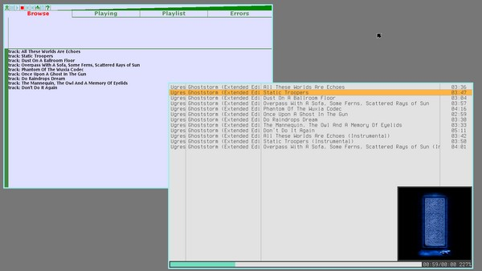


## Video

오랫동안 Plan 9에는 동영상 재생 옵션이 전혀 없었지만, 최근 점점 더 배신적이 되어가는 9front 개발자들이 ‘treason’이라는 동영상 플레이어를 개발했습니다. 이 동영상 플레이어의 기능은 제한적입니다. 앞뒤로 건너뛸 수 없을 뿐만 아니라, 더 큰 문제인 것은 동영상 크기를 어떤 식으로든 조정할 수 없다는 점입니다. 480P(DVD 화질*) 동영상을 재생하기 전에, 예를 들어 aux/vga -m vesa -l 1024x768x16 명령을 실행하여 화면 해상도를 수동으로 낮게 설정하고 전체 화면으로 볼 수 있었다면 좋았을 텐데요. 하지만 이 방법은 모든 그래픽 카드에서 작동하는 것은 아닙니다. 특히 제 그래픽 카드에서는 안 되지만, 여러분은 운이 더 좋을지도 모릅니다. (몇 가지 팁은 ‘게임 에뮬레이터’ 섹션을 참고하세요.) 어쨌든, 전체 화면이든 아니든, Plan 9에서 Plan 9를 볼 수 있다니—정말 멋지지 않나요!

개발자 웹사이트에서 ‘Treason’ 비디오 플레이어를 설치하세요:

```
; mkdir /tmp/treason
; cd /tmp/treason
; hget https://ftrv.se/_/treason.gz | gunzip | disk/mkext -d .
; ./treason/install.rc
; treason der_film.mkv # watch some vids :)
```

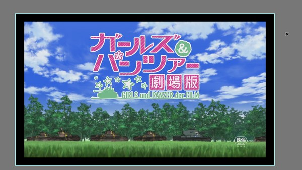


### Youtube

아, 맞아요. treason을 설치하면 Plan 9에서도 유튜브 동영상을 당연히 볼 수 있습니다. 하지만 먼저 유튜브 다운로더를 설치해야 합니다:

```
# install nvi, similar to youtube-dl in unix:
; cd /tmp
; git/clone https://git.sr.ht/~ft/nvi
; cd nvi
; mk install

# make some convenient wrapper scripts:

#!/bin/rc
# ytaudio - play audio only from youtube video
nvi -A 251 -a /fd/1 $1 |
mcfs -t audio |
audio/opusdec > /dev/audio

#!/bin/rc
# ytlow - play low quality youtube video
nvi -V 18 -v /tmp/vid.mp4 $1 &&
treason /tmp/vid.mp4 &&
rm /tmp/vid.mp4

#!/bin/rc
# ythigh - play high quality youtube video
nvi -a /tmp/audio -v /tmp/video $1 &&
treason -a /tmp/audio /tmp/video &&
rm /tmp/audio /tmp/video
```

이제 ytaudio qsb74pW7goU를 사용하여 《Plan 9 from Outer Space》의 오디오 트랙을 재생하거나, ytlow를 사용하여 저화질로, ythigh를 사용하여 고화질로 시청할 수 있습니다. 또한 유튜브 URL을 자동으로 재생하도록 플러빙 규칙을 추가할 수도 있습니다. $home/lib/plumbing 파일의 include basic 줄 앞에 다음 내용을 추가하기만 하면 됩니다:

```
# play youtube videos
type is text
data matches 'https://(www.)?youtube[^ ]+'
plumb start window ytlow ''''$0''''
```

이제 acme에서 ‘https://www.youtube.com/watch?v=qsb74pW7goU’을 마우스 오른쪽 버튼으로 클릭하거나, 해당 인수를 지정하여 plumb을 실행하면(쉘에서 ‘=’는 특별한 의미를 가지므로 따옴표로 묶어야 합니다), 화질이 낮은 영화의 멋진 저해상도 영상을 볼 수 있습니다.

PS: 앞서 언급했듯이, 9front에 관한 유튜브 동영상을 찾고 계신다면 adventuresin9 채널을 추천합니다!


# Graphics


## Viewing Images/Documents

이미지와 문서를 모두 표시할 수 있는 프로그램은 단 하나뿐이며, 바로 ‘page’입니다. DOCX나 ODT와 같은 일부 문서 형식을 지원하지 않고, EPUB과 같은 다른 형식에 대한 지원도 미흡하지만, 여전히 훌륭한 애플리케이션입니다. 다만 PDF, 구형 Microsoft Office 문서, 이미지 및 기타 간단한 형식의 파일은 대개 문제없이 작동합니다.


### Reading Comics

만화책은 대개 CBR 또는 CBZ 파일 형식으로 배포되는데, 이는 단순히 압축된 이미지 파일일 뿐입니다. 따라서 이를 읽으려면 unrar(unrar은 9fronts extra 저장소에서 구할 수 있으며, go는 필수 의존성입니다)로 압축을 풀거나 파일을 압축 해제하고, 추출된 이미지를 page에서 확인하세요:

```
; unzip -af voyage_to_venus_1.cbz
; lc voyage_to_venus_1
001.jpg 018.jpg 035.jpg 052.jpg 070.jpg 087.jpg
002.jpg 019.jpg 036.jpg 053.jpg 071.jpg 088.jpg
003.jpg 020.jpg 037.jpg 054.jpg 072.jpg 089.jpg
...
# to view all of these, starting with 001.jpg:
; page voyage_to_venus_1``
```


## Creating Images

paint를 사용할 수는 있지만, 유치원 미술 시간 외에는 활용하기 어려울 것입니다. 반면 resample(1), crop(1), rotate(1)은 이미지 편집에 유용한 작은 도구들입니다. 자세한 내용은 각 명령어의 매뉴얼 페이지를 참고하세요. 이미지 편집을 위한 또 다른 좋은 대안(포토샵이 아닌 ImageMagick과 같은 의미에서)은 9front extra 저장소에서 구할 수 있는 pico9입니다. 아직 개발 초기 단계이지만, 전망이 밝아 보입니다!


## Taking a Screenshot

/dev에는 창 텍스트를 저장하는 파일뿐만 아니라, 창 화면을 저장하는 파일인 /dev/window도 있습니다. 현재 창의 스크린샷을 찍으려면 다음 명령을 실행하면 됩니다: cat /dev/window > windowdump ; page windowdump. 전체 화면의 스크린샷을 찍으려면 다음을 실행하세요: cat /dev/screen > screendump.

이 이미지들은 Plan 9의 기본 이미지 형식으로 저장되며, 당연히 문서/이미지 뷰어 페이지에서 읽을 수 있습니다. 하지만 다른 운영 체제에서 이 이미지들을 사용하려면 더 널리 쓰이는 PNG나 JPEG 형식으로 변환해야 합니다: cat /dev/screen | topng > sshot.png 또는 간단히 tojpg < /dev/window > window.jpg

현재 창이 아닌 다른 창의 스크린샷을 찍으려면 위의 rio 스크립팅 섹션을 참고하세요. 타사 프로그램인 vshot을 설치하면 더 GUI에 가까운 방식으로 이 작업을 수행할 수도 있습니다.

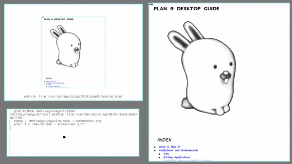


### Screencasting

extra 저장소에서 사용할 수 있는 wrec라는 9front용 화면 녹화 프로그램이 현재 개발 중입니다. 간단한 화면 캡처는 가능하지만, 아직 소리를 녹음할 수는 없습니다. PS: 최상의 결과를 얻으려면 초당 프레임 수를 매우 낮게 설정하여 녹화하는 것을 권장합니다(예: wrec -f 3). 위 예시와 같이 GIF 파일의 크기를 줄이고 반복 재생되도록 하려면, ImageMagick이 설치된 UNIX 시스템으로 파일을 내보낸 후 다음 명령을 실행하면 됩니다: convert -delay 20 -loop 0 -resize 600 screencast.gif small.gif.


# Peripherals


## USB sticks

9front에서는 USB 메모리 스틱이 자동으로 /shr에 마운트되지만, 수동으로 마운트해야 하는 경우 메모리 스틱을 꽂기 전과 꽂은 후에 ls /dev | grep sd 명령을 실행하여 해당 장치 이름을 확인하십시오. 장치 이름이 sdUc59fd라고 가정할 때, 다음 명령을 실행하여 메모리 스틱을 /n/dos에 마운트하십시오: mount <{dossrv -s} /n/dos /dev/sdUc59fd/dos. 마운트를 해제하려면 unmount /n/dos를 사용하십시오. 자세한 내용은 dossrv(4)를 참조하십시오. 장치를 연결한 후 /dev에 나타나지 않는다면, 하드웨어나 드라이버에 문제가 있거나 장치가 지원되지 않는 파일 시스템을 사용하고 있는 것입니다. 전통적으로 DOS 및 Plan 9 파일 시스템만 지원되었으나, 9front extra 저장소에 ext4srv가 추가됨에 따라 리눅스 파일 시스템도 사용할 수 있게 되었습니다.

NTFS(Windows 파일 시스템)는 지원되지 않으므로, 메모리 스틱을 사용하기 전에 FAT32(DOS 파일 시스템)로 다시 포맷해야 할 수도 있습니다. 여전히 sdUc59fd라는 이름으로 인식된다고 가정할 때, 다음과 같이 수행할 수 있습니다:

```
; disk/fdisk /dev/sdUc59fd/data
p      # print a table of partitions
?      # get help instructions
d p1   # delete a couple of partitions
d p2
a p1   # add a new partition
1      # just follow suggested size
971
t p1   # set partition type
?      # list available types
FAT32
w      # write and quit
q
; disk/format -d /dev/sdUc59fd/dos
```


## CD/DVD/BS's

/n/iso에 ISO 이미지를 마운트하려면 mount <{9660srv -s >[0=1]} /n/iso /path/to/your/cdrom.iso 명령을 실행하십시오. 이 명령어가 다소 난해해 보일 수 있지만, 사실 Plan 9에서 CD/DVD/BD를 다루는 것은 매우 쉽습니다(cdfs(4) 참조). 다음 예제에서는 오디오 CD를 마운트하고(장치가 /dev/sdD0가 아닌 경우에만 장치를 지정하면 됨), 재생하고, 리핑하는 방법을 보여줍니다:

```
; cdfs -d /dev/sdE1
; cat /mnt/cd/a* > /dev/audio
; cp /mnt/cd/a* /tmp/songs
```

다음과 같은 사용자 정의 함수들도 유용하게 쓰일 수 있습니다:

```
fn mem{   mount <{dossrv  -s >[0=1]} /n/dos $1 }
fn iso{   mount <{9660srv -s >[0=1]} /n/iso $1 }
fn eject{ echo eject > /mnt/cd/ctl }
fn cdfs{  /bin/cdfs -d /dev/sdE1   }
fn cddb{ # query the internet CD database
    cdfs
    grep aux/cddb /mnt/cd/ctl | rc
}
fn rip{  # rip a CD and convert it to ogg
    cdfs
    for(t in /mnt/cd/a*) audio/oggenc < $t > `{basename $t}^.ogg
}
```

다음 예제는 오디오 CD를 굽는 방법을 보여줍니다. 데이터 디스크(DVD와 블루레이는 항상 데이터 디스크입니다)를 굽고 싶다면 'a'를 'd'로 바꾸기만 하면 됩니다. 마지막 명령어는 디스크를 고정하는 것으로, 재기록 가능한 CD나 데이터 디스크의 경우 이 단계는 필요하지 않습니다:

```
; cdfs -d /dev/sdE1
; cp /tmp/files/* /mnt/cd/wa
; rm /mnt/cd/wa
```


## Printers

번거로움을 덜어드리겠습니다. $home/lib/profile 파일에 LPDEST=stdout을 추가하면, 이제 lp 명령어가 포스트스크립트(PS) 파일을 표준 출력으로 출력합니다. 원하신다면 이 PS 파일을 PDF로 변환한 다음, Windows나 UNIX 시스템으로 복사하거나 이메일로 전송하여 그곳에서 인쇄할 수 있습니다:

```
; lp doc.html | ps2pdf > doc.pdf
; doctype doc.ms | rc | lp | ssh unixmonster 'cat | lpr'
# or from drawterm (os lets you run a host command)
; doctype doc.ms | rc | lp | os lpr
```


# Games and other Fun Stuff


컴퓨터와 관련해서는 게임이 논란의 여지가 있는 주제입니다. 물론 엄청난 인기를 끌고 있지만, 생산성에 이보다 더 해로운 것은 없습니다(아마도 최신 웹 브라우저를 제외하면 말이죠). 따라서 좋은 컴퓨터 게임을 만드는 비결은, 몇 분간 휴식을 취할 수 있을 만큼 재미있으면서도 중요한 일을 방해하지 않을 정도로 지루하게 만드는 것입니다. 이러한 정의에 따르면, Plan 9에는 몇 가지 “좋은” 게임이 있습니다.


## Included Games

Plan 9에는 /bin/games 디렉터리에 다양한 게임 모음이 포함되어 있습니다. 제가 특히 좋아하는 게임은 다음과 같습니다:

- games/sudoku
- games/mahjongg
- games/sokoban
- games/mines (9front 전용)


## Included Game Emulators

9front의 게임 디렉토리에는 여러 가지 에뮬레이터도 있습니다. 예를 들어, ‘마리오 월드’ ROM의 합법적인 사본을 구할 수 있다면 다음과 같이 플레이할 수 있습니다: games/snes -ax 4 mario.sfc (하지만 주의하세요. 이런 구식 게임 중 일부는 위험할 정도로 재미있을 수 있습니다!)


- games/nes 닌텐도
- games/snes 슈퍼 닌텐도
- games/gb 게임보이
- games/gba 게임보이 어드밴스
- games/md 세가 메가 드라이브
- games/c64 코모도어 64

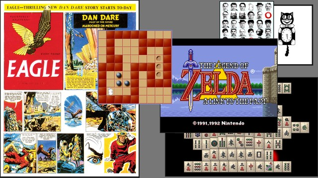

처음 이 게임들을 해봤을 때, 경험은 완벽하지 않았습니다. 낡고 성능이 떨어진 내 씽크패드는 이 게임들에서 제대로 된 사운드를 출력하는 데 애를 먹었고, ‘비디오’ 섹션에서 언급했듯이 내 그래픽 카드는 화면 해상도를 더 낮게 설정하는 것을 아예 거부했습니다. 더 성능이 좋은 데스크톱 컴퓨터에서 9front를 PXE 부팅함으로써 이 두 가지 문제를 모두 해결할 수 있었습니다. 이 컴퓨터는 Plan 9용 영화 및 게임 콘솔로 아주 훌륭하게 작동하며, 젤다를 실행하기 위한 멋진 작은 실행 스크립트도 마련해 두었습니다:

```
#!/bin/rc
# zelda - launch zelda fullscreen
# usage: zelda
# depends: gaming "console" and zelda rom

aux/realemu
aux/vga -m vesa -l 1024x768x16
window -r 0 0 1024 768 games/snes -ax 4 $home/games/snes/zelda.sfc
while(sleep 5){
    if(! ps | grep -s snes) aux/vga -m vesa -l 1920x1080x16
}
```


## 3rd Party Games

Plan 9용 타사 게임이나 소프트웨어는 드뭅니다. 하지만 예외도 있는데, 그중에서도 2048, hack9, snake 같은 좋은 게임들이 있습니다.

**9front extras에서 2048과 hack9 게임을 설치하려면:**

```
; cd /tmp
; 9fs 9front
# download packages
; cp /n/extra/src/2048.c .
; tar xzf /n/extra/src/hack9.tgz

# compile and install 2048
; 6c 2048.c
; 6l 2048.6
; mv 6.out $home/bin/amd64/2048

# compile and install hack9
; cd hack9
; mk install
```

**Bell Labs contrib 저장소에서 스네이크 게임을 설치하려면:**

```
; cd /tmp
; 9fs sources   # download file
; cp /n/sources/contrib/john/snake.c .
; 6c snake.c    # compile and install it
; 6l snake.6
; mv 6.out $home/bin/amd64/snake
```

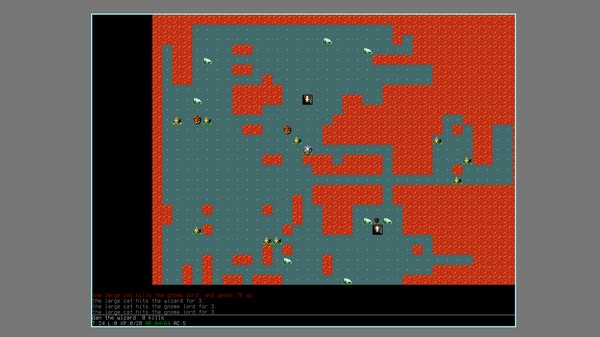


## Edutainment

Plan 9에는 scat이나 map과 같은 몇 가지 교육용 애플리케이션이 있습니다(map을 사용하려면 추가 데이터를 다운로드해야 합니다. /lib/map/README를 참조하세요). 예를 들어, 위키백과에서 제가 사는 도시의 좌표를 찾은 후, 노르웨이 북부의 간단한 지도를 그릴 수 있습니다: map perspective 1.01 -o 67.2827 -14.3751 | plot 아프리카 지도를 그리려면 방기(Bangui)와 같은 중심 도시의 좌표를 사용할 수 있습니다: map perspective 2 -o 4.22 -18.35 | plot (첫 번째 숫자는 지도에서 떨어진 거리이며, 숫자가 클수록 더 넓은 범위가 표시됩니다) 또한 제 도시의 좌표인 67.2827000000 -14.3751000000 150(마지막 숫자는 해발 고도(미터))를 /lib/sky/here에 추가하면 꽤 정확한 천문 데이터를 얻을 수 있습니다. astro는 해가 뜨고 지는 시간 등을 표시해 줍니다(한밤중의 태양이 있는 노르웨이 북부 지역에서는 꽤 유용하죠). 또한 scat을 사용하여 별 지도를 그릴 수 있습니다. 시연을 위해 (더 많은 예시는 매뉴얼 페이지에 있습니다):

```
; scat
2024  8 23 06:56:11 GMT  6h01m55s +67°16'57" -14°22'30"  150
moon      # find the moon
moon    1h09m25.0s +7°51'08.0" 258.06° 13.44° 16'30.2" 0.6229
expand 6  # zoom out a bit
scat: NGC database not available
0h45m00.0s to 1h35m00.0s
+1°00'00.0" to +14°00'00.0"
728 items
keep m <6 # only show what you can see with your naked eye
8 items
add moon  # the last command removed the moon, add it again
9 items
plot      # draw star chart
```

이 프로그램들은 그래픽을 그리는 데 plot을 사용합니다. graph나 proof(page의 전신)와 같은 다른 프로그램들도 이를 사용합니다. 이미 존재하는 도구를 바탕으로 유틸리티를 만드는 것은 매우 UNIX다운 방식이며, 이 프로그램들은 확실히 흥미롭습니다. 하지만 수년간 방치된 탓에 오늘날 이 프로그램들은 그저 장난감 수준에 그치고 말았습니다.

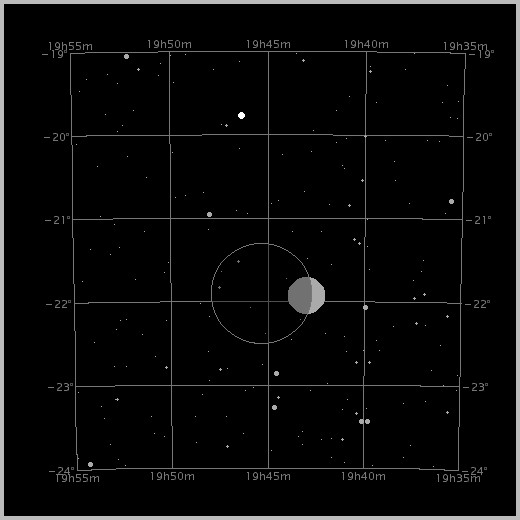

/bin/games에 있는 프로그램 중 상당수는 실제 게임이라기보다는 교육용 오락 프로그램에 가깝습니다. 여기에는 life, galaxy, timmy와 같은 시뮬레이터가 포함됩니다. 또한 blit(이에 대해서는 나중에 자세히 설명하겠습니다)이나 mix와 같이 컴퓨터 과학 마니아들이 좋아할 만한 “게임”도 몇 가지 있습니다(마지막 네 가지 예시는 9front 전용입니다).


### Arithmetic

고전적인 bsdgames 모음집은 UNIX에 다양한 간단한 교육용 오락 프로그램을 제공하는데, 이들 중 대부분은 Plan 9에서는 사용할 수 없습니다. 하지만 상관없습니다. 우리가 직접 처음부터 만들어 보면 되니까요. 적어도 기본적인 프로그램 몇 가지를 구현하는 방법은 보여드릴 수 있습니다. 누가 알겠어요? 어쩌면 이 간단한 스크립트들이 여러분이 직접 진짜 재미있는 게임을 만들도록 영감을 줄지도 모르죠 :^)

```
#!/bin/rc
# arithmetic - basic arithmetic quiz
# usage: arithmetic [-q n][-r n][-o '+-*/%^']

# set some default values
rfork e
right=0
wrong=0
questions=20
range=1            # in digits
operands='+-'
start=`{date -n}

# parse optional flags
for(i in $*){
    switch($i){
        case -q
            questions=$2 && shift 2
        case -r
            range=$2 && shift 2
        case -o
            operands=''$2'' && shift 2
    }
}

# rnum: generate a random digit based on cpu clock
fn rnum{
    awk '{ print $2 }' /dev/time | sed 's/.*(.)$/\1/'
}

# ask math questions
opleft=$operands
for(i in `{seq $questions}){
    # generate random math puzzle
    a=`{rnum}
    b=`{rnum}
    if(test $range -gt 1){
        for(i in `{seq `{echo $range - 1 | bc}}){
            a=`{echo $a^`{rnum}}
            b=`{echo $b^`{rnum}}
        }
    }
    if(~ $#opleft 0) opleft=$operands
    if not{
        opused=`{echo $opleft | sed 's/^(.).*/\1/'}
        opleft=`{echo $opleft | sed 's/^.(.*)/\1/'}
    }
    echo $a $"opused $b
    correct=`{ echo $a $"opused $b | bc }
    answer=`{ read }

    # evaluate given answer
    while(! ~ $answer $correct){
        if(echo $answer | grep -s '^[-+]?[0-9]+$'){
            echo What?
            wrong=`{ echo $wrong + 1 | bc }
        }
        if not echo Please type a number '(no decimals!)'
        answer=`{ read }
    }
    echo Right!
    right=`{ echo $right + 1 | bc }
}

# print result of math quiz
finish=`{date -n}
time=`{echo $finish - $start | bc}
total=`{echo $right + $wrong | bc}
timepq=`{echo $time / $total | bc}
if(~ $right 0){ prct=0% }
if not prct=`{ echo 'scale=2 ; '$right' / '$total'' |
    bc | sed 's/\.//' | sed 's/$/%/' }
echo -n $right right, $wrong wrong '('$prct' correct)'
    in $time seconds '('$timepq's per answer)'
``` 


### Quiz

‘quiz’는 bsdgames에서 만든 또 다른 간단하고 고전적인 프로그램으로, 여러 가지 질문을 던지고 진행 상황을 기록해 줍니다. 원래 UNIX 퀴즈 프로그램들은 지리, 스타 트렉, ed 편집기 등에 관한 다소 시대에 뒤떨어진 질문들을 던지곤 했지만, 이 프로그램의 진정한 매력은 사용자가 직접 퀴즈 파일을 작성할 수 있다는 점입니다. 이론적으로는 어휘 학습이나 시험 준비와 같은 실질적인 목적으로도 이 프로그램을 활용할 수 있습니다.

```
#!/bin/rc
# quiz - ask questions and look for correct answers
# usage: quiz [-as][-q questions][file]
#
# bug: case is normally ignored, but not for exotic unicode characters, this is
#      a grep bug.
# bug: special characters in the correct answers must be escaped (e.g. \?\!)

# variables
rfork e
ifs='
'
dir=$home/lib/quiz
is=(Correct answer is)
right=0
wrong=0
printanswer=no
if(~ $1 -a) printanswer=yes && shift 1
silenterror=no
if(~ $1 -s) silenterror=yes && shift 1
questions=20
if(~ $1 -q) questions=$2 && shift 2

# parse args
if(~ $#* 0) ls -p $dir && exit
if(~ $#* 1) file=$dir/$1
if not echo usage: quiz [-as][-q questions][file] && exit
if(test `{cat $file | wc -l} -le $questions) questions=`{cat $file | wc -l}

# ask questions, and check answers
for(i in `{sed -e '/^$/d' -e '/^#/d' $file | shuf | sed ''$questions'q'}){
    question=`{ echo $i | awk -F@@@ '{ print $1 }' }
    if(echo $question | grep -s '^cmd ')
        eval `{ echo $question | sed 's/^cmd //'}
    if not echo $question
    correct=`{ echo $i | awk -F@@@ '{ print $2 }' }
    correct_answer=`{ echo $i | awk -F@@@ '{ print $3 }' }
    if(~ $#correct_answer 0) correct_answer=$correct
    answer=`{ read }
    if(echo $answer | grep -si '^'$correct'$'){
        if(~ $printanswer yes) echo -n Right! $"is $"correct_answer
        if not echo -n Right!
        right=`{ echo $right + 1 | bc }
    }
    if not{
        if(~ $silenterror yes) echo -n Wrong!
        if not echo -n Wrong! $"is $"correct_answer
        wrong=`{ echo $wrong + 1 | bc }
    }
    read
}

# calculate results
if(~ $right 0){ prct=0% }
if not prct=`{ echo 'scale=2 ; '$right' / '$questions'' |
    bc | sed 's/\.//' | sed 's/$/%/' }
if not echo $right right, $wrong wrong '('$prct' correct)'
```

이 프로그램은 $home/lib/quiz 디렉터리에 @@@로 구분된 두 개(선택적으로 세 개)의 필드가 포함된 일반 텍스트 데이터베이스를 기대합니다. 필드는 question과 answer입니다. 정답은 다양한 변형을 허용하기 위해 정규 표현식으로 작성할 수 있으며, 이 경우 세 번째 필드인 기본 정답도 반드시 작성해야 합니다. 다음은 제 $home/lib/quiz/capitols 파일의 끝부분입니다:

```
Ukraine@@@Kyiv|Kiev@@@Kyiv
United Kingdom@@@London
Uruguay@@@Montevideo
Uzbekistan@@@T[oa]shkent@@@Toshkent
Vanuatu@@@Port Vila
Venezuela@@@Caracas
Vietnam@@@Ha ?Noi@@@Ha Noi
Yemen@@@[ŞS]an'?a'?@@@Şan'a'
Zambia@@@Lusaka
Zimbabwe@@@Harare
```


### Touchtype

터치 타이핑을 배우는 것은 컴퓨터를 진지하게 사용하는 사람이라면 누구나 필수이며, 노련한 시스템 관리자라 할지라도 가끔씩 실력을 다듬어 볼 필요가 있는 기술입니다. UNIX에는 ktouch와 같은 정교한 터치 타이핑 학습 프로그램이 있지만, 이 기술을 익히는 기본 방법은 꽤 간단합니다. 키보드 배열 그림을 출력하여 벽에 붙여두고, 타이핑을 할 때 키보드가 아닌 그림을 올려다보세요(가급적이면 손가락을 중간 행에 놓고, 검지 손가락은 작은 돌기가 있는 두 개의 키 위에 올려두는 것이 좋습니다). 처음에는 어렵겠지만, 꾸준히 연습하다 보면 점차 터치 타이핑을 익히게 될 것입니다. 다음 스크립트는 이 기술을 익히는 데 필요한 고생과 훈련을 덜어주지는 않겠지만, 여러분의 진도를 파악하는 데는 도움이 될 것입니다. 주어진 각 줄을 그대로 다시 입력하기만 하면 되며, 백스페이스 키를 눌러 실수를 수정하지 말고 계속 입력하세요. 완료되면 스크립트가 여러분의 타이핑 실력이 얼마나 좋은지, 혹은 나쁜지를 알려줄 것입니다.

```
#!/bin/rc
# touchtype - check your typing speed and accuracy
# usage: touchtype [ file ]

# choose input sample
rfork ne
tmp=/tmp/touchtype-$pid
out=/tmp/touchtype-out-$pid
fortune > $tmp
if(~ $#* 1) cat $1 > $tmp
ifs='
'

# do some touchtyping
start=`{date -n}
for(line in `{cat $tmp}){
    echo $line
    read >> $out
}
stop=`{date -n}

# calculate results
time=`{echo $stop - $start | bc}
char=`{cat $tmp | wc -c}
speed=`{echo '('$char' / '$time') * 60' | bc}
err=`{cmp -l $out $tmp | wc -l}
if(~ $#err 0) prc=0
if not prc=`{echo 'scale=2 ; '$err' / '$char'' | bc | sed 's/\.//'}

# print results
rm $tmp $out
echo
echo 'RESULT (<2% errors and >200 c/m is good):'
echo your write speed is $speed c/m with $prc^% errors
```


## Playing With Telnet

믿기 어렵겠지만, 2021년인 지금도 텔넷으로 즐길 수 있는 재미있는 것들이 정말 많습니다! 그중에서도 특히 MUD(다중 사용자 던전)를 즐기는 것은 여전히 큰 인기를 끌고 있습니다. 인기 있는 MUD 목록은 http://mudconnect.com에서 확인할 수 있습니다. 다음은 텔넷으로 즐길 수 있는 몇 가지 재미있는 예시입니다(PS: 더 나은 사용자 경험을 위해 먼저 vt를 실행하세요):

```
; telnet discworld.starturtle.net # Play the Discworld MUD
; telnet towel.blinkenlights.nl # Watch Star Wars IV in ASCII
; telnet twenex.org # Login to a shell server with a handful of TTY games
```


## Miscellaneous Fun

Plan 9에서는 엄밀히 말해 “게임” 범주에 속하지는 않지만, 정말 재미있는 것들을 많이 할 수 있습니다. 대표적인 예로 무작위 명언을 표시해 주는 `fortune`이 있습니다. 9front에는 `troll`과 `theo`도 포함되어 있는데, 이 프로그램들도 비슷한 기능을 하지만 좀 더 특화된 용도로 사용됩니다. Plan 9의 fortune은 임의의 파일에서 무작위 한 줄을 출력하는 데에도 유용합니다(예: `{fortune playlist}` 실행). 또 다른 재미있는 프로그램은 games/festoon으로, 무의미한 troff 문서를 생성합니다. 예를 들어 다음과 같이 사용할 수 있습니다: games/festoon -pet | pic | eqn | tbl | troff -mm | page

/bin/games에 있는 프로그램 중 일부는 juggle이나 catclock처럼 어느 정도 스크린세이버에 해당합니다. 9front에는 이 범주에 속하는 mole과 packet도 포함되어 있습니다. 마지막으로, 9front extra 저장소에는 xsr이라는 이름의 고전적인 UNIX 스크린세이버 포트가 있습니다.


## Obscure Operating Systems


앞서 가상화 섹션에서 이미 vmx에 대해 간략히 다룬 바 있습니다. 이를 통해 9front에서 리눅스나, 아마도 윈도우와 같은 운영 체제를 실행할 수 있습니다. 하지만 몇 가지 잘 알려지지 않은 운영 체제는 보다 원활하게 실행할 수도 있는데, 이러한 시스템들은 Plan 9 팬들에게 특별한 흥미를 불러일으키고 많은 즐거움을 선사할 수 있습니다:


### Inferno

인페르노(Inferno) 프로젝트는 플랜 9(Plan 9)가 처음 출시된 지 몇 년 후에 시작되었으며, 벨 연구소(Bell Labs)에서 거의 동시에 같은 개발자 그룹에 의해 개발되었습니다. 이 운영 체제는 플랜 9와 많은 공통점을 가지고 있으며, acme 및 기타 유사한 프로그램들을 찾을 수 있고, 정확히 동일한 파일 시스템 프로토콜을 공유합니다(단, 역사적인 이유로 문서에서는 9p가 아닌 styx라고 표기됩니다). 인페르노에서는 모든 것이 파일로 처리되므로, 인페르노와 플랜 9 간에 장치 및 기타 리소스를 원활하게 공유할 수 있습니다.

이 마지막 점은 특히 가치가 큰데, 인페르노가 다른 운영 체제 위에서 실행되도록 설계되었기 때문입니다. 인페르노는 사실상 모든 (구형) 유닉스 시스템, 물론 플랜 9는 물론이고, 심지어 구형 인터넷 익스플로러에서도 실행될 수 있습니다! Inferno는 이러한 시스템의 네트워크, 오디오, 메모리 등을 일반 파일로 처리하므로, Plan 9 시스템과 예를 들어 리눅스나 FreeBSD 시스템 사이에 우아한 가교 역할을 합니다. 또한 256Kb, 즉 1메가바이트의 4분의 1에 불과한 메모리만으로도 실행될 수 있습니다! 따라서 임베디드 애플리케이션에 매우 적합합니다.

하지만 안타깝게도 Inferno는 방치와 코드 노후화로 인해 심각한 문제를 겪고 있습니다. 현재 오디오 기능이 작동하지 않으며, 이에 따라 Inferno가 제공하는 모든 멀티미디어 애플리케이션도 사용할 수 없습니다. 더 큰 문제는 Inferno가 32비트 시스템에서만 지원되며, 최신 시스템에서 이를 빌드하는 것조차 점점 더 어려워지고 있다는 점입니다. 최근 몇 년간 퍼가토리오(purgatorio)나 9페르노(9ferno)와 같은 인페르노의 포크 프로젝트들이 몇 개 등장하기는 했지만, 어쨌든 이 프로젝트는 사실상 휴면 상태인 것으로 보입니다. Plan 9(32비트)에서 원래의 인페르노를 다음과 같이 설치하고 실행할 수 있습니다. (9legacy에서 컴파일하는 편이 더 수월할 수도 있습니다. 그 OS 역시 안심할 만큼 방치되어 있기 때문이죠.)

```
; cd $home/src
; git/clone https://bitbucket.org/inferno-os/inferno-os
; mkdir /usr/inferno
; dircp inferno-os /usr/inferno
; cd /usr/inferno
; path=(/usr/inferno/Plan9/386/bin $path)
; mk install

# install a new user
; mkdir tmp
; mkdir usr/$myuser
; dircp usr/inferno usr/$myuser

# run inferno and start a desktop
; emu
; wm/wm
```

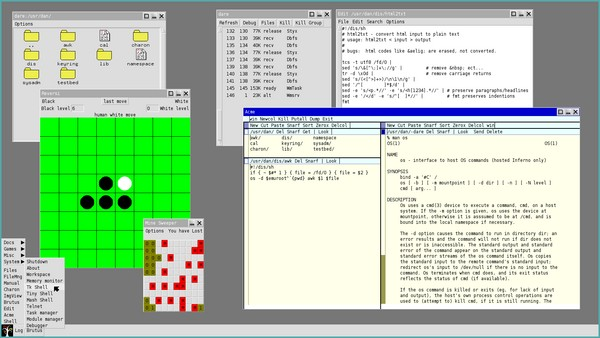

여기 doc 디렉토리에 있는 논문들을 꼭 읽어보시기 바랍니다. 특히 bltj.pdf, sh.pdf, descent/descent.pdf, limbotk/tk.pdf는 Inferno 운영 체제와 rc에서 영감을 받은 셸, 독특한 프로그래밍 언어인 Limbo, 그리고 이를 위한 Tk GUI 툴킷을 소개하고 있습니다. Inferno는 Go의 선구자라고 할 수 있는 완전히 새로운 프로그래밍 언어인 Limbo로 작성되었습니다. Plan 9과는 달리, Inferno의 GUI 접근 방식은 기존 시스템에 훨씬 더 가깝습니다. 따라서 Tk나 UNIX 또는 Windows의 다른 툴킷 사용 경험이 있다면, Inferno에서 그래픽 프로그램을 개발하는 것이 꽤 쉬울 것입니다. 참고로, 기본 시작 메뉴는 상당히 빈약하지만, /dis/wm 디렉터리 아래에서 많은 추가 GUI 프로그램을 찾을 수 있으며, /lib/wmsetup에 있는 시작 메뉴 설정 파일을 수정할 수도 있습니다.

인페르노는 상용 제품으로 기획되었으며, 일종의 윈도우스러운 느낌을 줍니다. 하지만 근본적인 차이점에도 불구하고, Plan 9를 매우 연상시킵니다. 이는 흥미로운 조합이자 재미있는 프로그래밍 환경입니다. 다만 버그와 제한 사항에 대비해야 합니다. 이름에서 알 수 있듯이, 이 프로젝트는 (‘언데드’인 Plan 9와 달리) 오랫동안 중단된 상태이기 때문입니다.

PS: os 명령어를 사용하면 Inferno의 많은 제한 사항을 우회할 수 있습니다. 이 명령어를 통해 Inferno 내부에서 호스트 프로그램을 실행할 수 있습니다. 예를 들어, Inferno에는 awk, tar, lp(UNIX의 lpr)가 포함되어 있지 않지만, 이러한 호스트 명령어를 사용하는 래퍼 함수를 쉽게 작성할 수 있습니다. 또한 로컬 $home/lib/wmsetup에 몇 가지 시작 시 바로 실행할 수 있는 단축 명령을 추가하는 것도 좋습니다. (셸은 -l(엘) 플래그를 사용할 때만 $home/lib/profile을 사용합니다.)

```
# inferno startup shortcuts for plan 9, adjust to suit your needs:
EMU=(-g1600x900 -C x8r8g8b8 -f /fonts/vera/veramono/veramono.12.font -c1)
fn inferno{ /usr/inferno/Plan9/386/bin/emu wm/wm wm/logon -u myuser }

# to halt inferno, run this in an inferno shell
; shutdown -h

# adding awk to inferno (do this within inferno):
; mkdir $home/dis
; echo bind -b $home/dis /dis >> $home/namespace
; touch $home/dis/awk
; chmod +x $home/dis/awk

# then, you can add this to $home/dis/awk:

#!/dis/sh
# awk - a wrapper for awk on host
# usage: awk '{ cmd... }'
# bugs:  does not support awk flags

if {~ $#* 0} { file = /fd/0 } { file = $2 }
os -d $emuroot^`{pwd} awk $1 $file
```


### UNIX V8

80년대 후반, UNIX 설계자들은 운영 체제 개발을 계속하며 Plan 9를 개발하기 전에 Research UNIX 버전 8부터 10까지를 개발했습니다. 이러한 초기 UNIX 시스템에서 Plan 9의 많은 아이디어가 담긴 시제품을 확인할 수 있습니다. 예를 들어, mux, jim, face는 본질적으로 Plan 9의 rio*, sam*, faces의 원형이며, plot과 proof의 초기 버전도 찾아볼 수 있습니다. SIMH 에뮬레이터를 사용하면 초기 버전의 UNIX를 실행할 수 있는데, V8 및 BSD 계열의 경우 vax780 에뮬레이터를, 가장 초기의 UNIX 버전의 경우 pdp11 에뮬레이터를 사용하면 됩니다. V8을 설치하고 실행하려면:

```
# first, install the simh emulators
; cd /tmp
; 9fs 9front
; tar xzf /n/extra/src/simh.tgz
; cd simh
; plan9/build_all
; mkdir $home/bin/$objtype/simh
; dircp BIN $home/bin/$objtype/simh

# download v8 and run it
; hget http://9legacy.org/download/unix/v8-simh.tar.bz2 | bunzip2 | tar x
; cd v8-simh
; vt
; simh/vax780 v8.ini
login: root
```

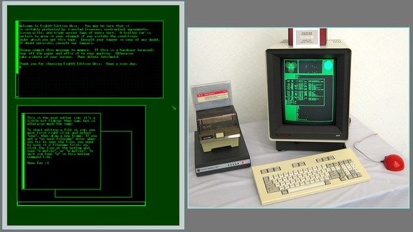

ANSI 터미널 vt를 사용하는 것이 필수 조건은 아니지만, 더 나은 사용 경험을 제공합니다. 서버가 실행되면 마우스 오른쪽 버튼을 클릭하고 “raw”를 선택하세요. 이렇게 하면 텍스트가 두 번 표시되는 것을 방지할 수 있으며, Del이나 Ctrl-D와 같은 키 조합을 사용할 수 있게 됩니다(그렇지 않으면 Plan 9가 이러한 신호를 해석해 버립니다). 그리고 맞습니다. 초기 유닉스 시스템에서는 Plan 9와 마찬가지로 Delete 키를 사용하여 프로세스를 종료했습니다. 시스템을 중지한 후(아래 참고 사항 참조), 마우스 오른쪽 버튼을 클릭하고 “cooked”를 선택하십시오. 이제 Delete 키를 누르면 Plan 9가 VAX 에뮬레이터를 중지합니다. V8 시스템에 새 사용자를 추가해 보겠습니다:

```
# install a new user

# echo myuser::8:4:mh1092,m069:/usr/myuser: >> /etc/passwd
# mkdir /usr/myuser
# /etc/chown myuser /usr/myuser
# exit
login: myuser

# set up your environment

$ cat << eof > .profile
TERM=blit # or vt100
export TERM
PATH=$PATH:/etc:/usr/games:/usr/blit/bin:$HOME/bin
export PATH
eof

# halt the system - preferred way (old v7 style also works)

$ su
# kill 1
# /etc/umount -a # v7 style: sync; sync; sync
# /etc/halt

# you can now safely kill the vax780 emulator
```

보시다시피, 이 시스템은 사용자 관리 및 시스템 종료 절차에 대한 단순한 접근 방식 면에서 Plan 9와 상당히 유사합니다. TERM 값에 대해서는 나중에 다시 다루겠지만, 기본적으로 vt나 UNIX 터미널을 통해 V8에 연결할 계획이라면 vt100을 사용하십시오. 또한 SIMH에서 V7이나 BSD 계열 중 하나를 실행하고 있다면 이 값을 설정해야 합니다. TERM 값을 설정하면 vi나 rogue와 같은 프로그램을 사용할 수 있습니다. PATH 변수를 설정하면 프로그램을 더 쉽게 실행할 수 있습니다. 예를 들어, 더 정확한 /etc/chown 대신 chown을 실행할 수 있습니다. 아직 가지고 계시지 않다면, Kernighan과 Pike가 쓴 『The UNIX Programming Environment』를 꼭 구해 보시기를 강력히 추천합니다. V8을 사용하든, Mac을 사용하든, 그 사이의 어떤 시스템을 사용하든 상관없이 이 책은 UNIX에 관한 정석입니다! 또한 관심이 있다면, 매뉴얼의 “제2권”으로 불리는 UNIX 버전 7 및 10과 함께 제공된 초록 문서를 찾아보실 수 있습니다. 이 문서들은 V8에 대한 역사적 배경과 유용한 팁을 제공합니다.

예전에는 UNIX가 지하실 어딘가에 있는 대형 서버에서 실행되었고, 여러 사용자가 디스크리스 터미널을 통해 이 서버에 연결되어 있었습니다. 여러 개의 창을 열고 telnet을 통해 서버에 연결하면 이를 시뮬레이션할 수 있습니다: telnet tcp!<mymachine>!8888. 단, <mymachine>을 실제 컴퓨터 이름(예: “localhost”가 아닌 “cirno”)으로 변경해야 합니다. 이러한 터미널은 상태 비저장형(stateless)이므로 별도의 종료 절차가 필요하지 않으며, 창을 닫기만 하면 됩니다. 하지만 서버는 파일 시스템을 실행하고 있으므로, 위의 지침에 따라 서버를 중지해야 합니다.

앞서 언급했듯이, V8은 그래픽 시스템으로 설계되었으며, 윈도우 매니저, 그래픽 텍스트 편집기 및 기타 마우스 클릭 방식으로 작동하는 기능들을 포함하고 있었습니다. 벨 연구소(Bell Labs)는 V8용 자체 그래픽 터미널인 ‘Blit’을 개발했습니다(원래 이름은 ‘Jerq’였으나, 어떤 이유로든 경영진이 그 이름에 문제를 제기했습니다). V8에서 그래픽 프로그램을 사용하려면 Blit 터미널을 통해 V8 서버에 연결해야 합니다. 9front에는 Blit 에뮬레이터가 포함되어 있으며, 다음과 같이 V8 서버에 연결할 수 있습니다: games/blit -b 19200 -C 000000,00ff00 -t tcp!<mymachine>!8888 (여기서 처음 두 플래그는 선택 사항입니다). 창 관리자는 /usr/blit/bin/mux로 시작할 수 있으며, PATH가 올바르게 설정되어 있다면 mux만 입력해도 됩니다.

이 Blit 에뮬레이터를 통해 V8에 접속하려면 TERM 변수를 blit으로 설정해야 합니다. 하지만 vi나 rogue와 같은 프로그램은 mux에서 작동하지 않습니다. 이러한 프로그램을 실행하려면 먼저 mux exit 명령어로 창 관리자를 종료한 다음, 텍스트 터미널에서 해당 프로그램을 실행해야 합니다. /usr/blit/bin 디렉터리에는 demo pacman이나 crabs와 같은 재미있는 그래픽 프로그램들이 있습니다. crabs는 화면 위를 돌아다니는 수많은 작은 게들을 생성하여, 창 일부를 무작위로 먹어치웁니다. Rob Pike에 따르면, 벨 연구소(Bell Labs)의 상사가 중요한 회의를 위해 컴퓨터를 사용해야 할 때마다, 개발자들 사이에서 30분 후로 실행되도록 이 프로그램을 예약해 두는 것이 즐겨 쓰던 말장난이었다고 합니다. 즐겁게 사용해 보세요 :)


# Office


대부분의 운영 체제에는 수많은 오피스 제품군이 있으며, 그 밖에도 셀 수 없이 많은 유틸리티가 있습니다. 사실 선택지가 너무 많아서 ‘오피스’가 단순히 텍스트를 다루는 것을 뜻하는 화려한 표현일 뿐이라는 사실을 잊기 쉽습니다. Plan 9는 사용자에게 허황된 기대를 주지 않습니다. 이 시스템을 사용하려면 읽기와 쓰기에 능숙해야 하며, 파일을 체계적으로 정리하고 관리할 줄 알아야 합니다. 다시 말해, 이 시스템을 잘 활용하려면 필수적인 사무 능력이 필요합니다.


## Reading Office Documents

당신에게 달려 있는 한, 당신의 모든 문서는 당연히 일반 텍스트일 것이라고 확신합니다. 일반 텍스트는 편집이 가능하고, 검색이 가능하며, 파이프 연산이 가능하고, 프로그래밍이 가능합니다. grep, sed, awk와 같은 표준 도구를 사용해 자유롭게 조작할 수 있으며, 테라바이트나 되는 디스크 공간을 필요로 하지도 않습니다. Plan 9에서 텍스트는 훨씬 더 강력합니다. 항상 유니코드로 저장되며, plumbable, acmeable, zeroxable, yesterdayable, snarfable, devable(네, 이 단어들은 Plan 9에서 “진짜” 형용사입니다)할 수 있습니다. 이는 마치 현실 세계와 마찬가지로 모든 것을 하나로 묶어주는 마법의 접착제와 같습니다. 문서를 일반 텍스트로 작성하지 않는다면 정말 미친 짓일 겁니다! 하지만 안타깝게도 항상 본인의 뜻대로 되는 것은 아닙니다. 성가신 상사가 여러분의 독특한 운영 체제 취향을 전혀 고려하지 않고 중요한 Word 문서를 보내올 수도 있습니다. 당황하지 마세요! 많은 사무용 문서는 `page`를 통해 읽을 수 있습니다(물론 HTML 파일은 `mothra`로 읽을 수 있습니다). DOCX나 ODT처럼 `page`에서 처리되지 않는 문서는 Plan 9 시스템으로 가져오기 전에 쉽게 PDF로 변환할 수 있습니다(당신의 모든 컴퓨터에서 Plan 9를 실행하고 있지 않다고 가정할 때).*


### Reading Epubs

이론적으로는 Page가 EPUB 파일을 처리할 수 있지만, 제 경험상 그렇지 않습니다. EPUB 파일은 기본적으로 압축된 HTML 파일일 뿐이므로, 압축을 풀고 “toc”(목차) 파일을 찾아 각 챕터를 구성하는 파일이 무엇인지 확인한 다음, 웹 브라우저에서 하나씩 읽어볼 수 있습니다. 다음 스크립트는 이 과정을 자동화합니다:

```
#!/bin/rc
# epub2html - convert epub to html
# usage: epub2html file.epub
# bugs:  only one epub at a time

# set some defaults
rfork e
cwd=`{pwd}
fn usage{
    echo Usage: epub2html file.epub >[1=2]
    exit usage
}    
if(! ~ $#* 1) usage
file=$1
if(! ~ $file /*) file=`{cleanname $cwd/$1}
if(! test -f $file && ! ~ $1 *.[Ee][Pp][Uu][Bb]) usage
name=`{basename $1 | sed 's/\.[Ee][Pp][Uu][Bb]//'}
dir=$name^_files

# determine directory name of toc file
fn ops{
    ops=`{ls -p $1 | grep -i '^o.*ps'}
    if(~ $#ops 0) echo $1
    if not{
        toc=`{ls -p $1/$ops | grep -i 'toc.ncx'}
        if(~ $#toc 0) echo $1
        if not echo $1/$ops
    }
}

# extract epub and chapter information
mkdir -p $dir && cd $dir
unzip -af $file >/dev/null >[2=1]
ops=`{ops $cwd/$dir} && cd $ops
cat [Tt][Oo][Cc].[Nn][Cc][Xx] | sed -n '/<navPoint/,/<\/navPoint/p' |
  sed -n 's/.*<text>(.*)<\/text>.*/\1/p' > chaps
cat [Tt][Oo][Cc].[Nn][Cc][Xx] | sed -n '/<navPoint/,/<\/navPoint/p' |
  sed -n 's/.*src="(.*)".*/\1/p' | sed 's/%20/ /g' > links

# generate html index
cat <<eof > $cwd/$name.html
<!DOCTYPE html>
<html>
    <head>
        <meta charset="utf-8">
        <title>Contents</title>
    </head>
    <body>
        <h1>Contents:</h1>
eof
for(i in `{seq `{cat links | wc -l}}){
    link=`{sed -n $i^p links}
    chap=`{sed -n $i^p chaps}
    echo '        <a href="'$ops^/^$"link'">'$"chap'</a><br>' \
      >> $cwd/$name.html
}
cat <<eof >> $cwd/$name.html
    </body>
</html>
eof
```

이 스크립트는 제 용도에는 놀라울 정도로 잘 작동하지만, 모든 EPUB 파일을 완벽하게 처리할 수 있다고 장담할 수는 없습니다. 필요에 따라 스크립트를 자유롭게 확장하거나 수정해 보세요. 흥미를 돋우기 위해 epub2html을 기반으로 한 스크립트 세 가지를 추가로 소개하겠습니다. 이 스크립트들은 설명이 필요 없을 정도로 직관적입니다. 마지막 스크립트인 ‘eread’가 아마 가장 흥미로울 텐데, 이 스크립트는 EPUB 파일을 직접 메모리에 불러온 뒤, 생성된 HTML을 mothra에서 읽어들입니다. 브라우저를 종료하면 파일들은 자동으로 삭제됩니다. 따라서 디스크의 임시 파일을 건드리지 않고도 EPUB을 빠르게 읽을 수 있는 방법입니다. 물론, 저처럼 게으른 사람이 아니라면 쉘 스크립트를 이리저리 만지작거리는 대신, 페이지를 수정하여 EPUB을 올바르게 처리하도록 하는 편이 더 나을 수도 있겠죠 ;)

```
#!/bin/rc
# epub2txt - convert epub to text
# usage:  epub2txt file.epub
# depend: epub2html

# set some defaults
rfork e
if(! ~ $#* 1) exit usage
keep=yes
name=`{basename $1 | sed 's/\.[Ee][Pp][Uu][Bb]//'}
if(! test -f $name.html){
    keep=no
    epub2html $* || exit $status
}
ifs='
'

# convert extracted epub to text
> $name.txt
for(file in `{awk -F" '/<a/ { print $2 }' $name.html})
    html2ms < $"file | deroff | fmt >> $name.txt
if(~ $keep no)
    rm -rf $name.html $name^_files
            

#!/bin/rc
# epub2pdf - convert epub to pdf
# usage:  epub2pdf [-k] file.epub
# depend: epub2html
# bugs:   troff(1) cannot handle any and all fonts,
#         so expect to see Weinberger pinups pop up.

# set some defaults
rfork e
if(! ~ $#* 1) exit usage
keep=yes
name=`{basename $1 | sed 's/\.[Ee][Pp][Uu][Bb]//'}
if(! test -f $name.html){
    keep=no
    epub2html $* || exit $status
}
temp=/tmp/epub2pdf-$pid
mkdir $temp
ifs='
'

# convert extracted epub to pdf
for(file in `{awk -F" '/<a/ { print $2 }' $name.html})
    html2ms < $"file >> $temp/out.ms
doctype $temp/out.ms | rc | dpost -f >[2]/dev/null |\
  ps2pdf '-dCompatibilityLevel=1.4' > $name.pdf
rm -rf $temp
if(~ $keep no) rm -rf $name.html $name^_files
            

#!/bin/rc
# eread - read an epub directly in mothra
# usage:  eread file.epub
# depend: epub2html, mothra

rfork ne
cwd=`{pwd}
name=`{basename $1 | sed 's/\.[Ee][Pp][Uu][Bb]//'}

# extract epub to memory, then read it
ramfs -p; cd /tmp
epub2html `{cleanname $cwd/$1} || exit $status
mothra -a file://tmp/$name.html
```


## Writing Office Documents

놀라운 장점들이 많지만, 일반 텍스트 문서에는 명백한 단점이 하나 있습니다. 바로 보기 좋지 않다는 점입니다. 기사를 쓰거나, 심지어 전문적으로 보이는 편지 하나라도 작성해야 한다면, 고정폭 글꼴보다 조금 더 세련된 도구가 필요합니다. 이때 Troff가 든든한 조력자가 되어줄 것입니다(TeX의 오래된 Plan 9 포팅 버전도 사용할 수 있지만, 꼭 그 복잡한 세계로 뛰어들어야 한다면 KerTeX를 확인해 보는 것도 좋습니다). 이 유서 깊은 도구를 너무 성급하게 무시하지 마세요! man man 명령을 실행하면 그다지 인상적이지 않은 고정폭 매뉴얼이 출력되지만, man -t man | page 명령을 사용하면 훨씬 더 전문적으로 보이는 문서를 얻을 수 있습니다! 매뉴얼 페이지를 작성하기 위한 man(6) 매크로 외에도, Plan 9에는 일반적인 기사나 편지를 작성하기 위한 ms(6) 매크로가 포함되어 있으며, 당연히 완전한 유니코드 지원을 제공합니다(이 기능은 UNIX Troff에서는 누락되었거나 사용하기 불편하며, TeX이나 DocBook은 말할 것도 없습니다). 또한 이미지를 삽입하기 위해 mpictures(6) 매크로를 사용할 수 있으며(이미지는 먼저 포스트스크립트로 변환해야 합니다. 예: jpg -9t < image.jpg | lp -dstdout > image.ps), troff 문서를 HTML로 변환하거나 그 반대로 변환하기 위해 html2ms/ms2html 명령을 사용할 수 있습니다.

다음은 troff(ms 매크로 사용)로 작성된 편지와 그 결과물의 스크린샷입니다:

```
.DS L
To: Archduke Poggle of Geonosis
23 Insectoid Str.
Hive
103133
GEONOSIS

From: Emperor Palpatine
Imperial Palace
P0 000001
Senate District
CORUSCANT
.DE
.SH
Dear Archduke
.PP
The so called
.I
undefeatable
.R
Death Star was blown to bits by a bunch of teenagers yesterday.
I must say I am disappointed!
We need to construct a new planet killer ASAP,
and this time lets try to avoid an
.B
Achilles heel
.R
in our design shall we?
.PP
I have some other ideas for further improvements.
First of all we need a
.I
menacing
.R
throne room with a view...
.DS
Yours truly,
    Palpatine
.DE
```

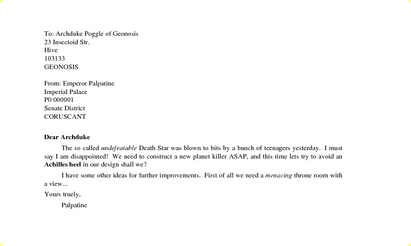

troff 구문은 매우 간단합니다. 섹션 헤더를 나타내는 .SH나 단독 줄 단락을 나타내는 .PP와 같은 troff 또는 매크로 명령어를 추가한 다음, 그 뒤에 본문 내용을 작성하면 됩니다. 엄밀히 말하면 이들은 ms 매크로 명령어이며, man 매크로와는 약간 다릅니다. 저수준 troff 명령어는 소문자로 작성됩니다(예: 줄 바꿈을 강제하거나 새 페이지를 시작하는 .br 또는 .bp). 필요하다면 특정 인라인 troff 명령도 작성할 수 있습니다(예: \fIitalics\fRroman\f(CW 고정폭 글꼴). 하지만 단순한 편지를 작성하려는 경우라면 이 모든 것을 알 필요는 없습니다. 사실 .SH와 .PP만으로도 충분하지만, 더 알고 싶다면 ms(6)을 참고하십시오.

오해하지 마십시오. troff는 매우 전문적인 문서를 작성하는 데에도 사용할 수 있습니다. 개발 섹션에서 Plan 9에 관한 Francisco J. Ballesteros의 훌륭한 책을 언급했는데, 이 책이 Plan 9에서 troff를 사용하여 작성되었다는 점은 언급할 가치가 있습니다. 전문성은 다소 떨어지지만 여전히 유용할 수 있는 예로는, 제가 쓴 ‘운영 체제의 복잡성’에 관한 기사가 있습니다. 이 PDF 파일을 ms 소스 코드와 비교해 보면 troff 문서를 작성하는 것이 어떤 모습인지 대략적으로 파악할 수 있습니다.

troff를 사용할 때 한 가지 문제는 소스를 유용한 문서로 컴파일하기 위해 수많은 다양한 troff 전처리기, 매크로 패키지 등을 사용해야 한다는 점입니다. doctype myfile.ms를 실행하면 파일을 순수한 troff로 변환하는 데 필요한 명령어를 확인할 수 있으며, 이 파일은 page에서 읽거나 유용한 형식으로 변환할 수 있습니다. 예를 들어:

```
; doctype myfile.ms
tbl myfile.ms | troff -ms -mpictures
; doctype myfile.ms | rc | page
; doctype myfile.ms | rc | dpost > myfile.ps    # i.e. postscript
; doctype myfile.ms | rc | dpost | ssh unixmachine 'lpr'
; doctype myfile.ms | rc | dpost | ps2pdf > myfile.pdf
; tbl myfile.ms | nroff -ms > myfile.txt
; ms2html < myfile.ms > myfile.html
```

문서의 종류에 따라 이러한 변환 중 일부는 제대로 작동하지 않을 수도 있습니다. 일반 텍스트와 HTML 변환 결과는 대개 상당히 좋지 않지만, Postscript와 PDF는 잘 작동할 것입니다. troff 문서를 자주 다루는 경우, 다음과 같은 단축키를 만들어 두면 유용할 수 있습니다. 예를 들어:

```
fn readms{ doctype $* | rc | page }
fn ms2pdf{ doctype $* | rc | dpost | ps2pdf '-dCompatibilityLevel=1.4' > out.pdf }
```


### Tweaking Troff Macros

자, 분명히 말하자면, 문서를 순수한 troff로 작성하고 싶지는 않을 것입니다. ms와 같은 사용자 친화적인 매크로 패키지가 있는 데는 다 이유가 있으니까요! 그럼에도 불구하고, 실제로 좀 더 직접적인 접근 방식이 필요한 경우도 있습니다. 예를 들어, 저는 정기적으로 개인적인 편지를 인쇄하여 보내곤 합니다. 기본 ms 문서는 글자 크기가 매우 작고 여백이 넓습니다. 설상가상으로, 이 매크로는 유럽에서 보편적으로 사용되는 A4 용지 크기에 맞춰 조정되어 있지 않습니다. 그 결과, 제 ms 편지는 글자가 간신히 읽힐 정도로 작고 사방이 넉넉한 여백으로 둘러싸여 있습니다. 게다가 저는 Times 글꼴보다 Helvetica를 더 선호하므로, 설정을 조금 변경해 보겠습니다. 다음은 이 작업을 수행하는 아주 기본적인 매크로 패키지입니다:

```
.\" Basic A4 troff macros for personal letters
.\" automatically add margins at top and bottom of page
.de hd
'sp 0.4i
..
.de fo
'bp
..
.wh 0 hd      \" run hd at start of page
.wh -0.6i fo  \" run fo at bottom -0.6 inches

.\" set A4 paper size (8.3i x 11.7i), margins and text size,
.\" and redefine standard fonts to use Helvetica
.pl 11.7i     \" page length
.ll 7.4i      \" line length (8.3 - 0.4 - 0.5 (right margin))
.po 0.4i      \" page offset (left margin)
.ps +2        \" point size  (text size)
.vs +1        \" vertical (line) space
.fp 1 R H     \" redefine font 1 (regular) roman
.fp 2 I HI
.fp 3 B HB

.\" add user friendly macros
.de SH        \" section header
.ft 3
.ps +4
..
.de PP        \" paragraph
.ps 12        \" reset text size and type
.ft 1
.sp 1         \" (vertical) space
.ti 2         \" temporary indent
..
.de R         \" basic font macros
.ft R
..
.de I
.ft I
..
.de B
.ft B
..
```

보시다시피, troff 매크로 명령어는 .de CMD, .. 블록 내에 정의되며, 주석은 \"로 시작합니다. 자세한 내용은 /sys/doc/troff.ps에 있는 troff 문서를 참고하시기 바랍니다. 또한 /sys/lib/tmac/tmac.s에 있는 ms 매크로 패키지를 살펴보고, 이 기본적인 예제에 몇 가지 명령어를 더 추가해 볼 수도 있습니다. Plan 9의 troff에는 제한된 수의 글꼴만 기본으로 설치되어 있습니다. /sys/lib/troff/font/devutf/shell.lib 파일을 살펴보면 사용 가능한 옵션을 확인할 수 있습니다. 문서에 사용자 정의 글꼴, 색상 및 URL 링크가 필요하다면, 과감히 UNIX 버전의 troff를 사용해야 합니다. 관심이 있다면 Gavin Freeborn이 이 주제에 대해 제작한 훌륭한 유튜브 동영상들이 있습니다.

이 매크로 패키지는 기본 포인트 크기가 10인 ms보다 약간 더 큰 글꼴을 사용하며, 용지 모서리에 훨씬 더 밀착되어 있습니다(네 면 모두 여백이 약 1센티미터 정도입니다). 문서에서 이 매크로를 사용하려면, 편지 상단에 `.so mymacro.a4`를 추가한 다음 `troff myletter.a4 | page` 명령으로 읽으면 됩니다. 하지만 자주 사용할 예정이므로 시스템 전체에 설치하는 편이 더 편리합니다: `cp mymacro.a4 /sys/lib/tmac/tmac.a4`. 이제 .so mymacro.a4 줄을 생략하고 다음과 같이 문서를 컴파일할 수 있습니다: troff -ma4 myletter.a4 | dpost | ps2pdf ‘-sPAPERSIZE=a4’ > myletter.pdf. (ps2pdf에서 사용하는 Ghostscript도 troff와 마찬가지로 용지 크기를 알아야 한다는 점에 유의하십시오.)


## Spellchecking

맞춤법 검사기인 spell(1)과 이에 상응하는 acme의 aspell은 영어 텍스트의 맞춤법을 검사하는 간단하지만 유용한 도구입니다(아쉽게도 사용자가 제공하는 사전을 지원하지는 않습니다). 말 나온 김에, dict(7)은 UNIX에서 WordNet과 어느 정도 유사한 훌륭한 영어 사전입니다. 이 도구를 사용하려면 먼저 몇 가지 파일을 설치해야 하며, 설치 방법은 /lib/dict에 있는 README 파일을 참조하십시오.

어떤 운영 체제에서도 비영어권에 대한 지원은 극히 미미하지만, 적어도 맞춤법 검사만큼은 다양한 전략을 활용할 수 있습니다. 예를 들어, 노르웨이어 맞춤법 검사를 위한 다음 함수들을 살펴보세요:

```
fn lower{
    tr A-ZÆØÅ a-zæøå
}
fn words{
    tr -c 'a-zæøåA-ZÆØÅ''' '
    ' | sed 's/''//g' | sort | uniq
}

temp=/tmp/dict-$pid
dict=/lib/words.no        # Norwegian dictionary
lodict=`{basename $dict}  # Local Norwegian dictionary
fn nolook{
    look $* $dict
}
fn nospell{
    if(test -f $lodict) dict=$lodict
    for(word in `{deroff $* | lower | words | comm -13 $dict -})
        if(! grep -s '^'$word'$' $dict) echo $word
}
fn noaddword{
    if(test -f $lodict) dict=$lodict
    for(word in $*) echo $word >> $dict
    words < $dict > $temp && mv $temp $dict
}
fn nomkdict{
    comm -12 <{deroff $* | lower | words} $dict >> $lodict
    for(word in `{deroff $* | lower | words | comm -13 $lodict -})
        if(! grep -s '^'$word'$' $dict) echo $word >> $lodict
    words < $lodict > $temp && mv $temp $lodict
}
```

이 기능들을 사용하려면 /lib/words.no에 철자가 올바른 노르웨이어 단어 사전이 있어야 합니다. 근처에 aspell용 노르웨이어 단어 목록이 설치된 UNIX 시스템이 있다고 가정할 때, 다음과 같이 사전을 가져올 수 있습니다: ssh myunixpc ‘aspell -d nb dump master | aspell -l nb expand’ | tcs -f 8859-4 | sort > /lib/words. no (다른 언어가 필요한 경우, 여기에서 “nb”를 변경하십시오. 예를 들어, 프랑스어의 경우 “fr”로 변경). lower 및 words 약어는 노르웨이어의 특수 문자 æøå를 고려합니다. nolook은 노르웨이어 look(1)의 약어일 뿐입니다.

spell과 매우 유사하게, nospell은 문서를 troff 구문을 제거한 개별적이고 고유한 단어로 분할하고, 사전에 없는 단어를 출력합니다. (안타깝게도 comm은 비영어 문자를 제대로 처리하지 못하기 때문에, 노르웨이어 문자 æøå가 포함된 단어를 잡아내기 위해 별도의 grep 명령줄이 필요합니다.) 사전에 사용자 정의 단어를 추가하려면 noaddword를 사용하십시오. 단, nospell은 로컬 사전 파일이 존재할 경우 이를 사용한다는 점에 유의하십시오. nomkdict *.ms를 실행하여 전역 사전(/lib/dict.no)에 일치하는 단어를 로컬 사전(~/dict.no)에 채워 넣으십시오. 이제 시스템 사전에 영향을 주지 않고 사용자 정의 목록에 자유롭게 noaddword를 추가할 수 있으며, 로컬 사전이 프로젝트 파일의 어휘에 최적화되어 있으므로 맞춤법 검사 속도가 수백 배 빨라집니다.

이러한 사용자 정의 도구는 조잡한 편이며, 특히 접미사나 접두사를 처리하지 못하기 때문에 유용하게 사용하려면 방대한 전역 사전을 준비해야 합니다. 예를 들어, 지금 읽고 계신 이 문서에는 약 4,113개의 고유한 영어 단어가 포함되어 있습니다. ‘spell’은 그중 1,053개를 맞춤법 오류로 표시할 것입니다.* 위의 전략을 /lib/words에 있는 약 30,000개의 단어가 포함된 기본 사전과 함께 사용하면 무려 2,174개의 오류가 표시될 것입니다. 하지만 약 120,000개의 단어가 포함된 영어 aspell 사전을 사용하면 오류는 853개밖에 나오지 않습니다(Plan 9의 기본 사전은 의도적으로 접미사/접두사를 제외합니다). 물론 이 오류들은 모두 오탐지입니다. (그랬으면 좋겠네요!)

이에 비해 LibreOffice는 828개의 고유한 오탐지를 표시하는데, 이 역시 꽤 형편없는 수준입니다. 이 거대한 오피스 제품군의 맞춤법 검사 메커니즘은 우리의 조잡한 셸 스크립트보다 확실히 더 매력적이지만, 과연 그것이 반드시 “더 낫다”고 할 수 있을까요? 올바른 단어를 하나하나 수동으로 다시 입력하는 대신, GUI에서 마우스 오른쪽 버튼을 천 번이나 클릭하는 것이 정말로 여러분의 맞춤법 실력을 향상시켜 줄까요? 이 도구를 사용자 정의하고 여러분의 독특한 습관에 맞추는 것이 얼마나 쉬운가요? 오늘날 믿기 힘들 정도로 빠른 컴퓨터를 사용하더라도, 대용량 문서에서 “모두 무시”를 클릭해 오탐을 수정할 때 리브레오피스는 1~2분 정도 지연될 수 있습니다. 이 오피스 제품군은 우리의 작은 셸 스크립트보다 (말 그대로) 백만 배는 더 복잡하지만, 과연 백만 배는 더 나을까요?

이 모든 해결책은 만족스럽지 않지만, 그게 바로 인생의 실상입니다. 영어라는 언어의 특성상, 지능적인 맞춤법 검사기는 강력한 인공지능에 버금가는 공상과학에나 나올 법한 이야기입니다. 이번 연습을 통해 우리는 몇 가지 추가적인 인생 교훈도 얻을 수 있을 것입니다: 1) 단순한 해결책으로도 충분하다, 2) 컴퓨터는 인간의 본성을 고칠 수 없다, 3) 작가의 삶은 지루함 그 자체다. 하지만 더 나은 맞춤법 검사기를 만들어 보고 싶다면, 『Programming Pearls』(Bentley 저)의 13장과 『Classic Shell Scripting』(Robbins & Beebe 저)의 12장을 읽어보시길 권합니다.


## PIM


“PIM”은 단순히 ‘정리 정돈’을 뜻하는 화려한 약어일 뿐입니다. 제가 예전에 근무했던 곳은 여섯 가지나 되는 ‘전문적인’ 프로젝트 관리 솔루션이 도입되어 있었음에도 불구하고, 엉망진창인 재난 현장이나 다름없었습니다. 동료들은 그 혼란스러운 상황에 지칠 대로 지쳐서 종종 새로운 프로젝트 관리 도구를 도입하곤 했는데, 이는 당연히 상황을 더욱 악화시켰습니다. 여기서 얻을 수 있는 교훈은 무엇일까요? 소프트웨어가 마법처럼 여러분의 혼란을 정리해 줄 수는 없으며, 스스로를 정리할 수 있는 사람은 오직 여러분뿐입니다.

Plan 9은 여러분의 보모 역할을 하려는 것은 아니지만, 스스로를 체계적으로 정리하는 데 사용할 수 있는 기본적인 도구들을 제공합니다. 이러한 도구에는 시간을 관리하는 date와 cal, 약속과 연락처를 관리하는 calendar와 tel, 그리고 프로그램 실행을 예약하는 cron(CPU+AUTH 서버가 필요함)이 포함됩니다. 그리고 약간의 awk만으로도 자신만의 PIM 도구를 쉽게 만들 수 있습니다. 여기서는 몇 가지 예시를 살펴보겠습니다. 다음 스크립트들은 의도적으로 기본적으로 작성된 것이므로 여러분의 필요를 정확히 충족시키지는 못할 수도 있지만, 여러분이 필요한 도구를 직접 작성하는 데 영감을 줄 수 있기를 바랍니다!

그리고 평소에 어떤 운영 체제를 사용하든, 곁에 실제 수첩을 하나 둬 두세요. 정말로요!


### 2do Lists

먼저, 간단한 할 일 목록 관리 프로그램을 만들어 봅시다:

```
#!/bin/rc
# 2do - simple 2do list manager
# usage: 2do [list [ id... | task... ]]
# bugs:  a task cannot begin with a number

# set some defaults
rfork ne
dir=$home/lib/2do
mkdir -p $dir
tmp=/tmp/2do-$pid
date=`{date -i}

# parse arguments
if (~ $#* 0) ls -p $dir && exit
if (~ $#* 1){ grep -v '^#' $dir/$1 | sort -k 2; exit }
list=$1 ; shift
id=1    # id is either 1 or one more then the highest id
if (test -f $dir/$list)
    id=`{awk '{ if($1 > id) id=$1 } END { print id+1 }' $dir/$list}

# id: remove tasks; task: add it
if (echo $* | grep -s '^[0-9\ ]+$'){
    for (id in $*)
        sed '/^'$id' /s/^/#/' $dir/$list > $tmp && mv $tmp $dir/$list
if not echo $id $date $* >> $dir/$list
```

다음은 이 기능의 사용법을 간단히 보여주는 예시입니다:

```
; for (thing in eggs milk cheese) 2do buy $thing
; 2do work start some project
; 2do
buy
work
; 2do buy
3 2021-03-23 cheese
1 2021-03-23 eggs
2 2021-03-23 milk
; 2do buy 1 3
; 2do buy
2 2021-03-23 milk
```

보시다시피, 이 2do 스크립트는 매우 기본적입니다. 이 스크립트를 사용하면 원하는 만큼의 목록을 정의할 수 있으며, 각 목록에 작업을 하나씩 추가하거나 ID 번호를 지정하여 작업을 삭제할 수 있습니다. 각 새 작업에는 고유한 ID와 오늘의 날짜가 부여되며, 작업은 가장 오래된 것부터 가장 최근의 순서로 나열됩니다. 목록을 완전히 삭제하려면 rm $home/lib/2do/mylist를 실행하기만 하면 되며, 원한다면 텍스트 편집기(예: B $home/lib/2do/mylist)를 사용하여 2do 목록을 수동으로 편집할 수도 있습니다.

이 스크립트는 여러 흥미로운 방식으로 쉽게 확장할 수 있습니다. 예를 들어, 우선순위를 추가하고 우선순위 순으로 정렬한 다음 날짜 순으로 정렬하도록 할 수 있습니다. 작업은 실제로 삭제되는 것이 아니라 주석 처리되므로, 프로젝트 시작 이후 완료된 작업의 수를 확인하고 목록이 완료될 예상 시점을 파악할 수 있습니다. 마지막으로, 오늘 이외의 날짜를 설정하는 등 여기에서 일부 기본값을 조정할 수 있는 플래그를 추가하고 싶을 수도 있습니다. 자유롭게 코드를 실험하고 다뤄보세요. 만약 이러한 기능들을 모두 추가하고 그 이상을 구현했다면, 한 걸음 물러서서 여러분의 버전과 원본의 차이점을 살펴보세요. 그 추가적인 복잡성이 과연 그만한 가치가 있었을까요?


### Queues

다음 스크립트는 부끄러울 정도로 간단합니다. 단순히 `que` 명령어를 실행할 때마다 파일의 다음 줄을 출력함으로써 큐를 관리하는 조잡한 메커니즘일 뿐입니다. 하지만 곧 보게 되겠지만, 이 스크립트는 의외로 유용하다는 것이 밝혀집니다.

```
#!/bin/rc
# que - a simple queue tracker
# usage: que [-p] file

# set some defaults
rfork ne
tmp=/tmp/que-$pid
pronly=no

# check arguments and errors
if (~ $#* 0 || test $#* -gt 2) {
    echo Usage: que [-p] file >[1=2]
    exit usage
}
if (~ $1 -p) {
    pronly=yes
    file=$2
}
if not file=$1
if (! test -f $file){
    echo Error: File $file does not exist! >[1=2]
    exit nofile
}

# print task and update queue
if (! task=`{grep -n '<--' $file | sed 's/:.*//'}) task=1
next=`{ echo $task + 1 | hoc }
prev=`{ echo $task - 1 | hoc }
if (~ $pronly yes) { sed -n '$prev'p $file; exit }
sed 's/<--//' $file > $tmp
sed -n ''$task'p' $tmp
sed ''$next's/$/<--/' $tmp > $file
```

‘레드 드워프’ 오디오북을 듣고 있다고 가정해 봅시다. $home/lib/que/reddwarf에 다음과 같은 챕터 목록을 작성해 두었다고 합시다.

```
/usr/glenda/music/reddwarf/ch1.mp3
/usr/glenda/music/reddwarf/ch2.mp3
/usr/glenda/music/reddwarf/ch3.mp3
...
```

que $home/lib/que/reddwarf 명령을 실행하면 /usr/glenda/music/reddwarf/ch1.mp3가 출력되며, 목록은 다음과 같이 변경됩니다:

```
/usr/glenda/music/reddwarf/ch1.mp3
/usr/glenda/music/reddwarf/ch2.mp3<--
/usr/glenda/music/reddwarf/ch3.mp3
...
```

다음에 이 명령을 실행하면, que는 ch2.mp3를 출력하고 화살표 마커를 ch3.mp3로 이동시킬 것입니다. 작업을 더 자동화하는 것도 쉽습니다. 예를 들어:

```
; fn reddwarf{ play `{que $home/lib/que/reddwarf} }
; reddwarf    # listen to next chapter in our audiobook
; du -a My_Little_Pony | awk '/mp4/ { print $2 }' | sort > $home/lib/que/mlp
; fn mlp{ treason `{que $home/lib/que/mlp} }
; mlp         # watch next episode of My Little Pony
```

때로는 마커를 다음 단계로 진행하지 않고 대기열에 있는 현재 작업을 출력하고 싶을 때가 있습니다. 예를 들어, 저는 매주 정기적으로 회의에 참석하며 다음과 같은 형식의 회의록 목록을 관리하고 있습니다:

```
/usr/dan/jw/litt/work/2022/mwb_E_202209_files/OEBPS/202022327.xhtml
/usr/dan/jw/litt/work/2022/mwb_E_202209_files/OEBPS/202022330.xhtml<--
/usr/dan/jw/litt/work/2022/mwb_E_202209_files/OEBPS/202022332.xhtml
/usr/dan/jw/litt/work/2022/mwb_E_202209_files/OEBPS/202022334.xhtml
...
```

이 노트들은 몇 주에 걸쳐 작성된 EPUB 파일(각 줄마다 하나씩)로 제공됩니다. 저는 EPUB 파일을 추출하여 목록을 업데이트하는 간단한 스크립트를 가지고 있는데, 이 스크립트는 일 년에 세 번에서 네 번 정도 실행하면 됩니다. 매주 초가 되면 이 목록에 대해 `que`가 자동으로 실행되어 마커를 다음으로 이동시킵니다. 마지막으로, `que -p $home/lib/meeting`을 실행하여 해당 HTML 노트를 mothra에서 열어주는 ‘meeting’ 스크립트가 있습니다. ‘meeting’ 스크립트는 일주일에 몇 번씩 실행해야 할 수도 있지만, 이 설정 덕분에 항상 당주 노트를 참조하게 됩니다.

물론 이 예시의 세부 사항은 여러분에게 직접적인 관련이 없을 수도 있겠지만, 여러분만의 워크플로우를 자동화하는 방법에 대한 아이디어를 얻는 데 도움이 되기를 바랍니다. 주간 노트는 쉽게 일간 또는 월간 노트로 바꿀 수 있으며, 반드시 파일일 필요도 없습니다. 파일 디렉터리나 실행할 스크립트 등 무엇이든 될 수 있습니다(더 자세한 팁은 ‘배관’ 섹션을 확인해 보세요).


### Password Management

Plan 9의 모든 인증 서비스는 factotum이라는 프로세스에 의해 처리됩니다(“factotum”이란 주인을 대신하여 그의 재산을 관리할 권한을 위임받은 하인을 의미합니다). 이 개념은 UNIX의 PAM과 다소 유사하지만, 훨씬 더 간단하면서도 더 강력합니다. 커널을 포함하여 Plan 9의 어떤 프로그램에도 인증 코드가 전혀 포함되어 있지 않으며, 모든 인증 처리는 factotum에 중앙 집중화되어 있습니다. 이 프로세스는 이미 실행 중일 것이지만, 그렇지 않다면 auth/factotum -n 명령어로 시작할 수 있습니다. 또한 부팅할 때마다 자동으로 실행되도록 $home/lib/profile 파일에 이 명령을 추가해야 합니다. 여기서 -n 플래그는 “secstore를 찾지 마라”는 의미입니다. (이에 대해서는 나중에 더 자세히 설명하겠습니다) 일부 인증 서비스를 시스템의 나머지 부분과 분리해야 하는 경우, plumber의 인스턴스를 여러 개 가질 수 있는 것처럼 factotum의 인스턴스도 여러 개 실행할 수 있습니다.

인증 서비스 관리는 매우 간단합니다. 예를 들어, ssh를 통해 UNIX 시스템에 처음 로그인할 때, factotum은 필요한 키가 없다는 것을 감지하고, 사용자에게 키 입력을 요청한 후 키를 안전하게 저장합니다. 이후의 ssh 명령에서는 인증 서비스가 이미 비밀번호를 알고 있으므로 비밀번호를 묻지 않습니다(단, 재부팅 후에는 키가 사라지지만, 계속 읽어보세요). `cat /mnt/factotum/ctl`을 실행하면 factotum에 저장된 키를 확인할 수 있으며, 다음과 같은 결과가 출력될 수 있습니다:

```
key proto=pass server=unixpc service=ssh thumb=5+dUiv4yKNhWR3e+DmVu9wvgX
tu5gN3xPgApEWJGMR user=glenda !password?
```

비밀번호와 같은 기밀 정보는 절대 일반 텍스트로 출력되지 않는다는 것을 알 수 있을 것입니다. 이제 다음과 같이 이 키를 factotum에 수동으로 추가할 수도 있었을 것입니다:

```
; echo 'key proto=pass server=unixpc service=ssh thumb=5+dUiv4yKNhWR3e+D
  mVu9wvgXtu5gN3xPgApEWJGMR user=glenda !password='my secret password''
  > /mnt/factotum/ctl
# to delete it, do it manually or with delkey(1)
; echo 'delkey service=ssh' > /mnt/factotum/ctl
; delkey ssh | rc
```

SSH 키 설정 과정은 기본적으로 동일합니다. 먼저 키를 생성한 다음, 공개 키를 UNIX 시스템으로 복사하기만 하면 됩니다:

```
; mkdir $home/lib/ssh
; auth/rsagen -t 'service=ssh' > $home/lib/ssh/id_rsa
; auth/rsa2ssh $home/lib/ssh/id_rsa > $home/lib/ssh/id_rsa.pub
; sshfs user@tcp!unixpc.example!1234
; cat $home/lib/ssh/id_rsa.pub >> /n/ssh/.ssh/authorized_keys
; cat $home/lib/ssh/id_rsa > /mnt/factotum/ctl
```

하지만 이 서비스의 진정한 장점은 secstore와 같은 다른 서비스와 결합했을 때 비로소 빛을 발합니다. Plan 9의 보안 저장소(secstore)는 강력한 암호화를 사용하여 비휘발성 RAM에 파일을 저장하므로, 재부팅 후에도 안전하게 유지됩니다. 이 서비스를 사용하려면 CPU+AUTH 서버를 설정해야 하며, 설정 방법에 대한 자세한 내용은 9front FAQ의 7장(secstore의 경우 구체적으로 7.4.3절)에서 확인할 수 있습니다. secstore가 실행되면, factotum 키 데이터베이스를 작성하여 볼트에 추가할 수 있습니다:

```
; ramfs -p; cd /tmp   # write our file to RAM, not to disk
; cat /mnt/factotum/ctl > factotum
; sam factotum        # fill in the passwords
; cat factotum
key proto=pass server=unixpc service=ssh thumb=5+dUiv4yKNhWR3e+DmVu9wvgX
  tu5gN3xPgApEWJGMR user=glenda !password='my secret password'
key proto=dp9ik dom=mydomain user=glenda !password='don''t forget me!'
; auth/secstore -p factotum
```

여기에서 두 개의 키가 추가된 것을 확인할 수 있습니다. 하나는 ssh용이고, 다른 하나는 Plan 9 사용자 계정용입니다(여기서의 dom 값은 /lib/ndb/local에 있는 authdom과 동일합니다). 이제 $home/lib/profile 파일에서 auth/factotum -n을 auth/factotum으로 변경할 수 있습니다. 부팅 시, factotum은 이제 보안 저장소를 열고 암호화된 factotum 파일에서 발견되는 모든 키를 읽어들입니다. 나중에 이 파일을 편집하려면 ipso factotum을 입력하기만 하면 됩니다.

Plan 9 보안이 어떻게 작동하는지에 대한 자세한 내용은 /sys/doc/auth.ps 페이지를 참고할 수 있지만, 마무리하기 전에 secstore에 대해 조금 더 이야기해 보겠습니다. 보안 저장소는 factotum 데이터베이스뿐만 아니라 원하는 모든 파일을 암호화하는 데 사용할 수 있습니다. UNIX에서 gpg를 사용하여 암호화된 비밀번호 목록을 관리하고, 편의를 위해 Plan 9 시스템에도 이를 보관한다고 가정해 봅시다. 그 내용은 다음과 같을 수 있습니다:

```
CATEG    NAME   USER   PASSWORD EMAIL            WEBSITE
Bank     PayPal -      123456   myuser@gmail.com paypal.com
Bank     MyBank 123456 password myuser@gmail.com mybank.no
Email    GMail  myuser MySecret myuser@gmail.com gmail.com
...
```

그러면 다음과 같이 할 수 있습니다:

```
# put our custom database in the secret store
; auth/secstore -p passwords
# search the database for passwords
; auth/secstore -G passwords | grep -i bank
; auth/secstore -G passwords | awk '/Bank/ { print $2, $4 }' 
# securely edit our database
; ipso -e passwords
```

또한 비밀 데이터베이스를 UNIX 시스템으로 안전하게 내보내거나 가져올 수 있습니다:

```
# export to unix
; ssh unixpc 'gpg2 --gen-key'
; auth/secstore -G passwords | ssh unixpc 'cat | gpg2 -ser myuser > pass.gpg'

# import from unix
; ramfs -p; cd /tmp
; ssh unixpc 'gpg2 -d pass.gpg' > passwords
; auth/secstore -p passwords
```

이러한 파일을 지속적으로 가져오고 내보내야 한다면, 이러한 명령어 중 일부를 사용자가 더 편리하게 사용할 수 있는 단축키로 쉽게 구성할 수 있습니다. 하지만 secstore 서비스가 실행 중인 CPU+AUTH 서버가 없다고 가정해 보겠습니다. 그래도 비밀번호를 안전하게 관리할 수 있을까요? 물론입니다:

```
; ramfs -p; cd /tmp
; B passwords
; auth/aescbc -e < passwords > $home/lib/pass.aes
# and to double check that the password we typed was correct:
; auth/aescbc -d < $home/lib/pass.aes  > /dev/null
# search the encrypted file for a password
; auth/aescbc -d < $home/lib/pass.aes | grep -i bank
```

만약 디스크에 극비 정보를 저장했다면, 그 내용을 안전하게 삭제할 방법이 있을까요? 상황에 따라 다릅니다. 해당 파일의 사본이 읽기 전용 덤프 파일 시스템에 존재한다면, 불가능합니다. 운영 체제를 재설치하는 것이 파일을 제거할 수 있는 유일한 방법입니다. 하지만 그렇지 않은 경우라면, 내용을 빈 데이터로 덮어쓰는 것만으로도 간단히 해결할 수 있습니다:

```
# ps: the whitespace in the sed command here is a tab
; dd -if /dev/zero -of myfile -bs 1024 -count `{du myfile | sed 's/    .*//'}
```

PS: 물론 이건 농담입니다. 최신 하드디스크에 기록된 데이터가 완전히 삭제된다고 보장할 방법은 없습니다. 디스크가 운영 체제에 어떤 메시지를 보내든 상관없이 말이죠.


### Personal Accounting

많은 사람들에게 ‘회계’라는 단어만 들어도 등골이 오싹해지곤 하는데, 확실히 기업 회계는 끔찍할 정도로 복잡한 경향이 있습니다. 하지만 이는 대부분 복잡한 법규와 불필요하게 지나치게 꼼꼼한 계산 재검토 때문이죠. 개인 회계에서는 그런 것들까지 걱정할 필요가 없습니다. 우리는 단지 지출을 빠르게 기록할 수 있는 방법과, 그 지출을 예산과 대조해 확인할 수 있는 방법만 있으면 됩니다. 다음은 첫 번째 작업을 처리해 주는 간단한 스크립트입니다:

```
#!/bin/rc
# account - add records to our personal account
# usage: account [-d date] [-c catg] $$.CC [ comments... ]

# set some defaults
rfork e
account=$home/lib/account
date=`{date -i}
catg=food

# check arguments and errors
if (~ $#* 0) {
    echo 'Usage: account [-c catg] $$.CC [ comments... ]'
    exit usage
}
for(arg in $*){
    switch($arg){
    case -c
        catg=$2
        shift 2
    case -d
        date=$2
        shift 2
    }
}
if (echo $date | grep -vs '^[12][09][0-9][0-9]-[01][0-9]-[0-3][0-9]$') {
    echo Error: invalid date, use YYYY-MM-DD >[1=2]
    exit wrongdate
}
if (echo $1 | grep -vs '^[0-9.]+$') {
    echo Error: invalid expense, use $$.CC without prefixes >[1=2]
    exit wrongnumber
}

# add record to account
if (~ $catg income) amount=$1
if not amount=-$1
shift
echo $date $amount $catg $* >> $account
```

다음은 사용 방법을 보여주는 예시입니다:

```
; account -d 2021-03-01 -c rent 1000 it sucks to pay rent
; account -d 2021-03-02 -c income 3500 payday!
# this is too much typing, lets reduce it a bit
; fn prompt{ while (echo -n '> ') eval $* `{read} }
; prompt account
> -d 2021-03-04 21.25
> -d 2021-03-06 14.50 groceries
> -c transport 2.50 buss
> -c other 9.50 cinema
> 11.35 # hit Del key to quit input loop
; date -i
2021-03-09
; cat $home/lib/account
2021-03-01 -1000 rent it sucks to pay rent
2021-03-02 3500 income payday
2021-03-04 -21.25 food
2021-03-06 -14.50 food groceries
2021-03-09 -2.50 transport buss
2021-03-09 -9.50 other cinema
2021-03-09 -11.35 food
```

이 시연을 통해 개인 회계 관리가 종종 꽤 번거롭다는 것을 알 수 있습니다. 적어도 이 스크립트는 그 업무 부담을 다소 줄여주려고 합니다. 매일 지출 내역을 입력하는 습관을 들이면 날짜를 따로 지정할 필요가 없습니다. 대부분의 지출이 “식비”와 관련되어 있다고 가정할 때, 보통 카테고리도 따로 지정할 필요가 없습니다. 이 스크립트를 사용하면 각 입력 레코드에 주석을 달 수 있지만, 이는 선택 사항입니다. 레코드 내에서 +나 - 기호를 사용하지 않는다는 점에 유의하세요. 스크립트는 ‘수입’ 카테고리에 속하는 모든 항목을 +로, 그 외의 모든 항목을 -로 해석합니다. 마지막으로, 이 스크립트는 한 번에 하나의 레코드만 입력하도록 요구하지만, 매번 ‘account’를 입력하는 것은 번거롭게 느껴집니다. 그래서 ‘prompt’라는 작은 함수를 만들어, 명령어(이 경우 ‘account’)를 정의할 수 있게 했습니다. 이 함수는 입력을 한 줄씩 읽어들이고, 해당 줄을 명령어의 인수로 재평가한 뒤 실행합니다(UNIX의 xargs를 연상시키지만, 루프가 추가된 형태입니다). Delete 키를 누르면 루프를 종료합니다. 저는 이 방법을 다양한 상황에서 유용하게 활용합니다. 예를 들어, 기사를 쓰면서 여러 단어를 찾아봐야 할 때, `prompt look`이나 `prompt dict`를 사용하면 아주 편리합니다.

이 데이터베이스를 월별 지출 내역을 정리하거나 예산과 대조하는 등의 계산에 사용할 계획이라면, 데이터베이스에 유효한 데이터가 포함되어 있어야 합니다. 따라서 입력된 날짜와 지출 내역이 올바른지 확인하기 위해 몇 가지 추가적인 타당성 검사를 수행합니다. 이 검사가 100% 완벽하다고는 할 수 없지만, 개인적인 용도로는 충분할 것입니다. 다음 단계에서는 다음 스크립트를 통해 현재 월별 지출 내역을 미리 정의된 예산과 대조하여 확인합니다:

```
#!/bin/rc
# budget - measure monthly expenses against a budget
# usage: budget [YYYY-MM]

# set some defaults
rfork e
account=$home/lib/account_simple
if (~ $#* 0) date=`{date -i | sed 's/...$//'}
if not date=$1
echo $date

awk '
BEGIN {
    printf("%-s\n", "-----------------------------")
}
/'$date'.* income/ { income+=$2 }
/'$date'.* rent/   { rent+=$2   }
/'$date'.* save/   { save+=$2   }
/'$date'.* food/   { food+=$2   }
/'$date'.*/        { sum+=$2    }
END {
    printf("%-10s%10.2f %-10s\n", "income:", income, "of 3500")
    printf("%-10s%10.2f %-10s\n", "rent:", rent, "of -1000")
    printf("%-10s%10.2f %-10s\n", "save:", save, "of -200")
    printf("%-10s%10.2f %-10s\n", "food:", food, "of -1000")
    printf("%-10s%10.2f %-10s\n", "other:",
            sum - (income + (rent + save + food)), "of -1000")
    printf("%-s\n", "-----------------------------")
    printf("%-10s%10.2f\n", "Balance:", sum)
}' $account
```

budget 명령어를 실행하면 다음과 같은 결과가 출력됩니다:

```
2021-03
-----------------------------
income:      3500.00 of 3500
rent:       -1000.00 of -1000
save:           0.00 of -200
food:         -47.10 of -1000
other:        -12.00 of -1000
-----------------------------
Balance:     2440.90
```

물론 여기 제시된 예산은 비현실적으로 단순하지만, 적어도 개인 지출에 한해서는 회계 관리가 그리 어렵지 않을 수 있음을 보여주는 예가 될 수 있습니다. 스프레드시트 등을 더 선호하신다면, 아래의 ‘스프레드시트’ 섹션을 살펴보시고 재정 관리를 위한 또 다른 방법을 확인해 보시기 바랍니다.


### Time Management

시간 및 프로젝트 관리에 관한 정교한 방법론과 이론은 이미 많이 나와 있습니다. 여기서는 그런 내용들은 다루지 않고, 대신 개인 시간 관리에 필요한 가장 기본적인 도구들만 살펴보겠습니다. 우선, 고전적인 캘린더 프로그램은 약속을 관리하는 데 매우 적합합니다. 만약 오늘이 3월 24일이고, $home/lib/calendar 파일이 다음과 같이 되어 있다면:

```
Mar 23    Finish the Plan 9 Desktop Guide already!
Mar 24    Flee the country
Mar 25    Dentist appointment
Mar 26    Go home
```

'calendar' 명령을 실행하면 다음과 같은 줄이 출력됩니다:

```
Mar 24    Flee the country
Mar 25    Dentist appointment
```

캘린더는 오늘과 내일의 날짜에 해당하는 약속이나, 금요일인 경우 다음 월요일까지의 모든 약속을 출력합니다. 날짜와 약속은 탭으로 구분되어야 합니다. 이 프로그램을 유용하게 사용하는 비결은, 물론 약속을 직접 기록하는 것 외에도, 시스템을 설정하여 이 프로그램이 매일 자동으로 실행되도록 하는 것입니다. 이를 정확히 어떻게 구현할지는 사용자의 환경과 취향에 따라 크게 달라지지만, 간단한 해결책 중 하나는 $home/bin/rc/riostart 파일에 다음 내용을 추가하는 것입니다:

```
window rc -c 'calendar; rc'
```

스톱워치, 타이머 또는 알람 시계가 필요하시다면, 다음 예시들이 도움이 될 수 있습니다:

```
# hit enter to stop the clock, "r" is time in seconds
; time read
# set timer for 2 minutes
; sleep 120; play $home/music/sample/beep.mp3
# set of alarm at 17:10 o'clock
; while(! ~ `{date | awk '{ print $4 }'} 17:10*)
    sleep 60; play $home/music/alarm.mp3
```


## Math, Graphs and Units

Plan 9에는 bc, hoc, dc*라는 세 가지 계산기가 있습니다. 이 계산기들은 모두 기능 면에서 대체로 비슷하며, 오래된 UNIX의 주역인 bc가 여러분에게 가장 친숙할 것입니다(부동소수점 연산을 사용하려면 bc -l을 실행하세요).

units 명령어는 미터를 피트로, 킬로그램을 파운드로 변환하는 등 서로 다른 단위를 변환하는 데 유용합니다(다만 몇 가지 제한 사항이 있습니다). 그래프를 그리려면 graph를 사용하는 방법이 있습니다. 다음과 같은 주식 시장 출력 결과가 있다고 가정해 봅시다:

```
98
99
102    "102"
100
97     "97"
```

'graph -y 80 120 -a < stocks | plot' 명령어를 실행하면, y축이 80에서 120 사이로 설정되고 x축은 자동으로 증가하도록 그래프가 그려집니다. 또한 그래프의 최저점과 최고점에는 각각 “97”과 “102”라는 레이블이 표시됩니다. 물론 훨씬 더 복잡한 그래프를 만들 수도 있습니다. 데이터베이스에 투자한 각 기업별로 한 열씩, 총 세 열의 숫자가 있다고 가정해 봅시다(각 열에는 선택적으로 레이블이 지정될 수 있습니다). 이 경우 `graph -y 80 120 -a -o 3 -p rgb < stocks | plot` 명령어를 실행하면, 세 기업을 각각 다른 색상(빨강, 초록, 파랑)으로 표시한 그래프를 생성할 수 있습니다.

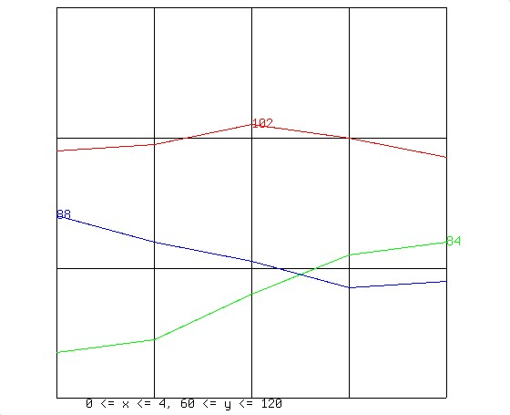

또 다른 대안으로는 gview가 있습니다. 예를 들어, awk ‘{ print NR, $1 }’ stocks | gview (여기서 stocks는 위의 주식 시장 예시입니다). 이를 사용하면 색상 변경이나 확대/축소와 같은 그래프에 대한 대화형 조작을 수행할 수 있습니다. 세 개의 회사가 포함된 “복잡한” 예시를 표시하려면, 입력 파일에 첫 번째 회사(예: 1 98... 5 97)을 나열하고, 선택적으로 색상(예: Red)을 추가한 뒤, 두 번째 기업(예: 1 88... 5 79)을 나열하는 식으로 구성되어야 합니다. 모든 기능을 갖추고 있음에도 불구하고, 그래프 및 gview 프로그램에는 치명적인 결함이 하나 있습니다. 바로 그래프를 문서에 삽입하는 과정이 번거롭다는 점입니다. troff 문서를 위한 더 우아한 그래프 도구는 grap입니다. 이 도구는 거의 동일한 기능을 제공하지만, 약간 다른 구문을 사용합니다. 위의 주식 시장 그래프를 troff 문서에 추가하려면 다음과 같이 작성할 수 있습니다:

```
.G1
98
99
102
100
97
.G2
```

그리고 grap stock.ms | pic | troff | page 명령을 실행하여 그래프를 볼 수 있습니다. 물론 각 회사마다 고유한 스타일과 레이블을 가진 세 회사의 그래프가 있다면 상황은 더 복잡해질 것입니다. 그래프 데이터가 stocks라는 파일에 들어 있고, 다음과 같은 형태라고 가정해 봅시다:

```
1 98  67 88
2 99  69 84
3 102 76 81
4 100 82 77
5 97  84 78
```

이 경우 grap 그래프는 다음과 같이 작성할 수 있습니다:

```
.G1
frame invis ht 2 wid 4 left solid bot solid
label left "CompA" left .5 up .7
label left "CompC" left .5
label left "CompB" left .5 down .7
draw compa solid
draw compb dotted
draw compc dashed
copy "stocks" thru X
    next compa at $1,$2
    next compb at $1,$3
    next compc at $1,$4
X
.G2
```

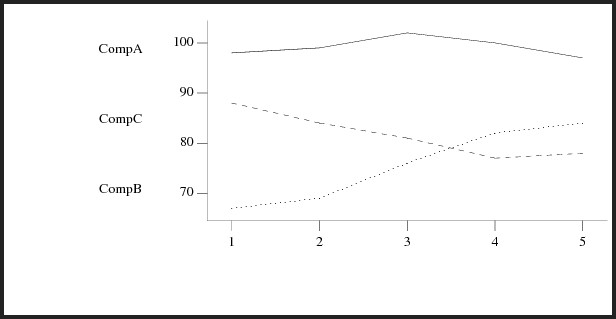

tbl, pic, eqn과 같은 다른 troff 전처리기들과 마찬가지로, 이 미니 언어를 익히려면 약간의 노력이 필요합니다. 하지만 일단 그 의미 체계를 익히면, troff 문서에 상당히 복잡한 표, 그림, 수학 식, 그래프 등을 추가하는 것은 그리 어렵지 않습니다.


## Spreadsheets

Plan 9에는 마우스로 클릭하며 편리하게 사용할 수 있는 GUI 스프레드시트가 없지만, 기본적인 기능을 구현하는 것은 그리 어렵지 않습니다. 여러분이 LibreOffice로 개인 회계를 관리하는 습관이 있다고 가정해 봅시다. 일반적인 회계 연도는 다음 스크린샷과 비슷할 것입니다:

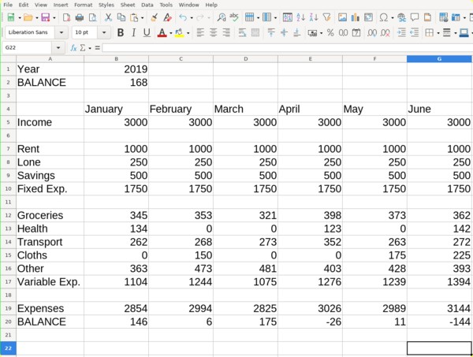

Plan 9에서 이와 같은 보고서를 재현하기 위한 핵심 단계는 데이터와 표시 방식을 분리하는 것입니다. 예를 들어, account 데이터 변수를 다음과 같이 고정 필드 데이터베이스에 저장해 봅시다:

```
Groceries   345     353     321     398     373     362
Health      134     0       0       123     0       142
Transport   262     268     273     352     263     272
Cloths      0       150     0       0       175     225
Other       363     473     481     403     428     393
```

이 데이터베이스가 마련되어 있으면 위의 스프레드시트를 생성하는 것은 꽤 쉽습니다. 예를 들어, 다음 awk 스크립트를 실행하면 LibreOffice 스크린샷과 유사한 ASCII 형식의 보고서가 출력됩니다:

```
; cat account
#!/bin/rc
# account - print an account report
# usage: account database
# bugs:  requires a very specific input file

date=`{date}
awk <$1 '
BEGIN {
    # set some fixed income/expense values
    income=3000; rent=1000; lone=250; savings=500; fixed=1750

    # print header and fixed monthly values
    printf("%10s%6s%6s%6s%6s%6s%6s\n",
    "", "Jan", "Feb", "Mar", "Apr", "May", "Jun")
    prfixed("Income", income)
    print ""
    prfixed("Rent", rent)
    prfixed("Lone", lone)
    prfixed("Savings", savings)
    prfixed("FIXED", fixed)
    print ""
}
{
    # print each line in the db and save their values
    prline($1, $2, $3, $4, $5, $6, $7)
    jan+=$2; feb+=$3; mar+=$4; apr+=$5; may+=$6; jun+=$7
}
END {
    # print summary of expenses
    prline("VARIABLE", jan, feb, mar, apr, may, jun)
    print ""
    prline("Expenses", jan+fixed, feb+fixed, mar+fixed,
                       apr+fixed, may+fixed, jun+fixed)
    prline("BALANCE",
        income-fixed-jan, income-fixed-feb, income-fixed-mar,
        income-fixed-apr, income-fixed-may, income-fixed-jun)
    print ""

    # print current year and annual balance
    split("'$"date'", date)
    printf("%10s %d\n", "Year", date[6])
    printf("%10s %d\n", "SUM",
        (income*6)-((fixed*6)+jan+feb+mar+apr+may+jun))
}

# a couple of wrapper functions for printf
function prline(tag, jan, feb, mar, apr, may, jun){
    printf("%-10s%6d%6d%6d%6d%6d%6d\n",
    tag, jan, feb, mar, apr, may, jun)
}
function prfixed(tag, n){
    printf("%-10s", tag)
    for (i=1; i<=6; i=i+1)
        printf("%6d", n)
    printf("\n")
}
'
; account database
             Jan   Feb   Mar   Apr   May   Jun
Income      3000  3000  3000  3000  3000  3000

Rent        1000  1000  1000  1000  1000  1000
Lone         250   250   250   250   250   250
Savings      500   500   500   500   500   500
FIXED       1750  1750  1750  1750  1750  1750

Groceries    345   353   321   398   373   362
Health       134     0     0   123     0   142
Transport    262   268   273   352   263   272
Cloths         0   150     0     0   175   225
Other        363   473   481   403   428   393
VARIABLE    1104  1244  1075  1276  1239  1394

Expenses    2854  2994  2825  3026  2989  3144
BALANCE      146     6   175   -26    11  -144

      Year 2021
       SUM 168
```

awk에 익숙하지 않다면, 위의 예제가 꽤 끔찍해 보일 것입니다. 마음을 가라앉히고 커피 한 잔을 내려 마시며 스크립트를 한 줄씩 천천히 읽어보세요. 논리는 꽤 직관적이며, 여기서 지루한 부분은 대부분 서식 지정과 관련이 있습니다. 예를 들어 printf(“%-10s%6d%6d%6d%6d%6d%6d\n”...)는 보기 좋지는 않지만, 필드가 깔끔하게 출력되도록 보장합니다(너비 10자의 문자열로 구성된 줄을 출력한 뒤, 너비 6자의 숫자 6개를 출력하고, 그 뒤에 줄바꿈을 추가합니다).

개인적인 회계 처리를 위해 ASCII 표를 출력하는 것도 좋지만, 이러한 보고서를 비즈니스 문서에 포함해야 한다고 가정해 봅시다. ASCII 표는 90년대 초반에 이미 유행이 지났기 때문에, 상사에게 보여줄 때는 확실히 더 전문적인 형식이 필요합니다. 당황하지 마세요. tbl(1)이 도와줄 테니까요! 다음 예제를 살펴보세요:

```
; cat << eof > table
    .TS
    expand center allbox;
    l l l l l l l
    l n n n n n n.
    eof
; account database | sed 's/[ ]+/    /g' >> table
; echo .TE >> table
; tbl table | troff | page
```

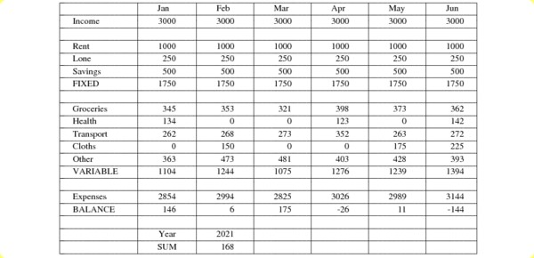

한 걸음 물러서서 여기서 무슨 일이 일어나고 있는지 설명해 봅시다. tbl(1) 프로그램은 탭으로 구분된 입력 필드를 기대하므로, sed를 사용하여 공백을 탭으로 변환합니다. 또한 tbl 테이블은 “.TS”로 시작하고 “.TE”로 끝나야 하며, 테이블의 형식을 설명하는 간단한 헤더가 필요합니다. expand, center, allbox는 테이블의 다양한 시각적 요소를 제어하며, 다음 두 줄은 첫 번째 행이 왼쪽 정렬된 텍스트 필드 7개로 구성되고, 그 이후의 모든 행은 왼쪽 정렬된 텍스트 필드 1개와 숫자 필드 6개로 구성된다는 것을 나타냅니다. 더 자세한 정보는 tbl(1) 매뉴얼 페이지를 참고하세요. 이 명령어를 사용하면 정말 다양한 작업을 수행할 수 있습니다. 테이블을 ms(즉, troff) 문서에 포함시키려면 cat table >> document.ms를 실행하기만 하면 됩니다.

언뜻 보면 이 예제들이 지루해 보일 수 있지만, 실제로는 LibreOffice 예제보다 다루기가 그리 어렵지 않습니다. 위의 LibreOffice 스프레드시트는 550자로 구성되어 있습니다. 이 필드 중 일부는 코드를 포함하고 있습니다. 예를 들어, “1104”라고 표시된 필드는 실제로 “=SUM(B12:B17)”로 입력되었을 수 있습니다. (awk의 “jan+=$2”와 비교해 보세요.) 이러한 문자를 입력하는 것 외에도, 테이블을 조작하기 위해 최소 101회의 마우스 또는 키보드 조작이 필요하므로, 총 651회 이상의 조작이 이루어집니다.

주석과 공백을 제외하면 awk 프로그램의 길이는 982자이고, 데이터베이스는 118자이므로 총 1100개의 입력 작업이 발생합니다. 따라서 awk 테이블을 작성하는 데는 처음에 LibreOffice 테이블보다 50% 더 많은 작업이 필요합니다. 하지만 awk 프로그램이 일단 작성되면, 회계 처리를 할 때만 데이터베이스를 업데이트하면 되며, 이는 LibreOffice 스프레드시트에 비해 5분의 1에 해당하는 작업량입니다. 게다가 데이터에 영향을 주지 않고 awk 코드를 자유롭게 변경할 수 있을 뿐만 아니라, 다른 프로그램에서도 데이터를 활용할 수 있으며, 예를 들어 그래프나 데이터베이스에 데이터를 입력할 수도 있습니다. 계산 효율성은 말할 것도 없고, awk 방식의 유연성은 훨씬 뛰어납니다! ‘선제적 게으름’은 초보자에게는 당연히 두려운 개념이지만, 경험이 쌓이면 그 지혜를 받아들이게 마련입니다.
하지만 한 가지 더 문제를 생각해 봅시다. 데이터를 troff 테이블로 빠르게 보기 위해 맞춤형 tbl 파일을 작성하는 것은 정말 지루한 일입니다. 이 과정을 자동화할 수 있을까요? 물론입니다. 주어진 파일에 대해 자동으로 tbl 테이블을 작성하고 page에서 열어주는 ‘table’이라는 스크립트를 작성해 봅시다:

```
#!/bin/rc
# table - convert database to a tbl(1) spreadsheet
# usage: table file
# bugs:  only supports a simple generic spreadsheet

# set some defaults
rfork ne
tmp=/tmp/ttbl-$pid
mkdir -p $tmp
fn sigexit{ rm -rf $tmp }

# workaround: tbl can only handle one page (56 lines) at a time
pages=`{echo `{cat $1 | wc -l} / 56 | hoc}
if(~ $pages [0-9]*.[0-9]*){
    pages=`{echo $pages | sed 's/\.*//'}
    pages=`{echo $pages + 1 | hoc}
}
s=1
e=56
for(p in `{seq $pages}){
    p=`{echo 00$p | sed 's/.*(...$)/\1/'}
    sed -n $s,$e^p $1 > $tmp/p$p
    s=`{echo $s + 56 | hoc}
    e=`{echo $e + 56 | hoc}
}

# generate tbl for each 56 line segment
for(file in $tmp/p*){
    tbl=$file.tbl
    echo .TS > $tbl
    echo 'expand center allbox;' >> $tbl

    # create tbl header (header and content lines)
    for(word in `{sed 1q $1 | sed 's/[ ]+/_/g'}){
        if (echo $word | grep -s '^[0-9.-]+$') echo -n 'n '
        if not echo -n 'l '
    } >> $tbl
    echo >> $tbl
    for (word in `{sed -n 2p $1 | sed 's/[ ]+/_/g'}){
        if (echo $word | grep -s '^[0-9.-]+$') echo -n 'n '
        if not echo -n 'l '
    } >> $tbl
    echo . >> $tbl

    cat $file >> $tbl
    echo .TE >> $tbl
}

# compile all segments and print out
for (file in $tmp/p*.tbl){ tbl $file | troff >> $tmp/all }
page $tmp/all
exit    # force clean up
```

여기서 한 가지 복잡한 점은 tbl이 페이지 용량을 초과하는 테이블을 처리하지 못하기 때문에, 매우 큰 테이블은 더 작은 단위로 분할해야 한다는 것입니다. 그리고 당연히 우리 스크립트가 어떤 입력에 대해서도 마법처럼 완벽한 테이블을 만들어낼 수는 없습니다. 우선 스크립트는 처음 두 줄을 스캔하여 출력할 필드의 유형(왼쪽 정렬 텍스트인지 숫자인지)을 파악하고, 그 이후의 모든 줄은 두 번째 줄과 동일한 필드를 갖는다고 가정합니다. 마지막으로, 입력 파일은 탭으로 구분된 데이터베이스 형식이어야 하며, 그렇지 않은 경우 먼저 변환해야 합니다(예: sed ‘s/,/ /g’ db.csv > db.tab; table db.tab).


## Databases


“데이터베이스”는 정말 간단한 것을 놀라울 정도로 복잡하게 들리게 만드는 IT 유행어 중 하나입니다. 다음 텍스트 파일을 살펴보세요:

```
Asia             Japan       120     144
Asia             India       746    1267
Asia             China      1032    3705
Asia             USSR        275    8649
Europe           Germany      61      96
Europe           England      56      94
Europe           France       55     211
North America    Mexico       78     762
North America    USA         237    3615
North America    Canada       25    3852
South America    Brazil      134    3286
```

자, 보세요. 이게 바로 데이터베이스입니다! 데이터베이스란 단순히 값들의 목록일 뿐, 그 이상도 이하도 아닙니다. 위의 표는 대륙, 이름, 인구, 면적을 나열한 국가 데이터베이스입니다. awk를 사용하면 데이터베이스에서 값을 쉽게 추출할 수 있습니다. 예를 들어:

```
; echo Asias population is `{awk -F'    ' '
    /Asia/ { sum += $3 } END { print sum }' countries}
Asias population is 2173
; echo Germanys population density is `{awk -F'    ' '
    /Germany/ { print ($3*1000)/$4 }' countries}
Germanys population density is 635.417
```

물론 제 데이터베이스가 불완전하고 다소 오래된 정보라 이 수치들은 상당히 부정확하겠지만, 요지는 이해하셨으리라 믿습니다. 물론 사람들이 데이터베이스라고 하면 대개 관계형 데이터베이스를 떠올리곤 합니다. 이는 공통된 키 값을 통해 서로 연관된 값들의 집합입니다. 예를 들어, 국가 데이터베이스에 최신 수도 정보를 추가한다고 가정해 봅시다:

```
Brazil     Brasilia
Canada     Ottawa
China      Beijing
England    London
France     Paris
Germany    Bonn
India      New Delhi
Japan      Tokyo
Mexico     Mexico City
USA        Washington
USSR       Moscow
```

이 두 데이터베이스는 ‘국가명’이라는 공통 필드(국가 데이터베이스의 두 번째 필드이자 수도 데이터베이스의 첫 번째 필드)를 통해 서로 연결되어 있습니다. 이제 이 두 데이터베이스를 병합해 봅시다:

```
; sort -t'    ' -k 2 countries > tmp_countries
; sort -t'    ' capitals > tmp_capitals
; join -t'    ' -1 2 tmp_countries tmp_capitals
Brazil     South America     134    3286    Brasilia
Canada     North America      25    3852    Ottawa
China      Asia             1032    3705    Beijing
England    Europe             56      94    London
France     Europe             55     211    Paris
Germany    Europe             61      96    Bonn
India      Asia              746    1267    New Delhi
Japan      Asia              120     144    Tokyo
Mexico     North America      78     762    Mexico City
USA        North America     237    3615    Washington
USSR       Asia              275    8649    Moscow
```

여기서 한 가지 복잡한 점이 있습니다. 우리의 정렬 및 조인 명령어에는 -t' ‘(awk의 경우 -F’ ') 플래그가 있는데, 이는 -t 뒤에 작은 따옴표로 묶인 탭 문자가 오는 형태입니다. 이는 우리 데이터베이스가 탭으로 구분된 값(TSV) 형식이기 때문이며, 이를 통해 “North America”와 같이 공백이 포함된 필드를 다룰 수 있습니다. -t' ' 플래그가 없다면, 이 값은 하나의 필드가 아닌 두 개의 필드로 해석될 것입니다. 물론 쉼표로 구분된 값(CSV)을 처리할 때도 동일한 방식을 사용할 수 있으며, 이때 플래그를 -t,.로 변경하기만 하면 됩니다.

직접 시도해 보시면, 예제에서 사실 약간 속임수를 썼다는 것을 알게 될 것입니다. 탭으로 구분된 데이터베이스는 완벽하게 정렬되어 있지 않으며, 실제로는 다음과 같이 보입니다:

```
Asia    Japan    120    144
Asia    India    746    1267
Asia    China    1032    3705
Asia    USSR    275    8649
Europe    Germany    61    96
Europe    England    56    94
Europe    France    55    211
North America    Mexico    78    762
North America    USA    237    3615
North America    Canada    25    3852
South America    Brazil    134    3286
```

UNIX에서는 이러한 텍스트를 보기 좋게 출력하는 것이 쉽습니다. join -t' ' -1 2 tmp_countries tmp_capitals | column -t 명령을 실행하기만 하면 됩니다. 하지만 Plan 9에는 column 명령이 없습니다. 가장 유사한 명령인 mc에는 이러한 자동 정렬 기능이 없습니다. 하지만 동일한 기능을 수행하는 awk 스크립트를 작성하는 것은 그리 어렵지 않습니다. 다음은 그 예시입니다:

PS: 이 스크립트는 탭을 대체하므로, 탭으로 구분된 데이터베이스 파일을 이 스크립트로 덮어쓰지 마세요! 가독성 높은 출력 용도로만 사용하십시오.

```
#!/bin/rc
# column - auto align column output
# usage: column < input > output

cat /fd/0 | awk '
BEGIN {
    FS = "\t"; blanks = sprintf("%100s", " ")
    number = "^[+-]?([0-9\ ]+[.]?[0-9\ ]*|[.][0-9\ ]+)$"
}

{    row[NR] = $0
    for (i = 1; i <= NF; i++){
        if ($i ~ number)
            nwid[i] = max(nwid[i], length($i))
        wid[i] = max(wid[i], length($i))
    }
}

END {
    for (r = 1; r <= NR; r++){
        n = split(row[r], d)
        for (i = 1; i <= n; i++){
            sep = (i < n) ? "    " : "\n"
            if (d[i] ~ number)
                printf("%" wid[i] "s%s", numjust(i, d[i]), sep)
            else
                printf("%-" wid[i] "s%s", d[i], sep)
        }
    }
}

function max(x, y){ return (x > y) ? x : y }

function numjust(n, s) { # position s in field n
    return s substr(blanks, 1, int((wid[n]-nwid[n])/2))
}'
```


### Awk as a Database

좋아요, 관계형 데이터베이스를 병합할 수는 있겠지만, 여전히 작업량이 상당하네요. 이 과정을 자동화할 수 있을까요? 게다가 awk ‘/Germany/ { print ($3*1000)/$4 }'라고 작성하는 건 그리 직관적이지 않은데, awk ’$country == “Germany” { print ($population*1000)/$area }'라고 작성할 수는 없을까요? 네, 가능합니다. 다음 스크립트를 사용하면 awk로 관계형 데이터베이스를 쿼리할 수 있습니다. 먼저 어떤 속성이 어디에 있는지 설명하는 relfile을 작성하기만 하면 됩니다. relfile에는 사용 가능한 모든 속성이 포함된 테이블도 반드시 포함되어야 합니다. 이러한 파일이 존재하지 않는 경우, 파일을 생성해야 하며, 이를 위한 지침은 relfile에 명시되어야 합니다.

```
; cat relfile
countries:
    continent
    country
    population
    area
capitals:
    country
    capital
cc:
    country
    population
    area
    capital
    continent
    !sort -t'    ' -k 2 countries > tmp_countries
    !sort -t'    ' capitals > tmp_capitals
    !join -t'    ' -1 2 tmp_countries tmp_capitals > cc
    !rm tmp_* cc
; cat q
#!/bin/rc
# q - awk relational database query
# usage: q query
# depend: relfile

echo $* | awk '
BEGIN { readrel("relfile") }
/./   { doquery($0) }

# parse relfile
function readrel(f) {
    while (getline <f > 0 )
        if ($0 ~ /^[A-Za-z]+ *:/) {
            gsub(/[^A-Za-z]+/, "", $0)
            relname[++nrel] = $0
        } else if ($0 ~ /^[ \t]*!/)
            cmd[nrel, ++ncmd[nrel]] = substr($0,index($0,"!")+1)
        else if ($0 ~ /^[ \t]*[A-Za-z]+[ \t]*$/)   # attribute
            attr[nrel, $1] = ++nattr[nrel]
        else if ($0 !~ /^[ \t]*$/)
            print "bad line in relfile:", $0
}

# translate qawk query into corresponding awk query
function doquery(s,    i,j) {
    for (i in qattr)
        delete qattr[i]
    query = s
    while (match(s, /\$[A-Za-z]+/)) {
        qattr[substr(s, RSTART+1, RLENGTH-1)] = 1
        s = substr(s, RSTART+RLENGTH+1)
    }
    for (i = 1; i <= nrel && !subset(qattr, attr, i); )
        i++
    if (i > nrel)
        missing(qattr)
    else {
        for (j in qattr)
            gsub("\\$" j, "$" attr[i,j], query)
        for (j = 1; j <= ncmd[i]; j++)  # create table i
            if (system(cmd[i, j]) != 0) {
                print "command failed, query skipped\n", cmd[i,j]
                return
            }
        awkcmd = sprintf("awk -F''\t'' ''%s'' %s", query, relname[i])
        #printf("query: %s\n", awkcmd)  # for debugging
        system(awkcmd)
    }
}

function subset(q, a, r,    i) { # is q a subset of a[r]?
    for (i in q)
        if (!((r,i) in a))
            return 0
    return 1
}
function missing(x,    i) {
    print "no table contains all of the following attributes:"
    for (i in x)
        print i
}'
; q '$country == "Germany" { print ($population*1000)/$area }'
635.417
; q '{ printf("%-10s %4.2f\n", $country, ($population*1000)/$area) }'
Japan      833.33
India      588.79
China      278.54
USSR       31.80
Germany    635.42
England    595.74
France     260.66
Mexico     102.36
USA        65.56
Canada     6.49
Brazil     40.78
```

우리의 작은 q 명령어가 당분간 오라클을 무너뜨리지는 못하겠지만, 개인적인 용도로는 awk가 유연하면서도 효율적입니다. 참고로 이 섹션과 앞서 다룬 스프레드시트 섹션은 모두 Aho, Kernighan, Weinberger의 『The Awk Programming Language』 제4장에서 크게 영향을 받았거나, 그 내용을 차용했습니다. Plan 9, UNIX, 심지어 DOS를 사용하든 상관없이, 이 책을 개인 서재에 꼭 소장하시기를 강력히 추천합니다.


### Ndb as a Database

데이터베이스에 awk를 사용하는 것도 괜찮지만, 이는 매우 UNIX 특유의 방식입니다. Plan 9에는 사실 ndb(네트워크 데이터베이스)라는 정말 훌륭하고 초고속인 데이터베이스가 있습니다. 아마도 여러분은 이미 네트워크 구성 파일인 /lib/ndb/local을 설정할 때 ndb를 사용해 보셨을 텐데, 사실 ndb는 바로 이러한 용도로 만들어졌습니다. 하지만 실제로는 모든 기능을 갖춘 완전한 범용 데이터베이스입니다. 다음은 앞서 언급한 국가 데이터베이스를 ndb로 구현하는 방법입니다:

```
; cat countries.db
country=Japan
    continent=Asia
    population=120
    area=144
    capitol=Tokyo

country=France
    continent=Europe
    population=55
    area=211
    capitol=Paris

country=Mexico
    continent="North America"
    population=78
    area=762
    capitol="Mexico City"
...
; population=`{ndb/query -f countries.db country Germany population}
; area=`{ndb/query -f countries.db country Germany area}
; echo Germanys population density is `{echo '('$population'*1000)/'$area'' | hoc}
Germanys population density is 635.416666667
; ndb/query -f countries.db continent Asia
country=Japan continent=Asia population=120 area=144
country=India continent=Asia population=746 area=1267
country=China continent=Asia population=1032 area=3705
country=USSR continent=Asia population=275 area=8649
; ndb/query -a -f countries.db continent Asia population |
    awk '{ sum+=$1 } END { print "Asias population is", sum }'
Asias population is 2173
```

ndb 항목은 형식에 구애받지 않으며, country=Japan continent=Asia population=120...과 같이 한 줄로 작성하거나, 공백이나 탭으로 들여쓰기하여 여러 줄로 작성하거나, 두 방식을 혼합하여 작성할 수 있습니다. 위의 항목들을 구분하는 빈 줄은 필수 사항이 아니며, 가독성을 높이기 위해 추가된 것입니다. 마지막 ndb 예제에서 -a 플래그에 유의하십시오. 이 플래그가 없으면 ndb는 아시아 대륙의 첫 번째 항목에 해당하는 인구 수인 120을 반환합니다. ndb는 여러 데이터베이스 파일을 처리할 수 있으며, 처리 속도를 높이기 위해 속성 해시를 생성합니다. 자세한 내용은 ndb(8)을 참조하십시오.


# Conclusion

Plan 9의 가장 큰 장점은 단순함에 있습니다. 관련 문서를 인쇄해도 책장이 무너지지 않을 정도이며, 소스 코드도 실제로 읽기 쉽습니다. 주류 운영 체제에서는 이런 점을 찾아보기 어렵습니다. 물론 이렇게 단순한 시스템인 만큼, 대중적인 운영 체제에서 제공하는 수많은 기능을 Plan 9는 지원하지 않습니다. 이 대안 OS를 일상적으로 사용할 계획이라면, 소매를 걷어붙이고 셸을 배우고, 어쩌면 C 언어도 익혀야 하며, 작업을 수행하기 위해 여러 유틸리티를 직접 작성해야 합니다. 하지만 이는 매우 흥미로운 학습 경험이 될 것입니다.

이 글을 통해 Plan 9가 여러분이 생각했던 것만큼 그렇게 형편없지는 않다는 점이 잘 드러났기를 바랍니다. 저도 이 글을 쓰면서 몇 번이나 긍정적으로 놀랐으니까요! 9front 개발자들의 훌륭한 노력 덕분에, 최신 하드웨어에서도 Plan 9를 실행할 수 있습니다. 제가 직접 테스트해 본 대부분의 노트북에서는 오디오나 와이파이 같은 필수 기능까지 포함해 별다른 문제 없이 잘 작동했습니다. 앞서 살펴본 바와 같이, 사무 작업을 하고, 게임과 오디오를 즐기며, 이미지 편집과 웹 서핑도 할 수 있습니다. 게다가 최근 꽤 괜찮은 음악 플레이어, 동영상 플레이어, 웹 브라우저가 추가되면서, 9front는 비록 완벽하다고는 할 수 없더라도 적어도 캐주얼한 데스크톱 환경으로는 그리 나쁘지 않은 모습을 보여주기 시작했습니다. 물론 Plan 9의 진정한 매력은 언제나 단순하고 일관된 디자인에 있었으며, 이는 사용자에게 적은 노력으로 엄청난 성능을 제공합니다. 이를 사용하면 UNIX 자체를 사용하는 것보다 훨씬 더 UNIX의 위력을 실감하게 될 것입니다. 즐거운 해킹 되세요 :)


