# Chapter 3 Learning vi

UNIX에는 읽을 수 있는 파일의 내용을 처리할 수 있는 여러 편집기가 있으며, 해당 파일에
데이터, 소스 코드 또는 텍스트가 포함되어 있든 상관없습니다. ed나 ex와 같은 줄 단위 편집기는 파일의 한 줄을
화면에 표시하는 반면, vi나 emacs와 같은 화면 단위 편집기는 파일의 일부를 터미널
화면에 표시합니다.
시스템에서 가장 유용한 표준 텍스트 편집기는 vi입니다. emacs와 달리, vi는 거의 모든 UNIX 시스템에서
거의 동일한 형태로 사용할 수 있으므로 일종의 텍스트 편집 공통어 역할을 합니다. ed와 ex에 대해서도
마찬가지라고 할 수 있지만, 화면 편집기는 일반적으로 사용하기 훨씬 더 쉽습니다. 화면 편집기를 사용하면
페이지를 스크롤하고, 커서를 이동하고, 줄을 삭제하고, 문자를 삽입하는 등의 작업을 수행하면서,
편집 내용을 실시간으로 확인할 수 있습니다. 화면 편집기는 파일을 읽으면서 변경 사항을 적용할 수 있게 해주기 때문에
매우 인기가 높습니다. 마치 인쇄된 문서를 편집하는 것과 비슷하지만, 훨씬 더 빠릅니다.
많은 초보자에게 vi는 직관적이지 않고 번거롭게 보입니다. 평소처럼 입력하고
워드 프로세싱 기능을 위해 특수 제어 키를 사용하는 대신, 일반 키보드 키를 모두 사용하여
명령을 내리기 때문입니다. 입력을 하려면 먼저 특수한 삽입 모드로 전환해야 합니다. 게다가
명령어도 너무 많은 것처럼 보입니다.

vi 명령어를 하나하나 모두 외운다고 해서 vi를 배울 수는 없습니다. 우선 몇 가지 기본적인 명령어부터
배우는 것으로 시작하세요. 배우는 과정에서 명령어들이 공통적으로 보이는 사용 패턴을 파악하세요. 작업을 수행하는 새로운 방법을
찾아보고, 새로운 명령어와 명령어 조합을 직접 시도해 보세요.
vi에 점점 익숙해지면, vi에게 무엇을
해야 할지 지시하는 데 필요한 키 입력 횟수가 줄어든다는 것을 알게 될 것입니다. 편집 작업의 점점 더 많은 부분을 컴퓨터에 맡길 수 있는 단축키를 배우게 될 것이며, 이는
본래 그래야 할 일입니다. vi 명령어 목록을 처음 봤을 때처럼 많은 암기가 필요한 것은 아닙니다. 다른
기술과 마찬가지로, 편집을 많이 할수록 vi에 대해 더 많이 알게 되고 더 많은 일을 해낼 수 있게 됩니다.
이 장은 세 개의 섹션으로 구성되어 있으며, 각 섹션은 한 번의 학습 세션 동안
다룰 수 있는 vi 관련 내용으로 이루어져 있습니다. 각 세션을 마친 후에는 책을 잠시
옆에 두고 직접 실험해 보십시오. 배운 내용을 충분히 익혔다고 느껴지면 다음
세션으로 넘어가십시오.

## Session 1: Basic Commands

첫 번째 세션에서는 vi 편집기를 사용하는 데 필요한 기본 지식을 다룹니다. vi에 대한 전반적인 설명을
마친 후, 몇 가지 간단한 조작 방법을 살펴봅니다. 다음을 배우게 됩니다.
• 파일을 열고 닫는 방법;
• 명령을 입력하고 텍스트를 삽입하는 방법;
• 커서를 이동하는 방법;
• 텍스트를 편집하는 방법(변경, 삭제, 복사).
vi를 사용하면 보고서, 일련의 셸 명령어,
프로그램 등 읽을 수 있는 텍스트가 포함된 모든 파일을 편집할 수 있습니다. vi 편집기는 편집할 파일을 버퍼(메모리에 일시적으로 할당된
영역)에 복사하고, 버퍼의 내용을 가능한 한 많이 화면에 표시하며, 사용자가 텍스트를 추가, 삭제 및 이동할
수 있게 해줍니다. 편집 내용을 저장하면 vi는 버퍼를 영구 파일에 복사하여 기존 파일의 내용을
덮어씁니다.

## Opening a File

vi 명령어의 구문은 다음과 같습니다.
vi [파일명]
여기서 파일명은 기존 파일이나 새 파일의 이름입니다. 파일명을 지정하지 않으면 vi는
이름이 지정되지 않은 버퍼를 열고, 편집 내용을 저장하기 전에 버퍼 이름을 지정하도록 요청합니다. RE-
TURN 키를 눌러 명령어를 실행하십시오.
파일명은 해당 디렉터리 내에서 고유해야 합니다. AT&T(System V) UNIX 시스템에서는 파일 이름이
14자를 초과할 수 없습니다. (Berkeley UNIX 시스템에서는 더 긴 파일 이름을 허용합니다.) 파일 이름에는 경로명에서 파일과 디렉터리 사이의 구분자로 예약된 /를 제외한 모든 ASCII
문자를 포함할 수 있습니다. 백슬래시로 “에스케이프” 처리하면
파일 이름에 공백을 포함할 수도 있습니다. 하지만 실제로는 파일 이름이
대문자와 소문자, 숫자, 그리고 .(점) 및 _(밑줄) 문자의 임의의 조합으로
이루어집니다. UNIX는 대소문자를 구분한다는 점을 기억하십시오. 소문자 파일 이름은 대문자 파일
이름과 구별되며, 관례상 소문자를 사용하는 것이 좋습니다.
현재 디렉토리에서 notes라는 새 파일을 열려면 다음을 입력하세요:
$ vi notes
vi 명령을 실행하면 화면이 지워지고 작업을 시작할 수 있는 새 버퍼가 표시됩니다. notes는
새 파일이므로, 화면에는 파일에 텍스트가 전혀 없으며 빈
줄조차 없다는 것을 나타내는 물결표(∼) 열이 표시됩니다.

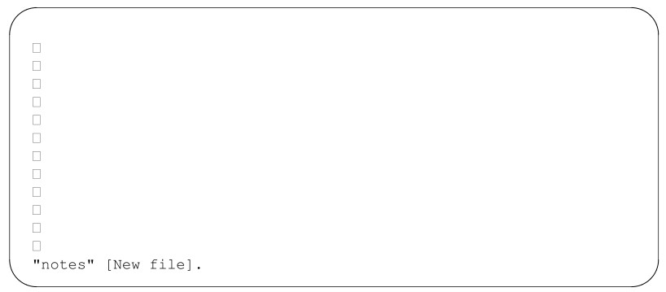

이미 존재하는 파일의 이름을 지정하면, 해당 파일의 내용이 화면에 표시됩니다. 예를 들어,
다음과 같이 입력하면:
$ vi letter
기존 파일인 ‘letter’의 사본이 화면에 표시될 수 있습니다.

화면 하단의 프롬프트 줄에는 파일 이름과 크기가 표시됩니다.
때때로 vi를 실행할 때 다음 메시지 중 하나가 나타날 수 있습니다:
[using open mode]
또는:
Visual needs addressable cursor or upline capability
두 경우 모두, 사용 중인 터미널의 유형을 식별하는 데 문제가 있는 것입니다. :q를 입력하면 편집
세션을 즉시 종료할 수 있습니다.
vi는 거의 모든 터미널에서 실행될 수 있지만, 사용자가 어떤 종류의 터미널을 사용하고 있는지 알아야 합니다.
터미널 유형은 일반적으로 UNIX 로그인 절차의 일부로 설정됩니다. 터미널 유형이
올바르게 정의되었는지 확실하지 않다면, 시스템 관리자나 숙련된 사용자에게 도움을 요청하여 터미널을
설정하십시오. 터미널 유형(예: wy50)을 알고 있다면, 다음 명령을 사용하여 TERM 환경 변수를
설정할 수 있습니다:
TERM=wy50; export TERM

### vi Commands

vi 편집기에는 명령 모드와 삽입 모드, 두 가지 모드가 있습니다. 많은 워드 프로세서와 달리, vi의
명령 모드는 초기 또는 기본 모드입니다. 텍스트 줄을 삽입하려면 삽입 모드로 전환하는 명령을
입력한 다음 텍스트를 입력해야 합니다.
대부분의 명령어는 한두 개의 문자로 구성됩니다. 예를 들면 다음과 같습니다.
i: 삽입
c: 변경
문자를 명령어로 사용하면 파일을 빠르게 편집할 수 있습니다. 수많은 기능 키를 외울 필요도 없고,
손가락을 쭉 뻗어 복잡한 키 조합을 누를 필요도 없습니다.
일반적으로 vi 명령어는
• 대소문자를 구분합니다(대문자와 소문자를 입력하면 다른 의미를 가집니다. 예: I는 i와
다릅니다);
• 화면에 표시되지 않습니다;
• 명령어 입력 후 RETURN 키를 누를 필요가 없습니다.

또한 화면 하단 줄에 표시되는 특수한 명령어 그룹도 있습니다. 하단 행
명령은 특별한 기호로 표시됩니다. 슬래시(/)와 물음표(?)는 검색 명령을
시작하며, 이에 대해서는 2단원에서 다룹니다. 콜론(:)은 ex 명령을 나타냅니다. 이 장에서는
하나의 ex 명령(편집 내용을 저장하지 않고 파일을 종료하는 명령)을 소개하며, ex 라인 에디터에 대해서는
7장에서 자세히 다룹니다.

vi에 삽입 모드를 시작하겠다고 알리려면 i 키를 누르세요. 화면에는 아무것도 표시되지 않지만,
이제 커서 위치에 원하는 텍스트를 입력할 수 있습니다. vi에 텍스트 삽입을 중지하라고 알리려면 ESC 키를 누르면 명령
모드로 돌아갑니다.
예를 들어, ‘introduction’이라는 단어를 삽입하고 싶다고 가정해 봅시다. iin-
troduction을 입력하면 화면에 다음과 같이 표시됩니다.
introduction
명령 모드에서 시작했기 때문에, vi는 첫 번째 키 입력(i)을 삽입 명령으로 해석합니다.
그 이후의 모든 키 입력은 ESC 키를 누를 때까지 파일에 문자로 기록됩니다. 삽입 모드에서
오류를 수정해야 할 경우, 백스페이스 키를 누른 후 오류 부분을 덮어쓰면 됩니다.
텍스트를 삽입하는 동안 RETURN 키를 누르면 오른쪽 여백에서 줄이 끊어집니다. 자동 줄바꿈
옵션을 사용하면 오른쪽 여백을 초과하면 자동으로 캐리지 리턴이 적용됩니다. 예를 들어, 오른쪽 여백을
10칸 이동하려면 :set wm=10을 입력하십시오.
때로는 현재 삽입 모드인지 명령 모드인지 알 수 없는 경우가 있습니다. vi가
예상대로 반응하지 않을 때는 ESC 키를 누르십시오. 신호음이 들리면 명령 모드에 있는 것입니다.

### Saving a File

언제든지 파일 작업을 중단하고, 수정 내용을 저장한 뒤 UNIX 프롬프트로 돌아갈 수 있습니다. vi에서
작업을 종료하고 수정 내용을 저장하는 명령어는 ZZ입니다. (ZZ는 대문자로 입력해야 한다는 점에 유의하십시오).
vi 명령어를 연습하기 위해 letter라는 파일을 만들고, 36
줄의 텍스트를 입력했다고 가정해 봅시다. 파일을 저장하려면 먼저 ESC 키를 눌러 명령 모드에 있는지 확인한 다음,
쓰기 및 저장 명령어인 ZZ를 입력합니다. 파일은 일반 파일로 저장됩니다. 결과는 다음과 같습니다.
"letter" [New file] 36 lines, 1331 characters
이제 UNIX 프롬프트로 돌아옵니다. 프롬프트에서 ls를 입력하여 디렉터리의 파일 목록을 확인해 보면,
새 파일이 나열되어 있습니다.
$ ls
ch01 ch02 letter
이제 새 파일을 만드는 방법을 충분히 알게 되었습니다. 연습 삼아 letter라는 파일을 만들고 그림 3-1에 표시된 텍스트를
삽입해 보세요. 작업이 끝나면 ZZ를 입력하여 파일을 저장하고 UNIX 프롬프트로 돌아가세요.

## Moving the Cursor

편집 세션에서 삽입 모드로 새 텍스트를 추가하는 데 소요되는 시간은 전체 시간 중 극히 일부에 불과합니다. 대부분의
시간은 기존 텍스트를 편집하는 데 할애하게 됩니다.
명령 모드에서는 파일 내 어디든 커서를 위치시킬 수 있습니다. 모든 기본 편집 작업(텍스트
변경, 삭제, 복사)은 변경하려는 텍스트 위에 커서를 위치시키는 것으로 시작합니다. 따라서
커서를 해당 위치로 빠르게 이동할 수 있어야 합니다.

\
그림 3.1 vi로 입력한 편지 예시

vi에는 다음과 같은 이동 명령어가 있습니다.
• 한 번에 한 글자씩 위, 아래, 왼쪽, 오른쪽으로 이동;
• 단어, 문장, 단락과 같은 텍스트 블록 단위로 앞뒤로 이동;
• 한 화면씩 파일을 앞뒤로 이동.
커서를 이동하려면 ESC 키를 눌러 명령 모드에 있는지 확인하십시오. 현재 커서 위치에서 파일 내로
앞이나 뒤로 이동하는 명령을 입력하십시오. 한 방향으로 이동할 수 있는 최대 위치에 도달하면
삑 소리가 나며 커서가 멈춥니다. 파일 끝의 물결표(∼)를
넘어서 커서를 이동할 수는 없습니다.

### Single Movements

손끝 바로 아래에 있는 h, j, k, l 키를 사용하면 커서를 이동할 수 있습니다.
h: 왼쪽으로 한 칸 이동
j: 한 줄 아래로 이동
k: 한 줄 위로 이동
l: 오른쪽으로 한 칸 이동
커서 방향 키(↑, ↓, →, ←)나 RETURN, BACKSPACE 키를 사용할 수도 있지만, 이 키들은
사용하기 불편할 뿐만 아니라 모든 터미널에서 지원되는 것은 아닙니다.
또한 h, j, k, l 키를 숫자 인자나 다른 vi 명령과 함께 사용할 수도 있습니다.

### Numeric Arguments

이동 명령어 앞에 숫자를 붙일 수 있습니다. ‘4l’ 명령어는 커서(문자 주위에
작은 상자로 표시됨)를 오른쪽으로 네 칸 이동시키는데, 이는 문자 ‘l’을 네 번 입력하는 것(llll)과 같은 효과입니다.

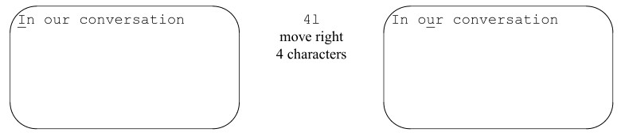

이 한 가지 개념(명령을 곱할 수 있다는 점)만으로도 각 명령에 대해 더 많은 선택지(그리고 더 큰 기능)를
얻을 수 있습니다. 앞으로 새로운 명령을 배우게 될 때 이 점을 명심해 두세요.

### Movement by Lines

파일 ‘letter’를 저장했을 때, 편집기는 해당 파일에 몇 줄이 포함되어 있는지 알려주는 메시지를 표시했습니다.
파일의 한 줄은 화면에 표시되는 물리적 줄(80자 제한)과 길이가 반드시 일치하는 것은 아닙니다.
한 줄이란 캐리지 리턴 사이에 입력된 모든 텍스트를 의미합니다. RETURN 키를 누르기 전에 200자를 입력하면,
vi는 이 200자를 모두 하나의 줄로 간주합니다(비록 화면상에서는 그 200자가
여러 개의 물리적 줄로 보일지라도).
줄 이동에 유용한 두 가지 명령어는 다음과 같습니다.
0 <0>: 줄의 시작 부분으로 이동
$: 줄의 끝 부분으로 이동
다음 파일에는 줄 번호가 표시되어 있습니다. 화면에 줄 번호를 표시하려면 :set nu를 입력하십시오.

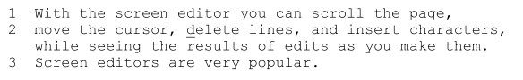

논리적 줄 수(3)는 화면에 표시되는 물리적 줄 수(4)와 일치하지 않습니다.
‘delete’라는 단어의 ‘d’에 커서를 놓고 $를 입력하면, 커서는
‘them’이라는 단어 뒤에 있는 마침표 위치로 이동합니다.

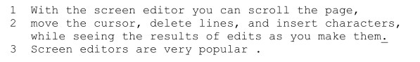

0(영)을 입력하면 커서가 줄의 맨 앞, “move”라는 단어의 ‘m’ 자로
되돌아갑니다.

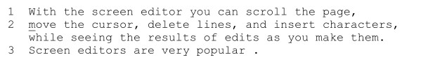

vi에서 자동 줄바꿈 옵션(:set wm=10)을 사용하지 않는 경우, 줄 길이를 관리하기 쉬운 수준으로 유지하기 위해
캐리지 리턴을 사용하여 줄을 끊어야 합니다.

### Movement by Text Blocks

또한 텍스트 단위(단어, 문장 또는 단락)로 커서를 이동할 수도 있습니다.
w 명령어는 기호와 구두점을 단어와 동일하게 취급하여 커서를 한 번에 한 단어씩 앞으로 이동시킵니다.
다음 줄은 w 명령어를 10번 연속으로 실행했을 때 발생하는 커서 이동을 보여줍니다:
m _ove t _he c _ursor, _ d _elete l _ines, _ a _nd i _nsert c _haracters, _
기호와 구두점을 무시하고 한 번에 한 단어씩 앞으로 이동하려면 W 명령어(대문자 W에 유의)를
사용할 수도 있습니다. 이 명령어는 커서를 공백 뒤의 첫 번째 문자로 이동시킵니다.
W를 사용한 커서 이동은 다음과 같습니다:
m _ove t _he c _ursor, d _elete l _ines, a _nd i _nsert c _haracters,
한 단어씩 뒤로 이동하려면 b 명령어를 사용하십시오. B 명령어는 구두점을 무시하고
한 단어씩 뒤로 이동할 수 있게 해줍니다.
w, W, b 또는 B 명령어와 함께 숫자를 사용하여 이동량을 곱할 수 있습니다. 예를 들어,
2w는 두 단어 앞으로 이동하고, 5B는 구두점을 무시하고 다섯 단어 뒤로 이동합니다. 숫자 배수를 조합하여
커서 이동 명령어를 사용하는 연습을 해보세요.

## Simple Edits

파일에 텍스트를 입력할 때, 완벽하게 입력되는 경우는 거의 없습니다. 오류를 발견하거나 문구를 더 잘 다듬고 싶을 때가 있기 마련입니다. 텍스트를
입력한 후에는 이를 수정할 수 있어야 합니다.
편집에는 어떤 작업이 포함될까요? 텍스트를 삽입하고 싶을 때가 있습니다(빠뜨린 단어나 누락된 문장 등). 그리고 텍스트를 삭제하고 싶을 수도 있습니다(잘못 입력된 문자나 전체 단락 등). 또한 글자나
단어를 수정해야 할 때도 있습니다(철자 오류를 수정하거나 생각이 바뀌었을 때). 텍스트를 파일의 한 곳에서
다른 곳으로 이동시키고 싶을 수도 있습니다. 때로는 텍스트를 복사하여 파일의 다른 부분에 복제하고 싶을 때도 있습니다.
기본 편집 명령어는 네 가지가 있습니다: 삽입을 의미하는 i(이미 살펴보셨을 것입니다), 변경을 의미하는 c, 삭제를 의미하는
d, d 다음에 p를 입력하여 이동(삭제 후 삽입)하는 명령어, 그리고 복사를 의미하는 y(yank)입니다. 각 편집 유형에 대해서는 이 절에서
설명합니다. 표 3-1에는 몇 가지 간단한 예시가 나와 있습니다.

표 3.1 기본 편집 명령어
대상 | 변경 | 삭제 | 복사(Yank)
--- | --- | --- | ---
한 단어 | cw | dw | yw
두 단어 | 2cW | 2dW | 2yW
세 단어 뒤로 | 3cb | 3db | 3yb
한 줄 | cc | dd | yy 또는 Y
줄 끝으로 | c$ 또는 C  d$ 또는 D | y$
줄 시작으로 | c0 | d0 | y0
단일 문자 | r | x | yl

### Inserting New Text

이미 ‘insert’ 명령어를 사용하여 새 파일에 텍스트를 입력해 보았습니다. 또한 기존 텍스트를 편집할 때도
‘insert’ 명령어를 사용하여 문자, 단어, 문장을 추가할 수 있습니다. 문장 맨 앞에 ‘Today,’를
삽입해야 한다고 가정해 봅시다. 다음 명령어와 텍스트를 차례대로 입력하세요:

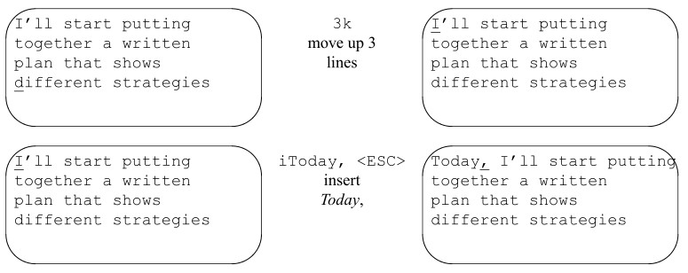

앞서 본 예제에서 vi는 새로운 텍스트가 삽입될 때마다 기존 텍스트를 오른쪽으로 밀어냅니다. 이는 우리가
입력하는 각 문자에 따라 화면을 조정할 수 있는 “지능형” 터미널에서 vi를 실행하고 있기 때문입니다.
“비지능형” 터미널(예: adm3a)에서 삽입 작업은 다르게 보입니다. 터미널 자체는 입력되는 각 문자에 대해
화면을 갱신할 수 없기 때문에(속도가 크게 저하되지 않는 한), vi는 사용자가 ESC 키를 누를 때까지 화면을
다시 그리지 않습니다. 대신, 사용자가 입력할 때 덤프 터미널에서는 기존 텍스트가 덮어쓰는 것처럼 보입니다.
ESC 키를 누르면, 사라졌던 문자들이 다시 나타나도록 줄이 즉시 조정됩니다. 따라서
덤프 터미널에서는 동일한 삽입 작업이 다음과 같이 표시됩니다:

### Changing Text

‘c’ 변경 명령어를 사용하면 파일 내의 어떤 텍스트든 대체할 수 있습니다. 대체할 텍스트의 범위를 지정하려면
변경 명령어와 이동 명령어를 함께 사용하십시오. 예를 들어, c 명령어를 사용하여
커서 위치부터

- cw : 단어 끝까지
- 2cb : 두 단어 뒤로
- c$ : 줄 끝까지

텍스트를 변경할 수 있습니다. 그런 다음 지정된 텍스트를 새로운 텍스트로 대체할 수 있는데, 그 양은 문자 하나도 없을 수도 있고, 한 단어일 수도 있으며, 수백 줄에
이르기도 합니다. c 명령어를 사용하면 ESC 키를 누를 때까지 삽입 모드가 유지됩니다.

### Words

단어(cw)를 더 긴 단어나 더 짧은 단어, 혹은 원하는 길이의 텍스트로 대체할 수 있습니다. cw 명령어는
“표시된 단어를 삭제하고 ESC 키를 누를 때까지 새로운 텍스트를 삽입한다”고 생각할 수 있습니다.
파일 ‘letter’에 다음 줄들이 있고, ‘designing’을 ‘putting together’로
바꾸고 싶다고 가정해 봅시다. 단 한 단어만 변경하면 됩니다.

cw 명령어는 변경할 단어의 마지막 문자에 $ 기호를 추가한다는 점에 유의하십시오.

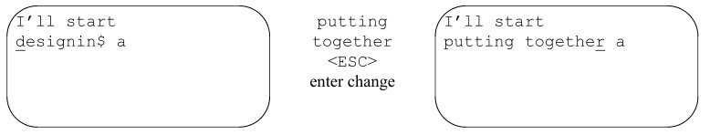

cw 명령어는 단어의 일부에도 적용됩니다. 예를 들어, ‘putting’을 ‘puts’로 변경하려면 커서를 두 번째 ‘t’에
위치시킨 다음, cw를 입력하고 s를 입력한 후 ESC 키를 누르면 됩니다. 숫자 접두사를 사용하면
여러 단어나 문자를 한 번에 변경할 수 있습니다. 예를 들면 다음과 같습니다.

- 3cw : 커서 오른쪽의 세 단어를 변경합니다.
- 5cl : 커서 오른쪽의 다섯 글자를 변경합니다.

지정된 개수의 단어, 문자 또는 줄을 동일한 분량의 텍스트로 대체할 필요는 없습니다.

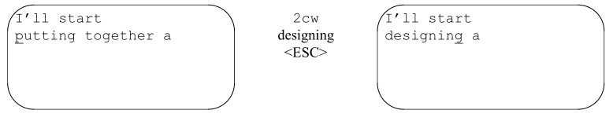

### Lines

현재 줄 전체를 바꾸려면 특수한 변경 명령어인 cc를 사용합니다. 이 명령어는 줄 전체를 변경하여,
ESC 키를 누르기 전에 입력한 텍스트로 해당 줄을 대체합니다. cc 명령어는 커서가 줄의 어느 위치에 있든 상관없이
줄 전체의 텍스트를 대체합니다.
C 명령어는 현재 커서 위치부터 줄 끝까지의 문자를 대체합니다. 이 명령어는
c와 줄 끝을 나타내는 특수 기호인 $를 결합한 것과(예: c$) 동일한 효과를 냅니다.

### Characters

r 명령어를 사용하여 또 다른 문자 치환 편집을 수행할 수 있습니다. 이 명령어는 하나의 문자를
다른 하나의 문자로 치환합니다. 이 명령어의 용도 중 하나는 철자 오류를 수정하는 것입니다. 이런 경우에는 cw를
사용하고 싶지 않을 것입니다. 왜냐하면 단어 전체를 다시 입력해야 하기 때문입니다. r을 사용하여 커서 위치의
단일 문자를 치환하십시오:

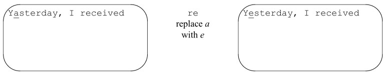

r 명령어는 단 한 글자만 치환합니다. 편집을 완료하기 위해 ESC 키를 누를 필요가
없습니다. r 명령어를 실행한 후에는 자동으로 명령 모드로 돌아갑니다.

### Deleting Text

또한 삭제 명령어인 d를 사용하여 파일 내의 텍스트를 삭제할 수도 있습니다. 변경 명령어와 마찬가지로, 삭제
명령어에도 인자(작업할 텍스트의 양)가 필요합니다. 단어 단위(dw),
줄 단위(dd 및 D)로 삭제하거나, 나중에 배우게 될 다른 이동 명령어를 사용하여 삭제할 수 있습니다.
모든 삭제 작업에서, 편집을 수행할 위치로 이동한 다음 삭제 명령어
(d)를 입력하고, 그 뒤에 삭제할 텍스트의 범위(예: 텍스트 객체, 단어인 경우 w)를 지정합니다.

### Words

다음 문장에서 첫 번째 줄에 나오는 ‘start’라는 단어를 하나 삭제하고 싶다고 가정해 봅시다.

dw 명령어는 커서 위치부터 단어 끝까지를 삭제합니다. 따라서 dw를 사용하면
단어의 일부를 삭제할 수 있습니다.

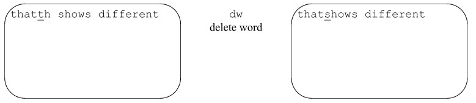

보시다시피, dw는 단어의 나머지 부분뿐만 아니라 같은 줄에 있는 다음
단어 앞의 공백까지 삭제했습니다. 단어 사이의 공백을 유지하려면 de를 사용하세요. de는 해당
단어의 끝까지만 삭제합니다.

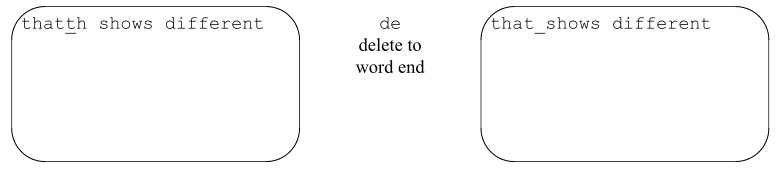

뒤로 삭제(db)하거나, 줄의 끝이나 시작 부분까지 삭제(d$ 또는 d0)할 수도 있습니다.

### Lines

dd 명령어는 커서가 위치한 줄 전체를 삭제합니다. 앞의 예제와 동일한 텍스트를 사용하여,
그림과 같이 커서를 첫 번째 줄에 위치시킨 상태에서 처음 두 줄을 삭제할 수 있습니다:
X 명령어는 커서 앞의 문자를 삭제합니다. 이 두 명령어 앞에 숫자를 붙이면
해당 숫자만큼의 문자를 삭제할 수 있습니다. 예를 들어, 5X를 입력하면 커서 왼쪽의 5개 문자가 삭제됩니다.

### Moving Text

텍스트를 삭제한 다음, 그 삭제된 텍스트를 파일 내의 다른 위치에 배치함으로써 텍스트를 이동할 수 있습니다. 이는 마치 “잘라내기 및
붙여넣기”와 같습니다. 텍스트 블록을 삭제할 때마다, 해당 삭제 내용은 버퍼에 임시로 저장됩니다. 파일 내의
다른 위치로 이동한 후 put 명령을 사용하여 텍스트를 새로운 위치에 배치할 수 있습니다. 어떤 텍스트 블록이든
이동할 수 있지만, 이 명령 순서는 단어보다는 줄 단위로 사용할 때 더 유용합니다.
put 명령어(p)는 (버퍼에) 저장되거나 삭제된 텍스트를 커서 위치 뒤에 삽입합니다. 대문자로
입력한 명령어(P)는 텍스트를 커서 앞에 삽입합니다. 한 줄 이상을 삭제한 경우, p 명령어는
삭제된 텍스트를 커서 바로 아래의 새 줄에 삽입합니다. 단어를 삭제한 경우, p 명령어는 삭제된 텍스트를 같은 줄의
커서 뒤에 삽입합니다.
파일 letter에 다음 줄들이 있고, 네 번째 줄의
텍스트를 이동하고 싶다고 가정해 봅시다. delete 명령을 사용하여 이 편집을 수행할 수 있습니다. 먼저 해당 줄을 삭제합니다:

그런 다음 p를 사용하여 커서 바로 아래 줄에 삭제된 줄을 복원합니다:

xp(문자 삭제 후 커서 뒤쪽에 삽입)를 사용하여 두 글자의 순서를 바꿀 수도 있습니다. 예를 들어,
‘mvoe’라는 단어에서 ‘vo’라는 두 글자의 순서가 바뀌어 있습니다. 이를 수정하려면 커서를 ‘v’에 놓고 x를 누른 다음
p를 누르십시오.
텍스트를 삭제한 후에는 다음 변경 또는 삭제 명령을 실행하기 전에 해당 텍스트를 복원해야 합니다. 버퍼에 영향을 미치는
다른 편집을 수행하면 삭제된 텍스트는 사라집니다. 새로운 편집을 하지 않는 한 put 명령을
반복해서 사용할 수 있습니다. vi 고급 장에서는 이름이 지정된 버퍼나 번호가 매겨진 버퍼에서 텍스트를
복구하는 방법을 배우게 될 것입니다.

### Copying Text

종종 파일의 일부를 다른 곳으로 복사하면 편집 시간(과 키 입력 횟수)을 절약할 수 있습니다.
y(yank)와 p(put)라는 두 가지 명령어를 사용하면 기존 텍스트를 원하는 만큼 복사한 후, 파일 내 다른 위치에 붙여넣을 수 있습니다.
yank 명령어는 원본 텍스트를 변경하지 않고 텍스트의 사본을 버퍼에 저장하는 데 사용됩니다.
이렇게 복사된 텍스트는 put 명령어를 통해 파일 내 다른 위치에 붙여넣을 수 있습니다.
yank는 모든 이동 명령어(예: yw, y$, 4yy)와 함께 사용할 수 있습니다. yank는 주로
한 줄(또는 그 이상)의 텍스트에 사용되는데, 이는 한 단어를 yank하고 put하는 것이 일반적으로
단순히 그 단어를 삽입하는 것보다 더 많은 시간이 걸리기 때문입니다. 예를 들어, 텍스트 5줄을 yank하려면:

복사한 텍스트를 붙여넣으려면, 텍스트를 넣을 위치로 커서를 이동한 다음, p 명령어를 사용하여
현재 줄 아래에 삽입하거나, P 명령어를 사용하여 현재 줄 위에 삽입하십시오.

복사된 텍스트는 커서 바로 아래 줄에 표시됩니다. 삭제 작업은 복사 작업과 동일한 버퍼를 사용합니다. Delete
및 put 명령은 yank 및 put과 거의 동일한 방식으로 사용할 수 있습니다. 새로운 삭제나 복사 작업이 있을 때마다
복사 버퍼의 이전 내용이 대체됩니다. 나중에 살펴보겠지만, put 명령을 사용하면 최대 9개까지의 이전 복사 또는 삭제 내역을
다시 불러올 수 있습니다.

### Using Your Last Command

사용자가 입력하는 각 명령은 다음 명령을 입력할 때까지 임시 버퍼에 저장됩니다. 파일의 단어 뒤에
를 삽입하면, 텍스트를 삽입하는 데 사용된 명령과 입력한 텍스트가
일시적으로 저장됩니다. 동일한 편집 명령을 반복해서 수행할 때는
(점)을 사용하여 명령을 복제하면 시간을 절약할 수 있습니다. 명령을 복제하려면 화면의 아무 곳이나에 커서를 위치시킨 후
. 키를 눌러 버퍼에 저장된 마지막 명령(삽입이나 삭제 등)을 반복할 수 있습니다. 또한
숫자 인자(예: 2.)를 사용하여 이전 명령을 한 번 이상 반복할 수도 있습니다.
파일 letter에 다음과 같은 줄들이 있다고 가정해 봅시다. 삭제하려는 줄에
커서를 놓으십시오:

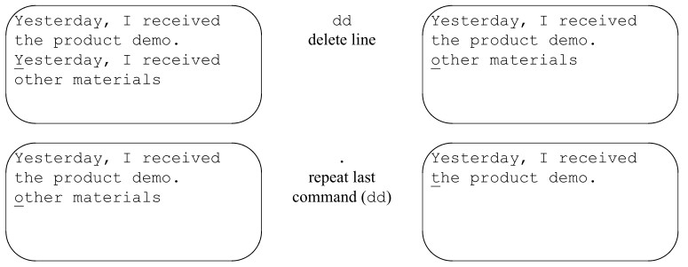

일부 버전의 vi에서는 CTRL-@ (ˆ@) 명령을 사용하면 마지막 삽입(또는 추가) 명령을 반복할 수 있습니다.
이는 . 명령어와는 대조적인데, . 명령어는 삭제나 변경 명령어를 포함하여 텍스트를 변경한 마지막 명령어를 반복합니다.
실수를 했을 경우 마지막 명령어를 취소할 수도 있습니다. 명령어를 취소하려면 커서가
화면의 어느 위치에 있든 상관없습니다. u 키를 누르기만 하면 마지막 명령어(삽입이나 삭제 등)를 취소할 수 있습니다.
앞서 예시를 이어가면:

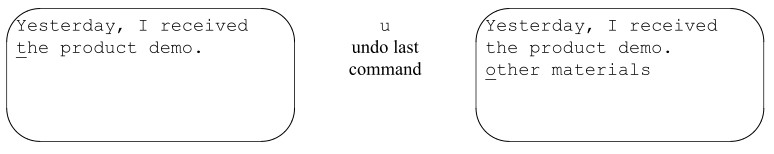

대문자 U는 커서가 해당 줄에 머무르는 동안 해당 줄의 모든 편집 내용을 취소합니다.
줄 밖으로 커서를 이동하면 더 이상 U를 사용할 수 없습니다.

### Joining Two Lines with J

파일을 편집하다 보면 가끔 읽기 힘든 짧은 줄들이 연속해서 나타나는 경우가 있습니다.
두 줄을 하나로 합치고 싶다면, 첫 번째 줄의 아무 곳이나 커서를 위치시킨 다음 J 키를 눌러 두 줄을 합치세요.

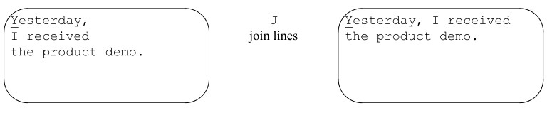

숫자 인수를 지정하면 해당 개수의 연속된 줄을 결합합니다.

### Quitting without Saving Edits

vi를 처음 배울 때, 특히 과감하게 실험을 즐기는 사용자라면, 자신이 만들어낸 어떤 난장판에서도 벗어날 수 있게
도와주는 또 다른 유용한 명령어가 하나 있습니다. ZZ를 사용하여 편집 내용을 저장하는 방법은 이미 알고 계시겠지만,
한 세션에서 수행한 모든 편집 내용을 지우고 원본 파일로
돌아가고 싶다면 어떻게 해야 할까요?
ex 라인 에디터를 기반으로 한 특별한 하단 줄 명령어를 사용하면 편집 내용을 저장하지 않고 vi를 종료할 수
있습니다. ex 명령어에 대한 자세한 설명은 vi 고급 장에서 다루겠지만, 기본적인 vi 편집을 위해서는
다음 명령어 하나만 기억해 두면 됩니다:
:q!  <RETURN>
q! 명령어는 현재 열려 있는 파일을 종료합니다. 파일을 마지막으로 저장한 이후에 이루어진 모든 편집 내용은 사라집니다.
이번 세션에서 배운 명령어만으로도 vi를 어느 정도 사용할 수 있습니다. 하지만 vi의
진정한 힘을 활용하고(그리고 자신의 생산성을 높이기 위해) 다음 세션으로 넘어가는 것이 좋습니다.

## Session 2: Moving Around in a Hurry

vi는 새 파일을 만드는 데만 사용하는 것이 아니라 기존 파일을 편집하는 데도 사용합니다. 파일을 열었을 때 첫 번째 줄부터 시작하여
한 줄씩 차례로 이동하는 경우는 거의 없습니다. 보통은 파일의 특정 위치로 이동한 다음 작업을 시작하기를 원합니다.
모든 편집은 편집을 시작할 위치로 커서를 이동하는 것(또는 ex 라인 편집기 명령을 사용하여
편집할 줄 번호를 지정하는 것)으로 시작됩니다. 이 장에서는 다양한 방식(화면, 텍스트, 패턴 또는 줄 번호)으로
이동을 고려하는 방법을 설명합니다. vi에서 이동하는 방법은 매우 다양합니다. 편집
속도는 몇 번의 키 입력만으로 목적지에 도달하는 데 달려 있기 때문입니다.
이번 세션에서는 다음을 통해 파일 내에서 이동하는 방법을 배우게 됩니다.
• 화면 단위;
• 텍스트 블록;
• 패턴 검색;
• 줄 단위.

### Movement by Screens

책을 읽을 때, 우리는 책 속의 “장소”를 페이지 단위로 생각합니다. 예를 들어, 읽기를 멈춘 페이지나
목록에 있는 페이지 번호 같은 것이죠. 일부 vi 파일은 몇 줄밖에 되지 않아 파일 전체를
한 번에 볼 수 있습니다. 하지만 많은 파일은 수백 줄에 달합니다.
vi 파일을 긴 종이 롤에 적힌 텍스트라고 생각하면 됩니다. 화면은 그 긴 종이 롤 위에 (보통) 24줄의
텍스트가 표시된 창과 같습니다. 삽입 모드에서 화면을 텍스트로 채워나가다 보면, 결국 화면의
맨 아래 줄에 텍스트를 입력하게 됩니다. 끝까지 도달하여 RETURN 키를 누르면 맨 위의 줄이 화면 밖으로 사라지고,
새로운 텍스트를 입력할 수 있는 빈 줄이 화면 하단에 나타납니다. 이를 스크롤이라고 합니다. 화면을 앞뒤로 스크롤하여
파일 내의 모든 텍스트를 볼 수 있으며, 이를 통해 파일을 탐색할 수 있습니다.

### Scrolling the Screen

vi에는 파일을 한 화면 또는 반 화면 단위로 앞뒤로 스크롤하는 명령어가 있습니다:
ˆF: 한 화면 앞으로 이동
ˆB: 한 화면 뒤로 이동
ˆD: 반 화면 앞으로 이동
ˆU: 반 화면 뒤로 이동
(ˆ 기호는 CTRL 키를 나타냅니다. ˆF는 CTRL 키와 F 키를 동시에 누르는 것을 의미합니다).

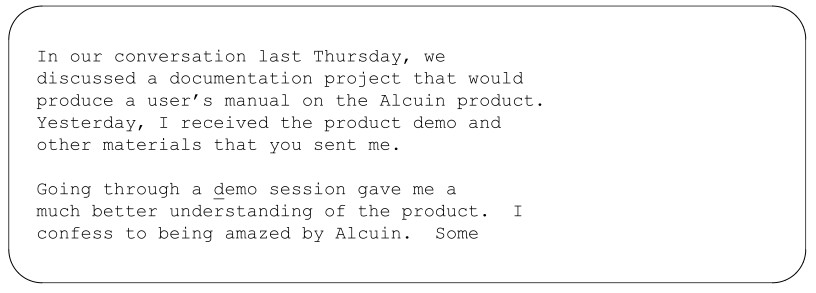

ˆF 키를 누르면 화면이 다음과 같이 표시됩니다:

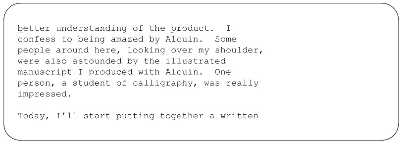

화면을 한 줄 위로 스크롤하는 명령어(ˆE)와 한 줄 아래로 스크롤하는 명령어(ˆY)도 있습니다. (이러한 명령어는
PDP-11이나 PC-XT용 Xenix와 같은 소규모 시스템에서는 사용할 수 없습니다.)

### Movement within a Screen

또한 현재 화면이나 파일 보기를 유지한 채 다음 명령을 사용하여 화면 내에서 이동할 수 있습니다.
H: 홈(화면의 맨 위 줄)
M: 화면의 중간 줄
L: 화면의 맨 아래 줄
nH: 맨 위 줄에서 n줄 아래로 이동
nL: 맨 아래 줄에서 n줄 위로 이동
H 명령어는 화면의 어느 위치에서든 커서를 첫 번째 줄(홈 줄)로 이동시킵니다. M 명령어는
화면의 중간 줄로, L 명령어는 마지막 줄로 이동시킵니다. 첫 번째 줄 바로 아래 줄로 이동하려면 2H를 사용하십시오.

이러한 화면 이동 명령은 편집 작업에도 사용할 수 있습니다. 예를 들어, dH를 입력하면 화면에 표시된 맨 위 줄까지
삭제됩니다.

### Movement within Lines

현재 화면에는 줄 단위로 이동하는 명령어도 있습니다. 여러분은 이미 줄
이동 명령어인 $와 0을 배웠습니다.
RETURN: 다음 줄의 시작 부분으로 이동
ˆ: 현재 줄의 첫 번째 문자로 이동
+: 다음 줄의 시작 부분으로 이동
-: 이전 줄의 시작 부분으로 이동

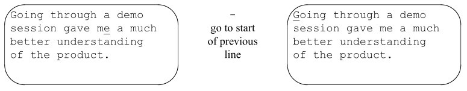

ˆ 명령어는 공백이나 탭을 무시하고 줄의 첫 번째 문자로 이동합니다. (반면, 0은
해당 위치가 비어 있더라도 줄의 첫 번째 위치로 이동합니다).

## Movement by Text Blocks

vi 파일을 탐색하는 또 다른 방법은 단어, 문장, 또는 단락과 같은 텍스트 블록을 기준으로 하는 것입니다.
이미 단어 단위(w 또는 b)로 앞뒤로 이동하는 방법을 배웠습니다.
e 단어 끝
E 단어 끝 (구두점 무시)
( 이전 문장의 시작
) 다음 문장의 시작
{ 이전 단락의 시작
} 다음 단락의 시작
vi 프로그램은 마침표 뒤에 최소 두 개의 공백이 있거나,
줄의 마지막 비공백 문자가 마침표인 경우 문장의 끝을 찾아냅니다. 마침표 뒤에 공백이 하나만 남아 있다면,
문장으로 인식되지 않습니다.

단락은 다음 빈 줄까지의 텍스트, 또는 mm 또는 ms 매크로 패키지에 포함된 기본 단락 매크로
(.IP, .P, .PP, .QP) 중 하나까지를 의미합니다. 단락 구분자로 인식되는 매크로는
제7장에서 설명한 대로 :set 명령을 사용하여 사용자 정의할 수 있습니다.

대부분의 사람들은 앞으로 이동하는 것을 더 쉽게 상상할 수 있으므로, 일반적으로 앞으로 이동하는 명령어가 더
유용합니다.
숫자와 이동 명령어를 결합할 수 있다는 점을 기억하세요. 예를 들어, 3)은 세 문장 앞으로
이동합니다. 또한 이동 명령어를 사용하여 편집할 수 있다는 점도 기억하세요. d)는 현재 문장의 끝까지 내용을 삭제하고,
2y}는 앞으로 두 단락을 복사(yank)합니다.

## Movement by Searches

대용량 파일 내에서 빠르게 이동하는 가장 유용한 방법 중 하나는 텍스트, 또는 더 정확하게는
특정 문자 패턴을 검색하는 것입니다. 이 패턴에는 하나 이상의 문자를 일치시킬 수 있는 “와일드카드”
약어가 포함될 수 있습니다. 예를 들어, 철자가 틀린 단어를 찾거나 프로그램 내에서 변수가
나타나는 모든 위치를 검색할 수 있습니다.
검색 명령어는 슬래시(/)입니다. 슬래시를 입력하면 화면 하단 줄에 표시되며,
그 다음에 찾고자 하는 패턴(단어 또는 기타 문자열)을 입력합니다.
/ text<RETURN> text를 앞으로 검색
text 앞뒤의 공백도 검색 대상에 포함됩니다. 모든 하단 줄 명령어와 마찬가지로, RETURN 키를
누르면 명령이 완료됩니다.
검색은 커서 위치에서 시작하여 앞으로 진행되며, 필요한 경우 파일의 시작 부분으로
돌아가며 검색을 계속합니다. 커서는 패턴이 처음 나타나는 위치로 이동합니다(일치하는 부분이 없으면
상태 줄에 “Pattern not found”라는 메시지가 표시됩니다).
다음과 같은 패턴을 검색하려면:

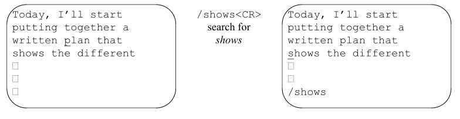

검색은 파일의 현재 위치에서 앞으로 진행됩니다. 임의의 문자 조합을 입력할 수 있으며,
검색 대상이 반드시 전체 단어일 필요는 없습니다.
? 명령어를 사용하여 뒤로 검색할 수도 있습니다:
?text<RETURN> text를 뒤로 검색
마지막으로 검색한 패턴은 편집 세션이 끝날 때까지 유지됩니다. 검색 후
원래 입력했던 키 입력을 반복하는 대신, 명령어를 사용하여 마지막으로
검색한 패턴을 다시 검색할 수 있습니다.
n 같은 방향으로 검색 반복
N 반대 방향으로 검색 반복
/<RETURN> 앞으로 검색 반복
?<RETURN> 뒤로 검색 반복
마지막 패턴이 유지되므로, 패턴을 검색한 후 작업을 수행하고,
n, N, / 또는 ?를 사용하여 다시 입력하지 않고도 해당 패턴을 다시 검색할 수 있습니다. 검색 방향(/=앞으로,
?=뒤로)은 화면 왼쪽 하단에 표시됩니다.
앞서 예시를 이어가면, 패턴 th는 여전히 검색 가능한 상태입니다:

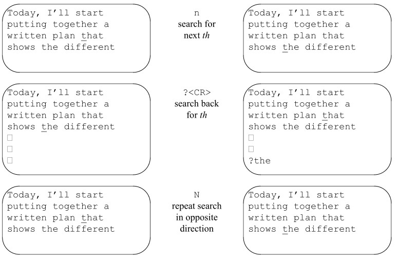

이 섹션에서는 패턴 검색에 대해 아주 간략하게만 소개했습니다. 7장에서는 패턴 매칭과 이를 활용하여
파일 전체를 일괄 수정하는 방법에 대해 더 자세히 다룰 것입니다.

### Current Line Searches

현재 줄 내에서 작동하는 축소판 검색 명령도 있습니다.
f 명령은 지정한 문자가 나타나는 다음 위치로 커서를 이동시킵니다. 세미콜론을 사용하면
“찾기” 작업을 반복할 수 있습니다. 단, f 명령은 커서를 다음 줄로 이동시키지 않는다는 점에 유의하십시오.
fx x가 해당 줄에서 다음으로 나타나는 위치로 커서를 이동시킵니다(여기서 x는 임의의 문자가 될 수 있음)
; 이전 찾기 명령을 반복합니다
다음과 같이 이 줄에서 편집하고 있다고 가정해 봅시다:

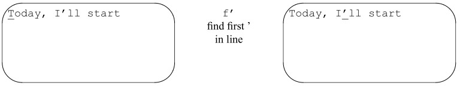

'df'를 사용하면 지정한 문자(이 경우 ‘ ’)까지(해당 문자 포함)를 삭제할 수 있습니다. 이 명령은
줄의 일부를 삭제하거나 복사할 때 유용합니다.
‘t’ 명령은 'f'와 똑같이 작동하지만, 검색된 문자 바로 앞에 커서를 위치시킨다는 점이 다릅니다.
‘f’ 및 'b'와 마찬가지로, 숫자를 앞에 붙이면 n번째로 나타나는 위치를 찾을 수 있습니다. 예를 들어:

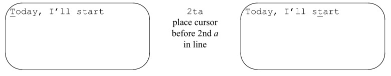

## Movement by Line Numbers

파일에는 순차적으로 번호가 매겨진 줄들이 포함되어 있으며, 줄 번호를 지정하여 파일 내를 이동할 수 있습니다.
줄 번호는 편집하려는 대량의 텍스트 블록의 시작과 끝을 파악하는 데 유용합니다. 또한
컴파일러 오류 메시지가 줄 번호를 참조하기 때문에 프로그래머에게도 유용합니다. 제7장에서 배우게 될 것처럼,
ex 명령어에서도 줄 번호가 사용됩니다.
줄 번호를 사용하여 이동하려면 줄 번호를 식별할 방법이 필요합니다. 줄 번호는
제7장에서 설명하는 :set nu 옵션을 사용하여 화면에 표시할 수 있습니다. vi에서는 화면 하단에
현재 줄 번호를 표시할 수도 있습니다.
ˆG 명령을 사용하면 화면 하단에 현재 줄 번호,
파일의 총 줄 수, 그리고 현재 줄 번호가 전체의 몇 퍼센트를 차지하는지 표시됩니다. 예를 들어,
‘letter’ 파일의 경우 ˆG는 다음과 같이 표시될 수 있습니다.
"letter" line 10 of 40 --25%--
ˆG는 명령어에 사용할 줄 번호를 표시하거나, 편집 도중 주의가 산만해졌을 때
현재 위치를 파악하는 데 사용됩니다.
G(go to) 명령어는 줄 번호를 숫자 인자로 사용하여 해당 줄의 첫 번째 위치로
이동합니다. 예를 들어, 44G는 커서를 44번째 줄의 시작 부분으로 이동시킵니다. 줄 번호를 지정하지 않고 G
명령어를 실행하면 커서가 파일의 마지막 줄로 이동합니다.

단일 따옴표(’’)를 두 번 입력하면 원래 있던 줄의 시작 부분으로 돌아갑니다. 백
따옴표(‘‘)를 두 번 입력하면 정확히 원래 위치로 돌아갑니다. 검색 명령(/ 또는 ?)을 실행한 경우, ‘‘
를 입력하면 커서가 검색을 시작했을 때의 위치로 돌아갑니다.
ˆG로 표시되는 총 줄 수를 통해 대략적으로 몇 줄을
이동해야 할지 파악할 수 있습니다. 1,000줄로 구성된 파일의 10번째 줄에 있는 경우:
“ch01” 1,000줄 중 10번째 줄 --1%--
그리고 파일 끝부분 근처에서 편집을 시작하고 싶다면, 다음과 같이 대략적인
목적지를 지정할 수 있습니다.
800G
줄 번호를 이용한 이동은 대용량 파일 내에서 빠르게 이동할 수 있게 해줍니다.

## Session 3: Beyond the Basics

이미 vi의 기본 편집 명령어인 i, c, d, y에 대해 배웠습니다. 이번 강의에서는
편집에 대해 이미 알고 계신 내용을 더욱 심화하여 다룹니다. 다음 내용을 배우게 됩니다.
• vi를 실행하는 추가적인 방법;
• vi를 사용자 정의하는 방법;
• 모든 편집 작업을 이동 명령과 결합하는 방법;
• 삽입 모드로 진입하는 추가적인 방법;
• 삭제된 내용, 복사된 내용, 마지막 명령을 저장하는 버퍼를 사용하는 방법;
• 파일 내 위치를 표시하는 방법.

## Command-Line Options

vi 명령어에는 유용하게 사용할 수 있는 다른 옵션들도 있습니다. 파일을 열 때 특정
줄 번호나 패턴으로 바로 이동할 수 있습니다. 또한 파일을 읽기 전용 모드로 열 수도 있습니다. 또 다른 옵션은 시스템이 다운되었을 때 편집 중이던
파일의 모든 변경 내용을 복원해 줍니다.

### Advancing to a Specific Place

기존 파일을 편집하기 시작할 때, 파일을 불러온 다음 패턴이 처음 나타나는 위치나
특정 줄 번호로 이동할 수 있습니다. 또한 ‘open’ 명령어인 vi를 검색이나 줄 번호를 이용한
첫 번째 이동과 결합할 수도 있습니다. 예를 들어:
$ vi +n letter
는 letter 파일을 n번째 줄에서 엽니다. 다음 명령어:
$ vi + letter
는 letter 파일을 마지막 줄에서 엽니다. 또한:
$ vi +/pattern letter
는 letter 파일에서 패턴이 처음 나타나는 위치에서 엽니다.
letter 파일을 열고 Alcuin이 포함된 줄로 바로 이동하려면 다음을 입력하십시오:
$ vi +/Alcuin letter

패턴에는 공백을 넣을 수 없습니다. 공백 뒤의 문자는 파일 이름으로 해석되기 때문입니다.
작업을 마치기 전에 편집 세션을 종료해야 할 경우, ZZZ나 HERE와 같은 패턴을 삽입하여
현재 위치를 표시해 둘 수 있습니다. 그러면 파일을 다시 열 때 /ZZZ나
/HERE만 기억하면 됩니다.

### Read-Only Mode

파일을 살펴보고 싶지만, 실수로 키를
누르거나 내용이 변경되는 것을 방지하고 싶은 경우가 있습니다. (vi 이동 명령을 연습하기 위해 긴 파일을 불러오거나,
명령 파일이나 프로그램을 훑어보고 싶을 수도 있습니다). 파일을 읽기 전용 모드로 열면 모든
vi 이동 명령을 사용할 수 있지만, 편집을 통해 파일을 변경할 수는 없습니다. 읽기 전용 모드로 파일 letter를
확인하려면 다음 중 하나를 입력하면 됩니다:
$ vi -R letter
또는:
$ view letter

### Recovering a Buffer

가끔 파일을 편집하는 도중에 시스템 오류가 발생할 수 있습니다. 일반적으로 마지막 쓰기(저장) 이후에
수정한 내용은 모두 사라집니다. 하지만 -r 옵션을 사용하면 시스템 충돌 당시의 편집된 버퍼를
복구할 수 있습니다. (preserve라는 시스템 프로그램이 시스템이 종료될 때
버퍼를 저장합니다).
시스템이 다시 가동된 후 처음 로그인하면,
버퍼가 저장되었다는 내용의 메일 메시지를 받게 됩니다. 파일을 처음 불러올 때 -r 옵션을 사용하여 편집된 버퍼를 복원하십시오.
예를 들어, 시스템 충돌 후 ‘letter’ 파일의 편집된 버퍼를 복원하려면 다음을 입력하십시오:
$ vi -r letter
-r 옵션을 사용하지 않고 파일을 처음 불러오면, 버퍼에 저장된 편집 내용이 손실됩니다.
:pre 명령을 사용하면 시스템 충돌이 발생하지 않았을 때도 버퍼를 강제로 보존하도록 할 수 있습니다.
파일을 편집한 후 쓰기 권한이 없어 편집 내용을 저장할 수 없다는 사실을 알게 된 경우, 이 기능이 유용할 수 있습니다.
(또는 파일을 다른 이름으로 저장하거나 쓰기 권한이 있는 디렉터리에 복사해 둘 수도 있습니다.)

## Customizing vi

편집 환경의 일부로 설정할 수 있는 여러 옵션은 vi의 작동 방식에 영향을 미칩니다. 예를 들어,
오른쪽 여백을 설정하면 vi가 자동으로 줄 바꿈을 처리하므로, 캐리지 리턴을
삽입할 필요가 없습니다.
vi 내에서 :set 명령을 사용하여 옵션을 변경할 수 있습니다. 또한, vi는 홈 디렉토리에 있는 .exrc라는
초기화 파일을 읽어 추가적인 작동 지침을 확인합니다. 이 파일에 set
명령을 넣어두면, vi를 사용할 때마다 그 동작 방식을 수정할 수 있습니다.
또한, 서로 다른 환경에서 사용하고자 하는 다양한 옵션을 초기화하기 위해 로컬 디렉터리에 .exrc 파일을
설정할 수도 있습니다. 예를 들어, 텍스트 편집용 옵션 한 세트를 정의하고, 소스 프로그램 편집용으로는
또 다른 세트를 정의할 수 있습니다. 홈 디렉터리에 있는 .exrc 파일이 먼저 실행되고, 그 다음에
현재 디렉터리에 있는 파일이 실행됩니다.
마지막으로, 환경에서 셸 변수 EXINIT이 설정되어 있는 경우(Bourne 셸의 export
명령이나 C 셸의 setenv 명령을 사용하여), 그 안에 포함된 명령은 vi가 시작될 때 실행됩니다.
EXINIT이 설정되어 있으면 .exrc 대신 EXINIT이 사용되며, vi는 두 곳에서 명령을 모두 가져오지 않습니다.

### The set Command

set 명령어로 변경할 수 있는 옵션에는 두 가지 유형이 있습니다. 하나는 켜짐(on) 또는 꺼짐(off)으로 설정되는 토글 옵션이고,
다른 하나는 숫자나 문자열 값(예: 여백 위치나 파일 이름 등)을
받는 옵션입니다.
토글 옵션은 기본적으로 켜져 있거나 꺼져 있을 수 있습니다. 토글 옵션을 켜려면 다음 명령을 사용합니다:
:set option
토글 옵션을 끄려면 다음 명령을 사용합니다:
:set nooption
예를 들어, 패턴 검색 시 대소문자를 구분하지 않도록 지정하려면 다음을 입력합니다:
:set ic
vi에서 검색 시 대소문자를 다시 구분하도록 하려면 다음 명령을 입력합니다:
:set noic
일부 옵션에는 값이 있습니다. 예를 들어, window 옵션은 화면의
“창”에 표시되는 줄 수를 설정합니다. 이러한 옵션의 값은 등호(=)를 사용하여 설정합니다. 예:
:set window=20
vi 세션 중에 사용 가능한 옵션을 확인할 수 있습니다. 다음 명령어:
:set all
을 실행하면 사용자가 설정한 옵션과 vi가 선택한 기본값을 포함한 전체 옵션 목록이 표시됩니다.
화면은 다음과 같이 표시됩니다:

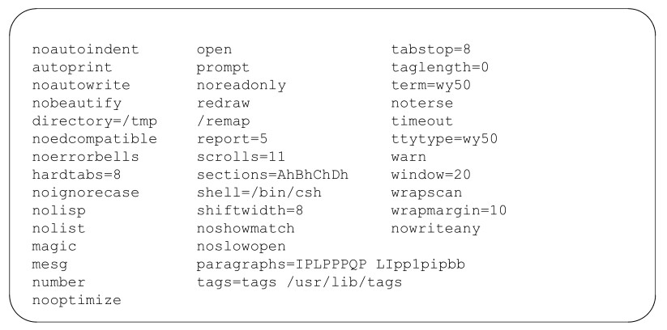

또한 다음 명령을 사용하여 개별 옵션의 설정값을 이름으로 조회할 수도 있습니다.
:set option?
:set 명령은 .exrc 파일에서 또는
현재 세션 중에 사용자가 직접 변경하거나 설정한 옵션을 표시합니다. 예를 들어, 화면은 다음과 같이 표시될 수 있습니다.
number window=20 wrapmargin=10
이 옵션들이 무엇을 의미하는지에 대한 설명은 부록 A를 참조하십시오.

### The .exrc File

사용자의 vi 환경을 제어하는 .exrc 파일은 홈 디렉토리에 있습니다. 이 파일에 vi나 ex를 사용할 때마다 적용되기를 원하는
set 옵션을 입력하십시오.
.exrc 파일은 다른 파일과 마찬가지로 vi 편집기를 사용하여 수정할 수 있습니다. .exrc 파일의 예시는
다음과 같습니다:
set wrapmargin=10 window=20
이 파일은 ex가 비주얼 모드(vi)로 진입하기 전에 실제로 읽히기 때문에, .exrc에 포함된 명령어 앞에는
콜론을 붙이지 않아야 합니다.

### Alternate Environments

로컬 디렉터리에 위치한 .exrc 파일에 옵션 설정을 저장하여 대체 vi 환경을 정의할 수 있습니다.
해당 디렉터리에서 vi를 실행하면 로컬 .exrc 파일이 불러오게 됩니다. 이 파일이 존재하지 않으면,
홈 디렉터리에 있는 파일이 불러오게 됩니다.
예를 들어, 프로그래밍용 옵션 세트는 다음과 같이 설정할 수 있습니다.
set number lisp autoindent sw=4 tags=/usr/lib/tags terse
그리고 텍스트 편집용 옵션 세트는 다음과 같이 설정할 수 있습니다.
set wrapmargin=15 ignorecase
로컬 .exrc 파일은 7장에서 설명하는 약어를 정의할 때 특히 유용합니다.

### Some Useful Options

:set all을 입력하면 볼 수 있듯이, 다양한 옵션이 있습니다. 대부분의 옵션은 vi에서 내부적으로 사용되며
일반적으로 변경할 필요가 없습니다. 그 외의 옵션들은 특정 상황에서는 중요하지만, 다른 상황에서는 그렇지 않을 수 있습니다(예를 들어, nore-
draw와 window 옵션은 낮은 보드 속도의 전화 접속 회선에서 유용할 수 있습니다). 부록 A에는 각 옵션에 대한 간략한 설명이
수록되어 있습니다. 시간을 내어 옵션 설정을 직접 다뤄보시기를 권장합니다. 흥미로운 옵션이
보이면, 해당 옵션을 설정(또는 해제)하고 편집하는 동안 어떤 변화가 일어나는지 지켜보세요. 의외로
유용한 도구들을 발견할 수도 있습니다.
비프로그램 텍스트를 편집할 때 거의 필수적인 옵션이 하나 있습니다. wrapmargin 옵션은
입력 시 텍스트를 자동으로 줄바꿈하는 데 사용될 오른쪽 여백의 크기를 지정합니다. (이를 통해 수동으로
캐리지 리턴을 입력할 필요가 없습니다.) 이 옵션은 값이 0보다 크게 설정되어 있을 때 적용됩니다. 일반적인 값은 10 또는
15입니다.
set wrapmargin=15
또한 vi가 검색을 수행하는 방식을 제어하는 세 가지 옵션이 있습니다. 기본적으로 vi는
대소문자를 구분하며(foo는 Foo와 일치하지 않음), 검색 중에 파일의 맨 앞으로
돌아가며(즉, 파일 내 어디에서 검색을 시작하더라도 모든 일치 항목을 찾을 수 있음),
패턴 일치 시 와일드카드 문자를 인식합니다. 이러한 옵션을 제어하는 기본 설정은
각각 noignorecase, wrapscan, magic입니다. 이러한 기본값을 변경하려면 반대되는
토글인 ignorecase, nowrapscan 또는 nomagic을 설정하십시오.

또 다른 유용한 옵션은 shiftwidth입니다. 이 옵션은 프로그래머들이 프로그램의 들여쓰기를
올바르게 할 수 있도록 돕기 위해 고안되었지만, 작가들에게도 유용할 수 있습니다. >> 및 << 명령을 사용하면
text를 shiftwidth만큼 들여쓰기(또는 들여쓰기 해제)할 수 있습니다. 줄에서 커서의 위치는 상관없으며,
줄 전체가 이동됩니다. shiftwidth 옵션은 기본적으로 8로 설정되어 있지만, :set을 사용하여
이 값을 변경할 수 있습니다.
>> 또는 << 명령어 앞에 숫자를 붙여 여러 줄에 적용할 수 있습니다. 예를 들어:
10>>
는 다음 10줄을 shiftwidth만큼 들여쓰게 합니다.

## Edits and Movement

지금까지 편집 명령어인 c, d, y와 이를 이동 명령어 및 숫자와 결합하는 방법
(예: 2cw 또는 4dd)을 배웠습니다. 그 이후로 여러분은 이동 명령어를 훨씬 더 많이 익혔습니다.
편집 명령어를 이동 명령어와 결합할 수 있다는 사실이 여러분에게 “새로운” 개념은 아니지만,
표 3-2를 통해 현재 사용할 수 있는 다양한 편집 옵션을 파악해 볼 수 있습니다.

표 3.2 vi 명령어 결합

커서에서 | 변경 | 삭제 | 복사
--- | --- | --- | ---
화면 하단 | cL | dL | yL
다음 줄 | c+ | d+ | y+
다음 문장 | c) | d) | y)
다음 단락 | c} | d} | y}
패턴 | c/패턴 | d/패턴 | y/패턴
파일 끝 | cG | dG | yG
줄 번호 13 | c13G | d13G | y13G

또한 표 3-2에 나와 있는 명령어 중 어느 것과나 숫자를 조합하여 곱셈 연산을 수행할 수 있습니다. 예를 들어,
2c)는 다음 두 문장을 변경합니다. 이 표가 다소 어려워 보일 수 있지만, 다양한 조합을 직접 시도해 보며
그 패턴을 파악해 보십시오. 이렇게 하면 얼마나 많은 시간과 노력을 절약할 수 있는지 알게 될 것이며,
변경 키와 이동 키의 조합이 더 이상 낯설게 느껴지지 않고 자연스럽게 떠오르게 될 것입니다.

## More Ways to Insert Text

다음 명령어 순서를 사용하여 커서 앞쪽에 텍스트를 삽입했습니다:
itext <ESC>
삽입 명령어는 여러 가지가 있습니다. 이들 명령어의 차이점은 커서를 기준으로
서로 다른 위치에 텍스트를 삽입한다는 점입니다:
a: 커서 뒤에 텍스트 추가
A: 현재 줄 끝에 텍스트 추가
i: 커서 앞에 텍스트 삽입
I: 줄 시작 부분에 텍스트 삽입
o: 커서 바로 아래에 새 줄을 열어 텍스트 입력
O: 커서 바로 위에 새 줄을 열어 텍스트 입력
R: 기존 문자를 새 문자로 덮어씁니다
이 모든 명령을 사용하면 삽입 모드로 전환됩니다. 텍스트를 삽입한 후에는 ESC 키를 눌러
명령 모드로 돌아가는 것을 잊지 마십시오.
A(추가) 및 I(삽입) 명령을 사용하면 삽입 모드를 호출하기 전에 커서를 줄 끝이나
줄 시작 부분으로 이동할 필요가 없습니다. 예를 들어, A를 사용하면 $a를 입력할 때 키 입력 횟수를 한 번 줄일 수 있습니다. 비록
키 입력 한 번이 시간을 절약해 주는 것처럼 보이지 않을 수도 있지만, 편집 실력이 늘고 (그리고 인내심이 줄어들면)
불필요한 키 입력을 최대한 줄이고 싶어질 것입니다.
자연스럽게 함께 사용되는 다른 명령어 조합들도 있습니다. 예를 들어, ea는
단어 끝에 새로운 텍스트를 추가하는 데 유용합니다. (이러한 자주 사용되는 조합을
인식하도록 스스로 훈련하면, 명령을 호출하는 것이 자동화되는 데 도움이 됩니다).

## Using Buffers

편집하는 동안, 마지막으로 삭제(d 또는 x)하거나 복사(y)한 내용이 버퍼(저장된 메모리의 한
부분)에 저장되는 것을 보셨을 것입니다. put 명령어(p 또는 P)를 사용하면 해당 버퍼의 내용에 접근하여 저장된 텍스트를 파일에
다시 넣을 수 있습니다.
vi는 최근 9번의 삭제 내용을 번호가 매겨진 버퍼에 저장합니다. 이 번호가 매겨진
버퍼 중 어느 것이든 불러와 최근 9번의 삭제 내용 중 하나(또는 전부)를 복원할 수 있습니다. 또한 복사한 텍스트(yank)를
문자로 식별되는 버퍼에 저장할 수도 있습니다. 최대 26개의 버퍼(a부터 z까지)에 복사한 텍스트를 채워두고, 편집 세션 중 언제든지
put 명령을 사용하여 해당 텍스트를 복원할 수 있습니다.
vi 프로그램은 또한 마지막 편집 명령(삽입, 변경, 삭제 또는 얀크)을 버퍼에 저장합니다.
마지막 명령은 키를 한 번만 누르면 반복하거나 취소할 수 있습니다.

### Recovering Deletions

한 번에 대량의 텍스트를 삭제할 수 있다는 점은 좋지만, 실수로
필요한 53줄을 삭제해 버린다면 어떻게 될까요? 번호가 매겨진 버퍼에 저장된 최근 9번의 삭제 내역 중
어떤 것이든 복구할 수 있는 방법이 있습니다. 가장 최근에 삭제한 내용은 버퍼 1에, 그 바로 이전 내용은 버퍼 2에 저장되며, 이런 식으로 이어집니다.

삭제된 내용을 복원하려면 " (따옴표)를 입력하고, 번호로 버퍼에 저장된 텍스트를 지정한 다음
put 명령을 입력하세요. 예를 들어, 버퍼 2에 저장된 두 번째로 마지막 삭제 내용을 복원하려면 다음과 같이 입력하세요:
"2p
때로는 지난 9개의 버퍼에 무엇이 들어 있는지 기억하기 어려울 수 있습니다. 이때 도움이 되는 요령이 있습니다.
. 명령어(마지막 명령어 반복)는 p 및 u와 함께 사용할 때 특별한 의미를 가집니다. p 명령어는
마지막으로 삭제되거나 변경된 내용을 표시하지만, 2p는 마지막 두 개를 표시합니다. p, .(점), u
(되돌리기)를 조합하면 번호가 매겨진 버퍼들을 차례로 거슬러 올라갈 수 있습니다.
“1p” 명령은 현재 버퍼 1에 저장된 마지막 삭제 내용을 텍스트에 다시 삽입합니다. 그 후
u를 입력하면 해당 내용이 사라집니다. 하지만 . 명령을 입력하면 마지막 명령("1p)을 반복하는 대신,
마치 "2p를 입력한 것처럼 다음 버퍼를 표시합니다. 따라서 버퍼를 차례로 거슬러 올라갈 수 있습니다. 예를 들어,
다음과 같은 명령 시퀀스:
"1pu.u.u.u.u.
는 번호가 매겨진 마지막 여섯 개의 버퍼 내용을 순서대로 보여줍니다.

### Yanking to Named Buffers

이름이 지정되지 않은 버퍼의 경우, 다른 편집 작업을 수행하기 전에 버퍼의 내용을 (p 또는 P)로 저장해야만
버퍼가 덮어쓰이지 않는다는 점을 이미 확인하셨을 것입니다. 또한 y 명령을 사용하여 텍스트 복사 및 이동을 위해 특별히 마련된 26개의 이름 지정 버퍼(a부터 z까지)를
활용할 수도 있습니다. 복사한 텍스트를 저장할 버퍼에 이름을 지정하면,
편집 세션 중 언제든지 해당 이름 지정된 버퍼의 내용을 다시 붙여넣을 수 있습니다.
이름 지정된 버퍼에 복사하려면, 복사 명령어 앞에 따옴표(")와
로드하려는 버퍼 이름을 나타내는 문자를 붙이십시오. 예를 들어:
"dyy 현재 줄을 버퍼 d에 복사
"a6yy 다음 6줄을 버퍼 a에 복사
이름이 지정된 버퍼를 불러오고 새로운 위치로 이동한 후, p 또는 P를 사용하여 텍스트를 다시 삽입합니다.
"dP 커서 앞에 버퍼 d 삽입
"ap 커서 뒤에 버퍼 a 삽입

버퍼의 일부만 텍스트에 삽입할 수는 없으며, 전체를 삽입하거나 아예 삽입하지 않는 것 중 하나만 가능합니다.
이름이 지정된 버퍼를 사용하면 p 명령으로 버퍼를 삽입하기 전에 다른 편집 작업을 수행할 수 있습니다. vi를 종료하지 않고
파일 간을 이동하는 방법을 익힌 후에는, 이름이 지정된 버퍼를 사용하여 파일 간에 텍스트를 선택적으로
전송할 수 있습니다.
거의 동일한 절차를 사용하여 텍스트를 이름 지정된 버퍼로 삭제할 수도 있습니다. 예를 들어:
"a5dd 5줄을 삭제하여 버퍼 a에 저장
버퍼 이름을 대문자로 지정하면, 복사하거나 삭제한 텍스트가 버퍼의 현재
내용 뒤에 추가됩니다. 예를 들어:
"byy 현재 줄을 버퍼 b로 복사
"B5dd 5줄을 삭제하고 버퍼 b에 추가
3} 세 단락 아래로 이동
"bP 버퍼 b의 6줄을 커서 위쪽에 삽입
이름이 지정된 버퍼에서 텍스트를 삽입할 때, 해당 버퍼에는 여전히 사본이 남아 있습니다. 편집 세션을 종료하거나 버퍼의 텍스트를 덮어쓰기 전까지는
원하는 만큼 삽입 작업을 반복할 수 있습니다.
예를 들어, 매뉴얼의 참고 문헌 섹션에서 각 페이지의
기본 틀과 같이 반복되는 요소가 포함된 문서를 작성하고 있다고 가정해 봅시다. 이 기본 틀을 이름이 지정된 버퍼에 저장한 다음,
파일에 삽입하고 빈칸을 채운 후, 필요할 때마다 기본 틀을 다시 삽입할 수 있습니다.

## Marking Your Place

vi 세션 중에는 보이지 않는 “북마크”를 사용하여 파일 내의 현재 위치를 표시해 두고, 다른 곳에서 편집을
마친 후 표시해 둔 위치로 돌아올 수 있습니다. 명령 모드에서:
"mx는 현재 위치를 x(x는 임의의 문자로 지정 가능)로 표시합니다.
"´x는 커서를 x로 표시된 줄의 시작 부분으로 이동시킵니다.
"`x는 커서를 x로 표시된 문자로 이동시킵니다.
"``는 이동 후 이전 표시 위치나 컨텍스트로 돌아갑니다.

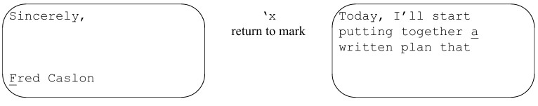

위치 표시기는 현재 vi 세션 중에만 설정되며, 파일에 저장되지는 않습니다.

## Other Advanced Edits

왜 지금까지 전역 변경, 파일 간 텍스트 이동, 또는 그 밖의 고급
ex 기능에 대해 다루지 않았는지 궁금해하실 수도 있습니다. 그 이유는 이러한 도구를 사용하려면 ex와 제7장에서 함께 다룰 일련의 UNIX 패턴
일치 도구에 대해 더 깊이 이해하는 것이 도움이 되기 때문입니다.

