# Chapter 4 nroff and troff

vi 편집기를 사용하면 텍스트를 편집할 수 있지만, 서식 지정에는 그다지 적합하지 않습니다. 프로그램 소스
코드와 같은 텍스트 파일은 pr과 같은 간단한 프로그램을 사용하여 서식을 지정할 수 있습니다. 이 프로그램은 매 페이지 상단에 헤더를 삽입하고
페이지 나누기를 처리하지만, 그 외에는 문서를 파일에서 보이는 그대로 출력합니다. 하지만 깔끔하게 서식이 지정된 텍스트를 준비해야 하는
어떤 응용 프로그램의 경우, nroff(“엔-로프”)나 troff(“티-
로프”) 서식 지정 프로그램을 사용하게 될 것입니다.
이 프로그램들은 일반적으로 서식
지시어로 코딩되거나 “마크업”된 입력 텍스트 파일을 처리하는 데 사용됩니다. 대부분의 워드 프로세서와 같은 WYSIWYG 프로그램을 사용할 때는 명령어를 통해
화면에 텍스트를 페이지에 배치될 방식 그대로 배치합니다. nroff
와 troff에서 사용하는 것과 같은 마크업 언어를 사용할 때는, 텍스트 내에 명령어를 삽입하여 서식 지정 프로그램이 무엇을 해야 하는지 지시합니다.

이 장의 목적은 두 가지입니다. 독자들에게 유용할
기본 서식 지정 코드를 소개하고자 합니다. 하지만 동시에, 서식 지정기가 무엇을 하는지,
어떻게 작동하는지에 대한 맥락 속에서 이를 설명하고자 합니다. 이 장을 읽기 힘들다고 느끼신다면—특히 nroff/
troff를 처음 접하는 경우라면, 5장이나 6장으로 건너뛰어 ms나 mm 중 하나의 매크로 패키지에
익숙해진 다음, 다시 돌아와 이 장을 이어가시기 바랍니다. 우리는 여러분이 이 책을 읽는 이유가
단순한 기초를 넘어 nroff/troff의 복잡한 부분을 숙달하고자 하기 때문이라고 가정합니다. 그 결과,
이 장은 이 책이 입문용 사용자
가이드였다면보다 다소 길고 복잡하게 구성되어 있습니다.


## Conventions

예시에 나오는 입력 텍스트와 요청을 포맷터 출력 결과와 구별하기 위해, nroff나 troff의 출력 결과 주변에
“페이지 모서리”를 표시하는 관례를 채택했습니다. nroff의 출력 결과는
다른 예시와 동일한 고정폭 서체로 표시됩니다:

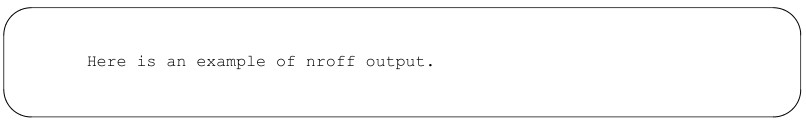

troff의 출력 결과는 본문과 동일한 서체로 표시되지만, 예제에서 명시적으로 글자 크기를 지정하지 않은 경우 글자 크기가 1
포인트 줄어듭니다:
다음은 troff 출력 결과의 예입니다.
출력 결과를 표현할 때 때로는 타협이 필요했습니다. 예를 들어, nroff 출력 결과를
표시할 때는 예제를 nroff로 별도로 처리한 후, 그 결과를 소스 파일로 다시 불러왔습니다.
그러나 그 후, troff를 통해 고정폭 글꼴로 조판되었습니다. 그 결과, 특히 줄 길이나 페이지 크기에서
실제 nroff 출력과는 약간의 차이가 있을 수 있습니다. 하지만 문맥을 통해
무엇이 시연되고 있는지는 항상 명확히 파악할 수 있을 것입니다.


## What the Formatter Does

잠시 시간을 내어 타자기와 같은 WYSIWYG 기기에서 페이지 서식을 지정할 때
하는 일들을 생각해 보세요:
• 페이지의 일부를 텍스트 영역으로 지정합니다. 이를 위해서는 상단, 하단, 좌측, 우측
여백을 설정해야 합니다.
• 입력하는 줄들이 모두 대략 같은 길이가 되도록 조정하여
지정된 텍스트 영역에 들어맞게 합니다.
• 텍스트를 단락과 같은 구문 단위로 나눕니다.
• 텍스트 영역의 맨 아래에 도달하면 새 페이지로 넘어갑니다.
nroff나 troff는 별다른 설정 없이 이 작업 중 하나만 수행합니다. 즉, 출력 파일에서 줄이 균일하게
나오도록 입력 파일의 줄 길이를 조정합니다. 이를 위해 다음 두 가지 가정을 합니다:
• 줄 길이가 6.5인치라고 가정합니다.
• 입력 파일의 빈 줄이 새 단락의 시작을 나타낸다고 가정합니다. 앞선 텍스트의 마지막 줄은
조정되지 않으며, 출력물에는 빈 줄이 삽입됩니다.
채우기와 조정 과정은 직관적으로 명백합니다. 우리 모두는 타자기를 사용할 때 수동으로 거의 같은 작업을 해본 적이 있거나,
WYSIWYG 워드 프로세서가 이를 대신해 준 경험이 있을 것입니다. 그러나 특히
troff와 같은 조판 프로그램의 경우, 줄 조정 과정에는
명백하지 않은 파급 효과가 있습니다. 무슨 일이 일어나고 있는지 명확히 이해하는 것은 나중에 매우 유용할 것입니다. 이러한 이유로, 우리는 이
과정을 자세히 살펴보겠습니다.


## Line Adjustment

줄 조정에는 ‘채우기’, ‘정렬’, ‘하이픈 삽입’의 세 가지 요소가 있습니다. 채우기는
텍스트의 모든 줄 길이를 대략적으로 동일하게 만드는 과정입니다. 타자기를 사용할 때는 줄이 꽉 찼을 때
캐리지 리턴을 누르기만 하면 이 작업이 자동으로 이루어집니다. 대부분의 워드 프로세싱 프로그램은 줄 끝에서
자동으로 캐리지 리턴을 삽입하며, vi에서도 이를 설정하는 방법을 앞서 살펴보았습니다.
그러나 nroff와 troff는 특수한 “채우기 없음(no fill)” 모드를 제외하고는 입력문의 캐리지 리턴을 무시합니다.
이 프로그램들은 입력 텍스트를 재포맷하여 모든 입력 줄을 길이가 균일한 출력 줄로 모으고, 빈 줄에 도달하거나
(곧 보게 되겠지만) 중지를 지시하는 서식 명령을 만날 때만 중지합니다. 하나 이상의 공백으로 시작하는 줄은
채워지지 않지만, 줄 끝의 공백은 잘려 나갑니다. 입력 줄에서 단어 사이에 있는 여분의 공백은
유지되며, 포맷터는 마침표, 물음표 또는 느낌표 뒤마다
여분의 공백을 추가합니다.
정렬(justification)은 채우기(filling)와 밀접하게 관련된 기능이지만 혼동해서는 안 됩니다. 채우기는 단순히
줄 길이를 대략적으로 동일하게 유지하려고 하는 반면, 정렬은 줄 끝이 정확히 일치하도록
단어 사이의 간격을 조정합니다.

기본적으로 nroff와 troff는 모두 텍스트를 페이지에 채우고 양쪽 정렬을 합니다. 양쪽 정렬은 텍스트를 페이지에 채우는 것을 의미하지만,
양쪽 정렬 없이 텍스트를 페이지에 채우는 것도 가능합니다. 몇 가지 예를 살펴보겠습니다. 먼저, vi에서 입력한
한 단락을 살펴보겠습니다. 다음은 지난 장에서 입력한 편지의 한 단락으로, Alcuin 일루미네이티드 레터링 소프트웨어에 대한 사용자 가이드뿐만 아니라
참조 매뉴얼도 함께 작성하도록 수정된 내용입니다.
수정을 하는 과정에서 단락 중간에 짧은 줄 하나를 남겨 두었습니다.

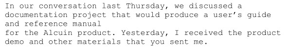

자, 이제 nroff로 처리한 후의 문단을 살펴보겠습니다:

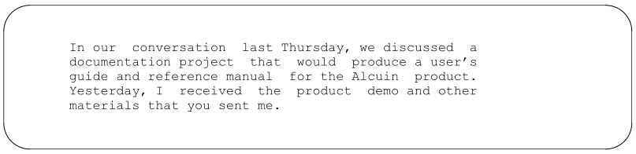

이 단락은 여백 채우기와 양쪽 정렬이 모두 적용되었습니다. 만약 서식 지정 시 여백 채우기만 하고 양쪽 정렬은 하지 않도록 설정했다면,
단락은 다음과 같이 보일 것입니다:

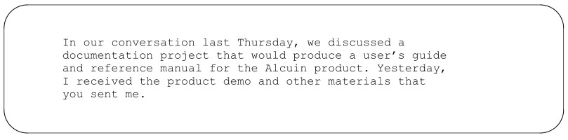

보시다시피, nroff는 첫 번째 예시에서 단어 사이에 여분의 공백을 추가하여 텍스트를 양쪽 정렬했습니다.
대부분의 타자기로 작성된 문서는 여백을 채우기는 하지만 양쪽 정렬은 아닙니다. 인쇄 용어로 말하면, 오른쪽 불규칙 정렬로 타자된 것입니다.
반면, 책, 잡지 및 기타 조판된 자료는 대개 오른쪽 정렬로 되어 있습니다. 때때로,
각 줄의 오른쪽 끝은 정렬되어 있지만 왼쪽 끝은
불규칙한 인쇄물(예: 광고 문구)을 볼 수 있습니다. 이러한 이유로 우리는 보통 텍스트가 단순히 ‘정렬’되었다고 말하기보다는 ‘오른쪽 정렬’ 또는 ‘왼쪽 정렬’되었다고 표현합니다.
긴 단어가 줄 끝에 위치하여 채우기나 정렬, 혹은 둘 다를 수행하기 어려운 경우,
포맷터는 (우리 모두가 잘 알고 있는) 또 다른 방법을 사용할 수 있습니다. 바로 하이픈 삽입입니다.
nroff 및 troff 프로그램은 과거 인간 조판사가 납 활자를 조판하던 방식과 거의 동일한
방식으로 채우기, 정렬, 하이픈 삽입을 수행합니다. 인간의 조판사는 각 줄이 채워질 때까지
트레이에 개별 글자를 배치하여 한 줄의 조판을 완성하곤 했습니다. 조판사가 줄 끝 부분에 도달했을 때
채우기를 위한 몇 가지 선택지가 있었습니다:
• 다음 단어가 정확히 들어맞을 수도 있습니다.
• 조판사가 단어 간격을 조금 더 좁히면 다음 단어가 들어맞을 수도 있습니다.
• 다음 단어를 하이픈으로 나누어서, 일부는 현재 줄에, 일부는 다음 줄에 배치할 수도 있습니다.

텍스트를 채우는 것 외에도 양쪽 정렬을 해야 한다면, 한 가지 추가적인 문제가 있었습니다. 줄 길이가
대략 적당한 길이가 된 후, 줄 길이가
균일해지도록 각 단어 사이에 공백을 추가해야 했습니다.
이 프로그램들이 대체하는 인간 조판사와 마찬가지로, nroff와 troff는 한 번에 한 줄씩 텍스트를 조립하며,
줄 길이를 측정하고 간격을 조정하여 줄 길이가 균일하게 나오도록 합니다(줄이 양쪽 정렬되어야 한다고
가정할 때). 입력 줄들은 단일 출력 줄을 구성할 만큼 충분한 텍스트가 모일 때까지 임시 저장 영역, 즉 버퍼에
모아집니다. 그런 다음 해당 줄이 출력되고, 다음 줄이
수집됩니다.
두 프로그램 간의 첫 번째 중요한 차이점은 바로 양쪽 정렬 과정에서
나타납니다. nroff 프로그램은 타자기식 프린터와 함께 사용하도록 설계된 반면, troff는
사진 조판기와 함께 사용하도록 설계되었습니다.
타자기식 프린터는 모든 문자의 크기가 동일합니다. 즉, ‘i’가 차지하는 공간은 ‘m’이 차지하는 공간과
같습니다. (일반적인 문자 너비는 1자당 1/10 또는 1/12인치입니다). 일부 프린터(예: 데이지휠
프린터)에서는 데이지휠이나 심블을 교체하여 글꼴 스타일을 변경할 수 있지만, 일반적으로는
한 번에 하나의 서체만 사용할 수 있습니다.

반면, 조판사는 각 글자가 그 윤곽에 비례하는 만큼의 공간을 차지하는 서체를 사용합니다.
‘i’에 할당된 공간은 ‘m’에 할당된 공간보다 확실히 더 좁습니다.
가변 폭 문자를 사용하면 troff에서 줄 채우기와 정렬 작업을 수행하는 것이
nroff보다 훨씬 더 어려워집니다. nroff는 단순히 문자 수만 세면 되는 반면, troff는 줄을 구성할 때
각 문자의 폭을 합산해야 합니다. (문자 폭은 문자의 자연스럽고 다소 불규칙한 모양이 아니라,
문자를 둘러싼 “상자”로 정의됩니다).
troff 프로그램 역시 단어 사이에 공백을 추가하여 양쪽 정렬을 수행하지만, 사용하는 가변 폭
글꼴이 훨씬 더 콤팩트하기 때문에 한 줄에 더 많은 내용을 담을 수 있고, 일반적으로 양쪽 정렬을
훨씬 더 잘 수행합니다.*
또 다른 차이점도 있습니다. 별다른 설정을 하지 않으면 nroff는 단어 사이에 전체 공백만
삽입합니다. 즉, 한 단어 쌍 사이에는 공백 두 개를, 다른 단어 쌍 사이에는 공백 세 개를 넣어
줄을 채울 수 있습니다. -e 옵션을 지정하여 nroff를 호출하면, 모든 단어 간 간격을 동일한 크기로 맞추려고 시도합니다(가능한 경우
소수점 단위 공백을 사용함). 하지만 이 경우에도 출력 장치가 소수점 단위 간격을 허용해야만 nroff가
제대로 작동합니다. troff 프로그램은 항상 균일한 단어 간 간격을 사용합니다.
다음은 troff로 줄 채우기와 양쪽 정렬을 적용한 동일한 단락입니다:

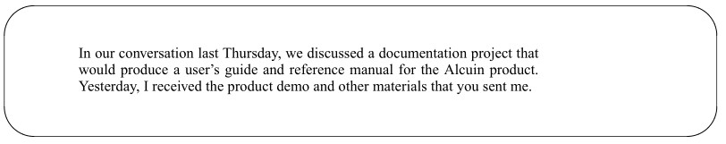

사정을 더욱 복잡하게 만드는 것은, 조판에 사용되는 문자들이 다양한 디자인, 즉 서체로 제공된다는 점입니다.
서체란 특정 디자인 요소를 공유하는 알파벳, 숫자, 구두점 문자들의 집합을 말합니다. 일반적으로
서체는 서로 관련이 있는 여러 가지 서체 스타일로 구성된 ‘서체군’으로 나뉩니다. 예를 들어, 이 책은 대부분
Times Roman 서체군으로 조판되었습니다. 여기에는 세 가지의 별도 서체가 있습니다:


조판 기술을 통해 같은 페이지에 여러 가지 서체를 사용할 수 있는데, 이 책 전체에 걸쳐 다양한 서체가 혼합되어 사용된 것을 보시면 알 수 있습니다.
때로는 방금 보여드린 Times Roman, Times
Bold, Times Italic처럼 같은 서체 계열에 속하는 서체들이 사용되기도 합니다. 하지만 각 페이지의 상단 제목(running header)에서는 Helvetica와 같은 다른 서체들도
보실 수 있습니다. 굵은체와 이탤릭체는 일반적으로 강조를 위해 사용되며,
이 책과 같은 컴퓨터 관련 서적에서는 예제나 기타 “컴퓨터 용어”를 나타낼 때 고정폭 타자기 서체가 사용됩니다.
같은 서체 계열 내에서도 동일한 문자의 너비는 서체마다 다릅니다. 예를 들어,
굵은체 “m”은 일반체 “m”보다 약간 더 넓습니다.
사정을 더욱 복잡하게 만드는 것은, 같은 서체라도 크기가 다양하다는 점입니다. 이
책을 보시면, 각 장 내의 절 제목이 강조를 위해 글자 크기가 약간 더 크다는 것을 알 수 있을 것입니다. 글자
크기는 ‘포인트’라는 단위로 측정됩니다. 이에 대해서는 나중에 더 자세히 다루겠지만, 글자 크기가 무엇을
의미하는지 대략적으로 파악하려면 현재 페이지를 살펴보기만 하면 됩니다. 이 책의 본문 글꼴은 10포인트 Times Roman이며,
다음 제목은 12포인트 Times Bold입니다. 줄 간격은 일반적으로 nroff의 경우처럼 고정되어 있는 것이 아니라,
포인트 크기에 비례합니다.
troff 프로그램은 각 글꼴에 포함된 다양한 문자의 너비에 대한 정보를 시스템의 /usr/lib/font 디렉터리에
저장된 테이블에서 얻습니다. 이 테이블들은 troff가 한 줄에 각 문자를 출력한 후
얼마나 오른쪽으로 이동해야 하는지 알려줍니다.

troff에 대해서는 나중에 더 자세히 다루겠습니다. 우선, 조판 시 포맷팅 프로그램의 역할이
타자기식 프린터용 텍스트를 준비할 때보다 훨씬 더 복잡하다는 점을 알아두시기 바랍니다.

*최고의 조판 프로그램들은 개별 문자 사이의 간격도
조정할 수 있는 기능을 갖추고 있습니다. 이 과정을 커닝이라고 합니다. 토론토에 있는 SoftQuad Publishing Software는 커닝을 지원하는
SQroff라는 troff의 향상된 버전을 판매하고 있습니다.


## Using nroff

앞서 언급했듯이, nroff와 troff는 별다른 설정을 하지 않으면 기본적인 서식 지정만 수행합니다.
이 프로그램들은 기본 줄 길이인 6.5인치를 사용하여 텍스트를 채우고 양쪽 정렬을 하지만, 줄 길이로 인해 암시적으로 생기는 오른쪽 여백 외에는
다른 여백을 남기지 않습니다. 이를 더 명확히 이해하기 위해, nroff로 서식 지정한 후의 모습인 지난 장의 예시 편지
(이 장에서 수정한 내용 포함)를 살펴보겠습니다.
먼저, 포맷터를 호출하는 방법을 살펴보겠습니다. nroff 프로그램은 포맷할 파일의 이름을
인수로 받습니다:
$ nroff letter
또는 표준 입력을 받아, 포맷하기 전에 다른 프로그램으로 텍스트를 전처리할 수 있게 해줍니다:
$
$ tbl report | nroff
nroff에는 다양한 옵션이 있습니다. 이 옵션들은 이 책의 여러 부분에서 (주제에 따라) 설명되어 있으며,
부록 B에 요약되어 있습니다.

기본 옵션 중 하나는 -T로, 출력을 준비해야 할 터미널(프린터) 유형을 지정합니다.
nroff의 출력은 비교적 간단하지만, 프린터 간에 존재하는 몇 가지 차이점이 출력에 상당한
영향을 미칠 수 있습니다. (예를 들어, 어떤 프린터는 백스페이스를 누른 뒤 밑줄이 그어진 각 글자 아래에 밑줄을 인쇄하여
밑줄 효과를 내는 반면, 다른 프린터는 줄 바꿈을 생략하고 해당 줄을 다시 한 번 스캔하여
밑줄을 인쇄하는 방식으로 처리할 수 있습니다.) 기본 장치는 텔레타이프 모델 37 터미널로, 이는 상당히
구식인 장치입니다. 다른 장치들은 부록 B에 나열되어 있습니다. 익숙하지 않은 프린터나 터미널이 있다면,
가장 안전한 선택은 아마도 lp일 것입니다:
$ nroff -Tlp file
이 책의 예제에서는 -T 옵션을 생략하겠지만, 직접 실험해 보고 자신의 장비에서
가장 좋은 결과를 내는 유형을 선택해 보시기 바랍니다.
대부분의 UNIX 프로그램과 마찬가지로, nroff는 표준 출력에 결과를 표시합니다. 따라서 텍스트가
letter라는 파일에 저장되어 있다고 가정하면, 다음 명령만 입력하면 됩니다:
$ nroff letter
잠시 후 화면에 결과가 표시될 것입니다. letter의 내용이 빠르게 스크롤될 것이므로,
nroff의 출력을 pg나 more와 같은 페이지링 프로그램으로 파이프해야 합니다:
$ nroff letter | pg
또는 lp나 lpr을 사용하여 프린터로 출력할 수도 있습니다:
$ nroff letter | lp


## Using troff

nroff에 비해 troff의 가장 큰 장점은 다양한 종류의 문자 집합이나 글꼴을 사용할 수 있어,
조판기나 레이저 프린터에서 제공하는 고품질 인쇄 기능을 최대한 활용할 수 있다는 점입니다.
글꼴, 글자 크기, 그리고 줄 사이의 수직
간격을 지정하기 위한 여러 명령어가 있는데, 이는 troff에서만 유용합니다. 하지만 실제 명령어에 대해 설명하기 전에, 먼저 약간의 역사를 살펴볼 필요가 있습니다.
troff 프로그램은 원래 특정 조판기인 Wang C/A/T를 위해 설계되었습니다. 이후,
다양한 출력 장치에서 작동하도록 수정되었습니다. 최신 버전을 다루기 전에, 먼저 (아직도
많은 곳에서 사용되고 있는) troff의 초기 버전에 대해 논의해 보겠습니다. C/A/T 조판기는
한 번에 네 가지 글꼴만 사용할 수 있도록 설계되었습니다.

(초기 사진 조판기는 다양한 문자의 윤곽이 그려진 필름을 통해 빛을 투사하는 방식으로 작동했다. 이 필름은 종종 회전하는 휠에 장착되어, 광원이 깜빡일 때 원하는 문자를
광원 앞에 위치시켜, 이를 통해 사진 용지나 네거티브
필름에 문자를 촬영했습니다. 렌즈는 문자를 확대하거나 축소하여 다양한 글자 크기를 만들어 냈습니다. C/A/T 조판기는
네 개의 사분면으로 나뉜 휠을 갖추고 있어, 여기에 네 가지 다른 서체를 장착할 수 있었습니다).
일반적으로 네 가지 서체는 동일한 서체 계열의 표준(로만), 굵은체, 이탤릭체와 더불어,
추가 구두점, 그리스 문자(수식용), 글머리 기호,
수직선 및 기타 비표준 문자가 포함된 “특수” 서체로 구성되었다. 그림 4-1은 이러한 표준 서체에서 사용할 수 있는 문자들을 보여준다.


### The Coming of ditroff

이후 troff는 다른 조판기를 지원하도록 수정되었으며, 무엇보다도 (적어도 이 책의 많은 독자들의 관점에서 볼 때)
레이저 프린터를 지원하도록 개선되었습니다. 최신 버전의 troff는 흔히 ditroff(device-independent troff의 약자)라고 불리지만,
많은 UNIX 시스템에서는 원래 troff의 이름을 otroff로 변경하고, ditroff를 단순히 원래 이름인 troff라고 부릅니다.
ditroff 프로그램은 개발 당시 기본 UNIX 배포판에서
“분리”되어 Documenter’s Workbench(DWB)라는 별도의 제품의 일부로 포함되었기 때문에, 모든 시스템에서 사용할 수 있는 것은 아닙니다. UNIX 시스템 제조업체는 이 패키지를 포함하지 않을 수 있는 선택권이 있지만,
점차 이를 포함하는 추세입니다. DWB의 각 버전은 타사 공급업체를
통해 별도로 구할 수도 있습니다.
최신 버전의 troff를 사용하면 원하는 만큼 다양한 글꼴을 지정할 수 있습니다. (.fp를 사용하여
최대 10개의 가상 “위치”에 글꼴을 마운트할 수 있으며, 이름으로 추가 글꼴을 요청할 수도 있습니다).
다양한 글꼴 크기를 사용할 수 있을 뿐만 아니라, 선 그리기를 위한 몇 가지 추가 명령어도
제공됩니다(ditroff는 직선뿐만 아니라 곡선도 그릴 수 있습니다). 하지만 대체로 ditroff는
다양한 출력 장치를 사용할 수 있는 유연성이 더 높다는 점을 제외하면, 원래 프로그램과 매우 유사합니다.
시스템에 어떤 버전의 troff가 설치되어 있는지 확인하는 한 가지 방법은(명시적으로 ditroff라고 불리는 프로그램이
없는 경우) /usr/lib/font 디렉터리의 내용을 나열해 보는 것입니다:

$ls -F /usr/lib/font
devlj/
devps/
ftB
ftI
ftR
ftS


이름이 ‘dev’로 시작하는 하위 디렉터리가 하나 이상 있다면, 시스템은
ditroff를 사용하고 있는 것입니다. 우리 시스템은 ditroff와 otroff를 모두 지원하므로, /usr/lib/font 디렉터리 내에 (ditroff용) 장치 하위 디렉터리와 (otroff용) 글꼴 파일이
직접 포함되어 있습니다.
글꼴 파일에 대해서는 나중에 더 자세히 다루겠습니다. 지금 당장은 이 파일들이 특정 출력 장치에 대한 다양한 글꼴의
문자 너비에 관한 정보를 포함하고 있다는 점만 알아두시면 됩니다.
초보자가 예상하는 것과는 달리, 글꼴 파일에는 문자
자체의 윤곽선이 포함되어 있지 않습니다. 제대로 된 조판기에서는 문자 윤곽선이 조판기 자체에 저장되어 있습니다. troff가 조판기로 보내는 것은
문자 코드와 크기 및 위치 정보뿐입니다.

그러나 troff는 레이저 프린터와 함께 사용되는 경우가 점점 늘어나고 있는데, 이러한 프린터 중 상당수는 다운로드 가능한
글꼴을 사용합니다. 각 문자의 전자 이미지는 대개 인쇄 작업이 시작될 때마다 컴퓨터에서 프린터의 메모리로
로드됩니다. 이 경우 문자 윤곽이 포함된 추가적인 “글꼴 파일”이
있을 수 있지만, 이러한 파일은 프린터를 제어하는 소프트웨어에서 사용되며
troff 자체와는 아무런 관련이 없습니다. 다른 경우에는 글꼴 이미지가 프린터의 ROM(읽기 전용 메모리)에 저장되기도 합니다.
레이저 프린터를 사용하는 경우, troff 자체는 인쇄된 페이지에 문자나 이미지를 실제로 그리는 작업과는
전혀 무관하다는 점을 기억하는 것이 중요합니다. 이러한 경우, troff는 프린터에서 사용하는 문자의 너비를 설명하는 테이블을 사용하여 단순히
페이지의 서식을 지정하고, 페이지 레이아웃, 간격 등에 대한 명령어를 생성할 뿐입니다. 프린터를 실제로 구동하는 작업은 다른 프로그램이 처리하며,

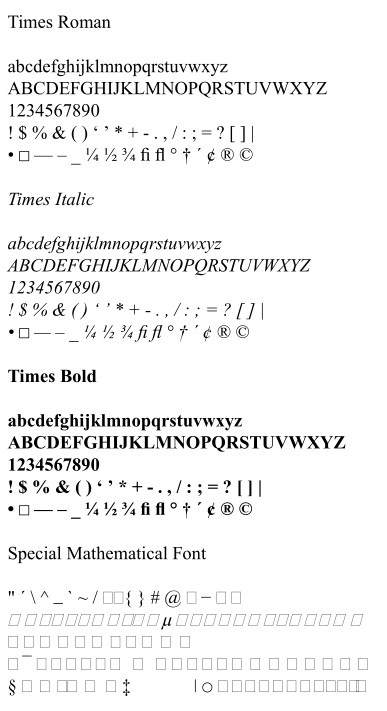

그림 4.1 네 가지 표준 글꼴

일반적으로 프린터 드라이버 또는 troff 후처리기라고 불립니다.
이러한 후처리기와 함께 troff를 사용하려면, 일반적으로 troff의 출력을 후처리기로 파이프하고,
거기서 다시 인쇄 스풀러로 보내야 합니다:
$ troff 파일 | 후처리기 | lp
출력을 C/A/T 조판기로 직접 전송하도록 설계된 구버전의 troff를 사용하는 경우,
troff가 표준 출력을 사용하도록 지시하는 -t 옵션을 지정해야 합니다. 그렇지 않으면 다음과 같은
메시지가 표시됩니다:
조판기가 사용 중입니다.
(물론, 혹시라도 C/A/T 조판기에 연결되어 있다면 이 옵션은 필요하지 않습니다. 부록 B에는
유용하게 사용할 수 있는 몇 가지 다른 옵션들이 나열되어 있습니다.) 반면, ditroff를 사용할 때는
사용 중인 장치를 지정하는 -T 명령줄 옵션을 명시해야 합니다.
그러면 후처리기가 장치 독립적인 troff 출력을 해당 특정
레이저 프린터나 조판기의 명령어로 변환합니다. 예를 들어, 저희 사이트에서는 Apple LaserWriter와
Pipeline Associates의 devps 후처리기를 함께 사용하여, troff 출력을 LaserWriter용으로 변환합니다. 저희의
명령줄은 다음과 같습니다:
$ ditroff -Tps files | devps | lp

-T 옵션과 포스트프로세서를 변경하기만 하면 동일한 파일을 서로 다른 장치에서 인쇄할 수 있습니다.
예를 들어, 레이저 프린터로 초안을 인쇄한 다음, 파일을 크게 수정하지 않고도
최종 출력을 위해 조판기로 전환할 수 있습니다. (실제로 출력을 다른 프린터로 보내려면, lp 명령의 옵션으로
프린터 이름을 지정해야 합니다. 이 일반적인 예제에서는 적절한 프린터가 기본 프린터로 연결되어 있다고 가정하고,
어떤 옵션도 지정하지 않은 채 lp를 단순히 사용합니다).
세상의 모든 일이 그렇듯이, 이 작업도 말처럼 항상 쉬운 것은 아닙니다. 서로 다른 출력
장치에서 사용하는 글꼴은 명목상의 글꼴 이름과 크기가 동일하더라도 너비가 다르기 때문에, 한 장치에서 다른 장치로 전환할 때
페이지 나누기와 줄 바꿈이 달라질 수 있습니다.

Adobe Systems의 PostScript, Xerox의 Interpress, Imagen의 DDL과 같은 업계 전반에 걸쳐 널리 사용되는 페이지 설명 언어가 최근 개발됨에 따라,
ditroff를 다양한 출력 장치와 연동하는 작업이 점점 더 쉬워지고 있습니다. 이러한 페이지 설명 언어는 호스트
컴퓨터가 아닌 프린터에 내장되어 있으며, 페이지 상의 문자 및 그래픽 배치에 대해 장치에 구애받지 않는 방식으로
설명해 줍니다.
이제 각 출력 장치마다 별도의 후처리기를 사용하는 대신, 하나의 후처리기를 사용하여
troff 출력을 원하는 페이지 설명 언어로 변환할 수 있습니다. 예를 들어, Adobe
Systems의 TranScript 후처리기(또는 Pipeline Associates의 devps와 같은 동등한 후처리기)를
사용하여 troff 출력을 PostScript로 변환한 다음, 그 PostScript 출력을 다양한
조판기나 레이저 프린터 중 어느 것으로든 보낼 수 있습니다.
이 시점부터 ‘troff’라고 언급할 때마다, 일반적으로는 ditroff를 의미합니다. 또한,
nroff는 troff와 차이가 있으므로 계속해서 다루겠지만, 본문에서는 더 뛰어난 기능을 갖춘
프로그램에 중점을 둘 것입니다. 레이저 프린터의 보급이 확대됨에 따라 머지않은 미래에 troff가
거의 모든 사용자에게 선호되는 프로그램이 될 것이라고 우리는 생각합니다.

그러나 troff용으로 작성된 문서를 nroff에 입력해도 꽤 만족스러운 결과를 얻을 수 있습니다.
대부분의 경우, nroff가 처리할 수 없는 서식 지정은 단순히 무시됩니다. 또한
nroff용으로 작성된 문서를 troff에 입력할 수도 있지만, 그렇게 하면 troff의 장점을
만들어 주는 많은 기능을 활용하지 못하게 됩니다.


## The Markup Language

nroff 및 troff 마크업 명령어(흔히 ‘요청’이라고도 함)는 일반적으로 소문자 한두 개로
구성되며, 첫 번째 열에 마침표나 아포스트로피가 온 뒤 별도의 줄에 위치합니다. 대부분의 요청은
기억하기 꽤 쉽습니다. 예를 들어, 공백을 남기라는 요청은 다음과 같습니다.
.sp
또한 텍스트의 어느 곳에나 삽입할 수 있는 요청들도 있습니다. 이러한 요청들은 일반적으로
이스케이프 시퀀스라고 불립니다. 이스케이프 시퀀스는 대개 백슬래시(\)로 시작합니다. 예를 들어, 이스케이프 시퀀스
\l은 수평선을 그립니다. 특히 troff에서는 이스케이프 시퀀스를 사용하여 선을 그리거나
표준 ASCII 문자 집합에 포함되지 않은 다양한 특수 문자를 출력합니다. 예를 들어,
•(불릿)을 표시하려면 \(bu를 입력하면 됩니다.

서식 지정 명령어에는 세 가지 종류가 있습니다.
• 다음 줄의 텍스트를 출력하기 전에 1인치 간격을 두도록 요청하는 것과 같이,
즉시 한 번만 적용되는 명령어.
• 줄 길이를 설정하거나 양쪽 정렬을 활성화 또는
비활성화하도록 요청하는 것과 같이, 지속적인 효과를 갖는 명령어.
• 매크로 작성에 유용한 명령어. 포맷터에는 더 간단한 명령들의 순서를 조합하여
복잡한 명령을 구성할 수 있게 해주는 “프로그래밍 언어”가 내장되어 있습니다. 이
언어의 일부로, 문자열(string) 및 숫자 레지스터(number register)라고 하는 변수에 값을 저장하거나,
조건을 테스트하고 그 결과에 따라 동작하는 등의 명령이 있습니다.
대부분의 경우, 매크로, 문자열 및 숫자 레지스터를 정의하는 데 사용되는 명령에 대해서는
이 책의 뒷부분에서 다루겠습니다.
지금은 포맷터의 기본 동작을 제어하는 기본 명령어를 이해하는 데
중점을 두겠습니다. 또한 즉각적이고 일회성 효과를 내는 가장 유용한 명령어들도 많이 배울 것입니다. 표
4-1은 가장 자주 사용하게 될 명령어들을 요약한 것입니다.

표 4.1 기본 nroff/troff 명령어

요청 | 의미 | 요청 | 의미
--- | --- | --- | ---
.ad | 줄 조정 활성화 | .na | 줄 정렬 안 함
.br | 줄 바꿈 | .ne | 페이지 끝까지 줄 채우기
.bp | 페이지 바꿈 | .nf | 줄 채우기 안 함
.ce | 다음 줄 중앙 정렬 | .nr | 번호 레지스터 정의 및 설정
.de | 매크로 정의 | .po | 페이지 오프셋 설정
.ds | 문자열 정의 | .ps | 글자 크기 설정
.fi | 출력 줄 채우기 | .so | 소스 파일로 전환 후 반환
.ft | 현재 글꼴 설정 | .sp | 공백
.in | 들여쓰기 설정 | .ta | 탭 정지 위치 설정
.ls | 이중 또는 삼중 간격 설정 | .ti | 임시 들여쓰기 설정
.ll | 줄 길이 지정 | .vs | 세로 줄 간격 설정


### Looking at nroff Output

텍스트 서식 지정기의 기본 작동 방식에 대해 다룰 때, nroff와 troff가
기본적인 서식 지정을 수행한다는 것을 살펴보았습니다. 이 프로그램들은 기본 줄 길이인 6.5인치를 사용하여 텍스트를 채우고 양쪽 정렬을 하지만,
줄 길이로 인해 암시적으로 생기는 오른쪽 여백 외에는 여백을 남기지 않습니다.
이를 더 명확히 이해하기 위해, 지난 장에서 살펴본 샘플 편지를 nroff로 서식 처리한 후의 모습으로
살펴보겠습니다. 이때 임베디드 요청은 포함하지 않았으며, 매크로 패키지도 사용하지 않았습니다. 그림 4-2를 보면,
서식 지정기가 모든 줄을 동일한 길이로 조정했음을 한눈에 알 수 있습니다.
심지어 편지의 주소란에서도, 우리가 원래 그대로 두기를 원했던 부분조차도 마찬가지입니다. 입력에 있는 빈
줄은 출력에서도 빈 줄로 나타나며, 단락 끝의 부분 줄은
조정되지 않습니다.
원시 서식의 가장 눈에 띄는 특징은 여기서 재현하기가 다소 어렵지만,
우리는 시도해 보았습니다. nroff는 상단이나 왼쪽 여백을 자동으로 할당하지 않습니다.


## Turning Filling On and Off

편집 과정에서 발생하는 고르지 않은 텍스트 줄을 채우는 기능은 아마도 서식 지정기에서 기대하는 가장 기본적인 작업이겠지만,
항상 바람직한 것은 아닙니다. 예를 들어, 이 편지에서는 주소란이
채워지는 것을 원치 않습니다. 이 문제를 해결하기 위해 사용할 수 있는 두 가지 명령어가 있습니다: .br (줄바꿈)과 .nf (채우기 안 함).
한 줄 뒤에 .br 명령을 입력하면, 버퍼가 아직 가득 차지 않았더라도 해당 줄의 현재 내용을 출력하고 다음 줄을 시작합니다.
올바르게 서식이 지정된 주소 블록을 생성하려면, 파일에
다음과 같은 명령을 입력할 수 있습니다:

```
Mr. John Fust
.br
Vice President, Research and Development
.br
Gutenberg Galaxy Software
.br
Waltham, Massachusetts 02159
```

각 입력 행은 채우기나 정렬 없이 그대로 출력됩니다. 또한 .nf 명령을 사용할 수도 있는데,
이 명령은 nroff에게 채우기를 완전히 중지하도록 지시합니다. 이 명령 뒤에 나오는 텍스트는 포맷터에 의해 입력 파일에 표시된 그대로
정확히 출력됩니다. 텍스트를 입력된 그대로 배치하고 싶을 때 이 명령을 사용하십시오.

편지의 본문은 채우기를 적용하고 싶으므로, .fi(fill)
명령을 사용하여 채우기를 다시 활성화해야 합니다:

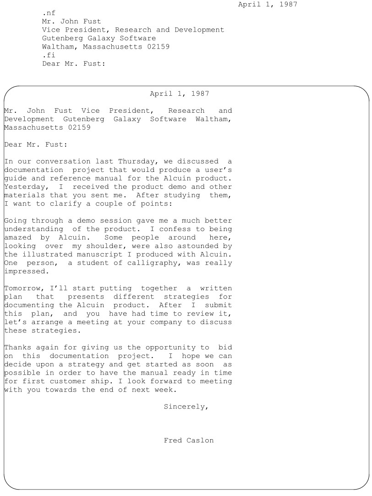
그림 4.2 nroff 형식으로 포맷된 원본 파일

앞서 제시한 예시를 자세히 살펴보면, 편지 본문에서 두 가지 서식 지정
요청을 빈 줄에 입력했음을 알 수 있을 것입니다. 지금 이 편지의 서식을 지정하면 다음과 같은 결과가 나옵니다:

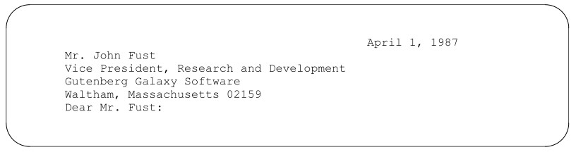

아시다시피, 예전에는 날짜와 주소란을 구분하던 빈 줄과,
주소란과 인사말을 구분하던 빈 줄이 사라졌습니다. 서식 지정 요청이 포함된 줄은 출력 시 공백이
생성되지 않으므로(공백 요청인 경우는 제외), 서식 지정 코드를 입력할 때 실수로 빈 줄을
바꾸지 않도록 주의해야 합니다.


## Controlling Justification

정렬은 .ad(adjust) 명령을 사용하여 채우기와 별도로 제어할 수 있습니다. (단, 정렬이 작동하려면
채우기 기능이 켜져 있어야 합니다.) 텍스트를 한쪽 여백이나 양쪽 여백에서 조정할 수 있습니다.
앞서 소개한 .br 및 .nf 명령과 달리, .ad는 원하는 정렬 유형을 지정하는 인수를
받습니다:

l 왼쪽 여백만 조정
r 오른쪽 여백만 조정
b 양쪽 여백 모두 조정
c 채워진 줄을 여백 사이에 중앙 정렬

이와 관련된 또 다른 명령어인 .na(no adjust)가 있습니다. 파일에 입력된 텍스트는 대개 처음부터 왼쪽 정렬로
설정되어 있으므로, .na를 사용하여 정렬을 완전히 해제하면 대부분의
경우 .ad l과 유사한 결과가 나타납니다.
그러나 중요한 차이점이 하나 있습니다. 일반적으로 .ad 명령어에 인수가 주어지지 않으면
양쪽 여백이 모두 조정됩니다. 즉, .ad는 .ad b와 동일합니다. 하지만 .na 명령어 다음에
.ad를 사용하면 마지막으로 지정된 값으로 되돌아갑니다. 즉, 다음과 같은 명령어 순서는:

```
.ad r
Some text
.ad l
Some text
.ad
Some text
```

는 세 번째 텍스트 블록의 양쪽 여백을 모두 조정합니다. 하지만 다음 순서:

```
.ad r
Some text
.na
Some text
.ad
Some text
```

는 세 번째 텍스트 블록의 오른쪽 여백만 조정합니다.
.ad b나 .ad l을 언제 사용해야 하는지는 쉽게 알 수 있습니다. 편지 본문의 여백을 불규칙하게
만들어, 마치 타자기로 작성한 것처럼 보이게 하고 싶다고 가정해 봅시다. 이전에 입력했던
.fi 명령 뒤에 .ad l을 추가하기만 하면 됩니다.
오직 오른쪽 정렬의 용도를 찾는 것은 조금 더 어려울 수 있습니다. 가끔 광고에서
왼쪽이 불규칙한 텍스트를 본 적이 있겠지만, 그게 전부일 것입니다. 하지만 잠시 생각해 보면, 이것이
한 줄을 오른쪽 여백까지 맞추는 좋은 방법이기도 하다는 것을 깨닫게 될 것입니다.
예를 들어, 예시 편지에서 날짜 앞에 공백을 여러 개 입력하는 대신(어차피
여백과 딱 맞지 않게 나오겠지만), 다음과 같은 줄을 입력할 수 있습니다:

```
.ad r
April 1, 1987
.ad b
```

알고 보니, 이 방식은 제대로 작동하지 않습니다. 기억하시겠지만, 채우기 기능이 활성화되면 nroff와
troff는 입력 내용을 한 줄 단위의 버퍼에 모아두었다가, 해당 줄이 채워진 후에야 저장된 텍스트를 출력합니다. 이
로 인해 nroff와 troff를 사용하는 전반에 걸쳐 예상치 못한 결과가 파급될 수 있습니다. 만약
서식 조건을 일시적으로 설정하는 명령을 실행한 후, 해당 줄이 출력되기 전에 이를 재설정하면,
원래 설정은 아무런 효과가 없을 수 있습니다. 결과는 해당 줄이 줄 버퍼에 처음 수집된 시점이 아니라,
줄이 출력되는 시점에 유효한 명령에 의해 결정됩니다.
특정 요청은 출력에서 암시적인 줄 바꿈(타자기의 캐리지 리턴에 해당)을
유발하지만, 다른 요청은 그렇지 않습니다. .ad 요청은 줄 바꿈을 유발하지 않습니다. 따라서 다음과 같은 구문은:

```
.ad r
April 1, 1987
.ad b
Mr. John Fust
```

다음과 같은 결과가 출력됩니다:

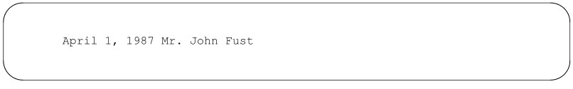

다음과 같은 결과는 아닙니다:

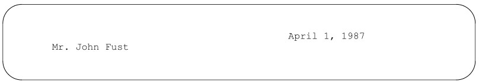

이와 같은 임시 설정에서 원하는 결과를 얻으려면, 영향을 받는 줄 뒤에
줄 바꿈을 유발하는 조건을 반드시 추가해야 합니다.* 예를 들어, 앞의 예시에서는
날짜 뒤에 빈 줄이나 .sp 요청을 추가해야 하며, 이 둘 중 어느 것이든 일반적으로 줄 바꿈을 유발합니다.
그렇지 않은 경우, 다음과 같이 명시적인 break를 삽입해야 합니다:

```
.ad r
April 1, 1987
.br
.ad b
Mr. John Fust
```

정렬에 관한 마지막 사항: 포맷터는 단어 사이의 공백을 넓혀서 줄을 조정합니다. 두 단어 사이의 공백이 조정되거나 출력 줄에 걸쳐 나뉘는 것을 원하지 않는다면, 공백 앞에
백슬래시를 붙이십시오. 이를 ‘확장 불가능한 공백’이라고 합니다.
확장 불가능한 공백에는 잘 알려지지 않은 용도가 많이 있는데, 적절한 시점에 이에 대해 언급하겠습니다.
다음은 유용하게 쓰일 수 있는 간단한 예입니다. nroff와 troff는 일반적으로 마침표,
물음표 또는 느낌표 뒤에 공백 두 개를 추가합니다. 포맷터는 문장의 끝과
약어를 구분할 수 없기 때문에, 이러한 여분의 공백이 보기 좋지 않다고 생각되면 Mr.와 같은
약어 뒤에 패딩 불가능한 공백을 넣을 수 있습니다: Mr.\ John Fust.

*다음 명령어는 줄 바꿈을 유발합니다:
.bp .br .ce .fi .nf .sp .in .ti
그 외의 모든 명령어는 줄 바꿈을 유발하지 않고 텍스트 사이에 삽입할 수 있습니다. 또한, 후술하겠지만,
이러한 명령어조차도 특수한 “줄 바꿈 금지” 제어 문자(. 대신 ’)로 시작하면 줄 바꿈을
유발하지 않게 할 수 있습니다.


## Hyphenation

앞서 언급했듯이, 하이픈 삽입은 채움과 정렬과 밀접한 관련이 있는데, 이는 nroff
와 troff가 큰 간격 없이 채워지고 정렬된 줄을 생성할 수 있는 추가적인 기능을 제공하기 때문입니다.
nroff 및 troff 프로그램은 일련의 일반적인 규칙에 따라 하이픈 삽입을 수행합니다. 때때로
특정 단어의 하이픈 삽입을 제어해야 할 필요가 있습니다. 단어를
하이픈으로 나누지 않도록 지정하거나, 특정 방식으로 하이픈을 삽입하도록 지정할 수 있습니다. 또한 하이픈 삽입 기능을 완전히 해제할 수도 있습니다.


### Specifying Hyphenation for Individual Words

단어를 특정 방식으로 하이픈 처리하도록 지정하는 방법에는 두 가지가 있습니다. 바로 .hw 요청과
특수 하이픈 처리 표시자 \%를 사용하는 방법입니다.
.hw(단어 하이픈 삽입) 요청을 사용하면 특정 방식으로 하이픈을 삽입해야 하는
소수의 단어 목록을 지정할 수 있습니다. 단어 목록에 할당된 공간은 제한적(약 128자)이므로,
이 요청은 자주 사용하는 단어 중 nroff와 troff가 하이픈 처리를 제대로 하지 못하는 단어에만 사용해야 합니다.
.hw를 사용하려면, 예외 목록을 구성하는 단어를 지정하고, 단어 내에서 하이픈을 넣고 싶은
위치에 하이픈을 입력하기만 하면 됩니다.
.hw hy-phen-a-tion
하나의 .hw 요청으로 여러 단어를 지정할 수도 있고, 필요에 따라 여러 개의 .hw 요청을
발행할 수도 있습니다.
하지만 특정 단어의 특정 인스턴스가 원하는 방식으로 하이픈이 삽입되도록
확보하기만 하면 되는 경우라면, 하이픈 삽입 표시 문자열인 \%를 사용할 수 있습니다. 텍스트에
단어를 입력할 때, 하이픈을 삽입해도 되는 각 지점에 \% 두 문자를 입력하거나, 단어를 전혀
하이픈으로 나누지 않으려면 단어 맨 앞에 입력하면 됩니다:
\%acknowledge: ‘acknowledge’라는 단어는 하이픈이 들어가지 않습니다.
ac\%know\%ledge: ‘acknowledge’라는 단어는 지정된 위치에서만
하이픈이 들어갈 수 있습니다.

이 문자열은 첫 번째 열의 마침표 뒤에 요청 이름이 따르지 않는 서식 지정 요청의 첫 번째 사례입니다.
나중에 이와 같은 사례를 더 많이 보게 될 것입니다. 이 문자열은
본문 바로 안에 삽입되어 있지만 출력되지는 않습니다.
일반적으로 nroff와 troff는 하이픈 삽입을 꽤 잘 처리합니다. 특정
하이픈 위치를 설정해야 하는 경우는 드물 것입니다. 일반적으로는 하이픈 위치에 대해 신경 쓸 필요조차 없으며,
부적절한 줄 바꿈이 눈에 띄는 경우에만 .hw 또는 \%를 사용하여 수정하면 됩니다.
UNIX의 hyphen 명령을 사용하면 nroff 또는 troff -a로 서식이 지정된 파일의 모든 하이픈 위치를 출력할 수 있습니다.
$ nroff 옵션 파일명 | hyphen
또는:
$ troff 옵션 -a 파일명 | hyphen
시스템에 hyphen 명령어가 없는 경우, 대신 grep을 사용할 수 있습니다:
$ nroff 옵션 파일명 | grep ’-$’
(단일 따옴표는 grep이 -를 옵션의 시작 부분으로 해석하지 않도록 하기 때문에
중요합니다).


### Turning Hyphenation Off and On

하이픈 분할을 원하지 않는다면 .nh(하이픈 분할 없음) 요청을 사용하십시오. 하지만 이 방법을 사용하더라도,
이미 단어 내에 하이픈, 엠 대시(—) 또는 하이픈 표시
문자(\%)가 포함된 단어는 여전히 하이픈 분할 대상이 된다는 점을 유의해야 합니다.
단어 분할을 비활성화한 후에는 .hy(단어 분할) 명령을 사용하여 다시 활성화할 수 있습니다. 이
명령에는 몇 가지 특이점이 있습니다. 단어 분할을 활성화할 수 있을 뿐만 아니라, nroff와 troff가 사용하는
단어 분할 규칙을 조정할 수도 있습니다. 이 명령은 다음과 같은 숫자 인수를 받습니다:
0: 단어 분할 비활성화
1: 단어 분할 활성화
2: 페이지의 마지막 줄은 하이픈 처리하지 않음
4: 단어의 첫 두 글자 뒤에는 하이픈을 넣지 않음
8: 단어의 마지막 두 글자 앞에는 하이픈을 넣지 않음
인수를 지정하지 않고 .hy를 입력하는 것은 .hy 1을 지정하는 것과 같습니다. 다른 숫자 값들은
합산됩니다. 예를 들어, .hy 12(.hy 4와 .hy 8의 합)를 지정하면 nroff와 troff가 단어 시작이나 끝의 짧은
음절을 하이픈으로 나누지 않게 되며, .hy 14를 지정하면 세 가지 하이픈 제한 사항이 모두
적용됩니다.


## Page Layout

조정된 주소 블록을 제외하면, 예제 편지를 서식 지정할 때 여러분이 아마도 눈치챘을 가장 큰 서식상의 단점은
왼쪽이나 위쪽 여백이 없었다는 점입니다. 게다가, 한 페이지 분량의 예시에서는 잘 드러나지 않지만,
아래쪽 여백도 없습니다. 입력 파일에 텍스트가 충분하여
두 번째 페이지로 넘어가게 된다면, 텍스트가 페이지 경계를 넘어 연속적으로 이어지는 것을 볼 수 있을 것입니다.
일반적인 사용 환경에서는 이러한 레이아웃 문제가 ms 또는 mm 매크로
패키지(후술)에 의해 자동으로 처리될 것입니다. 하지만 여기서는 포맷터 자체가 어떻게 작동하는지 이해하고 싶습니다.
이제 몇 가지 기본적인 페이지
레이아웃 명령어를 통해 nroff 및 troff 마크업 언어에 대한 탐구를 계속해 보겠습니다. 이 명령어들을 사용하면 페이지 내 텍스트의 배치에 영향을 줄 수 있습니다. 그중 일부
(설명이 set이라는 단어로 시작하는 명령어)는 동일한 요청이 다시 명시적으로 변경될 때까지
효력이 지속되는 조건을 지정합니다. 다른 명령어들은 한 번만 적용되는 효과를 가집니다.
표 4-2에 나와 있듯이, 페이지 레이아웃 명령어는 페이지에서 텍스트의 수평적
배치에 영향을 미치는 그룹과 수직적 배치에 영향을 미치는 그룹, 이렇게 두 가지로 나뉩니다. 이 명령어들을
잠시만 살펴보더라도 무엇보다 먼저 단위에 대해 이야기해야 한다는 것을 알 수 있습니다.

표 4.2 레이아웃 명령어
레이아웃 종류 | 명령 및 설명
--- | ---
  | .ll n | 줄 길이를 n으로 설정
  | .po n | 왼쪽 여백(페이지 오프셋)을 n으로 설정
세로 레이아웃 | .in n | 왼쪽 여백을 n만큼 들여쓰기
  | .ti n | 왼쪽 여백을 일시적으로 n만큼 들여쓰기
  | .ce n | 다음 n줄을 중앙 정렬
  |.pl n | 페이지 길이를 n으로 설정
  |.sp n | 공백 n개를 삽입
가로 레이아웃 | .bp n | 새 페이지를 시작
  |.wh n | 명령을 실행할 시점(페이지의 어느 수직 위치에서)을 지정


### Units of Measure

기본적으로, 수직 거리를 측정하는 대부분의 nroff 및 troff 명령어(예: .sp)는
“줄”(수직 간격 또는 vs라고도 함)의 수를 단위로 사용합니다. nroff 프로그램은 장치에 따라
정해진 일정한 줄 간격을 가지며, troff는 일반적으로 포인트 크기에 비례하는
가변적인 줄 간격을 가집니다. 하지만 두 프로그램 모두 다양한 다른 단위를 사용할 수 있도록 지원합니다. 인치와 센티미터는 물론, 표준 인쇄 단위인 피카(pica)와 포인트(point)를 사용하여
간격을 지정할 수 있습니다. (
피카는 1인치의 1/6이며, 포인트는 약 1인치의 1/72입니다. 이 단위들은 원래 활자 크기를 측정하기 위해
개발되었으며, 이 두 단위 간의 관계는 겉보기와 달리 임의적인 것이 아닙니다. 표준
12포인트 활자의 높이는 1피카입니다).
들여쓰기 깊이와 같은 가로 측정값도 이러한 측정 단위 중
어느 것을 사용하든 지정할 수 있으며, 인쇄용 측정 단위인 em과 en을 사용할 수도 있습니다. 이들은 상대적 측정 단위로, 원래는
현재 글꼴 크기와 서체에서 m과 n 글자의 크기를 기준으로 합니다. 기본적으로 가로 측정값은 항상
em 단위로 간주됩니다.

또한 이러한 단위와 포인트, 피카 사이에도 관계가 있습니다. em의 너비는 항상
지정된 포인트 크기의 글자 높이와 동일합니다. 다시 말해, 12포인트 글꼴에서 em의
너비는 12포인트입니다. 엔(en)은 항상 엠(em)의 절반 크기, 즉 현재 포인트 크기의 절반입니다. 이러한 단위를
사용할 때의 장점은 사용 중인 글꼴 크기에 상대적이라는 점입니다. 이는 nroff에서는 중요하지 않지만,
troff에서 이러한 단위를 사용하면 재코딩 없이도 문서의 모양을 변경할 수 있는
유연성이 높아집니다.

nroff 및 troff 프로그램은 이러한 단위 중 어느 것으로도 측정하지 않고, 장치에 따라 달라지는 기본
단위를 사용합니다. 사용자가 지정한 모든 치수는 사용되기 전에 기본 단위로 변환됩니다. 일반적으로 nroff는
1인치의 1/240을 가로 단위로 사용하며, otroff는 1인치의 1/432를 단위로 사용합니다. 이러한 단위들 역시
겉보기에 그다지 임의적으로 정해진 것은 아닙니다. AT&T가 UNIX 프로그래머 매뉴얼의 일부로 발간한, troff에 관한 최초이자
방대하며 권위 있는 문서인 Joseph Osanna의 『Nroff/Troff 사용자 매뉴얼』에 따르면,
nroff의 단위는 “다양한 타자기형 출력 장치의 가로 및 세로 해상도의
최소공배수”로 선정되었다. otroff의 단위는 C/A/T 조판기(troff가 원래 설계된 대상 장치)를
기반으로 했는데, 이 장치는 수평 방향으로 1/432인치 단위로,
수직 방향으로는 그 정확히 1/3인 1/144인치 단위로 이동할 수 있었습니다. ditroff의 단위는
출력 장치의 해상도에 따라 달라집니다. 예를 들어, 300 dpi(인치당 도트 수) 레이저 프린터의
단위는 수직 또는 수평 방향 모두에서 1/300인치가 됩니다. ditroff 장치 단위에 대한 자세한 내용은
부록 D를 참조하십시오.

지금 당장 이 모든 측정 단위의 세부 사항을 기억할 필요는 없습니다. 일반적으로 가장 익숙한 단위를
사용하시면 되며, 다른 단위들은 필요할 때 다시 다루도록 하겠습니다.
단위를 지정하려면, 서식 지정 요청에 입력하는 숫자 값 뒤에 표 4-3에 나와 있는 적절한
척도 표시기를 추가하기만 하면 됩니다. 예를 들어, 3줄 대신 3인치 아래로 간격을 두려면
다음과 같이 요청을 입력하십시오.

.sp 3i
모든 척도 표시기의 숫자 부분에는 소수점이 포함될 수 있습니다. 지정된 값이 사용되기 전에,
nroff와 troff는 해당 값을 가장 가까운 장치 단위로 반올림합니다.

표 4.3 측정 단위
표시 | 단위
--- | ---
c  | 센티미터
i  | 인치
m  | 엠
n  | 엔
p  | 포인트
P  | 파이크
u  | 기기 단위
v  | 세로 간격 (줄)
없음 | 기본값

사실, 숫자 인자를 요구하는 모든 요청에 대해 합리적인 숫자 표현식을 사용할 수 있습니다.
그러나 산술 표현식을 사용할 때는 지정하는 단위에 주의해야 합니다.
.ll, .in, .ti, .ta, .po, .lt, .mc와 같이 수평 방향의 모든 요청은 별도로 지정하지 않는 한
ems를 의미하는 것으로 간주합니다.
.sp와 같은 수직 방향 요청은 별도로 지정하지 않는 한 ‘v’를 기본 단위로 가정합니다. 이 규칙의 유일한 예외는
.ps와 .vs로, 이들은 기본적으로 ‘포인트’를 가정하지만—어쨌든 이 요청들은 실제로는 이동 요청이 아닙니다.
결과적으로, 다음과 같은 요청을 수행하면:
.ll 7i/2
실제로 요청하는 내용은 다음과 같습니다:
.ll 7i/2m
다음과 같은 요청:
.ll 7i/2i
또한 원하는 결과가 아닙니다. 산술 연산을 수행할 때, 분수의 경우와 마찬가지로 포맷터는 스케일링된 값을
장치 단위로 변환합니다. otroff에서 이는 앞서 언급한 표현식이 실제로 다음과 같이 평가된다는 것을 의미합니다:
.ll (7*432u)/(2*432u)

정말로 7인치의 절반을 구하고 싶다면, 다음과 같이 식을 지정해야 합니다.
.ll 7i/2u
물론 7을 2로 직접 나누어 3.5i라고 간단히 지정할 수도 있습니다. 이 예제의 요점은,
산술 연산을 수행할 때—보통 숫자 레지스터라고 하는 변수에 저장된 값을 사용하여(이에 대해서는
나중에 자세히 설명하겠습니다)—단위 간의 상호작용에 주의를 기울여야 한다는 것입니다. 또한, 소수 단위는
항상 아래로 반올림되므로, 7i/2.5u와 같은 표현은 7i/2u와 동일하게 처리되므로
피해야 합니다.
절대값 외에도, 많은 nroff 및 troff 명령어에서는 값 앞에 + 또는 -를 붙여 상대값을
지정할 수 있습니다. 예를 들어:
.ll -.5i
는 현재 줄 길이가 얼마든 상관없이 ½인치를 뺍니다.


### Setting Margins

nroff와 troff에서는 .po(페이지 오프셋) 및 .ll(줄 길이)
요청을 조합하여 여백이 설정됩니다. .po 요청은 왼쪽 여백을 정의합니다. .ll 요청은 각 줄이 채워진 후의 길이를
정의하므로, 암묵적으로 오른쪽 여백도 정의하게 됩니다:

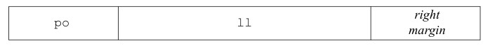

nroff 프로그램의 기본 줄 길이인 6.5인치는 8½×11 페이지의 경우 상당히 표준적인 값으로, 이를 통해
양쪽에 1인치의 여백을 확보할 수 있습니다.
페이지 양쪽에 1¼인치의 여백을 두고 싶다고 가정할 때, 다음과 같은
명령을 입력하면 됩니다:
.ll 6i
.po 1.25i
이렇게 하면 좌우 여백이 모두 1¼인치가 됩니다. .po 명령은 왼쪽 여백, 즉
페이지 오프셋을 1¼인치로 지정합니다. 여기에 6인치 줄 길이가 더해지면 페이지
오른쪽에도 비슷한 여백이 남게 됩니다.
이제 예제 편지가 어떻게 서식이 지정되는지 살펴보겠습니다. 출력된 한 단락만 봐도
대략적인 내용을 파악할 수 있을 것입니다.

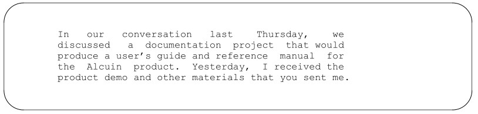

앞서 살펴본 바와 같이, nroff는 기본 페이지 오프셋을 0으로 가정합니다. 사용자나 사용 중인 매크로 패키지가
페이지 오프셋을 설정해야 합니다. 반면 troff에는 26/27인치의 기본 페이지 오프셋이 있으므로, 이 값을
별도로 설정하지 않아도 됩니다.
(모든 nroff 출력 예제는 실제로 troff로 시뮬레이션된 것이며,
5인치 너비의 인쇄용 페이지에 맞도록 축소되었다는 점을 유의하십시오. 그 결과, 예제 출력에 표시된 너비는 정확하지는
않지만, 8½×11인치 페이지에서 실제 결과가 어떻게 나올지 가늠할 수 있게 해줍니다).


### Setting Indents

기본 페이지 오프셋(왼쪽 여백) 외에도, 한 줄 또는
전체 텍스트 블록에 들여쓰기를 설정할 수 있습니다. 또한 한 줄 이상의 텍스트를 중앙 정렬할 수도 있습니다.
단락의 서두에 흔히 사용되는 것처럼 한 줄만 들여쓰기를 하려면 .ti(임시 들여쓰기)
명령을 사용합니다. 예를 들어, 샘플 편지의 단락 사이에 있는 빈 줄 뒤에
.ti 5 명령을 입력하면 nroff에서 다음과 같은 결과를 얻을 수 있습니다:

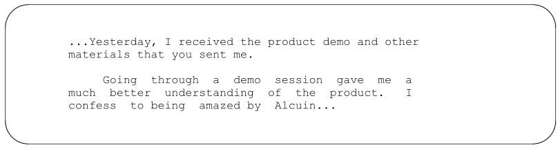

반면, .in 명령어는 변경될 때까지 유지되는 들여쓰기를 설정합니다. 예를 들어,
단락 사이에 .ti 5 대신 .in 5를 입력했다면, 결과는
다음과 같이 표시되었을 것입니다:

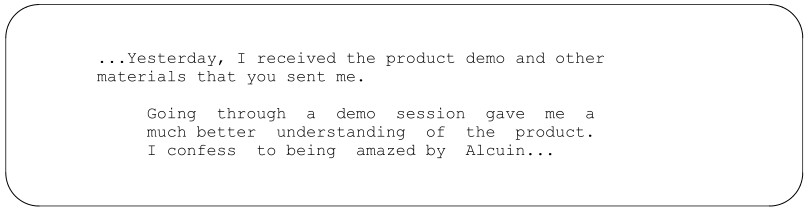

들여쓰기가 재설정될 때까지 그 이후의 모든 단락은 계속해서 들여쓰기가 적용됩니다. 기본 들여쓰기(
왼쪽 여백의 값)는 0입니다.
이 두 가지 들여쓰기 지시를 결합하면 “매달린 들여쓰기”를 만들 수 있습니다. 숫자 인자를 받는 많은 지시에서는
음수 값을 지정할 수 있다는 점을 기억하십시오. 다음은 이것이
의미를 갖는 첫 번째 사례입니다. 편지를 수정하여 각 항목에 번호를 매기고, 번호가 매겨진 단락의 본문을
들여쓰도록 하고 싶다고 가정해 봅시다:

```
...Yesterday, I received the product demo and other materials
that you sent me. After studying them, I want to clarify
a couple of points:
.in 4
.ti -4
1. Going through a demo session gave me a much better
understanding of the product. I confess to being amazed by
Alcuin...
```

첫 번째 줄은 여백에서 시작하고, 그 다음 줄들은 들여쓰기됩니다:

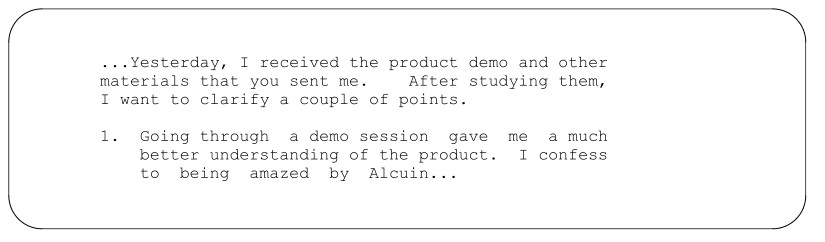

nroff에서 이와 같이 들여쓰기된 단락을 정렬하려면, 간격을 두고 싶은 문자 수를 세고
그 수를 들여쓰기 크기로 사용하면 됩니다. 하지만 troff에서는 이 방법이 그리 간단하지 않습니다.
문자나 공백조차도 너비가 일정하지 않기 때문에, 매달린 들여쓰기를 만드는 것이 더 어렵습니다. Ens는
들여쓰기에 사용하기 좋은 단위입니다. em과 마찬가지로 ens도 포인트 크기에 상대적이지만, em보다
평균 문자 너비에 훨씬 더 가깝습니다. 그 결과, ens를 사용하는 것이 비교적 직관적입니다. 5n의 들여쓰기는
타자기에 익숙한 사람이라면 5자 들여쓰기가 있을 법한 위치와 거의 일치합니다.


### Centering Output Lines

중앙 정렬은 또 다른 유용한 레이아웃 도구입니다. 다음 줄을 중앙에 정렬하려면 .ce 요청을 사용하세요:

```
.ce
This line will be centered.
```

결과는 다음과 같습니다:

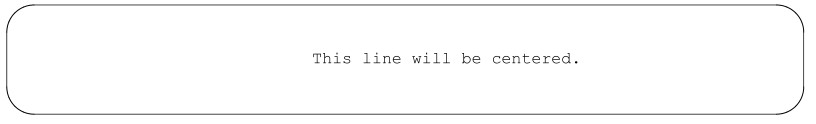

중앙 정렬은 적용된 모든 들여쓰기를 고려합니다. 즉, .in을 사용하여 1인치 들여쓰기를 지정했고
줄 길이가 5인치인 경우, 텍스트는 들여쓰기 이후 4인치 구간 내에서 중앙에 정렬됩니다.
여러 줄을 중앙에 정렬하려면 요청의 인수로 숫자를 지정하십시오:

```
.ce 3
Documentation for the Alcuin Product
A Proposal Prepared by
Fred Caslon
```

결과는 다음과 같습니다:

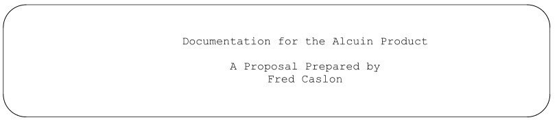

.ce 명령어는 중간에 있는 빈 줄을 무시하고 세 줄의 텍스트를 모두 중앙 정렬했다는 점에 유의하세요.
정확히 알 수 없는 수의 줄을 중앙 정렬하려면, .ce 명령어에 매우 큰 숫자를 지정한
다음, .ce 0을 입력하여 이 기능을 해제하세요:

```
.ce 1000
Many lines of text here.
.ce 0
```

예제를 살펴보시면, 중앙 정렬을 적용하면 자동으로 채우기와 양쪽 정렬이 비활성화된다는 점을 눈치채셨을 것입니다.
각 줄은 개별적으로 중앙 정렬됩니다. 하지만, 채우기와 양쪽 정렬이 적용된 전체 단락을
중앙에 정렬하고 싶은 경우도 있습니다. (이 단락 스타일은 책이나 논문에서 인용문을
구분하는 데 자주 사용됩니다.) 이를 위해서는 .in 및 .ll 명령을 함께 사용하면 됩니다:

```
I was particularly interested by one comment that I
read in your company literature:
.in +5n
.ll -5n
The development of Alcuin can be traced back to our
founder’s early interest in medieval manuscripts.
He spent several years in the seminary before
becoming interested in computers. After he became
an expert on typesetting software, he resolved to
put his two interests together.
.in -5n
.ll +5n
```

결과는 다음과 같습니다:

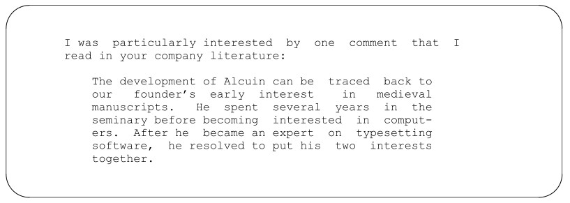

.ce를 사용하여 줄을 중앙 정렬할 때는 그 시점에 적용 중인 모든 들여쓰기가 반영된다는 점을 기억하십시오. 페이지 오프셋, 줄 길이, 들여쓰기, 중앙 정렬 간의 관계를 다음과 같이
시각화할 수 있습니다:

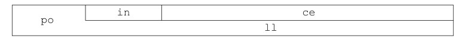


### Setting Tabs

텍스트 정렬 방법에 대한 논의에서 탭에 대한 설명을 빼놓을 수는 없습니다. 타자기를 사용해 본 사람이라면 누구나
잘 알다시피, 탭이란 줄 위에서 미리 정의된 위치로 수평 이동하는 것을 말합니다.
nroff와 troff에서 탭을 사용할 때의 문제는 화면에 표시되는 내용이 인쇄된 페이지의 결과물과 매우
다르다는 점입니다. 타자기나 WYSIWYG 워드 프로세서와 달리, 편집기/포맷터
조합은 두 가지 다른 탭 설정을 제공합니다. vi에서 탭을 설정할 수도 있고,
nroff와 troff에서도 설정할 수 있지만, 설정값은 서로 다를 가능성이 높으며, 화면에 표시되는 결과는 확실히
미관상 좋지 않습니다.
하지만 화면상의 탭이 인쇄된 페이지에서와 같은 방식으로 정렬되지 않는다는 사실에 익숙해지면,
탭을 꽤 효과적으로 사용할 수 있습니다.
기본적으로 nroff에서는 0.8인치마다, troff에서는 0.5인치마다 탭 정지점이 설정됩니다. nroff나 troff에서
자신만의 탭 정지점을 설정하려면 .ta 명령을 사용하십시오. 예를 들어:
.ta 1i 2.5i 3i
는 각각 1인치, 2½인치, 3인치에 세 개의 탭 정지점을 설정합니다. 이전 설정이나 기본 설정은
이제 더 이상 적용되지 않습니다.
증분 탭 정지점을 설정할 수도 있습니다. 다음 명령을 사용하면 됩니다:
.ta 1i +1.5i +.5i

이전 예제와 동일한 위치에 탭을 설정합니다. 더하기 기호가 앞에 붙은 값은
nroff 및 troff 67
마지막 탭 정지점의 값에 더해집니다.
탭 정지 위치에서 텍스트의 정렬 방식도 지정할 수 있습니다. 숫자 값만 사용하여 설정한 경우
타자기에서와 마찬가지로 왼쪽 정렬됩니다. 그러나 탭 정지 정의에 문자 R 또는 C를 추가하면
텍스트를 해당 정지 위치에서 오른쪽 정렬하거나 중앙 정렬할 수 있습니다.
예를 들어, 다음 입력 줄(여기서 탭 문자는 |——| 기호로 표시됨)은:

```
.nf
.ta 1i 2.5i 3.5i
|——|First|——|Second|——|Third
.fi
```

다음과 같은 출력을 생성합니다:

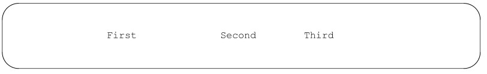

하지만:
.nf
.ta 1i 2.5iR 3.5iC
|——|First|——|Second|——|Third
.fi
다음과 같은 결과가 나옵니다:

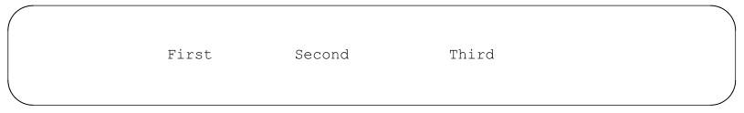

오른쪽 정렬 탭은 숫자 데이터를 정렬하는 데 유용할 수 있습니다. 특히 troff의 경우,
모든 문자(공백 포함)의 크기가 서로 다르기 때문에, 단순히 눈대중으로
정렬할 수 없습니다. 정렬하려는 숫자의 소수점 자릿수가 고르지 않은 경우, 특수 이스케이프 시퀀스 \0을 사용하여
수치 데이터를 수동으로 오른쪽 정렬하도록 강제할 수 있습니다. 이 시퀀스는 숫자 한 자의 너비와
정확히 동일한 너비의 공백을 생성합니다. 예를 들어:

```
.ta 1iR
|——|500.2\0
|——|125.35
|——|50.\0\0
```

다음과 같은 결과가 출력됩니다:

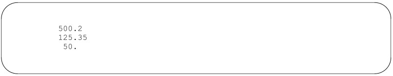

타자기와 마찬가지로, 이미 탭 위치를 지나간 상태(문자 입력,
들여쓰기 또는 기타 수평 이동으로 인해)라면, 입력된 탭은 텍스트를 다음 사용 가능한 탭
정지 위치로 밀어냅니다. 마지막 탭 정지 위치를 지나간 경우, 입력된 탭은 무시됩니다.

탭이 올바르게 작동하려면 ‘no-fill’ 모드에 있어야 합니다. 이는 단순히 채우기 기능이 탭의 효과를
무효화하기 때문만은 아닙니다. 탭을 지정할 때 .nf를 사용하는 것은 중요한 경험칙입니다. 이에 대한
이유는 15장에서 살펴보겠습니다.


### Underlining

nroff에서 강조의 주요 방식 중 하나인 텍스트 밑줄 긋는 방법에 대해서는 아직 설명하지 않았습니다. nroff에는
강조를 위해 글꼴을 변경하는 troff의 기능이 없습니다.
밑줄 긋기 명령어로는 .ul(밑줄)과 .cu(연속 밑줄) 두 가지가 있습니다. .ul 명령어는
인쇄 가능한 문자(단어만 해당하며 공백은 제외)에만 밑줄을 긋고, .cu는 전체
텍스트 문자열에 밑줄을 긋습니다.
이 명령어들은 .ce와 똑같이 사용됩니다. 인수를 지정하지 않으면 다음
입력 줄의 텍스트에 밑줄을 그립니다. 숫자 인수를 사용하여 한 줄 이상에 밑줄을 그릴 수 있습니다.
이 두 명령어는 troff에서는 밑줄 대신 이탤릭체를 생성합니다. 비록 밑줄 글꼴을 이탤릭체 이외의 다른 글꼴로 재설정할 수 있는
.uf 명령어가 있기는 하지만*, troff에서도
이 명령어들이 밑줄을 표시하도록 하는 방법은 없습니다. (ms 및 mm 매크로 패키지에는 모두 troff에서 밑줄을
표시하는 매크로가 포함되어 있지만, 이는 완전히 다른 메커니즘을 사용하며, 이에 대한 설명은
15장에서 다루게 됩니다).


### Inserting Vertical Space

보셨듯이, 입력 텍스트에 빈 줄이 있으면 출력에도 빈 줄이 생깁니다. 입력 텍스트에 빈 줄을 여러 개
삽입하면 페이지에 빈 공간(예를 들어, 편지 끝인사와 서명 사이)을 남길 수 있습니다.
하지만, 특히 샘플 편지처럼 기존 파일을 수정하기 위해 뒤로 돌아가서
포맷팅 코드를 입력하는 대신, 작성하는 도중에 바로 포맷팅 코드를 입력할 때는 .sp
요청을 사용하여 간격을 지정하는 것이 더 편리한 경우가 많습니다.
예를 들어, 다음과 같이 입력할 수 있습니다:

```
Sincerely,
.sp 3
Fred Caslon
```

troff에서는 .sp 요청이 훨씬 더 중요합니다. troff는 공백을 훨씬 더 미세한 단위로 조절할 수 있기 때문입니다.
예를 들어, troff로 편지를 서식 지정할 때, 단락 사이에 전체 공백을 넣으면
다음과 같이 표시됩니다:

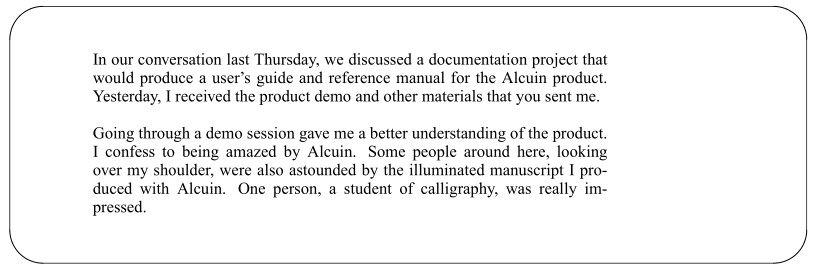

* 이 요청은 일반적으로 문서가 Times Roman 이외의 글꼴 패밀리로 조판될 때 사용됩니다.
표준 이탤릭체 대신 “밑줄 글꼴”을 Helvetica Italic으로 설정하는 데 사용될 수 있습니다.

줄 간격을 조금만 줄이면 출력 결과가 더 보기 좋을 것입니다. 단락 사이의 줄 간격을 .sp .5로
설정하면 다음과 같은 결과가 나옵니다:

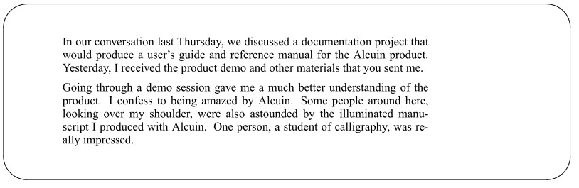

이 기능이 어떻게 유용할지 아직 명확하지 않을 수도 있지만, 거리 값 앞에 수직 막대 기호를 삽입하면
페이지 내의 특정 위치로 간격을 조정할 수도 있습니다. 예를 들어, 다음 코드:
.sp |3i
는 현재 위치에서 3인치 떨어진 곳이 아니라, 페이지 상단에서 3인치 떨어진 위치까지 아래로 간격을
조정합니다.
일반적인 상대적 간격 지정 시 음수 값을 사용할 수도 있습니다. 예를 들어:
.sp -3
은 페이지에서 세 줄 위로 이동합니다. 물론, 이러한 지정을 사용할 때는
무엇을 하고 있는지 정확히 알고 있어야 합니다. nroff나 troff에 한 줄을 다른 줄 위에 배치하라고 지시하면, 정확히
그대로 결과가 나옵니다. 예를 들어:

```
This is the first line.
.sp -2
This is the second line.
.br
This is the third line.
```

다음과 같은 결과가 나옵니다:

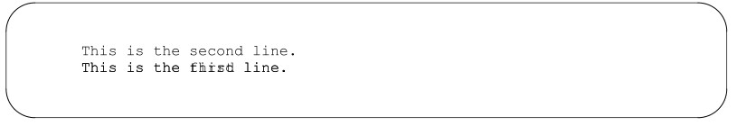

예상대로 두 번째 줄이 첫 번째 줄 위에 출력되지만, 원래 위치를 복원하지 않았기
때문에 세 번째 줄은 첫 번째 줄 위에 출력됩니다.
수직 방향으로 음의 이동을 수행할 때는 항상 상쇄할 수 있는 양의 이동을 함께 수행해야
합니다. 그래야 향후 출력 시 올바른 위치에 도달할 수 있습니다. 앞서 예시한 코드는 다음과 같이 작성했다면
이러한 문제를 피할 수 있었을 것입니다:

```
This is the first line.
.sp -2
This is the second line.
.sp
This is the third line.
```

(이 경우, 두 번째 줄을 출력하면 위로 이동한 간격 중 하나가 ‘소모’되므로, 위로 이동한 줄 수보다 한 줄 적은 간격으로 아래로 이동해야 한다는 점에 유의하십시오).

이러한 종류의 수직 이동은 일반적으로 선 그리기(예: 표 주위에 상자를
그리는 경우)에 사용되며, 이때 모든 텍스트가 출력된 후 포맷터가 페이지 위로 다시 이동하여 선을 그립니다.
현재 단계에서는 이 기능을 당장 활용할 기회가 거의 없을 것입니다. 그럼에도 불구하고, 이 기능이
있다는 사실을 아는 창의적인 사람이라면, 어떤 작업에 딱 맞는 도구로 활용할 수 있을 것이라고 확신합니다. (나중에 저희가 직접
고안한 몇 가지 창의적인 활용법을 보여드리겠습니다).
조판기가 페이지 위쪽으로 되돌아가서 작업할 수 있다는 사실에 놀라지 않으실 겁니다. 하지만
타자기식 프린터가 어떻게 이렇게 페이지 위쪽으로 되돌아가서 작업할 수 있는지 궁금하실 수도 있습니다. 정답은 ‘불가능하다’는 것입니다. 역방향
줄 이동(표준 패키지의 특정 매크로나 tbl 및 eqn 전처리기를
사용할 때 발생합니다)을 수행하려면, nroff 출력을 col이라는 특수 필터 프로그램을 통해 처리하여 모든
이동 명령을 미리 정렬해야만 페이지가 원하는 순서대로 인쇄됩니다:
$ nroff files | col | lp


### Double or Triple Spacing

nroff와 troff 모두 각 줄 사이의 간격을 개별적으로
조정하지 않고도 줄 간격을 2배 또는 3배로 설정할 수 있는 기능을 제공합니다. 예를 들어:
.ls 2
이 명령을 파일 맨 위에 넣으면 줄 간격이 2배로 설정됩니다. 인수를 3으로 지정하면 줄 간격이
3배로 설정됩니다.


## Page Transitions

한 페이지 분량의 편지 상단에 여백을 두고 싶다면, 본문 첫 줄 앞에
.sp 1i
명령을 삽입하기만 하면 됩니다. 하지만 nroff와 troff는 여러 페이지로 구성된 문서에서 페이지
전환을 처리할 수 있는 간편한 방법을 제공하지 않습니다.
기본적으로 nroff와 troff는 페이지 길이를 11인치로 가정합니다. 하지만 두 프로그램 모두
이 정보를 즉시 활용하지는 않습니다. 기본 상단 및 하단 여백이 설정되어 있지 않으므로, 텍스트 출력은
첫 번째 줄에서 시작하여 페이지 끝까지 이어집니다.
.bp(페이지 나누기) 명령을 사용하면 강제로 페이지 나누기를 할 수 있습니다. 이렇게 하면
현재 페이지의 나머지 부분은 빈 줄로 채워지고, 출력은 두 번째 페이지 상단에서 다시 시작됩니다. 이를
직접 테스트해 보고 싶다면, 예제 편지의 텍스트 어디에나 .bp를 삽입한 다음 nroff로 편지를 처리해 보십시오.
결과물을 파일로 저장하면:
$ nroff letter > letter.out
.bp 뒤에 나오는 텍스트가 67번째 줄에서 시작된다는 것을 알 수 있습니다(인치당 6줄일 때 11인치는 페이지당 66줄에
해당합니다).
각 페이지의 상단과 하단에 자동으로 여백을 두려면 .wh(when) 명령을
사용해야 합니다. nroff와 troff 용어로 말하자면, 이 요청은 트랩(trap)을 설정하는 것으로, 페이지 상에서 특정
매크로가 실행될 위치를 지정합니다.
여기서 ‘요청’이 아니라 ‘매크로’라고 언급한 점에 주목하십시오. 바로 여기에 문제가 있습니다. .wh를 사용하려면 매크로를
정의하는 방법을 알아야 합니다. 단일 요청으로는 작동하지 않습니다.

하지만 매크로를 정의하는 것은 그리 복잡한 일이 아닙니다. 매크로는 단순히 저장된 일련의
명령으로, 단일 명령으로 한 번에 모두 실행할 수 있습니다. 매크로 정의 과정을 살펴본 후,
나중에 이 부분에 대해 다시 다루겠습니다.
우선, 상단 여백을 처리하는 명령이 포함된 매크로 하나와 하단 여백을 처리하는 매크로 하나,
총 두 개의 매크로를 정의했다고 가정해 봅시다. 첫 번째 매크로는 .TM으로, 두 번째는
.BM으로 명명하겠습니다. (관례상, 매크로 이름은 대문자로만 구성되는 경우가 많습니다. 이는
기본 nroff 및 troff 요청과 구별하기 위함입니다. 71
그러나 이는 단지 관례일 뿐이며, 항상
지켜지는 것은 아닙니다).
이 매크로들을 실행할 트랩을 설정하려면 다음과 같이 .wh 요청을 사용합니다:
.wh 0 TM
.wh -1i BM
.wh의 첫 번째 인수는 매크로를 실행할 페이지의 수직 위치를 지정합니다. 인수
0은 항상 페이지 상단을 의미하며, 음수 값은 페이지 길이에 따라 정의된 페이지 하단
부터 계산됩니다.
가장 간단한 형태에서 .TM 매크로는 1인치 아래로 간격을 두는 단일 요청만 포함하면 되고,
.BM은 새 페이지로 넘어가는 단일 요청만 포함하면 됩니다. 만약 .wh가 매크로 대신 단일 요청을
지정할 수 있게 한다면, 이는 다음과 동일합니다:
.wh 0 .sp 1i
.wh -1i .bp

페이지 길이가 11인치라면, 실제 사용 가능한 텍스트 영역은 9인치가 됩니다. 왜냐하면 모든 페이지에서
포맷터는 가장 먼저 1인치만큼 아래로 간격을 띄우고, 하단에서 1
인치 떨어진 지점에 도달하면 새 페이지로 넘어가기 때문입니다.
왜 nroff와 troff가 다른 필수적인 페이지 레이아웃 작업들보다 페이지 전환 작업을 더
복잡하게 만들었는지 궁금할 수 있습니다. 그 이유는 두 가지입니다:
• nroff와 troff 프로그램은 조판의 전통을 염두에 두고 설계되었습니다. 꽤
최근까지 대부분의 조판사는 인화지 롤이나
필름에 연속적인 출력을 생성했습니다. 이 출력은 수작업으로 잘라내어 페이지에 붙여넣었습니다.
• 특히 troff에서 페이지 전환은 앞서 설명한 다른 작업들보다 본질적으로 더 복잡합니다.
예를 들어, 책에는 종종 서로 다른 글자 크기나 서체로 설정된 머리글과 바닥글이
포함되어 있습니다. 페이지 전환이 있을 때마다 소프트웨어는 현재 글자 서식에 대한 정보를
자동으로 저장하고, 머리글이나 바닥글에 사용되는 서식으로 전환한 다음, 본문으로 돌아올 때
원래 서식으로 되돌려야 합니다. 또는 각주 문제를 생각해 봅시다.
각주가 있는 페이지에서는 페이지 끝나는 위치가 달라집니다. 페이지 전환
트랩은 이러한 점을 어느 정도 고려해야 합니다.
요컨대, 페이지 전환 시 포맷터가 수행하기를 바라는 작업은 다양할 수 있습니다. 이러한 이유로,
nroff와 troff의 개발자들은 사용자가 이 부분을 처리하기 위해 자신만의 매크로를 정의할 수 있도록 했습니다.

nroff나 troff를 처음 사용할 때는 미리 만들어진 매크로 패키지 중 하나인
ms나 mm을 사용하는 것이 좋습니다. System V 기반 UNIX 시스템의 표준 매크로 패키지는 mm이며,
버클리 UNIX 시스템의 표준은 ms입니다. 버클리 UNIX 시스템은 me라는 세 번째 매크로 패키지도 지원합니다. 이
외에도 뷰그래프, 표준 UNIX 참조 매뉴얼
페이지(man), UNIX 순서 변경 인덱스(mptx)를 서식 지정하기 위한 특수한 매크로 패키지들이 있습니다. 이
책에서는 ms와 mm 패키지에 대해서만 설명합니다. 매크로 패키지들은 페이지 전환
(및 기타 고급 서식 지정 문제)에 수반되는 많은 복잡한 사항들을 이미 고려하고 있으며, 직접 설계하려면 상당한 시간과
노력이 소요될 수많은 기능을 제공합니다.
물론, 독자적으로 매크로 패키지를 설계하는 것도 충분히 가능하며, 이에 대한 모든 세부 사항은
나중에 다루겠습니다. (사실, 이 책은 표준 매크로 패키지 중 어느 것도 사용하지 않고, 이 시리즈의 자문 편집자인
Pipeline Associates의 Steve Kochan과 Pat Wood가 Hayden UNIX 라이브러리와 함께 사용하기 위해 특별히
개발한 매크로 패키지를 사용하여 작성되었습니다.)


### Page Length Revisited

매크로를 자세히 살펴보기 전에, 잠시 시간을 내어 페이지 길이,
페이지 나누기 등에 대해 몇 가지 더 설명해 보겠습니다.
페이지 전환을 처리하기 위한 조치가 이미 마련되어 있다고 가정할 때, 앞서 소개한 요청 사항들에는 몇 가지
세부 사항이 더 있으며, 여러분이 유용하게 사용할 수 있을
몇 가지 새로운 요청 사항도 있습니다.
먼저, 페이지 길이에 대해 이야기해 봅시다. 인쇄 영역은 페이지 길이와 사용자가 정의한 트랩의 위치가
상호작용하여 결정된다는 점을 기억하는 것이 중요합니다. 예를 들어, (이 책의 원고를 준비할 때와 같이) 높이 7.5인치의 텍스트
영역을 다음과 같은 방법으로 정의할 수 있습니다.
• 페이지 길이를 9.5인치로 변경하고, 상단과 하단에 1인치 여백을 설정하거나;
• 페이지 길이를 11인치로 유지한 채 상단과 하단에 1.75인치 여백을 설정하는 방법.
일반적으로 우리는 .pl을 용지 길이를 설정하는 것으로 간주하고, 페이지 전환 트랩을 사용하여
여백을 더 넓히거나 좁히는 방식을 선호합니다.

하지만 실제로는 다른 용지 크기를 사용하는 경우도 있습니다. 이에 대한 좋은 예로
봉투에 주소를 인쇄하는 경우를 들 수 있습니다. 용지의 실제 높이는 약 4인치(인치당 6줄을 인쇄하는 타자기
형 프린터의 경우 24줄)이며, 우리는 4~
5줄로 구성된 좁은 영역에 인쇄하고자 합니다. 이 경우에 적합한 정의 세트는 다음과 같습니다.
.pl 4i
.wh 0 TM
.wh -9v BM
여기서 .TM에는 .sp 9v 요청이 포함되며, .BM에는 앞서와 마찬가지로 .bp가 포함됩니다.
트랩에 대해 더 설명할 내용이 있지만, 나중에 다루면 더 이해하기 쉬울 것이므로 이 주제는 당분간 미루겠습니다.


### Page Breaks without Line Breaks

페이지 나누기—이전에는 페이지 전환 트랩에서 페이지 나누기를 사용하는 방법에 대해 다루었지만, 페이지 나누기 자체만으로도 흔히 사용되는 용도가 있습니다.
종종 페이지가 정상적으로 끝나는 지점보다 앞서 페이지를 나누고 싶을 때가 있습니다. 예를 들어, 페이지
나누기가 단락의 첫 줄 바로 뒤에서 이루어진다면, “고아 줄”이 생기는 것을 방지하기 위해 해당 줄을 다음 페이지로 강제로 넘기기를
원할 것입니다. 또는 삽화를 넣기 위해 페이지 하단에 빈 공간을
남기고 싶을 수도 있습니다. 이렇게 하려면 원하는 위치에 .bp를 입력하기만 하면 됩니다. 그러면 즉시
새 페이지가 시작됩니다.
하지만 다음 페이지 상단에 “과부 줄”이 생기는 것을 방지하기 위해
단락 중간에 강제로 페이지 나누기를 해야 하는 경우를 생각해 보십시오. 이 경우 다음과 같이 하면 됩니다:

```
The medieval masters of calligraphy and illumination
are largely unknown to us. We thankfully have examples
of their work, and even
.bp
marginal notes by the copyists of some manuscripts,
but the men who produced these minute masterpieces
are anonymous.
```

.bp 요청 역시 줄 바꿈을 유발하며, 텍스트가 제대로 채워지지 않습니다:

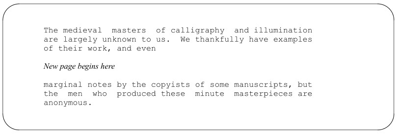

다행히도 이 문제를 해결할 방법이 있습니다. 요청을 마침표 대신 아포스트로피로 시작하면,
해당 요청으로 인해 줄 바꿈이 발생하지 않습니다.

```
The medieval masters of calligraphy and illumination
are largely unknown to us. We thankfully have examples
of their work, and even
’bp
marginal notes by the copyists of some manuscripts,
but the men who produced these minute masterpieces
are anonymous.
```

이제 원하는 결과를 얻었습니다:

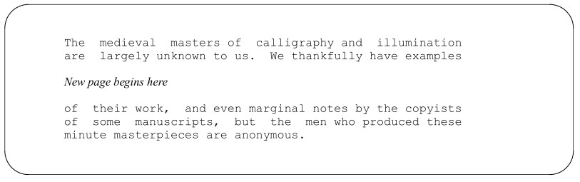

(사실, 대부분의 페이지 전환 매크로는 이 기능을 사용하여 단락이 페이지 경계를 넘어 이어지도록 합니다.
이에 대해서는 후반부 챕터에서 더 자세히 살펴보겠습니다).
또 다른 매우 유용한 명령은 조건부 페이지 나누기, 즉 .ne(need) 명령입니다.
텍스트 블록 전체가 같은 페이지에 표시되도록 하려면, 남은 공간이 충분하지 않을 때
이 명령을 사용하여 강제로 페이지 나누기를 할 수 있습니다. 공간이 충분하면 이 명령은 무시됩니다.
예를 들어, 다음 두 명령:
.ne 3.2i
.sp 3i
는 높이 3인치인 삽화를 삽입할 빈 공간을 확보하는 데 사용될 수 있습니다.
.ne 요청은 페이지 나누기를 유발하지 않으므로, .ne가 실행될 때 현재 줄 버퍼의 잔여 부분이 다음 페이지로
이월되는 것을 원치 않는다면, 반드시 그 앞에 .br이나 페이지 나누기를 유발하는 다른
요청을 배치해야 합니다.
특정 지점에서 항상 페이지 나누기를 원한다고 확신하지 않는 한, .bp 대신 .ne를 사용하는 것이 종종 더 좋습니다. 편집 과정에서 .ne 명령이 페이지 하단에서
멀어지면 아무런 효과가 없습니다. 반면 .bp는 항상 새 페이지를 시작하므로, 파일의 텍스트가 크게 변경된 경우 때로는 페이지가 거의
비어 있는 상태로 남게 될 수 있습니다.

이 목적을 위해 사용할 수 있는 다른 특수 공간 할당 요청도 있습니다. (매크로
패키지에 따라 이러한 요청을 사용해야 할 수도 있습니다.) 예를 들어, .sv(공간 확보)는 연속된 공간 블록을 요청합니다.
페이지의 나머지 부분에 요청된 양만큼의 여백이 포함되어 있지 않으면 여백이 출력되지 않습니다. 대신,
요청된 여백의 양은 기억되어 .os(저장된 여백 출력) 요청이
발생할 때 출력됩니다.
이것들은 고급 요청이지만, 대부분의 매크로 패키지가
페이지 전환 매크로에 .ns(여백 없음)와 .rs(여백 복원)라는
두 가지 다른 여백 요청을 포함하고 있으므로 이에 대해 알아둘 필요가 있습니다. .ns는 간격 요청의 효과를 억제하고, .rs는 그러한 요청의 효과를 복원합니다.
ms 및 mm 매크로 모두 페이지 전환 매크로에 .ns 요청을 포함하고 있습니다. 따라서 다음과 같은
요청을 실행하면:
.sp 3i

페이지 하단까지 1인치가 남아 있는 경우, 하단에 1인치가 남고 다음 페이지 상단에 2인치가
남는 것이 아니라, 하단에 남은 공간만 남게 됩니다. 다음 페이지는 맨 위에서 바로 시작됩니다.

하지만 두 매크로 패키지 모두 페이지 상단 매크로에 .os 요청을 포함하고 있으므로, 정말로 3
인치를 원한다면 .sv 3i를 사용하면 예상한 결과를 얻을 수 있습니다.
하지만 .sv를 사용하면 또 다른 예상치 못한 결과가 발생합니다. 간격 지정 명령 뒤에 오는 텍스트가
그 명령 앞쪽으로 “떠서” 현재 페이지의 남은 공간을 채우게 됩니다.
이에 대해서는 나중에 더 자세히 다루겠습니다. 간격 지정 명령이
항상 예상대로 작동하지 않을 때 혼란을 방지하기 위해 지금 미리 소개해 드린 것입니다.


### Page Numbering

nroff 및 troff 프로그램은 페이지 번호를 추적하며, 현재 페이지 번호를
출력할 수 있도록 합니다(일반적으로 페이지 전환 매크로를 통해). 다음의
.pn 명령을 사용하여 페이지 번호를 임의로 설정할 수 있습니다:
.pn 5 현재 페이지 번호를 5로 설정
.pn +5 현재 페이지 번호를 5 증가
.pn -5 현재 페이지 번호를 5 감소
또한 .bp 명령을 실행할 때마다 숫자 인수를 추가하는 것만으로
다음 페이지 번호를 임의로 설정할 수 있습니다:
.bp 5 페이지 분할을 수행하고 다음 페이지 번호를 5로 설정
.bp +5 페이지 분할을 수행하고 다음 페이지 번호를 5 증가
.bp -5 페이지 분할을 수행하고 다음 페이지 번호를 5 감소
.sp를 비활성화하는 것 외에도, .ns 명령은 페이지 번호가 지정되지 않은 경우 .bp의 동작을 비활성화합니다.
이는 (적어도 기존 매크로 패키지에서) 다음과 같은 명령어 순서가
.bp
.bp

이렇게 하면 빈 페이지가 출력되지 않습니다. 마치 단순한 .bp만 지정한 것과
같은 결과가 나옵니다. 대신 다음과 같이 지정해야 합니다:
.bp +1
시작 페이지 번호(보통 1)는 -n 옵션을 사용하여 명령줄에서 설정할 수도 있습니다. 예를 들어,
다음과 같이 입력하면:
$ nroff -ms -n10 file
file의 페이지 번호 매기기가 10페이지부터 시작됩니다. 또한, 출력의 선택된 페이지만 인쇄하는
명령줄 옵션도 있습니다. -o 옵션은 인자로 페이지 번호 목록을 받습니다. 파일 전체(목록에 있는 마지막 페이지 번호까지)가 처리되지만, 지정된 페이지만 출력됩니다. 목록에는 쉼표로 구분된 개별 페이지나, 하이픈으로 구분된 페이지 범위, 또는 둘 다를 포함할 수 있습니다. 숫자 뒤에 하이픈이
따르는 경우, 해당 페이지부터 끝까지 출력함을 의미합니다. 예를 들어:
$ nroff -ms -o1,5,7-9,13- file
$ nroff -ms -o1,5,7-9,13- file
이 명령은 1, 5, 7부터 9까지, 그리고 13부터 파일 끝까지의 페이지를 출력합니다. 목록 내에는 어디에도 공백이
없어야 합니다.


## Changing Fonts

otroff에서는 .fp(글꼴 위치) 요청을 통해 사용 중인 기본 글꼴을 지정해야 했습니다.
일반적으로 파일의 맨 앞부분(또는 대부분 매크로 패키지 내)에서 이 요청을 사용하여
조판 휠의 네 사분면(위치) 각각에 어떤 글꼴이 장착될지 지정합니다. 기본적으로
로만체 글꼴은 위치 1에, 이탤릭체 글꼴은 위치 2에, 굵은체 글꼴은 위치 3에, 특수
글꼴은 위치 4에 장착됩니다. 즉, troff는 마치 다음 줄들을 포함시킨 것처럼 동작합니다:
.fp 1 R
.fp 2 I
.fp 3 B
.fp 4 S
ditroff에서는 최대 10개의 글꼴이 자동으로 장착되며, 특수 글꼴은 10번 위치에 배치됩니다. 어떤 글꼴이
어떤 위치에 장착되는지는 출력 장치에 따라 다릅니다. 자세한 내용은 부록 D를 참조하십시오. 1번 위치에
마운트된 글꼴은 본문 텍스트의 글꼴로 사용됩니다. 즉, 별도의
지정이 없는 경우 이 글꼴이 사용됩니다. 또한 일반 문자 집합에 없는 문자가 요청될 때
사용자의 별도 조작 없이도 특수 글꼴이 사용됩니다.
다른 글꼴 중 하나를 요청하려면 .ft 요청을 사용하거나, 인라인 글꼴 전환 이스케이프
시퀀스 \f를 사용할 수 있습니다.
예를 들어:

```
.ft B
This line will be set in bold type.
.br
.ft R
This line will again be set in roman type.
```

다음과 같은 결과가 출력됩니다:

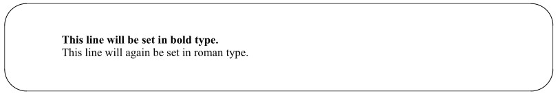

인라인 글꼴 이스케이프 시퀀스를 사용하여 글꼴을 변경할 수도 있습니다. 예를 들어, 앞 문장은
다음과 같이 코딩되었습니다:

```
...an inline font \fIescape sequence\fP.
```

끝부분에 \fR 대신 \fP가 있는 것을 보고 의아해하실 수도 있습니다. P 명령어는 .ft 요청이나 \f 이스케이프 시퀀스와 함께 사용할 수 있는
특수 코드입니다. 이는 “이전의 글꼴이 무엇이든 간에 그 글꼴로 되돌아가라”는
뜻입니다. 이 방법은 더 일반적이기 때문에 명시적인 글꼴 요청보다 종종 선호됩니다.
이 모든 내용은 Times Roman, Bold, Italic 이외의 글꼴에 대한 의문을 제기합니다. 여기에는 두 가지
문제가 있습니다. 첫째, 출력 장치에서 어떤 글꼴을 사용할 수 있는지, 둘째, troff가 어떤 글꼴에 대한
폭 테이블을 가지고 있는지입니다. (앞서 설명했듯이, troff는 각 문자를 출력한 후 다음 문자로 넘어갈 때까지의
간격을 결정하기 위해 이러한 테이블을 사용합니다). otroff의 경우, 이러한 너비 테이블은 /usr/lib/font 디렉터리에 있으며, 파일
이름이 ft로 시작하는 파일들에 저장되어 있습니다. 이 디렉터리의 내용을 나열해 보면, otroff의 경우 다음과 같은 내용을 볼 수 있습니다:
$ ls /usr/lib/font
ftB  ftBC ftC  ftCE ftCI
ftCK ftCS ftCW ftFD ftG
ftGI ftGM ftGR ftH  ftHB
ftHI ftI  ftL  ftLI ftPA
ftPB ftPI ftR  ftS  ftSB
ftSI ftSM ftUD
익숙한 R, I, B, S 글꼴을 찾아볼 수 있으며, ftH, ftHI, ftHB는 각각 Hel-
vetica, Helvetica Italic, Helvetica Bold 글꼴을 가리킨다고 추측할 수 있습니다. 하지만 조판에 익숙하지 않다면,
나머지 이름들은 마치 그리스어처럼 생소하게 느껴질 수도 있습니다. 어쨌든, 일반적으로 troff와 함께 제공되는
이 폭 표들은 C/A/T 조판기에서 흔히 사용되는 글꼴들을 위한 것입니다. 다른 장치를 사용하고 있다면,
이 표들은 별 도움이 되지 않을 수도 있습니다.

요점은, 다른 조판 장치를 사용하는 경우, troff와 연동되도록 장비를 설정한 담당자로부터 해당 시스템의
글꼴 이름에 대한 정보를 얻어야 한다는 것입니다. /usr/lib/font의 내용은 지원되는 글꼴에 따라
설치 환경마다 달라집니다.
ditroff의 경우, /usr/lib/font 내에 지원되는 각 출력 장치마다 별도의 하위 디렉터리가
있습니다. 예를 들어:
$ ls /usr/lib/font
devlj  devps
$ ls /usr/lib/font/devps
B.out  BI.out  CB.out CI.out CW.out CX.out
DESC.out H.out HB.out HI.out HK.out HO.out
HX.out  I.out  LI.out  PA.out  PB.out  PI.out
PX.out  R.out  O.out  RS.out  S.out  S1.out
여기서 글꼴 이름 뒤에는 .out이라는 문자열이 붙습니다.
다시 말하지만, 글꼴 이름 자체는 여러분에게 생소하게 들릴 것입니다. 하지만 ditroff를 사용하면
실제로 이 이름들 중 아무 것이나 사용해 보고 어떤 결과가 나오는지 확인할 수 있습니다. 모든 글꼴은
언제든지 사용할 수 있어야 하기 때문입니다.
논의를 위해, 여러분의 조판기나 기타 troff 호환 장비가
그림 4-3에 표시된 Helvetica 글꼴 패밀리(이름은 H, HI, HB)를 지원한다고 가정해 봅시다. (이는 상당히
합리적인 가정입니다. Helvetica는 Times 다음으로 가장 널리 사용되는 글꼴 패밀리이기 때문입니다.)

\f 이스케이프 시퀀스를 사용하여 두 글자짜리 글꼴 이름을 지정할 때는 ( 접두사도
반드시 추가해야 합니다. 예를 들어, Helvetica Italic은 인라인 시퀀스 \f(HI로, Helvetica
Bold는 \f(HB로 지정합니다.
Times Roman 계열 이외의 글꼴을 사용할 때 또 다른 문제가 있습니다.
문서를 Roman 대신 Helvetica로 조판하기로 결정했다고 가정해 봅시다. 초기 글꼴 위치
설정을 다음과 같이 재설정합니다.
.fp 1 H
.fp 2 HI
.fp 3 HB
.fp 4 S
그러나 본문 전체에 걸쳐 다음과 같은 형식의 요청이 있습니다.
.ft B
또는:
\fB
이 경우 파일 전체에 걸쳐 일괄 치환을 수행해야 합니다. 전체적인
글꼴 변경 결정으로부터 더 광범위하게 영향을 받지 않으려면, troff에서는 .ft
및 \f 지시문 내에서도 위치를 지정하여 글꼴을 지정할 수 있습니다:
.ft 1 또는 \f1: 위치 1에 마운트된 글꼴 사용
.ft 2 또는 \f2: 위치 2에 마운트된 글꼴 사용
.ft 3 또는 \f3: 위치 3에 마운트된 글꼴 사용
.ft 4 또는 \f4: 위치 4에 마운트된 글꼴 사용
ditroff를 사용할 때는 글꼴 위치를 설정하기 위해 .fp 요청을 사용할 필요가 없고, 사용 가능한 글꼴의
범위도 훨씬 넓기 때문에, 어떤 글꼴이 어느 위치에 마운트되어 있는지 파악하는 데 어려움을 겪을 수 있습니다. 어떤 글꼴이 마운트되어 있는지 빠르게
확인하는 방법은 짧은 파일에 ditroff를 실행하고, 그 출력을
화면에 표시하는 것입니다. 예를 들어:
$ ditroff -Tps junk | more
x T ps
x res 720 1 1
x init
x font l R
x font 2 I
x font 3 B
x font 4 BI
x font 5 CW
x font 6 CB
x font 7 H
x font 8 HB
x font 9 HI
x font 10 S
...

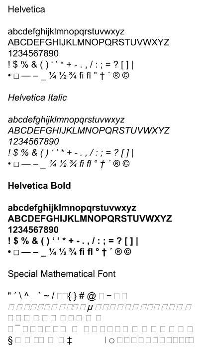

그림 4.3 헬베티카 글꼴

글꼴 정의는 파일 상단에 위치해야 합니다. 이 예제에서는 다음과 같은 글꼴을 확인할 수 있습니다: (Times)
Roman, (Times) Bold, (Times) Italic, (Times) Bold Italic, Constant Width, Constant Bold, Helvetica, Hel-
vetica Bold, Helvetica Italic 및 Special. 어떤 글꼴이 어느 위치에 마운트될지는 /usr/lib/font의 device 하위 디렉터리에 있는
DESC.out 파일에 의해 제어됩니다. 자세한 내용은 부록 D를 참조하십시오.


### Special Characters

nroff와 troff는 표준 ASCII 문자 집합에 포함되지 않는 다양한 특수 문자를 지원합니다.
여기에는 그리스 문자, 수학 기호 및 그래픽 문자가 포함됩니다. 이들 중 일부는
앞서 ‘특수 글꼴’이라고 언급한 글꼴에 포함되어 있습니다. 나머지는 표준 조판기
글꼴에 포함되어 있습니다.

어떤 글꼴에 포함되어 있든 상관없이, 특수 문자는 \(로 시작하는
4자 특수 이스케이프 시퀀스를 통해 파일에 포함됩니다.
부록 B에는 특수 문자의 전체 목록이 나와 있습니다. 그러나 가장 유용한 일부 문자는
표 4-4에 나열되어 있는데, 초보자라도 텍스트에 이러한 문자를 포함하고 싶을 수 있기 때문입니다. nroff는
이러한 문자 중 일부를 생성하기 위해 최선을 다하지만, 사실 이러한 문자들은 troff에 가장 적합합니다.

표 4.4 특수 문자

이름 | 이스케이프 시퀀스 | 출력 문자
--- | --- | --- 
긴 대시 | \(em | —
불릿 | \(bu | •
사각형 | \(sq |
베이스라인 룰 | \(ru |
언더룰 | \(ul |
1/4 | \(14 | ¼
1/2 | \(12 | ½
3/4 | \(34 | ¾
온도 | \(de | °
대거 | \(dg | †
더블 대거 | \(dd | ‡
등록 기호 | \(rg | ®
저작권 기호 | \(co | ©
단락 기호 | \(sc | §
제곱근 | \(sr | √
크거나 같음 | \(>= | ≥
작거나 같음 | \(<= | ≤
다르다 | \(!= | ≠
곱하기 | \(mu | ×
나누기 | \(di | ÷
더하기 또는 빼기 | \(+- | ±
오른쪽 화살표 | \(-> | →
왼쪽 화살표 | \(<- | ←
위쪽 화살표 | \(ua | ↑
아래쪽 화살표 | \(da | ↓

이러한 특수 문자 중 일부에 대해서는 사용하면서 더 자세히 다루겠습니다. 일부는
eqn이 수학 방정식을 생성하는 데 내부적으로 사용됩니다. 저작권, 등록 상표,
대거 기호와 같은 기호의 용도는 꽤 명백합니다.
하지만 명백한 용도에만 국한되어서는 안 됩니다. 이러한 특수 문자 중 상당수는
창의적인 방식으로 활용할 수 있습니다. 예를 들어, 제곱근 기호는 체크 표시를 흉내 내는 데 사용할 수 있고, 정사각형은
다른 형태의 글머리 기호로 활용할 수 있습니다. 15장에서 보여드리겠지만, 오버스트라이크 기능을 사용하면
상자 안의 체크 표시와 같이 효과적이고 독창적인
문자 조합을 만들 수 있습니다.
요점은 이러한 기호들을 여러분의 표현 수단에 추가해 두었다가, 필요와 상상력이
그 용도를 제시할 때까지 기다리는 것입니다.


### Type Size Specification

조판에서는 글자의 전체 크기도 다양하게 설정할 수 있습니다. 조판에서 글자 크기는
‘포인트’라는 단위로 표시됩니다. 1포인트는 약 1/72인치입니다. 일반적인 글자 크기는 6포인트에서 72포인트
사이입니다. 몇 가지 대표적인 크기는 다음과 같습니다:

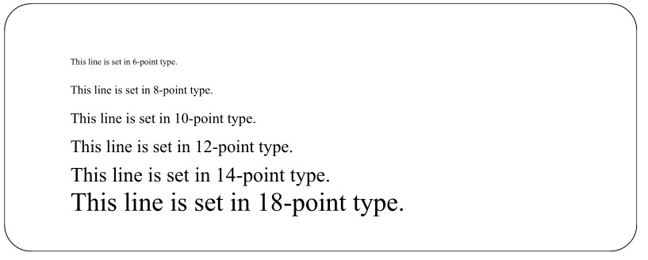

(서체의 정확한 크기가 항상 공식적인 크기 표기와 일치하는 것은 아닙니다. 예를 들어, 12포인트
서체가 항상 높이 1/6인치인 것은 아니며, 72포인트 서체가 높이 1인치인 것도 아닙니다. 정확한 크기는 서체에
따라 달라집니다).
글꼴 변경과 마찬가지로, 크기 변경에는 요청을 사용하는 방법과 인라인 이스케이프
시퀀스를 사용하는 방법, 두 가지가 있습니다. .ps 요청은 포인트 크기를 설정합니다. 예를 들어:
.ps 10 포인트 크기를 10포인트로 설정
포인트 크기를 명시하지 않은 .ps 요청은 이전의 포인트 크기 설정이 무엇이든 상관없이
그 설정으로 되돌립니다:
.ps 10
여기에 텍스트
.ps 변경 전의 포인트 크기로 되돌림
줄 중간에서 포인트 크기를 변경하려면 \s 이스케이프 시퀀스를 사용합니다. 예를 들어, 많은 책에서는
줄 중간에 UNIX라는 단어를 인쇄할 때 포인트 크기를 줄입니다. 앞의 문장은 다음 입력 줄들로
생성되었습니다:

```
For example, many books reduce the point size when
they print the word \s8UNIX\s0 in the middle of a line.
```

예시에서 짐작하셨겠지만, \s0는 포인트 크기를 0으로 설정하는 것이 아니라,
이전 크기로 되돌리는 것을 의미합니다.
또한, 포인트 크기를 지정할 때 상대적 값을 사용할 수도 있습니다. 책의 본문이
10포인트 글꼴로 설정되어 있다는 점을 고려하면, 다음과 같이 입력하여 동일한 결과를 얻을 수 있습니다:

```
For example, many books reduce the point size when
they print the word \s-2UNIX\s0 in the middle of a line.
```

포인트 크기는 한 자리 숫자만 사용하여 늘리거나 줄일 수 있습니다. 즉, 크기를 9포인트 이상 늘리거나
줄일 수는 없습니다.
조판기에서는 특정 크기만 사용할 수 있을 수 있습니다. (otroff에서 허용되는 포인트 크기는 6, 7, 8, 9, 10,
11, 12, 14, 16, 18, 20, 22, 24, 28 및 36입니다. ditroff에서 허용되는 포인트 크기는 출력 장치에 따라 다르지만,
일반적으로 더 많은 크기를 사용할 수 있습니다). 두 허용 크기 사이의 포인트 크기를 요청하면,
otroff는 다음 허용 포인트 크기로 올림하고, ditroff는 가장 가까운 사용 가능한 크기로 반올림합니다.


### Vertical Spacing

조판기를 사용하면 같은 페이지에서 서체와 글자 크기를 변경할 수 있을 뿐만 아니라,
줄 사이의 수직 간격도 조정할 수 있습니다. 이 간격은 연속된 줄의 문자 밑부분 사이의 거리이므로,
때로는 ‘베이스라인 간격’이라고도 합니다. (포인트 크기와
베이스라인 간격의 차이를 ‘리딩(leading)’이라고 하는데, 이는 옛날에 조판사가
연속된 활자 줄 사이에 얇은 납 조각을 끼워 넣던 관행에서 유래한 용어입니다).
타자기나 타자기식 프린터는 보통 1/6인치 단위(즉, 1인치당 6줄)로
수직 간격을 조정합니다. 조판기는 일반적으로 포인트 크기에 따라 간격을 조정합니다. 예를 들어, 앞서 보여준
활자 샘플들은 모두 20포인트의 수직 간격으로 조판되었습니다. 더 일반적으로는, 수직 간격이 다음과 같이
활자 크기에 따라 달라집니다:

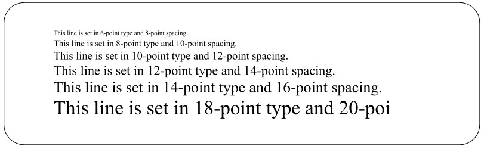

일반적으로 책의 본문은 단일 글자 크기로 조판되며(보통 9포인트 또는 10포인트, 세로 간격은
각각 11포인트 또는 12포인트로 설정됨). 때때로 강조를 위해 더 큰 글자 크기가 사용되기도 하는데, 예를 들어 장
또는 절 제목에서 그러합니다. 글자 크기가 변경되면 세로 간격도 함께 변경해야 합니다. 그렇지 않으면
글자가 이전 줄을 넘쳐나게 됩니다. 다음 예시에서 볼 수 있듯이, 14포인트 글자에 10포인트 간격만 적용된 경우입니다.

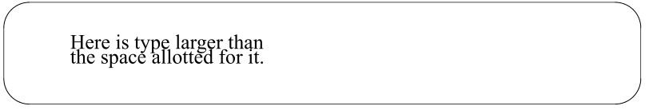

수직 간격은 .vs 명령을 사용하여 변경합니다. 수직 간격 명령은 일반적으로
포인트 크기 명령과 함께 사용됩니다:
.ps 10
.vs 12
.vs 명령으로 수직 간격을 설정하면, 이 값이 troff의 v 단위의 기준이 됩니다. 예를 들어,
.vs 12를 입력하면 .sp 명령은 12포인트만큼 아래로 간격을 띄우게 되며,
.sp 0.5v
는 6포인트, 즉 현재 세로 줄 간격의 절반만큼 아래로 간격을 두게 됩니다. 그러나 기준선 세로 간격을
16으로 변경하면, .sp 명령은 16포인트만큼 아래로 간격을 두게 됩니다. 다른 단위로 지정된 간격은
영향을 받지 않습니다. 이 모든 것은 빈 줄이 텍스트가 포함된 줄과 동일한
양만큼의 공간을 차지한다는 상식적인 관찰로 귀결됩니다.
이중 간격이나 삼중 간격을 사용할 경우, 기준선 간격에 곱셈 계수가 적용됩니다.
.ls 2 명령은 기준선 간격을 두 배로 늘립니다. 원하는 곱셈 계수를 자유롭게 지정할 수 있지만,
2와 3이 가장 합리적인 값입니다.

.ls 명령은 텍스트 출력 줄 사이의 간격에만 영향을 미칩니다. 이 명령은 v의 정의를 변경하지 않으며,
수직 간격 명령에도 영향을 주지 않습니다.


## A First Look at Macros

다음 두 장에서 기존 매크로 패키지에 대해 다루기 전까지는 매크로 설계의 모든 세부 사항을
자세히 다루지는 않겠지만, 여기서는 몇 가지 기본 개념을 살펴보겠습니다. 이를 통해 매크로 패키지가
무엇을 하는지, 그리고 어떻게 작동하는지 이해하는 데 도움이 될 것입니다.
매크로를 정의하려면 .de 요청을 사용하고, 그 뒤에 매크로가 호출될 때
실행하고자 하는 요청 시퀀스를 나열합니다. 매크로 정의는 ..(두 개의 점) 요청으로 종료됩니다.
매크로에 할당할 이름은 .de 요청의 인수로 지정합니다.
반복적으로 같은 명령어 시퀀스를 실행해야 할 때는 매크로를 정의하는 것을 고려해 보아야 합니다.
(이미 이러한 작업을 처리해 주는) 기존 매크로 패키지 중 하나를 사용하지 않는다면, 단락 나누기는
매크로 활용에 적합한 서식 설정의 좋은 예입니다.
단순히 빈 줄 하나로 단락을 구분하는 것도 충분히 타당하지만, 대신
빈 줄과 일시적인 들여쓰기를 사용하여 단락을 구분하고 싶을 수도 있습니다. 게다가 “고아 줄”을 방지하기 위해,
각 단락의 줄이 최소 두 줄은 페이지 하단에 표시되도록 하고 싶을 것입니다. 따라서
다음과 같은 매크로를 정의할 수 있습니다:

```
.de P
.sp
.ne 2
.ti 5n
..
```

이것이 가장 간단한 형태의 매크로로, 저장된 명령어들이 순서대로 이어지는 형태입니다. 하지만 매크로는
인수를 받을 수 있고, 다양한 조건의 유무에 따라 다른 동작을 수행할 수 있으며,
그 밖에도 흥미롭고 놀라운 여러 가지 기능을 수행할 수 있습니다.
매크로가 지닌 방대한 잠재력에 대해서는 후반부 챕터에서 더 자세히 다루겠습니다. 지금은
기존의 매크로 패키지를 사용하기 위해 이해해야 할 한두 가지 사항만
살펴보도록 하겠습니다.


### Macro Arguments

대부분의 기본 troff 명령어는 단일 문자나 알파벳과 같은 간단한 인수를 받습니다. 많은 매크로는
문자열과 같은 더 복잡한 인수를 받습니다. 다음 두 장에서 매크로 패키지에 대해 다루는 동안
유념해야 할 몇 가지 간단한 사항이 있습니다.
첫째, 공백은 기본적으로 인자 사이의 구분자로 간주됩니다. 단일 매크로 인자가
공백을 포함하는 문자열인 경우, 일련의
별도의 인자로 처리되지 않도록 문자열 전체를 따옴표로 묶어야 합니다.
예를 들어, 이 책의 장 제목을 출력하는 매크로를 생각해 봅시다. 매크로 호출은 다음과
같습니다:
.CH 4 “Nroff and Troff”
두 번째로, 무시하고 싶은 인수를 건너뛰려면 빈 문자열(“”)을 지정하면 됩니다. 예를 들어:
.CH “” ‘Preface’
보시다시피, 공백이 포함되지 않은 문자열 인수(“Preface”)를 따옴표로 묶어도 아무런 문제가 없으며,
모든 문자열을 따옴표로 묶는 것은 좋은 습관일 것입니다.


### Number Registers

매크로 정의에 특정 값을 사용하면, 해당 매크로를 사용할 때 그 값으로만 제한됩니다.
예를 들어, 앞서 보여준 단락 매크로 정의에서 공백은 항상 1이 되고, 들여쓰기는
항상 5n이 됩니다.
그러나 nroff와 troff에서는 숫자 레지스터라고 하는 특수 변수에 숫자 값을 저장할 수
있습니다. 매크로 정의에서 레지스터의 값을 사용하면, 레지스터에 새로운 값을 할당하는 것만으로도 매크로의 동작을
변경할 수 있습니다. 예를 들어, ms에서는 상단 및 하단 여백의 크기가
절대값으로 지정되지 않고 숫자 레지스터로 지정됩니다. 결과적으로, 이러한 여백을 변경하기 위해
매크로 정의를 수정할 필요가 없으며, 해당 숫자 레지스터의 값을
재설정하기만 하면 됩니다. 마찬가지로 중요한 점은, 숫자 레지스터의 내용을 플래그(매크로 간의 일종의 메시지)로
사용할 수 있다는 것입니다. nroff와 troff의 마크업 언어에는 조건문이 있으므로,
매크로에서 다음과 같이 지정할 수 있습니다. “숫자 레지스터 Y의 값이 x라면, 이렇게 처리하라. 그렇지 않으면, 이렇게 처리하라.” 예를 들어,
mm 매크로에서는 기본적으로 하이픈 삽입이 비활성화되어 있습니다. 이를 활성화하려면 특정
숫자 레지스터의 값을 1로 설정하면 됩니다. 여러 매크로가 이 레지스터의 값을 확인하고, 이를 신호로 사용하여 하이픈
삽입을 다시 활성화합니다.

숫자 레지스터에 값을 저장하려면 .nr 요청을 사용합니다. 이 요청은 두 개의 인자를 받는데, 하나는
숫자 레지스터의 이름*이고, 다른 하나는 레지스터에 저장할 값입니다.
예를 들어, ms 매크로에서는 상단 여백과 하단 여백의 크기가 HM
(헤더 여백) 및 FM(푸터 여백) 레지스터에 저장됩니다. 이 여백들을 기본값인 1인치에서 1.75
인치로 재설정하여(이 책에서 사용된 것과 같이 더 짧은 페이지를 생성하기 위해), 다음 요청을
실행하기만 하면 됩니다:
.nr HM 1.75i
.nr FM 1.75i
또한 -r 옵션을 사용하여 명령줄에서 단일 문자 이름을 가진 숫자 레지스터를 설정할 수도 있습니다.
(mm 매크로는 이 기능을 많이 활용합니다.) 예를 들어:
$ nroff -mm -rN1 file
는 숫자 레지스터 N을 값 1로 설정하여 mm 매크로를 사용하여 file을 서식 지정합니다. 번호 레지스터 사용에 대해서는
나중에 사용자 정의 매크로를 작성하는 방법을 설명할 때 더 자세히 다루겠습니다. 당장은 기존 레지스터에
새로운 값을 할당하는 방법만 알면 됩니다. 다음 두 장에서는 mm 및 ms 매크로 패키지를 사용할 때 유용할 수 있는
특정 번호 레지스터들에 대해 설명할 것입니다.


### Predefined Strings

mm 및 ms 매크로 패키지 역시 미리 정의된 텍스트 문자열을 사용합니다. nroff 및 troff
프로그램을 사용하면 텍스트 문자열을 한 글자 또는 두 글자로 된 문자열 이름과 연결할 수 있습니다. 포맷터가
문자열 이름이 포함된 특수 이스케이프 시퀀스를 발견하면, 해당 문자열 전체가
출력에 대체됩니다.
문자열을 정의하려면 .ds 명령을 사용합니다. 이 명령은 문자열 이름과
문자열 자체라는 두 개의 인자를 취합니다. 예를 들면 다음과 같습니다.
.ds nt Nroff와 Troff
문자열은 따옴표로 묶어서는 안 됩니다. 선택적으로 따옴표로 시작할 수는 있지만, 끝은
따옴표로 끝나서는 안 됩니다. 그렇지 않으면 마지막 따옴표가 출력에 그대로 나타납니다. 하지만 문자열을 하나 이상의
공백으로 시작하려면 정의의 첫 글자를 따옴표로 시작해야 합니다. 이 경우에도
끝에 따옴표는 없습니다. 언제나 그렇듯이, 문자열은 줄바꿈으로 종료됩니다.
백슬래시를 사용하여 줄바꿈을 숨김으로써 여러 줄로 구성된 문자열을 정의할 수 있습니다. 예를 들어:

```
.ds LS This is a very long string that goes over \
more than one line.
```

*숫자 레지스터 이름은 매크로 이름과 마찬가지로 한 글자 또는 두 글자로 구성될 수 있습니다. 그러나 이 둘은
서로 구별됩니다. 즉, 숫자 레지스터와 매크로에 동일한 이름을 지정해도 충돌이 발생하지 않습니다.

문자열이 보간될 때, (채우기 모드가 활성화되어 있지 않은 경우를 제외하고) 채우기 처리가 적용되며, 정의에서 지정한 위치와
정확히 일치하는 지점에서 줄이 바뀔 수는 없습니다. 출력에서 문자열을 보간하려면
다음 이스케이프 시퀀스 중 하나를 사용합니다:
\*a
\*(ab
여기서 a는 한 글자 길이의 문자열 이름이고, ab는 두 글자 길이의 문자열 이름입니다.
앞서 정의한 nt 문자열을 사용하려면 다음과 같이 입력합니다:
\*(nt
그러면 출력에서 이 문자열은 Nroff와 Troff라는 단어로 대체됩니다.
문자열은 매크로와 동일한 이름 풀을 사용합니다. 기존
매크로와 동일한 이름으로 문자열을 정의하면 해당 매크로가 작동하지 않게 되므로, 무분별하게 약어 문자열을 정의하는 것은 권장되지 않습니다.
vi 편집기의 약어 기능(7장에서 설명)을 사용하는 것이 입력 작업을 줄이는 데
더 효과적인 방법입니다.

문자열은 숫자 레지스터와 매우 유사한 방식으로 매크로 설계에 유용합니다. 즉, 매크로를
보다 일반적인 방식으로 정의할 수 있게 해줍니다. 예를 들어, 홀수 페이지의 머리글에 챕터 제목을
출력하는 이 책을 생각해 보십시오. 챕터 제목은 페이지 상단 매크로에 직접 코딩되어 있지 않습니다. 대신,
미리 정의된 문자열이 그 자리에 삽입됩니다. 챕터 첫 페이지의 챕터 제목 형식을 지정하는
동일한 매크로가 헤더에 표시될 문자열도 정의합니다.
기존 매크로 패키지를 사용할 때, 기존 문자열의 내용을 정의하거나
삽입해야 하는 경우가 있을 수 있습니다. 하지만 대부분의 경우, 문자열 정의는 매크로 정의 내부에 숨겨져 있으므로
직접 접할 일은 거의 없을 것입니다. 하지만 다음과 같이 실제로 사용하게 될
유용한 사전 정의된 문자열이 몇 가지 있습니다.
\*(DY
는 ms 매크로 패키지에서 항상 현재 날짜를 포함합니다. (mm 패키지에서 이에 해당하는 문자열은 \*(DT)입니다.)
예를 들어, 양식 서신에 작성된 날짜가 아닌
서식이 지정되고 인쇄된 날짜를 포함시키고 싶다면, 이 문자열을 삽입할 수 있습니다.


### Just What Is a Macro Package?

매크로에 대한 주제를 마무리하기 전에, 지금까지 간략히만 다뤘던 한 가지 주제를 잠시 다루어 볼 필요가 있습니다.
바로 ‘매크로 패키지’가 정확히 무엇인지에 대한 것입니다.
이름에서 알 수 있듯이, 매크로 패키지는 단순히 매크로 정의들의 모음입니다.
기존 패키지를 사용하기 위한 명령줄 옵션이 있다는 사실 때문에 이 패키지들이 특별한 지위를 가진 것처럼 보일 수 있지만,
이것들은 여러분이 읽고 수정할 수 있는 텍스트 파일일 뿐입니다(시스템의 UNIX 파일 권한이
이를 허용하도록 설정되어 있다고 가정할 때).
-ms 및 -mm 옵션에는 특별한 비결이 없습니다. nroff와 troff에 대한 실제 옵션은 -mx이며,
이 옵션은 프로그램이 /usr/lib/tmac 디렉터리에서 tmac.x 형식의 파일을
찾도록 지시합니다. 예상하셨겠지만, 이는 해당 디렉터리에 tmac.s 또는 tmac.m이라는
파일이 있다는 것을 의미합니다(시스템에 설치된 패키지에 따라 다름). 또한, 매크로 정의를 적절한 경로명을 가진 파일에 저장하기만 하면
명령줄에서 직접 사용자 정의 매크로 패키지를 호출할 수 있음을 의미합니다.
이 파일은 서식 지정 과정에서 처리되는 다른 모든 파일에 추가됩니다. 즉, ms 매크로를 사용하는 경우
다음 줄을 포함시켜 동일한 결과를 얻을 수 있습니다:
.so /usr/lib/tmac/tmac.s

각 소스 파일의 시작 부분에 이 명령을 추가하고, 명령줄 스위치 -ms는 생략합니다. (.so 요청은 다른
파일을 입력 스트림으로 읽어들이며, 해당 파일의 내용이 모두 처리되면 현재 파일로 돌아갑니다. 여러 개의
.so 요청을 중첩할 수 있으며, 이는 매크로 정의를 읽어들이는 것뿐만 아니라 추가 텍스트 파일을 읽어들이는 데에도 사용할 수 있습니다).
표준 매크로 패키지에 포함된 매크로들은 (복잡도를 제외하면) 여러분이 직접 작성할 수 있는
매크로들과 다르지 않습니다. 사실, 기존 매크로
패키지의 내용을 출력하여 살펴봄으로써 그 작동 원리를 배울 수 있습니다. 우리는 기존 매크로 패키지의 동작을 자세히 살펴볼 예정이지만,
저작권상의 이유로 내부 설계를 실제로 보여드릴 수는 없습니다. 이 부분에 대해서는 나중에 다시 다루겠습니다.
지금 당장은 매크로가 마법 같은 것이 아니라, 단순히 함께 작동하는 간단한 명령어들의 집합일 뿐이라는
사실만 알아두면 됩니다.


