# Chapter 6 The mm Macros

매크로 패키지는 다양한 종류의 문서 형식을 정의하는 방법을 제공합니다. 각 문서마다
고유한 문제가 존재하지만, 매크로를 사용하면 이를 간단하고 유연하게 해결할 수 있습니다. mm
매크로 패키지는 편지, 제안서, 메모, 기술 문서 및 보고서의 서식을 지정하는 데 도움을 주도록 설계되었습니다. mm
매크로가 포함된 텍스트 파일은 UNIX의 두 가지 텍스트 서식 지정 프로그램인 nroff나 troff를
통해 처리할 수 있습니다. 이 프로그램들의 출력 결과는 터미널 화면에 표시되거나 라인
프린터, 레이저 프린터, 조판기에 인쇄될 수 있습니다.
mm 매크로 패키지를 사용하는 사용자 중에는 몇 가지 매크로만 익혀도 효율적으로 작업하는 사람도 있습니다. 다른 사용자들은
다양한 매크로 중에서 선택하여 여러 가지 다른 형식의 문서를 작성하기도 합니다. 더 숙련된 사용자들은 매크로
정의를 수정하거나 자신만의 특수 목적 매크로를 정의하여 패키지의 기능을 확장하기도 합니다.

매크로는 서식 설명 언어를 구성하는 단어입니다. 단어와 마찬가지로, 매크로의 결과는
종종 문맥에 따라 결정됩니다. 즉, 특정 단어를 찾아본다고 해서 문장 전체의 의미를 이해할 수 없는 것과 마찬가지로,
개별 매크로를 찾아본다고 해서 항상 출력 결과를 이해할 수 있는 것은 아닙니다. 매크로 정의를 살펴보지 않고서는,
어떤 매크로가 특정 결과를 일으키고 있는지 파악하기 어려울 수 있습니다. 매크로는 서로 밀접하게 연관되어 있습니다. 일부 매크로는 프로그램의 서브루틴처럼 다른 매크로를 호출하여
특정 기능을 수행합니다.
매크로 패키지를 통해 무엇을 할 수 있는지 파악한 후에는, 아마도 본인이 선호하는
특정 형식(또는 특정 집단의 결정에 따라 발전해 온 형식)을 선택하게 될 것입니다. 그
형식을 기술하기 위해서는, 실제로 필요한 작업만 수행하는 소수의 매크로만 사용하게 될 가능성이 높습니다. 일상적인 사용에서는
문서를 일관된 방식으로 서식 지정하는 데 필요한 코드의 수를 최소화하고 싶어 할 것입니다.


## Formatting a Text File

mm과 같은 매크로 패키지의 역할을 파악하려면, 서식 지정(formatting)과 서식(format)의 차이를
고려해 보는 것이 도움이 될 수 있습니다. 서식 지정은 명령을 제공하고 실행하는 작업, 즉 과정입니다. 서식 지정 명령을
다양하게 조합함으로써, 마음에 드는 결과도 있고 그렇지 않은 결과도 얻을 수 있습니다. 반면 서식(format)은
선택된 서식 지정 명령 집합을 통해 얻어지는 일관된 산출물입니다. 매크로 패키지는
최소한의 노력으로 포맷을 반복해서 재현할 수 있게 해줍니다. 이를 통해 사용자는
텍스트 포맷터의 작동 방식보다는 문서의 요구 사항에 더 집중할 수 있습니다.
매크로 패키지를 사용하면 입력해야 하는 포맷팅 명령의 수를
줄이는 데 도움이 됩니다. 즉, 매크로 패키지가 많은 작업을 자동으로 처리해 준다는 뜻입니다. 그러나
nroff/troff 서식 지정기의 작동 방식과 새로운 서식을 정의하는 데 있어 이 도구가 제공하는 추가적인
유연성에 대해 점차 익숙해져야 합니다. 제4장에서 설명한 대로 서식 지정기의 작동 원리에 대한 기본적인 이해가 있다면,
매크로 패키지의 복잡한 세부 사항을 배우는 것이 더 쉬워질 것입니다.


### Invoking nroff/troff with mm

mm 명령어는 nroff 포맷터를 호출하고, 명령행에 지정된 텍스트 파일을 처리하기 전에
mm 매크로 정의가 포함된 파일을 읽어들이는 셸 스크립트입니다.
$ mm option(s) filename(s)
명령행에 두 개 이상의 파일이 지정된 경우, 처리 전에 파일들이 연결됩니다.
전처리기 및 후처리기를 호출하고, 출력 장치를 지정하며, 문서의 기본값을 변경하기 위해
다양한 숫자 레지스터를 설정하는 데 사용할 수 있는 여러 가지 옵션이 있습니다. mm 명령을 사용하는 것은
-mm 옵션을 사용하여 nroff를 명시적으로 호출하는 것과 동일합니다.
별도로 지정하지 않는 한, mm 명령어는 nroff의 -T 옵션을 로그인 환경에 설정된 터미널 유형으로
설정합니다. 기본적으로 출력은 터미널 화면으로 전송됩니다. 출력 내용을 보는 데 문제가 있거나
그래픽 터미널을 사용하는 경우, -T 옵션을 사용하여 다른 장치 이름을 지정할 수 있습니다. 사용 가능한 장치 목록은 부록 B를 참조하십시오. mm 명령어에는 역행 줄바꿈을 제거하기 위해 col 필터를 호출하는 -c 옵션과, tbl(-t) 및 eqn(-e)을 호출하는 옵션도 있습니다.

파일을 화면에 출력할 때, 마치
파일을 화면에 cat 명령어로 출력할 때와 마찬가지로, 출력 내용이 너무 빠르게 흘러가서 읽기 어려울 수 있습니다. mm 명령의 출력을 페이지링 프로그램인
pg나 more 중 하나를 통해 파이프 연결하여 한 번에 한 화면 분량씩 볼 수 있습니다. 이렇게 하면 서식 지정
명령이 예상한 결과를 얻었는지 대략적으로 확인할 수 있습니다. mm으로 서식이 지정된 파일을 인쇄하려면, 화면 페이지링 프로그램 대신
출력을 인쇄 스풀러(예: lp)로 파이프 연결하기만 하면 됩니다.
텍스트 서식 지정 프로그램이 수행하는 작업 중 상당수는 문서가 어떻게
인쇄될지에 따라 달라집니다. 문서를 nroff 대신 troff로 서식 지정하려면 mmt
129 [mmt] 명령 %key mmt command command(또 다른 셸 스크립트)를 사용하거나,
-mm 옵션을 사용하여 troff를 직접 호출하십시오. mmt 명령어는 레이저 프린터 및 조판기를 위한 출력을 준비합니다. 서식이 지정된
출력은 인쇄 스풀러(예: lp)로 직접 파이프 처리하거나, 파일로 출력한 후 별도로 인쇄해야 합니다.
사용 중인 시스템에서 두 가지 이상의 레이저 프린터나 조판기를 지원하는 경우,
mmt의 올바른 호출 방법을 해당 시스템에서 확인해야 할 것입니다.

otroff를 사용하는 경우, troff가 출력을 터미널로 보내지 않도록 주의하십시오. 왜냐하면
아마도 터미널이 멈춰 버리거나, 적어도 온갖 오류 메시지가 쏟아져 나올 가능성이 높기 때문입니다.
이 장에서는 일반적으로 mmt 대신 mm 명령의 결과를 보여줄 것입니다. 즉,
troff 대신 nroff를 보여줄 것입니다. 논의 중인 주제를 troff로 보여주는 것이 더 적합할 경우,
대신 troff 출력을 보여줄 것입니다. 이제쯤이면 독자들은 우리가 실제 명령어를 언급하지 않아도
어떤 프로그램이 사용되었는지 스스로 파악할 수 있을 것이라고 가정합니다.


### Problems in Getting Formatted Output

mm 코드가 포함된 문서를 서식 지정할 때, 서식이 적용된 문서의 일부만 표시될 수 있습니다. 또는
전혀 표시되지 않을 수도 있습니다. 일반적으로 이는 서식 지정기가 입력 파일에 입력된 대로 코드를
실행하는 데 문제가 발생했기 때문입니다. 대부분의 경우, 쌍으로 사용해야 하는 매크로 중 하나가
누락되어 발생합니다.
포맷팅이 이처럼 중단되면, 화면에 하나 이상의 오류 메시지가 표시되어
문제를 진단하는 데 도움이 될 수 있습니다. 이러한 메시지는 문제가 발생한 것으로 보이는 입력 파일의
줄 번호를 참조하며, 무엇이 누락되었는지 알려줍니다:

```
ERROR:(filename) line number
Error message
```

때로는 오류 메시지가 표시되지 않더라도 출력 결과가 중간에 끊기는 경우가 있습니다. 일반적으로는
출력이 끊긴 지점이나 그 이전 지점으로 이동하여 매크로 하나 또는 일련의 매크로를 살펴봐야 합니다.
또한 입력 파일에 프로그램을 실행하여 입력한 코드를 확인할 수도 있습니다. 대부분의 사이트에서
구할 수 있는 이 프로그램은 checkmm라고 합니다.


### Default Formatting

4장에서는 nroff로 서식이 지정된 편지 예제를 살펴보았습니다. 파일에
매크로를 추가하기 전에, 이번에는 mm 명령을 사용하여 mm 매크로 패키지를 불러온 뒤
편지 본문을 있는 그대로 서식 지정하면 어떻게 되는지 확인해 보는 것도 흥미로울 것입니다.
그림 6-1을 참고하면 다음 사항을 알 수 있습니다.
• 페이지 상단의 헤더에 페이지 번호가 표시됩니다.
• 주소 블록은 여전히 두 줄로 길게 나뉘어 있습니다.
• 입력 텍스트 줄이 채워져 블록 단락을 형성하고 있습니다.
• 오른쪽 여백은 nroff에서와 같이 양쪽 정렬이 아닌 불규칙한 형태입니다.
• 텍스트에 하이픈이 적용되지 않았습니다.
• 상단, 하단, 좌측, 우측 여백이 지정된 페이지 공간이 할당되었습니다.

  
그림 6.1 mm 형식의 원본 파일


## Page Layout

mm 명령을 사용하여 페이지 서식을 지정하면, 서식 지정기는 페이지 상단과 하단에 헤더와 푸터를
표시하기 위해 몇 줄을 할당하도록 지시받습니다. 기본적으로 페이지 번호는 헤더에 한 줄로 표시되며,
푸터에는 빈 줄만 출력됩니다.
기본 헤더와 푸터를 변경하는 방법에는 기본적으로 두 가지가 있습니다. 첫 번째 방법은
mm 또는 mmt 명령을 사용할 때 명령줄 매개변수를 지정하여 번호 레지스터 N을 설정하는 것입니다. 이를 통해
페이지 번호 매기기 방식과 페이지 번호가 표시되는 위치를 조정할 수 있습니다. 두 번째 방법은
입력 파일에서 헤더나 푸터에 텍스트를 삽입하는 매크로를 지정하는 것입니다. 이 두 가지 기법을 모두 살펴보겠습니다.


### Setting Page Numbering Style

문서의 서식을 지정하면 문서 끝까지 페이지 번호가 순서대로 매겨집니다. 이 페이지
번호는 보통 헤더에 대시로 구분되어 인쇄됩니다.

```
-1-
```

기술 매뉴얼과 같은 문서에서 사용되는 또 다른 페이지 번호 매기기 방식은
각 섹션별로 페이지 번호를 매기는 것입니다. 두 번째 섹션의 첫 번째 페이지는 다음과 같이 인쇄됩니다.

```
2-1
```

또 다른 유형의 변경 사항은 첫 페이지 상단의 헤더에 페이지 번호를 인쇄할지 여부를
결정합니다.
번호 레지스터 N은 이러한 동작을 제어합니다. 이 레지스터의 기본값은 0이며, 0에서 5까지의
값을 가질 수 있습니다. 표 6-1은 이러한 값들이 미치는 영향을 보여줍니다.

표 6.1 페이지 번호 스타일, 레지스터 N

값 | 동작
--- | ---
0 | 모든 페이지의 머리글에 페이지 번호가 인쇄됩니다. 이것이 기본 페이지 번호 매기기 스타일입니다.
1 | 1페이지에서는 페이지 번호가 바닥글 대신 인쇄됩니다.
2 | 1페이지에서는 페이지 번호가 인쇄되지 않습니다.
3 | 모든 페이지에 섹션별로 페이지 번호가 매겨지며, 페이지 번호는 바닥글에 표시됩니다. 이 설정은 여러 섹션 관련 레지스터와 매크로의 기본값에 영향을 미칩니다. 최상위 제목(Ej=1)에서 페이지 나누기를 유발하며, .FD 및 .RP 매크로를 모두 호출하여 각주 및 참조 번호 매기기를 재설정합니다.
4 | 페이지 번호가 포함된 기본 헤더는 표시되지 않지만, 페이지 헤더 매크로에 의해 제공되는 헤더에는 영향을 미치지 않습니다.
5 | 모든 페이지에 섹션별로 페이지 번호가 매겨지며, 페이지 번호는 바닥글에 표시됩니다. 또한, 레이블이 지정된 표시(.FC, .TB, .EX 및 .EC)에도 섹션별로 번호가 매겨집니다.

레지스터 N은 -r 옵션을 사용하여 명령줄에서 설정할 수 있습니다. 이 값을 2로 설정하면, 예제 편지를 인쇄할 때 1페이지 상단에 페이지 번호가
표시되지 않습니다:

```
$ mm -rN2 letter | lp
```


### Header and Footer Macros

mm 패키지에는 페이지 머리글(.PH)과 페이지
바닥글(.PF)에 표시될 내용을 정의하는 한 쌍의 매크로가 있습니다. 또한 홀수
페이지(.OH 및 .OF)나 짝수 페이지(.EH 및 .EF)의 머리글과 바닥글을 지정하기 위한 일련의 관련 매크로도 있습니다. 이 매크로들은 모두
동일한 형식을 가지며, 헤더나 푸터 내 세 곳(왼쪽 정렬, 중앙 정렬,
오른쪽 정렬)에 텍스트를 배치할 수 있게 해줍니다. 이는 큰따옴표로 묶인 단일 인자로 지정되며, 작은따옴표로 구분된 세 부분으로
구성됩니다.

```
’left’center’right’
```

예를 들어, 페이지 머리글에는 고객 이름, 문서 제목, 날짜를 넣고,
페이지 번호는 바닥글에 넣을 수 있습니다:

```
.PH "’GGS’Alcuin Project Proposal’\*(DT’"
.PF "’’Page % ’’"
```

헤더에 오늘의 날짜를 표시하기 위해 ‘DT’라는 문자열을 사용하고 있다는 것을 눈치채셨을지도 모릅니다. 다음 헤더는
페이지 상단에 표시됩니다.

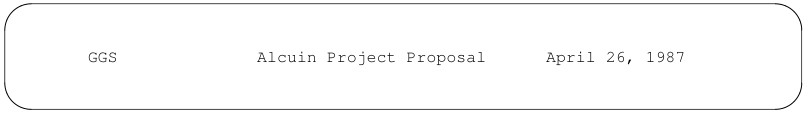

푸터에서는 특수 기호(%)를 사용하여 현재 페이지 번호에 접근합니다. 중앙 정렬할 텍스트만
지정되었지만, 텍스트를 올바르게 배치하기 위해서는 여전히 네 개의 구분 기호가 필요했습니다. 이 푸터는
페이지 하단에 표시됩니다:

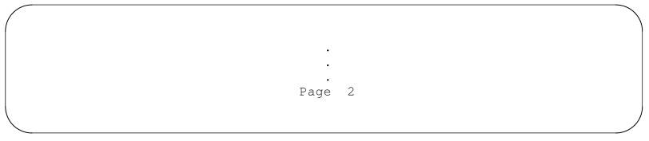

헤더 및 푸터 매크로는 기본 헤더와 푸터를 재정의합니다.


### Setting Other Page Control Registers

mm 패키지는 표 6-2에 표시된 바와 같이, 줄 길이, 페이지 오프셋, 포인트 크기,
그리고 페이지 길이를 제어하는 값을 제공하기 위해 숫자 레지스터를 사용합니다.
이러한 레지스터는 nroff나 troff가 mm 매크로 패키지를 읽기 전에 정의되어야 합니다. 따라서,
앞서 레지스터 N에 새로운 값을 할당할 때 보여준 것처럼, -r 옵션을 사용하여 명령줄에서
이들을 설정할 수 있습니다. nroff의 경우 레지스터 O와 W의 값은 문자 위치로 지정해야 합니다(nroff의
출력 장치 문자 크기에 따라 .5i는 5 또는 6 문자 위치로 해석될 수 있음). 반면
troff는 제4장에서 설명한 모든 단위를 사용할 수 있습니다. 예를 들어:

```
$ mm -rN2 -rW65 -rO10 file
```

반면:

```
$ mmt -rN2 -rW6.5i -rO1i file
```

표 6.2 숫자 레지스터

레지스터 | 포함 항목 | troff 기본값 | nroff 기본값
---- | --- | --- | ---
O | 페이지 오프셋 (왼쪽 여백) | .75i | .5i
N | 페이지 번호 매기기 형식 | 0 | 0
P | 페이지 길이 | 66v | 66줄
S | 포인트 크기 (troff 전용) | 10 | NA
W | 줄 길이 또는 너비 | 6i | 60

또는 파일 맨 위에서 .so 명령을 사용하여 mm
매크로 패키지를 불러온 다음, 다음과 같이 페이지 제어 레지스터를 설정할 수도 있습니다.

```
.nr N 2
.nr W 65
.nr O 10
.so /usr/lib/tmac/tmac.m
```

이 방법으로 설정할 경우 mm 명령을 사용할 수 없습니다. -mm 옵션을 생략하고 nroff 또는 troff를 사용하십시오.
-mm 옵션을 지정하면 mm 매크로 패키지가 두 번 불러오게 되며, mm는 해당 오류를 감지하고 실행을 중단합니다.


### Paragraphs

.P 매크로는 단락의 시작을 표시합니다.

```
.P
In our conversation last Thursday, we discussed a
```

이 매크로는 왼쪽 정렬된 블록 단락을 생성합니다. 입력 파일의 빈 줄도 왼쪽 정렬된
블록 단락으로 처리되는데, 이는 코딩되지 않은 파일의 서식을 지정할 때 보셨던 것과 같습니다.
그러나 단락 매크로는 포맷터에서 여러 가지 동작을 제어하며, 그중 상당수는
여러 숫자 레지스터의 기본값을 재정의하여 변경할 수 있습니다. .P 매크로는 숫자 인수를 받아
기본 단락 유형인 블록 단락을 재정의합니다. 1을 지정하면
들여쓰기된 단락이 생성됩니다:

```
.P 1
Going through a demo session gave me a much better
```

화면에 맞게 서식이 지정된 첫 세 단락은 다음과 같습니다:


두 번째 단락의 첫 번째 줄은 5칸 들여쓰기되어 있습니다. (troff에서 기본 들여쓰기 값은 3ens입니다).
단락 유형 지정은 두 번째 단락에만 적용된다는 점에 유의하십시오. 입력 파일에서 인수가 없는 .P가 앞에 붙은 세 번째 단락은
블록 단락입니다.
모든 단락이 들여쓰기된 문서를 만들고 싶다면, 기본 단락 유형을 지정하는 번호 레지스터를
변경하면 됩니다. Pt의 기본값은 0이며, 이 경우 블록 단락이
생성됩니다. 들여쓰기된 단락을 원한다면 Pt의 값을 1로 설정하십시오. 이제 .P 매크로는 들여쓰기된 단락을
생성합니다.
.nr Pt 1
기본 유형을 변경한 후 블록 단락을 얻으려면 인수를
0으로 지정하십시오:
.P 0
유형 인수를 지정하면 현재 적용 중인 단락 유형이 무시됩니다.
일부 예외를 제외하고 들여쓰기 단락을 생성하는 세 번째 단락 유형이 있습니다. Pt를
2로 설정하면, 섹션 제목, 목록 및 표 뒤에 오는 단락을 제외하고 모든 단락이 들여쓰기됩니다. 이것이 바로
이 책에서 사용되는 단락 유형입니다.
다음 목록은 세 가지 기본 단락 유형을 요약한 것입니다.
0 블록
1 들여쓰기
2 예외가 있는 들여쓰기


### Vertical Spacing

단락 매크로는 단락 간의 간격도 제어합니다. 간격의 크기는
숫자 레지스터 Ps에 지정됩니다. 이 값은 nroff와 troff에서 서로 다릅니다.
nroff에서 .P 매크로는 빈 줄과 동일한 효과를 내며, 단락 사이에
한 칸의 공백을 생성합니다. 반면 troff에서 .P 매크로는 현재
수직 간격 설정값의 절반에 해당하는 공백을 출력합니다. 기본적으로, 이는 빈 줄이 전체 공백 하나만큼 출력되는 반면,
.P 매크로는 그 공백의 절반만큼 출력된다는 것을 의미합니다.
.P 매크로는 수직 간격을 설정하기 위해 .SP 매크로를 호출합니다. 이 매크로는 숫자 인자를 받아
지정된 줄 수만큼의 공백을 요청합니다.

```
Sincerely,
.SP 3
Fred Caslon
```

인사말과 서명 줄 사이에는 세 줄의 여백이 제공됩니다.
.SP 매크로를 세 줄 연속으로 입력해도 동일한 효과를 얻을 수 없습니다. 세로
여백이 누적되지 않아 한 줄의 여백만 출력되고, 세 줄은 출력되지 않습니다.
숫자 인수가 지정된 .SP 매크로를 두 개 이상 연속해서 사용하면,
가장 큰 인수가 지정한 간격만큼의 공백이 생성됩니다. 나머지 인수는 무시됩니다.

```
.SP 5
.SP
.SP 2
```

이 예제에서는 8줄이 아닌 5줄의 공백이 출력됩니다.
.P 매크로는 .SP 매크로를 호출하므로, 두 개 이상의 단락 매크로를
연속해서 사용해도 하나의 단락 매크로를 사용한 것과 동일한 효과가 나타납니다.


### The .SP Macro versus the .sp Request

.SP 매크로와 .sp 명령어 사이에는 몇 가지 차이점이 있습니다. 일련의 .sp 명령어를 실행하면
수직 간격이 누적됩니다. 다음 세 개의 명령어는 여덟 줄의 빈 줄을 생성합니다:
.sp 5
.sp
.sp 2
.SP 매크로에 지정된 인수는 배율 조정이 불가능하며 음수일 수도 없습니다.
.SP 매크로는 현재 세로 간격의 배율(v)을 자동으로 적용합니다. 그러나 .SP와
.sp 모두 소수 값을 허용하므로, 다음 코드들은 모두 동일한 결과를 나타냅니다:
.sp .3v .SP .3 .sp .3


## Justification

nroff와 mm을 사용하여 서식 지정한 문서는 기본적으로 정렬되지 않은 텍스트(오른쪽 여백이 고르지 않거나
불규칙한)로 출력됩니다. troff로 서식 지정한 경우, 동일한 문서는 자동으로 정렬됩니다(오른쪽 여백이
고르게 됩니다).
nroff와 troff를 모두 사용하는 경우, 서식 지정기가 선택한 기본값에 의존하기보다는 정렬 여부를
명시적으로 설정하는 것이 좋습니다. .SA 매크로(set adjustment)를 사용하여
문서 전체에 걸쳐 정렬을 설정할 수 있습니다. 인자로 0을 지정하면 정렬을 적용하지 않으며, 1을 지정하면 정렬을 적용합니다.
파일 맨 위에 다음 매크로를 삽입하면:
.SA 1
nroff와 troff 모두 다음과 같이 오른쪽 정렬된 단락을 생성합니다:

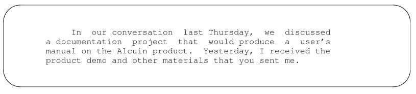


## Word Hyphenation

더 나은 줄 바꿈과 더 균일하게 채워진 줄을 얻기 위한 한 가지 방법은 포맷터에게
단어 하이픈 삽입을 수행하도록 지시하는 것입니다.
mm 매크로 패키지에서는 하이픈 삽입 기능이 꺼져 있습니다. 즉, 숫자 레지스터 Hy를 1로 설정하여 요청하지 않는 한, 포맷터는
단어가 한 줄에 들어맞도록 하이픈을 삽입하지 않습니다. 만약
포맷터가 자동으로 단어에 하이픈을 삽입하도록 하려면, 파일 맨 위에 다음 줄을 삽입하십시오:
.nr Hy 1
대부분의 경우, 서식 지정기는 단어를 하이픈으로 나눌 때 올바르게 분할합니다. 하지만 때로는
그렇지 않은 경우도 있으므로, 단어를 어떻게 분할할지(.hy 요청 사용) 또는 아예
하이픈을 넣지 말 것(.nh 요청 사용)을 서식 지정기에 명시적으로 지시해야 합니다.


## Displays

텍스트 파일을 서식 지정할 때, 캐리지 리턴으로 인한 줄 바꿈은 nroff/troff에 의해 무시됩니다. 입력 파일에서
텍스트가 줄 단위로 어떻게 입력되었는지는 출력에서 줄이 어떻게 형성되는지에 영향을 미치지 않습니다. 정보가 세 줄에 걸쳐 입력되었든 네 줄에 걸쳐 입력되었든 상관없이, 서식 지정 후에는 모두 동일하게
표시됩니다.
여러분은 아마도 예제 파일의 맨 앞에 있는 이름과 주소가
블록 형태로 출력되지 않았다는 것을 눈치채셨을 것입니다. 입력된 4줄이 하나로 이어져 출력에서는 두 줄이 꽉 채워진 형태로 나타났습니다:

```
Mr. John Fust Vice President, Research and Development
Gutenberg Galaxy Software Waltham, Massachusetts 02159
```

포맷터는 캐리지 리턴에 주의를 기울이는 대신, .P, .SP 또는 빈 줄과 같이 줄 바꿈을 유발하는
특정 매크로나 요청에 따라 동작합니다. 포맷터 요청인 .br은 아마도 줄을 바꿀 수 있는
가장 간단한 방법일 것입니다:

```
Mr. John Fust
.br
Vice President, Research and Development
```

.br 요청은 단일 줄의 줄바꿈을 강제로 적용할 때 가장 적합합니다. 더 큰 텍스트 블록의 경우,
mm 매크로 패키지는 텍스트 블록이 입력 파일에 입력된 그대로 출력되어야 함을 나타내는
한 쌍의 매크로를 제공합니다. .DS(표시 시작) 매크로는 텍스트의 시작 부분에 배치하고,
.DE(표시 끝) 매크로는 끝 부분에 배치합니다:

```
.DS
Mr. John Fust
Vice President, Research and Development
Gutenberg Galaxy Software
Waltham, Massachusetts 02159
.DE
```

서식 지정기는 이 줄들을 채우지 않으므로, 주소 블록은 입력된 그대로 4줄에 걸쳐 출력됩니다. 또한,
.DE 매크로는 출력 내용 뒤에 한 줄의 공백을 추가합니다.


### Our Coding Efforts, So Far

이제 예제 편지를 통해 할 수 있는 작업은 거의 다 다루었습니다. 더 큰 규모의 문서로 넘어가기 전에,
그림 6-2의 코드 파일과 그림 6-3의 nroff로 포맷된 출력을 비교해 보시기 바랍니다.
두 가지를 꼼꼼히 살펴보고, 각 매크로가 어떤 역할을 하는지 확실히 이해하시기 바랍니다.
지금까지 매우 간단한 1페이지 분량의 편지에서 발생하는 몇 가지 문제들을 해결해 보았습니다. 앞으로
진행해 나가면서, 여러 페이지로 구성된 문서의 문제점을 해결하는 특수한 매크로들에 대해 설명할 것이며,

```
.nr Pt 1
.SA 1
                                       April 1, 1987
.SP 2
.DS
Mr. John Fust
Vice President, Research and Development
Gutenberg Galaxy Software
Waltham, Massachusetts 02159
.DE
Dear Mr. Fust:
.P
In our conversation last Thursday, we discussed a
documentation project that would produce a user’s manual
on the Alcuin product. Yesterday, I received the product
demo and other materials that you sent me.
.P
Going through a demo session gave me a much better
understanding of the product. I confess to being amazed
by Alcuin. Some people around here, looking over my
shoulder, were also astounded by the illustrated
manuscript I produced with Alcuin. One person, a student
of calligraphy, was really impressed.
.P
In the next couple of days, I’ll be putting together a
written plan that presents different strategies for
documenting the Alcuin product. After I submit this plan,
and you have had time to review it, let’s arrange a
meeting at your company to discuss these strategies.
.P
Thanks again for giving us the opportunity to bid on this
documentation project. I hope we can decide upon a
strategy and get started as soon as possible in order to
have the manual ready in time for the first customer
shipment. I look forward to meeting with you towards the
end of next week.
.SP
                                      Sincerely,
.SP 2
                                      Fred Caslon
```

그림 6.2 코드화된 파일

예를 들어 제안서나 보고서와 같은 문서들입니다. 여러모로 볼 때, 더 복잡한 문서를 다루는 매크로들은 매크로 패키지의 핵심 기능으로,
마크업 언어를 배울 가치가 있다는 것을 진정으로 실감하게 해주는 요소들입니다.


## hanging Font and Point Size

nroff로 서식을 지정하고 라인 프린터로 출력할 때는 밑줄이나 위줄을 그어 개별 단어나
구문을 강조할 수 있습니다. troff를 사용하여 출력물을 레이저 프린터
또는 조판기로 보낼 때는 출력 장치의 성능에 따라
글자 종류, 서체, 포인트 크기를 다양하게 지정할 수 있습니다.

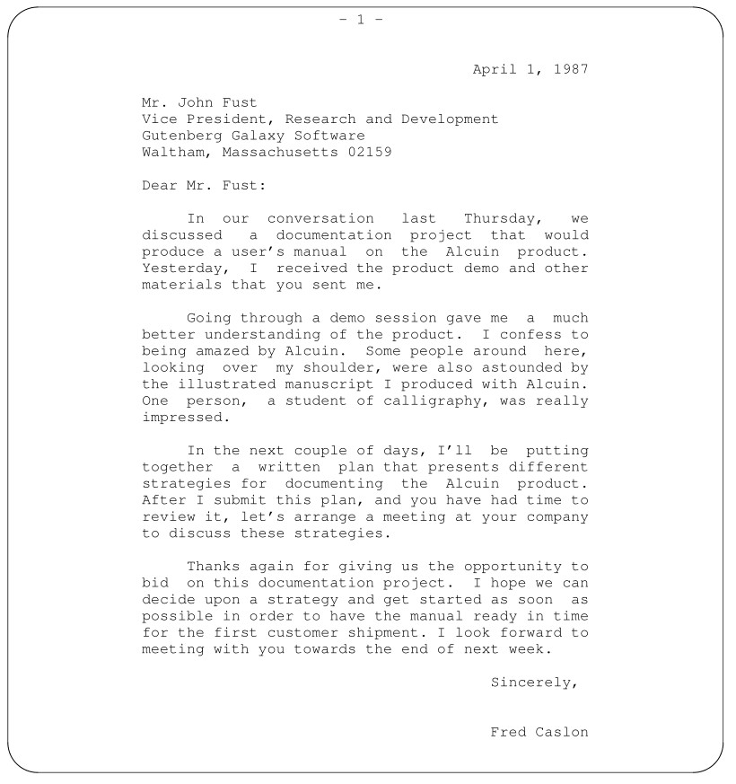  
그림 6.3 서식이 적용된 출력 결과


### Roman, Italic, and Bold Fonts

대부분의 서체에는 최소한 로마체, 굵은체, 기울임체 등 세 가지 글꼴이 제공됩니다. 일반적인 본문은
로마체로 인쇄됩니다. 강조를 위해 일시적으로 굵은체나 기울임체로 변경할 수 있습니다. 4장에서 여러분은
.ft 요청과 인라인 \f 요청을 사용하여 글꼴 변경을 지정하는 방법을 배웠습니다. mm 패키지는 글꼴을 변경하기 위한
일련의 기억하기 쉬운 매크로를 제공합니다:
.B 굵은체
.I 기울임체
.R 로마체
각 매크로는 하나의 인수를 특정 서체로 출력합니다. 한 문장을 다음과 같이 코딩할 수 있습니다:

```
.B Alcuin
revitalizes an
.I age-old
tradition.
```

인쇄된 문장에는 굵게 표시된 단어 하나와 기울임꼴로 표시된 단어 하나가 있습니다. (nroff에서는 굵은 글씨를 오버스트라이크로,
기울임꼴은 밑줄로 표현합니다.)

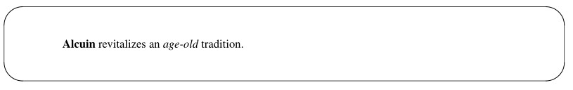

인수가 지정되지 않은 경우, 명시적으로 변경될 때까지 선택된 글꼴이 기본 글꼴로 유지됩니다:

```
The art of
.B
calligraphy
.R
is, quite simply,
.I
beautiful
.R
handwriting;
```

앞서 제시한 예제의 실행 결과는 다음과 같습니다:

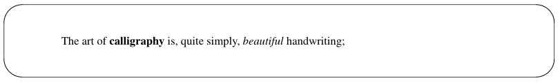

첫 번째 인수가 선택된 글꼴로 변경된다는 점은 이미 확인하셨을 것입니다. 두 번째
인수를 지정하면, 해당 인수는 이전 글꼴로 출력됩니다. 각 매크로는 글꼴을 번갈아 변경하기 위해
최대 여섯 개의 인수를 받습니다. (인수는 공백으로 구분되며, 구를 하나의 인수로 처리하려면
따옴표로 묶어야 합니다). 대체 인수를 유용하게 사용할 수 있는 예로는 구두점을 지정하는 경우가 있는데, 특히
입력 줄을 마침표로 시작할 수 없다는 제한 사항 때문에 더욱 그렇습니다.

```
its opposite is
.B cacography 
```

이 예제의 실행 결과는 다음과 같습니다:

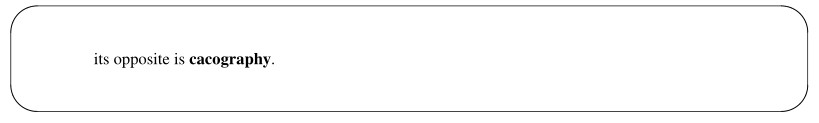

단어나 구로 구성된 대체 인수를 지정하는 경우, 공백을 반드시 포함해야 합니다:

```
The ink pen has been replaced by a
.I light " pen."
```

그러면 다음과 같은 결과가 나옵니다:

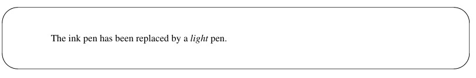

다음은 여섯 가지 인수를 모두 사용한 예시입니다:

```
Alcuin uses three input devices, a
.B "light pen" ", a " "mouse" ", and a " "graphics tablet."
```

그러면 다음과 같은 결과가 나옵니다:

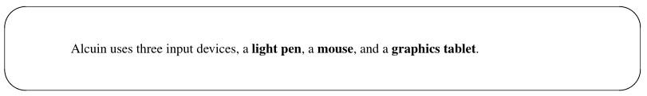

다른 기본 글꼴 및 대체 글꼴을 선택하기 위한 추가 매크로가 있습니다. 이 매크로들도 최대 6개의
인수를 받으며, 인수는 대체 글꼴로 표시됩니다:
.BR 굵은체와 일반체를 번갈아 표시
.IB 이탤릭체와 굵은체를 번갈아 표시
.RI 일반체와 이탤릭체를 번갈아 표시
.BI 대체 굵은체와 이탤릭체
.IR 대체 이탤릭체와 로마체
.RB 대체 로마체와 굵은체
nroff를 사용하는 경우, 굵은체 글꼴을 지정하면 문자가 위쪽에서 덮어쓰기되며, 이탤릭체 글꼴을
지정하면 각 문자에 밑줄이 그어집니다(연속적인 밑줄이 아닙니다). 위쪽 덮어쓰기와 밑줄 처리는
일부 프린터 및 터미널에서 문제를 일으킬 수 있습니다.


### Changing Point Size

troff로 서식을 지정할 때, 글자 크기를 더 크게 또는 더 작게 설정할 수 있습니다. 글자 크기가
변경되면 더 크거나 작은 글자에 필요한 세로 간격에도 영향을 미칩니다. 일반 본문 텍스트는
10포인트 크기로 설정되며, 세로 간격은 2포인트 더 넓게 적용됩니다.
제4장에서 .ps(포인트 크기) 및 .vs(수직 간격) 명령에 대해 배웠습니다. 이 명령들은
mm 단위에서도 작동하지만, mm에는 포인트 크기와 수직 간격을 모두 변경하는 단일 매크로도 있습니다:

```
.S [point size] [vertical spacing]
```

포인트 크기와 수직 간격 값은 현재 설정에 따라 설정할 수 있습니다. ‘+’는 현재 값을 늘리고,
‘-’는 현재 값을 줄입니다. 예를 들어, 상대적인 포인트 크기 변경을 다음과 같이 지정할 수 있습니다:
.S +2 +2
또는 절대적인 값을 다음과 같이 지정할 수 있습니다:
.S 12 14
기본적으로 세로 간격을 지정하지 않으면, 포인트 크기보다 2포인트 더 큰 간격이
유지됩니다. 빈 값(“”)은 현재 설정을 변경하지 않습니다.
새로운 포인트 크기와 수직 간격은 변경할 때까지 유지됩니다. 인수를 지정하지 않고
.S 매크로를 입력하기만 하면 이전 설정으로 복원됩니다:
.S
120 유닉스 텍스트 처리
mm 패키지는 기본값, 이전값, 현재값을 추적하므로 다음 세 가지 인수 중 하나를 사용하여
서로 다른 설정 간에 쉽게 전환할 수 있습니다:
D 기본값
P 이전값
C 현재값
기본값으로 복원하려면 다음을 입력하십시오:
.S D
포인트 크기는 10포인트로 돌아가고, 수직 간격은 자동으로
포인트 크기를 그대로 유지한 채 16포인트로 재설정됩니다. 다음을 입력하십시오:
.S C 16
다음의 레터헤드 예제에서는 회사명을 18포인트 글꼴로, 태그라인을
12포인트 글꼴로 지정한 다음, 기본 설정을 복원합니다:

```
.S 18
Caslon Inc.
.S 12
Communicating Expertise
.S D
```

결과는 다음과 같습니다:


앞서 설명한 .I 매크로를 사용하면 글자 크기와 함께 글꼴도 변경할 수 있습니다. 다음은
12포인트 이탤릭체로 표시된 태그 라인입니다.

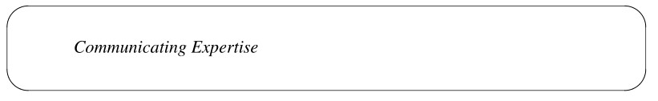

mm의 특수 목적 매크로인 .SM은 지정된 문자열의 포인트 크기를 1포인트 줄여줍니다. .SM 매크로 뒤에는
하나, 둘, 또는 세 개의 문자열을 지정할 수 있습니다. 크기가 줄어드는 인수는 하나뿐이며, 어느 인수가
줄어드는지는 지정된 인수의 개수에 따라 달라집니다. 인수를 하나 또는 둘 지정하면, 첫 번째 인수의 크기가 1
포인트 줄어듭니다:

```
using
.SM UNIX ,
you will find
```

두 번째 인수는 첫 번째 인수와 연결되므로, 쉼표는
UNIX라는 단어 바로 뒤에 위치하게 됩니다:

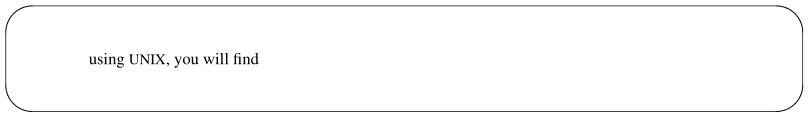

세 개의 인수를 지정하면:
.SM [ UNIX ]
두 번째 인수는 1포인트 줄어드지만, 첫 번째와 세 번째 인수는 현재
포인트 크기로 출력되며, 세 개가 모두 연결됩니다:

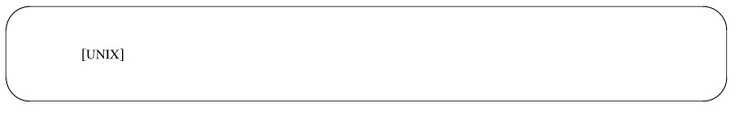


## More about Displays

광의적으로 말하자면, 디스플레이란 문서 본문 내에서
일반 단락으로 설정할 수 없는 모든 종류의 정보를 말합니다. 디스플레이에는 그림, 인용문, 예시, 표, 목록, 수식 또는 도표가 포함될 수 있습니다.
디스플레이 매크로는 디스플레이를 페이지에 배치합니다. 디스플레이 내부에서는 tbl이나 eqn과 같은 다른 매크로
또는 전처리기를 사용할 수 있습니다. 또는 단순히 특별한 처리가 필요한 텍스트 블록이 있을 수도 있습니다.
디스플레이 매크로를 사용하면 다음을 보장받을 수 있습니다.
• 디스플레이 앞뒤에 적절한 간격 확보;
• 디스플레이를 왼쪽 정렬, 들여쓰기 또는 중앙 정렬 블록으로 수평 배치;
• 디스플레이 전체를 한 단위로 유지하여 적절한 페이지 나누기.
.DS 매크로의 기본 동작은 텍스트 블록을 노필(no-fill) 모드로 왼쪽 정렬하는 것입니다. 이 경우 현재 여백으로부터
들여쓰기가 적용되지 않습니다.
.DS 매크로에 최대 세 개의 인수를 지정하여 디스플레이에 대한 다른 서식을 지정할 수
있습니다. 구문은 다음과 같습니다.
.DS [서식] [채움 모드] [오른쪽 들여쓰기]
서식 인수를 사용하면 들여쓰기 또는 중앙 정렬된 디스플레이를 지정할 수 있습니다. 이 인수는 다음 옵션에 해당하는
숫자 값이나 문자로 설정할 수 있습니다.
0 L 들여쓰기 없음 (기본값)
1 I 들여쓰기
2 C 각 줄 중앙 정렬
3 CB 전체 표시 중앙 정렬

일관성을 위해, 디스플레이의 들여쓰기는 처음에 들여쓰기된 단락과 동일하게 설정됩니다(nroff에서는 5개 공백,
troff에서는 3개 엔). 다만 이러한 값들은 Pi와 Si라는 두 개의 서로 다른 숫자 레지스터에
각각 독립적으로 저장됩니다. (기본값을 변경하려면, .nr 명령을 사용하여 원하는 값을
해당 레지스터에 입력하기만 하면 됩니다).
디스플레이를 중앙 정렬하는 방법에는 두 가지가 있습니다. 디스플레이의 각 줄을 개별적으로 중앙 정렬하는 방법(C)과,
디스플레이에서 가장 긴 줄을 기준으로 전체 디스플레이를 블록 단위로 중앙 정렬하는 방법(CB)이 있습니다.
예를 들어, 앞의 목록은 tbl을 사용하여 서식이 지정되었지만, 그 위치는
display 매크로에 의해 제어되었습니다.
.DS CB
.TS
표 사양
.TE
.DE

채우기 모드 인수는 숫자나 문자로 표시됩니다.
0 N 채우기 없음 모드 (기본값)
1 P 채우기 모드
오른쪽 들여쓰기 인수는 오른쪽 여백에서 빼는 숫자 값입니다. nroff에서는
이 값이 자동으로 ens 단위로 변환됩니다. troff에서는 변환된 숫자를 지정할 수 있으며, 그렇지 않은 경우
기본값은 ems입니다.
채움 모드를 다른 들여쓰기 표시 옵션과 함께 사용하면 양쪽이 들여쓰기된 단락을
만들 수 있습니다. 이는 다른 출처에서 긴 인용문을 포함하는 보고서나 제안서에서 자주 사용됩니다. 예를
들면:

```
.P
I was particularly interested in the following comment
found in the product specification:
.DS I F 5
Users first need a brief introduction to what the product
does. Sometimes this is more for the benefit of people
who haven’t yet bought the product, and
are just looking at the manual.
However, it also serves to put the rest of
the manual, and the product itself, in the proper context.
.DE
```

서식 지정 결과는 다음과 같습니다:

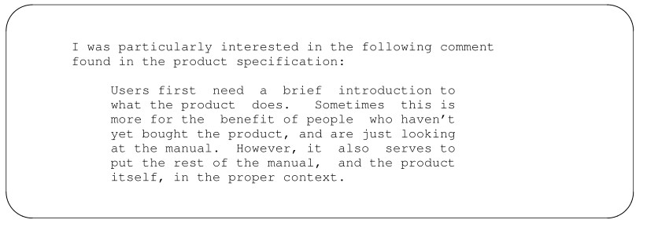

탭을 사용하면 디스플레이 외부의 환경에서 종종 문제가 발생합니다. 입력 파일에 탭을 사용하여 입력된
내용은 디스플레이 매크로의 기본 설정인 ‘no-fill’ 모드로 서식을 지정해야 합니다. 다음
표는 탭을 사용하여 간격을 조정하도록 설계되었습니다:

```
.DF I
Dates Description of Task
June 30 Submit audience analysis
July 2 Meeting to review audience analysis
July 15 Submit detailed outline
August 1 Submit first draft
August 5 Return of first draft
August 8 Meeting to review comments
.DE
```

이 표는 파일에서 보이는 그대로 출력됩니다. 이 자료가
‘채우기 없음’ 모드의 디스플레이 내에서 처리되지 않았다면, 열들이 제대로 정렬되지 않았을 것입니다.


### Static and Floating Displays

디스플레이에는 정적 디스플레이와 플로팅 디스플레이, 두 가지 유형이 있습니다. 이 둘의 차이는 디스플레이가
현재 페이지에 전체가 들어가지 않을 때 어떻게 처리되는지에 있습니다. 정적 디스플레이와 플로팅 디스플레이 모두
현재 페이지에 들어가지 않을 경우 다음 페이지 상단에 블록을 출력하지만, 플로팅
디스플레이만이 디스플레이 뒤에 오는 텍스트를 사용하여 앞 페이지를 채울 수 있게 해줍니다. 정적 디스플레이는
입력 파일에서 디스플레이가 배치된 순서를 그대로 유지합니다.
우리는 이미 .DS와 .DE를 사용하여 정적 디스플레이의 시작과 끝을 표시한 바 있습니다. 플로팅
디스플레이를 지정할 때는 종료 표시는 동일하지만, 시작은 .DF 매크로로 표시합니다. 옵션은
.DS 매크로와 동일합니다.
다음 입력 파일 예제에서는 실제 텍스트 줄 대신 숫자를 사용했습니다:

```
1
2
3
4
5
.DF
Long Display
.DE
6
7
8
9
10
```

화면에 페이지 나누기가 발생할 만큼 충분한 줄 수가 있다고 가정할 때,
다음과 같은 두 페이지의 레이아웃이 생성될 수 있습니다:

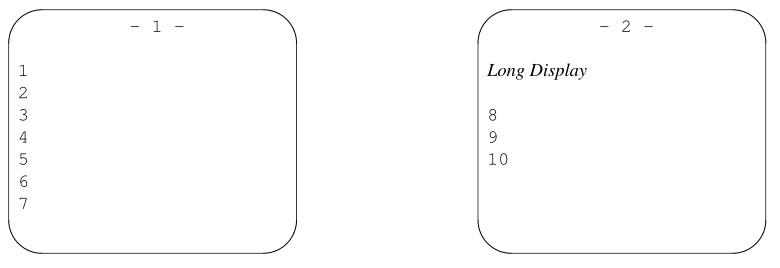

만약 1페이지에 디스플레이를 넣을 공간이 있었다면, 그곳에 배치되었을 것이며, 6행과 7행은
입력 파일에서와 마찬가지로 디스플레이 뒤에 이어졌을 것입니다.
정적 디스플레이가 지정되었다면, 해당 디스플레이는 2페이지의 동일한 위치에 배치되었을 것이며,
6행과 7행은 그 뒤에 이어져야 했으므로 1페이지 하단에 여백이 남게 되었을 것입니다. 유동 디스플레이는
페이지의 사용 가능한 공간을 최대한 효율적으로 활용하려고 시도합니다.
포맷터는 아직 출력하지 않은 유동 디스플레이를 보관하기 위해 큐를 유지합니다. 페이지의
맨 위 부분에 도달하면 큐에 있는 다음 디스플레이가 출력됩니다. 큐는 채워진 순서대로
(선입선출) 비워집니다. De와 Df라는 두 개의 숫자 레지스터를 사용하면 디스플레이가
큐에서 제거되어 제 위치에 배치되는 시점을 제어할 수 있습니다.
섹션 매크로 .H 및 .HU(곧 살펴보겠습니다)로 표시된 섹션의 끝이나
입력 파일의 끝에서, 큐에 남아 있는 모든 플로팅 디스플레이는 문서에 배치됩니다.


### Display Labels

표, 수식, 삽입물 및 그림에 제목이나 설명을 추가할 수 있습니다. 또한, 이러한 항목에
라벨을 지정하고 순서대로 번호를 매길 수 있을 뿐만 아니라, 파일 끝부분의 목차에 인쇄할 수도 있습니다. 다음
매크로 그룹을 사용할 수 있습니다:

```
.EC Equation
.EX Exhibit
.FG Figure
```

이 매크로들은 모두 동일한 방식으로 작동하며, 일반적으로 .DS/.DE 매크로 쌍 사이에 지정되어
제목과 표가 같은 페이지에 표시되도록 합니다. 각 매크로 뒤에는 제목을 붙일 수 있습니다. 제목에
공백이 포함된 경우, 따옴표로 묶어야 합니다. 표의 제목은 대개 표의 맨 위에
표시되므로, tbl에 표가 있음을 알리는 .TS 매크로보다 먼저 지정해야 합니다(
8장 참조).

```
.TB "List of Required Resources"
.TS
```

라벨은 중앙에 정렬되어 있습니다:

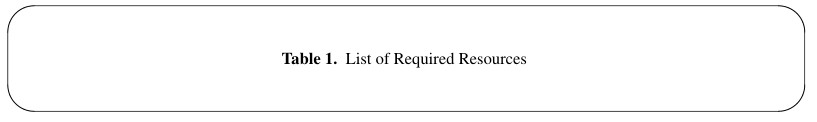

제목이 줄 길이를 초과할 경우, 여러 줄로 나뉘어 표시됩니다. 추가된 줄은
들여쓰기가 적용되며, 제목의 첫 번째 문자로 시작합니다.

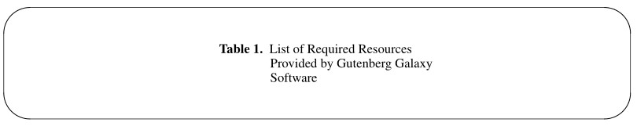

방정식, 도표 및 그림에 대한 설명은 대개 해당 내용 뒤에 나옵니다. 다음은:

```
.FG "Drawing with a Light Pen"
```

가운데 정렬된 선을 생성합니다:

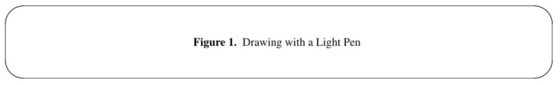

숫자 레지스터 Of를 1로 설정하면 레이블의 기본 형식을 약간 변경할 수 있습니다. 이렇게 하면
마침표가 대시로 대체됩니다.

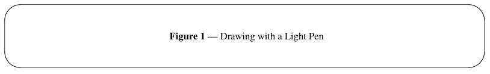

라벨 매크로로 지정된 두 번째 및 세 번째 인자는 디스플레이의
기본 번호 매기기를 수정하거나 재정의하는 데 사용할 수 있습니다. 기본적으로 두 번째 인자는 리터럴이고, 세 번째 인자는 해당 리터럴이 무엇을 의미하는지 지정하는 숫자
값입니다.
세 번째 인자가
0이면 두 번째 인자는 접두사로 처리되고,
1이면 두 번째 인자는 접미사로 처리되며,
2이면 두 번째 인자가 일반적인 표 번호를 대체합니다.
따라서, 다음과 같은 레이블을 사용하여 관련 표 두 개를 1a와 1b로 지정할 수 있습니다:

```
.TB "Estimated Hours: June, July, and August" a 1
.TB "Estimated Hours: September and November," 1b 2
```

(이 레이블들은 세 번째 인자의 두 가지 다른 사용법을 보여줍니다. 일반적으로는 주어진 테이블 집합에 대해 한 가지 기법이나
다른 기법 중 하나를 일관되게 사용해야 합니다).
tbl의 경우, 테이블 구분자는 .TS/.TE입니다. eqn의 경우, 방정식 구분자는 .EQ/.EN입니다.
pic의 경우, 그림이나 도표의 구분자는 .PS/.PE입니다. 이러한 구분자 쌍은 특정 전처리기에 의해
처리될 블록을 나타냅니다. 각 전처리기에 대한 정보는
8장부터 10장까지에서 확인할 수 있습니다. 앞서 언급했듯이, 전처리기는 표시물을 생성하고, 표시 매크로는 이를 배치하며,
라벨 매크로는 제목과 번호를 추가합니다.
사소한 점처럼 보일 수 있지만, 이러한 각 단계는 독립적이며, 완전히 통합되어 있지 않기 때문에
일부 중복되는 부분이 있습니다.
라벨 매크로는 전처리기와 독립적이므로, 디스플레이가 존재하는지 확인하지 않으며
tbl을 사용하여 표가 생성되었는지 확인하지도 않습니다. 탭을 사용하여 2열 표를 만들거나
문자 기호를 사용하여 그림을 만든 후에도 라벨을 부여할 수 있습니다. 또는 표의 첫 번째 줄에 표 제목을 만들고
tbl이 이를 처리하도록 할 수도 있습니다(tbl은 번호를 제공하지 않으며, 해당 표는 목차에
포함되지 않습니다).

tbl에서는 테이블을 중앙 정렬하도록 지정하고 .DS/.DE 매크로를 사용하지 않을 수 있습니다. 하지만 그 결과,
nroff/troff는 표를 한 페이지에 모두 담으려고 제대로 시도하지 않을 것이며, 사용자는
수동으로 페이지 나누기를 해야 할 수도 있습니다. 다른 방법으로 동일한 효과를 얻을 수 있는지 여부와 관계없이 문서 전체에 걸쳐
표시 매크로를 사용하는 것이 권장됩니다. 왜냐하면 적어도 이를 통해
일관성을 확보할 수 있기 때문입니다.


## Forcing a Page Break

때로는 관련 내용이 한데 묶여 있도록 하거나,
그림과 같이 수동으로 삽입할 내용을 위해 여러 페이지를 확보하기 위해 페이지 나누기를 강제로 적용하고 싶을 수 있습니다. .SK
(skip) 매크로는 페이지 나누기를 강제로 적용합니다. 이 매크로 뒤에 오는 텍스트는 다음 페이지의 맨 위에 출력됩니다.
0보다 큰 인수가 지정되면, 텍스트 출력을 재개하기 전에 해당 페이지 수만큼 건너뜁니다.
“빈” 페이지도 인쇄되며, 이 페이지들에는 일반적인 머리글과 바닥글이 포함됩니다.

```
On the next page, you will find a sample page from an
Alcuin manuscript printed with a 16-color plotter.
.SK 1
```


## Formatting Lists

mm 매크로 패키지는 항목 목록을 표시하기 위한 다양한 형식을 제공합니다. 다음 네 가지 표준 목록 유형 중에서
선택할 수 있습니다.
• 글머리 기호
• 대시
• 번호 매기기
• 알파벳 순서
또한, 비표준 기호나 텍스트 레이블을 사용하여 목록을 유연하게 만들 수 있습니다. 목록 매크로는
매달린 들여쓰기가 적용된 단락을 생성하는 데에도 사용할 수 있습니다.
각 목록 항목은 왼쪽 열에 있는 특수 기호, 문자, 숫자 또는 레이블과 오른쪽 열에 들여쓰기된
텍스트 단락으로 구성됩니다.


### Structuring a List

목록 매크로를 사용하면 훨씬 더 방대하고 번거로울 수 있는 서식 지정 작업을 간소화할 수 있습니다. 방금 보여드린 글머리 기호 목록을 만드는 코드는 다음과 같습니다:

```
.BL
.LI
bulleted
.LI
dashed
.LI
numbered
.LI
alphabetized
.LE
```

입력 파일의 텍스트 구조는 목록 초기화 매크로(.BL), 항목 표시 매크로
(.LI), 목록 종료 매크로(.LE)의 세 부분으로 구성됩니다.
먼저, 원하는 목록 유형에 맞는 특정 매크로를 지정하여 목록을 초기화합니다. 예를 들어,
BL은 글머리 기호 목록을 초기화합니다.
목록 초기화 매크로를 사용하여 텍스트의 들여쓰기를 변경하거나
목록 항목 간의 자동 간격을 해제하는 인수를 지정할 수 있습니다. 이러한 인수에 대해서는
나중에 목록 초기화 매크로를 더 자세히 살펴볼 때 다루겠습니다.
다음으로, 목록에 포함될 각 항목을 지정합니다. 항목 표시 매크로인 .LI는 각
항목 앞에 배치됩니다. 매크로 뒤에 한 줄 이상의 텍스트를 입력할 수 있습니다.

```
.BL
.LI
Item 1
.LI
Item 2
.LI
Item 3
```

목록이 서식 지정될 때, .LI 매크로는 각 항목 앞에 한 줄의 여백을 삽입합니다. (더 간결한 목록을 만들고 싶다면,
목록 초기화 매크로에 인수를 지정하여 이 줄을 생략할 수 있습니다.
이에 대해서는 잠시 후에 더 자세히 다루겠습니다.)
.LI 매크로는 현재 마크를 재정의하거나 앞에 추가하는 데에도 사용할 수 있습니다. 마크가
유일한 인수로 지정되면, 현재 마크를 대체합니다. 예를 들어:

```
.LI o
Item 4
```

첫 번째 인수로 마크를 지정하고, 두 번째 인수로 1을 지정하면, 지정된 마크가
현재 마크 앞에 추가됩니다. 다음 예시를 보세요:

```
.LI - 1
Item 5
```

다음과 같은 결과가 나올 것입니다:

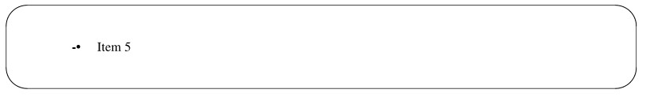

마크 대신 텍스트 레이블을 사용할 수도 있지만, 이 경우 목록을
올바르게 정렬하는 데 몇 가지 추가적인 문제가 발생합니다. 변수 항목 목록에 대한 텍스트 레이블에 대해서는 나중에 살펴보겠습니다.
.LI 매크로는 각 목록 항목 뒤에 자동으로 공백을 제공하지 않습니다. 한 줄의 공백을 원할 경우
인수로 1을 지정할 수 있습니다.
목록의 끝은 목록 종료 매크로 .LE로 표시됩니다. 이 매크로는 마지막 목록 초기화 매크로가 호출되기
전에 적용되었던 페이지 서식 설정을 복원합니다. .LE 매크로는 인자로 1을 지정하지 않는 한
목록 뒤에 공백을 출력하지 않습니다. (목록 바로 뒤에 단락 매크로와 같이 공백을 출력하는 매크로가
이어지는 경우에는 이 인자를 지정하지 마십시오).
목록의 기본 구조를 확실히 숙지해야 합니다. 흔히 발생하는 문제 중 하나는 .LE로 목록을
닫지 않는 것입니다. 대부분의 경우, 이 오류로 인해 포맷터가 파일의 해당 지점에서 중단됩니다. 덜 심각하지만
그럼에도 빈번하게 발생하는 실수는 목록 초기화 매크로와 목록의 첫 번째 항목 사이에 첫 번째 .LI를
생략하는 것입니다. 목록은 출력되지만 첫 번째 항목의 정렬이 어긋나게 됩니다.
다음은 목록의 예시입니다:

```
.BL
.LI
Item 1
.LI
Item 2
.LI
Item 3
.LI o
Item 4
.LI - 1
Item 5
.LE
```

샘플 목록에서 생성된 troff 출력은 다음과 같습니다:

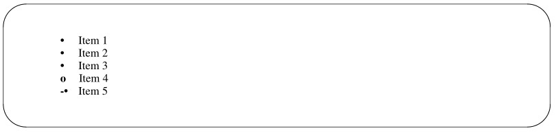

목록 구조는 최대 6단계까지 다른 목록 안에 중첩될 수 있습니다. 서로 다른 유형의 목록을
중첩할 수 있으므로, 들여쓰기가 적용된 개요 구조를 만들 수 있습니다. 하지만 프로그램에서 중첩된 if-then 구조와 마찬가지로,
현재 어느 단계에 있는지 확실히 파악하고 각 목록을 반드시 닫아야 합니다.

예를 들어, 글머리 기호 목록을 번호 매기기 목록 안에 중첩할 수 있습니다. 목록 초기화 매크로 .AL은
알파벳순 및 번호 매기기 목록을 생성합니다.

```
.AL
.LI
Don’t worry, we’ll get to the list-initialization macro .AL.
You can specify five different variations of
alphabetic and numbered lists.
.BL
.LI
Item 1
.LI
Item 2
.LI
Item 3
.LE
.LI
We’ll also look at variable-item lists.
.LE
```

이 입력은 troff를 통해 다음과 같이 서식이 지정된 목록을 생성합니다:

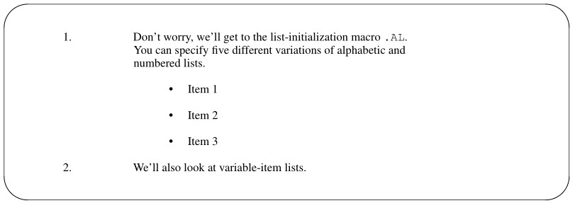

목록을 수정하는 것이 얼마나 쉬운지 이미 아실 수도 있습니다. 목록에 있는 항목들은
손쉽게 새로운 순서로 재배열할 수 있습니다. 번호가 매겨진 목록의 경우, 번호 체계를 다시 조정하지 않고도
새로운 항목을 추가할 수 있습니다. 글머리 기호 목록은 목록 초기화
매크로를 변경하기만 하면 알파벳순 목록으로 바꿀 수 있습니다. 또한 일반적으로 들여쓰기 수준 설정이나 항목 간 간격 지정과 같은
다양한 구체적인 서식 설정에 대해 신경 쓸 필요가 없습니다.
반면, 입력 파일에서는 서식이 적용된 출력물만큼 목록의 구조를 쉽게 파악하기 어렵기 때문에,
복잡한 목록, 특히 여러 단계로 중첩된 목록을 해석하는 데 어려움을 겪을 수 있습니다. 코드 검사 프로그램인 checkmm이 도움이 될 수 있으며,
또한 목록의 문제를 확인하고 수정하기 위해 서식을 적용하고 출력하는 과정을 반복해 볼 수도 있습니다.


### Marked Lists

기술 문서에서 오랫동안 기본으로 사용되어 온 표시 목록은 관련 항목들을 명확하게 정리하고,
읽기 쉽도록 구분해 줍니다. 글머리 기호(•)로 표시된 항목 목록은 아마도 가장 일반적인 목록 유형일 것입니다.
또 다른 유형의 표시 목록은 대시(—)를 사용합니다. 세 번째 유형의 목록은 사용자가 사각형( )과 같은
표시 기호를 직접 지정할 수 있게 해줍니다. 이러한 목록에 대한 목록 초기화 매크로는 다음과 같습니다:

```
.BL [text indent] [1]
.DL [text indent] [1]
.ML [mark] [text indent] [1]
```

.BL 매크로를 사용하면 텍스트가 들여쓰기된 단락의 첫 줄과 동일한 만큼 들여쓰기됩니다. 글머리 기호와 텍스트 사이에는
공백 하나만큼의 간격이 유지됩니다. 글머리 기호는 오른쪽 정렬되어 있어 왼쪽 여백에서
몇 칸 정도 들여쓰기가 됩니다.
이 nroff 형식의 출력 결과에서 볼 수 있듯이, nroff에서는 o 위에 +를
덮어쓰는 방식으로 글머리 기호를 표현합니다:

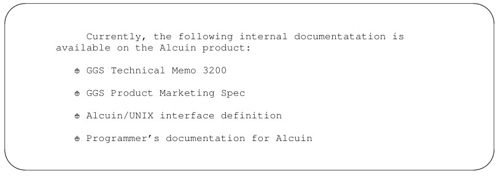

텍스트 들여쓰기를 지정하면, 텍스트의 첫 번째 문자가 해당 위치에서 시작됩니다. 글머리 기호의 위치는
텍스트를 기준으로 하며, 항상 텍스트의 왼쪽으로 한 칸 떨어져 있습니다.
마지막 인자가 1이면, 항목을 구분하는 공백 행이 생략됩니다. 이 인자만 지정하려면
텍스트 들여쓰기에 값이나 null 값(“”)을 반드시 지정해야 합니다.
.BL “” 1
이렇게 하면 훨씬 더 간결한 목록이 생성됩니다:

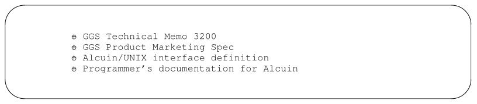

nroff가 생성하는 글머리 기호는 과다한 강조로 인해 항상 적절하지는 않으므로, 점선
목록이 적절한 대안이 됩니다. .DL 매크로를 사용하면, 점선 목록에서 대시는 글머리 기호 목록의
글머리 기호와 동일한 위치에 배치됩니다. 대시와 텍스트 사이에는 공백 하나가 유지되며, 이 텍스트는
글머리 기호 목록의 텍스트와 마찬가지로, 들여쓰기 단락(Pi)에 대한 숫자 레지스터에 지정된 만큼 들여쓰기됩니다.
nroff 포맷터는 단일 하이픈 형태의 대시를 제공하며, troff는 엠 대시를 제공합니다.
엠 대시가 더 길고 대시가 오른쪽 정렬되어 있기 때문에, 왼쪽 여백과의 정렬이 눈에 띄게
다릅니다. troff에서는 왼쪽 정렬로 표시되지만, nroff에서는 대시가 더 작기 때문에
몇 칸 정도 들여쓰기된 것처럼 보입니다.

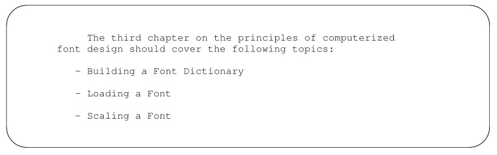

텍스트 들여쓰기를 지정하거나, 두 번째 인수로 1을 입력하여 항목 사이의 간격을 없앨 수 있습니다.
.ML 매크로를 사용할 때는 목록의 마크를 지정해야 합니다. 사용 가능한 기호로는
정사각형(\(sq\)를 입력하면 ), 체크 표시와 유사한 제곱근(\(sr\)를 입력하면 √), 그리고
기울기 기호(\(gr\)를 입력하면 ∇) 등이 있습니다. 사용자가 지정한 기호는 첫 번째 인자로 사용됩니다.
.ML \(sq
troff에서 사용할 수 있는 모든 문자나 기호가 nroff에서도 동일한 효과를 나타내는 것은 아닙니다.
글머리 기호나 점선 목록과 달리, 사용자 지정 기호 뒤의 텍스트는 자동으로 들여쓰기되지 않습니다. 그러나
기호 뒤에는 공백이 추가됩니다. 다음은 들여쓰기된 단락과 목록의 예시이며,
기호로 정사각형을 지정했고, nroff를 사용하여 서식이 지정되었습니다. 정사각형은 괄호 한 쌍으로 표시됩니다.

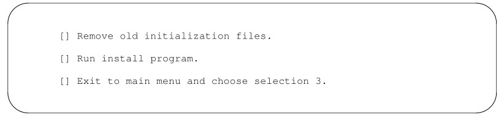

사용자가 지정한 표시 뒤에는 텍스트 들여쓰기를 지정하는 두 번째 인자와, 항목 사이의 공백을 생략하기 위한 1을 값으로 갖는 세 번째 인자를
이어서 지정할 수 있습니다.
다음 예제는 list-initialization 명령을 사용하여 생성되었습니다:
.ML \(sq 5 1
지정된 들여쓰기 값 5는 텍스트를 들여쓰기된 단락과 정렬합니다:

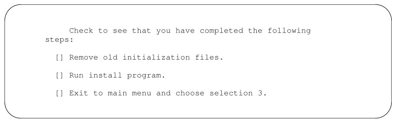


### Numbered and Alphabetic Lists

.AL 매크로는 번호가 자동으로 매겨지거나 알파벳 순서로 정렬된 목록을 초기화하는 데 사용됩니다. 이
매크로의 구문은 다음과 같습니다:

```
.AL [type] [text indent] [1]
```

인수가 지정되지 않으면 .AL 매크로는 번호가 매겨진 목록을 생성합니다. 예를 들어, 다음 단락은
목록 초기화 매크로인 .AL을 사용하여 다음과 같이 코딩할 수 있습니다:

```
User-oriented documentation recognizes three things:
.AL
.LI
that a new user needs to learn the system in stages,
getting a sense of the system as a whole while becoming
proficient in performing particular tasks;
.LI
that there are different levels of users, and not every
user needs to learn all the capabilities of the system
in order to be productive;
.LI
that an experienced user must be able to rely on the
documentation for accurate and thorough reference
information.
.LE
```

번호가 매겨진 목록을 만들려면:

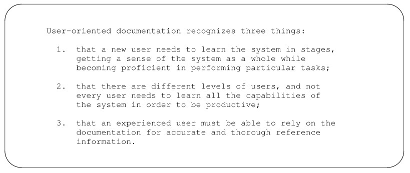

숫자 뒤에는 마침표가 오며, 마침표와 텍스트의 첫 번째 문자 사이에는
공백 두 개가 유지됩니다.
숫자 레지스터 Li에 지정된 텍스트 들여쓰기 수준은 nroff에서는 6이고 troff에서는 5입니다. 이
값은 현재 들여쓰기 값에 더해집니다. 텍스트 들여쓰기가 지정된 경우, 해당 값은 현재 들여쓰기 값에 더해지지만,
Li의 값은 변경되지 않습니다.
세 번째 인자는 목록 항목 간의 간격을 제거합니다. 또한, 숫자 레지스터 Ls는
중첩 수준을 나타내는 0에서 6 사이의 값으로 설정할 수 있습니다. 이 수준 이후의 목록은 항목 사이에
간격이 생기지 않습니다. 기본값은 최대 중첩 깊이인 6입니다. Ls가 2로 설정된 경우, 두 번째
수준까지의 목록에만 항목 사이에 빈 줄이 생깁니다.
다른 유형의 리스트는 .AL을 사용하여 지정할 수 있으며, 첫 번째 인수를 통해 다음과 같이 리스트 유형을 지정합니다:
다음과 같이:

값 순서 설명
1 1, 2, 3 숫자 순서
A A, B, C 알파벳 순서 (대문자)
a a, b, c 알파벳 순서 (소문자)
I I, II, III 로마 숫자 (대문자)
i i, ii, iii 로마 숫자(소문자)
유형 인수를 변경하기만 해도 다양한 목록 유형을 생성할 수 있습니다. 서로 다른 유형의 목록을 중첩하여 매우 유용한
개요 형식을 만들 수 있습니다. 이러한 개요의 예시로는 I, A, 1, a 순서로 4단계까지 중첩된
형식이 있습니다. 다소 복잡해 보이는 입력 파일은 그림
6-4에 나와 있으며(각 목록을 더 쉽게 볼 수 있도록 들여쓰기를 했으나, 실제로는 이러한 형식으로 포맷될 수는 없음),
nroff로 포맷된 출력은 그림 6-5에 나와 있습니다.
번호가 매겨진 목록을 생성하는 또 다른 목록 초기화 매크로는 .RL(참조 목록)입니다. 유일한 차이점은
참조 번호가 대괄호([])로 묶여 있다는 점입니다.

.RL [텍스트 들여쓰기] [1]
이 인자들은 .AL 매크로로 지정된 인자들과 동일한 효과를 냅니다. 항목 사이에 공백 없이 참조 목록을 초기화하려면
다음과 같이 사용하십시오:
.RL “” 1
그러면 다음과 같은 참조 목록이 생성됩니다:

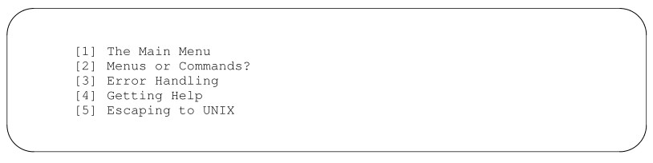

```
.AL I
.LI
Quick Tour of Alcuin
    .AL A
    .LI
    Introduction to Calligraphy
    .LI
    Digest of Alcuin Commands
    .AL 1
    .LI
    Three Methods of Command Entry
    .AL a
    .LI
    Mouse
    .LI
    Keyboard
    .LI
    Light Pen
    .LE
    .LI
    Starting a Page
    .LI
    Drawing Characters
    .AL a
    .LI
    Choosing a Font
    .LI
    Switching Fonts
    .LE
    .LI
    Creating Figures
    .LI
    Printing
    .LE
    .LI
    Sample Illuminated Manuscripts
    .LE
    .LI
Using Graphic Characters
.AL A
.LI
Modifying Font Style
.LI
Drawing Your Own Font
.LE
.LI
Library of Hand-Lettered Fonts
.LE
```

그림 6.4. 복합 목록에 대한 입력

  
그림 6.5 복합 리스트의 출력


### Variable-Item Lists

가변 항목 목록의 경우, 마크를 지정하지 않고 대신 각 .LI에 텍스트 레이블을 지정합니다. .LI 뒤에 오는 하나 이상의
텍스트 줄은 레이블에서 들여쓰기된 블록 단락을 형성하는 데 사용됩니다. 레이블이
지정되지 않으면, 매달린 들여쓰기가 적용된 단락이 생성됩니다. 구문은 다음과 같습니다:
.VL 텍스트 들여쓰기 [레이블 들여쓰기] [1]
다른 목록 초기화 매크로와 달리, 텍스트 들여쓰기는 필수입니다. 기본적으로 레이블 들여쓰기가 지정되지 않은 경우, 레이블은 왼쪽 정렬됩니다.
텍스트 들여쓰기와 레이블 들여쓰기를 모두 지정하면, 텍스트의 들여쓰기 값이
레이블 들여쓰기 값에 더해집니다.
변수 항목 목록은 다양한 구문
항목을 설명하는 명령어 참조 페이지와, 한 열에는 용어를, 다른 열에는 그 정의를 제시하는 용어집을 작성할 때 유용합니다. 텍스트 레이블은
단일 단어 또는 구여야 합니다. 다음 예제는 참조
페이지의 입력 파일 일부를 보여줍니다:

```
.VL 15 5
.LI figure
is the name of a cataloged figure. If
a figure has not been cataloged, you need to use
the LOCATE command.
.LI f:p
is the scale of the
figure in relation to the page.
.LI font
is the two-character abbreviation or
full name of one of the available fonts
from the Alcuin library.
.LE
```

다음과 같은 가변 항목 목록이 생성됩니다:

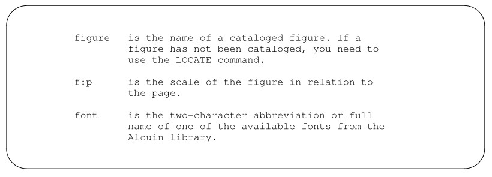

.LI에 텍스트 레이블을 지정하지 않거나 빈 인자(“”)를 전달하면,
매달린 들여쓰기가 적용된 단락이 생성됩니다. 레이블 없이 항목을 출력하려면 .LI 뒤에 백슬래시 뒤에 공백(\ )
또는 \0을 지정하십시오. 마찬가지로, 공백이 포함된 레이블을 지정하려면 공백 앞에
백슬래시를 붙이고 레이블을 따옴표로 묶어야 합니다:
.LI “point\ size”
또는 단순히 공백 대신 \0을 사용하면 됩니다:
.LI point\0size
첫 번째 줄은 왼쪽 정렬(또는 label indent에 지정된 만큼 들여쓰기)되며, 나머지
줄들은 text indent에 지정된 만큼 들여쓰기됩니다. 이렇게 하면 매달린
들여쓰기가 적용된 단락이 생성됩니다:

```
.VL 15
.LI
There are currently 16 font dictionaries in the Alcuin
library. Any application may have up to 12 dictionaries
resident in memory at the same time.
.LE
```

서식이 적용되면 이 항목은 15의 매달린 들여쓰기가 적용됩니다:


## Headings

앞서 우리는 목록 매크로를 사용하여 들여쓰기가 적용된 개요를 만들었습니다. 4단계로 들여쓰기가 적용된 이 개요는
문서의 구조를 시각적으로 나타낸 것입니다. 제목은 이와 유사한 기능을 수행하여,
문서가 섹션과 하위 섹션으로 어떻게 구성되어 있는지를 보여줍니다. 기술 문서나 책 분량의
원고에서는 독자가 쉽게 파악할 수 있는 구조를 갖추는 것이 매우 중요합니다.


### Numbered and Unnumbered Headings

mm을 사용하면 다양한 스타일을 적용하여 최대 7단계의 번호가 매겨진 제목과 번호가 매겨지지 않은 제목을 만들 수 있습니다.
제목 매크로는 두 가지가 있습니다. 번호가 매겨진 제목용 .H와 번호가 매겨지지 않은 제목용 .HU입니다. 다양한 번호 레지스터를 설정하고 문자열을 정의함으로써
각 제목 단계마다 서로 다른 스타일을 지정할 수 있습니다.
먼저 번호가 매겨진 제목을 만드는 방법을 살펴보겠습니다. .H 매크로의 구문은 다음과 같습니다:

```
.H level [heading text] [heading suffix]
```

.H 매크로를 사용하는 가장 간단한 방법은 1에서 7 사이의 숫자로 수준을 지정한 다음,
제목으로 출력될 텍스트를 이어서 작성하는 것입니다. 제목 텍스트에 공백이 포함된 경우, 따옴표로
묶어야 합니다. 한 줄을 초과하는 제목은 다음 줄로 넘어가게 됩니다. 여러 줄로 구성된 제목은
페이지 나누기가 발생하더라도 한 덩어리로 유지됩니다.
제목 접미사를 지정하면, 이 텍스트나 기호가 제목에 표시되지만 목차에는
포함되지 않습니다.
최상위 제목은 인자로 1을 지정하여 나타냅니다:

```
.H 1 "Quick Tour of Alcuin"
```

그 결과, 제목 앞에 제목 수준 번호가 붙게 됩니다. 1단계 제목에는 숫자 1이 붙습니다.

1. Quick Tour of Alcuin
2단계 제목은 인자로 2를 지정하여 표시합니다:
.H 2 "Introduction to Calligraphy"
첫 번째 2단계 제목 번호가 출력됩니다:
1.1 Introduction to Calligraphy
동일한 단계에서 다른 제목이 지정되면, 제목 단계 번호가 자동으로 증가합니다.
다음 제목이 2단계인 경우:
.H 2 "Digest of Alcuin Commands"
다음과 같이 출력됩니다:
1.2 Digest of Alcuin Commands
새로운 (번호가 더 높은) 수준으로 넘어갈 때마다, 기존 수준을 나타내는 번호 뒤에 .1이 추가됩니다.
동일한 수준에서 매번 호출할 때마다 해당 번호는 증가합니다. 한 수준에서 한 단계 뒤로 물러날 때(예를 들어,
5단계에서 4단계로), 해당 수준(이 경우 5단계)의 카운터는 0으로 재설정됩니다.

번호가 없는 제목은 사실상 0단계 제목입니다:
.H 0 "Introduction to Calligraphy"
번호가 없는 제목을 위해 별도의 매크로인 .HU가 개발되었으나, 그 효과는 동일합니다.
.HU "Introduction to Calligraphy"
번호가 없는 제목은 번호가 표시되지 않더라도 2단계
제목의 카운터를 증가시킵니다. 따라서 다음 예시에서 “서예 입문”이라는 제목은 번호가 없지만,
번호 매기기 체계에 있어서는 마치 2단계 제목(1.1)인 것과 동일한 효과를 냅니다.

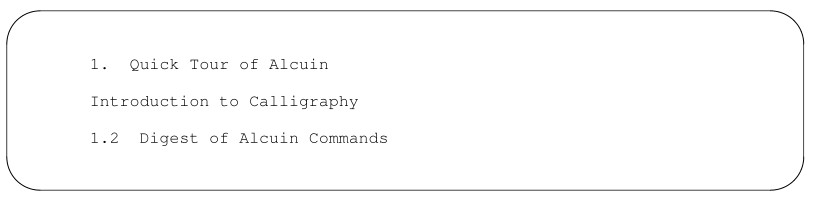

번호가 매겨진 제목과 번호가 매겨지지 않은 제목을 함께 사용하려는 경우, 번호 등록기
Hu를 문서에 포함된 가장 낮은 수준의 제목으로 변경할 수 있습니다. Hu를 2에서 더 큰 숫자로 변경하면:

```
.nr Hu 5
.H 1 "Quick Tour of Alcuin"
.HU "Introduction to Calligraphy"
.H 2 "Digest of Alcuin Commands"
```

번호가 매겨지지 않은 제목 뒤에 번호가 매겨진 제목이 올 경우, 번호 매기기 순서는 유지됩니다:

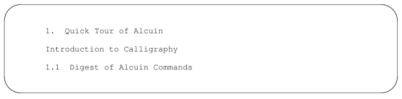

제목은 문서의 구조를 한눈에 파악할 수 있게 해주는 시각적 지표 역할을 합니다. 번호가 매겨지지 않은 제목을
사용하는 경우, 제목을 더욱 눈에 띄게 만드는 것이 더욱 중요해집니다. 간단히 할 수 있는 방법 중 하나는 1단계
제목에 대문자를 사용하는 것입니다.
다음은 제목의 모양을 변경하기 위해 사용할 수 있는 몇 가지 방법 목록입니다. 단,
일부 항목은 nroff로 서식을 지정하는지, 아니면 troff로 서식을 지정하는지에 따라 달라집니다:
• 로마체, 이탤릭체 또는 굵은체로 변경
• 제목의 포인트 크기 변경
• 제목 뒤의 간격 조정
• 제목의 정렬을 중앙 정렬 또는 왼쪽 정렬로 설정
• 번호 매기기 방식 변경
• 다른 제목 기호 선택
제목 스타일을 디자인할 때 가장 중요한 점은 독자가 서로 다른 수준의
제목을 구분할 수 있도록 돕는 것입니다. 예를 들어, 개요 형식에서는 들여쓰기 수준에 따라 주제가 절인지
하위 절인지가 구분됩니다. 번호가 매겨진 제목을 사용하는 것이 이를 달성하는 효과적인 방법입니다. 번호가 매겨지지 않은

제목을 사용하는 경우, 각 수준마다 제목 스타일을 다르게 설정하고 싶을 수 있지만, 실용적인 목적으로는
두세 단계로 제한하는 것이 좋습니다.
먼저, 기본 제목 스타일을 사용할 경우 어떤 결과가 나오는지 살펴보겠습니다.
첫 두 단계의 제목은 troff에서는 이탤릭체, nroff에서는 밑줄이 그어진 텍스트로 표시되도록 설정되어 있습니다.
제목 뒤에는 본문의 첫 번째 단락 앞에 빈 줄 하나가 있습니다. 또한, 최상위
제목 앞에는 두 줄의 빈 줄이 있고, 그 외 모든 단계의 제목 앞에는 한 줄의 빈 줄이 있습니다.

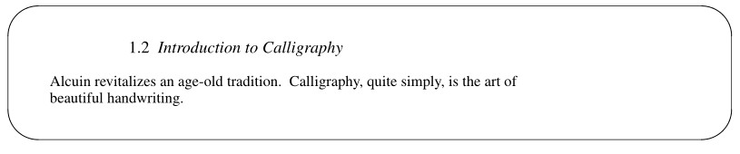

3단계부터 7단계까지는 모두 동일한 형식을 따릅니다. 본문은 기울임꼴이거나 밑줄이 그어져 있으며, 줄바꿈은
없습니다. 제목 본문 앞뒤에는 두 줄의 공백이 유지됩니다. 예를 들어:

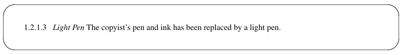

문서 내 제목의 기본 모양을 변경하려면 다음 두
문자열에 새로운 값을 지정하면 됩니다:
HF 제목 글꼴
HP 제목 포인트 크기
각 레벨마다 개별 설정을 지정할 수 있으며, 최대 7개 값까지 설정 가능합니다.
각 제목 레벨의 글꼴은 HF 문자열을 통해 설정할 수 있습니다. 글꼴을 선택하려면 다음 코드를 사용합니다:
1 로마체
2 이탤릭체
3 굵은체
기본적으로 7개 레벨 모두에 대한 인수는 2로 설정되어 있어, troff에서는 이탤릭체 제목이,
nroff에서는 밑줄이 그어진 제목이 출력됩니다. 여기서는 HF 문자열을 사용하여 상위 3개 레벨에 굵은체를, 그 다음 두 레벨에는 이탤릭체를
지정합니다:
.ds HF 3 3 3 2 2
레벨을 지정하지 않으면 기본값은 1입니다. 따라서 앞의 예에서 레벨 6과 7의 제목은
로만체 글꼴로 출력됩니다.
포인트 크기는 HP 문자열로 설정됩니다. 일반적으로 제목은 본문과
같은 크기로 출력되지만, 굵은 제목은 예외입니다. 굵은 제목은 독립된 제목일 경우, 최상위 제목과 마찬가지로
1포인트 줄어듭니다. HP 문자열은 최대 7개의 인수를 받아 각
레벨의 포인트 크기를 설정합니다.
.ds HP 14 14 12
인수가 지정되지 않았거나, null 값 또는 0이 지정된 경우, 해당
레벨에는 기본 설정인 10포인트가 사용됩니다. 포인트 크기는 현재 포인트 크기를 기준으로 상대적으로 지정할 수도 있습니다:
.ds HP +4 +4 +2

일련의 숫자 레지스터는 제목의 다른 기본 서식을 제어합니다:
Ej 페이지 분리
Hb 제목 뒤에 줄바꿈
Hc 제목 중앙 정렬
Hi 제목 뒤 텍스트 정렬
Hs 제목 뒤 수직 간격

이러한 각 번호 레지스터에 대해, 특정 동작을 켜거나
끄게 될 레벨의 번호를 지정합니다.
Ej 레지스터는 새 페이지에서 시작해야 하는 가장 높은 레벨의 제목(보통 1)으로 설정됩니다. 이 레지스터의
기본값은 0입니다. 이를 통해 문서의 주요 섹션이 별도의 페이지에서 시작되도록 보장합니다.
.nr Ej 1
Hb 레지스터는 제목 뒤에 줄 바꿈이 발생할지 여부를 결정합니다. Hs 레지스터는 제목 뒤에 빈
줄이 출력될지 여부를 결정합니다. 두 레지스터 모두 기본적으로 2로 설정되어 있습니다. 2로 설정된 경우, 레벨 1과 2에서는
섹션 제목이 출력된 후 줄 바꿈이 발생하고, 빈 줄이 제목과 본문의 첫 번째
단락을 분리합니다. 하위 레벨 제목(인수가 2보다 큰 경우)의 경우, 첫 번째 단락이 바로
같은 줄에 이어집니다.
Hc 레지스터는 중앙 정렬을 원하는 최상위 제목의 수준을 설정합니다. 일반적으로 이 레지스터는
번호가 매겨진 제목에는 사용되지 않으며 기본값은 0입니다. 그러나 번호가 매겨지지 않은 제목은 종종 중앙 정렬됩니다.
값을 2로 설정하면 1단계 및 2단계 제목이 중앙 정렬됩니다:
.nr Hc 2
번호가 없는 제목의 경우, Hc의 값이 Hb 및 Hu보다 크거나
같아야 한다는 점도 유의해야 합니다. 제목은 단독으로 한 줄을 차지해야 하므로, 해당
레벨에 대해 Hb에서 줄 바꿈을 설정해야 합니다. Hu 레지스터는 번호가 없는 제목의 레벨을 2로 설정하므로, 번호가 없는 제목에
영향을 미치려면 Hc가 최소 2 이상이어야 합니다.

이 레지스터들을 사용해서 첫 번째 및 두 번째 수준의 제목을 왼쪽 정렬로 하고
나머지 제목들은 중앙 정렬로 만드는 방법은 사실상 없습니다.
숫자 레지스터 Hi는 줄 바꿈을 유발하는 제목(Hb)의 단락 유형을 결정합니다. 이 레지스터는
다음 세 가지 값 중 하나로 설정할 수 있습니다:
0 왼쪽 정렬
1 Pt에 의해 단락 유형 결정
2 제목의 첫 번째 문자와 정렬되도록 들여쓰기
번호가 매겨진 제목의 가시성을 높이고 싶다면 Hi를 2로 설정하십시오:
.nr Hi 2
그러면 다음과 같은 결과가 나타납니다:

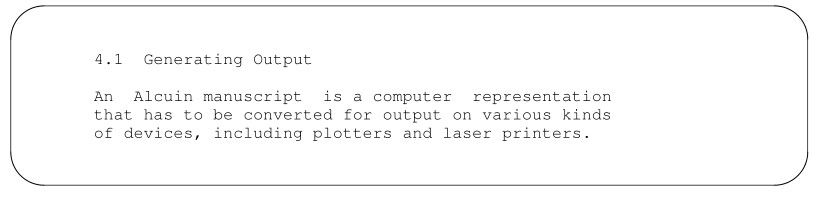


### Changing the Heading Mark

목록 초기화 매크로 .AL을 사용하면 목록에 사용되는 표시를 변경하여,
번호가 매겨진 목록 대신 알파벳 순서 목록을 생성할 수 있었던 것을 기억하십니까? .HM
매크로를 사용하는 제목에도 동일한 옵션을 사용할 수 있습니다.
.HM 매크로는 각 레벨의 표식을 지정하는 최대 7개의 인자를 받습니다. 다음 코드를
지정할 수 있습니다:
1 아라비아 숫자
001 선행 0이 포함된 아라비아 숫자
A 대문자 알파벳
a 소문자 알파벳
I 대문자 로마 숫자
i 소문자 로마 숫자
표식을 지정하지 않으면 기본 번호 매기기 방식(아라비아 숫자)이 사용됩니다. 대문자 알파벳 표시는
일련의 부록을 구성할 때 사용할 수 있습니다. 최상위 수준에 A를 지정할 수 있습니다:
.HM A
나머지 제목에는 기본 섹션 번호 매기기를 유지할 수 있습니다. 이렇게 하면 다음과 같은
순서로 섹션이 생성될 수 있습니다:
A, A.1, A.2, A.2.1 등.
목차 매크로를 사용하여 생성한 것과 유사한 개요 스타일을 위해 표기법을 혼합할 수 있습니다:
.HM I A 1 a i
로마 숫자는 절이나 부분을 나타내는 데 사용할 수 있습니다. 다음과 같이 지정하면:
.HM I i
첫 두 단계의 제목은 로마 숫자로 표시됩니다. 세 번째 단계의 제목을 보여드리면,
제목 표기법이 기본적으로 아라비아 숫자로 되돌아간 것을 확인할 수 있습니다:

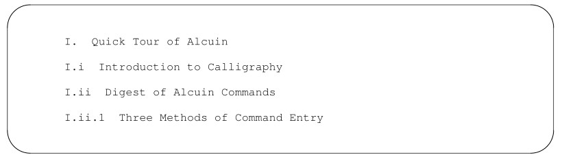

로마 숫자나 알파벳 문자로 구성된 표식을 사용할 때, 현재 수준의 표식이
이전 수준의 표식과 연결되는 것을 원치 않을 수 있습니다. 숫자 레지스터 Ht를 1로 설정하면
이러한 연결을 방지할 수 있습니다:
.HM I i
.nr Ht 1
이제 목록의 각 제목에는 해당 수준을 나타내는 표식만 표시됩니다:

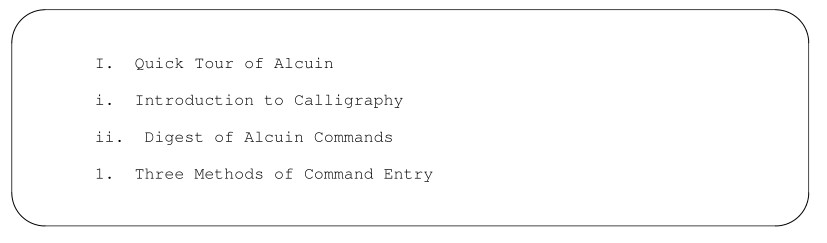


## Table of Contents

목차를 쉽고 자동으로 생성할 수 있다는 사실만으로도, 텍스트 처리에 투입되는 여러분과
컴퓨터의 모든 노력을 정당화하기에 충분합니다. 여러분은 이것이 바로 컴퓨터가
본래 해야 할 일이라는 것을 깨닫게 됩니다.
목차 페이지가 프린터에서 나오면, 작가는 방대한 양의 데이터를 표로 정리하도록 컴퓨터에 간단한 명령을 내리고,
순식간에 그 결과를 나열한 종이 한 장을 얻을 수 있는 통계학자만이 아는 행복의 경지에 이르게 됩니다.
목차를 만드는 일이 그렇게 쉬워 보이는 이유는 대부분의 작업이
문서를 코딩하는 과정에서 이루어지기 때문입니다. 즉, 각 수준의 제목과 모든 그림, 표,
도표, 수식을 표시하기 위해 코드를 입력해야 한다는 뜻입니다. 목차를 처리하는 것은 단순히 서식 지정 프로그램에
파일에 이미 들어 있는 정보를 수집하라고 지시하는 문제일 뿐입니다.

파일 시작 부분과 끝 부분에 각각 하나씩, 총 두 개의 간단한 코드만 삽입하면
목차를 자동으로 생성할 수 있습니다.
파일 시작 부분에서, 목차에 포함시키고자 하는 제목의 수준을 나타내는 번호 레지스터 Cl을
설정해야 합니다. 예를 들어, Cl을 2로 설정하면 1단계 및 2단계 제목이 저장됩니다.
파일 끝부분에 .TC 매크로를 배치하십시오. 이 매크로가 실제로 목차의 처리와 서식 지정을
담당합니다. 목차 페이지는 문서의 맨 끝에 출력됩니다.
다음은 목차 페이지의 예시입니다. 페이지 상단에는 “CONTENTS”라는 헤더가 인쇄됩니다.
페이지 하단에는 소문자 로마 숫자가 페이지 번호로 사용됩니다.

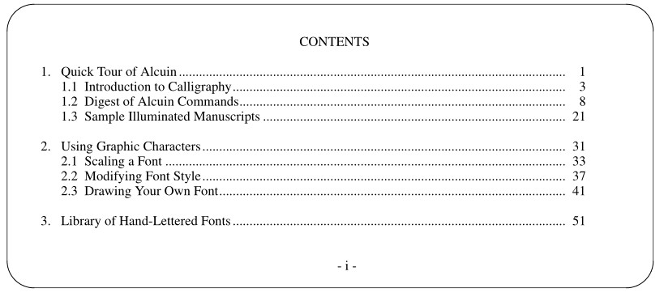

각 1단계 제목 앞에는 빈 줄 하나가 출력됩니다. 모든 1단계 제목은 왼쪽 정렬됩니다. 하위
단계 제목은 이전 단계의 본문 시작 부분과 일렬로 정렬되도록 들여쓰기됩니다.
문서에 다양한 표시물을 포함하고 .FG, .TB, .EX 매크로를 사용하여
표시물의 캡션과 제목을 지정한 경우, 이 정보는 .TC
매크로가 호출될 때 수집되어 출력됩니다. 그림, 표, 도표 목록이 누적될 때마다 별도의 페이지가 인쇄됩니다. 예를
들어:

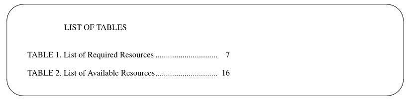

목차 바로 다음에 (페이지 나누기 없이) 그림 목록을 인쇄하려면,
번호 레지스터 Cp를 1로 설정하면 됩니다.
개별 목록의 인쇄를 생략하려면 다음 번호 레지스터를
0으로 설정하면 됩니다:
Lf If 0, no figures
Lt If 0, no tables
Lx If 0, no exhibits
또한, 기본적으로 0으로 설정된 방정식 번호 레지스터가 있습니다. .EC로 표시된 방정식을
목록에 포함시키려면 다음을 지정하십시오:
.nr Le 1
번호 레지스터와 동일한 이름을 사용하는 일련의 문자열이 있으며, 이는 목록 상단에 사용될
제목을 정의합니다:
Lf LIST OF FIGURES
Lt LIST OF TABLES
Lx LIST OF EXHIBITS
Le LIST OF EQUATIONS
.ds(문자열 정의) 명령을 사용하여 문자열을 재정의할 수 있습니다. 예를 들어, 그림의 제목을 다음과 같이
재정의할 수 있습니다:
.ds Lf LIST OF ALCUIN DRAWINGS


## Footnotes and References

학기 논문을 작성해 본 사람이라면 누구나 알다시피, 각주와 참고문헌은 특별한 문제를 야기합니다. 다행히도
mm에는 두 쌍의 전용 매크로가 있습니다. 이 두 매크로 모두 본문 내의 마커를 추적하여,
구분 기호로 묶인 텍스트 줄을 저장한 뒤, 이를 페이지 하단에 각주로 출력하거나 문서
끝부분에 참고문헌으로 출력합니다.


### Footnotes

각주는 문서 본문에서 \*F 문자열로 표시됩니다. 이 문자열은 텍스트 바로 뒤(공백 없이)에
나옵니다.
in an article on desktop publishing.\*F
문자열 F는 각주의 번호를 지정합니다. 이 번호는 (troff를 사용하여) 본문 내에서 위첨자로 출력되며,
사용할 때마다 그 값이 1씩 증가합니다.
.FS 매크로는 각주 본문의 시작을, .FE는 끝을 나타냅니다. 이 매크로들은
페이지 하단에 표시될 각주 본문을 감싸줍니다. .FS 매크로는 마커 바로
다음 줄에 배치됩니다.
.FS
"Publish or Perish: Start-up grabs early page language lead,"
\fIComputerworld\fR, April 21, 1986, p. 1.
.FE
각주를 표시할 때 번호 대신 레이블을 사용할 수 있습니다. 레이블은 본문 내에서 마크로 지정되어야 하며,
.FS의 인수로도 지정되어야 합니다.
...in accord with the internal specs.[APS]
.FS [APS]
"Alcuin Product Specification," March 1986
.FE
동일한 문서에서 번호가 매겨진 각주와 레이블이 지정된 각주를 모두 사용할 수 있습니다. 모든 각주는
각 페이지 하단에 짧은 선 아래에 모아져 출력됩니다. troff를 사용하는 경우, 각주
텍스트는 본문 글자 크기보다 2포인트 작은 크기로 설정됩니다.
각주의 표준 서식을 변경하려면 .FD 매크로를 지정할 수 있습니다. 이 매크로는
라벨의 하이픈 삽입, 텍스트 조정, 들여쓰기 및 양쪽 정렬을 제어합니다.

일반적으로 각주 본문은 왼쪽 여백에서 들여쓰기되며, 각주 표시나 라벨은 본문 시작 부분에 맞춰 왼쪽 정렬됩니다.
긴 각주의 경우 다음 페이지로 이어질 수도 있습니다.
페이지 나누기 시 단어가 끊어지지 않도록 하이픈 삽입 기능이 비활성화되어 있습니다. 이러한 설정은
표 6-3에 표시된 대로 .FD의 첫 번째 인수로 0에서 11 사이의 값을 지정하여 변경할 수 있습니다.

표 6.3 .FD 인수 값

Argument | Hyphenation | Adjust | Text Indent | Label Justification
--- | --- | --- | --- | ---
0 | no | yes | yes | left
1 | yes | yes | yes | left
2 | no | no | yes | left
3 | yes | no | yes | left
4 | no | yes | no | left
5 | yes | yes | no | left
6 | no | no | no | left
7 | yes | no | no | left
8 | no | yes | yes | right
9 | no | yes | yes | right
10 | no | no | yes | right
11 | yes | no | yes | right

.FD의 두 번째 인자가 1인 경우, 각주 번호 카운터를 1로 재설정합니다. 이 기능은
단원이나 단락의 끝에서 호출하여 새로운 번호 매기기 순서를 초기화할 수 있습니다. 이 명령을 단독으로 지정할 경우, 첫 번째
인자는 null이어야 합니다:
.FD “” 1


### References

참조 목록은 각주와 달리, 모든 참조 항목이 문서 끝부분의
한 페이지에 모아져 인쇄된다는 점에서 다릅니다. 또한, 나중에 참조할 수 있도록 참조 항목에 라벨을 지정할 수 있습니다.
참조 목록은 본문 내에서 나타나는 위치에 \*(Rf로 표시됩니다. 서식 지정기는 이 문자열을
[1]과 같이 괄호 안에 표시되는 값으로 변환합니다. 이 표시 뒤에는 참조
텍스트를 둘러싸는 한 쌍의 매크로가 이어집니다. .RS 매크로는 참조 텍스트의 시작을, .RF는 끝을 나타냅니다.

```
You will find information on this page description language
in their reference manual, which has been published
as a book.\*(Rf
.RS
Adobe Systems, Inc. PostScript Reference Manual.
Reading, Massachusetts: Addison-Wesley; 1985.
.RF
```

또한 .RS에 문자열 레이블 인자로, 현재
참조 번호가 할당될 문자열의 이름을 지정할 수도 있습니다. 이 문자열은 문서에서 나중에 참조할 수 있습니다. 예를 들어, 앞의 예제에서
문자열 레이블을 지정했다면:
.RS As
다른 곳에서 첫 번째 참조를 다시 불러올 수 있습니다:

```
The output itself is a readable file which you can interpret
with the aid of the PostScript manual.\*(As
```

문서 마지막에는 참고 문헌 페이지가 인쇄됩니다. 참고 문헌 페이지에 인쇄되는 제목은
Rp 문자열에 정의되어 있습니다. .ds를 사용하여 이
문자열을 재정의하기만 하면 “REFERENCES”를 다른 제목으로 바꿀 수 있습니다.


분량이 많은 문서의 경우, 챕터나 긴 절의 끝에 참고 문헌 목록을 인쇄하고 싶을 수 있습니다.
문서의 어느 곳에서나 .RP 매크로를 호출할 수 있습니다.

```
.RP
.H 1 "Detailed Outline of User Guide"
```

이 명령은 참고 문헌 목록을 별도의 페이지에 출력하고, 참고 문헌 카운터를 0으로 재설정합니다. 재설정 인자와
페이지 나누기 인자를 지정하여 이러한 동작을 변경할 수 있습니다. 재설정 인자는 .RP 매크로로 지정된 첫 번째 값입니다.
일반적으로 0이며, 이 경우 참고 문헌 카운터를 1로 재설정하여 각 섹션에 대해
독립적으로 번호가 매겨지도록 합니다. 문서 전체에 걸쳐 참조 번호를 순차적으로 유지해야 하는 경우,
값을 1로 지정하십시오.
페이지 나누기 인수는 두 번째로 지정되는 값입니다. 이 인수는 목록의 앞뒤에
페이지 나누기가 발생할지 여부를 제어합니다. 일반적으로 0으로 설정되어 목록이 새 페이지에 배치됩니다. 값을 3으로 지정하면
목록 앞뒤의 페이지 나누기가 억제되며, 그 결과 참고 문헌 목록은
해당 섹션의 끝 부분에 이어 인쇄되고 다음 섹션은 목록 바로 뒤에서 시작됩니다. 값을 1로 지정하면
목록 뒤에 발생하는 페이지 나누기만 억제되고, 값을 2로 지정하면 목록 앞에 발생하는
페이지 나누기만 억제됩니다.
기본 설정과 반대되는 효과를 원한다면 다음을 지정하십시오:
.RP 1 3

첫 번째 인수인 1은 현재 참조 번호를 저장하여 다음 절이나 장에서 사용할 수 있게 합니다. 두 번째
인수인 3은 참고 문헌 목록 앞뒤의 페이지 나누기를 억제합니다.


## Extensions to mm

지금까지 mm 매크로 패키지의 기능 중 대부분을 다루었지만, 전부는 아닙니다.
기술 메모 및 보고서의 서식을 지정하기 위한 특수한 매크로 세트인 ‘Technical Memorandum’ 매크로는 아직 다루지 않았습니다.
ms 매크로 패키지에 포함된 매크로들과 마찬가지로, 이 매크로들은 AT&T 벨 연구소(Bell Laboratories)의
내부 사용을 위해 설계되었으며, 전사적인 표준을 반영하고 있습니다. 벨 연구소 외부의
사용자는 이 매크로를 사용하기 전에 약간의 수정을 가해야 할 것입니다. 기술 메모
매크로는 제한된 수의 사용자 매크로를 활용하여 표준 서식을 생성하는 좋은 예입니다.
이 매크로들이 어떻게 작동하는지 이해하는 것은, 서식 지정에 대한 기초 지식을 가진 사람도 있고 그렇지 않은 사람도
혼재된 그룹을 대상으로 문서
표준을 구현해야 하는 책임자들에게 특히 중요할 것입니다.
매크로를 작성하거나 재작성하는 것은 mm을 사용자 정의하는 과정의 일부에 불과합니다. mm 매크로는
포괄적인 서식 지정 시스템으로 설계되었습니다. 앞서 살펴본 바와 같이, .sp와 같은 일반적인
기본 요청을 대체하는 매크로조차 있습니다. 실제로 mm 개발자들은 매크로의 작동을 방해하지 않도록,
절대적으로 필요한 경우가 아니면 nroff나 troff
요청을 사용하지 말 것을 권장합니다.

또한, mm 매크로를 출력해 보면 알 수 있듯이, mm의 내부 코드는 놀라울 정도로
밀도가 높으며, 기억하기 매우 어려운 레지스터 이름을 사용합니다. 이로 인해 가장
경험이 풍부한 사용자를 제외하고는 패키지의 기본 구조를 수정하기가 매우 어렵습니다. 기존 매크로 및 숫자 레지스터 이름과 충돌하지 않는 한 언제든지 자신만의 매크로를 추가할 수는
있지만, mm 패키지를 구성하는 기본 매크로를 직접 들어가서
쉽게 변경할 수는 없습니다.
동시에, mm 개발자들은 사용자가 선택적으로 수정할 수 있도록
만들어 두었습니다. 즉, mm가 사전에 메커니즘을 마련해 둔 부분들에 한해서만 수정할 수 있습니다. 이러한 메커니즘은 두 가지가 있습니다:
• 문서 서식의 모든 측면을 제어하기 위해 mm가 숫자 레지스터를 사용하는 방식
• mm 코드의 여러 곳에서 mm가 정의되지 않은(따라서 사용자가 정의할 수 있는) 매크로를 호출하는 방식
mm 패키지는 매우 높은 수준의 매개변수화를 거쳤습니다. 서식 시스템의 거의 모든 기능—
각기 다른 수준의 제목에 사용되는 글꼴부터 들여쓰기 크기, 표기 위아래의 여백에 이르기까지—은
숫자 레지스터의 값으로 제어됩니다. 이러한 숫자 레지스터를 이해하고 수정함으로써,
문서의 전반적인 외관을 크게 바꿀 수 있습니다.
또한, 문자열에 저장된 여러 값들이 있습니다. 이러한 문자열은 숫자 레지스터와
마찬가지로 사용되어 다양한 매크로에 기본값을 제공합니다.

변경하고 싶을 가능성이 가장 높은 레지스터는 다음과 같습니다. 대시(*)로 표시된 레지스터는
명령줄에서 -r 옵션(예: -rN4)을 사용하여만 변경할 수 있습니다.
Cl 목차에 저장할 제목의 수준입니다. .TC 매크로를 참조하십시오. 기본값은 2입니다.
Cp 1로 설정하면 그림 및 표 목록이 목차와 같은 페이지에 표시됩니다.
그렇지 않으면 새 페이지에서 시작됩니다. 기본값은 1입니다.
Ds 정적 표시 시 사용되는 앞뒤 여백을 설정합니다.
Fs 각주 간의 수직 간격입니다.
Hb 본문 출력 전에 줄바꿈이 발생하는 제목 수준입니다. 기본값은 2
줄입니다.
Hc 중앙 정렬이 적용되는 제목 수준입니다. 기본값은 0입니다.
Hi 제목 뒤의 들여쓰기 유형입니다. 기본값은 1(단락 들여쓰기)입니다. 허용되는 값은 다음과 같습니다:
0=왼쪽 정렬(기본값); 1=들여쓰기; 2=.H, .LC, .DE 뒤를 제외하고 들여쓰기.
Hs 제목 뒤에 공백이 삽입되는 제목 수준입니다. 기본값은 2이며, 즉 1단계 및 2단계 제목 뒤에
공백이 삽입됩니다.
Hy 하이픈 삽입을 설정합니다. 1로 설정하면 하이픈 삽입이 활성화됩니다. 기본값은 0입니다.
L† 페이지 길이를 설정합니다. 기본값은 66v입니다.
Li 목록의 기본 들여쓰기입니다. 기본값은 5입니다.
Ls 수준별 목록 항목 간 간격을 설정합니다. 기본값은 6이며, 이는 모든
수준의 목록 간 간격입니다.
N† 페이지 번호 매기기 방식. 0=모든 페이지에 머리글 표시; 1=1페이지에 머리글을
바닥글로 인쇄; 2=1페이지에 머리글 없음; 3=절 번호를 바닥글로 표시; 4=.PH가 정의된 경우를 제외하고
머리글 없음; 5=절 번호와 절 내 그림 번호를 바닥글로 표시. 기본값은 0입니다.
Np 단락 번호 매기기 방식. 0=번호 없음; 1=번호 매기기.
O 페이지 오프셋. nroff의 경우, 이 값은 문자 위치를 나타내는 비스케일링된 숫자입니다.
(기본값은 9자, 약 .75i). troff의 경우, 이 값은
스케일링됩니다 (.5i).
Of 그림 캡션 스타일. 0=마침표 구분자; 1=하이픈 구분자. 기본값은 0입니다.
Pi 단락 들여쓰기 양. 기본값은 nroff의 경우 5, troff의 경우 3n입니다.
Ps 단락 간 간격. 기본값은 3v입니다.
Pt 단락 유형. 기본값은 0입니다.
S† troff의 기본 포인트 크기. 기본값은 10입니다. 수직 간격은 \nS+2입니다.
Si 디스플레이용 표준 들여쓰기. 기본값은 nroff의 경우 5, troff의 경우 3입니다.
W 페이지 너비(줄 및 제목 길이). troff의 기본값은 6, nroff의 기본값은 60자입니다.
또한 숫자 레지스터에 저장될 것으로 예상되지만 실제로는 문자열에 저장되는
몇 가지 값도 있습니다:
HF 각 제목 수준에 사용되는 글꼴(1=로만체, 2=이탤릭체, 3=굵은체)
HP 각 제목 수준에 사용되는 포인트 크기

예를 들어, 문서 시작 부분에 다음과 같은 레지스터 설정을 추가하면:
.nr Hc 1
.nr Hs 3
.nr Hb 4
.nr Hi 2
.ds HF 3 3 3 3 2 2 2
.ds HP 16 14 12 10 10 10 10
다음과 같은 효과가 나타납니다:
• 최상위 제목(.H1로 생성됨)은 중앙 정렬됩니다.
• 첫 세 단계의 제목 뒤에는 빈 줄이 삽입됩니다.
• 네 번째 단계 제목 뒤에는 페이지 나누기가 삽입됩니다.
• 다섯 번째부터 일곱 번째 단계 제목은 본문과 이어져 표시됩니다.
• 모든 제목의 첫 단어 아래에는 다음 텍스트가 들여쓰기되어,
섹션 번호가 여백에 위치하도록 합니다.
• 첫 5단계의 제목은 굵은 글씨로, 6단계와 7단계는 기울임꼴로 표시됩니다.
• 1단계 제목은 16포인트 글씨로, 2단계 제목은 14포인트 글씨로,
3단계 제목은 12포인트 글씨로, 그 이후의 모든 단계는 10포인트 글씨로 인쇄됩니다.
이 책에서는 이 주제를 포괄적으로 다룰 공간이 부족합니다. 그러나 부록 B에는
사용자가 설정할 수 있는 mm 숫자 레지스터의 전체 목록이 수록되어 있습니다. 이 목록을
관련 매크로에 대한 설명과 함께 숙지하면, 숫자 레지스터와 문자열의 값을 변경함으로써
mm의 얼마나 다양한 측면을 수정할 수 있는지 파악하기 시작할 수 있을 것입니다.

두 번째 특징, 즉 여러 지점에 소위 “사용자 익스이트 매크로”를 제공한다는 점은 거의
그만큼 독창적입니다. 사용자가 정의할 수 있는 매크로는 다음과 같습니다.
.HX .HY .HZ .PX .TX .TY
.HX, .HY, .HZ 매크로는 제목과 관련이 있습니다. .HX 매크로는 각 제목 매크로의 시작 부분에서
실행되고, .HY는 중간 부분에서(mm의 자체 처리로 인해 손실된 임시 들여쓰기 등의 설정을
다시 지정할 수 있도록 하기 위함), .HZ는 끝 부분에서 실행됩니다.
기본적으로 이 매크로들은 정의되어 있지 않습니다. 그리고 troff는 정의되지 않은 매크로 이름을 만나면
단순히 무시합니다. 따라서 이 매크로들은 사용자가 정의할 때까지 코드 내에서 숨겨져 있습니다. 이
매크로들을 정의함으로써, mm 코드를 실제로 수정하지 않고도 제목 처리를 보완할 수 있습니다. 이
매크로들을 정의하기 전에, 사용 방법에 대한 자세한 내용은 mm 문서를 반드시 숙지하십시오.
마찬가지로, .PX는 각 페이지 상단에서 .PH 바로 뒤에 실행됩니다. 따라서 이를 통해
페이지 상단에 대한 추가 처리를 수행할 수 있습니다. (또한, 표준 헤더를 출력하는 .TP 매크로는
상대적으로 독립적이므로 재정의할 수 있습니다).
일반적인 페이지 하단 처리를 위한 메커니즘은 약간 다릅니다. .BS/.BE
매크로 쌍을 사용하면 각 페이지 하단, 즉 각주 뒤
이지만 바닥글 앞에 출력될 텍스트를 묶을 수 있습니다. 이 텍스트를 정의한 후 제거하려면, 빈 블록을 지정하기만 하면 됩니다.


.VM(수직 여백) 매크로를 사용하면 페이지 상단, 하단 또는
양쪽 모두에 추가 여백을 지정할 수 있습니다. 예를 들어:
.VM 3 3
은 상단과 하단 여백에 각각 세 줄씩 추가합니다. 이 매크로의 인수는 스케일링되지 않아야 합니다.
첫 번째 인수는 상단 여백에, 두 번째 인수는 하단 여백에 적용됩니다.
.TX 및 .TY 매크로를 사용하면 목차 페이지의 모양을 제어할 수 있습니다.
.TX 매크로는 목차의 첫 페이지 상단, 제목 위에 실행되며, .TY는
표준 제목(“CONTENTS”) 대신 실행됩니다.
14장에서는 매크로 정의 작성 방법에 대해 배우게 되며, 이를 통해 이러한 보충적인 “사용자 종료 매크로”를 작성하는 데
필요한 정보를 얻을 수 있을 것입니다.


