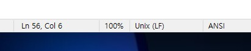
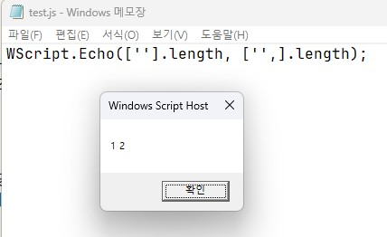
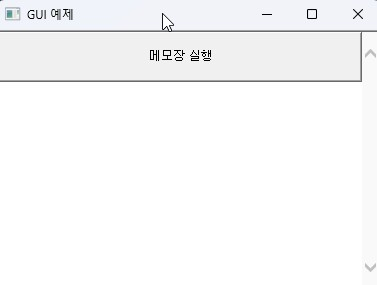

= JSCript 소개
Author Name <piljin.kwon@gmail.com>
:experimental:
:doctype: book
:lang: ko
:source-language: asciidoc
:source-highlighter: coderay
:showtitle:
:toc: left
:toclevels: 1
:toc-title: 목차
:partnums:
:sectnums:
:sectlinks:
:sectnumlevels: 4
:chapter-label:
:icons: font
:imagesdir!: ./images
:example-caption: 예제
:table-caption: 표
:figure-caption: 그림
:appendix-caption: 부록
ifdef::env-github[]
:tip-caption: :bulb:
:note-caption: :information_source:
:important-caption: :heavy_exclamation_mark:
:caution-caption: :fire:
:warning-caption: :warning:
endif::[]

https://www.i-vinci.co.jp/techblog/2161[고대 언어 JScript를 추천합니다^]

== 자기소개

처음 뵙겠습니다. i-Vinci의 나카지마입니다.

작년 10월경 SNS에서 잠시 화제가 되었던 ‘농가는 Replace()되었습니다’ 라는 게임을 추천합니다. 파이썬과 매우 유사한 프로그래밍 언어로 드론을 조작해 농업을 자동화하는 게임입니다. 2026년 중에 추가 콘텐츠도 공개될 예정이니, 관심이 있으시면 꼭 한번 플레이해 보세요.

== JScript란

JScript는 마이크로소프트가 개발한 ECMAScript(JavaScript의 표준 사양) 3.x를 준수하는 스크립트 언어입니다. 예전에는 Internet Explorer나 IIS의 서버 측 스크립트, Windows Scripting Host(WSH)에서 사용되었지만, 현재는 거의 사용되지 않습니다.

== 왜 하필 지금 JScript인가?

JScript와 마찬가지로 WSH에서 실행 가능한 VBScript는 마이크로소프트 측에서 “폐지될 것이라고 발표” 했습니다. 2027년경에는 VBScript 실행 기능이 비활성화되고, 장래에는 기능 자체가 삭제될 예정입니다.

반면 JScript는 2025년에 스크립트 엔진이 JScript 9로 업데이트되었으며, 적어도 “앞으로 몇 년간은 유지보수를 계속하겠다” 는 마이크로소프트의 의도를 엿볼 수 있습니다.

모처럼 블로그 글을 쓰는 김에 저 말고는 아무도 다루지 않는 틈새 주제를 다뤄보고 싶기도 했고, 시모이 씨가 예전에 집필한 VBScript 관련 글을 기리는 의미도 겸해, 지금이야말로 JScript에 대해 써보려고 합니다.

== JScript의 주의사항

JScript는 JavaScript와 마찬가지로 ECMAScript를 준수하는 언어이지만, 기반으로 하는 버전이 오래되어 ES5 이후의 구문을 지원하지 않는 등 몇 가지 주의할 점이 있습니다.

=== 스크립트 엔진에 관한 주의사항

소스 코드에 한국어를 포함할 경우 ANSI(CP949)로 저장해 주십시오(cmd창은 UTF-16LE를 사용하므로 UTF-8 은 글자가 깨집니다).

JScript를 실행하기 위한 런타임으로는 wscript.exe 와 cscript.exe 두 가지가 있습니다. 팝업 창에 메시지를 출력하는 등 GUI를 이용하는 경우는 wscript.exe, 표준 출력 등 CUI를 이용하는 경우는 cscript.exe 를 사용해 주십시오.

=== 언어 사양에 관한 주의사항

준수하고 있는 ECMAScript 버전이 오래된 데다, 당시 정의되지 않았던 사양은 현재 일반적인 JavaScript와 동작이 다를 수 있습니다. 그 일부를 항목별로 정리했으니 참고해 주십시오.

* ES5 이후의 구문은 지원되지 않으므로, ES3 시절의 구문만을 사용해서 작성해야 합니다.
* const, let 은 지원되지 않으므로, 변수 선언은 var 를 사용해 주십시오.
* 화살표 함수 () => {...} 는 지원되지 않으므로 function () {...} 을 이용해 주십시오.
* for-of 구문이나 배열에 대한 함수형 접근 방식의 메서드는 사용할 수 없습니다. 고전적인 for 문이나 for-in 구문을 사용해 주십시오.
* 템플릿 문자열 리터럴은 사용할 수 없습니다. 그냥 문자열을 연결해 주십시오.
* class 구문이 없으므로 생성자 함수를 사용해서 객체를 생성해 주십시오.
* Math.random() 함수의 의사 난수 생성은 무시할 수 없는 편향성이 있으므로, 균등하게 분포된 난수가 필요한 경우는 MersenneTwister 등을 이용해 주십시오.
* 배열의 끝에 쉼표를 쓰면, 배열의 끝에 undefined 가 삽입되어 버립니다.

== JScript의 장점

지금까지 JScript가 “구식 기술” 이라는 점과 주의할 사항에 대해 다루었지만, 기사로 다룰 만큼 당연한 장점도 있으니 안심하셔도 됩니다.

* Windows의 표준 스크립팅 환경으로 별도의 환경 구축이 필요 없습니다.
* 구식 사양이라고는 하지만 JavaScript 구문을 사용해서 시스템 스크립트를 작성할 수 있습니다(학습 부담이 적음).
* ActiveX 개체를 쉽게 조작할 수 있습니다(파일 시스템이나 Excel 등의 조작 지원).

=== 샘플 스크립트

이제부터 JScript로 어떤 작업이 가능한지, 실제로 실행 가능한 간단한 스크립트를 소개하고 예시를 보여드리겠습니다. 확장자 연결과 저장 시 문자 코드만 주의하면, 텍스트 편집기에 복사해서 붙여넣기만 해도 실행할 수 있으니 한번 시도해 보세요.

==== 파일 입출력

간단한 텍스트 파일 쓰기 및 읽기 예제입니다.

WSH에서 일본어를 다룰 때는 CP932 가 표준입니다.

UTF-8로 읽고 쓰기가 필요한 경우 ADODB.Stream 객체를 사용해서 변환해야 합니다.

[source,js]
----
/** 인수로 지정된 파일명과 파일 내용을 사용해서 텍스트 파일을 새로 생성합니다.
 * @see https://learn.microsoft.com/ja-jp/office/vba/language/reference/user-interface-help/createtextfile-method
 * @param {string} fileName
 * @param {string} content
 */

function writeTextFile(fileName, content) {
  /* FileSystemObject(FSO) 는 이름 그대로 파일 시스템을 다루기 위한 객체입니다.
   * 경로, 파일, 폴더 등의 파일 시스템 조작 외에도 텍스트 파일의 읽기 및 쓰기 등이 가능합니다. */
  var fso = new ActiveXObject('Scripting.FileSystemObject');

  /* CreateTextFile 메서드는 텍스트 파일을 생성합니다.
   * 두 번째 인수는 파일을 덮어쓸지 여부를 지정합니다.
   * false 를 지정하면 같은 이름의 파일이 존재할 경우 예외를 발생시킵니다. */
  var file = fso.CreateTextFile(fileName, true);

  file.Write(content);
  file.Close();
}

/** 인자로 지정된 파일명의 파일 내용을 반환합니다.
 * @see https://learn.microsoft.com/ja-jp/office/vba/language/reference/user-interface-help/opentextfile-method
 * @param {string} fileName
 * @returns {string} 텍스트 파일 내용
 */
 
function readTextFile(fileName) {
  var forReading = 1;
  var fso = new ActiveXObject('Scripting.FileSystemObject');
  
  /* 두 번째 인자는 텍스트 파일을 열 때의 모드를 지정합니다.
   * 1: 읽기 모드
   * 2: 쓰기 모드
   * 8: 추가 모드
   */
  var file = fso.OpenTextFile(fileName, forReading);
  var content = file.ReadAll();
  file.Close();
  return content;
}

(function () {
  var fileName = '.\\hello.txt';

  /* 텍스트 파일에 메시지 쓰기 */
  writeTextFile(fileName, 'Hello, JScript!');

  /* 텍스트 파일에서 메시지 읽기 */
  var message = readTextFile(fileName);

 /* WScript.Echo 는 메시지를 출력합니다.
   * wscript 로 실행할 경우 GUI 팝업 창에 출력되고,
   * cscript 로 실행할 경우 표준 출력으로 출력됩니다.
   */
  WScript.Echo(message);
})();
----

=== HTTP 요청

HTTP GET 요청의 예시입니다.

당사 웹사이트의 메인 페이지에서 제목을 가져와서 표시합니다.

fetch 를 사용할 수 없으므로 Msxml2.ServerXMLHTTP 를 사용합니다.

그대로 사용하기 어려우므로, 사용 방식에 맞는 메서드로 래핑해 봅시다.

[source,js]
----
/** 인수로 지정된 URL에 HTTP GET 요청을 수행하고, BODY 문자열을 반환합니다.
 * @see https://learn.microsoft.com/en-us/previous-versions/windows/desktop/ms754586(v=vs.85)
 * @param {string} url
 * @returns {string} HTTP BODY 문자열
 */

function httpGet(url) {
  var http = new ActiveXObject('Msxml2.ServerXMLHTTP');

  /* 두 번째 인수는 비동기 플래그입니다. false 는 동기 요청을 의미합니다. */
  http.open('GET', url, false);

  try {
    http.send();
  } catch (e) {
    WScript.Echo('Error');
    WScript.Quit();
  }

  return http.responseText;
}

/** HTML 문자열에서 제목을 추출해서 반환합니다.
 * @param {string} HTML 문자열
 * @returns {string} 제목 문자열. 찾을 수 없는 경우 빈 문자열.
 */

function getTitle(html) {
  var match = html.match(/<title[^>]*?>(.+?)<\/title>/i);
  if (match) {
    return match[1];
  }
  return '';
}

(function () {
  var html = httpGet('https://www.google.com/');
  var title = getTitle(html);
  WScript.Echo(title);
})()
----

=== Excel 파일 조작

이 스크립트를 실행하려면 Windows에 Excel이 설치되어 있어야 합니다.

Excel 조작 방법은 Excel VBA 와 완전히 동일합니다. 한 번만 익히면 Outlook 등의 조작도 같은 방법으로 가능합니다.

[source,js]
----
/** 인수로 지정된 파일명의 XLSX 파일을 생성합니다.
 * @param {string} fileName XLSX 파일명
 */
 
function createXlsxFile(fileName) {
  /* `Excel.Application` 객체는 거의 Excel VBA의 Application 객체와 동일한 조작이 가능합니다.
   * @see https://learn.microsoft.com/ja-jp/office/vba/api/excel.application(object)
   */
   
  var excelApp = new ActiveXObject('Excel.Application');

  /* Excel GUI를 표시할지 여부. `true` 로 설정하면 실제로 Excel을 조작하고 있음을 시각적으로 알 수 있습니다 */
  excelApp.Visible = false;
  var workbook = excelApp.Workbooks.Add();
  workbook.SaveAs(fileName);

  /* 보이지 않는 Excel이 실행된 상태로 남아 있을 수도 있으므로, 명시적으로 Excel을 종료합니다 */
  workbook.Close();
  excelApp.Quit()
}

/** 인수로 지정된 XLSX 파일의 지정된 주소에 값을 기록해서 저장합니다
 * @param {string} fileName XLSX 파일명
 * @param {string} sheetName 시트 이름
 * @param {string} rangeAddress 셀 좌표 문자열
 * @param {any} value 값
 */
 
function writeXlsxFile(fileName, sheetName, rangeAddress, value) {
  var excelApp = new ActiveXObject('Excel.Application');
  excelApp.Visible = false;
  
  /* Workbook, Worksheet, Cell의 조작 방법은 Excel VBA와 동일하므로 VBA 문서를 참조하십시오.
   * @see https://learn.microsoft.com/ja-jp/office/vba/api/excel.workbook
   * @see https://learn.microsoft.com/ja-jp/office/vba/api/excel.worksheet
   */
  
  var workbook = excelApp.Workbooks.Open(fileName)
  workbook.Sheets(sheetName).Range(rangeAddress).Value = value;
  workbook.Save();
  workbook.Close();
  excelApp.Quit()
}

/** 인수로 지정된 XLSX 파일의 지정된 주소에서 값을 가져옵니다.
 * @param {string} fileName XLSX 파일 이름
 * @param {string} sheetName 시트 이름
 * @param {string} rangeAddress 셀 좌표 문자열
 * @returns {any} 값
 */
 
function readXlsxFile(fileName, sheetName, rangeAddress) {
  var excelApp = new ActiveXObject('Excel.Application');
  excelApp.Visible = false;
  var workbook = excelApp.Workbooks.Open(fileName, false, true);
  var value = workbook.Sheets(sheetName).range(rangeAddress).value;
  workbook.Close();
  excelApp.Quit()
  return value;
}

(function () {
  var fso = new ActiveXObject('Scripting.FileSystemObject');

  /* Excel 파일의 새 파일 생성은 상대 경로로는 실패하므로 절대 경로로 변환 */
  var fileName  = fso.GetAbsolutePathName('.\\hello.xlsx');

  /* js 파일과 같은 폴더에 XLSX 파일 생성 */
  createXlsxFile(fileName);

  /* XLSX 파일에 값 추가 */
  writeXlsxFile(fileName, 'Sheet1', 'A1', 'Hello');

  /* XLSX 파일에서 값 가져오기 */
  var value = readXlsxFile(fileName, 'Sheet1', 'A1');

  /* 가져온 값 출력 */
  WScript.Echo(value); // Hello
})();
----

=== JavaScript CUI 스크립트

물론 JScript를 사용해도 표준 입출력 등을 활용해서 CUI 도구를 만들 수 있습니다.

CUI에서 실행하려면 wscript 대신 cscript 로 스크립트를 실행하면 됩니다.

샘플 코드는 자주 발생할 법한 처리들을 몇 가지 조합해 보았습니다.

명령 프롬프트나 PowerShell에서 아래와 같이 실행해 보세요.

----
# 명령줄 인수가 없는 경우
cscript sample-cui.js

# 명령줄 인수가 있는 경우
cscript sample-cui.js XXXX

# 마이크로소프트의 저작권 표시 등을 숨기려는 경우
cscript //Nologo sample-cui.js XXXX
----

[source,js]
----
/** 스크립트 실행 엔진을 판별한다
 * @returns {boolean} CScript에서 실행 중이면 true, WScript에서 실행 중이면 false
 */
 
function isRunningOnCScript() {
    return /cscript.exe$/.test(WScript.FullName);
}

/** 지정된 횟수만큼 char 를 반복한 문자열을 생성한다
 * @param {string} char 반복할 문자(열)
 * @param {number} count
 * @returns {string} 조립된 문자열
 */
 
function repeat(char, count) {
  var s = '';
  for (var i = 0; i < count; i++) {
    s += char;
  }
  return s;
}

/** 진행률 바 문자열을 구성한다
 * @param {number} current
 * @param {number} total
 * @returns 진행률 바 문자열
 */
 
function progressBar(current, total) {
  var width = 20;
  var ratio = Math.min(Math.max(current / total, 0), 1)
  var percent = Math.floor(ratio * 100)
  var filled = Math.floor(ratio * width)
  var empty = width - filled
  return '[' + repeat('|', filled) + repeat(' ', empty) + '](' + percent + '%)';
}

(function () {
  /* 실행 방법 확인 */
  if (!isRunningOnCScript()) {
    WScript.Echo('wscript.exe 에서 실행되고 있습니다. cscript.exe 에서 다시 실행해 주세요\n');
    WScript.Quit();
  }

  /* 명령줄 인수 확인 */
  if (WScript.Arguments.length === 0) {
    WScript.Echo('명령줄 인수가 지정되지 않았습니다\n');
    WScript.Quit();
  }

  /* 명령줄 인수 출력 */
  var argv = WScript.Arguments(0);
  WScript.Echo('명령줄 인수는 ' + argv + '입니다\n');

  /* 표준 입력 */
  var stdinText = '';
  while (stdinText === '') {
    WScript.StdOut.Write('문자열을 입력해 주세요:\n> ');
    stdinText = WScript.StdIn.ReadLine()
  }
  WScript.Echo('표준 입력된 문자열은 ' + stdinText + '입니다\n');

  /* 진행률 표시줄 출력 */
  var total = 255;
  for (var i = 0; i <= total; i++) {
    WScript.StdOut.Write('\r' + progressBar(i, total));
    WScript.Sleep(1);
  }
})();
----

=== JavaScript 외부 프로세스 실행

JScript에서 명령어나 다른 프로그램을 실행하거나 그 결과를 가져올 수 있습니다.

이를 통해 JScript를 글루 언어로 활용할 수 있어, 배치 처리 등을 수행할 때 유용합니다.

[source,js]
----
(function () {
  var wshShell = new ActiveXObject('WScript.Shell');

  /* 간단하게 외부 프로세스를 실행하려면 Run 메서드를 사용합니다.
   * 첫 번째 인수는 실행할 명령어입니다. 여기서는 메모장을 실행합니다.
   * 두 번째 인수는 창 표시 방식입니다.
   * 세 번째 인수는 동기 실행 또는 비동기 실행을 지정합니다.
   * 동기 실행을 하면 실행된 프로세스가 종료될 때까지 스크립트 실행이 중지되지만, 프로세스의 종료 코드를 가져올 수 있습니다.
   * @see https://learn.microsoft.com/ja-jp/previous-versions/windows/scripting/cc364421(v=msdn.10)
   */
   
  var exitCode = wshShell.Run('notepad', 3, true);
  WScript.Echo(exitCode);

  /* 외부 프로세스의 표준 출력을 가져오고 싶은 경우는 Exec 메서드를 사용합니다.
   * Run 메서드와 달리 창 표시 방법이나, 동기 실행 또는 비동기 실행을 제어할 수 없습니다.
   * 여기서는 localhost 에 ping 명령을 실행하고, 표준 출력 문자열을 가져옵니다.
   * 외부 명령의 출력 내용에 따라 후속 처리를 변경하고 싶은 경우 등에 유용합니다.
   * @see https://learn.microsoft.com/ja-jp/previous-versions/windows/scripting/cc364375(v=msdn.10)
   * @see https://learn.microsoft.com/ja-jp/previous-versions/windows/scripting/cc364386(v=msdn.10)
   */
   
  var wshShellExec = wshShell.Exec('ping localhost');
  while (wshShellExec.Status === 0) {
      WScript.Sleep(100);
  }
  WScript.Echo(wshShellExec.StdOut.ReadAll());
})();
----

=== 간단한 GUI 애플리케이션

Windows는 기본적으로 HTML 애플리케이션이라는 기능이 탑재되어 있습니다.

확장자를 .hta 로 저장한 HTML 파일은 브라우저가 아닌 mshta 라는 런타임에서 실행됩니다.

이 역시 오래된 기술이기 때문에 HTML5 나 CSS3 같은 최신 기능은 지원하지 않지만,

고전적인 웹 지식만으로도 Windows에서 실행 가능한 GUI 도구를 만들 수 있습니다.

HTA는 Windows의 로컬 리소스에 대한 액세스 등이 허용되기 때문에,

WSH와 마찬가지로 로컬 파일의 읽기/쓰기, 명령어 실행, 애플리케이션 및 클립보드 조작 등이 가능합니다.

예를 들어, 자주 사용하는 CLI 애플리케이션의 복잡한 명령줄 인자나 옵션 인자

입력을 보조하기 위한 GUI 프론트엔드 등을 간단하게 만들 수 있습니다.

샘플 코드는 메모장을 실행하는 버튼이 있는 GUI를 만들어 보았습니다.

HTA에 대한 자세한 정보는 Microsoft의 공식 문서를 참조하십시오.

[source,js]
----
<!DOCTYPE html>
<HTA:APPLICATION
  APPLICATIONNAME="Samle GUI"
  BORDER="thin"
  BORDERSTYLE="normal"
  CAPTION="Sample GUI"
  ICON=""
  MAXIMIZEBUTTON="yes"
  MINIMIZEBUTTON="yes"
  SCROLL=“no”
  SHOWINTASKBAR="yes"
  SINGLEINSTANCE="yes"
  SYSMENU="yes"
  VERSION="1.0"
  WINDOWSTATE="normal"
>
<html>
<head>
<meta charset="EUC_KR">
<meta name="viewport" content="width=device-width, initial-scale=1.0">
<title>GUI 예제</title>

</head>
<body>

<button id="runNotepad">메모장 실행</button>

</body>
</html>
----

== 마치며

지금까지 JScript에 대해 소개해 드렸는데, 어떠셨나요?

솔직히 저 역시 최근에는 거의 다루지 않고 있지만, 소프트웨어 설치에 대해 엄격한 규칙이 적용되는 프로젝트도 많기 때문에, 어쩌면 언젠가 다시 유용하게 쓰일 날이 올지도 모릅니다.

오래된 기술인 만큼 불편한 점도 있지만, 별도의 환경 구축 없이 어떤 Windows 환경에서도 쉽게 작성하고 실행할 수 있다는 점, 의외로 다양한 용도로 활용할 수 있다는 점 등이 잘 전달되었으면 좋겠습니다.

