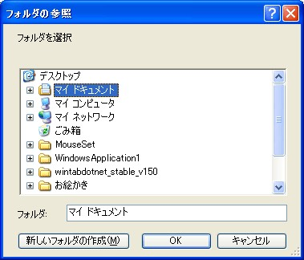
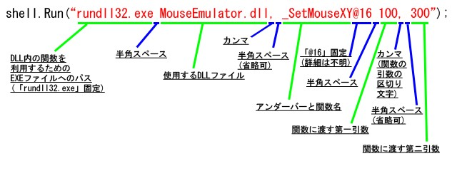
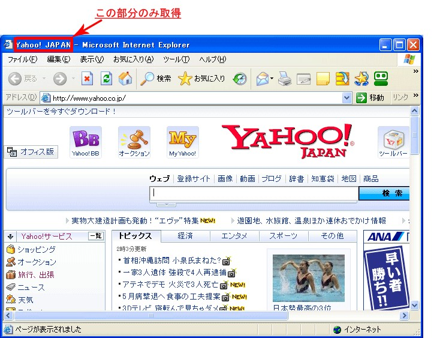
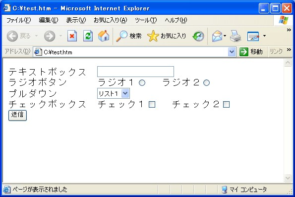

= WSH JScript 마스터하기
Author Name <piljin.kwon@gmail.com>
:experimental:
:doctype: book
:lang: ko
:source-language: asciidoc
:source-highlighter: coderay
:showtitle:
:toc: left
:toclevels: 1
:toc-title: 목차
:partnums:
:sectnums:
:sectlinks:
:sectnumlevels: 4
:chapter-label:
:icons: font
:imagesdir!: ./images
:example-caption: 예제
:table-caption: 표
:figure-caption: 그림
:appendix-caption: 부록
ifdef::env-github[]
:tip-caption: :bulb:
:note-caption: :information_source:
:important-caption: :heavy_exclamation_mark:
:caution-caption: :fire:
:warning-caption: :warning:
endif::[]

* https://jscript.zouri.jp/index.html[Reference^]
* https://atmarkit.itmedia.co.jp/ait/series/2728/[WSH Reference^]
* https://atmarkit.itmedia.co.jp/ait/series/2744/[VBS Fundamental^]

== 소개

https://jscript.zouri.jp/[WSH JScript를 능숙하게 다루자^]

=== 서문

이 문서는 `JScript` 를 배치 파일 대신 사용하는 방법을 소개하기 위해 작성했습니다. 하지만 현재는 `VBScript` 에 대한 수요가 좀 더 높고, 인터넷에 검색해도 압도적으로 VBScript 관련 결과가 더 많이 나옵니다. 솔직히 말해서, VBScript를 배우는 편이 좀 더 나을 것입니다. 참고 사이트도 훨씬 더 많고요...

하지만 그 중에는 VBScript 구문이 낯선 분들도 계실거라 생각합니다. 저 자신도 그중 한 명입니다. 솔직히 말하면, 이 문서를 작성한 이유는 『나만의 전용 라이브러리 만들기』였거든요. ㅋㅋ

자, 말이 길어졌지만 이 문서의 대상은 JavaScript, JScript 중급자~상급자입니다. 적어도 “함수” 나 “변수” 에 대한 기본적인 지식이 필요합니다. 그런 점 잘 부탁드립니다. 

업데이트는 비-정기적으로 처리할 예정입니다. JScript의 새로운 사용법을 알게 되면 그때마다 추가할 생각입니다. 하지만, 미리 말씀드리면 데이터베이스 관련 내용은 당분간 추가할 생각이 전혀 없습니다. 현재 실행 환경도 없는데다, 여러모로 이해하기 어려워 대략 포기한 참이거든요. 

== 결과 출력 방법

여기서는 “JScript에서 결과를 출력하는 방법” 에 대해 소개합니다. 처리 후의 결과나 오류 등을 출력하는 방법은 주로 “메시지 상자에 표시” 하거나 “텍스트 파일에 기록” 하는 것입니다. 그 밖에 여러 방법이 있지만, 여기서는 이 두 가지 방법을 소개합니다.

=== 메시지 박스

메시지 상자를 표시하려면 다음 함수를 호출합니다.

함수명::  
 WScript.Echo([arg1], [arg2], [arg3], […])

함수 설명::
메시지 상자를 표시합니다. 인수는 공백으로 구분되고 메시지 상자에 지정한 값이 출력됩니다. 인수를 모두 생략한 경우, 메시지 상자만 표시됩니다.

인수::

* arg1・・・출력할 객체 1(생략 가능)
* arg2・・・출력할 객체 2(생략 가능)
* arg3・・・출력할 객체 3(생략 가능)

반환값::
없음

[source,js]
----
//
//  결과 출력 방법
//
//  메시지 상자를 표시합니다.
//

WScript.Echo("Hello World");
----

메시지 상자에 “Hello World” 가 표시됩니다.

=== 텍스트 파일에 쓰기

텍스트 파일에 출력 결과를 기록하려면 다음 코드를 사용합니다. 이번에는 함수에 대한 설명은 생략하겠습니다. 자세한 내용을 알고 싶으시면, 텍스트 파일 조작 섹션을 참조합니다.

[source,js]
----
//
//  결과 출력 방법
//
//  텍스트 파일에 기록합니다.
//

//  파일 관련 기능을 제공하는 객체를 가져옵니다.
var fs = new ActiveXObject("Scripting.FileSystemObject");

//  파일을 엽니다.
var file = fs.OpenTextFile("C:/result.txt", 2, true );

file.WriteLine("정상 종료");
file.WriteLine("처리 건수는 100건");

//  파일을 닫습니다.
file.Close();

//  객체를 해제합니다.
fs = null;
WScript.Echo( “종료” );
----

「C:」 드라이브 최상위 디렉터리에 「result.txt」이름의 파일이 생성되며, 1행에 「정상 종료」, 2행에 「처리 건수는 100건」문자열이 기록됩니다.

== 정보 입력 방법

여기서는 JScript 파일을 실행할 때 매개변수를 설정(전달)하는 방법에 대해 소개합니다. 여러 웹사이트의 텍스트 상자처럼 “사용자가 직접 매개변수를 설정할 수 있다면 좋겠는데...” 라고 생각한 적은 없으신가요? 그래서 JScript로 구현할 수 있는 간단한 사용자 입력 방법을 소개하겠습니다.

주요 방법으로 확인 대화 상자, 드래그 앤 드롭 실행, 텍스트 파일에서 읽기 등이 있습니다. 이 밖에도 명령줄 인수(WshShell.Arguments)를 통한 실행, VBScript의 InputBox() 함수를 이용하는 방법(wsf mixed)도 있지만 이번에는 생략하겠습니다.

=== 확인 대화 상자

확인 대화 상자를 표시하려면 다음 함수를 호출합니다.

함수명::
 object.Popup(strText, [nSecondsToWait], [strTitle], [nType]);

함수 설명::
팝업 창을 표시합니다. 인수 nType 에 버튼 종류와 아이콘 종류를 더한 값을 지정합니다. 어떤 버튼이 눌렸는지는 반환값으로 판단할 수 있습니다. nSecondsToWait 에 정수 값을 지정하면, 지정한 시간(초)이 경과하면 자동으로 창이 닫힙니다. 이때 반환 값은 -1 입니다.

인수::

* object・・・・・・WshShell 객체
* strText ・・・・・창에 표시할 문자열
* nSecondsToWait・・창이 닫힐 때까지의 시간(초, 생략 가능)에 0 을 지정하면, 버튼을 누르지 않는 한 닫히지 않음
* strTitle・・・・・창의 제목 문자열(생략 가능)
* nType ・・・・・・창에 표시할 버튼과 아이콘 종류를 나타내는 수치(생략 가능)

.버튼 종류
[%autowidth]
|===
|값    |내용

|0  |[OK] 
|1  |[OK][취소]
|2  |[중지][다시 시도][무시] 
|3  |[예][아니오][취소] 
|4  |[예][아니오] 
|5  |[다시 시도][취소] 
|===

.아이콘 종류
[%autowidth]
|===
|값    |내용

|16 |[Stop] 
|32 |[?] 
|48 |[!] 
|64 |[i] 
|===

반환값::
클릭한 버튼을 나타내는 정수값

.누른 버튼별 반환값
[%autowidth]
|===
|값    |내용

|1   |[OK] 버튼 누름 
|2   |[취소] 버튼 누름 
|3   |[중지] 버튼 누름 
|4   |[재시도] 버튼 누름 
|5   |[무시] 버튼 누름 
|6   |[예] 버튼 누름 
|7   |[아니오] 버튼 누름 
|-1  | 어떤 버튼도 누르지 않았을 때
|===

[source,js]
----
//
//  정보 입력 방법
//
//  확인 대화 상자를 표시한다.
//

//  버튼 종류
var BTN_OK                 = 0;    // [OK] 
var BTN_OK_CANCL           = 1;    // [OK][취소] 
var BTN_STOP_RETRI_DISRGRD = 2;    // [중지][재시도][무시] 
var BTN_YES_NO_CANCL       = 3;    // [예][아니오][취소] 
var BTN_YES_NO             = 4;    // [예][아니오] 
var BTN_RETRI_CANCL        = 5;    // [재시도][취소] 

//  아이콘 종류
var ICON_STOP              = 16;   // [Stop] 
var ICON_QUESTN            = 32;   // [?]
var ICON_EXCLA             = 48;   // [!] 
var ICON_I                 = 64;   // [i] 

//  버튼별 반환값
var BTNR_OK                =  1;   // [OK] 버튼 누름 
var BTNR_CANCL             =  2;   // [취소] 버튼 누름 
var BTNR_STOP              =  3;   // [중지] 버튼 누름 
var BTNR_RETRI             =  4;   // [재시도] 버튼 누름 
var BTNR_DISRGRD           =  5;   // [무시] 버튼 누름
var BTNR_YES               =  6;   // [예] 버튼 누름
var BTNR_NO                =  7;   // [아니오] 버튼 누름
var BTNR_NOT               = -1;   // 어떤 버튼도 누르지 않았을 때

//  Windows 셸에 대한 액세스를 제공하는 객체
var sh = new ActiveXObject("WScript.Shell");

//  팝업 창 표시(10초 후 자동 종료)
var rtn = sh.Popup("버튼을 눌러 주세요!", 10, "확인", (BTN_YES_NO_CANCL + ICON_QUESTN));

//  객체를 해제
sh = null;

//  반환값 표시
WScript.Echo(rtn);
----

팝업 창에 “버튼을 눌러 주세요!” 라고 표시되며, [예][아니요][취소] 버튼을 선택할 수 있습니다. 선택하면 선택한 버튼에 따른 반환값을 메시지 상자에 표시합니다. 10초간 선택하지 않으면 자동으로 닫히고 -1 을 반환하고 종료합니다.

=== 드래그-앤-드롭

파일이나 폴더를 드래그-앤-드롭해서, 파일이나 폴더의 경로를 실행 시 입력 정보로 전달할 수 있습니다.

다음과 같은 속성을 가져올 수 있습니다. 

CAUTION: 드래그-앤-드롭으로 입력(처리)할 수 있는 크기에 한계가 있으므로 깊은 계층의 파일을 드래그-앤-드롭할 경우, 실행 시 오류가 발생합니다. 한계가 어느 정도인지 테스트한 적은 없지만, 의외로 한도량이 낮은 것 같습니다.

속성명::
 WScript.Arguments;

속성 설명::
WshArguments 객체(인수 컬렉션)를 참조하는 속성입니다.

인수::
없음

반환값::
WshArguments 객체(인수 컬렉션)

[source,js]
----
//
//  정보 입력 방법
//
//  드래그 앤 드롭을 통한 경로 정보 입력.
//

//  드래그 앤 드롭한 파일이나 폴더 경로 정보 가져오기
var args = WScript.Arguments;

//  드래그 앤 드롭한 개수 표시
for( var i=0; i<args.length; i++ )
    WScript.Echo( args(i) );
----

실행 방법은, 파일 탐색기로 JScript 파일(_.js_)에 파일 또는 폴더, 혹은 둘 다를 드래그-앤-드롭합니다. 출력 결과는 드래그-앤-드롭한 파일 및 폴더의 경로가 드래그-앤-드롭한 개수만큼 메시지 상자에 표시됩니다.

=== 텍스트 파일에서 로딩

텍스트 파일의 문자열을 읽으려면 다음 코드를 사용합니다. 함수에 대한 설명은 생략하겠습니다. 자세한 내용을 알고 싶으시면, 텍스트 파일 조작 섹션을 잠조합니다.

[source,js]
----
//
//  정보 입력 방법
//
//  텍스트 파일에서 한 줄씩 문자열을 읽어옵니다.
//

//  파일 관련 조작을 제공하는 객체를 가져옵니다.
var fs = new ActiveXObject("Scripting.FileSystemObject");

//  파일 열기
var file = fs.OpenTextFile("C:/info.txt");

//  파일 끝까지 한 줄씩 메시지 상자에 표시
while(!file.AtEndOfStream)
    WScript.Echo(file.ReadLine());

//  파일 닫기
file.Close();

//  객체 해제
fs = null;
----

실행 전에 ‘C:’ 드라이브 최상위 디렉터리에 ‘Info.txt’ 파일을 생성하고, 파일에 3줄 정도 문자열을 입력합니다. 그 후 실행하면 첫 번째 줄부터 순서대로 메시지 상자에 문자열이 표시됩니다.

=== 파일 선택 대화상자

파일 선택 대화 상자를 사용하려면 다음 함수와 속성을 활용합니다. 또한, 예제를 통해 사용법을 소개하고 있으니 참고하시기 바랍니다.

함수명::
 object.ShowOpen();

함수 설명::
파일 선택 대화 상자를 표시합니다.

인수::

* object・・・・・・파일 선택 대화 상자의 기능을 제공하는 객체

반환값::
없음

속성명::
 object.InitialDir;

속성 설명::
파일 선택 대화 상자가 표시될 때의 초기 디렉터리 경로를 관리하는 속성입니다. 설정되지 않은 경우, 현재 디렉터리가 초기 디렉터리가 됩니다.

[CAUTION] 
====
디렉터리 연결 문자는 ‘/’ 가 아닌 ‘\’ 를 사용해야 합니다.

예: +
C:/TEST/EX　× +
C:\\TEST\\EX ○
====

인수::

* object・・・・・・파일 선택 대화 상자의 기능을 제공하는 객체

반환값::
파일 선택 대화 상자가 표시될 때의 초기 디렉터리 경로

속성 이름::
 object.Filter;

속성 설명::
파일 선택 대화 상자의 파일 유형 필터를 관리하는 속성입니다. 설정 내용은 표시명과 정규식을 ‘|’ 로 구분한 문자열이며, 설정 예시는 다음과 같습니다.
 object.Filter = “텍스트 파일|*.txt|Excel 파일|*.xls|모든 파일|*.*”;

인수::

* object・・・・・・파일 선택 대화 상자의 기능을 제공하는 객체

반환값::
파일 선택 대화 상자의 파일 유형 필터 값

속성 이름::
 object.FilterIndex;

속성 설명::
파일 선택 대화 상자가 처음 표시될 때 파일 유형의 필터 번호를 관리하는 속성입니다. 위에서 ‘object.Filter’ 로 지정한 필터의 초기 표시 시 선택 항목의 번호로, 1부터 시작하는 번호입니다.

인수::

* object・・・・・・파일 선택 대화 상자 기능을 제공하는 객체

반환값::
파일 선택 대화 상자의 초기 표시 시 파일 유형 필터 번호

속성 이름::
 object.Flags;

속성 설명::
파일 선택 대화 상자의 옵션을 관리하는 속성입니다. 여러 파일을 선택하거나, 읽기 전용을 숨기는 등의 옵션 설정을 제공합니다. 일단, 제가 조사해서 사용할 것 같다고 생각한 것들을 아래에 정리해 보았습니다.

.파일 선택 대화 상자의 옵션
[%autowidth]
|===
|값    |내용

|0   |모든 옵션이 없는 상태
|1   |읽기 전용 체크박스 켜기
|4   |읽기 전용 체크박스 표시하지 않기
|512    |파일을 여러 개 선택할 수 있게 하기
|4096   |기존 파일만 입력할 수 있게 하기
|===

인수::

* object・・・・・・파일 선택 대화 상자의 기능을 제공하는 객체

반환값::
파일 선택 대화 상자의 옵션

[source,js]
----
//
//  정보 입력 방법
//
//  파일 선택 대화 상자를 표시합니다.
//

//  파일 선택 대화 상자의 옵션
var OFN_NON                 =    0;     // 모든 옵션이 없는 상태
var OFN_READONLY            =    1;     // 읽기 전용 체크박스를 켜기
var OFN_HIDEREADONLY        =    4;     // 읽기 전용 체크박스를 표시하지 않음
var OFN_ALLOWMULTISELECT    =  512;     // 파일 다중 선택 허용
var OFN_FILEMUSTEXIST       = 4096;     // 기존 파일만 입력할 수 있도록 설정

//  파일 선택 대화 상자의 기능을 제공하는 객체
var fop = new ActiveXObject("UserAccounts.CommonDialog");

//  초기 표시 디렉터리 경로 설정
fop.InitialDir = "C:\\";

//  필터 설정
fop.Filter = "텍스트 파일|*.txt|Excel 파일|*.xls|모든 파일|*.*";

//  초기 필터 번호(Excel 파일)
fop.FilterIndex = 2;

//  옵션 설정
fop.Flags = OFN_FILEMUSTEXIST | OFN_HIDEREADONLY;

//  파일 선택 대화 상자 표시
var rtn = fop.ShowOpen();

//  취소 버튼이 눌렸을 때
if( rtn  ==  0 )
    WScript.Echo("취소 버튼이 눌렸습니다.");
else
    WScript.Echo(fop.FileName);

//  객체 해제
fop = null;
----

파일 선택 대화 상자가 표시됩니다. 옵션으로 읽기 전용 체크박스는 표시되지 않으며, 존재하지 않는 파일을 지정하면 오류가 발생하도록 설정되어 있습니다.

=== 파일 저장 대화 상자

파일 저장 대화 상자를 사용하려면 다음 함수와 속성을 활용합니다. 또한, 다음 예제를 통해 사용법을 소개하고 있으니 참고하시기 바랍니다.

함수명::
 object.OpenFileSaveDlg();

함수 설명::
파일 저장 대화 상자를 표시합니다.

인수::

* object・・・・・・파일 저장 대화 상자의 기능을 제공하는 객체

반환값::
없음

속성명::
 object.FileType;

속성 설명::
파일 저장 대화 상자의 파일 유형 필터를 관리하는 속성.・・・, 솔직히 이 속성의 사용법은 너무 난해해서 잘 모르겠습니다. 일단 문자열을 설정하면 그대로 표시되지만, 여러 개를 설정하는 방법은 여전히 모르겠습니다. 게다가 ‘*.txt’ 라고 설정해도 딱히 텍스트 파일만 표시되는 것도 아니고, 어떤 파일도 다 표시되니 이제 정말 막막합니다. 누군가 알려주세요. f^^

인수::

* object・・・・・・파일 저장 대화 상자의 기능을 제공하는 객체

반환값::
파일 저장 대화 상자의 파일 유형 필터 값

속성 이름::
 object.FileName;

속성 설명::
파일 저장 대화 상자가 표시될 때의 초기 디렉터리 경로를 관리하는 속성입니다. 설정되지 않은 경우, 현재 디렉터리가 초기 디렉터리가 됩니다. 경로의 맨 끝에 파일 유형에 대한 정규식을 설정하면, 정규식으로 지정된 유형의 파일만 대화 상자에 표시됩니다. 설정 예시는 아래를 참조힙니다.

* 예 :　object.FileName = “C:\\TEST\\*.txt”;    (이 예에서는 텍스트 파일만)
* 예 :　object.FileName = “C:\\TEST\\*.*”;      (이 예에서는 모든 파일)

주의 사항으로, 디렉터리 간 연결 문자는 ‘/’ 가 아닌 ‘\’ 를 사용해야 합니다.

예 : C:/TEST/EX　× +
　　 C:\\TEST\\EX○

인수::

* object・・・・・・파일 저장 대화 상자의 기능을 제공하는 객체

반환값::
파일 저장 대화 상자가 표시될 때의 초기 디렉터리 경로

[source,js]
----
//
//  정보 입력 방법
//
//  　파일 저장 대화 상자를 표시한다.
//

//  파일 저장 대화 상자의 기능을 제공하는 객체
var fsv = new ActiveXObject("SAFRCFileDlg.FileSave");

//  초기 표시 디렉터리 경로 설정
fsv.FileName = "C:\\TEST\\1\\*.txt";

//  파일 유형 설정
fsv.FileType = "텍스트 파일";

//  파일 저장 대화 상자 표시
var rtn = fsv.OpenFileSaveDlg();

//  취소 버튼이 눌렸을 때
if ( rtn  ==  0 )
    WScript.Echo("취소 버튼이 눌렸습니다.");
else
    WScript.Echo(fsv.FileName);

//  객체를 해제
fsv = null;
----

파일 저장 대화 상자가 표시됩니다. 옵션으로 대화 상자에 표시되는 파일 종류는 텍스트 파일 뿐입니다.

=== 폴더 선택 대화상자

폴더 선택 대화 상자를 사용하려면 다음 함수를 활용합니다. 또한, 다음 예제를 통해 사용법을 소개하고 있으니 참고하시기 바랍니다.

함수명::
　object.BrowseForFolder( Hwnd, sTitle, iOptions, [vRootFolder] );
　
함수 설명::
폴더 선택 대화 상자를 표시합니다.

인수::

* object・・・・・・ShellApplication 객체
* Hwnd・・・・・・・대화 상자의 부모 창 핸들(스크립트는 일반적으로 처리할 수 없는 데이터이므로 ‘0’ 을 설정해야 함)
* sTitle・・・・・・대화 상자 내에 표시되는 제목
* iOptions・・・・・대화 상자의 옵션으로, 일단 제가 조사해 본 결과 사용할 것 같다고 생각한 것들을 아래에 정리해 보았습니다.
+
.폴더 선택 대화 상자의 옵션
[%autowidth]
|===
|값    |내용

|0    |모든 옵션이 없는 상태
|16   |폴더 이름을 지정하는 텍스트 상자도 표시
|512  |새 폴더 버튼을 숨김
|===

* vRootFolder ・・・폴더 선택 대화 상자가 처음에 표시하는 디렉터리의 경로. 지정한 계층보다 상위 계층은 선택할 수 없게 됩니다. (생략 가능) 생략 시에는 ‘“”’를 설정한 것과 동일하며, 아래 이미지와 같은 화면이 표시됩니다. (경로에는 ‘/’를 사용하지 말고 ‘\’를 사용해 주세요)

 + 

반환값::
대화 상자에서 선택한 폴더에 대한 Folder 객체(단, FileSystemObject에서 제공하는 것과는 다른 것 같으므로, 여기를 참조하십시오.)

[source,js]
----
//
//  정보 입력 방법
//
//  폴더 선택 대화 상자를 표시합니다.
//

//  폴더 선택 대화 상자의 옵션
var BIF_NON                 =   0;  // 모든 옵션이 없는 상태
var BIF_EDITBOX             =  16;  // 폴더 이름을 지정하는 텍스트 상자 표시
var BIF_NONEWFOLDERBUTTON   = 512;  // 새 폴더 버튼 숨기기

//  Shell 관련 작업을 제공하는 두 번째 객체를 가져옴
var sh = new ActiveXObject("Shell.Application");

//  상위 창의 핸들을 설정(기본적으로 이 값은 ‘0’)
var hWnd = 0;

//  대화 상자에 표시할 제목을 설정
var title = "폴더 선택";

//  옵션을 설정
var op = BIF_EDITBOX;

//  초기 표시 디렉터리 경로 설정
var initPath = "C:\\TEST";

//  폴더 선택 대화 상자 표시
var folder = sh.BrowseForFolder(hWnd, title, op, initPath);

//  취소 버튼이 눌렸을 때
if (folder == null)
    WScript.Echo("취소 버튼이 눌렸습니다.");
else
    WScript.Echo(folder.Items().Item().Path);

//  객체를 해제
sh = null;
----

폴더 선택 대화 상자가 표시됩니다. 옵션으로 폴더 이름을 지정하는 텍스트 상자가 표시되어 있습니다.

== 텍스트 파일

이 글은 JScript를 사용해서 텍스트 파일을 읽거나 쓰는 방법 등에 대해 소개합니다. 텍스트 파일에서 정보를 읽거나, 텍스트 파일에 문자열을 쓰는 작업에 대해 몇 가지 방법을 소개합니다.

=== 파일 열기(읽기) 및 닫기

텍스트 파일을 읽기 전용으로 열고 닫으려면 다음 함수를 호출합니다. 그 외에도 OpenAsTextStream() 함수를 사용하는 방법도 있지만, 사용하기 조금 불편하므로 소개하지 않겠습니다. 알고 싶은 분은 직접 구글 검색을 통해 찾아보세요. b

함수명::
　object.OpenTextFile(filename, [iomode], [create], [format])

함수 설명::
지정한 파일을 열고, 열린 파일의 읽기 또는 쓰기에 사용할 수 있는 TextStream 객체를 반환합니다.
　
인수::

* object・・・・・・FileSystemObject 객체
* filename・・・・・생성하거나 읽을 파일의 경로에 대한 절대 경로 또는 상대 경로(상대 경로의 경우 현재 디렉터리가 시작점)
* iomode・・・・・・열기 모드(읽기 전용, 쓰기 전용, 추가 쓰기 지정)(생략 가능) 생략한 경우, 읽기 전용
* create・・・・・・파일이 존재하지 않을 때 새 파일을 생성할지 여부를 나타내는 부울 값(true는 생성, false는 생성하지 않음)(생략 가능) 생략한 경우, false
* format・・・・・・열 파일의 형식(생략 가능) 생략한 경우, ASCII 코드

.열기 모드
[%autowidth]
|===
|값    |내용

|1   |읽기 전용
|2   |쓰기 전용
|8   |추가 쓰기
|===

.파일의 형식
[%autowidth]
|===
|값    |내용

|-1  |Unicode
|0   |ASCII
|-2  |시스템 기본값
|===

반환값::
TextStream 객체

[source,js]
----
//
//  텍스트 파일 조작
//
//  텍스트 파일을 읽기 전용으로 열고 닫는다.
//

//  열기 모드
var FORREADING      = 1;    // 읽기 전용
var FORWRITING      = 2;    // 쓰기 전용
var FORAPPENDING    = 8;    // 추가 쓰기

//  열 파일의 형식
var TRISTATE_TRUE       = -1;   // 유니코드
var TRISTATE_FALSE      =  0;   // ASCII
var TRISTATE_USEDEFAULT = -2;   // 시스템 기본값

//  파일 관련 작업을 제공하는 객체 가져오기
var fs = new ActiveXObject("Scripting.FileSystemObject");

//  파일을 읽기 전용으로 열기
var file = fs.OpenTextFile("C:/Info.txt", FORREADING, true, TRISTATE_FALSE);

//  파일을 닫습니다
file.Close();

//  객체를 해제합니다
fs = null;
WScript.Echo("종료");
----

‘C:’ 드라이브 최상위 디렉터리에 ‘Info.txt’ 이름의 파일이 생성되고(존재하지 않는 경우에 한함), 프로그램 내에서 읽기 전용으로 열어 아무 작업도 하지 않은 채 닫는 단순한 처리입니다.

=== 파일 로딩 (전부)

텍스트 파일에서 모든 문자열을 한 번에 읽어들이려면 다음 함수를 사용합니다. 텍스트 파일 열기 및 닫기 함수는 ‘파일 열기(읽기) 및 닫기’ 섹션을 참조합니다.

함수명::
　object.ReadAll();

함수 설명::
텍스트 파일 내의 모든 문자열 데이터를 읽어옵니다. 반환값으로, 텍스트 파일에 포함된 문자가 문자열 형식의 데이터로 반환됩니다. 크기가 큰 파일을 열 때는 메모리 용량을 주의해야 합니다.

인수::

* object・・・・TextStream 객체

반환값::
object로 지정한 TextStream 객체(텍스트 파일)에 포함된 모든 문자열.

[source,js]
----
//
//  텍스트 파일 조작
//
//  　텍스트 파일 내의 모든 문자 데이터를 한 번에 읽어옵니다.
//

//  열기 모드
var FORREADING      = 1;    // 읽기 전용
var FORWRITING      = 2;    // 쓰기 전용
var FORAPPENDING    = 8;    // 추가 쓰기

//  열 파일의 형식
var TRISTATE_TRUE       = -1;   // 유니코드
var TRISTATE_FALSE      =  0;   // ASCII
var TRISTATE_USEDEFAULT = -2;   // 시스템 기본값

//  파일 관련 작업을 제공하는 객체를 가져옴
var fs = new ActiveXObject( “Scripting.FileSystemObject” );

//  파일을 읽기 전용으로 열기
var file = fs.OpenTextFile( “C:/Info.txt”, FORREADING, true, TRISTATE_FALSE );

//  파일에서 모든 문자 데이터를 읽기
var str = file.ReadAll();
WScript.Echo( str );

//  파일 닫기
file.Close();

//  객체 해제
fs = null;
----

실행 전에 ‘C:’ 드라이브 최상위 경로에 ‘Info.txt’ 이름의 파일을 생성하고, 파일에 3줄 정도의 임의의 문자열을 입력합니다. 그 후 실행하면 파일의 문자 데이터가 한 번에 메시지 상자에 표시됩니다.

=== 파일 로딩 (단일 라인)

텍스트 파일에서 한 줄의 문자열을 읽으려면 다음 함수와 속성을 사용합니다. 텍스트 파일의 열기 및 닫기 함수는 ‘파일 열기(읽기) 및 닫기’ 섹션을 참조합니다.

함수명::
　object.ReadLine();

함수 설명::
텍스트 파일의 현재 시크(_seek_) 위치에 있는 행의 문자열 데이터를 읽습니다. 반환값으로, 읽어들인 행 데이터를 문자열 형식의 데이터로 반환합니다. 호출 후, 시크 위치는 다음 행의 맨 앞으로 이동합니다.

인수::

* object・・・・TextStream 객체

반환값::
object로 지정한 TextStream 객체(텍스트 파일)의 현재 시크 위치에 있는 행의 문자열.

속성 이름::
object.AtEndOfStream;

속성 설명::
텍스트 파일의 현재 탐색 위치가 파일 끝인지 여부를 나타내는 bool 값.

인수::

* object・・・・TextStream 객체

반환값::
object로 지정한 TextStream 객체의 현재 탐색 위치가 파일 끝이면 true, 그 외의 경우 false를 반환합니다.

[source,js]
----
//
//  텍스트 파일 조작
//
//  　텍스트 파일 내의 모든 문자 데이터를 한 번에 읽어옵니다.
//

//  열기 모드
var FORREADING      = 1;    // 읽기 전용
var FORWRITING      = 2;    // 쓰기 전용
var FORAPPENDING    = 8;    // 추가 쓰기

//  열 파일의 형식
var TRISTATE_TRUE       = -1;   // 유니코드
var TRISTATE_FALSE      =  0;   // ASCII
var TRISTATE_USEDEFAULT = -2;   // 시스템 기본값

//  파일 관련 작업을 제공하는 객체 가져오기
var fs = new ActiveXObject( “Scripting.FileSystemObject” );

//  파일을 읽기 전용으로 열기
var file = fs.OpenTextFile( “C:/Info.txt”, FORREADING, true, TRISTATE_FALSE );

//  파일의 문자 데이터를 한 줄씩 표시
while( !file.AtEndOfStream )
{
    WScript.Echo( file.ReadLine() );
}

//  파일 닫기
file.Close();

//  객체 해제
fs = null;
WScript.Echo( “종료” );
----

실행 전에 ‘C:’ 드라이브 최상위 디렉터리에 ‘Info.txt’ 이름의 파일을 생성하고, 파일에 3줄 정도의 임의의 문자열을 입력합니다. 그 후, 실행하면 파일의 문자 데이터를 한 줄씩 모든 줄을 메시지 상자에 순차적으로 표시합니다.

=== 파일 로딩 (단일 문자)

텍스트 파일에서 한 글자 길이의 문자열을 읽으려면 다음 함수를 사용합니다. 텍스트 파일의 열기 및 닫기 함수는 ‘파일 열기(읽기) 및 닫기’ 섹션을 참조합니다.

함수명::
　object.Read( num );

함수 설명::
텍스트 파일의 현재 탐색 위치에서 지정한 글자 수만큼의 문자열 데이터를 읽습니다. 반환값으로 읽어들인 문자 데이터를 문자열 형식의 데이터로 반환합니다. 호출 후, 시크 위치는 num만큼 이동합니다.

인수::

* object・・・・TextStream 객체
* num ・・・・・읽어들일 문자 수

반환값::
object로 지정한 TextStream 객체(텍스트 파일)의 현재 시크 위치부터 지정한 문자 수만큼의 문자열.

[source,js]
----
//
//  텍스트 파일 조작
//
//  　텍스트 파일 내의 모든 문자 데이터를 한 글자씩 읽어옵니다.
//

//  열기 모드
var FORREADING      = 1;    // 읽기 전용
var FORWRITING      = 2;    // 쓰기 전용
var FORAPPENDING    = 8;    // 추가 쓰기

//  열 파일의 형식
var TRISTATE_TRUE       = -1;   // 유니코드
var TRISTATE_FALSE      =  0;   // ASCII
var TRISTATE_USEDEFAULT = -2;   // 시스템 기본값

//  파일 관련 작업을 제공하는 객체 가져오기
var fs = new ActiveXObject( “Scripting.FileSystemObject” );

//  파일을 읽기 전용으로 열기
var file = fs.OpenTextFile( “C:/Info.txt”, FORREADING, true, TRISTATE_FALSE );

//  파일의 문자 데이터를 한 글자씩 표시
while( !file.AtEndOfStream )
{
    WScript.Echo( file.Read(1) );
}

//  파일 닫기
file.Close();

//  객체 해제
fs = null;
WScript.Echo( “종료” );
----

실행 전에 ‘C:’ 드라이브 최상위 디렉터리에 ‘Info.txt’ 이름의 파일을 생성하고, 파일에 3줄 정도의 임의의 문자열을 입력합니다. 그 후, 실행하면 파일 내의 문자 데이터를 한 글자씩 모든 문자가 메시지 상자에 순차적으로 표시됩니다.

=== 파일 열기(쓰기) 및 닫기

텍스트 파일을 쓰기 전용으로 열고 닫으려면, ‘파일 열기(읽기) 및 닫기’ 섹션에서 소개한 함수를 참조합니다. 인수로 지정하는 값을 통해 쓰기 전용으로 열 수 있습니다. 그 외에도 CreateTextFile() 함수를 사용하는 방법도 있지만, 사용하기 다소 불편하므로 소개하지 않겠습니다. 알고 싶으신 분은 직접 검색해 보세요. b

[source,js]
----
//
//  텍스트 파일 조작
//
//  　텍스트 파일을 쓰기 전용으로 열고 닫습니다.
//

//  열기 모드
var FORREADING      = 1;    // 읽기 전용
var FORWRITING      = 2;    // 쓰기 전용
var FORAPPENDING    = 8;    // 추가 쓰기

//  열 파일의 형식
var TRISTATE_TRUE       = -1;   // 유니코드
var TRISTATE_FALSE      =  0;   // ASCII
var TRISTATE_USEDEFAULT = -2;   // 시스템 기본값

//  파일 관련 조작을 제공하는 객체를 가져옴
var fs = new ActiveXObject( “Scripting.FileSystemObject” );

//  파일을 쓰기 전용으로 열기
var file = fs.OpenTextFile( “C:/Write.txt”, FORWRITING, true, TRISTATE_FALSE );

//  파일 닫기
file.Close();

//  객체를 해제
fs = null;
WScript.Echo( “종료” );
----

‘C:’ 드라이브 최상위 디렉터리에 ‘Write.txt’ 이름의 파일을 생성하고(파일이 존재하지 않는 경우에 한함), 프로그램에서 쓰기 전용으로 연 뒤, 아무런 작업도 하지 않고 닫는 단순한 처리입니다. 해당 파일에 이미 내용이 설정되더라도 빈 파일이 됩니다.

=== 파일 열기(추가, 쓰기) 닫기

텍스트 파일을 추가 쓰기 전용으로 열고 닫으려면, ‘파일 열기(읽기) 및 닫기’ 섹션에서 소개한 함수를 참조합니다. 인수로 지정하는 값을 사용해서 추가 쓰기 전용으로 열 수 있습니다.

[source,js]
----
//
//  텍스트 파일 조작
//
//  　텍스트 파일을 추가 쓰기 전용으로 열고 닫습니다.
//

//  열기 모드
var FORREADING      = 1;    // 읽기 전용
var FORWRITING      = 2;    // 쓰기 전용
var FORAPPENDING    = 8;    // 추가 쓰기

//  열 파일의 형식
var TRISTATE_TRUE       = -1;   // 유니코드
var TRISTATE_FALSE      =  0;   // ASCII
var TRISTATE_USEDEFAULT = -2;   // 시스템 기본값

//  파일 관련 작업을 제공하는 객체를 가져옴
var fs = new ActiveXObject( “Scripting.FileSystemObject” );

//  파일을 추가 및 쓰기 전용으로 열기
var file = fs.OpenTextFile( “C:/AddWrite.txt”, FORAPPENDING, true, TRISTATE_FALSE );

//  파일 닫기
file.Close();

//  객체 해제
fs = null;
WScript.Echo( “종료” );
----

‘C:’ 드라이브 최상위 디렉터리에 'AddWrite.txt' 이름의 파일을 생성하고(파일이 존재하지 않는 경우에 한함), 프로그램에서 쓰기 전용으로 열고 아무런 작업도 하지 않은 채 닫는 단순한 처리입니다. 쓰기 전용과 달리, 해당 파일에 이미 내용이 설정되어 있는 경우도 빈 파일이 되지 않습니다.

=== 파일 작성

텍스트 파일에 문자열을 기록하려면 다음 함수를 사용합니다. 텍스트 파일 열기 및 닫기 함수는 ‘파일 열기(읽기) 및 닫기’ 섹션을 참조합니다.

함수명::
　object.Write( str );

함수 설명::
텍스트 파일에 문자열을 기록합니다.

인수::

* object・・・・TextStream 객체
* str ・・・・・기록할 문자열 데이터

반환값::
없음

함수명::
　object.WriteLine( str );

함수 설명::
텍스트 파일에 문자열과 줄바꿈 코드를 기록합니다.

인수::

* object・・・・TextStream 객체
* str ・・・・・기록할 문자열 데이터

반환값::
없음

함수명::
　object.WriteBlankLines( num );

함수 설명::
텍스트 파일에 num으로 지정한 개수만큼의 줄바꿈 코드를 기록한다.

인수::

* object・・・・TextStream 객체
* num ・・・・・기록할 줄바꿈 코드의 개수

반환값::
없음

[source,js]
----
//
//  텍스트 파일 조작
//
//  　텍스트 파일에 문자를 기록한다.
//

//  열기 모드
var FORREADING      = 1;    // 읽기 전용
var FORWRITING      = 2;    // 쓰기 전용
var FORAPPENDING    = 8;    // 추가 쓰기

//  열 파일의 형식
var TRISTATE_TRUE       = -1;   // 유니코드
var TRISTATE_FALSE      =  0;   // ASCII
var TRISTATE_USEDEFAULT = -2;   // 시스템 기본값

//  파일 관련 작업을 제공하는 객체를 가져옴
var fs = new ActiveXObject( “Scripting.FileSystemObject” );

//  파일을 쓰기 전용으로 열기
var file = fs.OpenTextFile( “C:/Write.txt”, FORWRITING, true, TRISTATE_FALSE );

//  문자열 쓰기(줄바꿈 없음)
file.Write( “abcdefghijklmnopqrstuvwxyz” );
file.Write( “ABCDEFGHIJKLMNOPQRSTUVWXYZ” );
file.Write( “0123456789” );

//  빈 줄 두 개를 작성
file.WriteBlankLines( 2 );

//  문자열을 기록합니다(줄바꿈 포함)
file.WriteLine();
file.WriteLine( “abcdefghijklmnopqrstuvwxyz” );
file.WriteLine( “ABCDEFGHIJKLMNOPQRSTUVWXYZ” );
file.WriteLine( “0123456789” );

//  파일 닫기
file.Close();

//  객체 해제
fs = null;
WScript.Echo( “종료” );
----

C:」 드라이브 최상위 디렉터리에 「Write.txt」라는 이름의 파일이 생성되며(존재하지 않는 경우에 한함), 프로그램 내에서 쓰기 전용으로 열려 다음 문자열이 기록됩니다.

----
-- Write.txt --
1행: abcdefghijklmnopqrstuvwxyzABCDEFGHIJKLMNOPQRSTUVWXYZ0123456789
2행:
3행:
4행: abcdefghijklmnopqrstuvwxyz
5행: ABCDEFGHIJKLMNOPQRSTUVWXYZ
6행: 0123456789
----

=== 스페셜 캐릭터에 대해서

JScript에서 사용할 수 있는 특수 문자 표를 아래에 제시합니다. 주로 사용하는 것은 ‘\r\n’ 조합의 줄바꿈 문자와 ‘\t’ 탭 문자 정도일 것 같습니다. 오히려 ‘\b’와 ‘\f’는 도무지 무슨 뜻인지 모르겠습니다. 구글에서 검색해 보세요. b

[%autowidth]
|===
|특수 문자    |내용

|\b    |백스페이스
|\f    |폼 피드
|\n    |라인 피드 (줄 바꿈)
|\r    |캐리지 리턴
|\t    |수평 탭
|\‘    |단일 따옴표(’)
|\“    |쌍 따옴표(”)
|\\    |원 기호(\)
|===

== 파일 및 폴더

여기서는 JScript를 사용해서 파일과 폴더를 복사하거나 이동하고, 속성을 설정하거나 조회하는 방법을 소개합니다. 이 파트의 예제를 실행할 때는 소스 코드에 기재된 경로와 파일명에 주의해 주세요. 우선, 컴퓨터가 불안정해지는 일이 절대 없도록 테스트용 폴더 내에서만 작동하도록 설정해 두었습니다. 시스템 파일을 이동했다가는 최악의 상황이 벌어질 테니까요. f^^

=== 설정 및 현재 디렉토리 조회

현재 디렉터리를 가져오거나 설정하려면 다음 속성을 사용합니다. 문자열에서 ‘\’ 기호를 사용하려면 ‘\\’ 처럼 두 개를 나란히 써야 합니다. 경로에 사용하는 ‘\’ 기호 대신 ‘/’ 를 사용해도 무방합니다. ‘\’ 기호와 달리 두 개를 나란히 쓸 필요가 없으므로 ‘/’ 를 사용하는 것을 권장합니다.

속성 이름::
　object.CurrentDirectory;

속성 설명::
현재 활성화된 디렉터리를 가져오거나 설정할 수 있는 속성입니다.
　
인수::

* object・・・・・・WshShell 객체

반환값::
현재 활성화된 디렉터리로의 경로.

[source,js]
----
//
//  파일 및 폴더 조작
//
//  　현재 디렉터리의 설정 및 가져오기.
//

//  Shell 관련 작업을 제공하는 객체를 가져옴
var sh = new ActiveXObject( “WScript.Shell” );

//  현재 디렉터리를 표시
WScript.Echo( sh.CurrentDirectory );

//  ‘C:’ 드라이브 바로 아래에 현재 디렉터리를 설정
sh.CurrentDirectory = “C:/”;

//  설정 후의 현재 디렉터리를 표시
WScript.Echo( sh.CurrentDirectory );

//  객체를 해제
sh = null;
----

처음에는 실행 파일이 있는 계층의 경로가 메시지 상자에 표시되고, 그 후 ‘C:’ 드라이브 바로 아래의 경로가 메시지 상자에 표시됩니다.

=== 파일 존재 검증

지정된 경로의 파일이 존재하는지 여부를 확인하려면 다음 함수를 사용합니다.

함수명::
　object.FileExists( path );

함수 설명::
지정된 경로의 파일이 존재하는지 여부를 판단해서, 부울 값을 반환합니다.

인수::

* object・・・・・・FileSystemObject 객체
* path・・・・・・・ 존재 여부를 확인하려는 파일의 경로(절대 경로, 상대 경로 모두 지정 가능)

반환값::
path로 지정한 경로의 파일이 존재할 경우 true. 존재하지 않을 경우 false.

[source,js]
----
//
//  파일 및 폴더 조작
//
//  　지정한 경로의 파일이 존재하는지 확인합니다.
//

//  파일 관련 작업을 제공하는 객체를 가져옴
var fs = new ActiveXObject( “Scripting.FileSystemObject” );

//  ‘C:/TEST’ 경로에 ‘Info.txt’ 파일이 존재하는지 확인
if( fs.FileExists(“C:/TEST/Info.txt”) )
    WScript.Echo( “「Info.txt」가 존재합니다.” );
else
    WScript.Echo( “「Info.txt」가 존재하지 않습니다.” );

//  객체를 해제
fs = null;
----

「C:/TEST」 디렉터리에 「Info.txt」 파일이 존재하는지 여부가 메시지 상자에 표시됩니다.

=== 파일 이동

지정된 경로의 파일을 이동하려면 다음 함수를 사용합니다.

함수명::
　object.MoveFile( src, dest );

함수 설명::
파일을 다른 계층으로 이동합니다. 절대 경로 및 상대 경로로 이동할 수 있습니다.

인수::

* object・・・・・・FileSystemObject 객체
* src ・・・・・・・이동할 파일의 경로(와일드카드 사용 가능)
* dest・・・・・・・이동할 경로(이미 같은 이름의 파일이 존재하는 경우 예외가 발생합니다)

반환값::
　없음.

[source,js]
----
//
//  파일 및 폴더 조작
//
//  　지정된 경로의 파일을 이동합니다.
//

//  파일 관련 작업을 제공하는 객체를 가져옴
var fs = new ActiveXObject( “Scripting.FileSystemObject” );

//  “C:/TEST/1” 경로에 있는 “Info.txt” 파일을
//  “C:/TEST/2” 경로로 이동
fs.MoveFile( “C:/TEST/1/Info.txt”, “C:/TEST/2/” );

//  객체를 해제
fs = null;
WScript.Echo( “종료” );
----

‘C:/TEST/1’ 경로에 있는 ‘Info.txt’ 파일이 ‘C:/TEST/2’ 경로로 이동됩니다.

[source,js]
----
//
//  파일 및 폴더 조작
//
//  　지정된 경로의 파일 이름을 변경하고 이동한다.
//

//  파일 관련 조작을 제공하는 객체를 가져온다.
var fs = new ActiveXObject( “Scripting.FileSystemObject” );

//  「C:/TEST/1」 경로에 있는 「Info.txt」 파일을
//  「C:/TEST/2」 경로로 이름을 변경해서 이동
fs.MoveFile( “C:/TEST/1/Info.txt”, “C:/TEST/2/NewInfo.txt” );

//  객체를 해제
fs = null;
WScript.Echo( “종료” );
----

「C:/TEST/1」 경로의 「Info.txt」 파일이 「C:/TEST/2」 경로로 이동되며, 파일명은 「NewInfo.txt」로 변경됩니다.

[source,js]
----
//
//  파일 및 폴더 조작
//
//  　지정된 경로의 파일을 이동합니다(정규 표현식).
//

//  파일 관련 작업을 제공하는 객체 가져오기
var fs = new ActiveXObject( “Scripting.FileSystemObject” );

//  “C:/TEST/1” 경로에 있는 확장자가 “.txt”인 모든 파일을
//  “C:/TEST/2” 경로로 이동
fs.MoveFile( “C:/TEST/1/*.txt”, “C:/TEST/2/” );

//  객체를 해제
fs = null;
WScript.Echo( “종료” );
----

「C:/TEST/1」 경로에 있는 확장자가 「.txt」인 모든 파일이 「C:/TEST/2」 경로로 이동됩니다.

[source,js]
----
//
//  파일 및 폴더 조작
//
//  　상대 경로로 지정한 파일을 이동합니다.
//

//  파일 관련 조작을 제공하는 객체를 가져옵니다.
var fs = new ActiveXObject( “Scripting.FileSystemObject” );

//  이 파일과 같은 디렉터리에 있는 ‘Info.txt’ 파일을
//  한 단계 위의 디렉터리로 이동
fs.MoveFile( “Info.txt”, “../” );

//  객체를 해제
fs = null;
WScript.Echo( “종료” );
----

이 파일과 같은 디렉터리에 있는 ‘Info.txt’ 파일이 한 단계 위의 디렉터리로 이동됩니다.

=== 파일 복사

지정된 경로의 파일을 복사하려면 다음 함수를 사용합니다.

함수명::
　object.CopyFile( src, dest, [op] );

함수 설명::
파일을 다른 경로로 복사합니다. 절대 경로 및 상대 경로로 이동할 수 있습니다.

인수::

* object・・・・・・FileSystemObject 객체
* src ・・・・・・・복사할 파일의 경로(와일드카드 사용 가능)
* dest・・・・・・・복사 대상 경로
* op・・・・・・・・복사 대상에 같은 이름의 파일이 존재할 때 덮어쓸지 여부를 나타내는 부울 값. 단, 복사 대상의 같은 이름 파일이 읽기 전용 파일인 경우 예외가 발생합니다. 설정값이 true이면 덮어쓰고, false는 덮어쓰지 않습니다. (생략 가능) 생략한 경우, true와 동일한 동작을 합니다.

반환값::
　없음.

[source,js]
----
//
//  파일 및 폴더 조작
//
//  　지정된 경로의 파일을 복사합니다.
//

//  파일 관련 작업을 제공하는 객체를 가져옵니다.
var fs = new ActiveXObject( “Scripting.FileSystemObject” );

//  「C:/TEST/1」 경로에 있는 「Info.txt」 파일을
//  「C:/TEST/2」 경로로 복사합니다.
fs.CopyFile( “C:/TEST/1/Info.txt”, “C:/TEST/2/” );

//  객체를 해제
fs = null;
WScript.Echo( “종료” );
----

‘C:/TEST/1’ 경로의 ‘Info.txt’ 파일이 ‘C:/TEST/2’ 경로로 복사됩니다.

[source,js]
----
//
//  파일 및 폴더 조작
//
//  　지정된 경로의 파일 이름을 변경해서 복사합니다.
//

//  파일 관련 조작을 제공하는 객체를 가져옵니다.
var fs = new ActiveXObject( “Scripting.FileSystemObject” );

//  「C:/TEST/1」 경로의 「Info.txt」 파일을
//  'C:/TEST/2' 경로로 이름을 변경해서 복사
fs.CopyFile( “C:/TEST/1/Info.txt”, “C:/TEST/2/NewInfo.txt” );

//  객체를 해제
fs = null;
WScript.Echo( “종료” );
----

“C:/TEST/1” 경로에 있는 “Info.txt” 파일이 “C:/TEST/2” 경로로 복사되며, 파일 이름은 “NewInfo.txt”로 변경됩니다.

[source,js]
----
//
//  파일 및 폴더 조작
//
//  　지정된 경로의 파일을 복사합니다(정규 표현식).
//

//  파일 관련 조작을 제공하는 객체를 가져옵니다
var fs = new ActiveXObject( “Scripting.FileSystemObject” );

//  「C:/TEST/1」 경로에 있는 확장자가 「.txt」인 모든 파일을
//  「C:/TEST/2」 경로로 복사
fs.CopyFile( “C:/TEST/1/*.txt”, “C:/TEST/2/” );

//  객체를 해제
fs = null;
WScript.Echo( “종료” );
----

「C:/TEST/1」 디렉터리에 있는 확장자가 「.txt」인 모든 파일이 「C:/TEST/2」 디렉터리로 복사됩니다.

[source,js]
----
//
//  파일 및 폴더 조작
//
//  　상대 경로로 지정한 파일을 복사합니다.
//

//  파일 관련 작업을 제공하는 객체를 가져옵니다.
var fs = new ActiveXObject( “Scripting.FileSystemObject” );

//  이 파일과 같은 디렉터리에 있는 ‘Info.txt’ 파일을
//  한 단계 위의 디렉터리로 복사합니다.
fs.CopyFile( “Info.txt”, “../” );

//  객체를 해제합니다.
fs = null;
WScript.Echo( “종료” );
----

이 파일과 같은 계층에 있는 ‘Info.txt’ 파일이 한 단계 위의 계층으로 복사됩니다.

=== 파일 삭제

지정된 경로의 파일을 삭제하려면 다음 함수를 사용합니다.

함수명::
　object.DeleteFile( path, [op] );

함수 설명::
파일을 삭제합니다. 절대 경로 및 상대 경로를 사용할 수 있습니다.

인수::

* object・・・・・・FileSystemObject 객체
* path・・・・・・・삭제할 파일의 경로(와일드카드 사용 가능)
* op・・・・・・・・삭제할 파일이 읽기 전용 파일인 경우, 삭제 가능 여부를 나타내는 부울 값. 설정값이 true이면 읽기 전용 파일의 삭제가 가능하며, false인 경우 읽기 전용 파일은 삭제할 수 없습니다.

반환값::
　없음.

[source,js]
----
//
//  파일 및 폴더 조작
//
//  　지정된 경로의 파일을 삭제합니다.
//

//  파일 관련 작업을 제공하는 객체를 가져옵니다.
var fs = new ActiveXObject( “Scripting.FileSystemObject” );

//  ‘C:/TEST’ 경로에 있는 ‘Info.txt’ 파일을 삭제합니다.
fs.DeleteFile( “C:/TEST/Info.txt” );

//  객체를 해제합니다.
fs = null;
WScript.Echo( “종료” );
----

「C:/TEST」 디렉터리에 있는 「Info.txt」 파일이 삭제됩니다.

[source,js]
----
//
//  파일 및 폴더 조작
//
//  　지정된 경로의 파일을 삭제합니다(정규 표현식).
//

//  파일 관련 작업을 제공하는 객체 가져오기
var fs = new ActiveXObject( “Scripting.FileSystemObject” );

//  「C:/TEST」 경로 아래에 있는 확장자가 「.txt」인 모든 파일 삭제
fs.DeleteFile( “C:/TEST/*.txt” );

//  객체 해제
fs = null;
WScript.Echo( “종료” );
----

「C:/TEST」 디렉터리에 있는 확장자가 「.txt」인 모든 파일이 삭제됩니다.

[source,js]
----
//
//  파일 및 폴더 조작
//
//  　상대 경로로 지정한 파일을 삭제합니다.
//

//  파일 관련 조작을 제공하는 객체를 가져옵니다
var fs = new ActiveXObject( “Scripting.FileSystemObject” );

//  이 파일과 같은 경로에 있는 「Info.txt」 파일을 삭제
fs.DeleteFile( “Info.txt” );

//  객체 해제
fs = null;
WScript.Echo( “종료” );
----

이 파일과 같은 경로에 있는 「Info.txt」 파일이 삭제됩니다.

=== 파일 이름 설정 및 검색

지정된 경로의 파일 이름을 가져오거나 변경하려면 다음 함수 및 속성을 사용합니다.

함수명::
　object.GetFile( path );

함수 설명::
지정된 경로의 파일 File 객체를 가져옵니다. 절대 경로 및 상대 경로로 지정할 수 있습니다.

인수::

* object・・・・・・FileSystemObject 객체
* path・・・・・・・대상 파일의 경로

반환값::
　대상 파일의 File 객체

속성명::
　object.Name;

속성 설명::
File 객체에 설정된 파일 이름을 가져오거나 설정하는 방법을 제공하는 속성.

인수::

* object・・・・・・File 객체

반환값::
File 객체에 설정된 파일 이름

[source,js]
----
//
//  파일 및 폴더 조작
//
//  　지정된 경로의 파일 이름 가져오기 및 파일 이름 변경.
//

//  파일 관련 작업을 제공하는 객체 가져오기
var fs = new ActiveXObject( “Scripting.FileSystemObject” );

//  File 객체 가져오기
var file = fs.GetFile( “C:/TEST/Info.txt” );

//  파일 이름 표시
WScript.Echo( file.Name );

//  파일 이름 변경
file.Name = “NewInfo.txt”;

//  객체 해제
fs = null;
WScript.Echo( “종료” );
----

「C:/TEST」 경로에 있는 「Info.txt」 파일의 File 객체를 가져와, 먼저 변경 전 파일 이름을 메시지 상자에 표시한 후, 파일 이름을 「NewInfo.txt」로 변경합니다.

=== 지정된 레벨의 모든 파일을 가져옵

지정된 디렉터리 내의 모든 File 객체를 가져오려면 다음 함수 및 속성을 사용합니다.

함수명::
　object.GetFolder( path );

함수 설명::
지정된 경로의 폴더에 대한 Folder 객체를 가져옵니다. 절대 경로 및 상대 경로로 지정할 수 있습니다.

인수::

* object・・・・・・FileSystemObject 객체
* path・・・・・・・대상 폴더의 경로

반환값::
　대상 폴더의 Folder 객체

속성명::
　object.Files;

속성 설명::
Folder 객체에 설정된 모든 File 객체를 관리하는 컬렉션을 제공하는 속성입니다.

인수::

* object・・・・・・Folder 객체

반환값::
Folder 객체에 설정된 모든 File 객체를 관리하는 컬렉션

[source,js]
----
//
//  파일 및 폴더 조작
//
//  　지정된 경로의 폴더 내에 있는 모든 파일을 가져옵니다.
//

//  파일 관련 조작을 제공하는 객체를 가져옵니다.
var fs = new ActiveXObject( “Scripting.FileSystemObject” );

//  Folder 객체를 가져옴
var folder = fs.GetFolder( “C:/TEST” );

//  Enumerator 객체에 Folder 객체에
//  포함된 모든 File 객체를 저장
var em = new Enumerator( folder.Files );

//  저장된 File 객체의 파일명을 모두 표시
for( em.moveFirst(); !em.atEnd(); em.moveNext() )
    WScript.Echo( em.item().Name );

//  객체를 해제
fs = null;
WScript.Echo( “종료” );
----

“C:/TEST” 디렉터리의 모든 파일 이름이 메시지 상자에 하나씩 표시됩니다.

=== 폴더 존재 확인

지정된 경로의 폴더가 존재하는지 여부를 확인하려면 다음 함수를 사용합니다.

함수명::
　object.FolderExists( path );

함수 설명::
지정된 경로의 폴더가 존재하는지 여부를 판단해서, 부울 값을 반환합니다.

인수::

* object・・・・・・FileSystemObject 객체
* path・・・・・・・ 존재 여부를 확인할 폴더의 경로(절대 경로, 상대 경로 모두 지정 가능)

반환값::
path로 지정한 경로의 폴더가 존재할 경우 true, 존재하지 않을 경우 false.

[source,js]
----
//
//  파일 및 폴더 조작
//
//  　지정한 경로의 폴더가 존재하는지 확인합니다.
//

//  파일 관련 조작을 제공하는 객체를 가져옴
var fs = new ActiveXObject( “Scripting.FileSystemObject” );

//  「C:/TEST」 경로에 「EX」 폴더가 존재하는지 확인
if( fs.FolderExists(“C:/TEST/EX”) )
    WScript.Echo( “「EX」는 존재합니다.” );
else
    WScript.Echo( “「EX」는 존재하지 않습니다.” );

//  객체를 해제
fs = null;
----

「C:/TEST」 경로에 「EX」 폴더가 존재하는지 여부가 메시지 상자에 표시됩니다.

=== 폴더 생성

지정한 경로에 폴더를 생성하려면 다음 함수를 사용합니다.
(2016/8/8 추가)

함수명::
　object.CreateFolder( path );

함수 설명::
지정한 경로에 폴더를 생성합니다.

인수::

* object・・・・・・FileSystemObject 객체
* path・・・・・・・생성할 폴더의 경로(절대 경로, 상대 경로 모두 지정 가능)

※한 번에 여러 계층을 생성할 수는 없습니다.「C:/1/2/3/4/5/6/7」처럼 한 번에 7개를 생성할 수 없으므로 주의하십시오.

반환값::
생성된 Folder 객체.

[source,js]
----
//
//  파일 및 폴더 조작
//
//  　지정한 경로에 폴더를 생성한다.
//

//  파일 관련 조작을 제공하는 객체를 가져온다.
var fs = new ActiveXObject( “Scripting.FileSystemObject” );

//  「C:/TEST」 경로에 「1」 폴더가 존재하는지 확인
if( fs.FolderExists(“C:/TEST/1”) )
{
    WScript.Echo( “「1」이(가) 존재합니다.” );
}
else
{
    //  「C:/TEST」 경로에 「1」 폴더 생성
    fs.CreateFolder( “C:/TEST/1” );
    WScript.Echo( “「1」 폴더를 생성했습니다.” );
}

//  객체를 해제
fs = null;
----

「C:/TEST」 경로에 「1」 폴더가 생성됩니다. 이미 같은 이름의 폴더가 존재할 경우, 존재한다는 사실이 메시지 상자에 표시됩니다.

=== 폴더 이동

지정된 경로의 폴더를 이동하려면 다음 함수를 사용합니다.

함수명::
　object.MoveFolder( src, dest );

함수 설명::
폴더를 다른 계층으로 이동합니다. 절대 경로 및 상대 경로로 이동할 수 있습니다.

인수::

* object・・・・・・FileSystemObject 객체
* src ・・・・・・・이동할 폴더의 경로(와일드카드 사용 가능)
* dest・・・・・・・이동할 경로(이미 같은 이름의 폴더가 존재하는 경우 예외가 발생합니다)

반환값::
　없음.

[source,js]
----
//
//  파일 및 폴더 조작
//
//  　지정된 경로의 폴더를 이동합니다.
//

//  파일 관련 작업을 제공하는 객체를 가져옴
var fs = new ActiveXObject( “Scripting.FileSystemObject” );

//  ‘C:/TEST/1’ 경로의 ‘A’ 폴더를
//  ‘C:/TEST/2’ 경로로 이동
fs.MoveFolder( “C:/TEST/1/A”, “C:/TEST/2/” );

//  객체를 해제
fs = null;
WScript.Echo( “종료” );
----

‘C:/TEST/1’ 경로의 ‘A’ 폴더가 ‘C:/TEST/2’ 경로로 이동됩니다.

[source,js]
----
//
//  파일 및 폴더 조작
//
//  　지정된 경로의 폴더 이름을 변경하고 이동한다.
//

//  파일 관련 조작을 제공하는 객체를 가져온다.
var fs = new ActiveXObject( “Scripting.FileSystemObject” );

//  「C:/TEST/1」 경로에 있는 「A」 폴더를
//  「C:/TEST/2」 경로로 이름을 변경해서 이동
fs.MoveFolder( “C:/TEST/1/A”, “C:/TEST/2/NewA” );

//  객체를 해제
fs = null;
WScript.Echo( “종료” );
----

「C:/TEST/1」 경로의 「A」 폴더가 「C:/TEST/2」 경로로 이동되며, 폴더 이름은 「NewA」로 변경됩니다.

[source,js]
----
//
//  파일 및 폴더 조작
//
//  　지정된 경로의 폴더를 이동합니다(정규 표현식).
//

//  파일 관련 작업을 제공하는 객체 가져오기
var fs = new ActiveXObject( “Scripting.FileSystemObject” );

//  ‘C:/TEST/1’ 경로의 모든 폴더를
//  ‘C:/TEST/2’ 경로로 이동
fs.MoveFolder( “C:/TEST/1/*”, “C:/TEST/2/” );

//  객체 해제
fs = null;
WScript.Echo( “종료” );
----

'C:/TEST/1' 계층의 모든 폴더가 ‘C:/TEST/2’ 계층으로 이동됩니다.

[source,js]
----
//
//  파일 및 폴더 조작
//
//  　상대 경로로 지정한 폴더를 이동합니다.
//

//  파일 관련 조작을 제공하는 객체를 가져옵니다.
var fs = new ActiveXObject( “Scripting.FileSystemObject” );

//  이 파일과 같은 계층에 있는 ‘A’ 폴더를
//  한 단계 위의 계층으로 이동
fs.MoveFolder( “A”, “../” );

//  객체를 해제
fs = null;
WScript.Echo( “종료” );
----

이 파일과 같은 계층에 있는 ‘A’ 폴더가 한 단계 위의 계층으로 이동됩니다.

=== 폴더 복사

지정한 경로의 폴더를 복사하려면 다음 함수를 사용합니다.

함수명::
　object.CopyFolder( src, dest, [op] );

함수 설명::
폴더를 다른 계층으로 복사합니다. 절대 경로 및 상대 경로로 이동할 수 있습니다.

인수::

* object・・・・・・FileSystemObject 객체
* src ・・・・・・・복사할 폴더의 경로 (와일드카드 사용 가능)
* dest・・・・・・・복사 대상 경로
* op・・・・・・・・복사 대상에 같은 이름의 폴더가 존재할 때 덮어쓸지 여부를 나타내는 부울 값. 설정값이 true이면 덮어쓰고, false는 덮어쓰지 않습니다. (생략 가능) 생략한 경우, true와 동일한 동작을 합니다.

반환값::
없음.

[source,js]
----
//
//  파일 및 폴더 조작
//
//  　지정된 경로의 폴더를 복사합니다.
//

//  파일 관련 작업을 제공하는 객체를 가져옴
var fs = new ActiveXObject( “Scripting.FileSystemObject” );

//  ‘C:/TEST/1’ 경로에 있는 ‘A’ 폴더를
//  ‘C:/TEST/2’ 경로로 복사
fs.CopyFolder( “C:/TEST/1/A”, “C:/TEST/2/” );

//  객체를 해제
fs = null;
WScript.Echo( “종료” );
----

「C:/TEST/1」 경로의 「A」 폴더가 「C:/TEST/2」 경로로 복사됩니다.

[source,js]
----
//
//  파일 및 폴더 조작
//
//  　지정된 경로의 폴더 이름을 변경해서 복사한다.
//

//  파일 관련 조작을 제공하는 객체를 가져온다.
var fs = new ActiveXObject( “Scripting.FileSystemObject” );

//  ‘C:/TEST/1’ 경로에 있는 ‘A’ 폴더를
//  ‘C:/TEST/2’ 경로로 이름을 변경해서 복사
fs.CopyFolder( “C:/TEST/1/A”, “C:/TEST/2/NewA” );

//  객체를 해제
fs = null;
WScript.Echo( “종료” );
----

「C:/TEST/1」 경로의 「A」 폴더가 「C:/TEST/2」 경로로 복사되며, 폴더 이름은 「NewA」로 변경됩니다.

[source,js]
----
//
//  파일 및 폴더 조작
//
//  　지정된 경로의 폴더를 복사합니다(정규 표현식).
//

//  파일 관련 작업을 제공하는 객체 가져오기
var fs = new ActiveXObject( “Scripting.FileSystemObject” );

//  ‘C:/TEST/1’ 경로의 모든 폴더를
//  ‘C:/TEST/2’ 경로로 복사
fs.CopyFolder( “C:/TEST/1/*”, “C:/TEST/2/” );

//  객체 해제
fs = null;
WScript.Echo( “종료” );
----

'C:/TEST/1' 계층의 모든 폴더가 ‘C:/TEST/2’ 계층으로 복사됩니다.

[source,js]
----
//
//  파일 및 폴더 조작
//
//  　상대 경로로 지정한 폴더를 복사합니다.
//

//  파일 관련 조작을 제공하는 객체를 가져옵니다.
var fs = new ActiveXObject( “Scripting.FileSystemObject” );

//  이 파일과 같은 계층에 있는 ‘A’ 폴더를
//  한 단계 위의 계층으로 복사
fs.CopyFolder( “A”, “../” );

//  객체를 해제
fs = null;
WScript.Echo( “종료” );
----

이 파일과 같은 계층에 있는 ‘A’ 폴더가 한 단계 위의 계층으로 복사됩니다.

=== 폴더 삭제

지정된 경로의 폴더를 삭제하려면 다음 함수를 사용합니다.

함수명::
　object.DeleteFolder( path, [op] );

함수 설명::
폴더를 삭제합니다. 절대 경로 및 상대 경로로 이동할 수 있습니다.

인수::

* object・・・・・・FileSystemObject 객체
* path・・・・・・・삭제할 폴더의 경로(와일드카드 사용 가능)
* op・・・・・・・・삭제할 폴더가 읽기 전용 폴더인 경우, 삭제 가능 여부를 나타내는 부울 값. 설정값이 true이면 읽기 전용 폴더를 삭제할 수 있으며, false인 경우 읽기 전용 폴더는 삭제할 수 없습니다.

반환값::
없음.

[source,js]
----
//
//  파일 및 폴더 조작
//
//  　지정된 경로의 폴더를 삭제합니다.
//

//  파일 관련 조작을 제공하는 객체를 가져옵니다.
var fs = new ActiveXObject( “Scripting.FileSystemObject” );

//  ‘C:/TEST’ 경로 아래의 ‘EX’ 폴더를 삭제
fs.DeleteFolder( “C:/TEST/EX” );

//  객체를 해제
fs = null;
WScript.Echo( “종료” );
----

‘C:/TEST’ 경로 아래의 ‘EX’ 폴더가 삭제됩니다.

[source,js]
----
//
//  파일 및 폴더 조작
//
//  　지정된 경로의 폴더를 삭제합니다(정규 표현식).
//

//  파일 관련 작업을 제공하는 객체를 가져옵니다
var fs = new ActiveXObject( “Scripting.FileSystemObject” );

//  「C:/TEST」 경로 아래의 모든 폴더를 삭제합니다
fs.DeleteFolder( “C:/TEST/*” );

//  객체를 해제
fs = null;
WScript.Echo( “종료” );
----

「C:/TEST」 계층의 모든 폴더가 삭제됩니다.

[source,js]
----
//
//  파일 및 폴더 조작
//
//  　상대 경로로 지정한 폴더를 삭제합니다.
//

//  파일 관련 조작을 제공하는 객체를 가져옵니다
var fs = new ActiveXObject( “Scripting.FileSystemObject” );

//  이 파일과 같은 수준에 있는 「EX」 폴더를 삭제
fs.DeleteFolder( “EX” );

//  객체 해제
fs = null;
WScript.Echo( “종료” );
----

이 파일과 같은 수준에 있는 「EX」 폴더가 삭제됩니다.

=== 폴더 이름 설정 및 가져오기

지정된 경로의 폴더 이름을 가져오거나 변경하려면 다음 속성을 사용합니다. GetFolder() 함수에 대해서는 ‘지정된 계층의 모든 파일 가져오기’를 참조하십시오.

속성명::
　object.Name;

속성 설명::
Folder 객체에 설정된 폴더 이름을 가져오거나 설정하는 방법을 제공하는 속성입니다.

인수::

* object・・・・・・Folder 객체

반환값::
Folder 객체에 설정된 폴더 이름

[source,js]
----
//
//  파일 및 폴더 조작
//
//  　지정된 경로의 폴더 이름을 가져오고, 폴더 이름을 변경합니다.
//

//  파일 관련 작업을 제공하는 객체 가져오기
var fs = new ActiveXObject( “Scripting.FileSystemObject” );

//  Folder 객체 가져오기
var folder = fs.GetFolder( “C:/TEST/EX” );

//  폴더 이름 표시
WScript.Echo( folder.Name );

//  폴더 이름 변경
folder.Name = “NewEX”;

//  객체 해제
fs = null;
WScript.Echo( “종료” );
----

‘C:/TEST’ 경로 하위의 ‘EX’ 폴더에 대한 Folder 객체를 가져와, 먼저 변경 전 폴더 이름을 메시지 상자에 표시한 후, 폴더 이름을 ‘NewEX’로 변경합니다.

=== 지정된 계층 구조 내 모든 폴더를 검색합니다

지정한 디렉터리 내의 모든 Folder 객체를 가져오려면 다음 속성을 사용합니다. GetFolder() 함수에 대해서는 ‘지정된 계층의 모든 파일 가져오기’를 참조하십시오.

속성명::
　object.SubFolders;

속성 설명::
Folder 객체에 설정된 모든 하위 폴더의 Folder 객체를 관리하는 컬렉션을 제공하는 속성.

인수::

* object・・・・・・Folder 객체

반환값::
Folder 객체에 설정된 모든 하위 폴더의 Folder 객체를 관리하는 컬렉션

[source,js]
----
//
//  파일 및 폴더 조작
//
//  　지정된 경로의 폴더 내에 있는 모든 폴더를 가져옵니다.
//

//  파일 관련 작업을 제공하는 객체를 가져옴
var fs = new ActiveXObject( “Scripting.FileSystemObject” );

//  Folder 객체를 가져옴
var folder = fs.GetFolder( “C:/TEST” );

//  Enumerator 객체에 Folder 객체에
//  포함된 모든 Folder 객체를 저장
var em = new Enumerator( folder.SubFolders );

//  저장된 File 객체의 파일명을 모두 표시
for( em.moveFirst(); !em.atEnd(); em.moveNext() )
    WScript.Echo( em.item().Name );

//  객체를 해제
fs = null;
WScript.Echo( “종료” );
[source,js]
----

‘C:/TEST’ 계층 구조에 있는 모든 폴더 이름이 메시지 상자에 하나씩 표시됩니다.

=== 파일 속성 설정 및 조회

지정한 파일 또는 폴더의 속성을 가져오고 설정하려면 다음 속성을 사용합니다. 이 속성 값은 여러 속성의 값을 더한 값이 됩니다. 더하면 예상치 못한 속성이 되지 않을까? 라고 생각하는 분도 계시겠지만, 속성 값을 2진수로 보면... 각 비트에 1이 설정되는 것 같으므로 문제 없습니다. 하지만 ‘더하기’라고 하면 오해가 생길 수 있겠네요. 논리합을 통한 합성으로 정정하겠습니다.

함수명::
　object.Attributes;

함수 설명::
지정한 파일 또는 폴더의 속성 조회 및 설정을 제공하는 속성입니다.

인수::

* object・・・・・・File 객체 또는 Folder 객체

반환값::
지정한 파일 또는 폴더의 속성값

.속성값
[%autowidth]
|===
|값    |내용    |비고

|0    |표준 파일         |모든 속성 값이 없는 상태
|1    |읽기 전용 파일    |조회 및 설정 가능
|2    |숨김 파일         |조회 및 설정 가능
|4    |시스템 파일       |조회 및 설정 가능
|8    |디스크 드라이브 볼륨 레이블    |조회만 가능
|16   |디렉터리          |조회만 가능
|32   |아카이브 파일     |조회 및 설정 가능
|64   |바로 가기 파일    |조회만 가능
|128  |압축 파일         |조회만 가능
|===

[source,js]
----
//
//  파일 및 폴더 조작
//
//  　지정된 경로의 파일 속성 조회 및 설정.
//

//  속성 종류
var FATT_NORMAL     =   0;  // 표준 파일
var FATT_READONLY   =   1;  // 읽기 전용 파일 (조회 및 설정 가능)
var FATT_HIDDEN     =   2;  // 숨김 파일(조회 및 설정 가능)
var FATT_SYSTEM     =   4;  // 시스템 파일(조회 및 설정 가능)
var FATT_VOLUME     =   8;  // 디스크 드라이브 볼륨 레이블(조회만 가능)
var FATT_DIRECTORY  =  16;  // 디렉터리(읽기 전용)
var FATT_ARCHIVE    =  32;  // 아카이브 파일(읽기 및 쓰기 가능)
var FATT_ALIAS      =  64;  // 바로 가기 파일(읽기 전용)
var FATT_COMPRESSED = 128;  // 압축 파일 (읽기 전용)

//  파일 관련 작업을 제공하는 객체를 가져옴
var fs = new ActiveXObject( “Scripting.FileSystemObject” );

//  File 객체를 가져옴
var file = fs.GetFile( “C:/TEST/Info.txt” );

//  변경 전 읽기 전용 속성을 확인
if( file.Attributes & FATT_READONLY )
    WScript.Echo( “변경 전: 읽기 전용 파일” );
else
    WScript.Echo( “변경 전: 쓰기 가능 파일” );

//  읽기 전용 속성 반전(읽기 전용이었던 경우 쓰기 가능으로 변경)
file.Attributes += file.Attributes & FATT_READONLY ? -FATT_READONLY : FATT_READONLY;

//  변경 후의 읽기 전용 속성 가져오기
if( file.Attributes & FATT_READONLY )
    WScript.Echo( “변경 후: 읽기 전용 파일” );
else
    WScript.Echo( “변경 후: 쓰기 가능 파일” );

//  객체 해제
fs = null;
----

'C:/TEST' 경로에 있는 ‘Info.txt’ 파일의 변경 전 읽기 전용 속성 값을 메시지 상자에 표시하고, 읽기 전용 속성 값을 반전시킵니다. 그리고 변경 후의 읽기 전용 속성 값을 표시합니다. 즉, 변경 전이 읽기 전용 파일이라면 쓰기 가능한 파일로... 변경 전이 쓰기 가능한 파일이라면 읽기 전용 파일로 속성이 변경됩니다.

=== 특수 폴더 가져오기

내 문서나 바탕 화면 등의 특수 폴더 경로를 가져오는 데는 다른 방법도 있습니다. 이를 구현하려면 다음 속성을 사용합니다. 계정에 따라 내 문서나 바탕 화면의 경로는 다릅니다. 이번에 소개하는 방법은 계정을 신경 쓸 필요가 없으므로 편리합니다.

함수명::
　object.SpecialFolders( sp_name );
　
함수 설명::
특수 폴더를 관리하는 컬렉션입니다. sp_name에 지정한 특수 폴더 이름을 전달함으로써, 특수 폴더의 경로를 획득할 수 있습니다.

인수::

* object・・・・・・WshShell 객체
* sp_name ・・・・・획득할 특수 폴더 이름

.특수 폴더 이름
[%autowidth]
|===
|특수 폴더 이름

|AllUsersDesktop
|AllUsersStartMenu
|AllUsersPrograms
|AllUsersStartup
|Desktop
|Favorites
|Fonts
|MyDocuments
|NetHood
|PrintHood
|Programs
|Recent
|SendTo
|StartMenu
|Startup
|Templates
|===

반환값::
지정한 특수 폴더의 절대 경로

[source,js]
----
//
//  파일 및 폴더 조작
//
//  　특수 폴더의 경로를 표시합니다.
//

//  Shell 관련 작업을 제공하는 객체를 가져옵니다.
var sh = new ActiveXObject( “WScript.Shell” );

//  바탕화면의 경로를 표시합니다.
var path = sh.SpecialFolders( “Desktop” );
WScript.Echo( path );

//  객체를 해제합니다.
sh = null;
----

바탕화면의 절대 경로를 표시합니다.

=== 경로에서 파일 이름을 얻으세요

경로 문자열에서 파일 이름만 추출하려면 다음 함수를 사용합니다.

함수명::
　object.GetFileName( path );
　
함수 설명::
지정된 경로의 마지막 파일 이름 또는 폴더 이름 부분을 추출합니다.

인수::

* object・・・・・・FileSystemObject 객체
* path・・・・・・・파일 경로 또는 폴더 경로
　
반환값::
path로 지정된 경로의 마지막 파일명 또는 폴더명

[source,js]
----
//
//  파일 및 폴더 조작
//
//  　경로에서 파일명 부분만 추출합니다.
//

//  파일 관련 조작을 제공하는 객체를 가져옵니다.
var fs = new ActiveXObject( “Scripting.FileSystemObject” );

//  경로에서 파일 이름을 가져옴
var path = “C:/Info.txt”;
var name = fs.GetFileName( path );
WScript.Echo( name );

//  객체를 해제
fs = null;
----

“C:/Info.txt”라는 경로에서 “Info.txt”만 가져와 메시지 상자에 표시됩니다.

=== 경로에서 상위 계층 패스를 얻습니다

경로에서 한 단계 위의 경로를 가져오려면 다음 함수를 사용합니다.

함수명::
　object.GetParentFolderName( path );
　
함수 설명::
지정된 경로의 파일 또는 폴더의 상위 폴더 경로를 가져옵니다.

인수::

* object・・・・・・FileSystemObject 객체
* path・・・・・・・파일 경로 또는 폴더 경로
　
반환값::
path로 지정한 경로의 파일 또는 폴더의 상위 폴더 경로

[source,js]
----
//
//  파일 및 폴더 조작
//
//  　경로에서 상위 계층의 경로를 가져옵니다.
//

//  파일 관련 조작을 제공하는 객체를 가져옴
var fs = new ActiveXObject( “Scripting.FileSystemObject” );

//  경로에서 상위 계층의 경로를 가져옴
var path1 = “C:/Info.txt”;
var path2 = fs.GetParentFolderName( path1 );
WScript.Echo( path2 );

//  객체를 해제
fs = null;
----

“C:/Info.txt”라는 경로에서 한 단계 위의 경로, 즉 “C:/”만 가져와 메시지 상자에 표시됩니다.

=== 파일 크기 조회

지정한 파일 및 폴더의 용량을 확인하려면 다음 속성을 이용합니다. GetFile() 함수에 대해서는 ‘파일 이름 설정 및 가져오기’를 참조하십시오. GetFolder() 함수에 대해서는 ‘지정된 계층의 모든 파일 가져오기’를 참조하십시오.

속성 이름::
　object.Size;
　
속성 설명::
지정한 경로의 파일 또는 폴더 용량을 바이트 단위로 가져옵니다. 폴더 경로를 지정한 경우, 해당 폴더 내에 포함된 모든 폴더와 파일의 크기를 가져올 수 있습니다.

인수::

* object・・・・・・File 객체 또는 Folder 객체
　
반환값::
파일 또는 폴더의 용량(바이트 단위)

[source,js]
----
//
//  파일 및 폴더 조작
//
//  　지정된 경로의 파일 용량을 표시합니다.
//

//  파일 관련 조작을 제공하는 객체를 가져옵니다.
var fs = new ActiveXObject( “Scripting.FileSystemObject” );

//  File 객체 가져오기
var file = fs.GetFile( “C:/TEST/Info.txt” );

//  크기 표시
WScript.Echo( “Info.txt는 ” + file.Size + “바이트” );

//  객체 해제
fs = null;
----

‘C:/TEST’ 폴더에 있는 ‘Info.txt’ 파일의 용량이 메시지 상자에 표시됩니다.

[source,js]
----
//
//  파일 및 폴더 조작
//
//  　지정된 경로의 파일 용량을 표시합니다.
//

//  파일 관련 조작을 제공하는 객체를 가져옵니다.
var fs = new ActiveXObject( “Scripting.FileSystemObject” );

//  Folder 객체를 가져옵니다.
var folder = fs.GetFolder( “C:/TEST” );

//  크기 표시
WScript.Echo( “C:/TEST는 ” + folder.Size + “바이트” );

//  객체 해제
fs = null;
----

「C:」 드라이브의 「TEST」 폴더 용량이 메시지 상자에 표시됩니다.

== 바로가기 파일

여기서는 JScript를 사용해서 바로 가기 파일을 만드는 등의 작업을 수행하는 방법에 대해 소개합니다. 바로 가기 파일을 만드는 방법과 기존 바로 가기 파일에서 대상 경로를 가져오는 방법 등을 소개합니다.

=== 바로가기 파일 만들기

바로 가기 파일을 생성하려면 다음 함수와 속성을 사용합니다. 파일 또는 폴더에 대한 바로 가기 파일 생성 방법과 웹 페이지에 대한 바로 가기 파일 생성 방법을 소개합니다. 생성할 바로 가기 파일에 단축키를 할당하는 방법도 함께 소개합니다.

함수명::
　object.CreateShortcut( path );

함수 설명::
바로 가기 또는 URL 바로 가기에 대한 객체 참조를 생성합니다. path에 지정된 경로에 이미 바로 가기 파일이 존재하는 경우, 해당 바로 가기에 대한 참조를 가져옵니다.
　
인수::

* object・・・・・・WshShell 객체
* path・・・・・・・생성하거나 가져올 바로 가기 파일의 경로(확장자가 .lnk인 경우 파일 및 폴더 바로 가기, .url인 경우 웹 페이지 바로 가기를 생성할 때 지정)

반환값::
생성하거나 가져온 WshShortcut 객체 또는 WshURLShortcut 객체(path의 확장자가 .lnk인 경우 WshShortcut 객체, .url인 경우 WshURLShortcut 객체)
　
속성 이름::
　object.TargetPath;

속성 설명::
바로 가기 파일의 대상 경로 또는 URL을 관리하는 속성.
　
인수::

* object・・・・・・WshShortcut 개체 또는 WshURLShortcut 개체
　
반환 값::
바로 가기 파일의 대상 경로 또는 URL
　
속성 이름::
　object.WindowStyle;

속성 설명::
바로 가기 파일을 실행할 때 대상 경로의 창이 표시될 때의 표시 형식(창 스타일)을 관리하는 속성.

인수::

* object・・・・・・WshShortcut 객체
　
반환 값::
창 스타일(창의 표시 형식) 값

.창 스타일
[%autowidth]
|===
|값    |내용
|1     |창을 활성 상태로 만들고, 일반 크기로 표시
|3     |창을 활성 상태로 만들고, 최대화 크기로 표시
|7     |최소화 상태로 표시하고, 그 위에 있는 창을 활성 상태로 만듦
|===

속성 이름::
　object.IconLocation;

속성 설명::
바로 가기 파일의 아이콘을 관리하는 속성입니다. 설정값 사용 예(file.IconLocation = “notepad.exe, 0”;)
　
인수::

* object・・・・・・WshShortcut 객체
　
반환값::
아이콘이 저장된 위치를 나타내는 문자열
　
속성 이름::
　object.Hotkey;

속성 설명::
바로 가기 파일에 할당할 단축키를 관리하는 속성입니다. 설정값 사용 예(file.Hotkey = “CTRL+SHIFT+ALT+A”;)　

CAUTION: 문자열 내에 공백을 넣지 마십시오.
　
인수::

* object・・・・・・WshShortcut 개체
　
반환값::
바로 가기 파일에 할당된 바로 가기 키의 조합을 나타내는 문자열
　
속성 이름::
　object.WorkingDirectory;

속성 설명::
바로 가기 키가 유효한 디렉터리의 경로를 관리하는 속성. 위에서 Hotkey 속성으로 설정한 단축키가 유효한 디렉터리.
　
인수::

* object・・・・・・WshShortcut 객체
　
반환값::
단축키가 유효한 디렉터리로의 경로

함수명::
　object.Save();

함수 설명::
CreateShortcut() 메서드로 생성한 바로 가기를 디스크에 저장합니다. 이 메서드를 호출하기 전까지는 WshShortcut 객체의 각 속성 값을 변경해도 반영되지 않습니다. 따라서 반드시 호출해야 합니다.
　
인수::
　
*object・・・・・・WshShortcut 객체
　
반환값::
없음

[source,js]
----
//
//  바로 가기 파일 조작
//
//  　파일에 대한 바로 가기를 생성한다.
//

//  창 스타일
var WINSTL_NOMAL    = 1;    // 창을 활성 상태로 만들고, 일반 크기로 표시
var WINSTL_MAX      = 3;    // 창을 활성 상태로 만들고, 최대화 크기로 표시
var WINSTL_MIN      = 7;    // 최소화 상태로 표시하고, 그 다음으로 상위인 창을 활성화

//  Shell 관련 작업을 제공하는 객체를 가져옴
var sh = new ActiveXObject( “WScript.Shell” );

//  이 파일과 같은 계층에 바로 가기 파일을 생성
var file = sh.CreateShortcut( “Info.txt 바로 가기.lnk” );

//  바로 가기의 대상 경로 설정
//  (앞에 ‘file:/’를 추가하면 아이콘이 자동으로 설정됨)
file.TargetPath = “file:/” + “C:/TEST/Info.txt”;

//  바로 가기 파일을 실행할 때 응용 프로그램의
//  창 스타일을 설정
file.WindowStyle = WINSTL_NOMAL;

//  아이콘 설정(이번에는 설정하지 않음)
//file.IconLocation = “”;
//  바로 가기 파일에 할당할 단축키 설정
file.Hotkey = “CTRL+SHIFT+A”;

//  단축키를 사용할 수 있는 경로를 본 파일과
//  동일한 경로로 설정
file.WorkingDirectory = “.”;

//  바로 가기 파일 저장
file.Save();

//  객체를 해제
sh = null;
WScript.Echo( “종료” );
----

실행 전에, 「C:/TEST」 디렉터리에 「Info.txt」 파일을 미리 만들어 두십시오. 그 후, 실행하면 이 파일과 같은 디렉터리에 「Info.txt」 파일로 연결되는 바로가기 파일이 생성됩니다.

[source,js]
----
//
//  바로가기 파일 조작
//
//  　폴더에 대한 바로가기를 생성한다.
//

//  창 스타일
var WINSTL_NOMAL    = 1;    // 창을 활성 상태로 만들고, 일반 크기로 표시
var WINSTL_MAX      = 3;    // 창을 활성 상태로 만들고, 최대화 크기로 표시
var WINSTL_MIN      = 7;    // 최소화 상태로 표시하고, 그 다음 순위의 창을 활성 상태로 만듦

//  Shell 관련 작업을 제공하는 객체를 가져옴
var sh = new ActiveXObject( “WScript.Shell” );

//  이 파일과 같은 계층에 바로가기 파일을 생성
var file = sh.CreateShortcut( “TEST 바로가기.lnk” );

//  바로가기의 대상 경로 설정
//  (앞에 ‘file:/’를 추가하면 아이콘이 자동으로 설정됨)
file.TargetPath = “file:/” + “C:/TEST”;

//  바로 가기 파일을 실행할 때 응용 프로그램의
//  창 스타일을 설정
file.WindowStyle = WINSTL_NOMAL;

//  아이콘 설정(이번에는 설정하지 않음)
//file.IconLocation = “”;
//  바로 가기 파일에 할당할 단축키 설정
file.Hotkey = “CTRL+ALT+B”;

//  단축키를 사용할 수 있는 경로를 이 파일과
//  동일한 경로로 설정
file.WorkingDirectory = “.”;

//  바로가기 파일 저장
file.Save();

//  객체 해제
sh = null;
WScript.Echo( “종료” );
----

실행 전에 ‘C:’ 드라이브 바로 아래에 ‘TEST’ 폴더를 미리 만들어 두십시오. 그 후 실행하면 이 파일과 같은 경로에 ‘TEST’ 폴더로 연결되는 바로 가기 파일이 생성됩니다.

[source,js]
----
//
//  바로 가기 파일 조작
//
//  　웹 페이지로 연결되는 바로 가기를 생성합니다.
//

//  Shell 관련 작업을 제공하는 객체를 가져옴
var sh = new ActiveXObject( “WScript.Shell” );

//  이 파일과 같은 경로에 바로 가기 파일을 생성
var file = sh.CreateShortcut( “C:/Google 바로 가기.url” );

//  바로 가기의 대상 경로 설정
file.TargetPath = “http://www.google.co.jp/”;

//  바로가기 파일을 저장
file.Save();

//  객체를 해제
sh = null;
WScript.Echo( “종료” );
----

‘C:’ 드라이브 바로 아래에 Google 메인 페이지로 연결되는 바로가기 파일이 생성됩니다.

=== 바로가기 파일 참조를 가져옵니다

바로 가기 파일에서 참조 경로를 가져오는 방법은 다음 예제를 통해 설명하고 있습니다. 사용하고 있는 함수와 속성은 ‘바로 가기 파일 만들기’에서 소개하고 있으니, 해당 내용을 참조해 주십시오.

[source,js]
----
//
//  바로 가기 파일 조작
//
//  　바로 가기 파일에서 대상 경로를 가져옵니다.
//

//  Shell 관련 조작을 제공하는 객체를 가져옵니다.
var sh = new ActiveXObject( “WScript.Shell” );

//  이 파일과 같은 계층에 있는 바로가기 파일 ‘TEST 바로가기.lnk’
//  객체를 가져옵니다.
var file = sh.CreateShortcut( “TEST 바로가기.lnk” );

//  바로가기의 대상 경로를 표시합니다.
WScript.Echo( file.TargetPath );

//  객체를 해제
sh = null;
----

실행 전에, 이 파일과 같은 디렉터리에 바로가기 파일을 배치해 주십시오. 배치한 파일의 파일명은 ‘TEST 바로가기.lnk’로 지정해 주십시오. 그 후, 실행하면 해당 바로가기가 가리키는 경로가 메시지 상자에 표시됩니다. 실행 전 준비를 잊은 경우, 빈 메시지 상자가 표시되므로 주의해 주십시오.

== 네트워크 드라이브

여기서는 JScript를 사용해서 네트워크 드라이브를 연결하거나 해제하는 방법 등에 대해 소개합니다. 프린터 연결에 대해서도 소개하고 싶지만, 환경이 갖춰지지 않아 여기서는 생략하겠습니다. 직장에서 틈을 봐서 실험해 볼 생각이지만, 기대는 하지 말아 주세요. 그리고 앞으로 소개할 샘플 소스 코드는 실행하지 마세요. 반드시 오류가 발생합니다. 그 이유는 네트워크에 물리적으로 연결되어 있지 않은 점도 있지만, 제가 네트워크에 대해 전혀 이해하지 못하고 있으니 자세한 내용은 검색해 보시기 바랍니다. 참고로, 제 집에서도 테스트할 수 있는 환경이 없었기 때문에 샘플 소스 코드에도 임의의 샘플 경로를 사용하고 있습니다. 하지만 직장에서 사용해 본 적이 있으므로, 사용법은 샘플 소스 코드에서 파악하실 수 있을 것입니다.

=== 네트워크 드라이브 할당

새로운 네트워크 드라이브를 연결하려면 다음 함수를 사용합니다.

함수명::
　object.MapNetworkDrive( DriveNm, ServerNm, [Update], [User], [Pass] );

함수 설명::
네트워크 드라이브를 할당합니다.
　
인수::

* object・・・・・・WshNetwork 객체
* DriveNm ・・・・・할당할 드라이브 이름(예: ‘Z:’ 드라이브에 할당할 경우, ‘“Z:”’를 설정합니다)
* ServerNm・・・・・공유 드라이브의 UNC 이름(서버명 및 IP 주소를 통한 설정도 가능합니다)
* Update・・・・・・할당된 드라이브를 저장할지 여부를 나타내는 부울 값. true를 지정하면 시스템을 종료하더라도 다음 번 시작 시에도 연결된 상태를 유지합니다. false를 지정하면 시스템을 종료한 후 다음 번 시작 시에는 연결이 해제됩니다. (생략 가능하며, 생략 시 false가 지정됨)
* User・・・・・・・ ServerNm에서 지정한 서버에 접속하기 위해 사용하는 사용자 ID.(생략 가능하며, 생략하면 null이 지정됩니다)
* Pass・・・・・・・ServerNm에서 지정한 서버에 접속하기 위해 사용하는 비밀번호(User에 대응하는 것). (생략 가능하며, 생략하면 null이 지정됩니다)

반환값::
없음
　
[source,js]
----
//
//  네트워크 드라이브 조작
//
//  　네트워크 드라이브를 할당합니다.
//

//  컴퓨터가 연결된 네트워크상의 공유 리소스에 대한
//  액세스를 제공하는 객체
var nw = new ActiveXObject( “WScript.Network” );

//  ‘Z:’ 드라이브에 네트워크 드라이브를 할당
nw.MapNetworkDrive( “Z:”, “\\\\Server\\FolderName”, true, ‘userid’, “password” );
WScript.Echo( “종료” );

//  객체 해제
nw = null;
----

'Z:‘ 드라이브에 ’\\Server' 서버의 ‘FolderName’ 폴더가 할당됩니다. 이 샘플을 실행하면 거의 틀림없이 오류가 발생합니다. 함수의 인자로 사용된 ‘\\\\Server\\FolderName’, ‘userid’, 'password'는 예시일 뿐이므로, 사용 시 이 네 가지를 직접 수정해서 사용하십시오.

=== 네트워크 드라이브 삭제

네트워크 드라이브 연결을 제거하려면 다음 함수를 사용합니다.

함수명::
　object.RemoveNetworkDrive( DriveNm, [Force], [Update] );

함수 설명::
네트워크 드라이브 연결을 해제합니다.
　
인수::

* object・・・・・・WshNetwork 객체
* DriveNm ・・・・・연결을 해제할 드라이브 이름(예: ‘Z:’ 드라이브의 연결을 해제할 경우, ‘“Z:”’를 설정합니다)
* Force ・・・・・・드라이브 할당을 강제로 해제할지 여부를 나타내는 부울 값. true를 지정하면 설령 해당 드라이브 내의 파일을 사용하고 있더라도 강제로 드라이브 연결을 해제할 수 있습니다. false를 지정하면 해당 드라이브 내의 파일을 사용하고 있던 경우에는 오류 메시지가 표시되며, 연결을 해제할 수 없습니다.(생략 가능하며, 생략하면 false로 지정됨)
* Update・・・・・・연결 해제를 저장할지 여부를 나타내는 부울 값. true를 지정하면 시스템을 종료하고, 다음 번 부팅 시에도 연결이 해제된 상태로 유지됩니다. false를 지정하면 시스템을 종료하고, 다음 번 시작 시에는 연결이 원래 상태로 복원됩니다. 단, 연결을 설정했을 때 연결 상태를 저장하지 않은 경우에는 연결이 해제된 상태로 유지됩니다.(생략 가능하며, 생략하면 false가 지정됨)

반환값::
없음
　
[source,js]
----
//
//  네트워크 드라이브 조작
//
//  　네트워크 드라이브 삭제.
//

//  컴퓨터가 연결된 네트워크상의 공유 리소스에 대한
//  액세스를 제공하는 객체
var nw = new ActiveXObject( “WScript.Network” );

//  ‘Z:’ 드라이브에 할당된 네트워크 드라이브 삭제
nw.RemoveNetworkDrive( “Z:” );
WScript.Echo( “종료” );

//  객체 해제
nw = null;
----

실행 전에 ‘Z:’ 드라이브에 네트워크 드라이브를 할당해 주십시오. 그 후 실행하면 ‘Z:’ 드라이브의 연결이 해제됩니다.

=== 현재 네트워크 드라이브 할당 조회

현재 할당된 네트워크 드라이브를 가져오려면 다음 함수와 속성을 이용합니다.

함수명::
　object.EnumNetworkDrives();

함수 설명::
현재 할당된 네트워크 드라이브의 컬렉션을 가져옵니다. 반환된 컬렉션에 저장된 데이터는 인덱스가 0부터 시작되며, 짝수 인덱스 값의 데이터에는 드라이브 이름이 설정되어 있고, 홀수 인덱스 값의 데이터에는 할당된 공유 드라이브의 UNC 이름이 설정되어 있습니다.
　
인수::

* object・・・・・・WshNetwork 객체

반환값::
현재 할당된 네트워크 드라이브의 컬렉션
　
속성 이름::
　object.length;

속성 설명::
현재 할당된 네트워크 드라이브 컬렉션에 저장된 데이터의 개수를 관리하는 속성.
　
인수::

* object・・・・・・현재 할당된 네트워크 드라이브 컬렉션

반환 값::
컬렉션에 저장된 데이터의 개수
　
[source,js]
----
//
//  네트워크 드라이브 조작
//
//  　현재 할당된 네트워크 드라이브를 표시합니다.
//

//  컴퓨터가 연결된 네트워크상의 공유 리소스에 대한
//  액세스를 제공하는 객체
var nw = new ActiveXObject( “WScript.Network” );

//  현재 할당된 네트워크 드라이브 컬렉션 가져오기
var drives = nw.EnumNetworkDrives();

//  컬렉션에서 하나씩 드라이브 이름과 물리적 드라이브의 로컬 이름을 표시
for( var i=0; i<drives.length; i+=2 )
    WScript.Echo( drives.Item(i) + “ = ” + drives.Item(i + 1) );
WScript.Echo( “완료” );

//  객체를 해제
nw = null;
----

실행 전에 하나 이상의 네트워크 드라이브를 할당해 두십시오. 실행하면 현재 드라이브에 할당된 네트워크 드라이브가 하나씩 표시됩니다.

== 애플리케이션

여기서는 JScript를 사용해서 애플리케이션을 실행하는 방법에 대해 소개하겠습니다. 단순히 실행하는 방법만 소개할 뿐이므로, 솔직히 말해 기억해 두더라도 별로 사용할 일은 없을 것 같습니다. 다음 회부터 소개할 키보드 조작과 마우스 조작을 병행해야 비로소 쓸 수 있을 것 같기도 하고, 아닐 것 같기도 하고... 

키보드 조작과 마우스 조작으로 억지로 애플리케이션을 조작하는 것은 제 생각에는 별로 추천하지 않습니다. 왜냐하면, 실행하는 컴퓨터의 성능이 너무 나쁘면 처리 속도가 따라가지 못해 제대로 작동하지 않을 수도 있으니까요~

=== 애플리케이션 실행

애플리케이션을 실행하려면 다음 함수를 사용합니다.

함수명::
　object.Run( cmd, [WinStyle], [WaitOnReturn] );

함수 설명::
새로운 프로세스에서 프로그램을 실행합니다.
　
인수::

* object・・・・・・WshShell 객체
* cmd ・・・・・・・실행할 명령줄 문자열. 애플리케이션 경로를 지정함으로써, 애플리케이션을 실행할 수 있습니다. 경로에 공백으로 구분해서 문자열을 설정함으로써 애플리케이션에 명령줄 인수를 전달할 수 있습니다.
+
** 예제 1・・명령줄 인수 없음 +
　object.Run( “C:/WINDOWS/system32/notepad.exe” ); 
** 예 2・・명령줄 인수가 있는 경우 +
　object.Run( “C:/WINDOWS/system32/notepad.exe C:\\Info.txt” ); 
** 예 3・・애플리케이션 경로에 공백이 있을 때 +
　object.Run( “\”C:/Program Files/sakura/sakura.exe\“” );
* WinStyle・・・・・창 스타일. 프로그램의 외관을 나타내는 정수값(생략 가능). 생략한 경우, 1이 기본값입니다. 설정 가능한 값은 1에서 10까지 있지만, 작동 방식을 제대로 알 수 없는 경우가 있으므로, 파악한 내용을 정리했습니다.
+
.창 스타일
[%autowidth]
|===
|값    |창 상태    |창 크기                 |비고

|0     |숨김       |                        |화면이 숨겨져 조작 불가 
|1     |활성       |일반                    |기본값
|2     |활성       |최소                    |　
|3     |활성       |최대                    |　
|4     |비활성     |일반                    |　
|5     |활성       |마지막 종료 시와 동일   |앱마다 동작이 다름
|7     |비활성     |최소	                |　
|===

* WaitOnReturn... 스크립트의 다음 문장으로 진행하지 않고 프로그램 실행이 종료될 때까지 스크립트를 대기시킬지 여부를 지정하는 부울 값(생략 가능). true 인 경우, Run() 메서드로 호출된 프로그램이 종료될 때까지 스크립트 처리가 중지됩니다. false 인 경우, 스크립트 처리는 중지되지 않고 다음 처리를 실행합니다. 생략하면 false 로 설정됩니다.

반환값::
애플리케이션에서 반환되는 오류 코드. 단, WaitOnReturn 에 false 를 설정했을 경우는 0 이 반환값입니다.

[source,js]
----
//
//  애플리케이션 조작
//
//  　실행 경로를 지정해서 애플리케이션을 실행한다.
//

//  창 스타일
var WS_NOTVISIBLE   = 0;    // 숨김
var WS_ACT_NORMAL   = 1;    // 활성, 크기는 보통(기본값)
var WS_ACT_MIN      = 2;    // 활성, 크기는 최소
var WS_ACT_MAX      = 3;    // 활성, 크기는 최대
var WS_NOTACT_NOMAL = 4;    // 비활성, 크기는 보통
var WS_ACT_DEF      = 5;    // 활성, 크기는 마지막으로 종료할 때와 동일
                            // (애플리케이션에 따라 동작이 다를 수 있음)
var WS_NOTACT_MIN   = 7;    // 비활성, 크기는 최소

//  Shell 관련 조작을 제공하는 객체 가져옴
var sh = new ActiveXObject( "WScript.Shell" );

//  경로를 지정해서 메모장 실행
sh.Run( "C:/WINDOWS/system32/notepad.exe", WS_ACT_NORMAL );

//  객체 해제
sh = null;
----

메모장이 실행됩니다. 주의 사항으로, 컴퓨터 환경에 따라 메모장 애플리케이션이 다른 경로에 저장되므로 주의합니다.

[source,js]
----
//
//  애플리케이션 조작
//
//  　애플리케이션에 인수를 전달해서 실행한다.
//

//  창 스타일
var WS_NOTVISIBLE   = 0;    // 숨김
var WS_ACT_NORMAL   = 1;    // 활성, 크기는 보통(기본값)
var WS_ACT_MIN      = 2;    // 활성, 크기는 최소
var WS_ACT_MAX      = 3;    // 활성, 크기는 최대
var WS_NOTACT_NOMAL = 4;    // 비활성, 크기는 보통
var WS_ACT_DEF      = 5;    // 활성, 크기는 마지막으로 종료할 때와 동일
                            // (애플리케이션에 따라 동작이 다를 수 있음)
var WS_NOTACT_MIN   = 7;    // 비활성, 크기는 최소

//  Shell 관련 작업을 제공하는 객체 가져옴
var sh = new ActiveXObject( "WScript.Shell" );

// 「C:/TEST/Info.txt」 파일을 메모장으로 실행
sh.Run( "C:/WINDOWS/system32/notepad.exe C:/TEST/Info.txt", WS_ACT_NORMAL );

//  객체 해제
sh = null;
----

실행 전에 「C:/TEST」 디렉터리에 「Info.txt」 파일을 미리 준비합니다. 시험삼아 「Info.txt」 파일에 임의의 문자열을 입력합니다. 실행하면 「Info.txt」 파일이 메모장으로 열립니다. 주의 사항으로, 컴퓨터 환경에 따라 메모장 애플리케이션이 저장된 경로가 다를 수 있으니 주의합니다.

[source,js]
----
//
//  애플리케이션 조작
//
//  　애플리케이션 이름을 지정해서 애플리케이션을 실행한다.
//

//  창 스타일
var WS_NOTVISIBLE   = 0;    // 숨김
var WS_ACT_NORMAL   = 1;    // 활성, 크기는 보통(기본값)
var WS_ACT_MIN      = 2;    // 활성, 크기는 최소
var WS_ACT_MAX      = 3;    // 활성, 크기는 최대
var WS_NOTACT_NOMAL = 4;    // 비활성, 크기는 보통
var WS_ACT_DEF      = 5;    // 활성, 크기는 마지막으로 종료할 때와 동일
                            // (애플리케이션에 따라 동작이 다를 수 있음)
var WS_NOTACT_MIN   = 7;    // 비활성, 크기는 최소

//  Shell 관련 작업을 제공하는 객체 가져옴
var sh = new ActiveXObject( "WScript.Shell" );

//  애플리케이션 이름으로 메모장 실행
sh.Run( "notepad.exe", WS_ACT_NORMAL );

//  객체 해제
sh = null;
----

메모장이 실행됩니다. 주의 사항으로, 환경 변수 PATH 에 메모장 애플리케이션이 저장된 디렉터리로 경로가 지정되어 있어야 합니다. 특별히 변경하지 않았다면 설정되지만, 설정을 변경한 경우 제대로 작동하지 않을 수 있습니다.

[source,js]
----
//
//  애플리케이션 조작
//
//  　기존 파일 경로를 지정해서 기본 애플리케이션을 실행한다.
//

//  창 스타일
var WS_NOTVISIBLE   = 0;    // 숨김
var WS_ACT_NORMAL   = 1;    // 활성, 크기는 보통(기본값)
var WS_ACT_MIN      = 2;    // 활성, 크기는 최소
var WS_ACT_MAX      = 3;    // 활성, 크기는 최대
var WS_NOTACT_NOMAL = 4;    // 비활성, 크기는 보통
var WS_ACT_DEF      = 5;    // 활성, 크기는 마지막으로 종료할 때와 동일
                            // (애플리케이션에 따라 동작이 다를 수 있음)
var WS_NOTACT_MIN   = 7;    // 비활성, 크기는 최소

//  Shell 관련 작업을 제공하는 객체 가져옴
var sh = new ActiveXObject( "WScript.Shell" );

//  텍스트 파일에 지정된 기본 애플리케이션으로
//  「C:/TEST/Info.txt」 파일 실행
sh.Run( "C:/TEST/Info.txt", WS_ACT_NORMAL );

//  객체 해제
sh = null;
----

실행 전에 ‘C:/TEST’ 경로에 ‘Info.txt’ 파일을 준비합니다. 시험삼아 「Info.txt」 파일에 임의의 문자열을 입력합니다. 실행하면 「Info.txt」 파일에 연결된 애플리케이션이 실행됩니다. 예를 들어, 사쿠라 에디터로 기본 파일을 열도록 설정한 경우, 사쿠라 에디터에서 「Info.txt」 파일이 열립니다. 주의 사항으로, 컴퓨터 환경에 따라 메모장 애플리케이션이 다른 경로에 저장될 수 있으니 주의합니다.

=== 동기화 및 비동기 애플리케이션 실행

앞서 ‘애플리케이션 실행’ 에서 소개한 내용은 단순히 애플리케이션을 실행하는 처리였습니다. 사실 애플리케이션이 실행되는 도중에도 다음 처리가 실행되어 버립니다. 따라서 여기서는 애플리케이션이 종료될 때까지 실행을 중지하는 등의 처리를 소개합니다. 다음 함수와 속성을 사용하면 이를 구현할 수 있습니다. Run() 함수는 ‘애플리케이션 실행’ 을 참조합니다.

함수명::
　object.Exec( cmd );

함수 설명::
자식 셸에서 애플리케이션을 실행합니다. 애플리케이션은 StdIn / StdOut / StdErr 스트림에 액세스할 수 있습니다.
　
인수::

* object・・・・・・WshShell 객체
* cmd ・・・・・・・실행할 명령줄 문자열. 애플리케이션 경로를 지정함으로써, 애플리케이션을 시작할 수 있습니다. 경로 뒤에 공백으로 구분해서 문자열을 설정함으로써 애플리케이션에 명령줄 인수를 전달할 수 있습니다.
+
** 예제 1・・명령줄 인수 없음 +
 object.Exec( “C:/WINDOWS/system32/notepad.exe” ); 
** 예 2・・명령줄 인수가 있는 경우 +
 object.Exec( “C:/WINDOWS/system32/notepad.exe C:\\Info.txt” ); 
** 예 3・・애플리케이션 경로에 공백이 섞여 있을 때 +
 object.Exec( “\”C:/Program Files/sakura/sakura.exe\“” );

반환값::
WshScriptExec 객체

함수명::
　object.Terminate();

함수 설명::
Exec() 메서드에 의해 시작된 프로세스를 종료합니다. 실제로는 종료하도록 스크립트 엔진에 지시만 내리기 때문에 실제 종료에 시간 지연이 발생합니다.
　
인수::

* object・・・・・・WshScriptExec 객체

반환값::
없음

속성 이름::
　object.Status;

속성 설명::
위에서 언급한 Exec() 메서드를 사용해서 실행한 프로그램의 상태 정보를 반환합니다.
　
인수::

* object・・・・・・WshScriptExec 객체

반환값::
위에서 언급한 Exec() 메서드를 사용해서 실행한 프로그램의 실행 상태에 대한 정수값.
　

.프로그램의 실행 상태
[%autowidth]
|===
|값    |내용

|0    |실행 중
|1    |종료
|===

[source,js]
----
//
//  애플리케이션 조작
//
//  　동기 방식으로 애플리케이션을 실행한다.
//

//  창 스타일
var WS_NOTVISIBLE   = 0;    // 숨김
var WS_ACT_NORMAL   = 1;    // 활성, 크기는 보통(기본값)
var WS_ACT_MIN      = 2;    // 활성, 크기는 최소
var WS_ACT_MAX      = 3;    // 활성, 크기는 최대
var WS_NOTACT_NOMAL = 4;    // 비활성, 크기는 보통
var WS_ACT_DEF      = 5;    // 활성, 크기는 마지막으로 종료할 때와 동일
                            // (애플리케이션에 따라 동작이 다를 수 있음)
var WS_NOTACT_MIN   = 7;    // 비활성, 크기는 최소

//  Shell 관련 작업을 제공하는 객체 가져옴
var sh = new ActiveXObject( "WScript.Shell" );

//  Excel을 실행합니다
sh.Run( "\"C:/Program Files/Microsoft Office/OFFICE11/EXCEL.EXE\"", WS_ACT_MAX, true );

//  Excel이 종료되면 표시합니다
WScript.Echo( "Excel이 종료되었습니다." );

//  객체 해제
sh = null;
----

Excel이 실행됩니다. 그리고 실행된 Excel을 종료하면 메시지 상자에 “Excel이 종료되었습니다.” 라고 표시됩니다. 이를 통해 “프로그램이 종료될 때까지 처리가 중단된다” 는 것을 알 수 있습니다. 주의할 점으로, 실행하는 컴퓨터에 Excel이 설치되지 않으면 실행되지 않습니다. 또한, Excel이 저장된 디렉터리가 다른 경우도 실행되지 않습니다.

[source,js]
----
//
//  애플리케이션 조작
//
//  　비동기 방식으로 애플리케이션을 실행한다.
//

//  창 스타일
var WS_NOTVISIBLE   = 0;    // 숨김
var WS_ACT_NORMAL   = 1;    // 활성, 크기는 보통(기본값)
var WS_ACT_MIN      = 2;    // 활성, 크기는 최소
var WS_ACT_MAX      = 3;    // 활성, 크기는 최대
var WS_NOTACT_NORMAL = 4;    // 비활성, 크기는 보통
var WS_ACT_DEF      = 5;    // 활성, 크기는 마지막으로 종료할 때와 동일
                            // (애플리케이션에 따라 동작이 다를 수 있음)
var WS_NOTACT_MIN   = 7;    // 비활성, 크기는 최소

//  Shell 관련 작업을 제공하는 객체 가져옴
var sh = new ActiveXObject( "WScript.Shell" );

//  Excel을 실행합니다
sh.Run( "\"C:/Program Files/Microsoft Office/OFFICE11/EXCEL.EXE\"", WS_ACT_MAX, false );
WScript.Echo( "스크립트 처리가 계속되었습니다." );

//  객체를 해제합니다
sh = null;
----

Excel이 실행됩니다. 곧바로 메시지 상자에 “Excel이 종료되었습니다.” 라는 메시지가 표시됩니다. 이전 예제와 달리, 실행된 Excel을 종료하지 않아도 메시지 상자가 표시됩니다. 이로 인해 프로그램이 종료될 때까지 기다리지 않고 다음 처리가 실행되어 버립니다. 주의할 점으로, 실행하는 컴퓨터에 Excel이 설치되지 않으면 실행되지 않습니다. 또한, Excel이 저장된 디렉터리가 다른 경우도 실행되지 않습니다.

[source,js]
----
//
//  애플리케이션 조작
//
//  　애플리케이션이 실행 중인 동안 처리를 수행한다.
//

//  애플리케이션 실행 상태
var WSH_RUNNING  = 0;   // 실행 중
var WSH_FINISHED = 1;   // 종료

//  Shell 관련 조작을 제공하는 객체 가져옴
var sh = new ActiveXObject( "WScript.Shell" );

//  Excel을 실행함
var job = sh.Exec( "\"C:/Program Files/Microsoft Office/OFFICE11/EXCEL.EXE\"" );

//  실행 중인 동안 루프
var cnt = 0;
while( job.Status  ==  0 )
{
    WScript.Sleep( 1000 );  // 1초 정지
    cnt++;
    //  10초가 지나면 종료
    if( cnt  >=  10 )
        job.Terminate();
}

WScript.Echo( "실행 시간 = " + cnt + "초" );

//  객체 해제
sh = null;
----

Excel이 실행됩니다. 그리고 실행된 Excel을 종료하면 메시지 상자에 Excel이 실행된 후 종료될 때까지의 시간이 표시됩니다. 이번 예제는 실행된 Excel이 종료되지 않아도 다음 처리를 실행하지만, 여기서는 실행된 Excel이 실행 중인지 종료 중인지 판단할 수 있으므로 종료될 때까지 루프 처리를 추가했습니다. 이 방법을 사용하면 애플리케이션을 실행하면서 스크립트에서 다양한 처리를 할 수 있습니다. 주의 사항으로, 실행하는 컴퓨터에 Excel이 설치되지 않으면 실행되지 않습니다. 또한, Excel이 저장된 디렉터리가 다른 경우도 실행되지 않습니다.

=== 창을 활성화합니다

이미 존재하는 창을 활성 상태로 만들려면 다음 함수를 사용합니다. Run() 함수는 ‘애플리케이션 실행’ 을 참조합니다.

함수명::
　object.AppActivate( title );

함수 설명::
애플리케이션 창을 활성 상태로 만듭니다.
　
인수::

* object・・・・・・WshShell 객체
* title ・・・・・・애플리케이션 제목 표시줄에 표시되는 제목 문자열 또는 애플리케이션 프로세스 ID. title로 지정한 문자열과 일치하는 애플리케이션 제목이 없는 경우, 애플리케이션 제목 맨 앞에 title 이 일치하는 것을 활성 상태로 만듭니다. 제목 맨 앞과 비교해도 일치하는 것이 없는 경우, 애플리케이션 제목 맨 끝에 title 이 일치하는 것을 활성 상태로 만듭니다. 그래도 일치하는 것이 없는 경우는 아무것도 활성 상태가 되지 않습니다. 같은 제목의 애플리케이션이 여러 개 있는 경우는, 어느 것이 활성 상태가 될지 알 수 없습니다.

반환값::
함수가 정상적으로 종료된지 여부의 부울 값. 창을 활성 상태로 만들면 true, 창을 활성 상태로 만들 수 없으면 false.

함수명::
　WScript.Sleep( time );

함수 설명::
지정된 시간 동안 처리를 일시 중지합니다.
　
인수::

* time・・・・・・・일시 중지할 시간. (단위: 밀리초)

반환값::
없음

[source,js]
----
//
//  애플리케이션 조작
//
//  　지정된 제목의 창을 활성 상태로 만든다.
//

//  창 스타일
var WS_NOTVISIBLE   = 0;    // 숨김
var WS_ACT_NORMAL   = 1;    // 활성, 크기는 보통(기본값)
var WS_ACT_MIN      = 2;    // 활성, 크기는 최소
var WS_ACT_MAX      = 3;    // 활성, 크기는 최대
var WS_NOTACT_NORMAL = 4;    // 비활성, 크기는 보통
var WS_ACT_DEF      = 5;    // 활성, 크기는 마지막으로 종료할 때와 동일
                            // (애플리케이션에 따라 동작이 다를 수 있음)
var WS_NOTACT_MIN   = 7;    // 비활성, 크기는 최소

//  Shell 관련 조작을 제공하는 객체 가져옴
var sh = new ActiveXObject( "WScript.Shell" );

//  비활성 상태로 메모장 실행
sh.Run( "notepad.exe", WS_NOTACT_NORMAL );

//  곧바로 활성 상태로 전환하면 혼란스러울 수 있으므로 3초간 대기
WScript.Sleep( 3000 );

//  제목이 ‘제목 없음 - Windows 메모장’ 인 창을 활성 상태로 전환
sh.AppActivate( "제목 없음 - Windows 메모장" );
WScript.Sleep( 1000 );
WScript.Echo( "종료" );

//  객체 해제
sh = null;
----

먼저, 비활성 상태인 메모장이 실행됩니다. 3초가 지난 후, 실행된 메모장을 활성 상태로 만듭니다. 주의할 점으로, 컴퓨터에 따라 메모장을 새로 만들 때 제목이 다를 수 있습니다. 그 경우, 활성 상태가 되지 않습니다.

=== 다른 JScript 파일을 실행하세요

외부 JScript 파일을 실행하려면 다음 예제를 통해 구현할 수 있습니다. Run() 함수는 ‘애플리케이션 시작’ 을 참조합니다.

[source,js]
----
//
//  애플리케이션 조작
//
//  　외부 스크립트 파일을 실행합니다(호출하는 측).
//

//  Shell 관련 조작을 제공하는 객체 가져오기
var sh = new ActiveXObject( "WScript.Shell" );

//  ‘wscript.exe’ 애플리케이션에 본 파일과 같은 계층에 있는 
//  'call.js' 를 명령줄 인수로 전달해서 실행
sh.Run( "C:/WINDOWS/system32/wscript.exe call.js" );

//  객체 해제
sh = null;
----

.call.js
[source,js]
----
//
//  애플리케이션 조작
//
//  　외부 스크립트 파일을 실행합니다(호출받는 쪽).
//
WScript.Echo( "호출되었습니다!?" );
----

실행 전에, 이 파일과 같은 디렉터리에 ‘Call.js’ 파일을 생성해야 합니다. 위의 소스 코드를 복사해서 「Call.js」 파일을 생성합니다. 실행하면 메시지 상자에 「호출되었습니다!？」라고 표시됩니다. 이번 예제는 「wscript.exe」 애플리케이션을 시작할 때 명령줄 인수로 실행하려는 스크립트 파일의 경로를 설정하고 있습니다.

=== 지정한 폴더를 탐색기로 열기

지정한 경로의 폴더를 탐색기에서 열려면 다음 함수를 사용합니다. 이 샘플을 작성하는 데 있어 이 사이트를 참고했습니다.

함수명::
　object.Open( path );

함수 설명::
지정한 폴더를 탐색기에서 엽니다.
　
인수::

* object・・・・・・ShellApplication 객체
* dir ・・・・・・・열릴 폴더의 경로 또는 특수 폴더에 할당된 상수값. (경로는 ‘/’ 를 사용하지 말고 ‘\’ 를 사용합니다.)

.특수 폴더 상수의 종류
[%autowidth]
|===
|값    |참조 폴더

|0     |바탕화면(가상)
|1     |Internet Explorer
|2     |프로그램
|3     |제어판
|4     |프린터
|5     |내 문서
|6     |즐겨찾기
|7     |시작 프로그램
|8     |최근 사용한 파일
|9     |보내기
|10    |휴지통
|11    |시작 메뉴
|16    |바탕화면(폴더)
|17    |내 컴퓨터
|18    |네트워크 컴퓨터
|19    |NetHood
|20    |글꼴
|21    |템플릿
|===

반환값::

[source,js]
----
//
//  애플리케이션 조작
//
//  　경로를 지정해서 탐색기로 열기.
//

//  Shell 관련 조작을 제공하는 객체 가져오기
var sh = new ActiveXObject( "Shell.Application" );

//  ‘C:’ 드라이브를 탐색기로 열기
sh.Open( "C:\\" );

//  객체 해제
sh = null;
----

탐색기가 열리고 ‘C:’ 드라이브의 폴더 구조가 표시됩니다.

[source,js]
----
//
//  애플리케이션 조작
//
//  　상수를 지정해서 탐색기로 열기.
//

//  특수 폴더 상수
var SSF_DESKTOP          =  0;  // 바탕화면(가상)
var SSF_IE               =  1;  // Internet Explorer
var SSF_PROGRAMS         =  2;  // 프로그램
var SSF_CONTROLS         =  3;  // 제어판
var SSF_PRINTERS         =  4;  // 프린터
var SSF_PERSONAL         =  5;  // 내 문서
var SSF_FAVORITES        =  6;  // 즐겨찾기
var SSF_STARTUP          =  7;  // 시작 프로그램
var SSF_RECENT           =  8;  // 최근 사용한 파일
var SSF_SENDTO           =  9;  // 보내기
var SSF_BITBUCKET        = 10;  // 휴지통
var SSF_STARTMENU        = 11;  // 시작 메뉴
var SSF_DESKTOPDIRECTORY = 16;  // 바탕화면(폴더)
var SSF_DRIVES           = 17;  // 내 컴퓨터
var SSF_NETWORK          = 18;  // 네트워크 컴퓨터
var SSF_NETHOOD          = 19;  // NetHood
var SSF_FONTS            = 20;  // 글꼴
var SSF_TEMPLATES        = 21;  // 템플릿

//  셸 관련 작업을 제공하는 객체 가져오기
var sh = new ActiveXObject( "Shell.Application" );

//  내 문서를 탐색기로 열기
sh.Open( SSF_PERSONAL );

//  객체 해제
sh = null;
----

탐색기가 열리고 내 문서 폴더가 표시됩니다.

== 키보드

여기서는 JScript를 사용해서 키보드를 조작하는 방법에 대해 소개합니다. 스크립트 처리를 통해 마치 키보드의 키를 누른 것 같은 동작을 수행합니다. 다만, 키를 계속 누르는 것 같은 조작은 할 수 없습니다. 지난 시간에 소개한 애플리케이션 조작 기능과 함께 사용하면, 활용의 폭이 넓어질 수도 있습니다.

=== 알파벳 키 입력

A~Z 알파벳 키를 입력하려면 다음 함수를 이용합니다. 

함수명::
　object.SendKeys( keys );

함수 설명::
애플리케이션에 키 입력을 전송합니다. 키보드의 문자 대부분은 단일 키로 표현됩니다. 키보드 문자 중에는 ‘Ctrl+Shift+Home’ 같이 여러 키의 조합으로 표현되는 것도 있습니다. 키보드 문자 하나를 전송하려면 해당 문자를 keys(인수) 로 지정합니다. 예를 들어, X 키를 전송하려면 keys(인수) 에 문자열 ‘“X”’ 를 지정합니다.
　
인수::

* object・・・・・・WshShell 객체
* keys・・・・・・・전송할 키 입력을 문자열로 지정.
+
** 설정 예 1: A 키를 전송하는 경우 +
　object.SendKeys( “A” );
　
** 설정 예 2: 1 키를 전송하는 경우 +
　object.SendKeys( “1” );
　
** 설정 예 3: ! 키를 전송하는 경우 +
　object.SendKeys( “!” );

** 설정 예 4: Ctrl+Shift+S 키를 전송하는 경우 +
　object.SendKeys( “^+S” );

** 설정 예 5: abCdE를 연속으로 전송하는 경우 +
　object.SendKeys( “abCdE” );
+
엔터 키 등의 특수 키는 다음 표를 참조하십시오.
+
.특수 키 문자
[%autowidth]
|===
|키              |설정 문자열    |비고
	             
|F1              |{F1}    　     |
|F2              |{F2}    　     |
|F3              |{F3}    　     |
|F4              |{F4}    　     |
|F5              |{F5}    　     |
|F6              |{F6}    　     |
|F7              |{F7}	　       |
|F8              |{F8}    　     |
|F9              |{F9}    　     |
|F10             |{F10}          |
|F11             |{F11}          |　
|F12             |{F12}          |　
|+               |{+}    　      |
|^               |{^}    　      |
|%               |{%}    　      |
|~               |{~}    　      |
|[               |{[}    　      |
|]	             |{]}    　      |
|{               |{{}    　      |
|}               |{}}    　      |
|(               |{(}    　      |
|)               |{)}    　      |
|Space           |“ ”            |반각 공백
|Shift           |+              |    　
|Ctrl            |^              |
|Alt             |%              |　
|Home            |{HOME}         |    　
|End             |{END}          |   　
|Enter           |{ENTER}        |~도 가능
|BackSpace       |{BACKSPACE}    |{BS}, {BKSP}도 가능
|Insert          |{INSERT}       |{INS}도 가능
|Delete          |{DELETE}       |{DEL}도 가능
|↑              |{UP}    　     |
|↓              |{DOWN}         |　
|←              |{LEFT}         |　
|→              |{RIGHT}        |　
|PageUp          |{PGUP}	     |
|PageDown        |{PGDN}         |
|Esc             |{ESC}          |
|Tab             |{TAB}          |
|Caps Lock       |{CAPSLOCK}     |
|Num Lock        |{NUMLOCK}    　|
|Scroll Lock     |{SCROLLLOCK}   |
|Break           |{BREAK}    　  |
|PRINT SCREEN    |{PRTSC}        |화면 캡처 기능은 반응하지 않음
|===

반환값::
없음

[source,js]
----
//
//  키보드 조작
//
//  　메모장을 실행하고 A~Z 키를 전송한다.
//

//  Shell 관련 조작을 제공하는 객체 가져오기
var sh = new ActiveXObject( "WScript.Shell" );

//  메모장 실행
sh.Run( "notepad.exe" );

//  실행 직후 키를 전송하면 실패할 가능성이 있으므로 3초간 대기
WScript.Sleep( 3000 );

//  0.1초 간격으로 A~Z 키를 전송
sh.SendKeys( "A" );     WScript.Sleep( 100 );
sh.SendKeys( "B" );     WScript.Sleep( 100 );
sh.SendKeys( "C" );     WScript.Sleep( 100 );
sh.SendKeys( "D" );     WScript.Sleep( 100 );
sh.SendKeys( "E" );     WScript.Sleep( 100 );
sh.SendKeys( "F" );     WScript.Sleep( 100 );
sh.SendKeys( "G" );     WScript.Sleep( 100 );
sh.SendKeys( "H" );     WScript.Sleep( 100 );
sh.SendKeys( "I" );     WScript.Sleep( 100 );
sh.SendKeys( "J" );     WScript.Sleep( 100 );
sh.SendKeys( "K" );     WScript.Sleep( 100 );
sh.SendKeys( "L" );     WScript.Sleep( 100 );
sh.SendKeys( "M" );     WScript.Sleep( 100 );
sh.SendKeys( "N" );     WScript.Sleep( 100 );
sh.SendKeys( "O" );     WScript.Sleep( 100 );
sh.SendKeys( "P" );     WScript.Sleep( 100 );
sh.SendKeys( "Q" );     WScript.Sleep( 100 );
sh.SendKeys( "R" );     WScript.Sleep( 100 );
sh.SendKeys( "S" );     WScript.Sleep( 100 );
sh.SendKeys( "T" );     WScript.Sleep( 100 );
sh.SendKeys( "U" );     WScript.Sleep( 100 );
sh.SendKeys( "V" );     WScript.Sleep( 100 );
sh.SendKeys( "W" );     WScript.Sleep( 100 );
sh.SendKeys( "X" );     WScript.Sleep( 100 );
sh.SendKeys( "Y" );     WScript.Sleep( 100 );
sh.SendKeys( "Z" );     WScript.Sleep( 100 );

//  a~z 키를 0.1초 간격으로 전송
sh.SendKeys( "a" );     WScript.Sleep( 100 );
sh.SendKeys( "b" );     WScript.Sleep( 100 );
sh.SendKeys( "c" );     WScript.Sleep( 100 );
sh.SendKeys( "d" );     WScript.Sleep( 100 );
sh.SendKeys( "e" );     WScript.Sleep( 100 );
sh.SendKeys( "f" );     WScript.Sleep( 100 );
sh.SendKeys( "g" );     WScript.Sleep( 100 );
sh.SendKeys( "h" );     WScript.Sleep( 100 );
sh.SendKeys( "i" );     WScript.Sleep( 100 );
sh.SendKeys( "j" );     WScript.Sleep( 100 );
sh.SendKeys( "k" );     WScript.Sleep( 100 );
sh.SendKeys( "l" );     WScript.Sleep( 100 );
sh.SendKeys( "m" );     WScript.Sleep( 100 );
sh.SendKeys( "n" );     WScript.Sleep( 100 );
sh.SendKeys( "o" );     WScript.Sleep( 100 );
sh.SendKeys( "p" );     WScript.Sleep( 100 );
sh.SendKeys( "q" );     WScript.Sleep( 100 );
sh.SendKeys( "r" );     WScript.Sleep( 100 );
sh.SendKeys( "s" );     WScript.Sleep( 100 );
sh.SendKeys( "t" );     WScript.Sleep( 100 );
sh.SendKeys( "u" );     WScript.Sleep( 100 );
sh.SendKeys( "v" );     WScript.Sleep( 100 );
sh.SendKeys( "w" );     WScript.Sleep( 100 );
sh.SendKeys( "x" );     WScript.Sleep( 100 );
sh.SendKeys( "y" );     WScript.Sleep( 100 );
sh.SendKeys( "z" );     WScript.Sleep( 100 );

WScript.Echo( "종료" );

//  객체 해제
sh = null;
----

메모장이 실행되고, 3초 후에 A~Z, a~z가 0.1초 간격으로 한 글자씩 표시됩니다.

=== 숫자 키패드 입력

0~9의 숫자 키를 입력하려면 다음 예제를 참고합니다. 

[source,js]
----
//
//  키보드 조작
//
//  　메모장을 실행하고 0~9 키를 전송합니다.
//

//  Shell 관련 조작을 제공하는 객체 가져오기
var sh = new ActiveXObject( "WScript.Shell" );

//  메모장 실행
sh.Run( "notepad.exe" );

//  실행 직후 키를 전송하면 실패할 가능성이 있으므로 3초간 대기
WScript.Sleep( 3000 );

//  0~9 키를 0.1초 간격으로 전송
sh.SendKeys( "0" );     WScript.Sleep( 100 );
sh.SendKeys( "1" );     WScript.Sleep( 100 );
sh.SendKeys( "2" );     WScript.Sleep( 100 );
sh.SendKeys( "3" );     WScript.Sleep( 100 );
sh.SendKeys( "4" );     WScript.Sleep( 100 );
sh.SendKeys( "5" );     WScript.Sleep( 100 );
sh.SendKeys( "6" );     WScript.Sleep( 100 );
sh.SendKeys( "7" );     WScript.Sleep( 100 );
sh.SendKeys( "8" );     WScript.Sleep( 100 );
sh.SendKeys( "9" );     WScript.Sleep( 100 );
WScript.Echo( "종료" );

//  객체 해제
sh = null;
----

메모장이 실행되고, 3초 후에 0~9가 0.1초 간격으로 한 글자씩 표시됩니다.

=== 기능 키 입력

F1~F12 기능 키를 입력하려면 다음 예제를 참고합니다. 

[source,js]
----
//
//  키보드 조작
//
//  　메모장을 실행하고 F5 키를 전송합니다.
//

//  기능 키 문자
var KEY_F1  = "{F1}";   // F1 키
var KEY_F2  = "{F2}";   // F2 키
var KEY_F3  = "{F3}";   // F3 키
var KEY_F4  = "{F4}";   // F4 키
var KEY_F5  = "{F5}";   // F5 키
var KEY_F6  = "{F6}";   // F6 키
var KEY_F7  = "{F7}";   // F7 키
var KEY_F8  = "{F8}";   // F8 키
var KEY_F9  = "{F9}";   // F9 키
var KEY_F10 = "{F10}";  // F10 키
var KEY_F11 = "{F11}";  // F11 키
var KEY_F12 = "{F12}";  // F12 키

//  Shell 관련 작업을 제공하는 객체 가져오기
var sh = new ActiveXObject( "WScript.Shell" );

//  메모장 실행
sh.Run( "notepad.exe" );

//  실행 직후 키를 전송하면 실패할 가능성이 있으므로 3초간 대기
WScript.Sleep( 3000 );

//  F5 키 전송(메모장에서는 현재 날짜와 시각이 출력되는 단축키)
sh.SendKeys( KEY_F5 );
WScript.Echo( "종료" );

//  객체 해제
sh = null;
----

메모장이 실행되고, 3초 후에 시스템 시각과 시스템 날짜가 표시됩니다. 이는 메모장에서 F5 키를 누르면 표시되는 내용입니다.

=== 기타 특수 키 입력

Enter 키, 스페이스 키 등을 입력하려면 다음 예제를 참고합니다. 

[source,js]
----
//
//  키보드 조작
//
//  　메모장을 실행해서 특수 기호나 화살표 키 등을 전송합니다.
//

//  특수 키 문자
var KEY_PLUS            = "{+}";            // + 키
var KEY_CARET           = "{^}";            // ^ 키
var KEY_PERCENT         = "{%}";            // % 키
var KEY_TILDE           = "{~}";            // ~ 키
var KEY_BRACKET_L       = "{[}";            // [ 키
var KEY_BRACKET_R       = "{]}";            // ] 키
var KEY_BRACE_L         = "{{}";            // { 키
var KEY_BRACE_R         = "{}}";            // } 키
var KEY_PARENTHESIS_L   = "{(}";            // ( 키
var KEY_PARENTHESIS_R   = "{)}";            // ) 키
var KEY_SPACE           = " ";              // Space 키
var KEY_SHIFT           = "+";              // Shift 키
var KEY_CTRL            = "^";              // Ctrl 키
var KEY_ALT             = "%";              // Alt 키
var KEY_HOME            = "{HOME}";         // Home 키
var KEY_END             = "{END}";          // End 키
var KEY_ENTER           = "{ENTER}";        // Enter 키
var KEY_BACKSPACE       = "{BACKSPACE}";    // BackSpace 키
var KEY_INSERT          = "{INSERT}";       // Insert 키
var KEY_DELETE          = "{DELETE}";       // Delete 키
var KEY_ARROW_UP        = "{UP}";           // ↑ 키
var KEY_ARROW_DOWN      = "{DOWN}";         // ↓ 키
var KEY_ARROW_LEFT      = "{LEFT}";         // ← 키
var KEY_ARROW_RIGHT     = "{RIGHT}";        // → 키
var KEY_PAGE_UP         = "{PGUP}";         // PageUp 키
var KEY_PAGE_DOWN       = "{PGDN}";         // PageDown 키
var KEY_ESC             = "{ESC}";          // Esc 키
var KEY_TAB             = "{TAB}";          // Tab 키
var KEY_CAPS_LOCK       = "{CAPSLOCK}";     // Caps Lock 키
var KEY_NUM_LOCK        = "{NUMLOCK}";      // Num Lock 키
var KEY_SCROLL_LOCK     = "{SCROLLLOCK}";   // Scroll Lock 키
var KEY_BREAK           = "{BREAK}";        // Break 키

//  Shell 관련 작업을 수행하는 객체를 가져옴
var sh = new ActiveXObject( "WScript.Shell" );

//  메모장 실행
sh.Run( "notepad.exe" );

//  실행 직후 키를 전송하면 실패할 수 있으므로 3초 동안 대기
WScript.Sleep( 3000 );

//  기호 키를 0.1초 간격으로 전송
sh.SendKeys( "!" );                 WScript.Sleep( 100 );
sh.SendKeys( "\"" );                WScript.Sleep( 100 );
sh.SendKeys( "#" );                 WScript.Sleep( 100 );
sh.SendKeys( "$" );                 WScript.Sleep( 100 );
sh.SendKeys( KEY_PERCENT );         WScript.Sleep( 100 );
sh.SendKeys( "&" );                 WScript.Sleep( 100 );
sh.SendKeys( "\'" );                WScript.Sleep( 100 );
sh.SendKeys( KEY_PARENTHESIS_L );   WScript.Sleep( 100 );
sh.SendKeys( KEY_PARENTHESIS_R );   WScript.Sleep( 100 );
sh.SendKeys( "-" );                 WScript.Sleep( 100 );
sh.SendKeys( "=" );                 WScript.Sleep( 100 );
sh.SendKeys( KEY_CARET );           WScript.Sleep( 100 );
sh.SendKeys( KEY_TILDE );           WScript.Sleep( 100 );
sh.SendKeys( "\\" );                WScript.Sleep( 100 );
sh.SendKeys( "|" );                 WScript.Sleep( 100 );
sh.SendKeys( "@" );                 WScript.Sleep( 100 );
sh.SendKeys( "`" );                 WScript.Sleep( 100 );
sh.SendKeys( ";" );                 WScript.Sleep( 100 );
sh.SendKeys( KEY_PLUS );            WScript.Sleep( 100 );
sh.SendKeys( ":" );                 WScript.Sleep( 100 );
sh.SendKeys( "*" );                 WScript.Sleep( 100 );
sh.SendKeys( "," );                 WScript.Sleep( 100 );
sh.SendKeys( "<" );                 WScript.Sleep( 100 );
sh.SendKeys( "." );                 WScript.Sleep( 100 );
sh.SendKeys( ">" );                 WScript.Sleep( 100 );
sh.SendKeys( KEY_BRACKET_L );       WScript.Sleep( 100 );
sh.SendKeys( KEY_BRACE_L );         WScript.Sleep( 100 );
sh.SendKeys( KEY_BRACKET_R );       WScript.Sleep( 100 );
sh.SendKeys( KEY_BRACE_R );         WScript.Sleep( 100 );
sh.SendKeys( "_" );                 WScript.Sleep( 100 );
sh.SendKeys( KEY_SPACE );           WScript.Sleep( 100 );
sh.SendKeys( KEY_TAB );             WScript.Sleep( 100 );
WScript.Sleep( 1000 );

//  Home 키, End 키, Enter 키 전송
sh.SendKeys( KEY_HOME );            WScript.Sleep( 100 );
sh.SendKeys( KEY_ENTER );           WScript.Sleep( 100 );
sh.SendKeys( KEY_END );             WScript.Sleep( 100 );
sh.SendKeys( KEY_ENTER );           WScript.Sleep( 100 );
sh.SendKeys( KEY_ENTER );           WScript.Sleep( 100 );
WScript.Sleep( 1000 );

//  화살표 키 전송
sh.SendKeys( KEY_ARROW_UP );        WScript.Sleep( 100 );
sh.SendKeys( KEY_ARROW_UP );        WScript.Sleep( 100 );
sh.SendKeys( KEY_ARROW_RIGHT );     WScript.Sleep( 100 );
sh.SendKeys( KEY_ARROW_RIGHT );     WScript.Sleep( 100 );
sh.SendKeys( KEY_ARROW_RIGHT );     WScript.Sleep( 100 );
sh.SendKeys( KEY_ARROW_RIGHT );     WScript.Sleep( 100 );
sh.SendKeys( KEY_ARROW_RIGHT );     WScript.Sleep( 100 );
sh.SendKeys( KEY_ARROW_LEFT );      WScript.Sleep( 100 );
sh.SendKeys( KEY_ARROW_DOWN );      WScript.Sleep( 100 );

WScript.Echo( "종료" );

//  객체 해제
sh = null;
----

메모장이 실행되고, 3초 후에 0~9가 0.1초 간격으로 키보드 기호 한 글자씩 표시됩니다. 그 후, 엔터 키나 화살표 키 입력이 이루어지며, 화면 내에서 커서가 움직입니다.

=== 조합 입력

Shift 키, Ctrl 키, Alt 키 등의 키와 조합해서 키를 입력하려면 다음 예제를 통해 구현할 수 있습니다. 대표적인 조합으로는 Alt 키 + F4 키가 있습니다. 아시다시피, 이는 응용 프로그램을 종료하는 단축키입니다. 여기서는 이런 조합을 이용한 입력 방법을 예제를 통해 소개합니다.

[source,js]
----
//
//  키보드 조작
//
//  　키를 조합해서 전송한다.
//

//  특수 키 문자
var KEY_SHIFT   = "+";          // Shift 키
var KEY_CTRL    = "^";          // Ctrl 키
var KEY_ALT     = "%";          // Alt 키
var KEY_ENTER   = "{ENTER}";    // Enter 키
var KEY_F1      = "{F1}";       // F1 키
var KEY_F2      = "{F2}";       // F2 키
var KEY_F3      = "{F3}";       // F3 키
var KEY_F4      = "{F4}";       // F4 키
var KEY_F5      = "{F5}";       // F5 키
var KEY_F6      = "{F6}";       // F6 키
var KEY_F7      = "{F7}";       // F7 키
var KEY_F8      = "{F8}";       // F8 키
var KEY_F9      = "{F9}";       // F9 키
var KEY_F10     = "{F10}";      // F10 키
var KEY_F11     = "{F11}";      // F11 키
var KEY_F12     = "{F12}";      // F12 키

//  Shell 관련 작업을 수행하는 객체 가져오기
var sh = new ActiveXObject( "WScript.Shell" );

//  메모장 실행
sh.Run( "notepad.exe" );

//  실행 직후 키 입력을 보내면 실패할 수 있으므로 3초간 대기
WScript.Sleep( 3000 );

//  ‘Shift’ 키를 누른 상태에서 ‘a’ 키를 누름
sh.SendKeys( KEY_SHIFT + "a" );
WScript.Sleep( 1000 );

//  ‘Shift’ 키를 누른 상태에서 ‘a’ 키, ‘b’ 키를 연달아 누름
sh.SendKeys( KEY_SHIFT + "(ab)" );
WScript.Sleep( 1000 );

//  ‘Alt’ 키를 누른 상태에서 ‘F4’ 키를 누름
sh.SendKeys( KEY_ALT + KEY_F4 );
WScript.Sleep( 2000 );

//  저장 대화 상자가 나타나면 ‘n’ 키로 ‘저장하지 않음’ 선택
sh.SendKeys( "n" );
WScript.Sleep( 1000 );
WScript.Echo( "종료" );

//  객체를 해제
sh = null;
----

메모장이 실행되고, 3초 후에 ‘A’, ‘AB’ 순으로 표시됩니다. 그 후, 저장 대화 상자가 표시되고, ‘아니요’ 가 선택되어 종료됩니다. 해설하면, 문자가 입력된 후 Alt 키와 F4 키를 눌러 응용 프로그램을 종료합니다. 그러면 저장 여부를 묻는 대화 상자가 표시됩니다. 여기서 N 키를 입력해서 ‘아니요’ 를 선택하고, 저장하지 않고 종료합니다.

=== 하나의 함수 호출에 여러 키를 전송합니다

지금까지는 키 하나당 SendKeys() 함수를 한 번 호출하는 예제만 있었지만, 여기서는 SendKeys() 함수 하나로 여러 키를 입력하는 방법을 소개합니다. 다음 예제를 통해 구현할 수 있습니다. 

[source,js]
----
//
//  키보드 조작
//
//  　SendKeys() 메서드에 여러 문자를 설정하는 예시.
//

//  특수 키 문자
var KEY_ENTER           = "{ENTER}";        // Enter 키
var KEY_ARROW_UP        = "{UP}";           // 위쪽 화살표 키
var KEY_ARROW_DOWN      = "{DOWN}";         // 아래쪽 화살표 키
var KEY_ARROW_LEFT      = "{LEFT}";         // 왼쪽 화살표 키
var KEY_ARROW_RIGHT     = "{RIGHT}";        // 오른쪽 화살표 키

//  Shell 관련 조작을 제공하는 객체 오기
var sh = new ActiveXObject( "WScript.Shell" );

//  메모장 실행
sh.Run( "notepad.exe" );

//  실행 직후 키를 전송하면 실패할 가능성이 있으므로 3초간 대기
WScript.Sleep( 3000 );

//  키를 한꺼번에 전송
sh.SendKeys( "ABCDEF" + KEY_ENTER + "GHIJKLMN" + KEY_ARROW_LEFT + KEY_ENTER );
WScript.Echo( "종료" );

//  객체 해제
sh = null;
----

메모장이 실행되고, 3초 후에 1행부터 ‘ABCDEF’, ‘GHIJKLM’, ‘N’ 순으로 3행이 표시됩니다. 자세히 설명하면, ‘ABCDEF’ 라는 여러 키가 전송된 후, 엔터 키가 전송되어 커서는 2행으로 이동합니다. 그 후, ‘GHIJKLMN’ 이라는 여러 키가 전송되고, 다음으로 왼쪽 화살표 키가 전송되어 커서가 ‘M’ 과 ‘N’ 사이로 이동합니다. 그 다음 엔터 키가 전송되어 커서는 3번째 줄로 이동하고, ‘N’ 도 3번째 줄에 위치하게 됩니다.

=== 단일 키를 보내려면 횟수를 지정해

하나의 키에 횟수를 지정해서 전송하는 방법은 다음 예제를 통해 구현할 수 있습니다. 

[source,js]
----
//
//  키보드 조작
//
//  　횟수를 지정해서 단일 키를 전송하는 예제.
//

//  Shell 관련 조작을 제공하는 객체 가져오기
var sh = new ActiveXObject( "WScript.Shell" );

//  메모장 실행
sh.Run( "notepad.exe" );

//  실행 직후 키를 전송하면 실패할 가능성이 있으므로, 3초간 대기
WScript.Sleep( 3000 );

//  횟수를 지정해서 키를 전송
sh.SendKeys( "{0 10}" );    WScript.Sleep( 100 );
sh.SendKeys( "{A 5}" );     WScript.Sleep( 100 );
sh.SendKeys( "{ENTER 5}" ); WScript.Sleep( 100 );
sh.SendKeys( "{TAB 5}" );   WScript.Sleep( 100 );
sh.SendKeys( "{! 5}" );     WScript.Sleep( 100 );
WScript.Echo( "종료" );

//  객체 해제
sh = null;
----

메모장이 실행되고, 3초 후에 0.1초 간격으로 ‘0’ 이 10자, ‘A’ 가 5자, 줄바꿈 5개, 탭 문자가 5개, 마지막으로 ‘!’ 가 5자 표시됩니다.

== 마우스

여기서는 JScript로 마우스를 조작하는 방법에 대해 소개합니다. 스크립트 처리를 통해 클릭이나 마우스 포인터 이동을 처리할 수 있습니다. 사실, JScript는 마우스를 조작할 수 없습니다!! 지금부터 소개할 내용은 별도의 DLL 도움을 받아야 가능한 것입니다. 이 사이트에서 소개한 적이 있지만, 이를 한층 더 강화했습니다. 

여기서는 Run() 함수와 Sleep() 함수 정도만 사용합니다. 이 페이지의 샘플은 모두 마우스 조작용 DLL이 필요합니다. 실행할 때는 위의 링크에서 다운로드해서 샘플 코드 파일과 같은 디렉터리에 둔 후 실행합니다.

=== 마우스 포인터를 이동합니다 (절대값)

마우스 포인터를 지정된 위치로 이동시키려면 다음 샘플 코드를 사용합니다. 단, 마우스 조작용 DLL 파일이 샘플 코드 파일과 같은 디렉터리에 없으면 작동하지 않습니다.

[source,js]
----
//
//  마우스 조작
//
//  　마우스 포인터의 위치를 설정합니다.
//

//  Shell 관련 조작을 제공하는 객체 가져오기
var sh = new ActiveXObject( "WScript.Shell" );

//  3초간 대기
WScript.Sleep( 3000 );

//  DLL 파일에서 함수를 호출해서 마우스 포인터 위치 설정
//  (X좌표=100, Y좌표=300)
sh.Run( "rundll32.exe MouseEmulator.dll, _SetMouseXY@16 100, 300" );
WScript.Sleep( 1000 );
WScript.Echo( "종료" );

//  객체 해제
sh = null;
----

실행하면 3초 후에 마우스 커서의 위치가 X좌표 100px, Y좌표 300px 로 이동합니다.

=== 마우스 포인터를 이동합니다 (상대 값)

마우스 포인터를 현재 위치를 기준으로 이동시키려면 다음 샘플 코드를 사용합니다.

[source,js]
----
//
//  마우스 조작
//
//  　마우스 포인터의 위치를 현재 위치에서 이동.
//

//  Shell 관련 조작을 제공하는 객체 가져오기
var sh = new ActiveXObject( "WScript.Shell" );

//  3초 동안간 대기
WScript.Sleep( 3000 );

//  DLL 파일에서 함수를 호출해서 마우스 포인터 위치 이동
//  (X좌표+=100, Y좌표+=300)
sh.Run( "rundll32.exe MouseEmulator.dll, _AddMouseXY@16 100, 300" );
WScript.Sleep( 1000 );
WScript.Echo( "종료" );

//  객체 해제
sh = null;
----

실행 후 3초가 지나면 현재 마우스 커서 위치에서 X좌표 100px, Y좌표 300px 만큼 이동합니다.

=== 클릭

클릭 동작을 구현하려면 다음 샘플을 사용할 수 있습니다. 

[source,js]
----
//
//  마우스 조작
//
//  　클릭합니다.
//

//  Shell 관련 조작을 제공하는 객체 가져오기
var sh = new ActiveXObject( "WScript.Shell" );

//  3초간 대기
WScript.Sleep( 3000 );

//  DLL 파일에서 함수를 호출해서 클릭
sh.Run( "rundll32.exe MouseEmulator.dll, _ClickLeft@16" );
WScript.Sleep( 1000 );
WScript.Echo( "종료" );

//  객체 해제
sh = null;
----

실행한 후, 3초 후에 현재 마우스 커서 위치를 클릭합니다.

=== 더블 클릭

더블 클릭 동작을 구현하려면 다음 샘플 코드를 사용합니다. 

[source,js]
----
//
//  마우스 조작
//
//  　더블 클릭합니다.
//

//  Shell 관련 조작을 제공하는 객체 가져오기
var sh = new ActiveXObject( "WScript.Shell" );

//  3초간 대기
WScript.Sleep( 3000 );

//  DLL 파일에서 함수를 호출해서 더블 클릭
sh.Run( "rundll32.exe MouseEmulator.dll, _DoubleClickLeft@16" );
WScript.Sleep( 1000 );
WScript.Echo( "종료" );

//  객체 해제
sh = null;
----

실행한 후, 3초 후에 현재 마우스 커서 위치를 더블 클릭합니다.

=== 우클릭

우클릭 기능을 구현하려면 다음 샘플 코드를 사용합니다. 

[source,js]
----
//
//  마우스 조작
//
//  　오른쪽 클릭하기.
//

//  Shell 관련 조작을 제공하는 객체 가져오기
var sh = new ActiveXObject( "WScript.Shell" );

//  3초간 대기
WScript.Sleep( 3000 );

//  DLL 파일에서 함수를 호출해서 마우스 오른쪽 버튼 클릭
sh.Run( "rundll32.exe MouseEmulator.dll, _ClickRight@16" );
WScript.Sleep( 1000 );
WScript.Echo( "종료" );

//  객체 해제
sh = null;
----

실행한 후, 3초 후에 현재 마우스 커서 위치에서 마우스 오른쪽 버튼을 클릭합니다.

=== 휠 돌리기

마우스 휠을 회전시키는 동작은 다음 샘플을 통해 구현할 수 있습니다. 

[source,js]
----
//
//  마우스 조작
//
//  　마우스 휠을 회전시킨다.
//

//  Shell 관련 조작을 제공하는 객체 가져오기
var sh = new ActiveXObject( "WScript.Shell" );

//  3초간 대기
WScript.Sleep( 3000 );

//  DLL 파일에서 함수를 호출해서 휠을 위로 돌리기
sh.Run( "rundll32.exe MouseEmulator.dll, _RotWheel@16 120" );
WScript.Sleep( 1000 );

//  DLL 파일에서 함수를 호출해서 휠을 아래로 돌리기
sh.Run( "rundll32.exe MouseEmulator.dll, _RotWheel@16 -120" );
WScript.Sleep( 1000 );
WScript.Echo( "종료" );

//  객체 해제
sh = null;
----

실행 후 3초가 지나면 마우스 휠을 위쪽으로(조금) 돌리고, 그로부터 1초 후에 마우스 휠을 아래쪽으로(조금) 돌립니다.

=== 마우스 조작을 위한 DLL에 대한 설명

지금까지 소개한 마우스 조작에 대해, 예제만 제시하고 자세한 사용법을 설명하지 않았기 때문에 여기서 소개하겠습니다. 또한, 제가 작성한 마우스 조작용 DLL 파일에 포함된 함수는 지금까지 소개한 것 외에도 더 있으므로 여기서 소개하겠습니다. Run() 함수의 인자에 작성한 DLL 함수 호출 구문을 아래 이미지로 설명했습니다.

아래 이미지는 DLL 내의 함수에 전달하는 인자...라고 기재했지만, 함수 내부에서 C 언어의 sscanf() 함수를 사용해서 인자로 전달합니다. sscanf() 함수 인자로 “"%ld,%ld...” 라고 작성했습니다. 아래 이미지는 “100, 300” 이라고 쉼표로 구분해서 전달합니다. 이것이 “"%ld%ld...”” 로 되는 경우는 “100 300” 이라고 공백으로 구분합니다. 뭐, 이건 어디까지나 확장하려는 분들을 위한 해설입니다.

 +

지금까지 소개한 클릭이나 마우스 포인터 이동에 관한 함수 외에도, 마우스 조작용 DLL 파일에는 다른 함수들이 있습니다. 지금까지 소개한 것들을 포함해서 아래 표에 정리했습니다. 적절히 활용하시기 바랍니다. 그리고 이번에 사용한 DLL을 확장하려는 분들은 여기서 DLL을 작성한 C 언어 소스 파일을 다운로드해도 좋습니다. 마음껏 다운로드하세요...

.DLL 내 함수 목록
[%autowidth]
|===
|함수명            |인수1              |인수2              |반환값             |함수 개요
							                               
|SetMouseXY        |X좌표              |Y좌표              |없음               |마우스 좌표를 설정합니다(X,Y)
|SetMouseX         |X좌표              |　                 |없음               |마우스 좌표를 설정합니다(X)
|SetMouseY         |Y좌표              |　                 |없음               |마우스 좌표를 설정합니다(Y)
|GetMouseX         |                   |                   |마우스의 X 좌표    |마우스 좌표를 가져옵니다(X)
|GetMouseY         |                   |                   |마우스의 Y 좌표    |마우스 좌표를 가져옵니다(Y)
|AddMouseXY        |X 좌표의 가산값    |Y 좌표의 가산값    |없음               |마우스 좌표에 값을 더합니다(X,Y)
|AddMouseX         |X 좌표 가산값    　|                   |없음               |마우스 좌표에 값 더하기(X)
|AddMouseY         |Y 좌표 가산값    　|                   |없음               |마우스 좌표에 값 더하기(Y)
|DownLeft          |                   |                   |없음               |왼쪽 버튼 누르기
|UpLeft    　      |                   |                   |없음               |왼쪽 버튼 놓기
|ClickLeft         |                   |                   |없음               |왼쪽 클릭
|DoubleClickLeft   |                   |                   |없음               |왼쪽 더블 클릭
|DownRight    　   |                   |                   |없음               |오른쪽 버튼을 누른다
|UpRight    　     |                   |                   |없음               |오른쪽 버튼을 뗀다
|ClickRight    　  |                   |                   |없음               |오른쪽 클릭
|DoubleClickRight  |                   |                   |없음               |오른쪽 더블 클릭
|DownMiddle    　  |                   |                   |없음               |중간 버튼 아래로 내리기
|UpMiddle    　    |                   |                   |없음               |중간 버튼 위로 올리기
|ClickMiddle    　 |                   |                   |없음               |중간 버튼 클릭
|DoubleClickMiddle |                   |                   |없음               |중간 버튼 더블 클릭
|RotWheel          |휠 이동량          |                   |없음               |휠 회전시키기
|===

== 엑셀

JScript로 Excel을 조작하는 방법을 소개합니다. 스크립트 처리 과정에서 Excel을 실행하거나 셀의 값을 가져오게 되는데, 실제 스크립트 소스 코드는 JScript와 Excel VBA(이하 VBA)를 혼합해서 작성하게 됩니다. VBA를 잘 모르시는 분은 ‘Excel VBA’로 검색해 보세요. 여기서 다시 본론으로 돌아가자면, 서두에서도 언급했듯이 “VBScript를 추천합니다.”라고 했었죠. 사실 VBA와 VBScript는 구문이 거의 비슷합니다… 아니, 똑같은 걸까요? 뭐, 거의 비슷한 방식으로 작성할 수 있습니다.

JScript와 VBA를 혼합해서 사용하는 것과, 구문이 거의 같은 VBScript와 VBA를 사용하는 것 사이에는… 아시다시피 차이가 있죠. 게다가 VBScript는 대소문자를 구분하지 않지만, JScript는 구분합니다. 제 경험상, JScript와 VBA를 조합하면 이 대소문자 구분 때문에 수없이 실행 시 오류가 발생했습니다. 코딩의 편의성을 고려한다면 VBScript를 공부해 두었더라면 좋았을 텐데~라고 생각하게 될 겁니다. 일단 이 이야기는 여기서 마치겠습니다.

본론으로 들어가겠습니다만, 여기서는 VBA에 관한 함수에 대해서는 일절 설명하지 않겠습니다. ‘○○를 하려면 이 예제를 참조하세요’라는 식으로 소개해 나가겠습니다. VBA에 관한 함수나 속성은 검색을 통해 다른 사이트를 참조하는 편이 더 많은 정보를 얻을 수 있습니다. 솔직히 말하면, 귀찮다는 게 사실입니다. 양해 부탁드립니다.

그리고, 여기서 소개하는 모든 예제에서는 동작을 알기 쉽게 하기 위해 Sleep() 함수를 많이 사용하고 있습니다. Sleep() 함수에 대해서는 ‘애플리케이션 조작 창을 활성 상태로 만들기’를 잠조합니다. 또한 이 페이지를 작성함에 있어 아래 사이트를 자주 참조했습니다. VBScript와 JScript(주로 VBScript)로 해설하고 있습니다. 만약 이 페이지에서 이해가 안 될 때는 이 사이트를 참조하면 알 수 있을지도 모릅니다.

=== 엑셀 시작 및 종료

Excel을 실행 및 종료하려면 다음 예제를 통해 구현할 수 있습니다.

[source,js]
----
//
//  Excel 조작
//
//  　Excel 실행 및 종료.
//

//  Excel 객체 가져오기(Excel 실행)
var ExcelApp = new ActiveXObject( “Excel.Application” );

//  Excel 애플리케이션 표시
ExcelApp.Visible = true;

//  3초 대기
WScript.Sleep( 3000 );

//  Excel 종료
ExcelApp.Quit();
WScript.Echo( “종료” );

//  객체 해제
ExcelApp = null;
----

Excel을 실행하고, 3초 후에 종료합니다.

=== 신간 추가

새로운 워크북을 추가하려면 다음 예제를 참고하시면 됩니다.

[source,js]
----
//
//  Excel 조작
//
//  　새로운 워크북을 추가합니다.
//

//  Excel 객체 가져오기(Excel 실행)
var ExcelApp = new ActiveXObject( “Excel.Application” );

//  Excel 애플리케이션 표시
ExcelApp.Visible = true;

//  3초 대기
WScript.Sleep( 3000 );

//  새 워크북 추가
var book = ExcelApp.Workbooks.Add();
WScript.Sleep( 1000 );

//  Excel 종료
ExcelApp.Quit();
WScript.Echo( “종료” );

//  객체 해제
ExcelApp = null;
----

Excel을 실행하고, 3초 후에 새 워크북이 생성됩니다. 그로부터 1초 후에 종료됩니다.

=== 기존 책을 열고 닫기

기존 Excel 파일을 열고 닫으려면 다음 예제를 통해 구현할 수 있습니다.

[source,js]
----
//
//  Excel 조작
//
//  　기존 워크북을 열고, 해당 워크북을 닫습니다.
//

//  Excel 객체 가져오기(Excel 실행)
var ExcelApp = new ActiveXObject( “Excel.Application” );

//  Excel 애플리케이션 표시
ExcelApp.Visible = true;

//  3초 대기
WScript.Sleep( 3000 );

//  기존 워크북 열기
var book = ExcelApp.Workbooks.Open( “C:/Test.xls” );
WScript.Sleep( 1000 );

//  워크북 닫기
book.Close();
WScript.Sleep( 1000 );

//  Excel 종료
ExcelApp.Quit();
WScript.Echo( “종료” );

//  객체를 해제
ExcelApp = null;
----

실행 전에 ‘C:’ 드라이브 최상위 경로에 ‘Test.xls’라는 이름의 Excel 파일을 준비해 주십시오. 실행하면 Excel이 실행되고, 3초 후에 ‘C:’ 드라이브 최상위 경로의 ‘Test.xls’ 파일을 엽니다. 그로부터 1초 후에 해당 워크북을 닫습니다. 그리고 1초 후에 Excel을 종료합니다.

=== 셀 단위로 값을 설정하세요

지정한 셀에 값을 설정하려면 다음 예제를 통해 구현할 수 있습니다.

[source,js]
----
//
//  Excel 조작
//
//  　A1 셀에 값을 설정합니다.
//

//  Excel 객체 가져오기(Excel 실행)
var ExcelApp = new ActiveXObject( “Excel.Application” );

//  Excel 애플리케이션 표시
ExcelApp.Visible = true;

//  3초 대기
WScript.Sleep( 3000 );

//  새 통합 문서 추가
var book = ExcelApp.Workbooks.Add();

//  첫 번째 시트의 시트 객체 가져오기
var sheet = book.Worksheets( 1 );

//  A1 셀에 값 설정
sheet.Range( “A1” ).Value = “あ”;
WScript.Sleep( 1000 );

//  워크북 닫기(저장하지 않음)
book.Close( false );

//  Excel 종료
ExcelApp.Quit();
WScript.Echo( “종료” );

//  객체 해제
ExcelApp = null;
----

Excel을 실행하고, 3초 후에 새 워크북을 생성합니다. 그리고 첫 번째 시트의 A1 셀에 ‘あ’를 입력합니다. 그 후 1초 후에 저장하지 않고 Excel을 종료합니다.

[source,js]
----
//
//  Excel 조작
//
//  　행과 열을 지정해서 셀에 값을 설정한다.
//

//  Excel 객체 가져오기(Excel 실행)
var ExcelApp = new ActiveXObject( “Excel.Application” );

//  Excel 애플리케이션 표시
ExcelApp.Visible = true;

//  3초 대기
WScript.Sleep( 3000 );

//  새 통합 문서 추가
var book = ExcelApp.Workbooks.Add();

//  첫 번째 시트의 시트 객체 가져오기
var sheet = book.Worksheets( 1 );

//  행 4, 열 3에 있는 셀에 값 설정
sheet.Cells( 4, 3 ).Value = 100;
WScript.Sleep( 1000 );

//  워크북 닫기(저장하지 않음)
book.Close( false );

//  Excel 종료
ExcelApp.Quit();
WScript.Echo( “종료” );

//  객체를 해제
ExcelApp = null;
----

Excel을 실행하고, 3초 후에 새 워크북을 생성합니다. 그리고 첫 번째 시트의 4행 3열(C4) 셀에 ‘100’을 입력합니다. 그 후 1초가 지나면 저장하지 않고 Excel을 종료합니다.

=== 셀의 값을 구하기

지정한 셀의 값을 가져오려면 다음 예제를 참고하시면 됩니다. 참고로, 빈 셀에는 null이 설정되어 있습니다. 빈 문자열(“”)이 아니므로 주의해 주세요.

[source,js]
----
//
//  Excel 조작
//
//  　A1 셀의 값을 가져옵니다.
//

//  Excel 객체 가져오기(Excel 실행)
var ExcelApp = new ActiveXObject( “Excel.Application” );

//  Excel 애플리케이션 표시
ExcelApp.Visible = true;

//  3초 대기
WScript.Sleep( 3000 );

//  기존 워크북 열기
var book = ExcelApp.Workbooks.Open( “C:/Test.xls” );

//  첫 번째 시트의 시트 객체 가져오기
var sheet = book.Worksheets( 1 );

//  A1 셀의 값을 메시지 상자에 표시
WScript.Echo( “A1=” + sheet.Range(“A1”).Value );
WScript.Sleep( 1000 );

//  워크북 닫기
book.Close();

//  Excel 종료
ExcelApp.Quit();
WScript.Echo( “종료” );

//  객체 해제
ExcelApp = null;
----

실행 전에 ‘C:’ 드라이브 최상위 경로에 ‘Test.xls’라는 이름의 Excel 파일을 준비해 주세요. 그리고 첫 번째 시트의 A1 셀에 아무 값이나 입력해 주십시오. (예: “아아아아” 등) 실행하면 엑셀이 실행되고, 3초 후에 ‘C:’ 드라이브 최상위 폴더에 있는 ‘Test.xls’ 파일을 엽니다. 그리고 첫 번째 시트의 A1 셀에 입력된 값이 메시지 상자에 표시됩니다. 그 후 1초 후에 엑셀을 종료합니다.

[source,js]
----
//
//  Excel 조작
//
//  　행과 열을 지정해서 셀의 값을 가져온다.
//

//  Excel 객체 가져오기(Excel 실행)
var ExcelApp = new ActiveXObject( “Excel.Application” );

//  Excel 애플리케이션 표시
ExcelApp.Visible = true;

//  3초 동안 대기
WScript.Sleep( 3000 );

//  기존 워크북 열기
var book = ExcelApp.Workbooks.Open( “C:/Test.xls” );

//  첫 번째 시트의 시트 객체 가져오기
var sheet = book.Worksheets( 1 );

//  4행 3열 셀의 값을 메시지 상자에 표시
WScript.Echo( “4행, 3열=” + sheet.Cells(4, 3).Value );
WScript.Sleep( 1000 );

//  워크북 닫기
book.Close();

//  Excel 종료
ExcelApp.Quit();
WScript.Echo( “종료” );

//  객체 해제
ExcelApp = null;
----

실행 전에 ‘C:’ 드라이브 최상위 디렉터리에 ‘Test.xls’라는 이름의 Excel 파일을 준비해 주세요. 그리고 첫 번째 시트의 C4 셀에 아무 값이나 입력해 주십시오. (예: “아아아아” 등) 실행하면 엑셀이 실행되고, 3초 후에 ‘C:’ 드라이브 최상위 경로에 있는 ‘Test.xls’ 파일을 엽니다. 그리고 첫 번째 시트의 C4 셀에 입력된 값이 메시지 상자에 표시됩니다. 그 후 1초 후에 엑셀을 종료합니다.

=== 엑셀 함수 사용

Excel에 제공되는 SUM() 함수나 MAX() 함수를 이용하려면 다음 예제를 통해 구현할 수 있습니다.

[source,js]
----
//
//  Excel 조작
//
//  　Excel 함수 중 Sum 함수를 호출합니다.
//

//  Excel 객체 가져오기(Excel 실행)
var ExcelApp = new ActiveXObject( “Excel.Application” );

//  Excel 애플리케이션 표시
ExcelApp.Visible = true;

//  3초 대기
WScript.Sleep( 3000 );

//  Excel 함수 중 Sum 함수를 호출
var anser = ExcelApp.WorksheetFunction.Sum( 10, 5, 8 );
WScript.Echo( “10 + 5 + 8 = ” + anser );
WScript.Sleep( 1000 );

//  객체 해제(Excel 종료)
ExcelApp.Quit();
ExcelApp = null;
----

Excel을 실행하고, 3초 후에 Excel 함수인 Sum()을 호출합니다. 그러면 결과가 메시지 상자에 표시됩니다. 그리고 1초 후에 종료됩니다.

[source,js]
----
//
//  Excel 조작
//
//  　Excel 함수인 Rept를 호출합니다.
//

//  Excel 객체 가져오기(Excel 실행)
var ExcelApp = new ActiveXObject( “Excel.Application” );

//  Excel 애플리케이션 표시
ExcelApp.Visible = true;

//  3초 동안 대기
WScript.Sleep( 3000 );

//  Excel 함수인 Rept()를 호출
var anser = ExcelApp.WorksheetFunction.Rept( “ABC”, 5 );
WScript.Echo( anser );
WScript.Sleep( 1000 );

//  객체 해제(Excel 종료)
ExcelApp.Quit();
ExcelApp = null;
----

Excel을 실행하고, 3초 후에 Excel 함수인 Rept()를 호출합니다. 그러면 결과가 메시지 상자에 표시됩니다. 그리고 1초 후에 종료됩니다.

=== VBA 매크로 호출

Excel의 VBA 매크로를 호출하려면 다음 예제를 통해 구현할 수 있습니다. 참고로, 예제에서 사용 중인 VBA 매크로가 포함된 Excel 파일은 여기에서 다운로드해 주세요.

[source,js]
----
//
//  Excel 조작
//
//  　시트의 매크로를 호출합니다. (인수 없음)
//

//  Excel 객체 가져오기(Excel 실행)
var ExcelApp = new ActiveXObject( “Excel.Application” );

//  Excel 애플리케이션 표시
ExcelApp.Visible = true;

//  3초 대기
WScript.Sleep( 3000 );

//  기존 통합 문서를 엽니다.
var book = ExcelApp.Workbooks.Open( “C:/MacroTest.xls” );
WScript.Sleep( 1000 );

//  시트의 매크로 함수를 호출합니다.
ExcelApp.Run( “MacroTest.xls!Sheet1.func1” );

//  워크북 닫기
book.Close();
WScript.Sleep( 1000 );

//  객체 해제(Excel 종료)
ExcelApp.Quit();
ExcelApp = null;
----

실행 전에 ‘C:’ 드라이브 최상위 디렉터리에 이 Excel 파일을 다운로드해 두십시오. 실행하면 Excel이 시작되고, 3초 후에 ‘C:’ 드라이브 최상위 디렉터리에 있는 ‘MacroTest.xls’ 파일을 엽니다. 그로부터 1초 후에, 첫 번째 시트의 VBA 매크로인 ‘func1()’ 함수를 호출합니다. 그리고 그로부터 1초 후에 Excel을 종료합니다.

[source,js]
----
//
//  Excel 조작
//
//  　시트의 매크로를 호출합니다. (인수 포함)
//

//  Excel 객체 가져오기 (Excel 실행)
var ExcelApp = new ActiveXObject( “Excel.Application” );

//  Excel 애플리케이션 표시
ExcelApp.Visible = true;

//  3초 동안 대기
WScript.Sleep( 3000 );

//  기존 통합 문서를 엽니다.
var book = ExcelApp.Workbooks.Open( “C:/MacroTest.xls” );
WScript.Sleep( 1000 );

//  시트의 매크로 함수 호출
ExcelApp.Run( “MacroTest.xls!Sheet1.func2”, 100, “ABC” );

//  워크북 닫기
book.Close();
WScript.Sleep( 1000 );

//  객체 해제(Excel 종료)
ExcelApp.Quit();
ExcelApp = null;
----

실행 전에 ‘C:’ 드라이브 최상위 폴더에 이 Excel 파일을 다운로드해 두십시오. 실행하면 Excel이 시작되고, 3초 후에 ‘C:’ 드라이브 최상위 폴더에 있는  MacroTest.xls’ 파일을 엽니다. 그로부터 1초 후에, 첫 번째 시트의 VBA 매크로인 ‘func2()’ 함수에 인수를 전달해서 호출합니다. 그리고, 그로부터 1초 후에 Excel을 종료합니다.

[source,js]
----
//
//  Excel 조작
//
//  　모듈의 매크로를 호출합니다.
//

//  Excel 객체 가져오기(Excel 실행)
var ExcelApp = new ActiveXObject( “Excel.Application” );

//  Excel 애플리케이션 표시
ExcelApp.Visible = true;

//  3초 대기
WScript.Sleep( 3000 );

//  기존 워크북 열기
var book = ExcelApp.Workbooks.Open( “C:/MacroTest.xls” );
WScript.Sleep( 1000 );

//  모듈의 매크로 함수 호출
ExcelApp.Run( “MacroTest.xls!Module1.func3” );

//  워크북 닫기
book.Close();
WScript.Sleep( 1000 );

//  객체 해제(Excel 종료)
ExcelApp.Quit();
ExcelApp = null;
----

실행하기 전에 ‘C:’ 드라이브 최상위 폴더에 이 Excel 파일을 다운로드해서 저장해 두십시오. 실행하면 엑셀이 실행되고, 3초 후에 ‘C:’ 드라이브 최상위 폴더에 있는 ‘MacroTest.xls’ 파일을 엽니다. 그로부터 1초 후에, 모듈 내(모듈명 ‘Module1’)의 VBA 매크로에 있는 ‘func3()’ 함수를 호출합니다. 그리고 1초 후에 엑셀을 종료합니다.

=== 기타 작전 가이드

'기타 조작 가이드'라는 명목으로 이 자리를 빌리겠습니다. 여기서 소개하는 내용은, 앞서 소개한 내용을 넘어선 작업을 하고 싶은 분들을 대상으로 합니다. 앞서 소개한 내용은 스크립트로서 알아두어야 할 최소한의 사항이라고 생각합니다.

하지만 사실 워크북 저장이나 시트 생성, 삭제 등 엑셀의 기능을 거의 모두 조작할 수 있습니다. 그래서 여기서는 앞으로 그런 고기능 스크립트를 만들고 싶은 분들을 위해, 개발 절차와 같은 내용을 소개하겠습니다. 개발 절차는 대략 다음과 같은 흐름이 됩니다.

엑셀에서 어떤 기능을 사용하고 싶은지 선택 ‘VBA’와 해당 기능의 이름을 키워드로 삼아 웹 검색 해당 기능에 맞는 함수 및 속성 발견 스크립트 내에 사용 실제로 실행해 보기 글쎄요, 1~5의 흐름을 글로 기술하면 다음과 같을 것 같습니다. 먼저 무엇을 하고 싶은지 생각해 봅니다.

예를 들어 ‘셀의 배경색을 변경하고 싶다’ 같은 것입니다. 그런 다음, 인터넷을 이용해 ‘VBA 셀 배경색’으로 검색하면 관련 사이트가 많이 나옵니다. 그리고 검색된 페이지 중에서 그럴듯한 설명이 적혀 있는 VBA 함수 및 속성을 찾아냅니다. 그런 다음 이를 다음과 같이 스크립트 내에서 호출해서 사용합니다.

[source,js]
----
var ExcelApp = new ActiveXObject( “Excel.Application” );
ExcelApp.Visible = true;
ExcelApp.Workbooks.Add();

//  배경색을 빨간색으로 설정
ExcelApp.Range( “A1” ).Interior.ColorIndex = 3
WScript.Sleep( 3000 );
ExcelApp.Quit();
ExcelApp = null;
----

자, 대략 이런 흐름으로 개발해 나가면 다양한 기능을 스크립트에 구현할 수 있을 것입니다. 여러분, 힘내세요.

== Access

JScript로 Access를 조작하는 방법을 소개합니다. 스크립트 처리 과정에서 Access를 실행하거나, 테이블을 생성하거나, SQL을 실행하게 되는데, 실제 스크립트 소스 코드는 JScript와 Access VBA(이하 VBA)가 혼합된 형태로 작성됩니다.

VBA를 잘 모르시는 분은 ‘Access VBA’로 검색해 보세요. 여기서는 VBA 함수에 대해서는 일절 설명하지 않겠습니다. ‘○○를 하려면 이 예제를 참조하세요’라는 식으로 소개해 드리겠습니다. VBA 함수나 속성에 대해서는 검색을 통해 다른 사이트를 참조하는 편이 더 많은 정보를 얻을 수 있습니다. 솔직히 말하면, 귀찮기 때문입니다. 양해 부탁드립니다.

그리고, 여기서 소개하는 모든 예제에서는 동작을 알기 쉽게 하기 위해 Sleep() 함수를 많이 사용하고 있습니다. Sleep() 함수에 대해서는 ‘애플리케이션 조작 창을 활성 상태로 만들기’를 잠조합니다. 또한 이 페이지를 작성함에 있어 아래 사이트를 자주 참조했습니다. VBScript와 JScript(주로 VBScript)로 해설하고 있습니다. 만약 이 페이지에서 이해가 안 될 때는 이 사이트를 참조하면 알 수 있을지도 모릅니다.

=== 시작 및 폐쇄 접근

Access를 시작 및 종료하려면 다음 예제를 통해 구현할 수 있습니다.

[source,js]
----
//
//  Access 조작
//
//  　Access 시작 및 종료.
//

//  Access 객체 가져오기(Access 시작)
var AccessApp = new ActiveXObject( “Access.Application” );

//  Access 애플리케이션 표시
AccessApp.Visible = true;

//  3초 대기
WScript.Sleep( 3000 );

//  Access 종료
AccessApp.Quit();
WScript.Echo( “종료” );

//  객체 해제
AccessApp = null;
　Access가 실행되고, 3초 후에 종료됩니다.
----

=== 새로운 MDB 파일 생성

새로운 MDB 파일(Microsoft Office Access 데이터베이스, 이하 MDB 파일이라 함)을 생성하려면 다음 예제를 통해 구현할 수 있습니다.

[source,js]
----
//
//  Access 조작
//
//  　새로운 MDB 파일을 생성합니다.
//

//  Access 객체 가져오기(Access 실행)
var AccessApp = new ActiveXObject( “Access.Application” );

//  Access 애플리케이션 표시
AccessApp.Visible = true;

//  3초 대기
WScript.Sleep( 3000 );

//  MDB 생성(「C:」 드라이브 최상위 경로에 「NewDatabase.mdb」 파일 새로 생성)
AccessApp.NewCurrentDatabase( “C:/NewDatabase.mdb” );
WScript.Sleep( 1000 );

//  MDB 파일 닫기
AccessApp.CloseCurrentDatabase();

//  Access 종료
AccessApp.Quit();
WScript.Echo( “종료” );

//  객체를 해제
AccessApp = null;
----

실행 전에 ‘C:’ 드라이브 최상위 경로에 ‘NewDatabase.mdb’ 파일이 없는지 확인해 주십시오. 실행하면 Access가 시작되고, 3초 후에 새로운 데이터베이스를 생성합니다. 이때 ‘C:’ 드라이브 최상위 경로에 ‘NewDatabase.mdb’ 파일이 생성됩니다. 그로부터 1초 후에 종료됩니다.

=== 기존 MDB 파일을 열어

기존 MDB 파일을 열려면 다음 샘플 코드를 사용합니다.

[source,js]
----
//
//  Access 조작
//
//  　기존 MDB 파일을 엽니다.
//

//  Access 버전 값
var ACCVER_JET  = -1.0;   // Access(Jet)로 작성된 것으로 추정되나, 판단 불가
var ACCVER_0    =  0.0;   // 해당 파일이 없거나, Access(Jet)로 작성된 것이 아님
var ACCVER_2_0  =  2.0;   // Access 2.0
var ACCVER_95   =  7.0;   // Access 95
var ACCVER_97   =  8.0;   // Access 97
var ACCVER_2000 =  9.0;   // Access 2000
var ACCVER_2002 = 10.0;   // Access 2002
var ACCVER_2003 = 11.0;   // Access 2003
var ACCVER_2007 = 12.0;   // Access 2007

//  Access 매크로 보안 수준
var ACCMSC_LOW      = 1;  // 낮음
var ACCMSC_MIDDLE   = 2;  // 중간
var ACCMSC_HIGH     = 3;  // 높음

//  Access 객체 가져오기(Access 실행)
var AccessApp = new ActiveXObject( “Access.Application” );

//  Access 애플리케이션 표시
AccessApp.Visible = true;

//  3초 대기
WScript.Sleep( 3000 );

//  보안 대화 상자 대응을 위해 보안 수준을 ‘낮음’으로 설정
//  (Access 버전이 Access 2003 이상인 경우에만)
if( AccessApp.Version  >=  ACCVER_2003 )
    AccessApp.AutomationSecurity = ACCMSC_LOW;

//  기존 MDB 파일 열기(‘C:’ 드라이브 최상위 폴더에 있는 ‘Test.mdb’ 파일 열기)
AccessApp.OpenCurrentDatabase( “C:/Test.mdb” );
WScript.Sleep( 1000 );

//  MDB 파일 닫기
AccessApp.CloseCurrentDatabase();

//  Access 종료
AccessApp.Quit();
WScript.Echo( “종료” );

//  객체를 해제
AccessApp = null;
----

실행 전에 ‘C:’ 드라이브 최상위 디렉터리에 ‘Test.mdb’라는 이름의 MDB 파일을 준비해 주십시오. 실행하면 Access가 시작되고, 3초 후에 ‘C:’ 드라이브 최상위 디렉터리에 있는 ‘Test.mdb’ 파일을 엽니다. 그리고 1초 후에 종료됩니다.

=== 테이블 생성 (CREATE TABLE 문)

SQL 문을 실행하고 테이블을 생성하려면 다음 예제를 통해 구현할 수 있습니다.

[source,js]
----
//
//  Access 조작
//
//  　새 MDB 파일을 생성하고 CREATE TABLE 문을 실행합니다.
//

//  Access 객체 가져오기(Access 실행)
var AccessApp = new ActiveXObject( “Access.Application” );

//  Access 애플리케이션 표시
AccessApp.Visible = true;

//  3초 대기
WScript.Sleep( 3000 );

//  MDB 생성(「C:」 드라이브 최상위 경로에 「Create.mdb」 파일을 새로 생성)
AccessApp.NewCurrentDatabase( “C:/Create.mdb” );
WScript.Sleep( 1000 );

//  DB 객체 가져오기
var db = AccessApp.CurrentDb();

//  SQL 문 생성(CREATE TABLE 문)
//  TEST_TBL 테이블 생성
//  테이블명이나 열명에 반각 공백, 반각 괄호, 연산자(더하기
//  또는 빼기 기호) 등의 금지 문자가 없는 경우, 아래 SQL과 같이
//  대괄호(“[”, “]”)로 묶을 필요는 없습니다.
//  참고로 아래 SQL도 대괄호를 제거해도 문제없이 작동합니다.
var wSQL = “”;
wSQL += “ CREATE TABLE [TEST_TBL](”;
wSQL += “   [Culmn1]  TEXT(128),”;         // 텍스트형
wSQL += “   [Culmn2]  LONGTEXT,”;          // 메모형
wSQL += "   [Culmn3]  BYTE,";              // 숫자형(바이트형)
wSQL += “   [Culmn4]  SHORT,”;             // 숫자형(정수형)
wSQL += “   [Culmn5]  LONG,”;              // 숫자형(장정수형)
wSQL += "   [Culmn6]  SINGLE,";            // 숫자형(단정밀도 부동소수점형)
wSQL += “   [Culmn7]  DOUBLE,”;            // 숫자형(배정밀도 부동소수점형)
wSQL += “   [Culmn8]  DATETIME NOT NULL,”; // 날짜/시간형
wSQL += “   [Culmn9]  CURRENCY,”;          // 통화형
wSQL += “   [Culmn10] COUNTER,”;           // 자동 번호
wSQL += “   [Culmn11] BIT,”;               // 예/아니오형
wSQL += “   PRIMARY KEY([Culmn1], [Culmn2])”;   // 기본 키 할당
wSQL += “ );”;

//  SQL 실행
db.Execute( wSQL );
WScript.Sleep( 1000 );

//  MDB 파일 닫기
AccessApp.CloseCurrentDatabase();

//  Access 종료
AccessApp.Quit();
WScript.Echo( “종료” );

//  객체 해제
AccessApp = null;
----

실행 전에 ‘C:’ 드라이브 최상위 경로에 ‘Create.mdb’ 파일이 없는지 확인하십시오. 실행하면 Access가 시작되고, 3초 후에 새로운 데이터베이스를 생성합니다. 이때, ‘C:’ 드라이브 최상위 경로에 ‘Create.mdb’ 파일이 생성됩니다. 그로부터 1초 후에 SQL 문이 실행되어 ‘TEST_TBL’ 테이블이 생성됩니다. 생성되는 필드에 대해서는 샘플 코드 내의 주석을 참조해 주십시오. 그리고 1초 후에 종료됩니다.

=== 드롭 테이블 명언

SQL 문을 실행해서 테이블을 삭제하려면 다음 예제를 통해 구현할 수 있습니다.

[source,js]
----
//
//  Access 조작
//
//  　기존 MDB 파일에서 DROP TABLE 문을 실행합니다.
//

//  Access 버전 값
var ACCVER_JET  = -1.0;   // Access(Jet)로 작성된 것으로 보이지만, 판단 불가
var ACCVER_0    =  0.0;   // 해당 파일이 없거나, Access(Jet)로 작성된 것이 아님
var ACCVER_2_0  =  2.0;   // Access 2.0
var ACCVER_95   =  7.0;   // Access 95
var ACCVER_97   =  8.0;   // Access 97
var ACCVER_2000 =  9.0;   // Access 2000
var ACCVER_2002 = 10.0;   // Access 2002
var ACCVER_2003 = 11.0;   // Access 2003
var ACCVER_2007 = 12.0;   // Access 2007

//  Access 매크로 보안 수준
var ACCMSC_LOW      = 1;  // 낮음
var ACCMSC_MIDDLE   = 2;  // 중간
var ACCMSC_HIGH     = 3;  // 높음

//  Access 객체 가져오기(Access 실행)
var AccessApp = new ActiveXObject( “Access.Application” );

//  Access 애플리케이션 표시
AccessApp.Visible = true;

//  3초 대기
WScript.Sleep( 3000 );

//  보안 대화 상자 대응을 위해 보안 수준을 ‘낮음’으로 설정
//  (Access 버전이 Access 2003 이상인 경우에만)
if( AccessApp.Version  >=  ACCVER_2003 )
    AccessApp.AutomationSecurity = ACCMSC_LOW;

//  기존 MDB 열기(‘C:’ 드라이브 최상위 폴더에 있는 ‘Create.mdb’ 파일 열기)
AccessApp.OpenCurrentDatabase( “C:/Create.mdb” );
WScript.Sleep( 1000 );

//  DB 객체 가져오기
var db = AccessApp.CurrentDb();

//  SQL 문 생성(DROP TABLE 문)
//  TEST_TBL 테이블 삭제
//  테이블명이나 열명에 반각 공백, 반각 괄호, 연산자(더하기
//  이나 마이너스 기호) 등의 금지 문자가 없는 경우, 아래 SQL과 같이
//  대괄호(“[”, “]”)로 묶을 필요는 없습니다.
//  참고로 아래 SQL도 대괄호를 제거해도 문제없이 작동합니다.
var wSQL = “DROP TABLE [TEST_TBL];”;

//  SQL 실행
db.Execute( wSQL );
WScript.Sleep( 1000 );

//  MDB 파일 닫기
AccessApp.CloseCurrentDatabase();

//  Access 종료
AccessApp.Quit();
WScript.Echo( “종료” );

//  객체 해제
AccessApp = null;
----

이번 샘플은 테이블 생성(CREATE TABLE 문) 샘플을 실행해서 생성된 MDB 파일이 필요합니다. 따라서 실행 전에 테이블 생성(CREATE TABLE 문) 샘플을 먼저 실행해 주십시오. 실행하면 Access가 시작되고, 3초 후에 ‘C:’ 드라이브 최상위 폴더에 있는 ‘Create.mdb’ 파일을 엽니다. 그로부터 1초 후에 SQL 문이 실행되어 ‘TEST_TBL’ 테이블이 삭제됩니다. 그리고 1초 후에 종료됩니다.

=== 레코드 삽입 (INSERT 문)

SQL 문을 실행해서 테이블에 레코드를 추가하려면 다음 예제를 참고하시면 됩니다. 주의할 점으로 특수 문자가 있습니다. 현재로서는 작은 따옴표(') 하나만 알려져 있지만, 그 외에도 더 있을 것으로 생각됩니다. 작은 따옴표(‘)를 삽입하려면 작은 따옴표를 두 개 연속으로 표기(’')해야 합니다.

아래 예제 코드에서는 성명에 “야마다 타로”라는 데이터를 삽입하고 있습니다. JScript에서는 작은따옴표가 특수 문자이므로, 이스케이프 기호로 ‘\’ 기호를 앞에 붙여야 합니다. 따라서 ‘\‘야마다 타로\’'’로 표기하고 있습니다.

‘야마다’와 ‘타로’ 사이에 작은따옴표를 삽입하고 싶은 경우에는 ‘\‘야마다\’\' 타로\‘’’로 표기해야 합니다. 불편하지만 어쩔 수 없습니다.

[source,js]
----
//
//  Access 조작
//
//  　새 MDB 파일을 생성하고, CREATE TABLE 문을 실행한 뒤,
//  INSERT INTO 문도 실행합니다.
//

//  Access 객체 가져오기(Access 실행)
var AccessApp = new ActiveXObject( “Access.Application” );

//  Access 애플리케이션 표시
AccessApp.Visible = true;

//  3초 대기
WScript.Sleep( 3000 );

//  MDB 생성(‘C:’ 드라이브 최상위 경로에 ‘Insert.mdb’ 파일을 새로 생성)
AccessApp.NewCurrentDatabase( “C:/Insert.mdb” );
WScript.Sleep( 1000 );

//  DB 객체 가져오기
var db = AccessApp.CurrentDb();

//  SQL 문 생성(CREATE TABLE 문)
//  TEST_TBL 테이블 생성
//  테이블명이나 열명에 반각 공백, 반각 괄호, 연산자(더하기
//  또는 빼기 기호) 등의 금지 문자가 없는 경우, 아래 SQL과 같이
//  대괄호(“[”, “]”)로 묶을 필요는 없습니다.
//  참고로 아래 SQL도 대괄호를 제거해도 문제없이 작동합니다.
var wSQL = “”;
wSQL += “ CREATE TABLE [TEST_TBL](”;
wSQL += “   [ID]       LONG,”;      // 숫자형(장정수형)
wSQL += “   [이름]     TEXT(32),”;  // 텍스트형
wSQL += “   [생년월일] DATETIME,”;  // 날짜/시간형
wSQL += “   PRIMARY KEY([ID])”;     // 기본 키 지정
wSQL += “ );”;

//  SQL 실행(CREATE TABLE 문)
db.Execute( wSQL );
WScript.Sleep( 1000 );

//  SQL 문 작성 (INSERT INTO 문 1)
//  TEST_TBL 테이블에 데이터 삽입
//  반각 작은 따옴표를 삽입할 경우, 반각 작은 따옴표를
//  두 개 연결해서 설정해야 합니다.
//  예(「あ'あ」를 삽입할 경우 「\‘あ\’\'あ\'」)
wSQL = “”;
wSQL += “ INSERT INTO [TEST_TBL]([ID], [성명], [생년월일])”;
wSQL += “ VALUES(1, \‘야마다 타로\’, #2010/04/01#);”;

//  SQL 실행(INSERT INTO 문 1)
db.Execute( wSQL );

//  SQL 문 생성(INSERT INTO 문 2)
//  TEST_TBL 테이블에 데이터 삽입
//  반각 작은 따옴표를 삽입할 경우, 반각 작은 따옴표를
//  두 개 연결해서 설정해야 합니다.
//  예(「あ'あ」를 삽입할 경우 「\‘あ\’\'あ\'」)
wSQL = “”;
wSQL += “ INSERT INTO [TEST_TBL]([ID], [성명], [생년월일])”;
wSQL += “ VALUES(2, \‘야마다 지로\’, null);”;

//  SQL 실행 (INSERT INTO 문 2)
db.Execute( wSQL );
WScript.Sleep( 1000 );

//  MDB 파일 닫기
AccessApp.CloseCurrentDatabase();

//  Access 종료
AccessApp.Quit();
WScript.Echo( “종료” );

//  객체를 해제
AccessApp = null;
----

실행 전에 ‘C:’ 드라이브 최상위 디렉터리에 ‘Insert.mdb’ 파일이 없는지 확인해 주십시오. 실행하면 Access가 시작되고, 3초 후에 새로운 데이터베이스가 생성됩니다. 이때 ‘C:’ 드라이브 최상위 디렉터리에 ‘Insert.mdb’ 파일이 생성됩니다. 1초 후에 SQL 문이 실행되어 ‘TEST_TBL’ 테이블이 생성됩니다. 생성되는 필드에 대해서는 샘플 코드 내의 주석을 참조하십시오. 1초 후에 SQL 문이 실행되어 ‘TEST_TBL’ 테이블에 레코드 2개가 추가됩니다. 추가되는 데이터의 내용은 샘플 코드를 참조하십시오. 그리고 1초 후에 종료됩니다.

=== 레코드 삭제 (DELETE 문)

SQL 문을 실행해서 테이블의 레코드를 삭제하려면 다음 예제를 통해 구현할 수 있습니다.

[source,js]
----
//
//  Access 조작
//
//  　기존 MDB 파일에서 DELETE 문을 실행합니다.
//

//  Access 버전 값
var ACCVER_JET  = -1.0;   // Access(Jet)로 작성된 것으로 보이지만, 판단 불가
var ACCVER_0    =  0.0;   // 해당 파일이 없거나, Access(Jet)로 작성된 것이 아님
var ACCVER_2_0  =  2.0;   // Access 2.0
var ACCVER_95   =  7.0;   // Access 95
var ACCVER_97   =  8.0;   // Access 97
var ACCVER_2000 =  9.0;   // Access 2000
var ACCVER_2002 = 10.0;   // Access 2002
var ACCVER_2003 = 11.0;   // Access 2003
var ACCVER_2007 = 12.0;   // Access 2007

//  Access 매크로 보안 수준
var ACCMSC_LOW      = 1;  // 낮음
var ACCMSC_MIDDLE   = 2;  // 중간
var ACCMSC_HIGH     = 3;  // 높음

//  Access 객체 가져오기(Access 실행)
var AccessApp = new ActiveXObject( “Access.Application” );

//  Access 애플리케이션 표시
AccessApp.Visible = true;

//  3초 대기
WScript.Sleep( 3000 );

//  보안 대화 상자 대응을 위해 보안 수준을 ‘낮음’으로 설정
//  (Access 버전이 Access 2003 이상인 경우에만)
if( AccessApp.Version  >=  ACCVER_2003 )
    AccessApp.AutomationSecurity = ACCMSC_LOW;

//  기존 MDB 열기(‘C:’ 드라이브 최상위 폴더에 있는 ‘Insert.mdb’ 파일 열기)
AccessApp.OpenCurrentDatabase( “C:/Insert.mdb” );
WScript.Sleep( 1000 );

//  DB 객체 가져오기
var db = AccessApp.CurrentDb();

//  SQL 문 생성(DELETE 문)
//  TEST_TBL의 ID가 1인 레코드를 삭제
//  테이블명이나 열명에 반각 공백, 반각 괄호, 연산자(더하기
//  이나 마이너스 기호) 등의 금지 문자가 없는 경우, 아래 SQL과 같이
//  대괄호(“[”, “]”)로 묶을 필요는 없습니다.
//  참고로 아래 SQL도 대괄호를 제거해도 문제없이 작동합니다.
var wSQL = “”;
wSQL += “ DELETE FROM [TEST_TBL]”;
wSQL += “ WHERE [ID]=1;”;

//  SQL 실행
db.Execute( wSQL );
WScript.Sleep( 1000 );

//  MDB 파일 닫기
AccessApp.CloseCurrentDatabase();

//  Access 종료
AccessApp.Quit();
WScript.Echo( “종료” );

//  객체 해제
AccessApp = null;
----

이번 샘플은 레코드 삽입(INSERT 문) 샘플을 실행해서 생성된 MDB 파일이 필요합니다. 따라서 실행 전에 레코드 삽입(INSERT 문) 샘플을 실행해 주십시오. 실행하면 Access가 시작되고, 3초 후에 ‘C:’ 드라이브 최상위 폴더에 있는 ‘Insert.mdb’ 파일을 엽니다. 그로부터 1초 후에 SQL 문이 실행되어, ‘TEST_TBL’ 테이블의 ‘ID’가 ‘1’인 레코드가 삭제됩니다. 그리고 1초 후에 종료됩니다.

=== 데이터 업데이트 (UPDATE 문장)

SQL을 실행해서 테이블의 데이터를 업데이트(변경)하려면 다음 예제를 통해 구현할 수 있습니다.

[source,js]
----
//
//  Access 조작
//
//  　기존 MDB 파일에 UPDATE 문을 실행합니다.
//

//  Access 버전 값
var ACCVER_JET  = -1.0;   // Access(Jet)로 작성된 것으로 보이지만, 판단 불가
var ACCVER_0    =  0.0;   // 해당 파일이 없거나, Access(Jet)로 작성된 것이 아님
var ACCVER_2_0  =  2.0;   // Access 2.0
var ACCVER_95   =  7.0;   // Access 95
var ACCVER_97   =  8.0;   // Access 97
var ACCVER_2000 =  9.0;   // Access 2000
var ACCVER_2002 = 10.0;   // Access 2002
var ACCVER_2003 = 11.0;   // Access 2003
var ACCVER_2007 = 12.0;   // Access 2007

//  Access 매크로 보안 수준
var ACCMSC_LOW      = 1;  // 낮음
var ACCMSC_MIDDLE   = 2;  // 중간
var ACCMSC_HIGH     = 3;  // 높음

//  Access 객체 가져오기(Access 실행)
var AccessApp = new ActiveXObject( “Access.Application” );

//  Access 애플리케이션 표시
AccessApp.Visible = true;

//  3초 대기
WScript.Sleep( 3000 );

//  보안 대화 상자 대응을 위해 보안 수준을 ‘낮음’으로 설정
//  (Access 버전이 Access 2003 이상인 경우에만)
if( AccessApp.Version  >=  ACCVER_2003 )
    AccessApp.AutomationSecurity = ACCMSC_LOW;

//  기존 MDB 열기(‘C:’ 드라이브 최상위 폴더에 있는 ‘Insert.mdb’ 파일 열기)
AccessApp.OpenCurrentDatabase( “C:/Insert.mdb” );
WScript.Sleep( 1000 );

//  DB 객체 가져오기
var db = AccessApp.CurrentDb();

//  SQL 문 생성(UPDATE 문)
//  TEST_TBL의 ID가 2인 레코드의 생년월일 업데이트
//  테이블명이나 열명에 반각 공백, 반각 괄호, 연산자(더하기
//  또는 빼기 기호) 등의 금지 문자가 없는 경우, 아래 SQL과 같이
//  대괄호(“[”, “]”)로 묶을 필요는 없습니다.
//  참고로 아래 SQL도 대괄호를 제거해도 문제없이 작동합니다.
var wSQL = “”;
wSQL += “ UPDATE [TEST_TBL]”;
wSQL += “ SET [생년월일]=#2010/03/01#”;
wSQL += “ WHERE [ID]=2;”;

//  SQL 실행
db.Execute( wSQL );
WScript.Sleep( 1000 );

//  MDB 파일 닫기
AccessApp.CloseCurrentDatabase();

//  Access 종료
AccessApp.Quit();
WScript.Echo( “종료” );

//  객체 해제
AccessApp = null;
----

이번 샘플은 레코드 삽입(INSERT 문) 샘플을 실행해서 생성된 MDB 파일이 필요합니다. 따라서 실행 전에 레코드 삽입(INSERT 문) 샘플을 실행해 주십시오. 실행하면 Access가 시작되고, 3초 후에 ‘C:’ 드라이브 최상위 경로의 ‘Insert.mdb’ 파일을 엽니다. 그로부터 1초 후에 SQL 문이 실행되어, ‘TEST_TBL’ 테이블에서 ‘ID’가 ‘2’인 레코드의 ‘생년월일’이 ‘2010/3/1’로 변경됩니다. 그리고 1초 후에 종료됩니다.

=== 데이터 검색 (SELECT 문)

SQL을 실행해서 테이블의 데이터를 가져오려면 다음 예제를 참고하시면 됩니다. 참고로, 테이블에 국한되지 않고 쿼리 테이블에서 데이터를 가져올 때도 테이블 이름을 쿼리 테이블 이름으로 대체하는 방식으로 수행할 수 있습니다.

[source,js]
----
//
//  Access 조작
//
//  　기존 MDB 파일에서 SELECT 문을 실행하고, 가져온 데이터를 표시한다.
//  (컬럼명 지정)
//

//  Access 버전 값
var ACCVER_JET  = -1.0;   // Access(Jet)로 작성된 것으로 보이지만, 판단 불가
var ACCVER_0    =  0.0;   // 해당 파일이 없거나, Access(Jet)로 작성된 것이 아님
var ACCVER_2_0  =  2.0;   // Access 2.0
var ACCVER_95   =  7.0;   // Access 95
var ACCVER_97   =  8.0;   // Access 97
var ACCVER_2000 =  9.0;   // Access 2000
var ACCVER_2002 = 10.0;   // Access 2002
var ACCVER_2003 = 11.0;   // Access 2003
var ACCVER_2007 = 12.0;   // Access 2007

//  Access 매크로 보안 수준
var ACCMSC_LOW      = 1;  // 낮음
var ACCMSC_MIDDLE   = 2;  // 중간
var ACCMSC_HIGH     = 3;  // 높음

//  Access 객체 가져오기(Access 실행)
var AccessApp = new ActiveXObject( “Access.Application” );

//  Access 애플리케이션 표시
AccessApp.Visible = true;

//  3초 대기
WScript.Sleep( 3000 );

//  보안 대화 상자 문제를 해결하기 위해 보안 수준을 ‘낮음’으로 설정
//  (Access 버전이 Access 2003 이상인 경우에만)
if( AccessApp.Version  >=  ACCVER_2003 )
    AccessApp.AutomationSecurity = ACCMSC_LOW;

//  기존 MDB 열기(‘C:’ 드라이브 최상위 경로의 ‘Insert.mdb’ 파일 열기)
AccessApp.OpenCurrentDatabase( “C:/Insert.mdb” );
WScript.Sleep( 1000 );

//  DB 객체 가져오기
var db = AccessApp.CurrentDb();

//  SQL 문 생성(UPDATE 문)
//  TEST_TBL의 ID가 2인 레코드의 생년월일 업데이트
//  테이블명이나 열명에 반각 공백, 반각 괄호, 연산자(더하기
//  또는 빼기 기호) 등의 금지 문자가 없는 경우, 아래 SQL과 같이
//  각괄호(“[”, “]”)로 묶을 필요는 없습니다.
//  참고로 아래 SQL도 대괄호를 제거해도 문제없이 작동합니다.
var wSQL = “”;
wSQL += “ SELECT [ID], [성명], Format([생년월일], ‘YYYY/MM/DD’) AS [생일]”;
wSQL += “ FROM [TEST_TBL];”;

//  SQL 실행(레코드셋 가져오기)
var rs = db.OpenRecordset( wSQL );

//  레코드셋의 끝까지 반복
while( !rs.Eof )
{
    //  컬럼명을 지정해서 레코드 데이터를 가져와 문자열에 저장
    var str = “”;
    str += “ID=” + rs( “[ID]” )   + “\n”;
    str += “성명=” + rs( “[성명]” ) + “\n”;
    str += “생년월일=” + rs( “[생일]” );
    //  메시지 상자에 가져온 데이터를 표시
    WScript.Echo( str );
    //  다음 레코드로 이동
    rs.MoveNext();
}

//  레코드 세트를 닫음
rs.Close();
WScript.Sleep( 1000 );

//  MDB 파일을 닫음
AccessApp.CloseCurrentDatabase();

//  Access 종료
AccessApp.Quit();
WScript.Echo( “종료” );

//  객체 해제
AccessApp = null;
----

이번 샘플은 레코드 삽입(INSERT 문) 샘플을 실행해서 생성된 MDB 파일이 필요합니다. 따라서 실행 전에 레코드 삽입(INSERT 문) 예제를 실행해 주십시오. 실행하면 Access가 시작되고, 3초 후에 ‘C:’ 드라이브 최상위 경로에 있는 ‘Insert.mdb’ 파일을 엽니다. 그로부터 1초 후에 SQL 문이 실행되어, ‘TEST_TBL’ 테이블의 모든 레코드 데이터 내용이 메시지 상자에 레코드별로 하나씩 표시됩니다. 모든 레코드를 표시한 후, 1초 후에 종료됩니다.

[source,js]
----
//
//  Access 조작
//
//  　기존 MDB 파일에 SELECT 문을 실행해서, 가져온 데이터를 표시한다.
//  (인덱스 값 지정)
//

//  Access 버전 값
var ACCVER_JET  = -1.0;   // Access(Jet)로 작성된 것으로 보이지만, 판단 불가
var ACCVER_0    =  0.0;   // 해당 파일이 없거나, Access(Jet)로 생성된 것이 아님
var ACCVER_2_0  =  2.0;   // Access 2.0
var ACCVER_95   =  7.0;   // Access 95
var ACCVER_97   =  8.0;   // Access 97
var ACCVER_2000 =  9.0;   // Access 2000
var ACCVER_2002 = 10.0;   // Access 2002
var ACCVER_2003 = 11.0;   // Access 2003
var ACCVER_2007 = 12.0;   // Access 2007

//  Access 매크로 보안 수준
var ACCMSC_LOW      = 1;  // 낮음
var ACCMSC_MIDDLE   = 2;  // 중간
var ACCMSC_HIGH     = 3;  // 높음

//  Access 객체 가져오기(Access 실행)
var AccessApp = new ActiveXObject( “Access.Application” );

//  Access 애플리케이션 표시
AccessApp.Visible = true;

//  3초 대기
WScript.Sleep( 3000 );

//  보안 대화 상자 대응을 위해 보안 수준을 ‘낮음’으로 설정
//  (Access 버전이 Access 2003 이상인 경우에만)
if( AccessApp.Version  >=  ACCVER_2003 )
    AccessApp.AutomationSecurity = ACCMSC_LOW;

//  기존 MDB 열기(‘C:’ 드라이브 최상위 폴더에 있는 ‘Insert.mdb’ 파일 열기)
AccessApp.OpenCurrentDatabase( “C:/Insert.mdb” );
WScript.Sleep( 1000 );

//  DB 객체 가져오기
var db = AccessApp.CurrentDb();

//  SQL 문 생성(UPDATE 문)
//  TEST_TBL의 ID가 2인 레코드의 생년월일 업데이트
//  테이블명이나 열명에 반각 공백, 반각 괄호, 연산자(더하기
//  또는 빼기 기호) 등의 금지 문자가 없는 경우, 아래 SQL과 같이
//  대괄호(“[”, “]”)로 묶을 필요는 없습니다.
//  참고로 아래 SQL도 대괄호를 제거해도 문제없이 작동합니다.
var wSQL = “”;
wSQL += “ SELECT [ID], [성명], Format([생년월일], ‘YYYY/MM/DD’) AS [생일]”;
wSQL += “ FROM [TEST_TBL];”;

//  SQL 실행(레코드셋 가져오기)
var rs = db.OpenRecordset( wSQL );

//  레코드셋의 끝까지 반복
while( !rs.Eof )
{
    //  인덱스 값을 지정해서 레코드 데이터를 가져와 문자열에 저장
    var str = “”;
    str += “ID=” + rs( 0 )   + “\n”;
    str += “성명=” + rs( 1 ) + “\n”;
    str += “생년월일=” + rs( 2 );
    //  메시지 상자에 가져온 데이터를 표시
    WScript.Echo( str );
    //  다음 레코드로 이동
    rs.MoveNext();
}

//  레코드 세트를 닫음
rs.Close();
WScript.Sleep( 1000 );

//  MDB 파일 닫기
AccessApp.CloseCurrentDatabase();

//  Access 종료
AccessApp.Quit();
WScript.Echo( “종료” );

//  객체 해제
AccessApp = null;
----

위의 코드는 샘플 1과 동일한 결과를 반환합니다.

=== 기타 작전 가이드

'기타 조작 가이드'라는 명목으로 이 자리를 빌립니다. 여기서 소개하는 내용은, 앞서 소개한 내용을 넘어선 작업을 하고 싶은 분들을 대상으로 합니다. 앞서 소개한 내용은 스크립트로서 알아두어야 할 최소한의 사항이라고 생각합니다. 쿼리 작성, MDB 파일 내의 매크로 실행 등도 가능합니다.

지금까지 소개한 내용은 주로 SQL을 실행해서 테이블 생성이나 삭제 등을 수행하고 있지만, 테이블 생성 및 삭제용 VBA 함수도 있습니다. 여기서는 가장 일반적인 SQL을 실행하는 방법으로 설명했습니다. Access 전용 SQL 구문이나 SQL 함수도 있으므로, ‘Access SQL’로 검색해 보시기 바랍니다. 뭐, 제 경험담이긴 하지만 Access를 이용할 일은 거의 없습니다. 위 내용 이상의 작업을 하고 싶다면 JScript가 아니라 Access VBA를 직접 이용하는 것이 좋습니다. 게다가 무엇보다 웹상의 정보량이 압도적입니다.

그건 그렇고, 여기서는 앞으로 그런 고기능 스크립트를 만들고 싶은 분들을 위해 개발 절차 같은 것을 소개하겠습니다. 기본적으로 Excel 조작의 기타 조작 가이드와 같습니다. 개발 절차는 대략 다음과 같은 흐름이 됩니다.

Access의 어떤 기능을 사용하고 싶은지 선택 ‘Access VBA’ 또는 ‘Access 쿼리’와 해당 기능의 이름을 키워드로 삼아 웹 검색 해당 기능에 맞는 함수 및 속성, 혹은 SQL 문을 찾아냄

스크립트 내에 사용
실제로 실행해 보기

글쎄요, 1~5의 흐름을 글로 기술하면 다음과 같을 것 같습니다. 먼저 무엇을 하고 싶은지 생각해 봅니다.

예를 들어 “테이블에 새로운 필드를 추가하고 싶다.” 같은 것이죠. 그런 다음 인터넷을 이용해 “Access VBA 필드 추가”로 검색하면 그런 종류의 사이트가 많이 나올 거라고 생각했는데… 실은 그렇지 않습니다. (웃음) Access VBA는 Excel VBA에 비해 인기가 낮습니다. 솔직히 일반인은 Access 같은 걸 쓰지 않을 겁니다. IT 관련 직종에 종사하는 분들 정도일 것 같습니다. 그래서 검색으로 제대로 결과가 나올지는 미묘한 부분입니다.

이제는 검색 키워드를 열심히 고민해 보시라고밖에 말씀드릴 수 없습니다. 일단 이번에는 ‘Access alter table add’라는 키워드로 찾아보았더니 겨우 찾았습니다.
그리고 검색된 페이지 중에서 그럴듯한 설명이 적힌 것을 찾아, 이를 다음과 같이 스크립트 내에서 호출해서 사용합니다.

[source,js]
----
var AccessApp = new ActiveXObject( “Access.Application” );
AccessApp.OpenCurrentDatabase( “C:/Insert.mdb” );
var db = AccessApp.CurrentDb();

//  「TEST_TBL」 테이블에 「ADDFIELD」라는 필드명의
//  텍스트형(32자리) 필드를 추가
db.Execute( “ALTER TABLE TEST_TBL ADD COLUMN ADDFIELD TEXT(32);” );
AccessApp.CloseCurrentDatabase();
AccessApp.Quit();
AccessApp = null;
----

자, 대략 이런 흐름으로 개발을 진행하면 다양한 기능을 스크립트에 구현할 수 있을 것입니다. 여러분, 힘내세요. 참고로, 위의 소스 코드는 레코드 삽입(INSERT 문) 예제를 실행해서 생성된 MDB 파일을 사용하고 있습니다. 따라서, 그대로 실행하지 마십시오. 반드시 레코드 삽입(INSERT 문) 예제를 실행한 후에 진행해 주십시오.

== 인터넷 익스플로러

여기서는 JScript를 사용해서 Internet Explorer(IE)를 조작하는 방법에 대해 소개합니다. 여러분도 아마 이 코너를 손꼽아 기다리셨을 거라 생각합니다. Internet Explorer(IE)의 실행이나 종료, 홈페이지 내 버튼 조작 등을 자동화할 수 있습니다. 웹 메일 프로그램 등의 자동 로그인이나 매일 방문하는 홈페이지로 이동하는 것도 자동화할 수 있으며, 사용 방법에 따라 매우 편리합니다. 주의사항으로, 여기서 설명하는 함수나 속성에 관해 말씀드리자면, Internet Explorer(IE) 조작 관련 함수나 속성은 의문점이 엄청나게 많습니다. 이 페이지도 여러 사이트를 돌아다니며 겨우 정리한 것입니다. 하지만 솔직히 다양한 정보가 뒤섞여 있어 이 페이지에서 설명하는 내용이 반드시 정확하다고는 할 수 없습니다. 그 점 양해 부탁드립니다.

또한 Internet Explorer(IE)는 버전에 따라 코딩 방식을 바꿔야 합니다. 버전 6과 7에서 크게 달라진 점이 있습니다....네, 버전 6에서는 새로운 창이, 버전 7 이후부터는 탭이 추가되었습니다. 그 때문에 버전 6과 7 이후에서는 코딩 방식이 달라집니다. 일단, Internet Explorer(IE) 버전 6과 7 이후에서 작동하는 샘플 코드 두 가지를 준비했습니다. 각자 자신의 환경에 맞는 것을 참고해 주시기 바랍니다. 2010년 8월 5일 기준

다소 바쁜 사정으로 인해 업데이트를 할 수 없게 되었습니다. IE7 이후용 샘플 제작은 훨씬 나중에 이루어질 것으로 보입니다. 이 점 양해 부탁드립니다.

=== 인터넷 익스플로러 시작 및 종료

Internet Explorer(IE)를 시작 및 종료하려면 다음 샘플 코드를 사용합니다. 사용된 함수와 속성에 대한 설명은 다음과 같습니다.

속성명::
　IEObj.Visible;

속성 설명::
　　Internet Explorer의 표시/숨김을 관리하는 속성.
　
인수::

* IEObj ・・・・・・Internet Explorer 조작용 객체

반환값::
　IEObj가 관리하는 Internet Explorer 화면의 표시 상태.
　숨겨져 있으면 false, 표시되어 있으면 true.

함수명::
　IEObj.Quit();

함수 설명::
　　Internet Explorer 애플리케이션을 종료합니다.
　
인수::

* IEObj ・・・・・・Internet Explorer 조작용 객체

반환값::
　없음

[source,js]
----
//
//  Internet Explorer 조작 (IE 버전 6)
//
//  　Internet Explorer 시작 및 종료.
//

//  Internet Explorer 객체 가져오기 (Internet Explorer 시작)
var IEApp = new ActiveXObject( “InternetExplorer.Application” );

//  Internet Explorer 애플리케이션 표시
IEApp.Visible = true;

//  3초 대기
WScript.Sleep( 3000 );

//  Internet Explorer 종료
IEApp.Quit();
WScript.Echo( “종료” );

//  객체 해제
IEApp = null;
----

Internet Explorer(IE)를 실행하고, 3초 후에 종료합니다. 홈페이지는 전혀 표시되지 않으므로, 새하얀 화면만 표시됩니다.

=== 사이트로 이동

　Internet Explorer(IE)에서 Google이나 Yahoo! Japan 등의 사이트를 표시하려면 다음 함수를 사용합니다. 또한, 이번에는 사용하지 않았지만 Navigate2() 함수가 있습니다. 함수 설명은 일단 기재해 둡니다.

Visible 속성에 대해서는 Internet Explorer의 시작 및 종료를 참조하십시오. Quit() 함수에 대해서는 ‘Internet Explorer의 시작과 종료’를 참조하십시오.

함수명::
　IEObj.Navigate( URL, [Flags], [TargetFrameName], [PostData], [Headers] );

함수 설명::
지정된 URL의 홈페이지를 표시합니다. 지정된 URL의 홈페이지 데이터를 서버에서 읽어와 표시합니다.
　
인수::

* IEObj ・・・・・・Internet Explorer 조작용 객체
* URL ・・・・・・・표시할 홈페이지의 URL 문자열
* Flags ・・・・・・리소스 설정 옵션용 플래그. (생략 가능) 기록을 남기지 않고 홈페이지를 표시하거나, 캐시를 사용하지 않고 서버에서 데이터를 읽어와 페이지를 표시하는 등의 설정을 추가하는 플래그. 여러 설정을 지정할 경우 논리합(OR)을 설정한다. 생략한 경우, ‘0’이 설정값이 됩니다. 설정값은 많았지만, 작동 방식을 알 수 없는 것은 생략했습니다.
* TargetFrameName ・문서를 불러올 프레임 이름 문자열. (생략 가능) ‘_blank’를 지정하면 새 창에서 표시됩니다. 생략한 경우 null이 지정됩니다. 솔직히  _blank’를 지정하지 않아도 Flags의 설정값 중에 새 창에서 열도록 하는 항목이 있으며, 현재로서는 사용 용도를 알 수 없습니다. 따라서 기본적으로 null 또는 생략하는 것을 권장합니다.
* PostData・・・・・POST 전송 시의 POST 데이터 문자열. (생략 가능) 전송 데이터의 Name 속성과 전송 값을 ‘=’로 연결한 문자열. 생략한 경우 null이 지정됩니다.
여러 데이터가 있는 경우 ‘&’로 연결합니다(아래 예시 참조).
+
예: 다음과 같은 전송 데이터가 있을 때의 예시.

** Name 속성=ID　　　전송 값=100
** Name 속성=Name　　전송 값=Yamada
** Name 속성=Sex　　 전송 값=Man

이때 PostData에 설정할 문자열은 다음과 같습니다.
　　　　　　　　　　
 PostData = “ID=100&Name=Yamada&Sex=Man”

* 헤더 ・・・・・URL이 HTTP URL을 나타낼 때 서버로 전송되는 헤더입니다. (생략 가능) 자세한 내용은 필자도 잘 알지 못하지만, PHP 등을 학습하면 이해하게 될 가능성은 있습니다. PostData 전송과도 관련이 있으므로 PostData에 전송 데이터를 설정했을 때는 필수입니다. 참고로, 맨 끝에 줄바꿈 코드를 설정해야 하므로 주의가 필요합니다. 생략한 경우에는 null이 지정됩니다.

다음은 설정값의 예시입니다. (솔직히 의문점이 많아 설명할 수 없음)

 Headers = “Content-Type: application/x-www-form-urlencoded\r\n”
　　　　　　　　

.리소스 설정 옵션용 플래그
[%autowidth]
|===
|값    |내용    |비고

|0    |기존 창, 기록, 캐시를 이용    |기본값
|1    |새 창에서 열기    |　
|2    |캐시를 읽지 않음   | 　
|4    |기록을 남기지 않음  |	　
|2048    |새 탭에서 열기(활성)    |IE7 이상
|4096    |새 탭에서 열기(비활성)  |IE7 이상
|===

반환값::
없음

함수명::
　IEObj.Navigate2( URL, [Flags], [TargetFrameName], [PostData], [Headers] );

함수 설명::
지정된 URL의 홈페이지를 표시합니다. 지정된 URL의 홈페이지 데이터를 서버에서 읽어와 표시합니다. 작동 방식은 Navigate() 함수와 동일하며, 인수의 URL이  avigate() 함수에서는 문자열형, Navigate2() 함수에서는 Variant형으로 되어 있을 뿐입니다. 이 홈페이지에 그 이유에 대해 어느 정도 설명되어 있었습니다.
　
인수::

* IEObj ・・・・・・Internet Explorer 조작용 객체
* URL ・・・・・・・표시할 홈페이지의 URL 문자열
* Flags ・・・・・・리소스 설정 옵션용 플래그. (생략 가능) 기록을 남기지 않고 홈페이지를 표시하거나, 캐시를 사용하지 않고 서버에서 페이지를 불러와 표시하는 등의 설정을 추가하는 플래그. 여러 설정을 지정할 경우 논리합(OR)을 설정합니다. 생략한 경우, ‘0’이 설정값이 됩니다. 설정값은 많았지만, 작동 방식을 알 수 없는 것은 생략했습니다.
* TargetFrameName ・문서를 불러올 프레임 이름의 문자열. (생략 가능) “_blank”를 지정하면 새 창에서 표시됩니다. 생략한 경우 null이 지정됩니다. 솔직히  _blank’를 지정하지 않아도 Flags 설정값에 새 창에서 열기 위한 옵션이 있으며, 현재로서는 사용 용도를 알 수 없습니다. 따라서 기본적으로 null을 지정하거나 생략하는 것을 권장합니다.
* PostData・・・・・POST 전송 시의 POST 데이터 문자열. (생략 가능) 전송 데이터의 Name 속성과 전송 값을 ‘=’로 연결한 문자열. 생략한 경우 null이 지정됩니다. 여러 데이터가 있는 경우 ‘&’로 연결합니다(아래 예시 참조).
+
예: 다음과 같은 전송 데이터가 있을 때의 예시.

**　Name 속성=ID　　　전송 값=100
**　Name 속성=Name　　전송 값=Yamada
**　Name 속성=Sex　　 전송 값=Man

이때 PostData에 설정할 문자열은 다음과 같습니다.

 PostData = “ID=100&Name=Yamada&Sex=Man”
　　　　　　　　　　
* Headers ・・・・・URL이 HTTP URL을 나타낼 때 서버로 전송되는 헤더입니다. (생략 가능) 자세한 내용은 필자도 잘 알지 못하지만, PHP 등을 학습하면 이해하게 될 가능성은 있습니다. PostData 전송과도 관련이 있으므로 PostData에 전송 데이터를 설정할 때는 필수입니다. 참고로, 맨 끝에 줄바꿈 코드를 설정해야 하므로 주의가 필요합니다. 생략한 경우 null이 지정됩니다.
+
다음은 설정값의 예시입니다. (솔직히 의문점이 많아 설명할 수 없음)

 Headers = “Content-Type: application/x-www-form-urlencoded\r\n”
　　　　　　　　　　
.리소스 설정 옵션용 플래그
[%autowidth]
|===
|값    |내용    |비고

|0     |기존 창, 기록, 캐시를 사용    |기본값
|1     |새 창에서 열기    　|
|2     |캐시를 읽지 않음    |　
|4     |기록을 남기지 않음  | 　
|2048  |새 탭에서 열기(활성)    |IE7 이상
|4096  |새 탭에서 열기(비활성)  |IE7 이상
|===

반환값::
없음

속성명::
　IEObj.Busy;

속성 설명::
Internet Explorer가 현재 텍스트나 이미지 데이터 등을 서버에서 읽어오고 있는지 여부를 나타내는 속성입니다. 홈페이지 내에 frame 태그가 있어 2개 이상의 HTML  파일을 읽어올 때는, 프레임마다 플래그가 전환됩니다. 첫 번째 프레임의 로딩이 끝나면 일시적으로 False가 되고, 다음 프레임의 로딩이 시작될 때 다시 True가 됩니다. 따라서 frame 태그가 있는 경우 페이지 로딩이 완료되었는지 여부를 판단할 수 없습니다.

인수::

* IEObj ・・・・・・Internet Explorer 조작용 객체

반환값::
IEObj가 관리하는 Internet Explorer가 현재 로드 중인지 여부를 나타내는 값. 로드 중이면 true, 로드가 완료되면 false.

속성명::
　IEObj.ReadyState;

속성 설명::
Internet Explorer 페이지의 현재 상태를 관리하는 속성. 데이터 로드 및 데이터 로드 완료 등의 상태를 확인할 수 있습니다. Busy 속성과 비슷하지만, 페이지 상태를 좀 더 상세하게 확인할 수 있습니다. frame 태그가 있는 경우에도 모든 HTML 파일의 로딩이 완료되었는지 확인할 수 있습니다.

인수::

* IEObj ・・・・・・Internet Explorer 조작용 객체

반환값::
IEObj가 관리하는 Internet Explorer의 현재 로딩 상태.

.로딩 상태
[%autowidth]
|===
|값    |내용    |비고

|0    |초기화 중     |이전 페이지 데이터가 지워질 때
|1    |표시 데이터 로딩 중    　|
|2    |표시 데이터 로딩 완료    |　
|3    |데이터 표시 중    　     |
|4    |모든 데이터 표시 완료	|　
|===

[source,js]
----
//
//  Internet Explorer 조작 (IE 버전 6)
//
//  　지정된 URL의 사이트를 표시한다.
//

//  로딩 상태
var READYSTATE_UNINITIALIZED  = 0;  // 초기화 중
var READYSTATE_LOADING        = 1;  // 표시 데이터 로딩 중
var READYSTATE_LOADED         = 2;  // 표시 데이터 로딩 완료
var READYSTATE_INTERACTIVE    = 3;  // 데이터 표시 중
var READYSTATE_COMPLETE       = 4;  // 모든 데이터 표시 완료

//  Internet Explorer 객체 가져오기(Internet Explorer 실행)
var IEApp = new ActiveXObject( “InternetExplorer.Application” );

//  Internet Explorer 애플리케이션 표시
IEApp.Visible = true;

//  3초 동안 대기
WScript.Sleep( 3000 );

//  Google 메인 페이지 표시
IEApp.Navigate( “http://www.google.co.jp/” );

//  페이지 로딩이 끝날 때까지 처리 중지
while( IEApp.Busy  &&  IEApp.ReadyState == READYSTATE_COMPLETE )
    WScript.Sleep( 500 );   // 루프 속도를 늦추기 위한 처리
WScript.Sleep( 3000 );

//  Internet Explorer 종료
IEApp.Quit();
WScript.Echo( “종료” );

//  객체 해제
IEApp = null;
----

Internet Explorer(IE)를 실행하고, 3초 후에 Google 메인 페이지를 표시합니다. 그로부터 3초 후에 종료됩니다.

=== 사이트 URL을 받으세요

Internet Explorer(IE)에서 표시 중인 사이트의 URL을 가져오려면 다음 속성을 사용합니다. Visible 속성에 대해서는 ‘Internet Explorer의 시작 및 종료’를 참조하십시오. Quit() 함수에 대해서는 ‘Internet Explorer의 시작 및 종료’를 참조하십시오. Navigate() 함수에 대해서는 ‘사이트로 이동’을 참조하십시오. Busy 속성에 대해서는 ‘사이트로 이동’을 참조하십시오. ReadyState 속성에 대해서는 ‘사이트로 이동’을 참조하십시오.

속성명::
　IEObj.LocationURL;

속성 설명::
Internet Explorer에서 현재 표시 중인 홈페이지의 URL을 관리하는 속성입니다.

인수::

* IEObj ・・・・・・Internet Explorer 조작용 객체

반환값::
IEObj가 관리하는 Internet Explorer에서 현재 표시 중인 페이지의 URL입니다.
　
[source,js]
----
//
//  Internet Explorer 조작 (IE 버전 6)
//
//  　Internet Explorer에서 현재 사이트의 URL을 가져온다.
//

//  로딩 상태
var READYSTATE_UNINITIALIZED  = 0;  // 초기화 중
var READYSTATE_LOADING        = 1;  // 표시 데이터 로딩 중
var READYSTATE_LOADED         = 2;  // 표시 데이터 로딩 완료
var READYSTATE_INTERACTIVE    = 3;  // 데이터 표시 중
var READYSTATE_COMPLETE       = 4;  // 모든 데이터 표시 완료

//  Internet Explorer 객체 가져오기(Internet Explorer 실행)
var IEApp = new ActiveXObject( “InternetExplorer.Application” );

//  Internet Explorer 애플리케이션 표시
IEApp.Visible = true;

//  3초 동안 대기
WScript.Sleep( 3000 );

//  Google 메인 페이지 표시
IEApp.Navigate( “http://www.google.co.jp/” );

//  페이지 로딩이 끝날 때까지 처리를 중지
while( IEApp.Busy  &&  IEApp.ReadyState == READYSTATE_COMPLETE )
    WScript.Sleep( 500 );   // 루프 속도를 조절하기 위한 처리
WScript.Sleep( 1000 );

//  사이트 URL 가져오기
var str = IEApp.LocationURL;
WScript.Echo( str );

//  Internet Explorer 종료
IEApp.Quit();
WScript.Echo( “종료” );

//  객체를 해제
IEApp = null;
----

Internet Explorer(IE)를 실행하고, 3초 후에 Google 메인 페이지를 표시합니다. 그 후, 표시 중인 홈페이지의 URL이 메시지 상자에 표시됩니다. 이번 경우에는 ‘http://www.google.co.jp/’이 표시됩니다. 메시지 상자를 닫은 후 Internet Explorer(IE)를 종료합니다.

=== 사이트 제목을 얻으세요

Internet Explorer(IE)에서 표시 중인 사이트의 제목을 가져오려면 다음 속성을 사용합니다. 제목이라고 하면 제목 표시줄의 문자열...이라고 말하고 싶지만, 엄밀히 말하면 title 태그로 지정한 문자열을 가리킵니다. 아래 이미지를 참고해 주세요.

 +

Visible 속성에 대해서는 Internet Explorer의 시작 및 종료를 참조하십시오. Quit() 함수에 대해서는 Internet Explorer의 시작 및 종료를 참조하십시오. Navigate() 함수에 대해서는 사이트로 이동을 참조하십시오. Busy 속성에 대해서는 사이트로 이동을 참조하십시오. ReadyState 속성에 대해서는 사이트로 이동을 참조하십시오.

속성명::
　IEObj.LocationName;

속성 설명::
Internet Explorer에서 현재 표시 중인 홈페이지의 제목을 관리하는 속성입니다. HTML 파일의 title 태그에 기재된 문자열이 관리 대상입니다.

인수::

* IEObj ・・・・・・Internet Explorer 조작용 객체

반환값::
IEObj가 관리하는 Internet Explorer에서 현재 표시 중인 페이지의 title 태그에 기재된 문자열.
　
[source,js]
----
//
//  Internet Explorer 조작 (IE 버전 6)
//
//  　지정된 URL 사이트의 HTML 소스 코드 중 <TITLE>부터 </TITLE>까지의
//  문자열을 가져옵니다.
//

//  로딩 상태
var READYSTATE_UNINITIALIZED  = 0;  // 초기화 중
var READYSTATE_LOADING        = 1;  // 표시 데이터 로딩 중
var READYSTATE_LOADED         = 2;  // 표시 데이터 로딩 완료
var READYSTATE_INTERACTIVE    = 3;  // 데이터 표시 중
var READYSTATE_COMPLETE       = 4;  // 모든 데이터 표시 완료

//  Internet Explorer 객체 가져오기(Internet Explorer 실행)
var IEApp = new ActiveXObject( “InternetExplorer.Application” );

//  Internet Explorer 애플리케이션 표시
IEApp.Visible = true;

//  3초 동안 대기
WScript.Sleep( 3000 );

//  Google 메인 페이지 표시
IEApp.Navigate( “http://www.google.co.jp/” );

//  페이지 로딩이 끝날 때까지 처리를 중지
while( IEApp.Busy  &&  IEApp.ReadyState == READYSTATE_COMPLETE )
    WScript.Sleep( 500 );   // 루프 속도를 조절하기 위한 처리
WScript.Sleep( 1000 );

//  사이트 내 <TITLE> 부분의 문자열을 가져옴
var str = IEApp.LocationName;
WScript.Echo( str );

//  Internet Explorer 종료
IEApp.Quit();

//  객체 해제
IEApp = null;
----

Internet Explorer(IE)를 실행하고, 3초 후에 Google 메인 페이지를 표시합니다. 그 후, 표시 중인 홈페이지의 제목이 메시지 상자에 표시됩니다. 실제로 표시되는 것은 HTML 파일의 <TITLE>~</TITLE> 사이에 있는 문자열입니다. 이번 경우에는 ‘Google’이 표시됩니다. 메시지 상자를 닫은 후 Internet Explorer(IE)를 종료합니다.

=== 사이트 내에서 문자열을 검색하세요

Internet Explorer(IE)에서 표시 중인 사이트의 표시된 문자열을 가져오려면 다음 속성을 사용합니다. Visible 속성에 대해서는 ‘Internet Explorer의 시작 및 종 ’를 참조하십시오. Quit() 함수에 대해서는 ‘Internet Explorer의 시작 및 종료’를 참조하십시오. Navigate() 함수에 대해서는 ‘사이트로 이동’을 참조하십시오. Busy 속성에 대해서는 ‘사이트로 이동’을 참조하십시오. ReadyState 속성에 대해서는 ‘사이트로 이동’을 참조하십시오.

속성명::
　IEObj.Document.body.innerText;

속성 설명::
Internet Explorer가 현재 표시하고 있는 홈페이지의 body 태그 내에서 실제로 페이지로 표시되는 문자열을 관리하는 속성입니다.

인수::

* IEObj ・・・・・・Internet Explorer 조작용 객체
* Document・・・・・웹 페이지 문서의 상태 조회 및 설정을 관리하는 속성
* body・・・・・・・자세한 내용은 알려지지 않았으나, body 태그에 기재된 HTML 요소 컬렉션 등을 저장하고 있는 객체로 예상됩니다.

반환값::
IEObj가 관리하는 Internet Explorer가 현재 표시하고 있는 페이지의 실제로 표시되고 있는 모든 문자열.
　
속성명::
　IEObj.Document.body.innerHTML;

속성 설명::
Internet Explorer가 현재 표시하고 있는 웹페이지의 body 태그 내에 기재된 HTML 코드 문자열을 관리하는 속성.

인수::

* IEObj ・・・・・・Internet Explorer 조작용 객체
* Document・・・・・홈페이지 문서의 상태 참조 및 설정을 관리하는 속성
* body・・・・・・・자세한 내용은 알려지지 않았으나, body 태그에 기재된 HTML 요소 컬렉션 등을 저장하고 있는 객체로 예상됩니다.

반환값::
IEObj가 관리하는 Internet Explorer가 현재 표시하고 있는 페이지의 body 태그 내에 기술된 모든 HTML 문자열.

[source,js]
----
//
//  Internet Explorer 조작 (IE 버전 6)
//
//  　지정된 URL 사이트의 HTML 소스 코드 중 <BODY>~</BODY>까지의
//  문자열을 가져옵니다.
//

//  로딩 상태
var READYSTATE_UNINITIALIZED  = 0;  // 초기화 중
var READYSTATE_LOADING        = 1;  // 표시 데이터 로딩 중
var READYSTATE_LOADED         = 2;  // 표시 데이터 로딩 완료
var READYSTATE_INTERACTIVE    = 3;  // 데이터 표시 중
var READYSTATE_COMPLETE       = 4;  // 모든 데이터 표시 완료

//  Internet Explorer 객체 가져오기(Internet Explorer 실행)
var IEApp = new ActiveXObject( “InternetExplorer.Application” );

//  Internet Explorer 애플리케이션 표시
IEApp.Visible = true;

//  3초 동안 대기
WScript.Sleep( 3000 );

//  Google 메인 페이지 표시
IEApp.Navigate( “http://www.google.co.jp/” );

//  페이지 로딩이 끝날 때까지 처리를 중지
while( IEApp.Busy  &&  IEApp.ReadyState == READYSTATE_COMPLETE )
    WScript.Sleep( 500 );   // 루프 속도를 조절하기 위한 처리
WScript.Sleep( 1000 );

//  사이트 내 <BODY> 부분의 문자열을 가져옴
var str = IEApp.Document.body.innerText;
WScript.Echo( str );

//  Internet Explorer 종료
IEApp.Quit();

//  객체 해제
IEApp = null;
----

Internet Explorer(IE)를 실행하고, 3초 후에 Google 메인 페이지를 표시합니다. 그 후, 표시 중인 홈페이지 내의 문장이 메시지 상자에 표시됩니다. 실제로 표시되는 내용은 HTML 파일의 <BODY>~</BODY> 사이에 있으며, 페이지에 실제로 표시되는 문자열을 보여줍니다. 메시지 상자를 닫은 후 Internet Explorer(IE)를 종료합니다.

[source,js]
----
//
//  Internet Explorer 조작 (IE 버전 6)
//
//  　지정된 URL 사이트의 HTML 소스 코드 중 <BODY>부터 </BODY>까지의
//  HTML 소스 코드를 가져옵니다.
//

//  로딩 상태
var READYSTATE_UNINITIALIZED  = 0;  // 초기화 중
var READYSTATE_LOADING        = 1;  // 표시 데이터 로딩 중
var READYSTATE_LOADED         = 2;  // 표시 데이터 로딩 완료
var READYSTATE_INTERACTIVE    = 3;  // 데이터 표시 중
var READYSTATE_COMPLETE       = 4;  // 모든 데이터 표시 완료

//  Internet Explorer 객체 가져오기(Internet Explorer 실행)
var IEApp = new ActiveXObject( “InternetExplorer.Application” );

//  Internet Explorer 애플리케이션 표시
IEApp.Visible = true;

//  3초 동안 대기
WScript.Sleep( 3000 );

//  Google 메인 페이지 표시
IEApp.Navigate( “http://www.google.co.jp/” );

//  페이지 로딩이 끝날 때까지 처리 중지
while( IEApp.Busy  &&  IEApp.ReadyState == READYSTATE_COMPLETE )
    WScript.Sleep( 500 );   // 루프 속도를 늦추기 위한 처리
WScript.Sleep( 1000 );

//  사이트 내 <BODY> 부분의 HTML 소스 코드 가져오기
var str = IEApp.Document.body.innerHTML;
WScript.Echo( str );

//  Internet Explorer 종료
IEApp.Quit();

//  객체를 해제
IEApp = null;
----

Internet Explorer(IE)를 실행하고, 3초 후에 Google 메인 페이지를 표시합니다. 그 후, 표시 중인 홈페이지 소스 내의 <BODY>~</BODY>에 기술된 HTML 문서가 메시지 상자에 표시됩니다. 메시지 상자를 닫은 후 Internet Explorer(IE)를 종료합니다.

=== 상태 표시줄 문자열을 설정하세요

Internet Explorer(IE)의 상태 표시줄에 표시될 문자열을 설정하려면 다음 속성을 사용합니다. Visible 속성에 대해서는 ‘Internet Explorer의 시작 및 종료’를 참조하십시오. Quit() 함수에 대해서는 ‘Internet Explorer의 시작 및 종료’를 참조하십시오. Navigate() 함수에 대해서는 ‘사이트로 이동’을 참조하십시오. Busy 속성에 대해서는 ‘사이트로 이동’을 참조하십시오. ReadyState 속성에 대해서는 ‘사이트로 이동’을 참조하십시오.

속성명::
　IEObj.StatusText;

속성 설명::
Internet Explorer의 상태 표시줄 문자열을 관리하는 속성입니다.

인수::

* IEObj ・・・・・・Internet Explorer 조작용 객체

반환값::
IEObj가 관리하는 Internet Explorer의 상태 표시줄에 설정된 문자열입니다.
　
[source,js]
----
//
//  Internet Explorer 조작 (IE 버전 6)
//
//  　Internet Explorer의 상태 표시줄에 문자열을 설정합니다.
//

//  Internet Explorer 객체 가져오기 (Internet Explorer 실행)
var IEApp = new ActiveXObject( “InternetExplorer.Application” );

//  Internet Explorer 애플리케이션 표시
IEApp.Visible = true;

//  3초 대기
WScript.Sleep( 3000 );

//  상태 표시줄에 문자열을 설정
IEApp.StatusText = “테스트”;
WScript.Sleep( 1000 );
WScript.Echo( “상태 표시줄을 확인해 주세요.” );

//  Internet Explorer 종료
IEApp.Quit();

//  객체를 해제
IEApp = null;
----

Internet Explorer(IE)를 실행하고, 3초 후에 Google 메인 페이지를 표시합니다. 그 후, Internet Explorer(IE) 애플리케이션의 상태 표시줄에 “테스트”가 표시됩니다. 1초 후에 상태 표시줄을 확인하라는 메시지 상자가 표시됩니다. 메시지 상자를 닫은 후 Internet Explorer(IE)를 종료합니다.

=== 상태 표시줄에서 문자열을 불러옵

Internet Explorer(IE)의 상태 표시줄 문자열을 가져오려면 다음 샘플 코드를 사용합니다. Visible 속성에 대해서는 ‘Internet Explorer의 시작 및 종료’를 참조하십시오. Quit() 함수에 대해서는 ‘Internet Explorer의 시작 및 종료’를 참조하십시오. Navigate() 함수에 대해서는 ‘사이트로 이동’을 참조하십시오. Busy 속성에 대해서는 ‘사이트로 이동’을 참조하십시오. ReadyState 속성에 대해서는 ‘사이트로 이동’을 참조하십시오. StatusText 속성에 대해서는 ‘상태 표시줄의 문자열 설정’을 참조하십시오.

[source,js]
----
//
//  Internet Explorer 조작 (IE 버전 6)
//
//  　Internet Explorer의 상태 표시줄 문자열을 가져옵니다.
//

//  Internet Explorer 객체 가져오기(Internet Explorer 실행)
var IEApp = new ActiveXObject( “InternetExplorer.Application” );

//  Internet Explorer 애플리케이션 표시
IEApp.Visible = true;

//  3초 동안 대기
WScript.Sleep( 3000 );

//  Google 메인 페이지 표시
IEApp.Navigate( “http://www.google.co.jp/” );

//  페이지 로딩이 끝날 때까지 처리를 중지
while( IEApp.Busy )
    WScript.Sleep( 500 );   // 루프 속도를 조절하기 위한 처리
WScript.Sleep( 1000 );

//  상태 표시줄에 표시된 문자열 가져오기
var str = IEApp.StatusText;
WScript.Echo( str );

//  Internet Explorer 종료
IEApp.Quit();

//  객체 해제
IEApp = null;
----

Internet Explorer(IE)를 실행하고, 3초 후에 Google 메인 페이지를 표시합니다. 그 후, Internet Explorer(IE) 애플리케이션의 상태 표시줄에 있는 문자열이 메시지 상자에 표시됩니다. 보통 아무것도 하지 않고 기다리면 ‘페이지가 표시되었습니다’라고 표시될 것입니다. 그 후, 메시지 상자를 닫은 뒤 Internet Explorer(IE)를 종료합니다.

=== 이전 페이지로 돌아가기

Internet Explorer(IE)에서 이전 화면으로 돌아가려면 다음 함수를 사용합니다. Visible 속성에 대해서는 ‘Internet Explorer의 시작 및 종료’를 참조하십시오. Quit() 함수에 대해서는 ‘Internet Explorer의 시작 및 종료’를 참조하십시오. Navigate() 함수에 대해서는 ‘사이트로 이동’을 참조하십시오. Busy 속성에 대해서는 ‘사이트로 이동’을 참조하십시오. ReadyState 속성에 대해서는 ‘사이트로 이동’을 참조하십시오.

함수명::
　IEObj.GoBack();

함수 설명::
Internet Explorer에서 바로 이전 페이지로 돌아갈 수 있습니다. ‘뒤로’ 버튼과 동일한 기능입니다.

인수::

* IEObj ・・・・・・Internet Explorer 조작용 객체

반환값::
없음

[source,js]
----
//
//  Internet Explorer 조작 (IE 버전 6)
//
//  　Internet Explorer의 이전 페이지로 돌아갑니다.
//

//  로딩 상태
var READYSTATE_UNINITIALIZED  = 0;  // 초기화 중
var READYSTATE_LOADING        = 1;  // 표시 데이터 로딩 중
var READYSTATE_LOADED         = 2;  // 표시 데이터 로딩 완료
var READYSTATE_INTERACTIVE    = 3;  // 데이터 표시 중
var READYSTATE_COMPLETE       = 4;  // 모든 데이터 표시 완료

//  Internet Explorer 객체 가져오기 (Internet Explorer 실행)
var IEApp = new ActiveXObject( “InternetExplorer.Application” );

//  Internet Explorer 애플리케이션 표시
IEApp.Visible = true;

//  3초 동안 대기
WScript.Sleep( 3000 );

//  Google 메인 페이지 표시
IEApp.Navigate( “http://www.google.co.jp/” );

//  페이지 로딩이 완료될 때까지 처리를 중지
while( IEApp.Busy  &&  IEApp.ReadyState == READYSTATE_COMPLETE )
    WScript.Sleep( 500 );   // 루프 속도를 늦추기 위한 처리
WScript.Sleep( 1000 );

//  Yahoo Japan 메인 페이지 표시
IEApp.Navigate( “http://www.yahoo.co.jp/” );

//  페이지 로딩이 완료될 때까지 처리 중지
while( IEApp.Busy  &&  IEApp.ReadyState == READYSTATE_COMPLETE )
    WScript.Sleep( 500 );   // 루프 속도를 조절하기 위한 처리
WScript.Sleep( 1000 );

//  이전 페이지로 돌아가기
IEApp.GoBack();

//  페이지 로딩이 끝날 때까지 처리를 중지
while( IEApp.Busy  &&  IEApp.ReadyState == READYSTATE_COMPLETE )
    WScript.Sleep( 500 );   // 루프 속도를 늦추기 위한 처리
WScript.Sleep( 3000 );

//  Internet Explorer 종료
IEApp.Quit();
WScript.Echo( “종료” );

//  객체를 해제
IEApp = null;
----

Internet Explorer(IE)를 실행하고, 3초 후에 Google 메인 페이지를 표시합니다. 그로부터 1초 후에 Yahoo Japan 메인 페이지가 표시됩니다. 그로부터 또 1초 후에 이전 화면(Google 메인 페이지)으로 돌아갑니다. 그 후, Internet Explorer(IE)를 종료합니다.

=== 다음 페이지로 이동하세요

Internet Explorer(IE)에서 다음 화면으로 이동하려면 다음 함수를 사용합니다. Visible 속성에 대해서는 ‘Internet Explorer의 시작 및 종료’를 참조하십시오. Quit() 함수에 대해서는 ‘Internet Explorer의 시작 및 종료’를 참조하십시오. Navigate() 함수에 대해서는 ‘사이트로 이동’을 참조하십시오. Busy 속성에 대해서는 ‘사이트로 이동’을 참조하십시오. ReadyState 속성에 대해서는 ‘사이트로 이동’을 참조하십시오. GoBack() 함수에 대해서는 ‘이전 페이지로 돌아가기’를 참조하십시오.

함수명::
　IEObj.GoForward();

함수 설명::
Internet Explorer에서 다음 페이지로 이동할 수 있습니다. ‘다음’ 버튼과 동일한 기능입니다.

인수::

* IEObj ・・・・・・Internet Explorer 조작용 객체

반환값::
없음
　
[source,js]
----
//
//  Internet Explorer 조작 (IE 버전 6)
//
//  　Internet Explorer에서 다음 페이지로 이동합니다.
//

//  로딩 상태
var READYSTATE_UNINITIALIZED  = 0;  // 초기화 중
var READYSTATE_LOADING        = 1;  // 표시 데이터 로딩 중
var READYSTATE_LOADED         = 2;  // 표시 데이터 로딩 완료
var READYSTATE_INTERACTIVE    = 3;  // 데이터 표시 중
var READYSTATE_COMPLETE       = 4;  // 모든 데이터 표시 완료

//  Internet Explorer 객체 가져오기 (Internet Explorer 실행)
var IEApp = new ActiveXObject( “InternetExplorer.Application” );

//  Internet Explorer 애플리케이션 표시
IEApp.Visible = true;

//  3초 동안 대기
WScript.Sleep( 3000 );

//  Google 메인 페이지 표시
IEApp.Navigate( “http://www.google.co.jp/” );

//  페이지 로딩이 완료될 때까지 처리를 중지
while( IEApp.Busy  &&  IEApp.ReadyState == READYSTATE_COMPLETE )
    WScript.Sleep( 500 );   // 루프 속도를 늦추기 위한 처리
WScript.Sleep( 1000 );

//  Yahoo Japan 메인 페이지 표시
IEApp.Navigate( “http://www.yahoo.co.jp/” );

//  페이지 로딩이 완료될 때까지 처리를 중지
while( IEApp.Busy  &&  IEApp.ReadyState == READYSTATE_COMPLETE )
    WScript.Sleep( 500 );   // 루프 속도를 늦추기 위한 처리
WScript.Sleep( 1000 );

//  이전 페이지로 돌아가기
IEApp.GoBack();

//  페이지 로딩이 끝날 때까지 처리를 중지
while( IEApp.Busy  &&  IEApp.ReadyState == READYSTATE_COMPLETE )
    WScript.Sleep( 500 );   // 루프 속도를 늦추기 위한 처리
WScript.Sleep( 1000 );

//  다음 페이지로 이동
IEApp.GoForward();

//  페이지 로딩이 완료될 때까지 처리를 중지
while( IEApp.Busy  &&  IEApp.ReadyState == READYSTATE_COMPLETE )
    WScript.Sleep( 500 );   // 루프 속도를 조절하기 위한 처리
WScript.Sleep( 3000 );

//  Internet Explorer 종료
IEApp.Quit();
WScript.Echo( “종료” );

//  객체 해제
IEApp = null;
----

Internet Explorer(IE)를 실행하고, 3초 후에 Google 메인 페이지를 표시합니다. 그로부터 1초 후에 Yahoo Japan 메인 페이지가 표시됩니다. 그로부터 1초 후에 이전 화면(Google 메인 페이지)으로 돌아갑니다. 그로부터 1초 후에 다음 화면(Yahoo Japan 메인 페이지)으로 넘어갑니다. 그 후, Internet Explorer(IE)를 종료합니다.

=== 홈 보기

Internet Explorer(IE)에서 시작 페이지로 설정된 페이지를 표시하려면 다음 함수를 사용합니다. Visible 속성에 대해서는 ‘Internet Explorer의 시작 및 종료’를 참조하십시오. Quit() 함수에 대해서는 ‘Internet Explorer의 시작 및 종료’를 참조하십시오. Navigate() 함수에 대해서는 ‘사이트로 이동’을 참조하십시오. Busy 속성에 대해서는 ‘사이트로 이동’을 참조하십시오. ReadyState 속성에 대해서는 ‘사이트로 이동’을 참조하십시오.

함수명::
　IEObj.GoHome();

함수 설명::
Internet Explorer에 이미 홈으로 설정된 페이지를 표시합니다. ‘홈’ 버튼과 동일한 기능입니다.

인수::

* IEObj ・・・・・・Internet Explorer 조작용 객체

반환값::
없음
　
[source,js]
----
//
//  Internet Explorer 조작 (IE 버전 6)
//
//  　Internet Explorer의 홈으로 설정된 페이지를 표시합니다.
//

//  로딩 상태
var READYSTATE_UNINITIALIZED  = 0;  // 초기화 중
var READYSTATE_LOADING        = 1;  // 표시 데이터 로딩 중
var READYSTATE_LOADED         = 2;  // 표시 데이터 로딩 완료
var READYSTATE_INTERACTIVE    = 3;  // 데이터 표시 중
var READYSTATE_COMPLETE       = 4;  // 모든 데이터 표시 완료

//  Internet Explorer 객체 가져오기(Internet Explorer 실행)
var IEApp = new ActiveXObject( “InternetExplorer.Application” );

//  Internet Explorer 애플리케이션 표시
IEApp.Visible = true;

//  3초 동안 대기
WScript.Sleep( 3000 );

//  홈 페이지 표시
IEApp.GoHome();

//  페이지 로딩이 끝날 때까지 처리를 중지
while( IEApp.Busy  &&  IEApp.ReadyState == READYSTATE_COMPLETE )
    WScript.Sleep( 500 );   // 루프 속도를 조절하기 위한 처리
WScript.Sleep( 3000 );

//  Internet Explorer 종료
IEApp.Quit();
WScript.Echo( “종료” );

//  객체 해제
IEApp = null;
----

Internet Explorer(IE)를 실행하고, 3초 후에 홈으로 설정된 페이지를 표시합니다. 그 후, Internet Explorer(IE)를 종료합니다.

=== 페이지 새로고침

Internet Explorer(IE)에서 표시 중인 웹 페이지를 새로 고치려면 다음 함수를 사용합니. Visible 속성에 대해서는 ‘Internet Explorer의 시작 및 종료’를 참조하십시오. Quit() 함수에 대해서는 ‘Internet Explorer의 시작 및 종료’를 참조하십시오. Navigate() 함수에 대해서는 ‘사이트로 이동’을 참조하십시오. Busy 속성에 대해서는 ‘사이트로 이동’을 참조하십시오. ReadyState 속성에 대해서는 ‘사이트로 이동’을 참조하십시오.

함수명::
　IEObj.Refresh();

함수 설명::
　Internet Explorer에 표시된 웹 페이지를 새로 고칩니다. ‘새로 고침’ 버튼과 동일한 기능입니다.

인수::

* IEObj ・・・・・・Internet Explorer 조작용 객체

반환값::
없음
　
[source,js]
----
//
//  Internet Explorer 조작 (IE 버전 6)
//
//  　Internet Explorer 화면을 새로 고침합니다.
//

//  로딩 상태
var READYSTATE_UNINITIALIZED  = 0;  // 초기화 중
var READYSTATE_LOADING        = 1;  // 표시 데이터 로딩 중
var READYSTATE_LOADED         = 2;  // 표시 데이터 로딩 완료
var READYSTATE_INTERACTIVE    = 3;  // 데이터 표시 중
var READYSTATE_COMPLETE       = 4;  // 모든 데이터 표시 완료

//  Internet Explorer 객체 가져오기(Internet Explorer 실행)
var IEApp = new ActiveXObject( “InternetExplorer.Application” );

//  Internet Explorer 애플리케이션 표시
IEApp.Visible = true;

//  3초 동안 대기
WScript.Sleep( 3000 );

//  Google 메인 페이지 표시
IEApp.Navigate( “http://www.google.co.jp/” );

//  페이지 로딩이 끝날 때까지 처리 중지
while( IEApp.Busy  &&  IEApp.ReadyState == READYSTATE_COMPLETE )
    WScript.Sleep( 500 );   // 루프 속도를 조절하기 위한 처리
WScript.Sleep( 1000 );

//  화면 새로 고침
IEApp.Refresh();

//  페이지 로딩이 완료될 때까지 처리를 중지
while( IEApp.Busy  &&  IEApp.ReadyState == READYSTATE_COMPLETE )
    WScript.Sleep( 500 );   // 루프 속도를 조절하기 위한 처리
WScript.Sleep( 3000 );

//  Internet Explorer 종료
IEApp.Quit();
WScript.Echo( “종료” );

//  객체 해제
IEApp = null;
----

Internet Explorer(IE)를 실행하고, 3초 후에 Google 메인 페이지를 표시합니다. 그로부터 1초 후에 Google 메인 페이지를 새로 고칩니다. 그 후, Internet Explorer(IE)를 종료합니다.

=== 창문 위치 설정

Internet Explorer(IE) 창의 위치를 설정하려면 다음 속성을 사용합니다. Visible 속성에 대해서는 ‘Internet Explorer의 시작 및 종료’를 참조하십시오. Quit() 함수에 대해서는 ‘Internet Explorer의 시작 및 종료’를 참조하십시오. Navigate() 함수에 대해서는 ‘사이트로 이동’을 참조하십시오. Busy 속성에 대해서는 ‘사이트로 이동’을 참조하십시오. ReadyState 속성에 대해서는 ‘사이트로 이동’을 참조하십시오.

속성명::
　IEObj.Left;

속성 설명::
Internet Explorer 창의 X 좌표 위치를 관리하는 속성입니다. 창의 왼쪽 상단 지점의 가로 방향 위치를 조작할 수 있습니다. 단위는 픽셀(px)입니다.

인수::

* IEObj ・・・・・・Internet Explorer 조작용 객체

반환값::
IEObj가 관리하는 창의 왼쪽 상단 좌표의 가로(X좌표) 방향 위치. 단위는 픽셀(px)입니다.
　
속성명::
　IEObj.Top;

속성 설명::
Internet Explorer 창의 Y좌표 위치를 관리하는 속성입니다. 창의 왼쪽 상단 지점의 세로 방향 위치를 조작할 수 있습니다. 단위는 픽셀(px)입니다.

인수::

* IEObj ・・・・・・Internet Explorer 조작용 객체

반환값::
IEObj가 관리하는 창의 왼쪽 상단 좌표의 세로(Y좌표) 방향 위치. 단위는 픽셀(px)입니다.
　
[source,js]
----
//
//  Internet Explorer 조작 (IE 버전 6)
//
//  　Internet Explorer 창의 위치를 설정한다.
//

//  Internet Explorer 객체 가져오기 (Internet Explorer 실행)
var IEApp = new ActiveXObject( “InternetExplorer.Application” );

//  Internet Explorer 애플리케이션 표시
IEApp.Visible = true;

//  3초 동안 대기
WScript.Sleep( 3000 );

//  Google 메인 페이지 표시
IEApp.Navigate( “http://www.google.co.jp/” );

//  페이지 로딩이 끝날 때까지 처리를 중지
while( IEApp.Busy )
    WScript.Sleep( 500 );   // 루프 속도를 늦추기 위한 처리
WScript.Sleep( 1000 );

//  창의 왼쪽 상단 X 좌표 설정(800px)
IEApp.Left = 800;

//  창의 왼쪽 상단 Y 좌표 설정(600px)
IEApp.Top = 600;
WScript.Sleep( 1000 );

//  창의 왼쪽 상단 X 좌표 설정(50px)
IEApp.Left = 50;

//  창의 왼쪽 상단 Y 좌표 설정(50px)
IEApp.Top = 50;
WScript.Sleep( 1000 );

//  Internet Explorer 종료
IEApp.Quit();
WScript.Echo( “종료” );

//  객체 해제
IEApp = null;
----

Internet Explorer(IE)를 실행하고, 3초 후에 Google 메인 페이지를 표시합니다. 그로부터 1초 후에 창 위치를 디스플레이 왼쪽 상단에서 X좌표 800px, Y좌표 600px 위치로 이동합니다(오른쪽 아래로 이동). 또한 그로부터 1초 후에 창 위치를 디스플레이 왼쪽 상단에서 X좌표 50px, Y좌표 50px 위치로 이동합니다(왼쪽 위로 이동).
그 후, Internet Explorer(IE)를 종료합니다.

=== 윈도우 위치 획득

Internet Explorer(IE) 창의 위치를 가져오려면 다음 샘플 코드를 사용합니다. Visible 속성에 대해서는 ‘Internet Explorer의 시작 및 종료’를 참조하십시오. Quit() 함수에 대해서는 ‘Internet Explorer의 시작 및 종료’를 참조하십시오. Navigate() 함수에 대해서는 ‘사이트로 이동’을 참조하십시오. Busy 속성에 대해서는 ‘사이트로 이동’을 참조하십시오. ReadyState 속성에 대해서는 ‘사이트로 이동’을 참조하십시오. Left 속성에 대해서는 ‘창 위치 설정’을 참조하십시오. Top 속성에 대해서는 ‘창 위치 설정’을 참조하십시오.

[source,js]
----
//
//  Internet Explorer 조작 (IE 버전 6)
//
//  　Internet Explorer 창의 위치를 가져옵니다.
//

//  Internet Explorer 객체 가져오기(Internet Explorer 실행)
var IEApp = new ActiveXObject( “InternetExplorer.Application” );

//  Internet Explorer 애플리케이션 표시
IEApp.Visible = true;

//  3초 동안 대기
WScript.Sleep( 3000 );

//  Google 메인 페이지 표시
IEApp.Navigate( “http://www.google.co.jp/” );

//  페이지 로딩이 끝날 때까지 처리를 중지
while( IEApp.Busy )
    WScript.Sleep( 500 );   // 루프 속도를 늦추기 위한 처리
WScript.Sleep( 1000 );

//  창의 왼쪽 상단 X 좌표 가져오기
var x = IEApp.Left;

//  창의 왼쪽 상단 Y 좌표 가져오기
var y = IEApp.Top;
WScript.Echo( “X=” + x + “px\nY=” + y + “px” );

//  Internet Explorer 종료
IEApp.Quit();

//  객체 해제
IEApp = null;
----

Internet Explorer(IE)를 실행하고, 3초 후에 Google 메인 페이지를 표시합니다. 그로부터 1초 후에 창의 위치(디스플레이의 왼쪽 상단 위치를 X좌표 0px, Y좌표 0px로 했을 때의 창 위치)를 메시지 상자에 표시합니다. 그 후, 메시지 상자를 닫으면 Internet Explorer(IE)를 종료합니다.

=== 창 크기 설정

Internet Explorer(IE) 창의 크기를 설정하려면 다음 속성을 사용합니다. Visible 속성에 대해서는 ‘Internet Explorer의 시작 및 종료’를 참조하십시오. Quit() 함수에 대해서는 ‘Internet Explorer의 시작 및 종료’를 참조하십시오. Navigate() 함수에 대해서는 ‘사이트로 이동’을 참조하십시오. Busy 속성에 대해서는 ‘사이트로 이동’을 참조하십시오. ReadyState 속성에 대해서는 ‘사이트로 이동’을 참조하십시오.

속성명::
　IEObj.Width;

속성 설명::
Internet Explorer 창의 가로 너비 크기를 관리하는 속성입니다. 창의 가로 너비를 설정하고 가져올 수 있습니다. 단위는 픽셀(px)입니다.

인수::

* IEObj ・・・・・・Internet Explorer 조작용 객체

반환값::
IEObj가 관리하는 창의 너비. 단위는 픽셀(px)입니다.
　
속성명::
　IEObj.Height;

속성 설명::
Internet Explorer 창의 세로 크기를 관리하는 속성입니다. 창의 세로 크기를 설정하고 가져올 수 있습니다. 단위는 픽셀(px)입니다.

인수::

* IEObj ・・・・・・Internet Explorer 조작용 객체

반환값::
IEObj가 관리하는 창의 세로 크기. 단위는 픽셀(px)입니다.
　
[source,js]
----
//
//  Internet Explorer 조작 (IE 버전 6)
//
//  　Internet Explorer의 창 크기를 설정한다.
//

//  Internet Explorer 객체 가져오기 (Internet Explorer 실행)
var IEApp = new ActiveXObject( “InternetExplorer.Application” );

//  Internet Explorer 애플리케이션 표시
IEApp.Visible = true;

//  3초 동안 대기
WScript.Sleep( 3000 );

//  Google 메인 페이지 표시
IEApp.Navigate( “http://www.google.co.jp/” );

//  페이지 로딩이 끝날 때까지 처리를 중지
while( IEApp.Busy )
    WScript.Sleep( 500 );   // 루프 속도를 늦추기 위한 처리
WScript.Sleep( 1000 );

//  너비 설정(320px)
IEApp.Width = 320;

//  높이 설정(240px)
IEApp.Height = 240;
WScript.Sleep( 1000 );

//  너비 설정(640px)
IEApp.Width = 640;

//  높이 설정(480px)
IEApp.Height = 480;
WScript.Sleep( 1000 );

//  Internet Explorer 종료
IEApp.Quit();
WScript.Echo( “종료” );

//  객체 해제
IEApp = null;
----

Internet Explorer(IE)를 실행하고, 3초 후에 Google 메인 페이지를 표시합니다. 그로부터 1초 후에 창 크기를 가로 320픽셀(px), 세로 240픽셀(px)로 설정합니다. 또한 그로부터 1초 후에 창 크기를 가로 640픽셀(px), 세로 480픽셀(px)로 설정합니다. 그 후, Internet Explorer(IE)를 종료합니다.

=== 창문 크기 확인

Internet Explorer(IE) 창의 크기를 가져오려면 다음 샘플 코드를 사용합니다. Visible 속성에 대해서는 Internet Explorer의 시작 및 종료를 참조하십시오. Quit() 함수에 대해서는 ‘Internet Explorer의 시작 및 종료’를 참조하십시오. Navigate() 함수에 대해서는 ‘사이트로 이동’을 참조하십시오. Busy 속성에 대해서는 ‘사이트로 이동’을 참조하십시오. ReadyState 속성에 대해서는 ‘사이트로 이동’을 참조하십시오. Width 속성에 대해서는 ‘창 크기 설정’을 참조하십시오. Height 속성에 대해서는 ‘창 크기 설정’을 참조하십시오.

[source,js]
----
//
//  Internet Explorer 조작 (IE 버전 6)
//
//  　Internet Explorer의 창 크기를 가져옵니다.
//

//  Internet Explorer 객체 가져오기 (Internet Explorer 실행)
var IEApp = new ActiveXObject( “InternetExplorer.Application” );

//  Internet Explorer 애플리케이션 표시
IEApp.Visible = true;

//  3초 동안 대기
WScript.Sleep( 3000 );

//  Google 메인 페이지를 표시
IEApp.Navigate( “http://www.google.co.jp/” );

//  페이지 로딩이 끝날 때까지 처리를 중지
while( IEApp.Busy )
    WScript.Sleep( 500 );   // 루프 속도를 늦추기 위한 처리
WScript.Sleep( 1000 );

//  너비 가져오기
var w = IEApp.Width;

//  높이 가져오기
var h = IEApp.Height;
WScript.Echo( “너비=” + w + “px\n높이=” + h + “px” );

//  Internet Explorer 종료
IEApp.Quit();

//  객체 해제
IEApp = null;
----

Internet Explorer(IE)를 실행하고, 3초 후에 Google 메인 페이지를 표시합니다. 그로부터 1초 후에 창의 크기(너비와 높이)를 메시지 상자에 표시합니다. 그 후, 메시지 상자를 닫으면 Internet Explorer(IE)가 종료됩니다.

=== 전체 화면 디스플레이

Internet Explorer(IE) 화면을 전체 화면으로 표시하려면 다음 속성을 사용합니다. Visible 속성에 대해서는 ‘Internet Explorer의 시작 및 종료’를 참조하십시오. Quit() 함수에 대해서는 ‘Internet Explorer의 시작 및 종료’를 참조하십시오. Navigate() 함수에 대해서는 ‘사이트로 이동’을 참조하십시오. Busy 속성에 대해서는 ‘사이트로 이동’을 참조하십시오. ReadyState 속성에 대해서는 ‘사이트로 이동’을 참조하십시오.

속성명::
　IEObj.FullScreen;

속성 설명::
Internet Explorer의 창 모드와 전체 화면 모드 전환을 관리하는 속성입니다. 설정하는 값은 부울 값이며, true이면 전체 화면 모드, false이면 창 모드가 됩니다.

인수::

* IEObj ・・・・・・Internet Explorer 조작용 객체

반환값::
현재 화면 표시 상태. true이면 전체 화면 상태, false이면 창 상태입니다.

[source,js]
----
//
//  Internet Explorer 조작 (IE 버전 6)
//
//  　Internet Explorer 창을 전체 화면으로 표시한다.
//

//  로딩 상태
var READYSTATE_UNINITIALIZED  = 0;  // 초기화 중
var READYSTATE_LOADING        = 1;  // 표시 데이터 로딩 중
var READYSTATE_LOADED         = 2;  // 표시 데이터 로딩 완료
var READYSTATE_INTERACTIVE    = 3;  // 데이터 표시 중
var READYSTATE_COMPLETE       = 4;  // 모든 데이터 표시 완료

//  Internet Explorer 객체 가져오기(Internet Explorer 실행)
var IEApp = new ActiveXObject( “InternetExplorer.Application” );

//  Internet Explorer 애플리케이션 표시
IEApp.Visible = true;

//  3초 동안 대기
WScript.Sleep( 3000 );

//  Google 메인 페이지 표시
IEApp.Navigate( “http://www.google.co.jp/” );

//  페이지 로딩이 끝날 때까지 처리 중지
while( IEApp.Busy  &&  IEApp.ReadyState == READYSTATE_COMPLETE )
    WScript.Sleep( 500 );   // 루프 속도를 늦추기 위한 처리
WScript.Sleep( 1000 );

//  전체 화면으로 표시
IEApp.FullScreen = true;
WScript.Sleep( 3000 );

//  Internet Explorer 종료
IEApp.Quit();
WScript.Echo( “종료” );

//  객체를 해제
IEApp = null;
----

Internet Explorer(IE)를 실행하고, 3초 후에 Google 메인 페이지를 표시합니다. 그로부터 1초 후에 창을 전체 화면으로 표시합니다. 그 후, Internet Explorer(IE)를 종료합니다.

=== 막대 표시 또는 숨기기

Internet Explorer(IE) 화면의 메뉴 모음, 도구 모음, 상태 표시줄의 표시 및 숨기기를 설정하려면 다음 속성을 사용합니다. Visible 속성에 대해서는 ‘Internet Explorer의 시작 및 종료’를 참조하십시오. Quit() 함수에 대해서는 ‘Internet Explorer의 시작 및 종료’를 참조하십시오. Navigate() 함수에 대해서는 ‘사이트로 이동’을 참조하십시오. Busy 속성에 대해서는 ‘사이트로 이동’을 참조하십시오. ReadyState 속성에 대해서는 ‘사이트로 이동’을 참조하십시오.

속성명::
　IEObj.MenuBar;

속성 설명::
Internet Explorer의 메뉴 바 표시/숨김 전환을 관리하는 속성입니다. 설정하는 값은 부울 값이며, true이면 표시되고, false이면 숨겨집니다.

인수::

* IEObj ・・・・・・Internet Explorer 조작용 객체

반환값::
현재 메뉴 바의 표시 상태. true이면 표시, false이면 숨김.
　
속성명::
　IEObj.ToolBar;

속성 설명::
Internet Explorer의 도구 모음 표시/숨김 전환을 관리하는 속성입니다. 설정하는 값은 부울 값이며, true이면 표시되고, false이면 숨겨집니다.

인수::

* IEObj ・・・・・・Internet Explorer 조작용 객체

반환값::
현재 도구 모음의 표시 상태. true이면 표시되고, false이면 숨겨집니다.

속성 이름::
　IEObj.StatusBar;

속성 설명::
Internet Explorer의 상태 표시줄을 표시하거나 숨기는 것을 관리하는 속성입니다. 설정하는 값은 부울 값이며, true이면 표시되고, false이면 숨겨집니다.

인수::

* IEObj ・・・・・・Internet Explorer 조작용 객체

반환값::
현재 상태 표시줄의 표시 상태. true이면 표시, false이면 숨김.
　
[source,js]
----
//
//  Internet Explorer 조작 (IE 버전 6)
//
//  　Internet Explorer 메뉴 모음의 표시/숨김을 설정합니다.
//

//  Internet Explorer 객체 가져오기 (Internet Explorer 실행)
var IEApp = new ActiveXObject( “InternetExplorer.Application” );

//  Internet Explorer 애플리케이션 표시
IEApp.Visible = true;

//  3초 대기
WScript.Sleep( 3000 );

//  메뉴 바 숨기기
IEApp.MenuBar = false;
WScript.Sleep( 1000 );

//  메뉴 바 표시
IEApp.MenuBar = true;
WScript.Sleep( 1000 );

//  Internet Explorer 종료
IEApp.Quit();
WScript.Echo( “종료” );

//  객체 해제
IEApp = null;
----

Internet Explorer(IE)를 실행하고, 3초 후에 메뉴 바를 숨깁니다. 그로부터 1초 후에 메뉴 바를 표시합니다. 그 후, Internet Explorer(IE)를 종료합니다.

[source,js]
----
//
//  Internet Explorer 조작 (IE 버전 6)
//
//  　Internet Explorer 툴바의 표시/숨김을 설정합니다.
//

//  Internet Explorer 객체 가져오기 (Internet Explorer 실행)
var IEApp = new ActiveXObject( “InternetExplorer.Application” );

//  Internet Explorer 애플리케이션 표시
IEApp.Visible = true;

//  3초 대기
WScript.Sleep( 3000 );

//  툴바 숨기기
IEApp.ToolBar = false;
WScript.Sleep( 1000 );

//  툴바 표시
IEApp.ToolBar = true;
WScript.Sleep( 1000 );

//  Internet Explorer 종료
IEApp.Quit();
WScript.Echo( “종료” );

//  객체 해제
IEApp = null;
----

Internet Explorer(IE)를 실행하고, 3초 후에 툴바를 숨깁니다. 그로부터 1초 후에 툴바를 표시합니다. 그 후, Internet Explorer(IE)를 종료합니다.

[source,js]
----
//
//  Internet Explorer 조작 (IE 버전 6)
//
//  　Internet Explorer의 상태 표시줄 표시/숨김을 설정합니다.
//

//  Internet Explorer 객체 가져오기 (Internet Explorer 실행)
var IEApp = new ActiveXObject( “InternetExplorer.Application” );

//  Internet Explorer 애플리케이션 표시
IEApp.Visible = true;

//  3초 대기
WScript.Sleep( 3000 );

//  상태 표시줄 숨기기
IEApp.StatusBar = false;
WScript.Sleep( 1000 );

//  상태 표시줄 표시
IEApp.StatusBar = true;
WScript.Sleep( 1000 );

//  Internet Explorer 종료
IEApp.Quit();
WScript.Echo( “종료” );

//  객체 해제
IEApp = null;
----

Internet Explorer(IE)를 실행하고, 3초 후에 상태 표시줄을 숨깁니다. 그로부터 1초 후에 상태 표시줄을 표시합니다. 그 후, Internet Explorer(IE)를 종료합니다.

=== 버튼을 눌러보세요

Internet Explorer(IE) 화면의 버튼을 누르려면 다음 속성을 사용합니다. 이번에 이 샘플 코드를 실행함에 있어, 제가 만든 실험용 페이지 1과 실험용 페이지 2를 사용하고 있습니다. 여기서 소개하는 내용은 인터넷 검색을 통해 알아낸 것을 정리한 것이지만, 실제로는 다른 방법도 있습니다. 다른 방법에 대해서는 여기서는 소개하지 않겠습니다. 참고로, 다른 방법은 JavaScript를 꼼꼼히 검색하면 찾을 수 있을 것입니다. Visible 속성에 대해서는 ‘Internet Explorer의 실행 및 종료’를 참조하십시오. Quit() 함수에 대해서는 ‘Internet Explorer의 실행 및 종료’를 참조하십시오. Navigate() 함수에 대해서는 ‘사이트로 이동’을 참조하십시오. Busy 속성에 대해서는 ‘사이트로 이동’을 참조하십시오. ReadyState 속성에 대해서는 ‘사이트로 이동’을 참조하십시오.

속성명::
　IEObj.Document.forms( fmID, [index] );

속성 설명::
Internet Explorer가 표시하고 있는 페이지 내의 폼(form) 컬렉션을 관리하는 속성.

인수::

* IEObj ・・・・・・Internet Explorer 조작용 객체
* Document・・・・・홈페이지 문서의 상태 조회 및 설정을 관리하는 속성
* fmID・・・・・・・폼(form) 컬렉션에서 하나의 form 객체를 지정하기 위해 지정하는 Name 요소(form 태그 내 Name 요소에 지정된 값) 또는 0부터 시작하는 번호(페이지 내에서 위에서 아래로 순서대로 기술된 form 태그의 번호).
* index ・・・・・・fmID로 폼 이름을 지정한 경우(번호가 아닌 경우)에만 지정하며, 동일한 폼 이름이 존재할 때 사용하는 0부터 시작하는 번호. 생략 가능하며, 생략 시 0이 설정된 것으로 간주할 수 있습니다(솔직히, 정확한 사실은 불명).

반환값::
IEObj가 관리하는 Internet Explorer가 현재 표시하고 있는 페이지 내에 포함된 폼(<form>~</form>) 중에서 지정한 form 객체.

속성 이름::
　form.item( itemID, [index] );

속성 설명::
Internet Explorer에서 표시 중인 페이지의 폼 내 컨트롤 컬렉션을 관리하는 속성.

인수::

* form・・・・・・・form 객체(위의 forms() 속성의 반환값).
* itemID・・・・・・컨트롤 컬렉션에서 하나의 컨트롤 객체를 지정하기 위해 지정하는 Name 요소. 또는 0부터 시작하는 번호(form 태그 내에서 위에서 아래로 순서대로 기술된 컨트롤의 번호).
* index ・・・・・・itemID로 컨트롤 이름을 지정한 경우(번호가 아닌 경우)에만 지정하며, 동일한 폼 이름이 존재할 때 사용하는 0부터 시작하는 번호. 생략 가능하며, 생략 시 0이 설정된 것으로 간주할 수 있습니다(솔직히, 정확한 사실은 알 수 없음).

반환값::
form이 관리하는 컨트롤 중 지정한 컨트롤 객체.
　
함수명::
　button.click();

함수 설명::
Internet Explorer의 버튼 컨트롤을 클릭합니다.

인수::

* button・・・・・・button 컨트롤 객체

반환값::
없음
　
속성명::
　IEObj.Document.all( itemID, [index] );

속성 설명::
Internet Explorer가 표시하고 있는 페이지 내의 모든 태그 요소(<body>나 <table>나 <input>나 <select> 등) 컬렉션을 관리하는 속성.

인수::

* IEObj ・・・・・・Internet Explorer 조작용 객체
* Document・・・・・웹 페이지 문서의 상태 참조 및 설정을 관리하는 속성
* itemID・・・・・・태그 요소 컬렉션에서 하나의 태그 요소 객체를 지정하기 위해 지정하는 Name 요소(컨트롤의 Name 요소를 지정함으로써 컨트롤 객체를 가져올 수 있음). 또는 0부터 시작하는 번호(HTML 파일 내의 모든 태그 중에서, 위에서부터 순서대로 기술된 태그의 번호...라고 생각되지만, 상당히 복잡한 사양으로 되어 있어 규명 불가능. 숫자로 지정하지 않는 것을 권장합니다).
* index ・・・・・・ itemID로 번호를 지정한 경우(번호가 아닌 경우)에만 지정하며, 동일한 Name 속성이 존재할 때 사용하는 0부터 시작하는 번호. 생략 가능하며, 생략 시 0이 설정된 것으로 간주할 수 있습니다(솔직히, 정확한 사실은 알 수 없음).

반환값::
IEObj가 관리하는 Internet Explorer가 현재 표시하고 있는 페이지 내의 태그 요소 객체. 컨트롤 이름을 지정한 경우 해당 컨트롤 객체를 가져올 수 있습니다. 솔직히 무엇이 반환될지는 코딩하는 본인에게 달려 있습니다.
　
[source,js]
----
//
//  Internet Explorer 조작 (IE 버전 6)
//
//  　Internet Explorer의 버튼을 누릅니다. (제출 양식 있음)
//

//  로딩 상태
var READYSTATE_UNINITIALIZED  = 0;  // 초기화 중
var READYSTATE_LOADING        = 1;  // 표시 데이터 로딩 중
var READYSTATE_LOADED         = 2;  // 표시 데이터 로딩 완료
var READYSTATE_INTERACTIVE    = 3;  // 데이터 표시 중
var READYSTATE_COMPLETE       = 4;  // 모든 데이터 표시 완료

//  Internet Explorer 객체 가져오기(Internet Explorer 실행)
var IEApp = new ActiveXObject( “InternetExplorer.Application” );

//  Internet Explorer 애플리케이션 표시
IEApp.Visible = true;

//  3초 대기
WScript.Sleep( 3000 );

//  실험용 페이지 표시
IEApp.Navigate( “http://3rd.geocities.jp/kaito_extra/Source/IECtrlWorkPage1.html” );

//  페이지 로딩이 끝날 때까지 처리 중지
while( IEApp.Busy  &&  IEApp.ReadyState == READYSTATE_COMPLETE )
    WScript.Sleep( 500 );   // 루프 속도를 낮추기 위한 처리
WScript.Sleep( 1000 );

//  폼 이름과 버튼(Type:submit)의
//  Name 속성을 통해 버튼 객체 가져오기
var Button = IEApp.Document.forms( “fm1” ).item( “SubmitButton1” );

//  버튼을 클릭
Button.click();
WScript.Sleep( 3000 );
WScript.Echo( “종료” );

//  Internet Explorer 종료
IEApp.Quit();

//  객체 해제
IEApp = null;
----

Internet Explorer(IE)를 실행하고, 3초 후에 실험용 페이지 1(폼을 사용한 실험용 페이지)을 표시합니다. 그로부터 1초 후에 전송 버튼을 누릅니다. 전송 버튼을 누르면 실험용 페이지(이동용)가 표시됩니다. 그 후, Internet Explorer(IE)를 종료합니다.

[source,js]
----
//
//  Internet Explorer 조작 (IE 버전 6)
//
//  　Internet Explorer의 버튼을 누릅니다. (제출 양식 없음)
//

//  로딩 상태
var READYSTATE_UNINITIALIZED  = 0;  // 초기화 중
var READYSTATE_LOADING        = 1;  // 표시 데이터 로딩 중
var READYSTATE_LOADED         = 2;  // 표시 데이터 로딩 완료
var READYSTATE_INTERACTIVE    = 3;  // 데이터 표시 중
var READYSTATE_COMPLETE       = 4;  // 모든 데이터 표시 완료

//  Internet Explorer 객체 가져오기(Internet Explorer 실행)
var IEApp = new ActiveXObject( “InternetExplorer.Application” );

//  Internet Explorer 애플리케이션 표시
IEApp.Visible = true;

//  3초 대기
WScript.Sleep( 3000 );

//  실험용 페이지 표시
IEApp.Navigate( “http://3rd.geocities.jp/kaito_extra/Source/IECtrlWorkPage2.html” );

//  페이지 로딩이 끝날 때까지 처리 중지
while( IEApp.Busy  &&  IEApp.ReadyState == READYSTATE_COMPLETE )
    WScript.Sleep( 500 );   // 루프 속도를 늦추기 위한 처리
WScript.Sleep( 1000 );

//  버튼(Type:button)의 Name 속성을 통해 버튼 객체 가져오기
var Button = IEApp.Document.all( “GoButton” );

//  버튼 클릭
Button.click();
WScript.Sleep( 3000 );
WScript.Echo( “종료” );

//  Internet Explorer 종료
IEApp.Quit();

//  객체 해제
IEApp = null;
----

Internet Explorer(IE)를 실행하고, 3초 후에 실험용 페이지 2(폼을 사용하지 않는 실험용 페이지)를 표시합니다. 그로부터 1초 후에, 전송 버튼을 누릅니다. 전송 버튼을 누르면 실험용 페이지(이동용)가 표시됩니다. 그 후, Internet Explorer(IE)를 종료합니다.

=== 텍스트 상자에 텍스트 문자를 설정하기

Internet Explorer(IE) 화면의 텍스트 상자에 문자를 설정하려면 다음 속성을 사용합니다. 이번 샘플 코드를 실행함에 있어, 제가 만든 실험용 페이지 1과 실험용 페이지 2를 사용하고 있습니다. 여기서 소개하는 내용은 인터넷 검색을 통해 알아낸 것을 정리한 것이지만, 실제로는 다른 방법도 있습니다. 다른 방법에 대해서는 여기서는 소개하지 않겠습니다.

참고로, 다른 방법은 JavaScript를 꼼꼼히 검색하면 찾을 수 있을 것입니다. Visible 속성에 대해서는 ‘Internet Explorer의 시작 및 종료’를 참조하십시오. Quit() 함수에 대해서는 ‘Internet Explorer의 시작 및 종료’를 참조하십시오. Navigate() 함수에 대해서는 ‘사이트로 이동’을 참조하십시오. Busy 속성에 대해서는 ‘사이트로 이동’을 참조하십시오. ReadyState 속성에 대해서는 ‘사이트로 이동’을 참조하십시오. IEObj.Document.forms() 속성에 대해서는 ‘버튼 누르기’를 참조하십시오.
form.item() 속성에 대해서는 ‘버튼 누르기’를 참조하십시오. IEObj.Document.all() 속성에 대해서는 ‘버튼 누르기’를 참조하십시오.

속성명::
　textbox.value;

속성 설명::
Internet Explorer의 텍스트 상자에 설정된 문자열을 관리하는 속성.

인수::

* textbox ・・・・・textbox 컨트롤 객체

반환값::
textbox 컨트롤에 입력된 문자열.
　
[source,js]
----
//
//  Internet Explorer 조작 (IE 버전 6)
//
//  　Internet Explorer의 텍스트 상자에 값을 설정한다. (제출 양식 포함)
//

//  로딩 상태
var READYSTATE_UNINITIALIZED  = 0;  // 초기화 중
var READYSTATE_LOADING        = 1;  // 표시 데이터 로딩 중
var READYSTATE_LOADED         = 2;  // 표시 데이터 로딩 완료
var READYSTATE_INTERACTIVE    = 3;  // 데이터 표시 중
var READYSTATE_COMPLETE       = 4;  // 모든 데이터 표시 완료

//  Internet Explorer 객체 가져오기(Internet Explorer 실행)
var IEApp = new ActiveXObject( “InternetExplorer.Application” );

//  Internet Explorer 애플리케이션 표시
IEApp.Visible = true;

//  3초 동안 대기
WScript.Sleep( 3000 );

//  실험용 페이지 표시
IEApp.Navigate( “http://3rd.geocities.jp/kaito_extra/Source/IECtrlWorkPage1.html” );

//  페이지 로딩이 끝날 때까지 처리를 중지
while( IEApp.Busy  &&  IEApp.ReadyState == READYSTATE_COMPLETE )
    WScript.Sleep( 500 );   // 루프 속도를 늦추기 위한 처리
WScript.Sleep( 1000 );

//  폼 이름과 텍스트 상자의
//  Name 속성을 통해 텍스트 상자 객체를 가져옴
var TextBox1 = IEApp.Document.forms( “fm1” ).item( “TextBox1” );
var TextBox2 = IEApp.Document.forms( “fm1” ).item( “TextBox2” );

//  텍스트 상자에 값 설정
TextBox1.value = “타나카 타로”;
TextBox2.value = “타나카 타로”;
WScript.Sleep( 3000 );
WScript.Echo( “종료” );

//  Internet Explorer 종료
IEApp.Quit();

//  객체를 해제
IEApp = null;
----

Internet Explorer(IE)를 실행하고, 3초 후에 실험용 페이지 1(폼을 사용한 실험용 페이지)을 표시합니다. 그로부터 1초 후에, 성명 텍스트 상자에 ‘다나카 타로’가 설정되고, 후리가나 텍스트 상자에 ‘타나카 타로’가 설정됩니다. 그 후, Internet Explorer(IE)를 종료합니다.

[source,js]
----
//
//  Internet Explorer 조작 (IE 버전 6)
//
//  　Internet Explorer의 텍스트 상자에 값을 설정한다. (양식 전송 없음)
//

//  로딩 상태
var READYSTATE_UNINITIALIZED  = 0;  // 초기화 중
var READYSTATE_LOADING        = 1;  // 표시 데이터 로딩 중
var READYSTATE_LOADED         = 2;  // 표시 데이터 로딩 완료
var READYSTATE_INTERACTIVE    = 3;  // 데이터 표시 중
var READYSTATE_COMPLETE       = 4;  // 모든 데이터 표시 완료

//  Internet Explorer 객체 가져오기(Internet Explorer 실행)
var IEApp = new ActiveXObject( “InternetExplorer.Application” );

//  Internet Explorer 애플리케이션 표시
IEApp.Visible = true;

//  3초 대기
WScript.Sleep( 3000 );

//  실험용 페이지 표시
IEApp.Navigate( “http://3rd.geocities.jp/kaito_extra/Source/IECtrlWorkPage2.html” );

//  페이지 로딩이 끝날 때까지 처리 중지
while( IEApp.Busy  &&  IEApp.ReadyState == READYSTATE_COMPLETE )
    WScript.Sleep( 500 );   // 루프 속도를 늦추기 위한 처리
WScript.Sleep( 1000 );

//  텍스트 상자의 Name 속성을 통해 텍스트 상자 객체를 가져옴
var TextBox1 = IEApp.Document.all( “TextBox1” );
var TextBox2 = IEApp.Document.all( “TextBox2” );

//  텍스트 상자에 값 설정
TextBox1.value = “타나카 타로”;
TextBox2.value = “타나카 타로”;
WScript.Sleep( 3000 );
WScript.Echo( “종료” );

//  Internet Explorer 종료
IEApp.Quit();

//  객체를 해제
IEApp = null;
----

Internet Explorer(IE)를 실행하고, 3초 후에 실험용 페이지 2(폼을 사용하지 않는 실험용 페이지)를 표시합니다. 그로부터 1초 후에, 성명 텍스트 상자에 ‘다나카 타로’가 입력되고, 후리가나 텍스트 상자에 ‘타나카 타로’가 입력됩니다. 그 후, Internet Explorer(IE)를 종료합니다.

=== 텍스트 박스 문자 가져오기

Internet Explorer(IE) 화면의 텍스트 상자에 있는 문자를 가져오려면 다음 샘플 코드를 사용합니다. 이번 샘플 코드를 실행하는 데 있어, 제가 만든 실험용 페이지 1과 실험용 페이지 2를 사용하고 있습니다. 여기서 소개하는 내용은 인터넷 검색을 통해 알아낸 것을 정리한 것이지만, 실제로는 다른 방법도 있습니다. 다른 방법에 대해서는 여기서는 소개하지 않겠습니다.

참고로, 다른 방법은 JavaScript를 꼼꼼히 검색하면 찾을 수 있을 것입니다. Visible 속성에 대해서는 ‘Internet Explorer의 시작 및 종료’를 참조하십시오. Quit() 함수에 대해서는 ‘Internet Explorer의 시작 및 종료’를 참조하십시오. Navigate() 함수에 대해서는 ‘사이트로 이동’을 참조하십시오. Busy 속성에 대해서는 ‘사이트로 이동’을 참조하십시오. ReadyState 속성에 대해서는 ‘사이트로 이동’을 참조하십시오. IEObj.Document.forms() 속성에 대해서는 ‘버튼 누르기’를 참조하십시오.
form.item() 속성에 대해서는 ‘버튼 누르기’를 참조하십시오. IEObj.Document.all() 속성에 대해서는 ‘버튼 누르기’를 참조하십시오. textbox.value 속성에 대해서는 ‘텍스트 상자에 문자 설정’을 참조하십시오.

[source,js]
----
//
//  Internet Explorer 조작 (IE 버전 6)
//
//  　Internet Explorer의 텍스트 상자 값을 가져옵니다. (양식 전송 기능 포함)
//

//  로딩 상태
var READYSTATE_UNINITIALIZED  = 0;  // 초기화 중
var READYSTATE_LOADING        = 1;  // 표시 데이터 로딩 중
var READYSTATE_LOADED         = 2;  // 표시 데이터 로딩 완료
var READYSTATE_INTERACTIVE    = 3;  // 데이터 표시 중
var READYSTATE_COMPLETE       = 4;  // 모든 데이터 표시 완료

//  Internet Explorer 객체 가져오기(Internet Explorer 실행)
var IEApp = new ActiveXObject( “InternetExplorer.Application” );

//  Internet Explorer 애플리케이션 표시
IEApp.Visible = true;

//  3초 동안 정지
WScript.Sleep( 3000 );

//  실험용 페이지 표시
IEApp.Navigate( “http://3rd.geocities.jp/kaito_extra/Source/IECtrlWorkPage1.html” );

//  페이지 로딩이 끝날 때까지 처리를 중지
while( IEApp.Busy  &&  IEApp.ReadyState == READYSTATE_COMPLETE )
    WScript.Sleep( 500 );   // 루프 속도를 늦추기 위한 처리
WScript.Sleep( 1000 );

//  폼 이름과 텍스트 상자의
//  Name 속성을 통해 텍스트 상자 객체를 가져옴
var TextBox1 = IEApp.Document.forms( “fm1” ).item( “TextBox1” );
var TextBox2 = IEApp.Document.forms( “fm1” ).item( “TextBox2” );

//  텍스트 상자에서 값을 가져옴
var str = “[fm1]\n”;
str += “TextBox1=” + TextBox1.value + “\n”;
str += “TextBox2=” + TextBox2.value;
WScript.Echo( str );

//  Internet Explorer 종료
IEApp.Quit();

//  객체 해제
IEApp = null;
----

Internet Explorer(IE)를 실행하고, 3초 후에 실험용 페이지 1(폼을 사용한 실험용 페이지)을 표시합니다. 그로부터 1초 후, 성명 텍스트 상자와 후리가나 텍스트 상자에 설정된 문자열이 메시지 상자에 표시됩니다. 그 후, Internet Explorer(IE)를 종료합니다.

[source,js]
----
//
//  Internet Explorer 조작 (IE 버전 6)
//
//  　Internet Explorer의 텍스트 상자 값을 가져온다. (양식 전송 없음)
//

//  로딩 상태
var READYSTATE_UNINITIALIZED  = 0;  // 초기화 중
var READYSTATE_LOADING        = 1;  // 표시 데이터 로딩 중
var READYSTATE_LOADED         = 2;  // 표시 데이터 로딩 완료
var READYSTATE_INTERACTIVE    = 3;  // 데이터 표시 중
var READYSTATE_COMPLETE       = 4;  // 모든 데이터 표시 완료

//  Internet Explorer 객체 가져오기(Internet Explorer 실행)
var IEApp = new ActiveXObject( “InternetExplorer.Application” );

//  Internet Explorer 애플리케이션 표시
IEApp.Visible = true;

//  3초 동안 대기
WScript.Sleep( 3000 );

//  실험용 페이지 표시
IEApp.Navigate( “http://3rd.geocities.jp/kaito_extra/Source/IECtrlWorkPage2.html” );

//  페이지 로딩이 끝날 때까지 처리를 중지
while( IEApp.Busy  &&  IEApp.ReadyState == READYSTATE_COMPLETE )
    WScript.Sleep( 500 );   // 루프 속도를 조절하기 위한 처리
WScript.Sleep( 1000 );

//  텍스트 상자의 Name 속성을 통해 텍스트 상자 객체를 가져옴
var TextBox1 = IEApp.Document.all( “TextBox1” );
var TextBox2 = IEApp.Document.all( “TextBox2” );

//  텍스트 상자에서 값을 가져옴
var str = “[양식 없음]\n”;
str += “TextBox1=” + TextBox1.value + “\n”;
str += “TextBox2=” + TextBox2.value;
WScript.Echo( str );

//  Internet Explorer 종료
IEApp.Quit();

//  객체를 해제
IEApp = null;
----

Internet Explorer(IE)를 실행하고, 3초 후에 실험용 페이지 2(폼을 사용하지 않는 실험용 페이지)를 표시합니다. 그로부터 1초 후, 성명 텍스트 상자와 후리가나 텍스트 상자에 설정된 문자열이 메시지 상자에 표시됩니다. 그 후, Internet Explorer(IE)를 종료합니다.

=== 체크박스를 상태 확인으로 설정하세요

Internet Explorer(IE) 화면의 체크박스 선택 상태를 설정하려면 다음 속성을 사용합니다. 이번 샘플 코드를 실행함에 있어, 제가 만든 실험용 페이지 1과 실험용 페이지 2를 사용하고 있습니다. 여기서 소개하는 내용은 인터넷 검색을 통해 알아낸 것을 정리한 것이지만, 실제로는 다른 방법도 있습니다. 다른 방법에 대해서는 여기서는 소개하지 않겠습니다.

참고로, 다른 방법은 JavaScript를 꼼꼼히 검색하면 찾을 수 있을 것입니다. Visible 속성에 대해서는 ‘Internet Explorer의 시작 및 종료’를 참조하십시오. Quit() 함수에 대해서는 ‘Internet Explorer의 시작 및 종료’를 참조하십시오. Navigate() 함수에 대해서는 ‘사이트로 이동’을 참조하십시오. Busy 속성에 대해서는 ‘사이트로 이동’을 참조하십시오. ReadyState 속성에 대해서는 ‘사이트로 이동’을 참조하십시오. IEObj.Document.forms() 속성에 대해서는 ‘버튼 누르기’를 참조하십시오.
form.item() 속성에 대해서는 ‘버튼 누르기’를 참조하십시오. IEObj.Document.all() 속성에 대해서는 ‘버튼 누르기’를 참조하십시오.

속성명::
　checkbox.checked;

속성 설명::
Internet Explorer의 체크박스 체크 상태를 관리하는 속성입니다.

인수::

* checkbox・・・・・checkbox 컨트롤 객체

반환값::
checkbox 컨트롤의 체크 상태입니다. 체크되어 있는 경우 true, 체크되어 있지 않은 경우 false가 반환됩니다.

[source,js]
----
//
//  Internet Explorer 조작 (IE 버전 6)
//
//  　Internet Explorer의 체크박스 선택 상태를 설정한다. (제출 양식 포함)
//

//  로딩 상태
var READYSTATE_UNINITIALIZED  = 0;  // 초기화 중
var READYSTATE_LOADING        = 1;  // 표시 데이터 로딩 중
var READYSTATE_LOADED         = 2;  // 표시 데이터 로딩 완료
var READYSTATE_INTERACTIVE    = 3;  // 데이터 표시 중
var READYSTATE_COMPLETE       = 4;  // 모든 데이터 표시 완료

//  Internet Explorer 객체 가져오기(Internet Explorer 실행)
var IEApp = new ActiveXObject( “InternetExplorer.Application” );

//  Internet Explorer 애플리케이션 표시
IEApp.Visible = true;

//  3초 동안 대기
WScript.Sleep( 3000 );

//  실험용 페이지 표시
IEApp.Navigate( “http://3rd.geocities.jp/kaito_extra/Source/IECtrlWorkPage1.html” );

//  페이지 로딩이 끝날 때까지 처리를 중지
while( IEApp.Busy  &&  IEApp.ReadyState == READYSTATE_COMPLETE )
    WScript.Sleep( 500 );   // 루프 속도를 늦추기 위한 처리
WScript.Sleep( 1000 );

//  폼 이름과 체크박스의
//  Name 속성을 통해 체크박스 객체를 가져옴
var CheckBox1 = IEApp.Document.forms( “fm1” ).item( “Dog” );
var CheckBox2 = IEApp.Document.forms( “fm1” ).item( “Cat” );
var CheckBox3 = IEApp.Document.forms( “fm1” ).item( “Bird” );
var CheckBox4 = IEApp.Document.forms( “fm1” ).item( “Fish” );

//  체크박스의 선택 상태 설정
CheckBox1.checked = false;
CheckBox2.checked = true;
CheckBox3.checked = true;
CheckBox4.checked = true;
WScript.Sleep( 3000 );
WScript.Echo( “종료” );

//  Internet Explorer 종료
IEApp.Quit();

//  객체 해제
IEApp = null;
----

Internet Explorer(IE)를 실행하고, 3초 후에 실험용 페이지 1(폼을 사용한 실험용 페이지)을 표시합니다. 그로부터 1초 후에, 반려동물 체크박스의 선택 상태가 변경됩니다. 변경 내용은 다음과 같습니다.

--
개: OFF
고양이: ON
새: ON
물고기: ON
--

그 후, Internet Explorer(IE)를 종료합니다.

[source,js]
----
//
//  Internet Explorer 조작 (IE 버전 6)
//
//  　Internet Explorer의 체크박스 선택 상태를 설정한다. (제출 양식 없음)
//

//  로딩 상태
var READYSTATE_UNINITIALIZED  = 0;  // 초기화 중
var READYSTATE_LOADING        = 1;  // 표시 데이터 로딩 중
var READYSTATE_LOADED         = 2;  // 표시 데이터 로딩 완료
var READYSTATE_INTERACTIVE    = 3;  // 데이터 표시 중
var READYSTATE_COMPLETE       = 4;  // 모든 데이터 표시 완료

//  Internet Explorer 객체 가져오기(Internet Explorer 실행)
var IEApp = new ActiveXObject( “InternetExplorer.Application” );

//  Internet Explorer 애플리케이션 표시
IEApp.Visible = true;

//  3초 대기
WScript.Sleep( 3000 );

//  실험용 페이지 표시
IEApp.Navigate( “http://3rd.geocities.jp/kaito_extra/Source/IECtrlWorkPage2.html” );

//  페이지 로딩이 끝날 때까지 처리 중지
while( IEApp.Busy  &&  IEApp.ReadyState == READYSTATE_COMPLETE )
    WScript.Sleep( 500 );   // 루프 속도를 늦추기 위한 처리
WScript.Sleep( 1000 );

//  체크박스의 Name 속성을 통해 체크박스 객체를 가져옴
var CheckBox1 = IEApp.Document.all( “Dog” );
var CheckBox2 = IEApp.Document.all( “Cat” );
var CheckBox3 = IEApp.Document.all( “Bird” );
var CheckBox4 = IEApp.Document.all( “Fish” );

//  체크박스의 선택 상태 설정
CheckBox1.checked = false;
CheckBox2.checked = true;
CheckBox3.checked = true;
CheckBox4.checked = true;
WScript.Sleep( 3000 );
WScript.Echo( “종료” );

//  Internet Explorer 종료
IEApp.Quit();

//  객체 해제
IEApp = null;
----

Internet Explorer(IE)를 실행하고, 3초 후에 실험용 페이지 2(양식을 사용하지 않는 실험용 페이지)를 표시합니다. 그로부터 1초 후에, 반려동물 체크박스의 선택 상태가 변경됩니다. 변경 내용은 다음과 같습니다.

--
개: OFF
고양이: ON
새: ON
물고기: ON
--

그 후, Internet Explorer(IE)를 종료합니다.

=== 체크박스 체크 상태 확인

Internet Explorer(IE) 화면의 체크박스 선택 상태를 가져오려면 다음 샘플 코드를 사용합니다. 이번 샘플 코드를 실행함에 있어, 제가 만든 실험용 페이지 1과 실험용 페이지 2를 사용하고 있습니다. 여기서 소개하는 내용은 인터넷 검색을 통해 정리한 것이지만, 실제로는 다른 방법도 있습니다. 다른 방법에 대해서는 여기서는 소개하지 않겠습니다.

참고로, 다른 방법은 JavaScript를 꼼꼼히 검색하면 찾을 수 있을 것입니다. Visible 속성에 대해서는 ‘Internet Explorer의 시작 및 종료’를 참조하십시오. Quit() 함수에 대해서는 ‘Internet Explorer의 시작 및 종료’를 참조하십시오. Navigate() 함수에 대해서는 ‘사이트로 이동’을 참조하십시오. Busy 속성에 대해서는 ‘사이트로 이동’을 참조하십시오. ReadyState 속성에 대해서는 ‘사이트로 이동’을 참조하십시오. IEObj.Document.forms() 속성에 대해서는 ‘버튼 누르기’를 참조하십시오.
form.item() 속성에 대해서는 ‘버튼 누르기’를 참조하십시오. IEObj.Document.all() 속성에 대해서는 ‘버튼 누르기’를 참조하십시오. checkbox.checked 속성에 대해서는 ‘체크박스 체크 상태 설정’을 참조하십시오.

[source,js]
----
//
//  Internet Explorer 조작 (IE 버전 6)
//
//  　Internet Explorer의 체크박스 선택 상태를 가져옵니다. (제출 양식 포함)
//

//  로딩 상태
var READYSTATE_UNINITIALIZED  = 0;  // 초기화 중
var READYSTATE_LOADING        = 1;  // 표시 데이터 로딩 중
var READYSTATE_LOADED         = 2;  // 표시 데이터 로딩 완료
var READYSTATE_INTERACTIVE    = 3;  // 데이터 표시 중
var READYSTATE_COMPLETE       = 4;  // 모든 데이터 표시 완료

//  Internet Explorer 객체 가져오기(Internet Explorer 실행)
var IEApp = new ActiveXObject( “InternetExplorer.Application” );

//  Internet Explorer 애플리케이션 표시
IEApp.Visible = true;

//  3초 동안 정지
WScript.Sleep( 3000 );

//  실험용 페이지 표시
IEApp.Navigate( “http://3rd.geocities.jp/kaito_extra/Source/IECtrlWorkPage1.html” );

//  페이지 로딩이 완료될 때까지 처리를 중지
while( IEApp.Busy  &&  IEApp.ReadyState == READYSTATE_COMPLETE )
    WScript.Sleep( 500 );   // 루프 속도를 낮추기 위한 처리
WScript.Sleep( 1000 );

//  폼 이름과 체크박스의
//  Name 속성을 통해 체크박스 객체를 가져옴
var CheckBox1 = IEApp.Document.forms( “fm1” ).item( “Dog” );
var CheckBox2 = IEApp.Document.forms( “fm1” ).item( “Cat” );
var CheckBox3 = IEApp.Document.forms( “fm1” ).item( “Bird” );
var CheckBox4 = IEApp.Document.forms( “fm1” ).item( “Fish” );

//  체크박스의 선택 상태 가져오기
var str = “[fm1]\n”;
str += “Dog=”  + CheckBox1.checked + “\n”;
str += “Dog=”  + CheckBox2.checked + “\n”;
str += “Cat=” + CheckBox3.checked + “\n”;
str += “Bird=” + CheckBox4.checked;
WScript.Echo( str );

//  Internet Explorer 종료
IEApp.Quit();

//  객체를 해제
IEApp = null;
----

Internet Explorer(IE)를 실행하고, 3초 후에 실험용 페이지 1(form을 사용한 실험용 페이지)을 표시합니다. 그로부터 1초 후에, 반려동물 체크박스의 선택 상태가 메시지 상자에 표시됩니다. 그 후, Internet Explorer(IE)를 종료합니다.

[source,js]
----
//
//  Internet Explorer 조작 (IE 버전 6)
//
//  　Internet Explorer의 체크박스 선택 상태를 가져온다. (양식 전송 없음)
//

//  로딩 상태
var READYSTATE_UNINITIALIZED  = 0;  // 초기화 중
var READYSTATE_LOADING        = 1;  // 표시 데이터 로딩 중
var READYSTATE_LOADED         = 2;  // 표시 데이터 로딩 완료
var READYSTATE_INTERACTIVE    = 3;  // 데이터 표시 중
var READYSTATE_COMPLETE       = 4;  // 모든 데이터 표시 완료

//  Internet Explorer 객체 가져오기(Internet Explorer 실행)
var IEApp = new ActiveXObject( “InternetExplorer.Application” );

//  Internet Explorer 애플리케이션 표시
IEApp.Visible = true;

//  3초 대기
WScript.Sleep( 3000 );

//  실험용 페이지 표시
IEApp.Navigate( “http://3rd.geocities.jp/kaito_extra/Source/IECtrlWorkPage2.html” );

//  페이지 로딩이 끝날 때까지 처리 중지
while( IEApp.Busy  &&  IEApp.ReadyState == READYSTATE_COMPLETE )
    WScript.Sleep( 500 );   // 루프 속도를 늦추기 위한 처리
WScript.Sleep( 1000 );

//  체크박스의 Name 속성을 통해 체크박스 객체를 가져옴
var CheckBox1 = IEApp.Document.all( “Dog” );
var CheckBox2 = IEApp.Document.all( “Cat” );
var CheckBox3 = IEApp.Document.all( “Bird” );
var CheckBox4 = IEApp.Document.all( “Fish” );

//  체크박스의 선택 상태 가져오기
var str = “[폼 없음]\n”;
str += “Dog=”  + CheckBox1.checked + “\n”;
str += “Cat=”  + CheckBox2.checked + “\n”;
str += “Bird=” + CheckBox3.checked + “\n”;
str += “Fish=” + CheckBox4.checked;
WScript.Echo( str );

//  Internet Explorer 종료
IEApp.Quit();

//  객체 해제
IEApp = null;
----

Internet Explorer(IE)를 실행하고, 3초 후에 실험용 페이지 2(양식을 사용하지 않는 실험용 페이지)를 표시합니다. 그로부터 1초 후에, 반려동물 체크박스의 선택 상태가 메시지 상자에 표시됩니다. 그 후, Internet Explorer(IE)를 종료합니다.

=== 확인 상태를 라디오 버튼으로 설정하세요

Internet Explorer(IE) 화면의 라디오 버튼 선택 상태를 설정하려면 다음 속성을 사용합니다. 이번 샘플 코드를 실행함에 있어, 제가 만든 실험용 페이지 1과 실험용 페이지 2를 사용하고 있습니다. 여기서 소개하는 내용은 인터넷 검색을 통해 정리한 것이지만, 실제로는 다른 방법도 있습니다. 다른 방법에 대해서는 여기서는 소개하지 않겠습니다.

참고로, 다른 방법은 JavaScript를 꼼꼼히 검색하면 찾을 수 있을 것입니다. Visible 속성에 대해서는 ‘Internet Explorer의 시작 및 종료’를 참조하십시오. Quit() 함수에 대해서는 ‘Internet Explorer의 시작 및 종료’를 참조하십시오. Navigate() 함수에 대해서는 ‘사이트로 이동’을 참조하십시오. Busy 속성에 대해서는 ‘사이트로 이동’을 참조하십시오. ReadyState 속성에 대해서는 ‘사이트로 이동’을 참조하십시오. IEObj.Document.forms() 속성에 대해서는 ‘버튼 누르기’를 참조하십시오.
form.item() 속성에 대해서는 ‘버튼 누르기’를 참조하십시오. IEObj.Document.all() 속성에 대해서는 ‘버튼 누르기’를 참조하십시오.

속성명::
　radiobutton.checked;

속성 설명::
Internet Explorer의 라디오 버튼의 선택 상태를 관리하는 속성입니다.

인수::

* radiobutton ・・・ 라디오 컨트롤 객체
　
반환값::
라디오 컨트롤의 선택 상태입니다. 선택된 경우 true, 선택되지 않은 경우 false가 반환됩니다.
　
[source,js]
----
//
//  Internet Explorer 조작 (IE 버전 6)
//
//  　Internet Explorer의 라디오 버튼 선택 상태를 설정한다. (제출 양식 있음)
//

//  로딩 상태
var READYSTATE_UNINITIALIZED  = 0;  // 초기화 중
var READYSTATE_LOADING        = 1;  // 표시 데이터 로딩 중
var READYSTATE_LOADED         = 2;  // 표시 데이터 로딩 완료
var READYSTATE_INTERACTIVE    = 3;  // 데이터 표시 중
var READYSTATE_COMPLETE       = 4;  // 모든 데이터 표시 완료

//  Internet Explorer 객체 가져오기(Internet Explorer 실행)
var IEApp = new ActiveXObject( “InternetExplorer.Application” );

//  Internet Explorer 애플리케이션 표시
IEApp.Visible = true;

//  3초 동안 대기
WScript.Sleep( 3000 );

//  실험용 페이지 표시
IEApp.Navigate( “http://3rd.geocities.jp/kaito_extra/Source/IECtrlWorkPage1.html” );

//  페이지 로딩이 끝날 때까지 처리를 중지
while( IEApp.Busy  &&  IEApp.ReadyState == READYSTATE_COMPLETE )
    WScript.Sleep( 500 );   // 루프 속도를 조절하기 위한 처리
WScript.Sleep( 1000 );

//  폼 이름과 라디오 버튼의
//  Name 속성을 통해 라디오 버튼 객체를 가져옴
//  (라디오 버튼은 동일한 Name 속성을 지정해서 동일한 그룹
//  에 속한다는 것을 알 수 있도록 되어 있으므로, item 속성으로 몇 번째
//  라디오 버튼인지 지정)
var RadioButton1 = IEApp.Document.forms( “fm1” ).item( “RadioButton1”, 0 ); //남성
var RadioButton2 = IEApp.Document.forms( “fm1” ).item( “RadioButton1”, 1 ); //여성

//  라디오 버튼에서 값을 가져옴
//RadioButton1.checked = true;
RadioButton2.checked = true;
WScript.Sleep( 3000 );
WScript.Echo( “종료” );

//  Internet Explorer 종료
IEApp.Quit();

//  객체 해제
IEApp = null;
----

Internet Explorer(IE)를 실행하고, 3초 후에 실험용 페이지 1(폼을 사용한 실험용 페이지)을 표시합니다. 그로부터 1초 후에, 성별 중 ‘여성’ 라디오 버튼이 선택됩니다. 그 후, Internet Explorer(IE)를 종료합니다.

[source,js]
----
//
//  Internet Explorer 조작 (IE 버전 6)
//
//  　Internet Explorer의 라디오 버튼 선택 상태를 설정합니다. (제출 양식 없음)
//

//  로딩 상태
var READYSTATE_UNINITIALIZED  = 0;  // 초기화 중
var READYSTATE_LOADING        = 1;  // 표시 데이터 로딩 중
var READYSTATE_LOADED         = 2;  // 표시 데이터 로딩 완료
var READYSTATE_INTERACTIVE    = 3;  // 데이터 표시 중
var READYSTATE_COMPLETE       = 4;  // 모든 데이터 표시 완료

//  Internet Explorer 객체 가져오기(Internet Explorer 실행)
var IEApp = new ActiveXObject( “InternetExplorer.Application” );

//  Internet Explorer 애플리케이션 표시
IEApp.Visible = true;

//  3초 대기
WScript.Sleep( 3000 );

//  실험용 페이지 표시
IEApp.Navigate( “http:”//3rd.geocities.jp/kaito_extra/Source/IECtrlWorkPage2.html" );

//  페이지 로딩이 끝날 때까지 처리 중지
while( IEApp.Busy  &&  IEApp.ReadyState == READYSTATE_COMPLETE )
    WScript.Sleep( 500 );   // 루프 속도를 늦추기 위한 처리
WScript.Sleep( 1000 );

//  라디오 버튼의 Name 속성을 통해 라디오 버튼 객체를 가져옴
//  (라디오 버튼은 동일한 Name 속성을 지정해서 동일한 그룹
//  에 속해 있는지 알 수 있도록 되어 있으므로, item 속성으로 몇 번째
//  라디오 버튼인지 지정)
var RadioButton1 = IEApp.Document.all( “RadioButton1”, 0 ); //남자
var RadioButton2 = IEApp.Document.all( “RadioButton1”, 1 ); //여자

//  라디오 버튼에서 값 가져오기
//RadioButton1.checked = true;
RadioButton2.checked = true;
WScript.Sleep( 3000 );
WScript.Echo( “종료” );

//  Internet Explorer 종료
IEApp.Quit();

//  객체 해제
IEApp = null;
----

Internet Explorer(IE)를 실행하고, 3초 후에 실험용 페이지 2(폼을 사용하지 않는 실험용 페이지)를 표시합니다. 그로부터 1초 후에, 성별 중 ‘여성’ 라디오 버튼이 선택됩니다. 그 후, Internet Explorer(IE)를 종료합니다.

=== 라디오 버튼 상태 확인 조회합니다

Internet Explorer(IE) 화면의 라디오 버튼 선택 상태를 가져오려면 다음 샘플 코드를 사용합니다. 이번에 이 샘플 코드를 실행함에 있어, 제가 만든 실험용 페이지 1과 실험용 페이지 2를 사용하고 있습니다. 여기서 소개하는 내용은 인터넷 검색을 통해 알아낸 것을 정리한 것이지만, 실제로는 다른 방법도 있습니다. 다른 방법에 대해서는 여기서는 소개하지 않겠습니다.

참고로, 다른 방법은 JavaScript를 꼼꼼히 검색하면 찾을 수 있을 것입니다. Visible 속성에 대해서는 ‘Internet Explorer의 시작 및 종료’를 참조하십시오. Quit() 함수에 대해서는 ‘Internet Explorer의 시작 및 종료’를 참조하십시오. Navigate() 함수에 대해서는 ‘사이트로 이동’을 참조하십시오. Busy 속성에 대해서는 ‘사이트로 이동’을 참조하십시오. ReadyState 속성에 대해서는 ‘사이트로 이동’을 참조하십시오. IEObj.Document.forms() 속성에 대해서는 ‘버튼 누르기’를 참조하십시오.
form.item() 속성에 대해서는 ‘버튼 누르기’를 참조하십시오. IEObj.Document.all() 속성에 대해서는 ‘버튼 누르기’를 참조하십시오. radiobutton.checked 속성에 대해서는 ‘라디오 버튼에 체크 상태 설정’을 참조하십시오.

[source,js]
----
//
//  Internet Explorer 조작 (IE 버전 6)
//
//  　Internet Explorer의 라디오 버튼 선택 상태를 가져온다. (양식 전송 기능 포함)
//

//  로딩 상태
var READYSTATE_UNINITIALIZED  = 0;  // 초기화 중
var READYSTATE_LOADING        = 1;  // 표시 데이터 로딩 중
var READYSTATE_LOADED         = 2;  // 표시 데이터 로딩 완료
var READYSTATE_INTERACTIVE    = 3;  // 데이터 표시 중
var READYSTATE_COMPLETE       = 4;  // 모든 데이터 표시 완료

//  Internet Explorer 객체 가져오기(Internet Explorer 실행)
var IEApp = new ActiveXObject( “InternetExplorer.Application” );

//  Internet Explorer 애플리케이션 표시
IEApp.Visible = true;

//  3초 동안 대기
WScript.Sleep( 3000 );

//  실험용 페이지 표시
IEApp.Navigate( “http://3rd.geocities.jp/kaito_extra/Source/IECtrlWorkPage1.html” );

//  페이지 로딩이 끝날 때까지 처리를 중지
while( IEApp.Busy  &&  IEApp.ReadyState == READYSTATE_COMPLETE )
    WScript.Sleep( 500 );   // 루프 속도를 늦추기 위한 처리
WScript.Sleep( 1000 );

//  폼 이름과 라디오 버튼의
//  Name 속성을 통해 라디오 버튼 객체를 가져옴
//  (라디오 버튼은 동일한 Name 속성을 지정해서 동일한 그룹
//  에 속한다는 것을 알 수 있으므로, item 속성을 통해 몇 번째
//  라디오 버튼인지 지정)
var RadioButton1 = IEApp.Document.forms( “fm1” ).item( “RadioButton1”, 0 ); //남성
var RadioButton2 = IEApp.Document.forms( “fm1” ).item( “RadioButton1”, 1 ); //여성

//  라디오 버튼에서 값을 가져옴
var str = “[fm1]\n”;
str += “남자=” + RadioButton1.checked + “\n”;
str += “여자=” + RadioButton2.checked;
WScript.Echo( str );

//  Internet Explorer 종료
IEApp.Quit();

//  객체 해제
IEApp = null;
----

Internet Explorer(IE)를 실행하고, 3초 후에 실험용 페이지 1(폼을 사용한 실험용 페이지)을 표시합니다. 그로부터 1초 후에, 성별 라디오 버튼의 선택 상태가 메시지 상자에 표시됩니다. 그 후, Internet Explorer(IE)를 종료합니다.

[source,js]
----
//
//  Internet Explorer 조작 (IE 버전 6)
//
//  　Internet Explorer의 라디오 버튼 선택 상태를 가져옵니다. (송신 양식 없음)
//

//  로딩 상태
var READYSTATE_UNINITIALIZED  = 0;  // 초기화 중
var READYSTATE_LOADING        = 1;  // 표시 데이터 로딩 중
var READYSTATE_LOADED         = 2;  // 표시 데이터 로딩 완료
var READYSTATE_INTERACTIVE    = 3;  // 데이터 표시 중
var READYSTATE_COMPLETE       = 4;  // 모든 데이터 표시 완료

//  Internet Explorer 객체 가져오기(Internet Explorer 실행)
var IEApp = new ActiveXObject( “InternetExplorer.Application” );

//  Internet Explorer 애플리케이션 표시
IEApp.Visible = true;

//  3초 동안 대기
WScript.Sleep( 3000 );

//  실험용 페이지 표시
IEApp.Navigate( “http:”//3rd.geocities.jp/kaito_extra/Source/IECtrlWorkPage2.html" );

//  페이지 로딩이 끝날 때까지 처리를 중지
while( IEApp.Busy  &&  IEApp.ReadyState == READYSTATE_COMPLETE )
    WScript.Sleep( 500 );   // 루프 속도를 늦추기 위한 처리
WScript.Sleep( 1000 );

//  라디오 버튼의 Name 속성을 통해 라디오 버튼 객체를 가져옴
//  (라디오 버튼은 동일한 Name 속성을 지정해서 동일한 그룹
//  에 속한다는 것을 알 수 있도록, item 속성을 통해 몇 번째
//  라디오 버튼인지 지정)
var RadioButton1 = IEApp.Document.all( “RadioButton1”, 0 ); //남자
var RadioButton2 = IEApp.Document.all( “RadioButton1”, 1 ); //여자

//  라디오 버튼에서 값을 가져오기
var str = “[fm1]\n”;
str += “남성=” + RadioButton1.checked + “\n”;
str += “여성=” + RadioButton2.checked;
WScript.Echo( str );

//  Internet Explorer 종료
IEApp.Quit();

//  객체 해제
IEApp = null;
----

Internet Explorer(IE)를 실행하고, 3초 후에 실험용 페이지 2(폼을 사용하지 않는 실험용 페이지)를 표시합니다. 그로부터 1초 후에, 성별 라디오 버튼의 선택 상태가 메시지 상자에 표시됩니다. 그 후, Internet Explorer(IE)를 종료합니다.

=== 리스트 박스에 선택을 설정하세요

Internet Explorer(IE) 화면의 목록 상자(풀다운) 항목을 선택하려면 다음 속성을 사용합니다. 이번에 이 샘플 코드를 실행함에 있어, 제가 만든 실험용 페이지 1과 실험용 페이지 2를 사용하고 있습니다. 여기서 소개하는 내용은 인터넷 검색을 통해 알아낸 것을 정리한 것이지만, 실제로는 다른 방법도 있습니다. 다른 방법에 대해서는 여기서는 소개하지 않겠습니다.

참고로, 다른 방법은 JavaScript를 꼼꼼히 검색하면 찾을 수 있을 것입니다. Visible 속성에 대해서는 ‘Internet Explorer의 시작 및 종료’를 참조하십시오. Quit() 함수에 대해서는 ‘Internet Explorer의 시작 및 종료’를 참조하십시오. Navigate() 함수에 대해서는 ‘사이트로 이동’을 참조하십시오. Busy 속성에 대해서는 ‘사이트로 이동’을 참조하십시오. ReadyState 속성에 대해서는 ‘사이트로 이동’을 참조하십시오. IEObj.Document.forms() 속성에 대해서는 ‘버튼 누르기’를 참조하십시오.
form.item() 속성에 대해서는 ‘버튼 누르기’를 참조하십시오. IEObj.Document.all() 속성에 대해서는 ‘버튼 누르기’를 참조하십시오.

속성명::
　listbox.selectedIndex;

속성 설명::
Internet Explorer의 리스트박스(풀다운)에서 선택된 항목의 인덱스 값을 관리하는 속성입니다. 0부터 시작하는 인덱스 값으로, 맨 위의 항목에는 0이 대응됩니다. 

인수::

*　listbox ・・・・・select 컨트롤 객체
　
반환값::
select 컨트롤에서 현재 선택된 인덱스 값.
　
속성 이름::
　listbox.value;

속성 설명::
Internet Explorer의 목록 상자(풀다운)에서 선택된 항목의 value 값을 관리하는 속성입니다. HTML 문서 내에서 option 태그 내에 value 값이 기재되어 있는 경우에만 유효한 속성이 됩니다.

인수::

* listbox ・・・・・select 컨트롤 객체
　
반환 값::
select 컨트롤에서 현재 선택된 value 값.
　
[source,js]
----
//
//  Internet Explorer 조작 (IE 버전 6)
//
//  　Internet Explorer의 리스트 박스 선택값을 설정한다. (양식 전송 포함)
//

//  로딩 상태
var READYSTATE_UNINITIALIZED  = 0;  // 초기화 중
var READYSTATE_LOADING        = 1;  // 표시 데이터 로딩 중
var READYSTATE_LOADED         = 2;  // 표시 데이터 로딩 완료
var READYSTATE_INTERACTIVE    = 3;  // 데이터 표시 중
var READYSTATE_COMPLETE       = 4;  // 모든 데이터 표시 완료

//  Internet Explorer 객체 가져오기(Internet Explorer 실행)
var IEApp = new ActiveXObject( “InternetExplorer.Application” );

//  Internet Explorer 애플리케이션 표시
IEApp.Visible = true;

//  3초 대기
WScript.Sleep( 3000 );

//  실험용 페이지 표시
IEApp.Navigate( “http://3rd.geocities.jp/kaito_extra/Source/IECtrlWorkPage1.html” );

//  페이지 로딩이 끝날 때까지 처리 중지
while( IEApp.Busy  &&  IEApp.ReadyState == READYSTATE_COMPLETE )
    WScript.Sleep( 500 );   // 루프 속도를 늦추기 위한 처리
WScript.Sleep( 1000 );

//  폼 이름과 리스트박스의
//  Name 속성을 통해 리스트박스 객체를 가져옴
var ListBox1 = IEApp.Document.forms( “fm1” ).item( “ListBox1” );
var ListBox2 = IEApp.Document.forms( “fm1” ).item( “ListBox2” );
var ListBox3 = IEApp.Document.forms( “fm1” ).item( “ListBox3” );

//  리스트박스의 선택값 설정(selectedIndex 값)
ListBox1.selectedIndex = 9;
ListBox2.selectedIndex = 5;
ListBox3.selectedIndex = 20;
WScript.Sleep( 3000 );

//  리스트박스의 선택값 설정(value 값)
ListBox1.value = “2010”;
ListBox2.value = “4”;
ListBox3.value = “31”;
WScript.Sleep( 3000 );
WScript.Echo( “종료” );

//  Internet Explorer 종료
IEApp.Quit();

//  객체 해제
IEApp = null;
----

Internet Explorer(IE)를 실행하고, 3초 후에 실험용 페이지 1(form을 사용한 실험용 페이지)을 표시합니다. 그로부터 1초 후에, 생년월일 선택 항목이 설정됩니다.
설정 항목은 다음과 같습니다.

--
연도: 위에서 10번째 항목(2001)
월: 위에서 6번째 항목(6)
일: 위에서 21번째 항목(21)
그로부터 3초 후, 생년월일 선택 항목이 다음과 같이 다시 설정됩니다.
연도: option 태그의 value 값이 2010인 항목(2010)
월: option 태그의 value 값이 4인 항목(4)
일: option 태그의 value 값이 31인 항목(31)
--

그 후, Internet Explorer(IE)를 종료합니다.

[source,js]
----
//
//  Internet Explorer 조작 (IE 버전 6)
//
//  　Internet Explorer의 리스트 박스 선택값을 설정한다. (양식 전송 없음)
//

//  로딩 상태
var READYSTATE_UNINITIALIZED  = 0;  // 초기화 중
var READYSTATE_LOADING        = 1;  // 표시 데이터 로딩 중
var READYSTATE_LOADED         = 2;  // 표시 데이터 로딩 완료
var READYSTATE_INTERACTIVE    = 3;  // 데이터 표시 중
var READYSTATE_COMPLETE       = 4;  // 모든 데이터 표시 완료

//  Internet Explorer 객체 가져오기(Internet Explorer 실행)
var IEApp = new ActiveXObject( “InternetExplorer.Application” );

//  Internet Explorer 애플리케이션 표시
IEApp.Visible = true;

//  3초 대기
WScript.Sleep( 3000 );

//  실험용 페이지 표시
IEApp.Navigate( “http://3rd.geocities.jp/kaito_extra/Source/IECtrlWorkPage2.html” );

//  페이지 로딩이 끝날 때까지 처리 중지
while( IEApp.Busy  &&  IEApp.ReadyState == READYSTATE_COMPLETE )
    WScript.Sleep( 500 );   // 루프 속도를 낮추기 위한 처리
WScript.Sleep( 1000 );

//  리스트박스의 Name 속성을 통해 리스트박스 객체 가져오기
var ListBox1 = IEApp.Document.all( “ListBox1” );
var ListBox2 = IEApp.Document.all( “ListBox2” );
var ListBox3 = IEApp.Document.all( “ListBox3” );

//  리스트박스의 선택값 설정(selectedIndex 값)
ListBox1.selectedIndex = 9;
ListBox2.selectedIndex = 5;
ListBox3.selectedIndex = 20;
WScript.Sleep( 3000 );

//  리스트박스의 선택값 설정(value 값)
ListBox1.value = “2010”;
ListBox2.value = “4”;
ListBox3.value = “31”;
WScript.Sleep( 3000 );
WScript.Echo( “종료” );

//  Internet Explorer 종료
IEApp.Quit();

//  객체 해제
IEApp = null;
----

Internet Explorer(IE)를 실행하고, 3초 후에 실험용 페이지 2(form을 사용하지 않는 실험용 페이지)를 표시합니다. 그로부터 1초 후에, 생년월일 선택 항목이 설정됩니다. 설정 항목은 다음과 같습니다.

--
연도: 위에서 10번째 항목(2001)
월: 위에서 6번째 항목(6)
일: 위에서 21번째 항목(21)
--

그로부터 3초 후, 생년월일 선택 항목이 다음과 같이 다시 설정됩니다.

--
연도: option 태그의 value 값이 2010인 항목(2010)
월: option 태그의 value 값이 4인 항목(4)
일: option 태그의 value 값이 31인 항목(31)
그 후, Internet Explorer(IE)를 종료합니다.
--

=== 리스트 박스에서 선택 항목을 불러옵니다

Internet Explorer(IE) 화면의 리스트 박스(풀다운)에서 현재 선택된 항목을 가져오려면 다음 샘플 코드를 사용합니다. 이번 샘플 코드를 실행하는 데 있어, 제가 만든 실험용 페이지 1과 실험용 페이지 2를 사용하고 있습니다. 여기서 소개하는 내용은 인터넷 검색을 통해 알아낸 것을 정리한 것이지만, 실제로는 다른 방법도 있습니다. 다른 방법에 대해서는 여기서는 소개하지 않겠습니다.

참고로, 그 밖의 방법은 JavaScript를 꼼꼼히 검색해 보면 찾을 수 있을 것입니다. Visible 속성에 대해서는 ‘Internet Explorer의 시작 및 종료’를 참조하십시오. Quit() 함수에 대해서는 ‘Internet Explorer의 시작 및 종료’를 참조하십시오. Navigate() 함수에 대해서는 ‘사이트로 이동’을 참조하십시오. Busy 속성에 대해서는 ‘사이트로 이동’을 참조하십시오. ReadyState 속성에 대해서는 ‘사이트로 이동’을 참조하십시오. IEObj.Document.forms() 속성에 대해서는 ‘버튼 누르기’를 참조하십시오. form.item() 속성에 대해서는 ‘버튼 누르기’를 참조하십시오. IEObj.Document.all() 속성에 대해서는 ‘버튼 누르기’를 참조하십시오. listbox.selectedIndex 속성에 대해서는 ‘리스트박스의 선택 내용 설정’을 참조하십시오. listbox.value 속성에 대해서는 ‘리스트박스의 선택 내용 설정’을 참조하십시오.

[source,js]
----
//
//  Internet Explorer 조작 (IE 버전 6)
//
//  　Internet Explorer의 리스트박스의 값을 가져옵니다. (양식 전송 포함)
//

//  로딩 상태
var READYSTATE_UNINITIALIZED  = 0;  // 초기화 중
var READYSTATE_LOADING        = 1;  // 표시 데이터 로딩 중
var READYSTATE_LOADED         = 2;  // 표시 데이터 로딩 완료
var READYSTATE_INTERACTIVE    = 3;  // 데이터 표시 중
var READYSTATE_COMPLETE       = 4;  // 모든 데이터 표시 완료

//  Internet Explorer 객체 가져오기(Internet Explorer 실행)
var IEApp = new ActiveXObject( “InternetExplorer.Application” );

//  Internet Explorer 애플리케이션 표시
IEApp.Visible = true;

//  3초 동안 대기
WScript.Sleep( 3000 );

//  실험용 페이지 표시
IEApp.Navigate( “http://3rd.geocities.jp/kaito_extra/Source/IECtrlWorkPage1.html” );

//  페이지 로딩이 완료될 때까지 처리를 중지
while( IEApp.Busy  &&  IEApp.ReadyState == READYSTATE_COMPLETE )
    WScript.Sleep( 500 );   // 루프 속도를 늦추기 위한 처리
WScript.Sleep( 1000 );

//  폼 이름과 리스트박스의
//  Name 속성을 통해 리스트박스 객체를 가져옴
var ListBox1 = IEApp.Document.forms( “fm1” ).item( “ListBox1” );
var ListBox2 = IEApp.Document.forms( “fm1” ).item( “ListBox2” );
var ListBox3 = IEApp.Document.forms( “fm1” ).item( “ListBox3” );

//  리스트박스에서 값을 가져옴
var str = “[fm1]\n”;
str += “ListBox1=” + ListBox1.selectedIndex + “ : ” + ListBox1.value + “\n”;
str += “ListBox2=” + ListBox2.selectedIndex + “ : ” + ListBox2.value + “\n”;
str += “ListBox3=” + ListBox3.selectedIndex + “ : ” + ListBox3.value;
WScript.Echo( str );

//  Internet Explorer 종료
IEApp.Quit();

//  객체 해제
IEApp = null;
----

Internet Explorer(IE)를 실행하고, 3초 후에 실험용 페이지 1(form을 사용한 실험용 페이지)을 표시합니다. 그로부터 1초 후에, 생년월일의 연도, 월, 일 각각에 대해 선택된 항목의 인덱스 값과 value 값이 메시지 상자에 표시됩니다. 그 후, Internet Explorer(IE)를 종료합니다.

[source,js]
----
//
//  Internet Explorer 조작 (IE 버전 6)
//
//  　Internet Explorer의 리스트 박스 값을 가져온다. (양식 전송 없음)
//

//  로딩 상태
var READYSTATE_UNINITIALIZED  = 0;  // 초기화 중
var READYSTATE_LOADING        = 1;  // 표시 데이터 로딩 중
var READYSTATE_LOADED         = 2;  // 표시 데이터 로딩 완료
var READYSTATE_INTERACTIVE    = 3;  // 데이터 표시 중
var READYSTATE_COMPLETE       = 4;  // 모든 데이터 표시 완료

//  Internet Explorer 객체 가져오기(Internet Explorer 실행)
var IEApp = new ActiveXObject( “InternetExplorer.Application” );

//  Internet Explorer 애플리케이션 표시
IEApp.Visible = true;

//  3초 동안 대기
WScript.Sleep( 3000 );

//  실험용 페이지 표시
IEApp.Navigate( “http://3rd.geocities.jp/kaito_extra/Source/IECtrlWorkPage2.html” );

//  페이지 로딩이 끝날 때까지 처리를 중지
while( IEApp.Busy  &&  IEApp.ReadyState == READYSTATE_COMPLETE )
    WScript.Sleep( 500 );   // 루프 속도를 늦추기 위한 처리
WScript.Sleep( 1000 );

//  리스트박스의 Name 속성을 통해 리스트박스 객체를 가져옴
var ListBox1 = IEApp.Document.all( “ListBox1” );
var ListBox2 = IEApp.Document.all( “ListBox2” );
var ListBox3 = IEApp.Document.all( “ListBox3” );

//  리스트박스에서 값을 가져옴
var str = “[양식 없음]\n”;
str += “ListBox1=” + ListBox1.selectedIndex + “ : ” + ListBox1.value + “\n”;
str += “ListBox2=” + ListBox2.selectedIndex + “ : ” + ListBox2.value + “\n”;
str += “ListBox3=” + ListBox3.selectedIndex + “ : ” + ListBox3.value;
WScript.Echo( str );

//  Internet Explorer 종료
IEApp.Quit();

//  객체 해제
IEApp = null;
----

Internet Explorer(IE)를 실행하고, 3초 후에 실험용 페이지 2(폼을 사용하지 않는 실험용 페이지)를 표시합니다. 그로부터 1초 후에, 생년월일의 연도, 월, 일 각각에 대해 선택된 항목의 인덱스 값과 value 값이 메시지 상자에 표시됩니다. 그 후, Internet Explorer(IE)를 종료합니다.

=== POST 보내기

여기서는 POST 전송에 대해 소개하겠습니다. POST 전송에 대해 잘 모르시는 분은 검색해 보세요. 여기서 소개하는 내용은 ‘버튼 누르기 ~ 리스트 박스의 선택 내용 가져오기’에서 다룬 내용만으로도 충분합니다. 그래서 굳이 소개할 필요는 없지만, 무심코 찾아보게 되어 올립니다. 먼저 아래 HTML 소스와 페이지 이미지를 확인해 주세요.

[source,js]
----
<html>
<head>
    <title></title>
</head>
<body style="font-family:ＭＳ 고딕;">
<form name="fm1" action="Next.php" method="POST">
텍스트 상자　<input id="Text1" type="text" name="txt" /> 
라디오 버튼　　　라디오 1<input id="Radio1" name="rad" type="radio" value="rad1" />
                　라디오 2<input id="Radio2" name="rad" type="radio" value="rad2" /> 
드롭다운　　　　<select id="Select1" name="lst">
                      <option value="lst1">목록 1</option>
                      <option value="lst2">목록 2</option>
                      <option value="lst3">목록 3</option>
                  </select>  
체크박스　체크 1<input id="Check1" type="checkbox" name="chk1" />
                　체크 2<input id="Check2" type="checkbox" name="chk2" />  
<input id="Submit1" type="submit" value="전송" name="smt" /> 
</form>
</body>
</html>
----

 +

이번에는 이 페이지에서 설명하겠습니다. 먼저 이 페이지에 대해 간단히 설명하겠습니다. 텍스트 상자나 체크박스에 임의로 값을 입력하거나 체크한 후, 전송 버튼을 누르면 ‘Next.php’ 파일로 이동합니다.

‘Next.php’ 파일에는 다음과 같은 데이터가 POST 방식으로 전송됩니다.

* ‘txt’ ・・・ 텍스트 상자의 value 값
* ‘rad’ ・・・ 라디오 버튼의 value 값
* ‘lst’ ・・・ 드롭다운의 value 값
* ‘chk1’ ・・・ 체크박스 1의 선택 상태(true 또는 false)
* 「chk2」・・・체크박스 2의 선택 상태(true 또는 false)
* 「smt」 ・・・버튼이 눌렸는지 여부의 상태(Null 값은 아니지만 값은 불명)

「Next.php」 파일에서는 이후 전송된 데이터를 여러 가지로 처리하지만, 여기서는 소개 대상이 아니므로 생략합니다.

여기서는 위의 데이터를 전송하면서 「Next.php」 파일로 이동하는 방법을 소개합니다. 컨트롤에 값을 설정하고 버튼을 누르는 동작은 앞서도 설명했듯이, ‘버튼 누르기 ~ 리스트박스의 선택 내용 가져오기’에서 소개한 내용만으로도 충분합니다. 하지만 여기서 소개하는 내용에서는 위 이미지의 페이지를 표시할 필요가 없으므로, 처리 속도 면에서는 앞으로 소개할 내용이 훨씬 뛰어납니다. 소개한다고는 해도 평소와 마찬가지로 함수 설명과 샘플 코드를 기재할 뿐입니다. 독자 여러분께는 이해하기 어려울 수도 있겠지만, 설명하기 어려운 부분이라 죄송합니다.

　Internet Explorer(IE)에서 POST 전송을 하려면 다음 함수 및 샘플 코드를 통해 구현할 수 있습니다. 다만, 이번에는 실제로 실행할 수 있는 샘플은 아닙니다. 필자의 사이트가 POST 전송을 지원하지 않아 테스트 페이지도 만들 수 없었습니다. 게다가 다른 회원 가입형 사이트에서 실험해 보고 싶었지만 적당한 사이트가 없어서 추측에 따라 샘플을 작성했습니다. 참고 정도로만 봐 주시기 바랍니다.

Visible 속성에 대해서는 ‘Internet Explorer의 시작 및 종료’를 참조해 주십시오. Quit() 함수에 대해서는 ‘Internet Explorer의 시작 및 종료’를 참조해 주십시오.
Navigate() 함수에 대해서는 ‘사이트로 이동’을 참조해 주십시오. Busy 속성에 대해서는 ‘사이트로 이동’을 참조해 주십시오. ReadyState 속성에 대해서는 ‘사이트로 이동’을 참조해 주십시오.

함수명::
　encodeURI( url );

함수 설명::
인수 url의 문자열을 인코딩합니다. url에서는 전각 문자를 사용할 수 없습니다. 따라서 이 함수를 사용해서 전각 문자를 변환합니다. 변환된 문자열을 원래대로 되돌리려면, 아래에서 소개하는 decodeURI() 함수를 사용합니다.

인수::

* url ・・・・・・・url 문자열
　
반환값::
인코딩된 문자열.
　
 decodeURI( url );

함수 설명::
인수 url의 문자열을 디코딩합니다. encodeURI() 함수로 변환된 문자열을 원래 문자열로 되돌립니다.

인수::

* url ・・・・・・・encodeURI() 함수로 변환된 url 문자열
　
반환값::
디코딩된 문자열.
　
[source,js]
----
//
//  Internet Explorer 조작 (IE 버전 6)
//
//  　Internet Explorer의 POST 전송.
//

//  로딩 상태
var READYSTATE_UNINITIALIZED  = 0;  // 초기화 중
var READYSTATE_LOADING        = 1;  // 표시 데이터 로딩 중
var READYSTATE_LOADED         = 2;  // 표시 데이터 로딩 완료
var READYSTATE_INTERACTIVE    = 3;  // 데이터 표시 중
var READYSTATE_COMPLETE       = 4;  // 모든 데이터 표시 완료

//  리소스 설정 옵션용 플래그
var NAVNOMAL               = 0;     //기존 창(캐시, 기록 있음)
var NAVOPENINNEWWINDOW     = 1;     //새 창
var NAVNOREADFROMCACHE     = 2;     //캐시를 읽지 않음
var NAVNOHISTORY           = 4;     // 기록 남기지 않음
var NAVOPENINNEWTAB        = 2048;  // 새 탭에서 열기(활성)   IE7 이상
var NAVOPENINBACKGROUNDTAB = 4096;  // 새 탭에서 열기(비활성) IE7 이상

//  Internet Explorer 객체 가져오기(Internet Explorer 실행)
var IEApp = new ActiveXObject( “InternetExplorer.Application” );

//  Internet Explorer 애플리케이션 표시
IEApp.Visible = true;

//  3초 동안 대기
WScript.Sleep( 3000 );

//  Form 태그 내의 name 속성별로 값을 저장
var txt  = “테스트TEST”;
var rad  = “rad1”;
var lst  = “lst1”;
var chk1 = “true”;
var chk2 = “false”;

//  POST 전송용으로 편집
var PostData = “”;
PostData += “txt=”  + txt  + “&”;
PostData += “rad=”  + rad  + “&”;
PostData += “lst=”  + lst  + “&”;
PostData += “chk1=” + chk1 + “&”;
PostData += “chk2=” + chk2;

//  인코딩
PostData = encodeURI( PostData );

//  헤더 저장
var Headers = “Content-Type: application/x-www-form-urlencoded\r\n”;

//  POST 전송 및 페이지 표시
IEApp.Navigate( “http://URL/Next.php”,  //이곳은 form 태그의 ACTION에 설정된 URL
                NAVNOMAL,
                null,
                PostData,
                Headers );

//  페이지 로딩이 끝날 때까지 처리를 중지
while( IEApp.Busy  &&  IEApp.ReadyState == READYSTATE_COMPLETE )
    WScript.Sleep( 500 );   // 루프 속도를 늦추기 위한 처리
WScript.Sleep( 3000 );
WScript.Echo( “종료” );

//  Internet Explorer 종료
IEApp.Quit();

//  객체 해제
IEApp = null;
----

이 샘플은 실행하지 마십시오!! 애초에 존재하지 않을 URL이므로 반드시 실패합니다. 위 이미지의 웹사이트가 존재한다는 전제 하에 작성해 보았습니다. 대략 이런 식으로 작성하면 POST 전송이 가능할 것으로 생각되지만, 제대로 실행 테스트를 해보지 않았으므로 어디까지나 참고용으로만 활용해 주세요. 
