= Windows 관리자를 위한 Windows Script Host 입문
Author Name <piljin.kwon@gmail.com>
:experimental:
:doctype: book
:lang: ko
:source-language: asciidoc
:source-highlighter: coderay
:showtitle:
:toc: top
:toclevels: 1
:toc-title: 목차
:partnums:
:sectnums:
:sectlinks:
:sectnumlevels: 4
:chapter-label: 
:icons: font
:imagesdir!: ./images
:example-caption: 예제
:table-caption: 표
:figure-caption: 그림
:appendix-caption: 부록
ifdef::env-github[]
:tip-caption: :bulb:
:note-caption: :information_source:
:important-caption: :heavy_exclamation_mark:
:caution-caption: :fire:
:warning-caption: :warning:
endif::[]

== 제1회 WSH의 내부 구조

관리 작업은 정해진 일련의 처리를 실행하거나, 동일한 처리를 반복하는 경우가 많다. WSH를 활용해서 자동화 및 업무 효율화를 도모하자.

=== 그래픽 인터페이스는 편리하지만……

네트워크 관리자의 일상은 우울하기 그지없다. 신규 사용자 추가나 사용자 정보 변경, 공유 리소스 유지보수, 장애 원인 파악 등 업무는 끝도 없이 이어진다. 게다가 실제 작업이라고는 같은 명령어나 도구를 반복해서 실행하거나, 정해진 일련의 명령어나 도구를 순서대로 실행하는 것뿐인 지루한 내용인 경우가 많다.

잘 알려진 것 같이, Windows의 장점은 GUI 환경이라는 점이다. 애플리케이션은 물론, Windows 환경을 관리하는 각종 관리 도구도 GUI화됨에 따라 초보 관리자라도 관리 작업에 손을 댈 수 있게 되었다. 그래픽 애플리케이션 사용자는 메뉴나 대화 상자의 표시를 통해 자신에게 어떤 조작이 허용되는지(허용되지 않는지) 알 수 있기 때문이다.

하지만 이런 그래픽 도구는 익숙하지 않은 것을 가끔 사용하는 데는 매우 편리하지만, 일상적으로 비슷한 처리를 반복해서 실행하기에는 번거롭고 귀찮다. 그래픽 도구는 대화형 조작이 기본이므로 일련의 작업을 자동화하기 어렵다. 예를 들어 도메인에 새로운 사용자 100명을 추가할 때, 대부분의 그래픽 도구는 확인 대화 상자의 [OK] 버튼을 100번 클릭해야 할 것이다. 정말 지루한 일이다.

이럴 때는 일련의 작업이나 반복 작업을 스크립트로 작성했다가 한 번에 실행할 수 있다면 편리하다. MS-DOS의 배치 파일(.bat)이나 UNIX의 셸 스크립트는 이런 용도로 활용되고 있다.

Windows 환경도 명령 프롬프트에서 배치 파일을 이용할 수 있다. 그러나 배치 파일로 제어할 수 있는 것은 기본적으로 명령줄 명령을 실행하는 것 뿐이며, 조건 분기나 루프 처리도 가능하지만 기능은 극히 제한적이어서, 결코 정교하다고 말하기 어렵다.

=== Windows 시스템 관리 작업을 대폭 간소화할 수 있는 WSH

이런 배치 파일을 대체하는 것으로, Windows 환경은 _Windows Script Host_ (이하 `WSH`)라는 기능이 제공되고 있다. 이는 Windows가 표준으로 지원하는 스크립트 환경으로, 텍스트 기반 스크립트를 작성함으로써 GUI에 의존하지 않고 Windows 환경에서 다양한 처리를 실행할 수 있다. 특히 WSH의 큰 특징은 자동화 기능을 갖춘 COM(Component Object Model) 객체를 스크립트에서 제어할 수 있다는 점이다. 현재 많은 애플리케이션과 라이브러리가 COM 객체로 제어가 가능해졌다. 예를 들어 대표적인 것으로는 웹 브라우저인 Internet Explorer나 Office 애플리케이션도 그 중 하나이며, WSH를 이용해서 IE나 Office를 구성 요소 중 하나로 스크립트에서 제어할 수 있다.

또한 Windows 환경은 WMI(Windows Management Instrumentation)라고 불리는 COM 객체 기반의 액세스 인터페이스가 마련되어 있으며, 이를 이용하면 Windows 데스크톱이나 네트워크 등의 정보 수집, 설정 변경, 모니터링 등 Windows 시스템의 운영 관리와 관련된 대부분의 작업을 스크립트를 통해 제어할 수 있다. 마찬가지로 Active Directory 환경을 이용한다면, ADSI(Active Directory Service Interface)라고 불리는 인터페이스를 이용해서 Active Directory의 설정·운영·관리와 관련된 사용자 정의 스크립트를 작성할 수 있다.

즉, WSH 스크립트에서 WMI나 ADSI를 활용함으로써 Windows 시스템의 배포나 초기 설정, 운영 관리와 같은 잡무를 자동화하고, 이에 소요되는 수고를 대폭 줄일 여지가 있다는 뜻이다.

그러나 실제로 이런 Windows 시스템 관리 분야에서 WSH가 널리 활용되고 있느냐 하면 그렇지는 않다. WSH 환경에서 표준적으로 사용할 수 있는 언어는 VBScript(Visual Basic Script)나 JScript이다. 이들은 당초 웹 페이지의 클라이언트 측 스크립트용으로 설계된 것이었다. 이 때문에 마이크로소프트가 제공하는 VBScript나 JScript 관련 문서나 코드 샘플, 시판되는 해설서 등 웹 페이지에 삽입하는 스크립트를 전제로 한 자료가 많았다.

하지만 앞서 언급한 것 같이, WSH는 결코 웹 페이지 스크립트만을 위한 것이 아니다. 관리자가 번거로운 일상적인 관리 작업을 간소화하기 위해 활용할 수 있다. 본고는 이런 목적으로 WSH를 활용하려는 관리자를 상정해서, WSH의 기초에 대해 해설하고자 한다. 이후 본고는 WSH를 활용한 샘플 스크립트를 소개하겠지만, 대상 독자의 목적은 앞서 언급한 것 같이 상정하므로, 복잡한 오류 처리 등은 생략하고 가능한 한 간단한 코드 예제를 소개하는 데 주력할 것이다. 관리자라면 오류 발생 시의 처리 등은 스스로 해결할 수 있을 것이다.

=== WSH란 무엇인가?

WSH는 이해하기 어려운 존재이다. 예를 들어 배치 파일의 경우, 일련의 명령줄 명령을 실행하는 방법을 텍스트 파일로 작성해서 .bat나 .cmd 파일로 저장하고, 명령줄에서 이를 실행함으로써 자동으로 실행할 수 있다는 것을 이해할 수 있다. UNIX의 셸 스크립트도 마찬가지일 것이다. 또한 Office 응용 프로그램에서 사용할 수 있는 VBA(Visual Basic for Applications)라면, VB와 유사한 언어를 통해 Office 응용 프로그램의 처리를 자동화할 수 있다는 것도 알 수 있다.

앞서 언급했듯이, WSH는 스크립트 언어로 VB와 유사한 VBScript나 JavaScript와 유사한 JScript를 표준으로 사용할 수 있다. 하지만 타사 제품을 구입하면 Perl 언어를 사용해서 WSH 스크립트를 작성하는 것도 가능하다. 즉, WSH는 특정 언어 처리 시스템에 의존하는 것이 아니다.

마찬가지로, WSH 스크립트를 이용해서 IE나 Office 애플리케이션, WMI나 ADSI 같은 COM 개체를 제어할 수 있다고 언급했으나, WSH가 이런 개체 환경을 가리키는가 하면 그것도 아니다. WSH는 어디까지나 스크립트 언어를 사용해서 이런 COM 개체를 제어하기 위한 것이다.

WSH를 한마디로 표현하면, “스크립트 언어를 이용해서 COM 객체를 포함한 다양한 Windows 기능을 제어할 수 있게 해주는 스크립트 실행 환경” 이라할 수 있을 것이다. WSH 환경의 내부 구성(Windows 2000 및 Windows XP의 스크립트 실행 환경인 WSH 5.6)을 아래에 제시한다.

.WSH의 구성
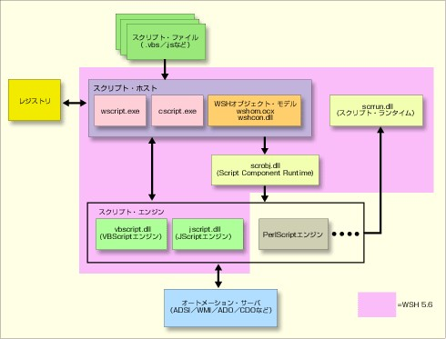 +
WSH는 특정 언어 처리 시스템에 의존하지 않는 범용 스크립트 실행 환경이다. WSH 자체가 제공하는 객체나 외부 COM 객체를 제어함으로써, Windows 환경에서 다양한 처리를 자동화할 수 있다.

이 그림은 Windows 2000, Windows XP, Windows Server 2003에 탑재된 WSH(WSH 5.6)의 내부 구성을 보여주는 것이다. 그림에서 분홍색으로 표시된 부분이 WSH 5.6으로 제공되는 부분이다. 이제부터 이 그림을 자세히 살펴보도록 하자.

=== 스크립트 파일

WSH는 기본적으로 VBScript 또는 JScript를 이용한 스크립트 작성이 가능하다. 이 둘은 모두 텍스트 파일이며, 각각 .vbs, .js라는 확장자를 갖는다(WSH 2.0 이후에는 다른 파일을 포함하거나, VBScript와 JScript 등 여러 언어를 조합해서 작성하거나, 여러 작업을 기술할 수 있는 .wsf 형식도 이용할 수 있지만, 이에 대해서는 나중에 설명하겠다). 이런 확장자를 가진 파일은 기본적으로 레지스트리에 WSH 스크립트로 등록되므로, 파일을 생성한 후 탐색기 등에서 파일을 더블클릭하면 스크립트를 실행할 수 있다. 필요하다면 다른 확장자와 WSH 스크립트를 연결할 수도 있지만, 특별한 이유가 없다면 기본 설정 그대로 두어도 무방할 것이다.

WSH 스크립트는 일반 텍스트여야 한다! 파일 내에 특수 문자 코드가 포함되면 실행 시 오류가 발생한다. 의도적으로 특수 코드를 삽입하는 경우는 드물지만, 스크립트 편집에 고급 서식 기능을 갖춘 워드 프로세서 등을 사용하면 자신도 모르는 사이에 특수 코드가 저장되는 경우도 있으므로 주의가 필요하다. 이런 문제를 피하기 위해 텍스트 편집기를 이용해서 스크립트를 편집하는 것이 좋다. 기능은 제한적이지만, 짧은 스크립트라면 Windows에 포함된 메모장으로도 충분히 사용할 수 있다. 어느 정도 길고 복잡한 스크립트라면, 마이크로소프트에서 판매하는 통합 개발 환경인 Visual Studio .NET이나 Office 응용 프로그램에 포함된 스크립트 편집기를 활용해도 좋다.

.Visual Studio .NET에서 WSH 스크립트 편집하기
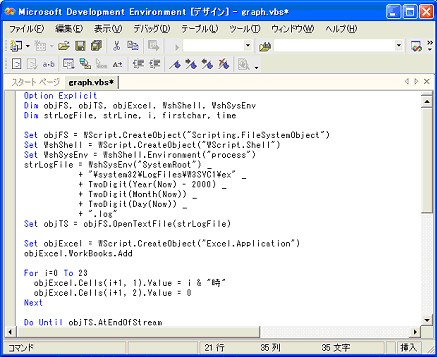 +
아주 짧은 스크립트라면 메모장으로도 충분하지만, 어느 정도 복잡한 스크립트를 개발할 경우에는 통합 개발 환경인 Visual Studio .NET을 이용할 수도 있다. VS.NET을 사용하면 텍스트 편집기에는 없는 개발 지원 기능을 활용할 수 있다.

=== 스크립트 호스트

WSH 스크립트의 실행을 담당하는 것이 스크립트 호스트이다. 실행된 스크립트 파일이 사용하는 스크립트 엔진(VBScript, JScript 등)을 결정하고, 이런 언어 엔진을 호출하며, 스크립트 내에서 지정된 COM 개체와의 통신을 제어한다.

그림에서 볼 수 있듯이, 스크립트 호스트는 wscript.exe (이하 WScript)와 script.exe (CScript)의 두 종류가 있다. 전자는 GUI 기반, 후자는 콘솔 기반의 스크립트 호스트이다.

두 가지의 가장 큰 차이점은 사용자에게 정보를 표시하거나 사용자 입력을 받는 스크립트를 작성했을 때의 처리 방식이다. 일반적으로 CScript는 명령 프롬프트에서 입력을 받아 명령 프롬프트에 결과를 출력한다(표준 입력에서 입력을 받아 표준 출력으로 결과를 출력한다). 반면 WScript는 Windows GUI인 대화 상자에서 입력을 받고, 메시지 상자를 통해 사용자에게 정보를 표시한다.

이 외의 부분은 WScript와 CScript가 거의 동일한 기능을 제공한다. 즉, 사용자의 상호작용이 수반되지 않는 스크립트라면 어느 쪽을 사용해도 별 차이가 없다는 뜻이다.

다만, 이번에 가정하는 것 같은 배치 처리 방식의 관리 업무는 보통 CScript를 사용하는 편이 편리할 것이다. 앞서 언급한 대로 WScript를 사용해도 동일한 처리가 가능하지만, 사용자에게 정보를 표시할 때 메시지 상자가 사용된다. 예를 들어 다음은 메시지를 표시만 하는 WSH 스크립트이다(“Wscript” 나 “Echo” 등의 의미는 다음 회부터 자세히 설명하겠다).

[source,vb]
----
Wscript.Echo “메시지를 표시합니다”
----

이 파일을 적절한 파일명(예: test.vbs)으로 저장하고 탐색기에서 실행하면 다음과 같은 메시지 상자가 표시된다. 이처럼 탐색기에서 더블클릭해서 WSH 스크립트를 실행할 경우, 기본적으로 WScript 스크립트 엔진이 사용된다는 뜻이다. 표시된 내용을 확인하고 다음 단계로 진행하려면 확인용 [OK] 버튼을 클릭한다. 따라서 예를 들어, 100명의 사용자를 Active Directory에 추가하는 스크립트를 작성했을 때, 한 명씩 등록 확인 메시지가 표시된다면 [OK] 버튼을 100번 클릭해야 한다.

.WScript 스크립트 호스트에서 실행해 보니
image:images/20261103_190453.jpg[] +
WScript로 실행하면 이와 같이 메시지 상자로 메시지가 표시된다. 처리를 진행하려면 [OK] 버튼을 클릭해야 한다.
　
다음으로, 명령 프롬프트를 열고 프롬프트에 “test.vbs” 만 입력한 뒤 Enter 키를 누른다. 이 경우도 기본적으로 WScript 스크립트 엔진이 사용되며, 위와 동일한 메시지 상자가 표시될 것이다.

CScript 스크립트 엔진을 사용해서 스크립트를 실행하려면 이를 명시적으로 지정해야 한다. 이를 위해서는 cscript 명령에 스크립트 파일 이름을 매개변수로 지정해서 실행하면 된다.

.CScript 스크립트 호스트에서 실행한 결과
image:images/20261103_190624.jpg[] +
메시지가 콘솔에 표시된다. 사용자가 아무 작업도 하지 않아도 처리가 진행된다(이 예는 처리가 종료되고 명령 프롬프트가 입력을 기다리는 상태이다).

이처럼 CScript로 실행할 때는 메시지가 명령 프롬프트 창에 표시되며, 사용자의 확인을 기다리지 않고 처리가 진행된다. 따라서 앞서 언급한 100명의 사용자 Active Directory 등록의 경우도 메시지가 100줄 분량으로 표시될 뿐, 사용자의 조작은 필요하지 않다. 단순한 일련의 처리나 반복 처리를 스크립트로 자동화하려면, 일반적으로 CScript를 이용하는 편이 좀 더 편리하다는 것을 알 수 있을 것이다.

=== 스크립트 엔진

WSH의 뛰어난 점은 스크립트를 실행하기 위한 호스트 환경(스크립트 호스트)과 스크립트 언어의 처리 엔진을 명확하게 분리했다는 것이다. 배치 파일과 명령 프롬프트, 셸 스크립트와 셸의 관계는 일대일이지만, WSH는 공통의 스크립트 호스트를 사용해서 서로 다른 여러 언어 엔진을 구현할 수 있다.

WSH 5.6은 VBScript와 JScript 두 가지 언어 엔진이 표준으로 제공된다. 즉, 이런 스크립트 언어의 경우 별도로 무언가를 추가로 설치하지 않아도 WSH 5.6을 사용할 수 있는 Windows 환경이라면 어디서나 스크립트를 실행할 수 있다.

표준으로 지원되는 것은 VBScript와 JScript 두 가지 뿐이지만, 타사 소프트웨어를 이용하면 다른 스크립트 엔진을 사용할 수도 있다. 예를 들어 Active State는 WSH용 Perl 기반 언어 엔진(Active Perl)을 제공하고 있다(Active State사 홈페이지).

스크립트 엔진의 역할은 스크립트 파일에 기술된 코드(특정 언어를 전제로 작성된 스크립트 코드)를 WSH가 해석할 수 있는 공통 코드로 변환하는 것이다.

=== WSH 객체 모델

앞서 언급한 것 같이, WSH 스크립트를 통해 IE, WMI, ADSI 등의 외부 COM 객체를 제어할 수도 있지만, WSH 자체도 프로그램 실행 제어, 네트워크 공유 연결/해제, 스크립트의 원격 실행 등을 가능하게 하는 COM 객체를 내부적으로 갖추고 있다. 이것이 그림에 표시된 WSH 객체 모델이다. 다만, WSH 객체 모델로 제어할 수 있는 것은 기본적인 처리 뿐이며, 고급 처리를 수행하려면 WMI나 ADSI 같은 외부 객체(오토메이션 서버)를 이용해야 한다.

=== 자동화 서버

자동화 서버란 WSH 스크립트로 제어할 수 있는 외부 COM 개체를 말한다. 대표적인 예로는 WMI나 ADSI가 있지만, 이 외에도 IE나 Office 애플리케이션 등 WSH에서 제어 가능한 인터페이스를 가진 COM 개체는 매우 다양하다. 이들을 활용하면 WSH 스크립트를 통해 다양한 관리 작업을 자동화할 수 있다(COM 개체로 기능하지 않는 애플리케이션도 키보드 조작을 에뮬레이트함으로써 스크립트에서 제어하는 것이 가능하다. 이에 대해서는 다음 연재에서 설명하겠다).

다음 회에는 WSH의 표준 개체 모델에 대해 자세히 해설하고, 이를 활용한 스크립트를 실제로 작성해 볼 예정이다.

== 제2회 WSH 스크립트 코딩의 첫걸음

WSH는 OOP 스타일로 WSH 표준 객체와 외부 COM 객체를 조작한다. 그 첫걸음이 되는 기초 지식을 익힌다.

지난 번에는 WSH의 내부 구조를 설명하고, WSH를 구성하는 각 구성 요소에 대해 개괄적으로 살펴보았다. 이를 통해 WSH는 MS-DOS의 배치 파일이나 UNIX의 셸 스크립트와 달리, 특정 언어에 의존하지 않는 범용 스크립트 실행 환경이라는 것을 알 수 있었다.

WSH의 프로그래밍 스타일은 이제는 상식이 된 OOP(객체 지향 프로그래밍)를 따르며, WSH 자체가 제공하는 객체나 IE, Office 등의 애플리케이션, WMI나 ADSI 등의 시스템 관리용 외부 객체를 스크립트에서 조작함으로써 처리를 실현한다. 하지만 OOP라고 해도 C++이나 Java, C# 언어처럼 복잡한 것은 아니므로, 작성 스타일에 익숙해지면 OOP 경험이 없는 사람도 문제없이 사용할 수 있을 것이다. 이런 독자를 염두에 두고, OOP에 대한 아주 간단한 소개도 다룰 것이다. 그리고 이번에는 WSH가 표준으로 제공하는 객체 모델을 소개하고, 이를 활용해서 간단한 스크립트를 작성해 보겠다.

=== 스크립트 실행 시 각 구성 요소의 역할

작성한 WSH 스크립트 파일을 실행하려면, 탐색기에서 스크립트 파일을 마우스로 더블 클릭하거나, 명령 프롬프트에서 CScript의 매개변수로 WSH 파일을 지정해서 실행하면 된다. 스크립트를 실행했을 때 WSH 구성 요소의 동작은 다음과 같다(WSH 구성 요소의 구성는 지난 회 그림 ‘WSH의 구성’ 을 참조하라).

WSH 스크립트 호스트의 시작::
WSH 스크립트를 실행하면, 먼저 스크립트 호스트가 시작된다. 탐색기에서 WSH 스크립트 파일을 더블 클릭하면 GUI 기반의 WScript 스크립트 호스트가 시작되고, 명령 프롬프트에서 CScript를 이용하는 경우는 CUI 기반의 CScript 스크립트 호스트가 시작된다. 이때 어느 경우든 스크립트 파일의 파일명이 각 스크립트 호스트에 매개변수로 전달된다.

스크립트 엔진 선택::
시작된 스크립트 호스트의 첫 번째 작업은 매개변수로 주어진 스크립트 파일의 확장자를 바탕으로 스크립트 엔진(스크립트 언어를 처리하기 위한 프로그램)을 결정하는 것이다. 스크립트 호스트는 레지스트리에 저장된 정보에 따라 스크립트 엔진을 결정한다. 기본 설정은 “.vbs” 는 VBScript에, “.js” 는 JScript에 대응한다.

스크립트 엔진의 시작과 스크립트 실행::
다음으로 스크립트 호스트는 스크립트 파일을 메모리에 읽어들이고, 선택된 스크립트 엔진을 시작한다. 이후 스크립트 호스트와 스크립트 엔진은 Windows Script Interfaces라는 인터페이스를 통해 통신하며 스크립트를 실행해 나간다.

실제 스크립트의 해석은 스크립트 엔진이 수행하지만, 스크립트 호스트 측에서 정의된 심볼(WSH 객체 등에 의해 정의된 심볼)을 처리할 때는 필요에 따라 스크립트 엔진이 스크립트 호스트에 정보를 조회하게 된다. 또한, 스크립트가 외부의 COM 컴포넌트를 이용하는 경우는 스크립트 호스트가 제공하는 라이브러리가 모든 통신 처리를 수행한다.

=== 스크립트 파일의 종류

WSH가 기본적으로 지원하는 스크립트 파일의 확장자는 다음과 같다.

|===
|확장자    |의미

|VBS    |VBScript 언어로 작성된 스크립트 파일
|JS     |JScript 언어로 작성된 스크립트 파일
|WSF    |작업 단위로 스크립트를 관리하는 XML 파일
|VBE    |인코딩된 VBScript
|JSE    |인코딩된 JScript
|===

이 중 WSF(Windows Script File)는 XML 형식의 파일로, ‘작업(job)’ 이라 불리는 작업 단위별로 하나의 파일 내에 서로 다른 여러 종류의 스크립트를 작성할 수 있다. 이때 각 스크립트는 VBScript나 JScript 등 서로 다른 언어를 혼합해서 작성하거나, 외부 스크립트 파일을 불러와(포함해서) 순차적으로 실행할 수 있다. WSF의 XML 요소에 대한 자세한 내용은 다른 문서를 참조하기 바란다.

VBE와 JSE는 인코딩된 스크립트 파일이다. 일반적인 스크립트 파일은 텍스트 기반이므로 텍스트 편집기로 쉽게 표시하거나 편집할 수 있다. 이는 스크립트를 간편하게 다룰 수 있는 특징이지만, 한편으로는 최종 사용자에게 스크립트의 세부 내용을 공개하고 싶지 않은 경우도 있다. 이런 경우는 스크립트를 인코딩함으로써 사용자가 스크립트 코드를 쉽게 표시하거나 변경할 수 없도록 할 수 있다.

작성한 스크립트를 인코딩하려면 다음 URL에서 스크립트 인코더를 다운로드해야 한다.

* Windows Script Encoder(마이크로소프트 다운로드)
　
이상은 표준으로 지원되는 스크립트용 확장자이다. 또한 옵션으로 스크립트 엔진을 설치하면 Perl(.pls)이나 Ruby(.rb) 스크립트도 실행할 수 있게 된다.

다만 본고의 주된 목적은 관리자가 번거로운 반복 작업이나, 단순하지만 다수의 단계에 걸친 관리 작업을 WSH 스크립트로 간소화하는 데 있다. 대규모의 복잡한 처리를 스크립트로 실행하는 경우나 최종 사용자에게 제공하는 스크립트의 경우, WSF 형식의 스크립트 파일이나 스크립트 인코딩이 유용한 경우도 있지만, 이번과 같은 목적에는 그다지 필요하지 않을 것이다. 이하 본고는 기본적으로 .VBS 파일과 .JS 파일만을 사용하기로 한다.

=== 객체 지향 프로그래밍 초보 입문

앞서 설명한 것 같이, WSH 스크립트는 WSH 자체가 제공하거나 외부에서 제공되는 COM 객체를 조작해서 처리를 수행한다. 따라서 VBScript나 JScript의 코딩 스타일은 객체 지향 프로그래밍(OOP: Object Oriented Programming)의 방식을 따르고 있다. MS-DOS 배치 파일은 실행하려는 명령줄 명령을 첫 번째 줄부터 순서대로 작성하면 되지만, WSH는 객체를 생성하고 객체에 메시지를 보내는 방식이 프로그램의 기본적인 흐름이 된다. OOP 경험이 없는 독자는 처음에는 이런 프로그래밍 방식에 당황할 수도 있다. 여기서는 그런 독자를 위해 OOP의 기초에 대해 간단히 정리해 보겠다.

FORTRAN 언어나 C 언어 같은 전통적인 절차형 언어는 프로그램에서 이용할 수 있는 기능을 함수(또는 서브루틴)로 구현해 나간다. 이 때문에 이런 언어는 구현할 기능이 늘어남에 따라, 해당 기능에 대응하는 함수 세트가 비대해지는 특징이 있다. 예를 들어 Windows는 API(Application Programming Interface)라고 불리는 함수를 애플리케이션에 제공하며, 애플리케이션이 이를 호출함으로써 메모리 관리나 창 관리 등 다양한 Windows 기능을 이용할 수 있도록 하고 있다. 당초에는 비교적 단순했던 Windows API였지만, Windows 버전 업그레이드를 통해 다양한 기능 확장이 이루어짐에 따라 API의 수는 계속 비대해졌고, 이제는 한 명의 프로그래머가 전체를 파악하기 어려울 정도로 복잡한 사양이 되어 버렸다(호환성 유지를 위해 오래된 API도 버릴 수 없다!).

이 문제를 해결하고, 복잡한 시스템을 가능한 한 단순하게 프로그램으로 다루려는 기법 중 하나가 OOP이다. OOP는 단순한 ‘기능’ 호출을 프로그램에서 나열하는 데 그치지 않고, 프로그램에서 ‘무엇(=객체)을 다루는가’ 에 주목해서 객체별로 기능을 정리한다. 이때, 묶어서 다루어야 할 데이터 세트와 그 데이터에 관한 기능을 ‘클래스’ 로 묶어 처리할 수 있도록 한다. 프로그램은 이 클래스에서 실체가 되는 객체(인스턴스라고도 함)를 생성해서 이용한다. C 언어 지식이 있다면, 구조체의 정의와 구조체 실체 간의 관계와 같다. 이를 통해 복잡한 시스템이라도 클래스를 정리함으로써 알기 쉽게 구조화할 수 있으며, 향후 기능 확장도 용이해진다. C#이나 Visual Basic .NET, Java, C++ 등 현재 사용되는 대부분의 프로그래밍 언어에서 이런 OOP 개념이 도입되어 있다. WSH도 스크립트에서 이용할 수 있는 기능은 WSH 객체 등으로 제공되며, 스크립트 코드는 OOP 스타일에 따른 작성법으로 이런 객체를 조작하게 된다.

객체(object)는 ‘사물’ 이라는 의미로, OOP는 모든 것을 객체 단위로 다룬다. 예를 들어 파일에서 데이터를 읽어오는 경우를 생각해 보자. 전통적인 절차형 언어는 각각 독립된 ‘열기’, ‘읽기’, ‘닫기’ 등의 라이브러리 함수를 호출하게 된다. 어떤 파일을 열 것인지(어떤 디스크의, 어떤 디렉터리에 있는 어떤 이름의 파일인지)에 대한 정보는 함수의 매개변수로 전달한다. 함수 호출의 결과는 반환값 등을 통해 얻을 수 있다.

이에 반해 OOP는 먼저 파일을 나타내는 객체를 생성하고, 그 객체에 ‘열기’, ‘읽기’, ‘닫기’ 메시지를 전송함으로써 파일 조작을 수행한다. 파일 객체에 실행 가능한 조작은 ‘열기’, ‘읽기’, ‘쓰기’, ‘닫기’ 등이다. 이처럼 각 객체는 자신에 대해 가능한 조작을 ‘메서드’ 로 외부에 공개한다. 프로그램은 객체별로 마련된 메서드에 메시지를 보내(호출해서) 처리를 진행하게 된다. 또한, 각 파일은 ‘파일명’ 이나 ‘파일 크기’ 등 객체 고유의 정보를 가지고 있다. 이처럼 각 객체가 가진 값을 ‘프로퍼티(=속성)’ 라고 부른다.

예를 들어 지금 A라는 파일과 B라는 파일이 존재한다고 가정하고, A와 B를 나타내는 객체를 각각 a, b라고 하면, a와 b는 서로 다른 객체지만 ‘읽기’ 나 ‘파일명’ 등 사용할 수 있는 메서드와 속성은 양쪽 모두에서 공통적이다. 이는 a와 b 모두 ‘파일’ 이라는 동일한 개념의 ‘사물’ 을 나타내기 때문이다. 이처럼 ‘파일’ 이라는 추상적인 존재를 기술하고, 그것이 공개하는 메서드와 속성의 틀을 규정하는 것이 ‘클래스’ 이며, 그 클래스에서 생성된 실체(이 예에서는 객체 a와 b)를 ‘인스턴스’ 라고 한다. 즉, a와 b는 같은 ‘파일’ 클래스에서 생성된 인스턴스이다.

객체가 어떤 메서드나 속성을 가지는지는, 어느 클래스에 속해 있는지에 따라 결정된다. 그러나 객체 a와 b가 공통으로 제공하는 ‘읽기’ 메서드를 호출해도, 객체 a의 ‘읽기’ 메서드를 호출하면 파일 A의 내용이, 객체 b의 ‘읽기’ 메서드를 호출하면 파일 B의 내용이 읽혀진다. 이는 a와 b가 서로 다른 인스턴스이기 때문이다. 이처럼 클래스는 ‘파일’ 이라는 추상적인 개념을 나타내는 반면, 인스턴스는 ‘파일 A’, ‘파일 B’ 같은 개별적인 ‘사물’ 을 나타낸다.

심오한 OOP의 모든 것을 여기서 다 설명할 수는 없다. WSH를 이용할 때는 아래에 제시된 OOP의 기본 중의 기본만 기억해 두기 바란다.

[sidebar]
----
OOP로 처리를 수행하려면 기본적으로 다음 절차를 따른다.

. 조작 대상이 될 객체를 생성하거나, 이미 생성된 객체를 지정한다.
. 해당 객체가 제공하는 메서드를 호출한다.
----

=== WSH 객체 모델

앞서 언급한 것 같이, WSH는 객체를 생성하고 메서드를 호출해서 처리를 수행한다. 그렇다면 WSH 스크립트에서 사용할 수 있는 객체는 어떤 것들이 있을까? 지난 시간에 설명한 것 같이, WSH 스크립트에서 외부 COM 객체를 호출하는 것도 가능하지만, WSH 자체도 프로그램의 실행 제어 등을 수행하기 위한 객체군을 제공하고 있다.

현재 WSH 5.6은 다음과 같은 14개의 내장 객체가 정의되어 있다. 각 객체는 그림과 같은 계층 구조를 가지고 있다(각 객체가 제공하는 역할은 아래 표를 참조).

.WSH 객체 모델
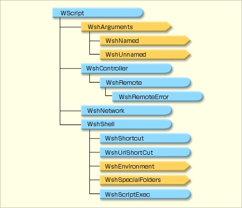 +
WSH는 이 14개의 내장 객체가 기본 제공된다. 그림에서 노란색 부분은 여러 객체를 항목으로 포함하는 컬렉션 클래스를 나타낸다.

그림에서 WScript부터 WshUnnamed까지의 객체(WScript, WshArguments, WshNamed, WshUnnamed)는 스크립트 호스트를 구성하는 wscript.exe 나 cscript.exe 에 내장된 객체이다(wscript.exe 나 cscript.exe 는 지난 번 그림 ‘WSH의 구성’ 참조). 반면 WshController부터 WshRemoteError까지는 wshcon.dll로, WshNetwork와 WshShell부터 WshScriptExec까지는 wshom.ocx로 제공되는 COM 객체이다. 이런 객체들은 WSH 표준으로서 Windows NT 4.0이나 Windows 98부터 최신 Windows Server 2003에 이르기까지 폭넓은 Windows 환경에서 사용할 수 있다. 즉, 이런 WSH 객체를 사용한 스크립트는 어떤 Windows 환경에서든 실행할 수 있다는 뜻이다.

그림에서 선으로 연결된 계층 구조를 이루는 객체는 상위 객체의 메서드나 속성을 통해 하위 객체를 가져올 수 있음을 의미한다. 예를 들어, WshArguments 객체는 WScript의 속성으로서 다음과 같이 가져올 수 있다.

[source,vb]
----
WScript.Arguments
----

객체의 속성이나 메서드에 접근하려면 이처럼 점(`.`)을 사용해서 표기한다. 이에 대한 자세한 내용은 코드 예제를 통해 나중에 자세히 설명하겠다.

그림에서 노란색으로 표시된 객체는 여러 객체를 항목으로 갖는 컬렉션 클래스를 의미한다. 컬렉션 클래스에 대한 자세한 내용도 향후 연재에서 자세히 설명할 예정이므로, 당분간 무시해도 무방하다.

각 객체의 역할을 간단히 정리하면 다음과 같다.

.WSH 개체의 역할
[%autowidth]
|===
|개체    |역할

|WScript    |개체 생성·연결, 화면 표시 등
|WshArguments    |명령줄 인자에 액세스
|WshNamed    |이름이 지정된 명령줄 매개변수에 액세스
|WshUnnamed    |이름이 지정되지 않은 명령줄 매개변수에 액세스
|WshController	|원격 스크립트 프로세스 생성
|WshRemote    |컴퓨터 시스템을 원격으로 관리
|WshRemoteError    |WshRemote 객체가 비정상적으로 종료되었을 때의 오류 정보에 접근
|WshNetwork    |네트워크 공유 연결·해제 등
|WshShell	|프로그램 실행 및 환경 변수 조작 등
|WshShortcut    |바로 가기 만들기
|WshUrlShortCut    |인터넷 리소스에 대한 바로 가기 만들기
|WshScriptExec    |Exec( )로 실행한 스크립트에 대한 상태 정보 및 오류 정보 가져오기
|WshEnvironment    |환경 변수에 액세스하기
|WshSpecialFolders    |Windows 전용 폴더에 액세스하기
|===

각 객체에 대해 자세한 내용을 알고 싶다면 MSDN 페이지를 참조한다.

다만 이 모든 세부 사항을 외울 필요는 없다. 이후 이 연재에서 구체적인 샘플 프로그램을 제시하며 각 객체의 실용적인 활용법을 소개할 예정이다.

=== WMI와 ADSI

WSH 스크립트는 앞서 언급한 WSH 표준 개체 외에도 외부 COM 개체를 조작할 수 있다. 특히 Windows 시스템을 관리할 때는 WMI(Windows Management Instrumentation)와 ADSI(Active Directory Service Interfaces)가 유용하다. WMI는 컴퓨터 관리용 인터페이스이고, ADSI는 Active Directory 관리용 인터페이스이며, Windows 2000/Windows XP/Windows Server 2003 각 환경에서 표준으로 사용할 수 있다.

WMI를 사용하면 디스크, 드라이버, 이벤트 로그, 파일, 폴더, 파일 시스템, 네트워크, OS 설정, 성능 데이터, 프린터, 프로세스, 레지스트리 설정, 보안, 서비스, 공유 폴더, 사용자 및 그룹 등을 리소스로 삼아 WSH 스크립트를 통해 관리할 수 있다.

반면 ADSI는 Active Directory 사용자, 그룹, 컴퓨터, 조직 단위(OU), 공유 폴더 등에 대해 생성·열람·편집·삭제 등의 작업을 수행할 수 있다.

WMI와 ADSI를 능숙하게 활용하면 번거로운 Windows 관리 및 Active Directory 관리의 많은 작업을 자동화할 수 있다. 관리 업무의 경감이 본고의 가장 큰 목적이므로 서둘러 내용을 진행하고 싶지만, WSH를 좀 더 깊이 이해하고 능숙하게 활용하기 위해 당분간 WSH의 기초 해설에 함께해 주시기를 부탁드린다.

=== 스크립트 실행 방법과 명령줄 옵션

서두에서 언급한 것 같이, 스크립트 호스트는 GUI 기반의 WScript와 명령줄(CUI) 기반의 CScript, 두 가지 유형이 존재한다. 필요에 따라 적절히 구분해서 사용하면 되지만, 다음과 같은 이유로 관리자는 CScript를 이용한 명령줄 실행을 선호할 것이다.

* 정보 출력 시 대화형 확인 작업이 필요하지 않다(이에 대해서는 지난 시간에 자세히 설명했다).

* 출력을 리디렉션함으로써 스크립트 실행 결과를 로그 파일에 쉽게 기록할 수 있다.

* 스크립트에 대한 매개변수 지정이 용이하다. 스크립트 실행 시, 조작 대상이나 옵션 등을 매개변수로 지정할 수 있다.

* 스크립트 실행을 도중에 취소하기 쉽다. 명령 프롬프트에서 스크립트를 실행하는 경우, 도중에 스크립트 실행을 중지하려면 Ctrl+C 키를 누르면 된다(또는 스크립트를 실행 중인 명령 창을 강제로 닫아도 된다). 반면 WScript 스크립트 호스트를 이용해서 스크립트를 실행하는 경우, 스크립트를 중단하려면 wscript.exe의 실행 프로세스를 강제 종료하는 방법 밖에 없다.
　
CScript로 스크립트를 실행하려면 명령 프롬프트에서 다음과 같이 지정한다.

----
CScript 스크립트 파일명 [옵션] [매개변수]
----

여기서 [매개변수]는 스크립트에 전달되는 매개변수이다. 탐색기에서 파일을 드래그 앤 드롭했을 때는 해당 파일의 파일명이 매개변수로 전달된다.

옵션은 다음을 사용할 수 있다(실제로는 명령 프롬프트에서 WScript에 옵션을 지정해서 실행하는 것도 가능하다). 옵션 시작 기호가 ‘//’ 같이 “슬래시 기호 2개로 시작한다” 는 점에 유의해야 한다(대소문자는 구분하지 않는다). 단순히 cscript만 실행하면 도움말 메시지가 표시된다.

.WSH에서 사용할 수 있는 실행 시 옵션
[%autowidth]
|===
|옵션    |의미

|//B    |배치 모드. 화면 출력을 표시하지 않음
|//D    |Microsoft Script Debugger가 설치되면 디버거를 사용할 수 있게 함
|//E:engine    |확장자에 관계없이 실행할 스크립트 엔진을 “engine”으로 지정함 (engine에는 VBScript, JScript 등을 지정함)
|//H:CScript   |
|//H:WScript   |기본 스크립트 호스트를 변경한다(설치 직후의 기본 상태에서는 WScript가 기본 스크립트 호스트로 레지스트리에 등록되어 있다)
|//I    |대화형 모드. 화면 출력을 표시한다
|//Job:xxxx    |WSF 작업을 실행한다
|//logo    |CScript 시작 시 로고를 표시한다
|//nologo    |CScript 시작 시 로고를 표시하지 않는다
|//S    |타임아웃 및 로고 표시 설정을 저장한다. 예를 들어, cscript //nologo //S 라고 하면, 다음부터 로고가 표시되지 않는다
|//T:nn    |타임아웃 시간을 초 단위로 지정한다. 지정한 시간이 경과하면 스크립트 처리 도중이라도 종료된다
|//X    |Microsoft Script Debugger가 설치되어 있으면 디버거에서 스크립트를 실행한다
|//U    |리디렉션된 경우 유니코드(UTF-16)로 입출력한다
|//?    |스크립트 호스트의 매개변수 목록을 표시한다
|===

예를 들어 “test.vbs” 라는 스크립트를 배치 모드로 실행하려면 다음과 같이 하면 된다.

----
CScript test.vbs //B
----

명령 프롬프트에서 직접 입력해서 실행하는 것 외에도, 작업 스케줄러에 스크립트를 등록해서 예약 실행하거나, 로그온 스크립트로 지정해서 사용자가 로그온할 때 스크립트를 자동으로 실행하도록 하는 것 등이 가능하다. 작업 스케줄링 등은 WMI를 통해 스크립트에서 제어할 수도 있다. 이런 스크립트의 다양한 실행 방법에 대해서도 향후 연재에서 적절한 시기에 다루도록 하겠다.

=== 간단한 스크립트

마지막으로, 예시로 메모장을 실행하는 간단한 스크립트를 작성해 보자. 다음은 그 스크립트이다.

[source,vb]
----
Set objShell = WScript.CreateObject(“WScript.Shell”)
WScript.Echo “메모장을 실행합니다.”
objShell.Run “notepad.exe”
----

응용 프로그램을 실행하려면 WshShell 객체의 Run 메서드를 사용한다. 스크립트가 시작될 때는 WshShell 객체가 존재하지 않으므로, 1행에서 WshShell 객체를 생성하고 있다. 객체를 생성하려면 WScript 객체의 CreateObject 메서드를 이용한다. 단, WScript 객체 자체는 생성할 필요가 없으며, 스크립트 내에서 항상 참조할 수 있다.

객체의 메서드나 속성에 접근하려면 객체 이름 뒤에 점(`.`)을 붙이고, 메서드명이나 속성명을 작성한다. 즉,

[source,vb]
----
WScript.CreateObject
----

라면, WScript 객체의 CreateObject 메서드를 호출한다는 의미가 된다.

메서드 호출 뒤에 오는 `( )` 안에는 메서드에 전달할 매개변수(인수)를 작성한다. 이번 WScript.CreateObject 메서드는 프로그램 ID라고 불리는 문자열을 매개변수로 지정한다(“WScript.Shell”). CreateObject 메서드는 매개변수로 주어진 프로그램 ID를 바탕으로 생성해야 할 클래스를 판단하고, 그 인스턴스를 생성한다. “WScript.Shell”은 WshShell 클래스를 나타내는 프로그램 ID이므로, 이를 통해 WshShell의 인스턴스를 생성할 수 있다.

맨 앞의 Set은 변수에 객체를 할당하는 문이며, 여기서는 생성한 인스턴스를 objShell 이라는 변수에 할당하고 있다. 또한, VBScript는  reateObject 함수가 있으므로, WScript.CreateObject 대신 CreateObject 만으로도 동일한 내용을 작성할 수 있다.

2번 줄은 WScript 객체의 Echo 메서드를 이용해서 “메모장을 실행합니다.” 라고 출력하고 있다. 이 경우 스크립트 호스트가 WScript면 메시지 상자로 표시되며, [OK] 버튼을 누를 때까지 처리가 그곳에서 처리는 중단된다. 반면 CScript면 문자열은 명령 프롬프트에 표시되고, 그대로 다음 처리로 진행된다.

3번 줄은 1번 줄에서 생성한 WshShell 인스턴스의 Run 메서드를 호출하고 있다. Run 메서드의 매개변수는 실행할 명령줄을 지정한다. 여기서는 notepad.exe 를 지정하므로 메모장이 실행된다.

CreateObject 의 사용법 등은 아직 직관적으로 이해하기 어려울 수도 있다. 하지만 당황할 필요는 없다. WSH 스크립트 공부는 이제 막 시작되었을 뿐이다.

다음 시간은 WSH 객체에 대한 자세한 내용과 실제 활용법을 염두에 두고, 더욱 심도 있게 설명할 예정이다.

== 제3회 WScript 객체 상세 설명 (1)

드디어 WSH의 표준 객체를 활용한 실전 스크립트 작성에 들어간다. 우선 기본이 되는 WScript 객체부터 시작해 보자.

지난 글에서 WSH 스크립트 해설의 첫 걸음으로 WSH 객체 모델의 개요에 대해 다루었다. 이번 글부터 몇 차례에 걸쳐 한 단계 더 깊이 들어가, 개별 WSH 내장 객체에 대해 자세히 살펴보기로 한다. 구체적으로는 WScript, WshShell, WshNetwork, WshController 객체를 하나씩 다룰 것이다. 스크립트 프로그래밍은 이런 WSH 내장 객체의 메서드와 속성을 활용해서 원하는 처리를 실행하게 된다.

=== 온라인 정보 자료

본론에 들어가기 전에, WSH 스크립트 프로그래밍에 도움되는 온라인 자료를 소개해 두겠다. 이들은 Windows Script Host 참조, VBScript 언어 참조, 『Windows 2000 Scripting Guide』이다.

Windows Script Host 참조::
이하 본고에서 WSH의 내장 객체 메서드와 속성을 차례로 설명하겠지만, 모든 메서드와 속성을 한 눈에 확인하려면 마이크로소프트가 인터넷에 공개한 다음 온라인 참조 자료를 활용하면 된다. 샘플 스크립트도 소개되어 있으므로, 스크립트를 작성할 때는 이를 적극적으로 참고하게 될 것이다.

.Windows Script Host 참조
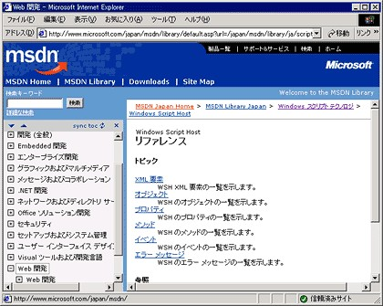 +
WSH 내장 객체의 메서드와 속성이 나열되어 있다.
　
다만 아쉽게도 왼쪽의 트리 표시와 제대로 연동되지 않으므로, 본문 내 링크를 클릭해서 페이지를 이동할 경우 트리에 최상위 항목인 ‘웹 개발’ 만 표시된다. 일시적인 현상일 수도 있지만, 불편하면 트리만 클릭해서 페이지를 이동하거나, 기본 페이지(위 페이지 등)를 표시된 상태로 둔 채 하위 계층으로 이동할 때는 별도의 창(Shift 키를 누른 상태에서 링크 클릭)에서 표시하는 것이 좋다. 트리는 ‘웹 개발’ → ‘스크립팅’ → ‘SDK 문서’ → ‘Windows 스크립트 기술’ → ‘Windows Script Host’ → ‘참조’ 순으로 이동하면 접근할 수 있다.

VBScript 언어 참조::
이하 본고는 필요에 따라 예제 프로그램을 제시하며 설명을 진행하겠다. 이미 이전 연재에서 언급한 것 같이, 언어는 VBScript를 사용한다. 이때 VBScript의 문장이나 함수를 활용하지만, VBScript의 언어 사양을 해설하는 것은 본고의 주된 목적이 아니므로, 이에 대해서는 최소한의 설명만 다루겠다.

VBScript의 언어 사양은 마이크로소프트가 인터넷에 공개한 페이지를 참조하시기 바란다.

.VBScript 언어 참조
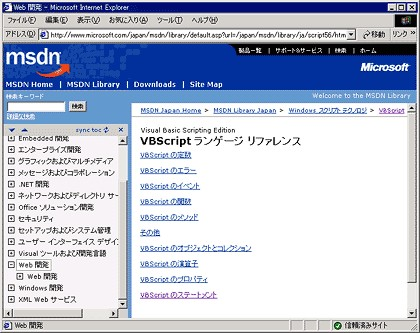 +
VBScript의 문이나 함수 등 언어 사양에 대한 자세한 내용은 여기에서 확인할 수 있다.

또한, 예제 프로그램에서 VBScript 문이나 함수를 사용한 경우는 해당 참조 페이지의 URL을 삽입하도록 한다.

『Windows 2000 Scripting Guide』::
미국 Microsoft 사이트는 『Windows 2000 Scripting Guide』라는 WSH 스크립트 해설서의 내용이 무료로 공개되어 있다. 물론 영어로 되어 있지만, 이는 WSH 스크립트의 대표 서적이라고 볼 수 있다. WSH 기초부터 WMI나 ADSI 같은 응용 분야까지 폭넓게 다루고 있다. WSH를 공부할 계획이라면 꼭 ‘즐겨찾기’ 에 등록하길 바란다(솔직히 말해, 본 연재도 이 문서를 크게 참고하고 있다).

『Windows 2000 Scripting Guide』(미국 Microsoft)

.『Windows 2000 Scripting Guide』
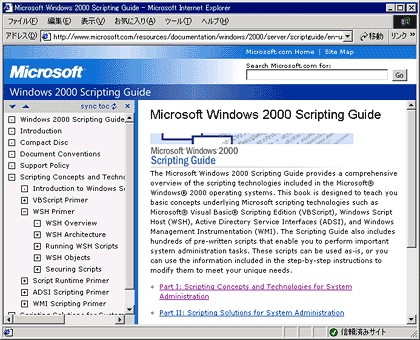 +
시중에 판매되는 서적 『Windows 2000 Scripting Guide』의 내용을 그대로 웹에 공개한 것이다. 영어지만, 스크립트 프로그래밍에서 매우 든든한 자료이다.

=== WScript 객체

지난 번 WSH 객체 모델에서 소개한 것 같이, WScript 객체는 WSH 객체 모델의 최상위에 위치한 객체이다. 다른 모든 WSH 객체는 이 WScript를 이용해서 가져오는 형태가 된다. WScript 객체는 암묵적으로 인스턴스화되므로(암묵적으로 객체가 생성되므로), 다른 객체와 달리 명시적으로 객체를 생성하지 않아도 스크립트 내 어디서나 호출할 수 있다.

WScript 객체에 포함된 각 메서드/속성과 그 역할을 정리하면 다음과 같다.

.WScript 객체의 메서드와 속성
[%autowidth]
|===
|메서드/속성    |역할

|CreateObject/GetObject    |COM 객체 생성/획득
|Echo/StdOut/StdIn/StdErr    |데이터 표시, 입출력 관리(표준 입출력 등)
|Arguments    |실행 시 매개변수
|Quit/Sleep/Timeout/Interactive    |스크립트 실행 제어
|Application／BuildVersion／FullName／Name／Path／ScriptFullName／ScriptName／Version    |호스트 정보 가져오기
|CreateObject／GetObject／ConnectObject／DisconnectObject    |이벤트 제어
|===

WSH 스크립트는 IE(Internet Explorer)나 WMI(Windows Management Instrumentation), ADSI(Active Directory Service Interfaces) 등의 COM 객체를 제어해서 다양한 처리를 수행한다. 이를 위한 COM 개체 생성 및 참조를 비롯해서 표준 입출력 처리, 실행 시 매개변수 가져오기, 스크립트 실행 제어 등 WSH 스크립트 실행의 기본이 되는 기능과 정보가 WScript 개체에 포함되어 있음을 알 수 있다.

이런 WScript 개체의 메서드/속성 간의 관계를 도식으로 나타내면 다음과 같다.

.WScript 객체 모델
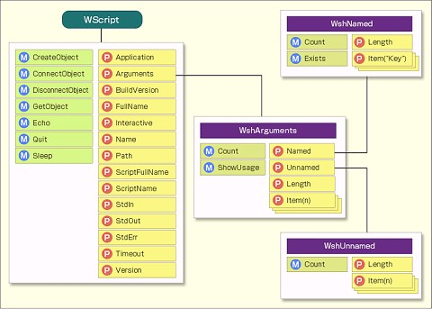 +
그림 속의 ‘M’ 은 메서드를, ‘P’ 는 속성을 나타낸다. 객체를 조작할 때는 메서드를 호출하고, 객체로부터 정보를 가져올 때는 속성을 참조한다.
　
그림 속의 ‘M’ 은 WScript 객체의 메서드를, ‘P’ 는 속성을 나타낸다. 메서드(method)는 ‘방법, 수단’ 이라는 뜻으로, 객체가 제공하는 명령과 같은 것이다. 이런 메서드를 적절히 호출함으로써 스크립트에서 객체를 조작한다. 예를 들어 어떤 객체를 생성하려면 WScript 객체의 CreateObject 메서드(WScript.CreateObject)를 호출한다(구체적인 프로그램 예제는 후술한다).

한편, 프로퍼티(property)는 ‘성질, 특성, 속성’ 이라는 의미로, 해당 객체에 관한 어떤 정보를 보유하고 있다. 스크립트는 객체의 프로퍼티에서 적절한 정보를 읽어와 처리를 진행한다. 예를 들어, WScript 객체의 Arguments 프로퍼티는 스크립트가 실행될 때 지정된 옵션이 저장되어 있다. 옵션에 따라 스크립트의 처리를 전환하려면 Arguments 프로퍼티의 값을 이용하게 된다.

이 WScript 객체의 Arguments 속성에서 WshArguments 객체로, 또한 WshArguments 객체의 Named 및 Unnamed 속성에서 WshNamed/WshUnnamed 객체로 각각 선이 그려져 있다. 이는 속성의 값이 선으로 연결된 객체임을 나타낸다. 즉, WScript.Arguments 속성의 내용은 WshArguments 클래스의 인스턴스(=객체)가 되고, WScriptArguments.Named 속성의 내용은 WshNamed 클래스의 인스턴스가 된다는 뜻이다. 지난 시간에 소개한 것 같이, 객체의 메서드나 속성은 “WScript.Arguments” 같이 점(`.`)으로 연결해서 표기한다.

그림에는 WshArguments 객체의 Item 속성이 여러 개의 사각형이 겹쳐진 형태로 표현되어 있다. 이는 Item 속성이 여러 개의 값을 가짐을 나타낸다(이처럼 여러 개의 값을 가지는 클래스를 ‘컬렉션 클래스’ 라고 한다. 자세한 내용은 나중에 설명하겠다). 예를 들어, 스크립트 실행 시 지정된 첫 번째 매개변수는 “WScript.Arguments.Item(0)”, 두 번째 매개변수는 “WScript.Arguments.Item(1)” 로 참조할 수 있다. 지금 다음과 같이 testscript.vbs 스크립트를 실행했다고 가정해 보자.

----
cscript testscript.vbs param1 param2
----

이 경우, WScript.Arguments.Item(0) 의 값은 “param1”, WScript.Arguments.Item(1) 의 값은 “param2” 가 된다. 즉, 컬렉션 클래스는 일종의 배열로 참조할 수 있다.

또한, “Set args = WScript.Arguments” 같이 속성을 변수에 할당하면, 변수 args 는 WshArguments 객체로 취급할 수 있게 된다. 따라서 WScript.Arguments.Item(0) 과 args.Item(0) 은 동일하다. 구체적인 프로그램 예제는 추후 자세히 설명하겠다.

=== COM 개체의 생성 및 참조

그럼 이제 WScript 개체의 각 메서드와 속성에 대해, 샘플 스크립트 등을 곁들여 자세히 설명해 보겠다. 먼저 COM 개체를 생성하고 참조하기 위한 CreateObject 메서드와 GetObject 메서드이다.

CreateObject 메서드와 GetObject 메서드는 WSH에서 가장 중요한 기능 중 하나이다. WSH 스크립트는 Windows 환경의 다양한 컴포넌트를 조작할 수 있다. 이를 위해서는 우선 조작하려는 컴포넌트(COM 객체)를 생성하거나 가져와야 한다. 이를 위해 사용하는 것이 CreateObject 메서드와 GetObject 메서드이다. WScript 객체는 명시적으로 생성하지 않아도 사용할 수 있지만, 그 외의 객체는 기본적으로 이 중 하나의 메서드를 사용해서 생성하거나 가져와야 한다.

=== CreateObject: 객체 생성

CreateObject 는 프로그램 ID를 인수로 받고, 해당 프로그램 ID로 표시되는 COM 객체의 인스턴스(실체)를 생성해서 그 객체를 반환하는 메서드이다. 여기서 말하는 ‘프로그램 ID’ 란 Windows 환경에서 사용할 수 있는 컴포넌트에 부여된 이름을 말한다. 클래스 ID 목록은 레지스트리의 HKEY_CLASSES_ROOT 아래에 기술되어 있다. 예를 들어, 다음은 레지스트리 편집기를 실행해서 HKEY_CLASSES_ROOT 아래를 표시한 화면이다.

.레지스트리 편집기에서 클래스 ID 목록 표시
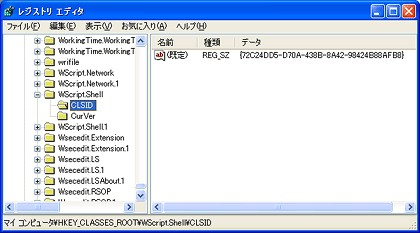 +
Windows 환경에서 사용할 수 있는 COM 개체는 레지스트리에 목록으로 정리되어 있다. 각 COM 개체는 프로그램 ID(문자열)나 클래스 ID(128비트 수치)로 식별된다.
　
화면의 트리(왼쪽 창)에 나열된 것이 프로그램 ID이다. 스크립트는 이런 이름(예: “Wscript.Shell”)을 통해 특정 COM 개체를 지정할 수 있다.

또한 위의 화면에서 ‘WScript.Shell’ 아래에 기재된 값을 표시하고 있다. ‘CLSID’ 는 클래스 ID(Class ID)를 의미하며, 이는 문자열이 아닌 128비트 수치이다. 각 COM 객체는 이처럼 고유한 클래스 ID가 할당되어 있다. CreateObject 메서드에 프로그램 ID를 지정해서 객체 생성을 지시하면, 내부적으로는 프로그램 ID가 이 클래스 ID로 변환되어 실제 DLL 파일 등이 호출된다. 다만 이런 처리는 WSH 스크립트 호스트가 자동으로 수행하므로, 프로그래머는 이를 별도로 의식할 필요가 없다.

지난 글 마지막 부분에서 ‘메모장’ 을 실행하는 스크립트를 소개했다.

[source,vb]
----
Set objShell = WScript.CreateObject(“WScript.Shell”)
WScript.Echo “메모장을 실행합니다.”
objShell.Run “notepad.exe”
----

이 첫 번째 줄에서 WScript의 CreateObject 메서드를 호출하고 있다. CreateObject 메서드의 매개변수로 “WScript.Shell” 이라는 프로그램 ID를 지정하고 있다(레지스트리 편집기 화면에 표시된 것). 이 메서드 호출의 결과로 WScript.Shell 객체가 생성되며, 그 결과가 반환값으로 돌아온다. 스크립트는 그 결과 객체를 objShell 이라는 변수에 할당하고 있다.

맨 앞에 있는 Set 키워드는 단순한 숫자나 문자열을 변수에 할당할 때는 지정하지 않지만, 객체를 할당할 경우는 반드시 지정해야 한다(반대로 Set 이 지정되면 객체 할당으로 간주해도 된다). Set문의 특징은 일반적인 숫자나 문자열 할당처럼 값 자체를 변수에 복사하는 것이 아니라, 객체에 대한 “참조를 할당한다” 는 점이다. C 언어를 안다면, 여기서 말하는 참조는 일종의 포인터와 같다고 생각하면 된다. 객체의 실체를 복사하는 것이 아니라, 실체는 그대로 두고 그 실체를 가리키는 포인터만 변수에 할당하는 것이다. 따라서 Set 문을 통해 할당을 반복하더라도 객체의 실체는 항상 하나이며, 복사되지 않는다. 단지 같은 객체의 실체를 가리키는 이름(=변수)이 늘어날 뿐이다.

=== GetObject: 객체 가져오기

GetObject는 매개변수로 파일 이름을 지정해서, 해당 파일을 조작하기 위한 자동화 객체를 가져오는 메서드이다. CreateObject 와 달리, 해당 객체가 이미 존재하면 새로운 객체를 생성하지 않고 기존 객체를 반환한다(이것이 Create 가 아닌 Get 인 이유이다). 존재하지 않으면 객체를 생성한다.

예를 들어 다음과 같이 한다.

[source,vb]
----
Set objExcel = WScript.GetObject(“D:\WSH\test.xls”)
WScript.Echo objExcel.Sheets(“Sheet1”).Cells(1,1)
----

이 예제는 test.xls 라는 Excel 파일을 지정하고, 해당 객체에 대한 참조를 objExcel 이라는 변수에 할당하고 있다. 그리고 2번 줄에서 objExcel의 Sheets 속성을 통해 “Sheet1” 이라는 이름의 Worksheet 객체를 가져오고, Cells 속성을 통해 1행 1열 셀의 값을 가져온 뒤, WScript.Echo 메서드(후술)를 통해 그 내용을 표시하고 있다. 이를 통해 test.xls 파일의 1행 1열의 데이터 내용을 표시할 수 있다.

이 스크립트가 실행되면 스크립트 호스트는 레지스트리를 참조해서 ‘.xls’ 파일이 Office 애플리케이션인 Excel과 연관되어 있음을 인식하고, 프로그램 ID가 ‘Excel.Sheet’ 인 객체를 반환한다. 즉, 프로그램 ID를 명시하지 않아도 레지스트리의 대응 관계가 자동으로 검색된다.

그러나 경우에 따라 동일한 확장자에 대응하는 응용 프로그램이 여러 개 존재할 수도 있다. 이런 경우는 대상이 되는 자동화 객체의 프로그램 ID를 GetObject의 두 번째 매개변수에 명시적으로 지정할 수 있다. 예를 들어, 위 목록의 첫 번째 줄은 다음과 같이 작성해도 된다. 동작은 전혀 달라지지 않는다.

[source,vb]
----
Set objExcel = WScript.GetObject(“D:\WSH\test.xls”, “Excel.Sheet”)
----

자세한 내용은 후속 연재에서 다루겠지만, WMI나 ADSI를 이용할 때도 처음에 GetObject를 사용해서 객체를 가져온다. 예를 들어 다음과 같이 한다.

[source,vb]
----
Set objWMIService = WScript.GetObject(“winmgmts:”)
----

GetObject의 첫 번째 매개변수로 지정된 “winmgmts:” 는 파일 이름이 아니라 WMI를 나타내는 문자열이다(Windows Management의 약자로 보인다). 이는 URL 맨 앞에 사용하는 프로토콜을 지정하는 ‘http:’ 같은 키워드로 생각하면 된다. 일반 파일이 아닌 특별한 참조 방법이다.

=== WScript 메서드와 VBScript 함수

VBScript는 CreateObject라는 VBScript 고유의 함수가 있으며, 이를 WScript.CreateObject 메서드 대신 사용할 수 있다. 또한 VBScript와 JScript는 GetObject라는 언어 고유의 함수가 있으며, 이를 WScript.GetObject 대신 사용할 수 있다. 그러나 이런 함수들의 기능은 각각 WScript.CreateObject 및 WScript.GetObject에 포함되어 있다.

따라서 스크립트는 일관되게 WScript.CreateObject 와 WScript.GetObject 를 사용하며, 본고는 그렇게 처리할 예정이다. 다만 인터넷 등에 공개된 타인의 스크립트 중에 이런 언어 고유의 함수를 이용한 것도 많다. 이런 경우를 발견하면, 기본적으로 WScript.CreateObject 와 WScript.GetObject로 대체해서 이해하면 된다. 일부 매개변수의 처리 방식 등이 약간 다르므로, 자세한 내용은 아래 링크에서 VBScript와 JScript의 언어 사양을 참조하시기 바랍니다.

=== 데이터 입출력

WSH 스크립트에서 데이터를 출력할 때는 일반적으로 WScript.Echo 메서드를 사용한다. 명령줄 모드의 CScript에서 실행하면 결과 문자열이 명령 프롬프트에, GUI 모드의 WScript에서 실행하면 결과 문자열이 메시지 상자에 각각 표시된다. 본 연재의 제1회에서 다음 예제를 소개한 바 있다.

[source,vb]
----
WScript.Echo “메시지를 표시합니다”
----

이 코드를 test.vbs 라는 파일에 저장하고, 탐색기에서 실행하면(WScript로 실행하면) 다음 메시지 상자가 표시된다.

.WScript에서 실행
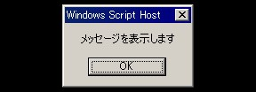 +
문자열은 메시지 상자로 표시된다.

반면, 동일한 test.vbs 를 명령줄에서 CScript로 실행하면 다음과 같이 된다.

.CScript에서 실행
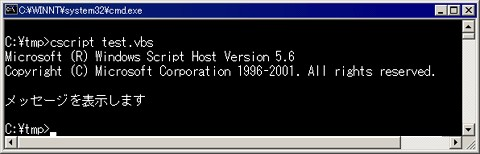 +
메시지는 명령줄에 표시된다.

명령줄 모드의 CScript에서 실행할 경우, Echo 메서드를 통한 문자열 표시뿐만 아니라 StdIn, StdOut, StdErr 각 속성을 이용해서 표준 입력/표준 출력/표준 오류 출력을 조작할 수 있다. 각 속성은 다음과 같이 TextStream 객체의 인스턴스(객체)로 되어 있다.

.WScript.StdIn／WScript.StdOut／WScript.StdErr 속성
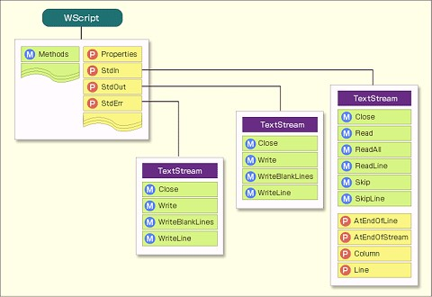 +
각 속성은 TextStream 클래스의 인스턴스(객체)이며, TextStream의 메서드와 속성을 사용할 수 있다.

이 TextStream 객체는 스크립트 실행 시 스크립트 호스트에 의해 자동으로 생성되므로, 프로그래머가 명시적으로 생성할 필요는 없다. 명시적으로 생성하지 않아도 바로 사용할 수 있다.

이름에서 알 수 있듯이, StdIn 은 표준 입력, StdOut 은 표준 출력, StdErr 은 표준 오류 출력을 각각 제어하는 속성이다. 다만 앞서 언급한 것 같이, 이런 속성을 사용할 수 있는 것은 명령줄 모드(CScript)에서 실행한 경우 뿐이며, GUI 모드의 WScript는 스크립트에 이런 속성을 사용하려고 시도하는 단계에서 ‘유효하지 않은 핸들입니다’ 라는 오류가 발생한다. GUI 모드에서 데이터 입력을 받으려면 VBScript의 InputBox 함수를 사용한다.

그림에서 알 수 있듯이, StdOut 및 StdErr 속성은 Write, WriteLine, WriteBlankLines 메서드를 사용할 수 있으며, 데이터를 표준 출력/표준 오류 출력으로 출력할 수 있다. 각 메서드의 기능은 다음과 같다.

.StdOut/StdErr에서 사용할 수 있는 메서드
[%autowidth]
|===
|메서드    |기능

|Write    |매개변수로 지정한 문자열이 출력된다. 줄바꿈(CR+LF)은 추가되지 않는다
|WriteLine    |매개변수로 지정한 문자열이 출력된다. 문자열 끝에 줄바꿈(CR+LF)이 자동으로 추가된다
|WriteBlankLines    |매개변수로 지정한 개수의 빈 줄이 출력된다
|===

Write 메서드는 매개변수로 지정한 문자열이 줄 바꿈 없이 연속적으로 표시된다.

[source,vb]
----
WScript.StdOut.Write “Write 메서드는”
WScript.StdOut.Write “매개변수로 지정한 문자열이”
WScript.StdOut.Write “줄 바꿈 없이 연속적으로 표시됩니다.”
----

이 코드를 명령줄에서 실행하면 다음과 같이 표시된다.

----
Write 메서드는 매개변수로 지정한 문자열이 줄바꿈 없이 연속으로 표시됩니다.
----

반면 WriteLine 메서드는 문자열 끝에 자동으로 줄바꿈(CR+LF)이 추가된다.

[source,vb]
----
WScript.StdOut.WriteLine “WriteLine 메서드는”
WScript.StdOut.WriteLine “매개변수로 지정한 문자열이”
WScript.StdOut.WriteLine “자동으로 줄바꿈됩니다.”
----

실행 결과는 다음과 같습니다.

----
WriteLine 메서드는
매개변수로 지정한 문자열이
자동으로 줄바꿈됩니다.
----

WScript.StdOut.WriteLine 은 앞서 언급한 WScript.Echo 와 동일한 동작을 한다. WScript(Windows GUI 기반)와 CScript(명령줄 기반) 모두에서 실행할 수 있는 스크립트를 만들려면 WScript.Echo 를 사용해야 한다(앞서 언급한 것 같이, WScript.StdOut.WriteLine 은 CScript만 사용할 수 있다).

출력할 데이터와 데이터 사이를 빈 줄로 구분하려면 WriteBlankLines 메서드를 사용합니다. 매개변수는 출력할 빈 줄의 수를 지정한다.

[source,vb]
----
WScript.StdOut.WriteLine “WriteBlankLines 메서드는”
WScript.StdOut.WriteBlankLines 1
WScript.StdOut.WriteLine “매개변수로 지정한 개수의 빈 줄이”
WScript.StdOut.WriteBlankLines 2
WScript.StdOut.WriteLine “출력됩니다.”
----

이 코드의 실행 결과는 다음과 같다.

----
WriteBlankLines 메서드에서는

매개변수로 지정한 개수의 빈 줄이

출력됩니다.
----

한편 StdIn 속성은 Read, ReadAll, ReadLine, Skip, SkipLine 메서드를 이용해서 표준 입력으로부터 입력을 읽어들일 수 있다.

.StdIn에서 사용할 수 있는 메서드/속성
[%autowidth]
|===
|메서드/속성    |기능

|Read    |매개변수로 지정한 문자 수만큼 표준 입력에서 읽어들이고, 결과 문자열을 반환합니다.
|ReadAll    |입력 데이터 전체를 읽어들이고, 결과 문자열을 반환합니다.
|ReadLine	|1줄 분량의 데이터를 읽어들이고, 결과 문자열을 반환한다
|Skip    |매개변수로 지정한 문자 수만큼 건너뛰고, 입력 포인터를 앞으로 이동시킨다
|SkipLine    |매개변수로 지정한 줄 수만큼의 입력을 건너뛴다
|AtEndOfLine    |입력 데이터가 줄 끝인지 여부를 나타낸다(부울 값)
|AtEndOfStream    |전체 입력 데이터의 마지막인지 여부를 나타낸다(부울 값)
|===

문자 수 매개변수는 일본어 문자도 지원하며, 반각 영숫자든 전각 한자든 1자로 계산된다.

문자 수를 지정해서 데이터를 읽으려면 Read 메서드를 이용한다. Read 메서드를 반복적으로 호출함으로써 이어지는 데이터를 읽을 수 있다.

[source,vb]
----
Do Until WScript.StdIn.AtEndOfLine
   strInput = WScript.StdIn.Read( 5 )
   WScript.Echo strInput
Loop
----

이 예제는 Read 메서드에 매개변수 5를 지정해서 입력 데이터에서 5자리를 읽어오고, WScript.Echo 메서드를 사용해서 데이터를 그대로 표시하고 있다. Do Until~Loop 는 Do Until 다음에 지정한 조건이 참(true)이 될 때까지 루프를 반복하는 문이다. 여기서는 AtEndOfLine 속성을 지정해서, 줄 끝 데이터(CR+LF)를 만날 때까지 루프를 반복하고 있다.

예를 들어 표준 입력에서 “WSH를 사용하면 번거로운 Windows 관리 업무를 경감할 수 있습니다” 라는 문자열을 지정해서 위 스크립트를 실행하면, 결과는 다음과 같이 5자씩 구분되어 표시된다.

----
WSH를 사
용하면 번거로운
Windo
ws 관리 업무
를 경감할
수 있습니다
----

이처럼 전각 문자도, 반각 문자도 각각 1자로 처리된다.

한 줄 분량의 데이터를 한꺼번에 읽어들이려면 ReadLine 메서드를 사용한다. 스크립트 실행 도중에 사용자 입력을 받아야 하는 경우는 이 ReadLine 메서드를 사용할 것이다. 이를 이용하면 사용자가 Enter 키를 누를 때까지의 모든 데이터를 가져올 수 있다.

[source,vb]
----
strInput = WScript.StdIn.ReadLine
WScript.Echo strInput
----

이 경우, 표준 입력에서 “WSH를 사용하면 번거로운 Windows 관리 업무를 줄일 수 있습니다” 까지를 지정해서 스크립트를 실행하면 출력은 다음과 같다.

----
WSH를 사용하면 번거로운 Windows 관리 업무를 줄일 수 있습니다
----

입력 데이터에서 임의의 문자 수를 건너뛰려면 Skip 메서드를 이용한다. 예를 들어 처음 10자를 건너뛰고 나머지 데이터를 모두 읽어와 표시하려면 다음과 같이 한다.

[source,vb]
----
WScript.StdIn.Skip( 10 )
Do Until WScript.StdIn.AtEndOfLine
   strInput = WScript.StdIn.Read( 1 )
   WScript.StdOut.Write strInput
Loop
----

마찬가지로 “WSH를 사용하면 번거로운 Windows 관리 업무를 줄일 수 있습니다” 를 지정하면, 결과는 다음과 같이 맨 앞 10자가 빠진 문장이 표시된다.

----
Windows 관리 업무를 경감할 수 있습니다
----

또한, StdIn 에 쓰기 메서드를 사용하거나, StdOut, StdErr 에 읽기 메서드를 사용하는 경우는 “파일 모드가 올바르지 않습니다” 라는 오류가 발생한다.

=== 계산기 샘플 스크립트

지금까지 설명한 메서드를 활용해서, 사용자가 입력한 수식을 계산하는 샘플 스크립트를 만들어 보자.

[source,vb]
----
Do
  WScript.StdOut.Write “수식을 입력해 주세요: ”
  strExpr = WScript.StdIn.ReadLine
  If strExpr = “” Then Exit Do

  WScript.StdOut.WriteLine “계산 결과: ” & _
    strExpr & “ = ” & Eval(strExpr)
Loop
----

실행 결과는 다음과 같다.

----
D:\WSH>cscript calc.vbs
수식을 입력해 주세요: 1+2
계산 결과: 1+2 = 3
수식을 입력해 주세요: 3*4
계산 결과: 3*4 = 12
수식을 입력해 주세요:

D:\WSH>
----

이 프로그램은 전체가 Do~Loop 로 둘러싸인 루프 구조를 이루고 있다. 루프의 종료 조건은 입력 후 확인하기 때문에 Until 이나 While 을 이용한 조건 지정은 생략했다. 2행에서 StdOut.Write 메서드를 이용해서 표준 출력에 “수식을 입력해 주세요:” 라고 출력한다. Write 메서드는 줄 바꿈을 출력하지 않으므로, 커서 위치는 ‘:’ 바로 오른쪽에 있다. 그리고 3행에서 StdIn.ReadLine 메서드를 이용해서 입력을 읽어와 strExpr 변수에 대입한다. 여기서 사용자에게 입력을 요청하게 된다. 사용자가 키 입력을 처리하면, 커서 위치인 ‘:’ 바로 오른쪽에 입력된 데이터가 표시된다. 이 예제는 키보드에서 ‘1+2’, ‘3*4’ 를 입력하고 있다.

다음 4행에서 입력을 확인하고, 입력이 “” 와 같으면, 즉 아무것도 입력되지 않은 경우는 Exit Do 문에 의해 루프를 종료한다. 취향에 따라 “exit” 나 “quit” 등의 문자열을 사용해도 좋을 것이다.

6행과 7행에서 StdOut.WriteLine 메서드를 사용해서 계산 결과를 표시하고 있다. 이 두 줄은 본래 한 줄로 표기해도 되지만, 매우 길기 때문에 두 줄로 나누고 ‘_’(언더스코어)로 연결했다. 이처럼 VBScript는 줄 끝을 ‘_’ 문자로써 여러 줄을 한 줄로 연결할 수 있다(반대로 말하면, 긴 한 줄을 여러 줄로 나누어 표기할 수 있다). 단, 이는 VBScript(및 Visual Basic) 고유의 표기법이다. VBScript는 물리적인 줄 끝이 (프로그램의) 문장의 끝을 나타내기 때문에, 이와 같이 문장이 여러 줄에 걸쳐 있음을 나타낼 필요가 있다. 반면 JScript는 코드의 논리적인 한 줄의 끝(구분자라고 함)으로 ‘;’ 를 표기하므로, ‘;’ 를 지정하기 전까지는 코드를 물리적으로 몇 줄에 걸쳐 작성하더라도 한 줄로 취급된다.

‘&’ 문자는 문자열을 연결하는 연산자이다. Eval은 VBScript의 함수로, VBScript 식으로서 주어진 문자열을 평가해서 결과를 반환한다.

이렇게 해서 문자열 “계산 결과:” 와 입력값 “1+2”, 문자열 “ = ”, 계산 결과 “3” 을 연결한 “계산 결과: 1+2 = 3” 이 출력된다.

다음 시간에도 계속해서 WScript 객체의 나머지 메서드와 속성에 대해 설명하겠다.

== 제4회 WScript 객체 상세 설명 (2)

시작 매개변수를 사용할 수 있다면, 사용자는 스크립트에 다양한 옵션을 지정할 수 있다. WSH에서 매개변수가 처리되는 방식을 알아본다.

지난 번에는 WSH 스크립트의 가장 기본이 되는 WScript 객체에 대한 상세 해설의 첫 번째 편으로, COM 객체를 생성하고 가져오는 CreateObject/GetObject 메서드, WSH 스크립트에서 데이터를 표시하거나 표준 입력을 관리하는 Echo/StdOut/StdIn 메서드 등에 대해 설명했다. WScript 객체의 메서드 목록에 대해서는 아래의 표 ‘WScript 객체의 메서드와 속성’ 을, WScript 객체의 구성에 대해서는 그림 ‘WScript 객체 모델(재게재)’ 을 참조하기 바란다.

이어서 이번에는 런타임 매개변수 조작 방법, 스크립트 실행 제어(일시 중지 및 강제 종료)를 중심으로 WScript 객체가 제공하는 나머지 기능에 대해 설명한다.

=== WSH 스크립트의 런타임 매개변수

명령줄에서 프로그램을 실행할 때는 일반적으로 명령어 이름 뒤에 해당 명령어에 전달할 매개변수를 지정한다. 예를 들어 다음 그림은 TCP/IP 설정을 확인하는 ipconfig 명령어의 실행 예시이다.

 +

(1)은 ipconfig 명령을 매개변수 없이 실행한 것이고, (2)는 상세 정보를 표시하도록 지시하는 “/all” 매개변수를 지정한 것이며, (3)은 IP 주소를 갱신하도록 지시하는 “/renew” 매개변수와 갱신을 수행할 어댑터 “localnet” 을 지정한 것이다. 이런 매개변수 지정이 가능하기 때문에, 하나의 명령에 다양한 기능을 부여할 수 있다. 만약 매개변수 지정이 불가능했다면, “상세 정보 표시” 나 “IP 주소 갱신” 같은 별개의 처리를 수행하기 위해 각각 독립된 명령어가 필요하거나, 특정 어댑터 이름을 프로그램에 하드코딩하여 재컴파일해야만 했을 것이다. 터무니없는 일이다.

이 ipconfig 명령어는 WSH 스크립트는 아니지만, WSH 스크립트도 마찬가지로 스크립트에 매개변수를 지정해서 실행할 수 있다.

.매개변수를 지정한 WSH 스크립트 실행 예
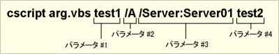 +
WSH 스크립트에 매개변수를 지정할 때는 스크립트 파일명(이 예에서는 “arg.vbs”) 뒤에 공백으로 구분해서 지정한다.

위의 예는 arg.vbs 라는 스크립트 파일에 4개의 실행 시 매개변수를 제공하고 있다. 이처럼 WSH 스크립트에 매개변수를 지정할 때는 일반적인 명령줄 명령과 마찬가지로 공백으로 구분해서 여러 개를 지정할 수 있다. 맨 앞이 슬래시가 아닌 매개변수는 ‘이름 없는 매개변수’(앞서 언급한 예시에서 매개변수 #1 과 #4), 슬래시로 시작하는 것은 ‘이름이 있는 매개변수’(마찬가지로 매개변수 #2 와 #3)로 스크립트 내부에서 구분해서 처리할 수 있다. 자세한 내용은 코드 예제를 통해 바로 다음에 설명하겠다.

공백 문자는 매개변수의 구분자 역할을 하므로, 매개변수 내부의 문자열에 공백이 포함된 경우는 다음과 같이 큰따옴표로 묶어야 한다.

.공백이 포함된 매개변수는 큰따옴표로 묶어야 한다
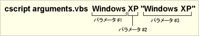 +
공백은 매개변수를 구분하는 역할을 하므로, 공백이 포함된 매개변수를 지정할 때는 큰따옴표로 묶어야 한다.

=== 실행 시 매개변수 가져오기: WScript.Arguments 속성

WSH 스크립트에서 실행 시 매개변수를 가져오려면 WScript 객체의 Arguments 속성을 사용한다. 이 WScript.Arguments 속성을 통해 WshArguments 컬렉션을 참조할 수 있다. WshArguments 컬렉션은 여러 값을 보관하는 컬렉션 클래스로, 스크립트 실행 시 지정된 모든 매개변수는 이 컬렉션 내부에 지정된 순서대로(왼쪽에서 오른쪽으로) 저장된다.

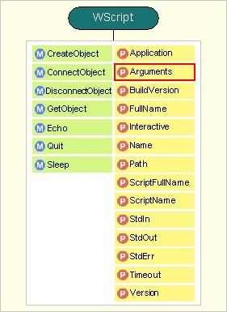 +

또한 WshArguments 컬렉션은 Named 와 Unnamed 라는 두 가지 속성이 있으며, Named 속성을 통해서는 WshNamed 컬렉션에, Unnamed 속성을 통해서는 WshUnnamed 컬렉션에 각각 액세스할 수 있다. WSH 런타임은 스크립트 실행 시 지정된 모든 매개변수를 WshArguments 컬렉션에 저장하는 동시에, 매개변수의 종류(이름이 지정된 매개변수와 이름이 지정되지 않은 매개변수)에 따라 필터링해서 WshNamed 컬렉션과 WshUnnamed 컬렉션으로 분류해서 저장한다.

.WScript 객체 모델 (재게재)
image:images/20261103_212050.jpg[] +
시작 시 매개변수는 WScript.Arguments 속성을 통해 액세스할 수 있는 WshArguments 컬렉션에 저장된다. 또한 매개변수의 종류에 따라 WshNamed 컬렉션과 WshUnnamed 컬렉션으로 필터링되어 저장된다(그림 속의 ‘M’ 은 메서드, ‘P’ 는 속성을 나타냄).

=== 모든 매개변수가 저장되는 WshArguments 컬렉션

앞서 설명한 것 같이, WScript.Arguments 를 통해 액세스할 수 있는 WshArguments 컬렉션은 여러 개체를 한꺼번에 다룰 수 있는 컬렉션 클래스로, 모든 런타임 매개변수를 이 개체의 Item 속성을 통해 참조할 수 있다. 컬렉션 클래스는 여러 요소를 저장할 수 있는 것으로, 후술하듯이 스크립트는 배열과 동일한 방식으로 요소에 접근할 수 있다. Item 속성 외에도 WshArguments 컬렉션은 다음과 같은 메서드/속성이 있다.

.WshArguments 컬렉션의 메서드/속성
[%autowidth]
|===
|메서드/속성    |기능

|메소드   |
|Count    |WshArguments 컬렉션 내에 저장된 매개변수의 개수를 반환한다
|ShowUsage    |XML 형식의 .wsf 파일에서 <RUNTIME> 섹션에 지정된 정보를 반환한다
|속성     |
|Named    |WshNamed 컬렉션에 대한 액세스를 제공한다. WshNamed 컬렉션에는 이름이 지정된 매개변수(/Name:Value 형식)가 출현 순서대로 저장되어 있다
|Unnamed	|WshUnnamed 컬렉션에 대한 액세스를 제공합니다. WshUnnamed 컬렉션에는 이름이 없는 매개변수가 출현 순서대로 저장되어 있습니다
|Length    |WshArguments 컬렉션에 저장된 매개변수의 개수를 보관합니다
|Item(n)    |WshArguments 컬렉션의 요소로 저장된 매개변수가 보관되어 있습니다. n=0일 때 첫 번째 매개변수, n=1일 때 두 번째 매개변수…와 같은 방식으로 접근한다.
|===

기본적으로 WshArguments.Count 메서드로 매개변수의 개수를 알 수 있으며, WshArguments.Item(n) 으로 실제 매개변수에 접근할 수 있다. Item 속성은 배열과 마찬가지로 괄호 안의 n 부분에 번호를 지정해서 각 요소에 접근할 수 있다.

또한 ShowUsage 메서드는 XML 형식의 .wsf 파일로 WSH 스크립트를 작성할 때 사용할 수 있는 것으로, <runtime> 섹션에 도움말 메시지를 작성했다가 ShowUsage 메서드를 호출하면 해당 메시지가 대화 상자에 표시된다. 다만 관리자가 간편하게 사용할 수 있다는 측면에서 그다지 필요하지 않으므로, 본 연재는 더 이상 설명하지 않겠다. 자세한 내용을 알려면 다음 Windows TIPS 을 참조하기 바란다.

* Windows TIPS ‘WSH 스크립트에서 도움말 메시지 표시하기’

다음 예제는 지정된 3개의 매개변수를 표시하는 스크립트입니다. 매개변수의 개수가 3개가 아닐 때는 “매개변수를 3개 지정해 주십시오.” 라는 오류 메시지를 표시합니다.

[source,vb]
----
1: If WScript.Arguments.Count = 3 Then
2:   WScript.Echo “첫 번째 매개변수는” & WScript.Arguments.Item(0) & “입니다.”
3:   WScript.Echo “두 번째 매개변수는” & WScript.Arguments.Item(1) & “입니다.”
4:   WScript.Echo “세 번째 매개변수는” & WScript.Arguments.Item(2) & “입니다.”
5: Else
6:   WScript.Echo “매개변수를 3개 지정해 주십시오.”
7: End If
----

이것을 arguments.vbs 라는 이름으로 저장해서 실행하면 다음과 같이 표시됩니다.

----
C:\>cscript arguments.vbs test1 test2 test3
첫 번째 매개변수는 test1입니다.
두 번째 매개변수는 test2입니다.
세 번째 매개변수는 test3입니다.
----

여기서는 실행 시 매개변수로 test1, test2, test3 을 전달하고 있다. 스크립트는 이를 WScript.Arguments.Item(0), Item(1), Item(2) 로 가져올 수 있다. 이처럼 요소 번호는 1부터가 아니라 “0부터 시작하므로 주의가 필요” 하다.

지정된 매개변수의 개수를 초과해서 Item 속성을 가져오려고 시도하면(위의 예시는 3개 이상 지정할 경우), “인덱스가 유효 범위를 벗어났습니다” 라는 스크립트 오류가 발생한다. 따라서 매개변수에 접근하기 전에 WScript.Arguments.Count 메서드로 매개변수의 개수를 확인하고 있다(1행). Count가 3이 아니면 6행의 Else 절이 실행되어 오류 메시지가 표시된다. If와 Then 사이에 조건식을 작성하면, End If(또는 ElseIf, Else)까지의 블록은 조건이 충족된 경우만 실행된다.

시험 삼아 매개변수를 4개 지정해 보면 오류가 표시된다.

----
C:\> cscript arguments.vbs test1 test2 test3 test4
매개변수를 3개 지정해 주십시오.
----

참고로, 여기서는 WshArguments 의 Count 메서드로 매개변수 개수를 가져왔지만, WshArguments 의 Length 속성을 사용해도 완전히 동일한 처리가 가능하다. 이 Length 속성은 JScript 언어 사양의 배열 조작과의 호환성을 확보하기 위해 마련된 것이다. 일반적으로 VBScript는 Count 메서드를 사용하고, JScript는 Length 속성을 사용한다.

For Each 문을 이용한 컬렉션 접근::
VB의 배열 처리와 마찬가지로, For Each 문을 이용해서 컬렉션 클래스의 요소에 접근할 수 있다. For Each 문을 사용하면 WScript.Arguments.Item(0) 같이 하나씩 요소에 접근하지 않아도, 컬렉션 내의 모든 요소에 대해 반복 처리를 수행할 수 있다.

예를 들어 다음과 같이 한다(argments.vbs 로 스크립트를 작성).

[source,vb]
----
WScript.Echo “매개변수 목록을 표시합니다: ”
For Each strArg In WScript.Arguments
  WScript.Echo “  ” & strArg
Next
----

실행 결과는 다음과 같다.

----
C:\> cscript arguments.vbs test1 test2 test3
매개변수 목록을 표시합니다:
  test1
  test2
  test3
----

이 예제는 For Each 문을 사용해서 WshArguments 컬렉션에 포함된 모든 요소를 표시하고 있다. 사용법은 For Each 뒤에 반복 처리할 요소를 저장할 변수명(strArg)을 기재하고, In 키워드 다음에 반복 처리 대상인 컬렉션을 지정한다. “strArg” 의 “str” 은 이 변수가 문자열임을 나타내는 것으로, 헝가리안 표기법이라 불린다. 헝가리안 표기법에 대한 자세한 내용은 아래 칼럼 ‘헝가리안 표기법을 이용한 변수 명명’ 을 참조한다. Next까지의 블록은 컬렉션의 요소 수만큼 반복해서 실행된다. 반복 처리 블록 내에는 처음 지정한 변수를 통해 각 요소를 참조할 수 있다.

물론, For 문을 사용해서 완전히 동일한 처리를 작성할 수도 있다. For Each 문 부분을 For 문으로 다시 작성하면 다음과 같다.

[source,vb]
----
For i=0 To WScript.Arguments.Count-1
  strArg = WScript.Arguments.Item(i)
  WScript.Echo “  ” & strArg
Next
----

For 문은 루프 카운터가 되는 정수 변수를 지정하고, 초기값과 최종값을 지정해서 반복 처리를 수행한다. 처리를 한 번 수행할 때마다 루프 카운터는 1씩 증가한다. For 문은 루프 카운터의 값이 To 뒤에 기술된 값을 초과하지 않는 한 블록을 실행한다. 따라서 이 경우는 컬렉션의 요소 수보다 1 작은 값을 지정한다.

이해하기 어렵다면 For 문을 사용해도 되지만, 익숙해지면 For Each 문이 작성하기 더 간단하다.

[sidebar]
----
【칼럼】 헝가리안 표기법을 이용한 변수 명명

헝가리안 표기법의 접두사 예시::
VBScript는 타입이 없는 언어이므로, 각 변수가 어떤 값을 가지고 있는지 한 눈에 파악하기 어렵다는 단점이 있다(정확히 말하면, 모든 변수가 무엇이든 저장할 수 있는 ‘바리언트 타입’ 으로 처리된다). 이런 언어는 변수명 맨 앞에 ‘타입’ 을 나타내는 문자열을 붙이는 ‘헝가리안 표기법(헝가리안 표기법)’ 이라는 명명 규칙이 자주 사용된다. 헝가리 표기법은 미리 유형별로 몇 글자의 키워드(접두사)를 정해 두고, 변수명 바로 앞(맨 앞)에 그 접두사를 붙이도록 한다. 예를 들어 문자열을 저장하는 ‘Target’ 이라는 변수라면 ‘strTarget’, 정수를 저장하는 ‘TimeOut’ 이라면 ‘nTimeOut’ 같은 식이다. 접두사로 자주 사용되는 문자열의 예는 다음 표에 나와 있다. 인터넷 등에 공개된 스크립트 중에서도 헝가리 표기법이 사용된 사례는 적지 않다. 본고도 필요에 따라 헝가리 표기법으로 변수명을 지정하기로 한다. 또한, 헝가리 표기법으로 표시된 형명은 어디까지나 프로그래머가 기대하는 형식일 뿐이며, 실제로 그 형식의 값이 들어 있다는 보장은 없으므로 주의해야 한다.

.형식 접두사
* 문자열(string) str
* 정수(integer) int, n, i
* 정수(long) lng, l
* 부동 소수점 수(double) dbl, d
* 논리값(boolean) bln, b
* 객체(object) obj, o
* 컬렉션(collection) col
----

=== 이름이 지정된 매개변수/이름이 지정되지 않은 매개변수에 대한 액세스

WSH 스크립트 실행 시 지정된 매개변수는 왼쪽에서 나타나는 순서대로 WshArguments 컬렉션에 저장되며, 동시에 이름이 지정된 매개변수와 이름이 지정되지 않은 매개변수로 필터링되어 전자는 WshNamed 컬렉션에, 후자는 WshUnnamed 컬렉션에 각각 저장된다.

이름이 지정된 매개변수는 슬래시(/)로 시작하며, 변수의 유형을 나타내는 ‘이름’, 콜론(:), ‘값’ 이 표기된 것이다. 예를 들면 다음과 같다.

.이름이 지정된 매개변수의 예
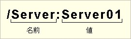 +
이 예에서 ‘Server’ 는 매개변수의 이름이고, ‘Server01’ 은 그 값이다.

또한, “:” 이나 값이 없는 “/A” 같은 매개변수도 이름이 지정된 매개변수이다. 이 경우 이름은 “A” 가 되고, 값은 빈 문자열이 된다.

반면 ‘test1’ 같이 ‘/’ 이외의 문자로 시작하는 매개변수는 ‘이름 없는 매개변수’ 가 된다. UNIX 명령어나 UNIX에서 유래한 명령어는 매개변수 지정에 하이픈(-) 문자를 사용하는 경우가 많다. 그러나 WSH에서 이름이 지정된 매개변수의 시작 기호는 슬래시 이외의 문자로 변경할 수 없다. 어쩔 수 없이 하이픈 ‘-’ 을 사용해야 하는 경우는, 일단 이름 없는 매개변수로(WshArguments 컬렉션에서) 하이픈이 포함된 문자열을 가져온 다음, 스크립트 내부에서 첫 번째 문자가 ‘-’ 인지 여부를 판별해야 할 것이다.

예를 들어, 서두의 예제에서 사용한 다음과 같은 매개변수를 지정하면, WScript 객체의 상태는 그림과 같이 된다.

----
cscript namedarguments.vbs test1 /A /Server:Server01 test2
----

.매개변수로 “test1 /A /Server:Server01 test2” 를 지정한 경우
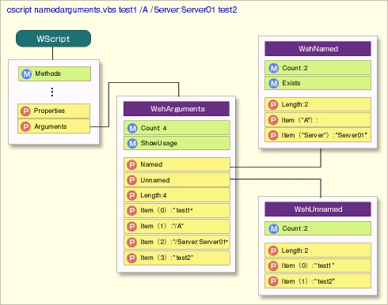 +
WshArguments 는 왼쪽부터 순서대로 모든 매개변수가 저장된다. WshNamed 는 이름이 지정된 매개변수만, WshUnnamed 는 이름이 지정되지 않은 매개변수만 왼쪽부터 순서대로 분류되어 저장된다.
　
WshNamed 와 WshUnnamed 모두 컬렉션 클래스이므로, WshArguments 컬렉션과 마찬가지로 스크립트에서 다룰 수 있다. 다만 그림에서 알 수 있듯이, WshNamed 의 Item 속성은 요소를 나타내는 인수로 번호가 아닌 매개변수의 이름을 지정한다. 앞서 언급한 “/Server:Server01” 의 경우, WScript.Arguments.Named.Item(“Server”) 라고 작성하면 “Server01” 을 가져올 수 있다.

반면 WshUnnamed 는 WshArguments 와 마찬가지로 0부터 시작하는 번호로 매개변수를 지정한다.

예를 들어 다음과 같이 한다.

[source,vb]
----
WScript.Echo WScript.Arguments.Unnamed(0)
WScript.Echo WScript.Arguments.Named(“Server”)
----

실행 결과는 다음과 같다.

----
C:\>cscript arg.vbs /Server:Server01 test1
test1
Server01
----

특정 이름이 지정된 매개변수가 존재하는지(지정되었는지) 확인하려면 WshNamed 의 Exists 메서드를 사용해서 확인할 수 있다.

[source,vb]
----
If WScript.Arguments.Named.Exists(“A”) Then
  WScript.Echo “/A 매개변수가 지정되었습니다.”
End If
----

실행 결과는 다음과 같다.

----
C:\>cscript arg.vbs /A
/A 매개변수가 지정되었습니다.
----

WshNamed는 이름과 값이 해석되어 저장되지만, WshNamed 이든 WshUnnamed 이든 저장되는 매개변수 자체는 WshArguments 의 것과 다르지 않다. 다만 앞서 언급한 그림에서 알 수 있듯이, 요소에 접근하기 위한 번호(값)는 컬렉션에 따라 다르므로 주의가 필요하다.

=== 이름이 지정된 매개변수 및 이름이 지정되지 않은 매개변수의 사용법

이름이 지정된 매개변수와 이름이 지정되지 않은 매개변수는 어떻게 구분해서 사용해야 할까? 예를 들어, 지금 원격으로 상대방의 컴퓨터에 연결해서 어떤 처리를 수행하는 스크립트를 만들게 되었다고 가정해 보자. 당연히 연결 대상 호스트 컴퓨터는 매개변수로 지정한다. 또한 이 외의 매개변수로 타임아웃 시간과 재시도 횟수를 지정한다고 가정해 보자.

이 경우, 이름이 없는 매개변수를 이용한다면 다음과 같을 것이다.

[source,vb]
----
 1: If WScript.Arguments.Count = 3 Then
 2:   strTarget = WScript.Arguments.Item(0)
 3:   nTimeOut = WScript.Arguments.Item(1)
 4:   nRetry = WScript.Arguments.Item(2)
 5: Else
 6:   WScript.Echo “대상 이름, 타임아웃 시간, 재시도 횟수를” _
 7:      & “지정해 주십시오.”
 8:    WScript.Quit
 9: End If
10:
11: WScript.Echo “대상은 ” & strTarget
12: WScript.Echo “타임아웃 시간은 ” & nTimeOut
13: WScript.Echo “재시도 횟수는 ” & nRetry
----

이 스크립트는 단순히 지정된 매개변수를 순서대로 대상 호스트 이름(strTarget), 타임아웃 시간(nTimeOut), 재시도 횟수(nRetry)를 나타내는 변수에 할당하고, WScript.Echo 메서드로 표시하고 있다. 실행하면 다음과 같다.

----
C:\>cscript arg1.vbs Server01 30 5
대상 호스트는 Server01
타임아웃 시간은 30
재시도 횟수는 5
----

스크립트 자체로는 전혀 문제가 없다. 하지만 이 스크립트를 실행하는 사용자는 매개변수 지정 순서를 기억해야 하며, 순서대로 정확하게 지정해야 한다. 순서를 잘못 지정하면 잘못된 매개변수 값이 스크립트에서 처리되어 버린다.

이런 경우 이름 지정 매개변수를 이용하면, 사용자는 매개변수의 순서를 신경 쓰지 않고 자유로운 순서로 매개변수를 지정할 수 있게 된다.

[source,vb]
----
 1: strTarget = WScript.Arguments.Named.Item(“Target”)
 2: nTimeOut = WScript.Arguments. Named.Item(“TimeOut”)
 3: nRetry = WScript.Arguments.Named.Item(“Retry”)
 4: If strTarget = “” or nTimeOut = ‘’ or nRetry = “” Then
 5:   WScript.Echo “대상 이름, 타임아웃 시간, 재시도 횟수를” _
 6:      & “지정해 주십시오.”
 7:    WScript.Quit
 8: End If
 9:
10: WScript.Echo “타겟은 ” & strTarget
11: WScript.Echo “타임아웃 시간은 ” & nTimeOut
12: WScript.Echo “재시도 횟수는 ” & nRetry
----

실행 결과는 다음과 같습니다.

----
C:\>cscript arg1.vbs /Target:Server01 /Retry:5 /TimeOut:30
대상은 Server01
타임아웃 시간은 30
재시도 횟수는 5

C:\>cscript arg1.vbs /TimeOut:30 /Retry:5 /Target:Server01
대상은 Server01
타임아웃 시간은 30
재시도 횟수는 5
----

스크립트 1행부터 3행에 나와 있듯이, WshNamed 컬렉션의 명명된 매개변수는 매개변수의 ‘이름’ 을 지정해서 액세스할 수 있다. 따라서 매개변수 지정 순서와 무관하게 올바른 매개변수를 해당 변수에 할당할 수 있다. 이 실행 예제는 1회차와 2회차에서 매개변수의 순서를 바꿔 지정했지만, 결과는 동일하다.

이름 지정 매개변수를 활용하면 매개변수의 의미를 명확히 할 수 있다는 점을 이해하셨으리라 생각한다. 이 예제는 미리 WshNamed 의 Exists 메서드를 통해 필요한 매개변수 개수를 확인하는 대신, 매개변수를 가져온 변수에 값이 들어 있지 않으면 오류 메시지를 표시하고 종료하도록 처리했다(4행~8행). 값이 지정되지 않은 경우는 스크립트 측에서 기본값을 부여하고 처리를 계속하도록 하면, 매개변수를 생략할 수 있게 된다.

이름이 없는 매개변수는 매개변수의 ‘이름’ 을 지정할 필요가 없어 간편하지만, 서로 다른 여러 매개변수를 지정하는 데는 적합하지 않다. 1개나 2개 정도의 소수 매개변수만 있는 경우나, 동일한 유형의 매개변수만 여러 개 지정하는 경우(예를 들어 순서에 상관없이 여러 호스트 이름을 지정하는 등)라면 괜찮지만, 종류가 다른 여러 매개변수를 지정해야 하는 경우는 이름이 있는 매개변수를 이용해야 할 것이다.

=== 스크립트 실행 제어

WScript 객체는 스크립트 실행을 강제 종료하는 Quit 메서드와, 실행을 일정 시간 동안 중지시키는 Sleep 메서드가 마련되어 있다.

이 중 Sleep 메서드는 밀리초 단위로 대기 시간을 지정한다. 다음 예제는 1초 간격으로 ‘1’, ‘2’, ‘3’ 이 표시된 후, WScript.Quit 메서드를 통해 실행이 강제 종료된다. ‘4’, ‘5’ 는 표시되지 않는다. 또한 VBScript는 스크립트 내의 아포스트로피(')부터 줄 끝까지는 주석으로 처리되며, 실제 동작에 영향을 미치지 않는다.

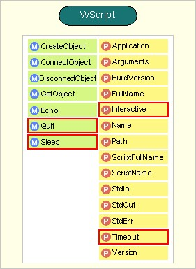 +

[source,vb]
----
 1:' 1000밀리초 동안 일시 정지한 후 1을 표시
 2:WScript.Sleep(1000)
 3:WScript.Echo “1”
 4:
 5:' 1000밀리초 동안 일시 정지한 후 2를 표시
 6:WScript.Sleep(1000)
 7:WScript.Echo “2”
 8:
 9:' 1000밀리초 동안 일시 정지한 후 3을 표시
10:WScript.Sleep(1000)
11:WScript.Echo “3”
12:
13:' 처리를 종료
14:WScript.Quit
15:
16:' 다음 코드는 실행되지 않음
17:WScript.Echo “4”
18:WScript.Echo “5”
----

스크립트 실행 시 매개변수를 지정해서 타임아웃 시간이나 배치 모드를 설정할 수 있다는 점은 제2회에 설명했으나, 스크립트 내에서도 TimeOut 속성과 Interactive 속성을 설정해서 이런 설정을 변경할 수 있다. 다음 예제는 ‘2’ 는 배치 모드이므로 표시되지 않는다. 또한, 4초 후에 타임아웃되므로 ‘5’ 는 표시되지 않고, “실행 시간이 제한 시간을 초과했습니다” 라는 메시지가 표시된다.

[source,vb]
----
 1:Wscript.Timeout = 4    '4초 후에 타임아웃되도록 설정
 2:
 3:' 1000밀리초 동안 일시 정지한 후 1을 표시
 4:WScript.Sleep(1000)
 5:WScript.Echo “1”
 6:
 7:WScript.Sleep(1000)    ' 1000밀리초 동안 일시 정지
 8:
 9:WScript.Interactive = False    ' 배치 모드로 설정
10:WScript.Echo “2”              ' 배치 모드이므로 표시되지 않음
11:WScript.Interactive = True     ' 대화형 모드로 설정
12:WScript.Sleep(1000)
13:WScript.Echo “3”              ' 대화형 모드이므로 표시됨
14:WScript.Sleep(2000)
15:
16:'여기까지 5초 동안 일시 정지했으므로, 타임아웃으로 인해 아래 코드는 실행되지 않음
17:WScript.Echo “5”
----

=== 호스트 정보 가져오기

WScript 객체의 속성을 사용해서 현재 실행 중인 스크립트 파일의 이름이나 스크립트 호스트 정보를 가져올 수 있다.

다음 예제는 스크립트 호스트의 버전과 파일 이름을 가져와 조건에 부합하는지 여부를 판단하고 있다.

[source,vb]
----
 1:If WScript.Version <> “5.6” Then
 2:    WScript.Echo “ WSH 5.6에서 실행해 주십시오.”
 3:    WScript.Quit
 4:End If
 5:
 6:If UCase(Right(WScript.FullName, 11)) = “WSCRIPT.EXE” Then
 7:    WScript.Echo “ CScript에서 실행해 주십시오.”
 8:    WScript.Quit
10:End If
11:
12:WScript.Echo “OK.”
----

전반부(1행~4행)는 Version 속성을 확인해서, 값이 5.6이 아니면 메시지를 표시하고 종료하고 있다. 이를 통해 구형 WSH 런타임의 실행을 차단할 수 있다.

후반부(6행~10행)는 WSH 스크립트 호스트 파일의 이름을 확인하고, wscript.exe 인 경우(GUI 모드로 실행된 경우) 마찬가지로 메시지를 표시하고 종료한다.

FullName 속성은 스크립트 호스트의 파일 이름이 “C:\WINDOWS\system32\cscript.exe” 같은 전체 경로로 반환된다. 이 경로는 환경에 따라 달라지므로, 경로 부분을 제거하기 위해 VBScript의 Right 함수를 사용해서 오른쪽 11자를 추출하고, UCase 함수로 소문자를 대문자로 통일한 뒤 WSCRIPT.EXE 와 비교하고 있다.

호스트 정보를 가져오는 속성에는 이 외에도 다음과 같은 것들이 있다.

.호스트 정보를 가져오는 WScript 객체의 속성
[%autowidth]
|===
|속성    |가져올 수 있는 값    |값의 예

|BuildVersion    |WSH의 빌드 버전 번호    |6626
|FullName    |호스트의 실행 파일(CScript.exe나 WScript.exe)의 절대 경로    |C:\WINDOWS\system32\cscript.exe
|Name    |스크립트 호스트의 이름. 항상 “Windows Script Host”를 반환    |Windows Script Host
|Path    |호스트 실행 파일이 있는 폴더의 경로    |C:\WINDOWS\system32
|ScriptFullName    |실행 중인 스크립트의 절대 경로    |D:\WSH\test.vbs
|ScriptName    |실행 중인 스크립트의 파일명    |test.vbs
|Version    |WSH의 버전 번호    |5.6
|===

저자의 환경은 WSH의 전체 버전이 5.6.6626이며, Version 속성에서 앞부분인 5.6을, BuildVersion에서 뒷부분인 6626을 얻을 수 있다.

지난번에 소개한 표는 편의상 Application 속성도 호스트 정보 획득 항목에 기재했으나, Application 속성은 WScript 객체 자체를 반환하는 속성이므로 사용할 기회가 없을 것으로 판단되어 설명은 생략한다.

이번에는 WScript 객체 중에서 실행 시 매개변수, 스크립트 실행 제어, 호스트 정보 획득과 관련된 메서드와 속성에 대해 해설했다. 이 외에도 WScript 객체는 특정 WSH 컴포넌트에서 발생한 이벤트를 다른 컴포넌트에서 처리하기 위한 이벤트 제어 기능이 있다. 그러나 단순하지만 번거로운 관리 작업을 매우 짧은 스크립트로 간편하게 실행한다는 본고의 취지상 사용할 기회가 없을 것으로 보아 설명은 생략했다.

이상으로 WScript 객체에 대한 설명을 마친다. 다음 시간은 WSH 스크립트에서 탐색기 등의 Windows 셸을 제어하기 위한 WshShell 객체에 대해 설명할 예정이다.

== 제5회 WshShell 객체 상세 설명 (1)

WshShell 객체를 이용해서 스크립트에서 외부 프로그램을 실행하고, 키 입력을 전송해서 제어한다.

지난 시간까지는 WScript 객체에 대해 자세히 설명했다. 이번부터 WshShell 객체에 대한 설명을 시작하겠다.

=== WshShell 객체

먼저, 제2회에 소개한 WSH 객체 모델의 그림을 다시 한 번 게재해 두겠다. 이 그림은 WSH의 내장 객체들을 정리한 것이다. WSH의 표준 객체로는 크게 WScript, WshShell, WshNetwork, WshController 4가지가 있다(WshArguments부터 WshUnnamed에 관해서는 WScript 객체에 부수적인 것으로 지난 시간에 설명했다). 이번부터 설명할 것은 그림의 하반부에 있는 WshShell 객체(그림의 빨간 테두리 부분)이다. WshShell 객체는 ‘Shell’ 이라는 이름이 붙어 있는 것으로 알 수 있듯이, OS에 대한 처리를 수행하는 객체이다(shell 은 ‘OS를 감싼다’ 는 의미가 있다). 이 객체를 이용하면 프로그램 실행이나 환경 변수 조작, 레지스트리 조작 등을 할 수 있다.

.WSH 객체 모델
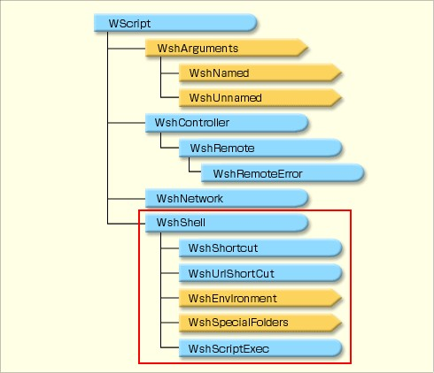 +
WSH의 내장 객체 목록. 이번부터 이 중 WshShell 객체(그림의 빨간색 테두리 부분)에 대해 설명한다.

다음 표는 WshShell 객체에 포함된 각 메서드/속성과 그 역할을 정리한 것이다.

.WshShell 객체의 메서드와 속성
[%autowidth]
|===
|메서드/속성    |역할

|Run/Exec    |프로그램 실행
|AppActivate/SendKeys    |프로그램에 키 입력 전송
|SpecialFolders    |‘바탕 화면’이나 ‘내 문서’ 등의 특수 폴더의 전체 경로 가져오기
|Environment/ExpandEnvironmentStrings    |환경 변수 가져오기 및 설정
|CreateShortcut    |바로 가기 생성
|LogEvent    |애플리케이션 이벤트 로그 생성
|RegRead／RegWrite／RegDelete    |레지스트리 값 가져오기 및 설정
|CurrentDirectory    |현재 디렉터리 가져오기 및 변경
|Popup    |대화 상자 표시
|===

WshShell 객체의 메서드／속성과 관련 객체를 정리하면 다음과 같은 그림이 된다.

.WshShell의 객체 모델
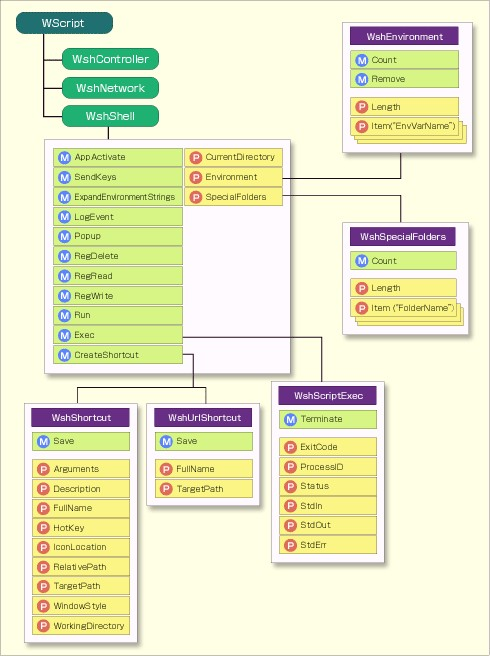 +
프로그램 실행, 프로그램에 키 입력 전송, 환경 변수 조회 및 설정, 레지스트리 값 조회 및 설정 등을 수행하기 위한 다양한 클래스가 마련되어 있다.

지금까지 설명해 온 WScript 객체와 달리, WshShell 객체는 명시적으로 객체를 생성하지 않으면 사용할 수 없다(WScript 객체는 암묵적으로 생성된다). WshShell 객체는 “WScript.Shell” 이라는 프로그램 ID를 가진 COM 객체이므로, CreateObject 메서드를 사용해서 생성할 수 있다. 구체적으로 WshShell 객체를 생성하려면 다음 코드를 스크립트 맨 앞에 작성하면, objShell 을 WshShell 객체로 사용할 수 있다.

[source,vb]
----
Set objShell = WScript.CreateObject(“WScript.Shell”)
----

objShell 이라는 변수명은 변수명 명명 규칙만 준수한다면 무엇이든 상관없지만, 이 연재는 objShell 이라는 변수명으로 통일하고 있다. 연재 제4회에서 설명한 것 같이, 본고는 변수 명명법으로 헝가리 표기법을 사용한다.

그럼 이제 WshShell 의 메서드와 속성에 대해 자세히 살펴보도록 하자. 먼저 Run 메서드와 Exec 메서드이다. 이 두 메서드는 프로그램을 실행하기 위한 메서드이다.

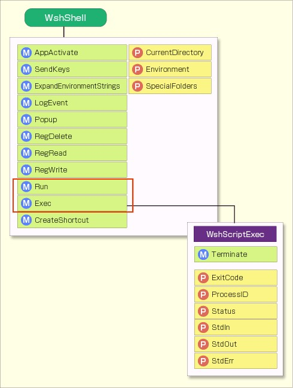 +

=== Run 메서드와 Exec 메서드

Office 제품이나 Internet Explorer 등 COM 개체로 제공되는 것들은 WScript 개체의 CreateObject 메서드나 GetObject 메서드를 이용해서 개체를 생성하고, 생성된 개체를 직접 조작하는 편이 좀 더 세밀한 처리가 가능하지만, 이 방법은 COM 개체가 제공되지 않는 프로그램에는 사용할 수 없다. Windows의 표준 텍스트 편집기인 메모장이나 비교적 소규모 프로그램의 경우, COM 개체로 접근하는 방법이 제공되지 않는 경우가 많다. 이에 반해 Run 메서드나 Exec 메서드를 사용하면 실행 파일만 있으면 임의의 프로그램을 실행할 수 있다. 범용성이 높은 메서드이다. 또한 실행 후에는 AppActivate/SendKeys 메서드(후술)를 통해 키 입력 등을 프로그램에 전송함으로써, 실행된 프로그램을 스크립트에서 제어할 수 있게 된다.

Run 메서드와 Exec 메서드는 프로그램 실행 방식에 차이가 있다. Run 메서드는 완전히 별도의 프로세스로 프로그램을 실행한다. Run 메서드를 사용할 때 직접 조작할 수 있는 것은, 실행 시 최소화·최대화 등의 표시 방식을 지정하는 것과, 프로그램이 종료될 때까지 기다릴 때 종료 코드를 가져오는 것 뿐이다. 반면 Exec 메서드는 명령줄 애플리케이션에 자주 사용되며, 프로그램의 표준 입력·표준 출력·표준 오류 출력을 이용할 수 있다. 또한, CScript에서 스크립트를 실행할 경우, Run 메서드는 현재 창과 별개의 새로운 명령 프롬프트가 생성되지만, Exec 메서드는 새로운 명령 프롬프트가 표시되지 않고 CScript를 실행한 명령 프롬프트가 그대로 사용된다. Run 메서드와 Exec 메서드의 차이점을 정리하면 다음과 같다.

.Run 메서드와 Exec 메서드의 비교
[%autowidth]
|===
|　	|Run 메서드    |Exec 메서드

|종료 코드 가져오기    |○    |○
|프로세스 ID 가져오기    |×    |○
|WSH 5.6 이전 환경에서 사용    |○   |×
|Windows 애플리케이션     |      |
|최대화·최소화 상태에서 실행    |○    |×
|명령줄 애플리케이션      |      |
|표준 입출력 사용    |×    |○
|창    |새로운 명령 프롬프트 표시    |CScript인 경우 표시하지 않음
|===

자세한 내용은 후술하겠지만, 가장 큰 차이점은 Exec 메서드는 표준 입출력(stdin/stdout)을 사용할 수 있다는 점일 것이다. Exec 메서드를 사용하면 다른 명령줄 도구를 실행해서 그 출력 결과를 받아 처리하는 등의 작업을 할 수 있다. 반면 Run 메서드는 Windows 프로그램으로서, 최소화 상태에서 은밀하게 스크립트를 실행하는 경우 등에 사용한다. 단, Exec 메서드는 WSH 5.6 이후 버전만 지원된다. 구형 WSH 환경은 Exec를 사용할 수 없으므로 주의해야 한다.

=== Run 메서드 사용법

Run 메서드로 프로그램을 실행하려면, 실행하려는 프로그램의 파일 이름을 매개변수로 지정한다. 실행 프로그램에 전달할 옵션이 있다면, 해당 옵션도 함께 지정한다. 기본적으로 파일 이름을 전체 경로로 지정해야 하지만, 실행 경로가 설정된 폴더에 있는 프로그램이라면 파일 이름만 지정해도 실행할 수 있다. 실행 경로는 환경 변수 PATH로 관리되며, 시스템 속성에서 변경할 수 있다.

다음 예제는 세 가지 방법으로 메모장을 실행하고 있다. 단, Windows의 시스템 폴더가 ‘C:\WINDOWS’ 이며(Windows 2000이나 Windows NT에서는 ‘C:\WINNT’), 스크립트를 실행하는 폴더에 ‘test.txt’ 와 ‘test2.txt’ 파일이 있다고 가정한다.

.Run 메서드 사용 예시 1
[source,vb]
----
1:Set objShell = WScript.CreateObject(“WScript.Shell”)
2:objShell.Run “C:\WINDOWS\system32\notepad.exe”
3:objShell.Run “%SystemRoot%\notepad.exe test.txt”
4:objShell.Run “notepad test2.txt”
----

첫 번째 예시(2행)는 Run 메서드의 매개변수로 실행하려는 프로그램의 전체 경로를 지정하고 있다. 두 번째 예시(3행)는 환경 변수 %SystemRoot% 를 이용해서 경로를 지정하고 있다(환경 변수 SystemRoot 는 보통 ‘C:\WINDOWS’ 로 설정되어 있다). 그리고 세 번째 예시(4행)는 경로와 확장자를 생략하고 ‘notepad’ 만 지정하고 있다. 이 코드를 실행하면 메모장 3개가 열릴 것이다. 그중 두 번째와 세 번째는 매개변수로 파일명을 지정했기 때문에, 텍스트 파일 test.txt 와 test2.txt 가 각각 열린다.

=== Run 메서드의 두 번째, 세 번째 매개변수

앞서 언급한 예제는 모두 하나의 매개변수를 지정했지만, Run 메서드는 두 번째, 세 번째 매개변수를 지정할 수도 있다. 이 중 두 번째 매개변수는 창 표시 방식을 0부터 10까지의 정수로 지정한다. 예를 들어 1은 최소화나 최대화 없이 원래 크기로 표시하고, 2는 최소화, 3은 최대화 표시 등이다. 자세한 내용은 다음과 같다.

.Run 메서드의 두 번째 매개변수
[%autowidth]
|===
|두 번째 매개변수의 값    |의미

|0    |창을 숨기고 다른 창을 활성 상태로 만듭니다.
|1    |창을 활성 상태로 만들어 표시합니다. 창이 최소화되거나 최대화된 경우, 원래 크기와 위치로 돌아갑니다.
|2    |창을 활성 상태로 만들고, 최소화된 창으로 표시합니다.
|3    |창을 활성 상태로 만들고, 최대화된 창으로 표시합니다.
|4	  |창을 최신 크기와 위치로 표시한다. 활성 창은 변경되지 않는다
|5    |창을 활성 상태로 만들고, 현재 크기와 위치로 표시한다
|6    |지정된 창을 최소화하고, Z 순서상 그 다음으로 최상위에 있는 창을 활성 상태로 만든다
|7    |창을 최소화된 상태로 표시한다. 활성 창은 변경되지 않는다
|8    |창을 현재 상태로 표시한다. 활성 창은 바뀌지 않는다
|9    |창을 활성 상태로 만들어 표시한다. 창이 최소화되거나 최대화된 경우, 원래 크기와 위치로 돌아간다
|10   |응용 프로그램을 시작한 프로그램의 상태에 따라 표시 상태를 설정한다
|===

이처럼 Run 메서드의 두 번째 매개변수를 지정함으로써, 실행할 창의 상태를 제어할 수 있다. 예를 들어, 사용자가 눈치채지 못하게 프로그램을 실행하는 경우, 이 두 번째 매개변수에 7을 지정하면 실행된 프로그램은 최소화되어 표시되며, 현재 활성화된 창도 전환되지 않는다(최종 사용자에 대한 관리 업무는 이런 필요성이 발생하는 경우가 적지 않다). 다만, 표시 크기가 고정된 프로그램 등(고정 크기의 대화 상자로 표시되는 프로그램 등)에 대해서는 이 매개변수를 설정해도 작동하지 않으므로 주의가 필요하다.

Run 메서드의 세 번째 매개변수는 실행된 프로그램이 종료될 때까지 기다릴지 여부를 지정한다. 앞서 소개한 예제는 3개의 메모장이 거의 동시에 실행되지만, 다음과 같이 각 Run 메서드의 세 번째 매개변수에 True 를 지정하면, 실행된 프로그램이 종료될 때까지 스크립트 실행이 중단된다. 즉, 처음 실행된 메모장을 종료하면 두 번째 메모장이 실행되고, 이를 종료하면 세 번째 메모장이 실행되는… 식으로 하나씩 순서대로 실행되게 된다. 앞서 언급한 예제에 두 번째, 세 번째 매개변수를 추가해 보자.

.Run 메서드 사용 예시 2
[source,vb]
----
1: Set objShell = WScript.CreateObject(“WScript.Shell”)
2: objShell.Run “C:\WINDOWS\system32\notepad.exe”, 3, True
3: objShell.Run “%windir%\notepad.exe test.txt”, 2, True
4: objShell.Run “notepad test2.txt”,, True
----

이 스크립트를 실행하면, 먼저 최대화된 상태의 메모장이 표시되고, 그 메모장을 종료하면 최소화된 상태의 메모장이 표시되며, 이를 종료하면 마지막으로 일반 메모장이 표시된다. 마지막 메모장을 종료한 시점에서 스크립트 전체도 종료된다. 4번째 줄 같이 두 번째 매개변수를 생략하고 세 번째 매개변수를 지정할 경우는 ‘,’ 를 이어서 기재한다.

Run 메서드의 세 번째 인자로 True 를 지정하면, 실행된 프로그램의 종료 코드를 스크립트에서 가져올 수 있다. 예를 들어, 파일 내용을 비교하는 명령줄 도구인 FC.EXE 는 비교한 파일이 동일하면 0을, 차이가 있으면 1을 반환한다(FC는 File Compare의 약자). 이를 활용해서 파일 비교 결과를 표시하는 스크립트를 만들어 보자.

.FC 명령어를 이용해서 파일을 비교하는 스크립트 (Run 메서드 사용)
[source,vb]
----
 1: Const MINIMIZE_WINDOW = 2
 2: Set objShell = WScript.CreateObject(“WScript.Shell”)
 3: fcresult = objShell.Run(“fc.exe test.txt test2.txt”, _
 4:            MINIMIZE_WINDOW, True)
 5:
 6: If fcresult = 0 Then
 7:   WScript.Echo “test.txt와 test2.txt는 내용이 동일한 파일입니다”
 8: ElseIf fcresult = 1 Then
 9:   WScript.Echo “test.txt와 test2.txt는 내용이 다른 파일입니다”
10: Else
11:   WScript.Echo “FC가 결과 ” & fcresult & “를 반환했습니다”
12: End If
----

이 스크립트는 두 번째 매개변수의 의미를 코드에서 바로 알 수 있도록, 숫자 2를 그대로 지정하는 대신 WSH의 Const 문으로 MINIMIZE_WINDOW 라는 상수에 할당해서 사용하고 있다(1행).

두 번째 매개변수에 아무것도 지정하지 않고 FC 명령을 실행하면, FC용 새로운 명령 프롬프트가 최전면에 표시되기 때문에, 이를 눈에 띄지 않게 처리하기 위해 최소화하도록 지정하고 있다(3~4행). 이 코드가 앞서 언급한 예제와 크게 다른 점도 바로 이 3~4행이다. 메서드 실행과 대입문을 조합해서 결과를 fcresult 변수에 대입하고 있다. 이런 방식으로 사용할 경우는 메서드의 모든 매개변수를 ‘( )’ 로 묶어야 하므로 주의가 필요하다. 종료 코드를 사용하지 않을 때는 메서드가 VB의 Sub 프로시저와 동일하게 취급되지만, 종료 코드를 사용할 때는 함수처럼 취급되기 때문이다(Sub 프로시저는 반환값이 없다).

스크립트의 후반부(6~12행)는 FC 명령에서 반환된 값에 따라 처리를 분기하고, 결과에 따른 메시지를 표시하고 있다. 물론 FC의 결과만 표시하려면 단순히 FC를 실행하면 되지만, 이처럼 WSH에서 실행함으로써 FC 명령의 실행 결과를 다른 처리에서 활용할 수 있게 된다.

=== Exec 메서드 사용법

FC 같은 명령줄 도구를 실행할 때는 Exec 메서드를 이용하는 방법도 있다. Exec 메서드도 매개변수로 실행할 프로그램을 지정한다는 점에서는 Run 메서드와 다르지 않다. 그러나 앞서 언급한 것 같이, Exec 메서드를 이용하면 종료 코드를 가져올 뿐만 아니라, 표준 입출력을 통해 명령에 옵션을 지정하거나 명령 실행 결과를 가져올 수 있게 된다.

또한 Exec 메서드는 반환값으로 WshScriptExec 객체를 반환한다. 앞서 언급한 클래스 구조도에서 알 수 있듯이, WshScriptExec 객체는 Status, StdIn, StdOut, StdErr, ExitCode, ProcessID 6가지 속성이 있다.

.WshScriptExec 객체의 내용
[%autowidth]
|===
|메서드/속성    |내용

|Terminate 메서드    |시작한 프로세스를 종료하도록 스크립트 엔진에 지시한다
|ExitCode 속성       |실행한 스크립트 또는 프로그램이 설정한 종료 코드를 반환한다
|ProcessID 속성      |WshScriptExec 객체에 의해 시작된 프로세스의 프로세스 ID(PID)
|Status 속성         |실행한 스크립트의 상태 정보를 반환한다
|StdIn 속성          |Exec 객체의 stdin 입력 스트림
|StdOut 속성	     |Exec 객체의 쓰기 전용 stdout 출력 스트림
|StdErr 속성         |Exec 객체의 stderr 출력 스트림
|===

Status 는 시작된 프로그램이 실행 중이면 0을, 실행이 완료되면 1을 반환한다. StdIn, StdOut, StdErr 는 시작된 프로그램의 표준 입력, 표준 출력, 표준 오류 출력을 읽고 쓰기 위한 스트림을 제공한다. ExitCode 와 ProcessID 는 각각 종료 코드와 프로세스 ID를 반환한다. 프로그램이 아직 종료되지 않은 경우, ExitCode 속성은 0으로 설정된다. 프로세스 ID는 후술할 AppActivate 메서드(프로그램을 활성화함)에서 사용된다.

WshScriptExec 객체의 Terminate 메서드를 사용하면, 실행 중인 프로그램을 강제 종료할 수 있다(단, 작업 중인 프로그램을 강제 종료하면 데이터가 손상될 가능성이 있으므로 Terminate 메서드의 사용은 그다지 권장되지 않는다).

여기서 주의할 점은, WshScriptExec 객체에서 다루는 표준 입출력은 Exec 메서드로 실행한 프로그램의 관점에서 본 표준 입출력이므로, 스크립트 측에서 보면 반대로 된다는 것이다. 즉, 스크립트 관점에서 보면 데이터를 전달하는 것이 표준 입력이고, 데이터를 받는 것이 표준 출력 및 표준 오류 출력이 된다. WScript 객체의 경우와 달리 사용할 수 있는 메서드와 속성이 반대로 되므로 주의가 필요하다. 이 관계를 도식으로 나타내면 다음과 같다.

.WshScriptExec 객체의 표준 입출력
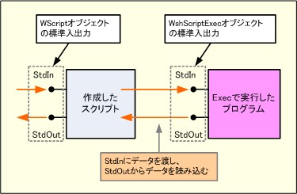 +
WshScriptExec 객체를 이용하면, 실행된 프로그램의 표준 입출력을 통해 데이터를 주고받을 수 있다. 그러나 WshScriptExec 객체의 StdIn/StdOut/StdErr 는 모두 실행된 프로그램의 관점에서 본 것이므로, 직관적으로는 반대라는 점에 주의해야 한다.
　
그럼, Exec 메서드를 사용해서 앞서 소개한 FC 명령을 이용해서 파일을 비교하는 스크립트를 다시 작성해 보자. 다음과 같이 작성된다.

.FC 명령어를 이용하여 파일을 비교하는 스크립트 (Exec 메서드 사용)
[source,vb]
----
 1: Set objShell = WScript.CreateObject(“WScript.Shell”)
 2: Set objExec = objShell.Exec(“fc.exe test.txt test2.txt”)
 3:
 4: Do While objExec.Status = 0
 5:   WScript.Sleep 100
 6: Loop
 7:
 8: fcresult = objExec.ExitCode
 9: If fcresult = 0 Then
10:   WScript.Echo “test.txt와 test2.txt는 내용이 동일한 파일입니다”
11: ElseIf fcresult = 1 Then
12:   WScript.Echo “test.txt와 test2.txt는 내용이 다른 파일입니다”
13: Else
14:   WScript.Echo “FC가 결과 ” & fcresult & “를 반환했습니다”
15: End If
----

Exec 메서드를 이용할 경우는, 실행된 프로그램의 종료를 기다리는 옵션을 지정할 수 없으므로, 명시적으로 루프를 돌면서 프로그램의 종료를 기다리고 있다(4~6행). 프로그램 실행이 종료되면 Status가 0이 아니게 되므로, 이 경우 루프에서 빠져나와 ExitCode 의 값을 확인한다(단순한 무한 루프로 만들면 처리 속도가 느려지므로, 종료 판정을 할 때마다 100msec의 슬립 시간을 실행하고 있다).

이처럼, 직전에 실행한 프로그램이 종료될 때까지 기다린 후 다음 프로그램을 실행하는 스크립트라면 Run 메서드를 사용하는 편이 좀 더 간단하다. 다만 Exec 메서드를 사용하는 경우, 명령줄 프로그램 실행 시 새 창이 표시되지 않으므로 하나의 명령 프롬프트 내에서 모든 처리를 완료할 수 있다는 장점이 있다.

=== Exec 메서드에서의 표준 입출력 활용

앞서 언급했듯이, Exec 메서드의 가장 강력한 점은 실행된 프로그램의 표준 입출력을 활용할 수 있다는 것이다. WshScriptExec 객체의 StdIn, StdOut, StdErr 는 TextStream 객체이며, WScript 객체의 StdIn, StdOut, StdErr 속성과 동일하게 다룰 수 있다(WScript 객체의 표준 입출력 조작 메서드에 대해서는 제3회 참조). 다만, 앞서 언급한 것 같이 WScript 객체의 경우와 사용할 수 있는 메서드 및 속성이 반대로 된다는 점에 주의해야 한다.

여기서는 WshScriptExec 객체의 표준 출력을 사용하는 예로, ipconfig 명령을 이용해서 스크립트를 실행한 컴퓨터 자체의 IP 주소를 가져와 보자. ipconfig 명령을 실행하면 표준 출력에 다음과 같은 결과가 표시된다.

.ipconfig 명령어 실행 예시
----
D:\WSH>ipconfig

Windows IP 구성

이더넷 어댑터 로컬 영역 연결 2:

        연결별 DNS 접미사  . : d-advantage.com
        IP 주소. . . . . . . . . . . . : 192.168.0.121
        서브넷 마스크 . . . . . . . . . . . : 255.255.255.0
        기본 게이트웨이 . . . . . . . . . : 192.168.0.56

D:\WSH>
----

이 중 자신의 IP 주소는 ‘IP Address’ 라고 적힌 행의 ‘:’ 이후 부분이므로, 스크립트를 통해 이 부분을 추출하는 방법을 고려해 본다. 문자열에 키워드가 포함되어 있는지 여부나 특정 문자가 몇 번째 위치에 있는지는 VBScript의 InStr 함수를 활용해서 확인할 수 있다. 문자열의 일부를 추출하려면 Mid 함수를 사용한다. 코드는 다음과 같다.

.자신의 IP 주소를 표시하는 샘플 스크립트
[source,vb]
----
 1: Set objShell = WScript.CreateObject(“WScript.Shell”)
 2: Set objExec = objShell.Exec(“ipconfig.exe”)
 3:
 4: Do Until objExec.StdOut.AtEndOfStream      ' 표준 출력이 끝날 때까지 반복
 5:   strLine = objExec.StdOut.ReadLine         ' 한 줄 읽기
 6:   If InStr(strLine, “IP Address”) <> 0 Then    ' “IP Address”가 포함되어 있는가?
 7:     iColon = Instr(strLine, “:”)                ' “:”의 위치를 확인
 8:     strAddress = Mid(strLine, iColon + 2)     ' 주소 부분 추출
 9:     Wscript.Echo strAddress                 ' 출력
10:   End If
11: Loop
----

실행 중인 프로그램의 표준 출력을 처리할 때는 StdOut 스트림의 끝까지 처리하면, Status 속성을 의식하지 않고도 실행이 종료될 때까지의 결과를 읽어올 수 있다. 또한, ReadLine 메서드는 스트림에 데이터가 없으면 데이터가 추가될 때까지 기다리기 때문에, 앞서 설명한 것처럼 Sleep을 사용해서 명시적으로 기다릴 필요가 없어진다. 이처럼 Exec 메서드를 이용하면, 실행된 프로그램의 표준 출력을 처리하는 스크립트를 매우 간결하게 작성할 수 있다.

4행에서 스트림의 끝 부분까지 루프를 돌고, 5행에서 한 줄을 읽어 strLine 변수에 할당한다. 6행에서 “IP Address” 라는 키워드가 해당 행에 포함되어 있는지 확인하고, 포함되어 있다면 InStr 함수가 0이 아닌 값을 반환하므로 7~9행을 실행한다. 7행에는 「:」의 위치를 확인해서 iColon 변수에 할당한다. 여기서는 “IP Address” 를 포함하는 행에는 반드시 「:」가 포함되어 있다고 가정하며 0인지 여부에 대한 판정을 생략하고 있지만, 좀 더 안전한 스크립트를 만들기 위해서는 그런 판정도 추가해야 한다. 8행에는 Mid 함수를 사용해서 콜론 뒤에 있는 IP 주소 문자열을 strAddress 변수에 할당한다. ‘+2’ 라고 표기된 것은, iColon 의 위치에 ‘:’ 라는 문자가 있고 그 다음 위치는 공백이 있으므로, IP 주소가 시작되는 부분은 iColon 에서 2글자 뒤임을 나타낸다. 9행에서 얻은 주소를 출력한다. 실행하면 다음과 같다.

.샘플 실행 결과
----
D:\WSH>cscript ipaddr.vbs
192.168.0.121

D:\WSH>
----

=== 키 입력 전송: SendKeys 메서드

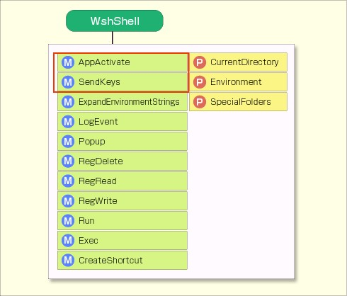 +

COM 개체로 사용할 수 있는 외부 Windows 프로그램은 WSH 스크립트에서 직접 조작할 수 있지만, 그렇지 않은 Windows 프로그램을 스크립트로 조작하려면 프로그램을 미리 실행한 다음, 스크립트에서 키 입력을 전송해서 마치 프로그램이 키보드로 조작되는 것처럼 제어해야 한다. 이를 위해 사용할 수 있는 것이 WshShell 개체의 SendKeys 메서드와 AppActivate 메서드이다.

SendKeys 메서드는 실행 중인 프로그램에 키 입력을 전송하는 메서드이다. SendKeys 메서드를 이용해서 키 입력을 에뮬레이트하면 대부분의 Windows 프로그램을 조작할 수 있다. 다만 문제는 제어 가능 여부가 시간적 타이밍에 크게 영향을 받는다는 점이다.

이는 예를 들어, 프로그램에서 대화 상자를 팝업으로 표시하고 [OK] 버튼을 누르는 조작을 생각하면 곧바로 알 수 있다. 기본적으로 프로그램 본체에 메뉴 조작용 키 입력을 전송해서 대화 상자를 표시한 다음, [Enter] 키를 전송해서 [OK] 버튼을 누르면 된다(대부분의 대화 상자는 기본적으로 [OK] 버튼에 입력 포커스가 설정되어 있다). 하지만 대화 상자가 표시되기 전에 [Enter] 를 전송해 버리면, 올바르게 처리되지 않는다. 이 때문에 대부분의 경우 스크립트 프로그래머는 키 전송 타이밍을 실행 환경(컴퓨터 성능 등)에 맞춰 시행착오를 거치며 설정해야 한다. 또한 시간적 타이밍뿐만 아니라, 스크립트 실행 중에 사용자가 다른 프로그램을 활성화해 버리면 오작동이 발생할 수 있다. 실행 시 옵션이나 표준 입출력을 이용하는 기존의 방법에 비해 불안정한 요소가 크다. 따라서 무턱대고 SendKeys 메서드에 의존하기 보다는, 프로그램을 제어할 다른 방법이 없는지 검토하는 것이 바람직하다.

SendKeys 메서드의 매개변수는 프로그램에 전송할 키 입력을 나타내는 문자열이다. SendKeys 메서드를 실행하면, 매개변수로 지정한 문자열이 그 시점에서 활성화된 창으로 전송된다. 예를 들어 다음은 메모장을 실행하고, 실행 처리가 완료될 때까지 1초간 기다린 후, “hello” 라고 입력하는 스크립트이다. 또한, SendKeys 메서드는 일본어 등의 2바이트 문자를 전송할 수 없다!!

.SendKeys 메서드를 사용하여 메모장에 “hello”라고 입력하는 스크립트
[source,vb]
----
1: Set objShell = WScript.CreateObject(“WScript.Shell”)
2: objShell.Run “notepad.exe”
3: WScript.Sleep 1000
4: objShell.SendKeys “hello”
----

Shift 나 Ctrl 키 같은 특수 키는 특별한 문자열이 할당되어 있으며, 이를 지정함으로써 해당 특수 키를 프로그램에 전송할 수 있다. 구체적으로는 Shift 는 ‘+’, Ctrl 은 ‘^’, Alt 는 ‘%’, Enter는 ‘~’ 같은 식이다(‘^’ 등의 기호 자체를 전송하려면 `{ }` 로 묶어 {^} 같이 처리한다). 이 외의 특수 키는 `{ }` (중괄호)를 사용해서 지정한다. 예를 들어 Esc 는 {ESC}, Tab은 {TAB}, Back Space는 {BACKSPACE} 또는 {BS}, {BKSP} 와 같다. 자세한 내용은 앞서 언급한 SendKeys 메서드의 레퍼런스에 정리되어 있다. 특수 키의 표기 방법 목록을 아래에 제시한다.

.특수 키 표기 방법
[%autowidth]
|===
|키    |SenKeys 메서드의 매개변수

|+    |{+}
|^    |{^}
|%    |{%}
|Shift  |+
|Ctrl   |^
|Alt    |%
|Enter    |{ENTER} 또는 ~
|↓    |{DOWN}
|←    |{LEFT}
|→    |{RIGHT}
|↑    |{UP}
|Back Space    |{BACKSPACE}, {BS} 또는 {BKSP}
|Break    |{BREAK}
|Caps Lock    |{CAPSLOCK}
|Delete    |{DELETE} 또는 {DEL}
|End    |{END}
|Esc    |{ESC}
|Help    |{HELP}
|Home    |{HOME}
|Insert    |{INSERT} 또는 {INS}
|Num Lock    |{NUMLOCK}
|Page Down    |{PGDN}
|Page Up    |{PGUP}
|Print Screen    |{PRTSC}
|Scroll Lock    |{SCROLLLOCK}
|Tab    |{TAB}
|F1    |{F1}
|F2 (F3~F12도 마찬가지)    |{F2}
|===

Shift, Ctrl, Alt 등은 다른 키와 조합해서 사용하는 키이다. 예를 들어 [Ctrl] + [C] 라면 “^c” 같이 표기한다. 또한 Shift, Ctrl, Alt 를 누른 상태에서 2자 이상 입력할 경우는 괄호 “( )” 로 묶어 표기한다. 예를 들어 “%FO” 는 Alt 키를 누른 상태에서 F 키를 누르고, Alt 키를 뗀 후 O 키를 누르는 것을 나타내지만, “%(FO)” 는 Alt 키를 누른 상태에서 F, O 두 키를 연속해서 누르는 것을 나타낸다(대부분의 Windows 프로그램 메뉴는 두 방법 모두 “파일(F)”－“열기(O)” 메뉴를 실행할 수 있다).

하나의 키를 반복해서 누를 경우는 “{X 10}” 같이 작성하면 X 키를 10번 전송할 수 있다. 특수 문자의 경우도, 예를 들어 “{DOWN 5}” 라고 작성하면 아래쪽 화살표 키(↓)를 5번 전송할 수 있다.

여기서 예시로, test.txt 파일을 메모장으로 열고, 처음 ‘WSH’ 가 등장하는 줄을 클립보드에 복사한 뒤 메모장을 종료하는 코드를 만들어 보자. 구체적으로는 메모장을 실행하고, 검색 대화 상자를 표시한 뒤, “WSH” 라는 문자열을 검색해서, 해당 문자열이 발견된 줄의 맨 앞부터 선택해서 클립보드로 복사한 후 메모장을 종료한다.

.키 입력을 통해 메모장을 조작하는 스크립트
[source,vb]
----
 1: Set objShell = WScript.CreateObject(“WScript.Shell”)
 2: objShell.Run “notepad.exe test.txt”
 3: WScript.Sleep 1000
 4: objShell.SendKeys “^f”      ' Ctrl+F로 검색 대화 상자 표시
 5: WScript.Sleep 100
 6: objShell.SendKeys “WSH~”    ' WSH를 입력하고 Enter 키를 누름
 7: objShell.SendKeys “{ESC}”   ' 대화 상자 닫기
 8: WScript.Sleep 100
 9: objShell.SendKeys “{HOME}”  ' 줄 시작 부분으로 이동
10: objShell.SendKeys “+{END}”  ' Shift+End로 줄 끝까지 선택
11: objShell.SendKeys “^c”      ' Ctrl+C로 복사
12: objShell.SendKeys “%{F4}”   ' Alt+F4로 종료
----

이 스크립트는 먼저 Run 메서드를 통해 text.txt 파일을 열고, 그 후의 조작을 순서대로 SendKeys 로 전송하고 있다. 첫 실행 시 1초(3행), 검색 대화상자 표시 및 대화상자 닫기 부분에서 각각 0.1초씩 대기 시간을 설정하고 있다(5행과 8행). 후반부 처리 도중에도 대기 시간을 설정하면, 실제로 이루어지는 동작을 눈으로 볼 수 있으므로 흥미로울지도 모른다.

=== 프로그램 활성화: AppActivate 메서드

위의 예제는 활성화된 프로그램에 키를 계속 전송하기 때문에, 사용자의 조작 등으로 도중에 다른 창이 활성화되면 그 창에 키를 전송해 버려 정상적으로 작동하지 못한다. 또한, 실행까지 걸리는 시간을 1초로 정했기 때문에, 그 이상 시간이 걸리는 경우도 문제가 발생한다. 이런 문제를 조금이라도 해소하기 위해, SendKeys 를 사용할 때는 직전에 AppActivate 메서드를 사용해서 키를 전송하려는 창을 활성 상태로 만들어 두는 것이 바람직하다.

AppActivate 메서드는 창 제목의 문자열 또는 프로세스 ID를 지정해서 해당 애플리케이션 창을 활성 상태로 만드는 메서드이다. 제목은 완전히 일치하는 문자열이 아니라도, 처음부터 중간까지 또는 중간부터 끝까지의 문자열을 지정하면 된다. 실행 시에는 완전히 일치하는 것 → 시작 부분이 일치하는 것 → 끝 부분이 일치하는 것의 순서로 검색된다. 여러 개의 창이 검색 결과에 포함될 경우, 그중 어느 것이 활성화될지는 정해져 있지 않다.

한편, Exec 를 사용해서 실행한 프로그램의 프로세스 ID는 WshScriptExec 객체의 ProcessID 속성에서 얻을 수 있다.

AppActivate 메서드는 실행에 성공하면 True를, 실패하면 False를 반환한다. 이 반환값을 이용해서 성공할 때까지 기다릴 수 있다. 앞서 언급한 예제를 다시 작성하면 다음과 같다.

[source,vb]
----
 1: Set objShell = WScript.CreateObject(“WScript.Shell”)
 2: Set objExec = objShell.Exec(“notepad.exe test.txt”)
 3: ' 실행을 기다림
 4: Do Until objShell.AppActivate(objExec.ProcessID)
 5:   WScript.Sleep 1000
 6: Loop
 7: objShell.SendKeys “^f”      ' Ctrl+F로 검색 대화 상자 표시
 8: ' 대화 상자가 표시될 때까지 대기
 9: Do Until objShell.AppActivate(“검색”)
10:   WScript.Sleep 100
11: Loop
12: objShell.SendKeys “WSH~”    ' WSH를 입력하고 Enter 키를 누름
13: objShell.SendKeys “{ESC}”   ' 대화 상자 닫기
14: WScript.Sleep 100
15: objShell.AppActivate(objExec.ProcessID)
16: objShell.SendKeys “{HOME}”  ' 줄 맨 위로 이동
17: objShell.SendKeys “+{END}”  ' Shift+End를 눌러 줄 끝까지 선택
18: objShell.SendKeys “^c”      ' Ctrl+C를 눌러 복사
19: objShell.SendKeys “%{F4}”   ' Alt+F4를 눌러 종료
----

AppActivate 메서드를 이용해서, 4행에서 메모장 실행 완료를 기다리고, 9행에서 검색 대화 상자 표시 완료를 기다린 뒤, 15행에서 메모장 본체 창을 다시 명시적으로 활성화하고 있다. 이처럼 AppActivate 를 삽입함으로써 의도치 않은 창으로 키 입력이 전송되는 것을 방지하고, 스크립트의 안전성을 높일 수 있다.

다음 시간에도 계속해서 WshShell 객체의 메서드와 속성에 대해 설명하겠다.

==  제6회　WshShell 객체 상세 설명 (2)

스크립트에서 환경 변수를 적절히 활용하면, 시스템이나 사용자에 따라 유연하게 처리를 전환할 수 있는 스크립트를 작성할 수 있다.

지난 번에 이어 WshShell 객체에 대해 설명한다. WshShell 객체는 프로그램 실행, 프로그램에 키 입력 전송, 환경 변수 조회 및 설정 등 OS에 대한 다양한 처리를 수행하는 객체이다.

=== 특수 폴더 가져오기――　SpecialFolders 속성　――

Windows 환경은 바탕화면(화면 가장 뒤쪽에 있는 부분. 배경화면 등을 설정할 수 있음)이나 내 문서, 시작 메뉴 등의 특수 폴더를 자주 사용하지만, 이에 해당하는 실제 폴더의 경로는 실행 환경에 따라 다르기 때문에(실행하는 OS나 사용자마다 다름 등), 스크립트에서 이용할 때도 코드로 폴더 경로를 직접 지정할 수는 없다.

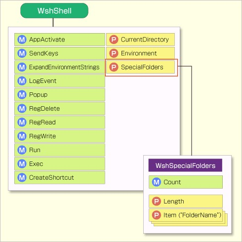 +

이럴 때 활용할 수 있는 것이 WshShell 객체의 SpecialFolders 속성이다. SpecialFolders 속성을 이용하면 이런 특수 폴더의 경로를 가져올 수 있다. SpecialFolders 속성을 통해 폴더를 가져온 다음 조작하려면, 특정 환경에 의존하지 않는 스크립트를 작성할 수 있다.

SpecialFolders에서 가져올 수 있는 폴더는 다음 16가지 유형이다. 단, 임시 폴더나 Windows 시스템 폴더는 SpecialFolders가 아닌 환경 변수를 이용해서 가져온다.

.SpecialFolders 속성을 통해 가져올 수 있는 특수 폴더
[%autowidth]
|===
|폴더 지정     |의미

|AllUsersDesktop     |모든 사용자의 바탕화면
|AllUsersStartMenu   |모든 사용자의 시작 메뉴
|AllUsersPrograms    |모든 사용자의 시작 메뉴에 있는 ‘모든 프로그램’
|AllUsersStartup     |모든 사용자의 시작 메뉴에 있는 ‘시작 프로그램’
|Desktop             |바탕 화면
|Favorites           |즐겨찾기
|Fonts               |글꼴
|MyDocuments         |내 문서
|NetHood             |내 네트워크
|PrintHood           |프린터
|Programs            |시작 메뉴의 ‘모든 프로그램’
|Recent              |최근 사용한 파일
|SendTo              |컨텍스트 메뉴의 ‘보내기’
|StartMenu           |시작 메뉴
|Startup             |시작 메뉴의 ‘시작 프로그램’
|Templates           |새 파일 생성용 템플릿
|===

SpecialFolders를 사용할 때는 다음과 같이, 가져오고 싶은 특수 폴더의 경로 문자열을 매개변수로 지정한다.

[source,vb]
----
objShell.SpecialFolders(“폴더 지정”)
----

예를 들어 내 문서 폴더를 알려면 다음과 같이 한다.

[source,vb]
----
objShell.SpecialFolders(“MyDocument”)
----

실제로 SpecialFolders 는 폴더 이름(표에 기재된 폴더 지정)을 키로 하는 컬렉션을 나타내며, 뒤따르는 괄호 안의 부분은 그 기본 속성인 Item 속성이다(이 관계는 앞서 언급한 객체 모델 그림 참조). 즉, 위의 스크립트를 생략하지 않고 작성한다면 다음과 같이 된다.

[source,vb]
----
objShell.SpecialFolders.Item(“MyDocument”)
----

다음 코드는 각 특수 폴더를 명령줄에 나열해서 표시하는 샘플 스크립트이다.

.SpecialFolders 사용 예
[source,vb]
----
 1: Set objShell = WScript.CreateObject(“WScript.Shell”)
 2: WScript.Echo “Desktop: ”
 3: WScript.Echo “  ” & objShell.SpecialFolders(“Desktop”)
 4: WScript.Echo “Favorites: ”
 5: WScript.Echo “  ” & objShell.SpecialFolders(“Favorites”)
 6: WScript.Echo “MyDocuments: ”
 7: WScript.Echo “  ” & objShell.SpecialFolders(“MyDocuments”)
 8: WScript.Echo “SendTo: ”
 9: WScript.Echo “  ” & objShell.SpecialFolders(“SendTo”)
10: WScript.Echo “StartMenu: ”
11: WScript.Echo “  ” & objShell.SpecialFolders(“StartMenu”)
12: WScript.Echo “Startup: ”
13: WScript.Echo “  ” & objShell.SpecialFolders(“Startup”)
----

이 코드를 specialfolders.vbs 라는 파일로 저장해서 실행하면 다음과 같이 표시됩니다.

----
D:\WSH> cscript specialfolders.vbs
Desktop:
  C:\Documents and Settings\tomo-k\데스크톱
Favorites:
  C:\Documents and Settings\tomo-k\즐겨찾기
MyDocuments:
  C:\Documents and Settings\tomo-k\My Documents
SendTo:
  C:\Documents and Settings\tomo-k\SendTo
StartMenu:
  C:\Documents and Settings\tomo-k\시작 메뉴
Startup:
  C:\Documents and Settings\tomo-k\시작 메뉴\프로그램\자동 실행

D:\WSH>
----

=== 환경 변수의 조회 및 설정

실행 파일의 검색 경로, 임시 폴더 경로 등 Windows 시스템이나 응용 프로그램이 사용하는 일부 시스템 정보는 환경 변수로 저장되어 있다. WshShell 객체의 ExpandEnvironmentStrings 메서드를 사용해서 환경 변수를 조회할 수 있으며, Environment 속성을 통해 환경 변수를 조회하고 설정할 수 있다.

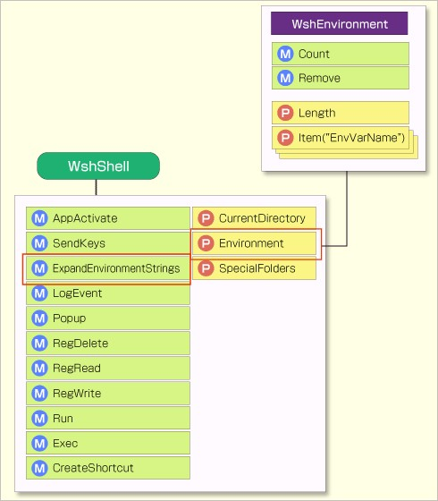 +

ExpandEnvironmentStrings 메서드::
명령 프롬프트 등에서 환경 변수를 사용할 때는, 앞뒤에 ‘%’ 를 붙인 표기법을 사용해서 특정 환경 변수에 저장된 값을 배치 파일 등에서 활용할 수 있다. 예를 들어 Windows 디렉터리에 있는 win.ini 라는 파일이면, ‘%SystemRoot%\win.ini’ 같이 표기한다. 이 “SystemRoot” 는 시스템의 Windows 폴더 경로가 저장된 환경 변수이며, 명령 프롬프트나 배치 파일에서 “%SystemRoot%\win.ini” 라고 지정하면 환경 변수가 확장되어 “C:\Windows\win.ini” 로 해석된다(Windows XP나 Windows Server 2003의 경우).

이런 환경 변수 문자열을 얻기 위한 메서드가 ExpandEnvironmentStrings 이다. ExpandEnvironmentStrings 의 처리는 명령 프롬프트에서 “SET” 명령을 실행해서 표시할 수 있는 환경 변수의 값을 스크립트로 가져오는 것과 유사하다(현재 프로세스에 해당하는 환경 변수의 값을 가져온다. 프로세스 외의 환경 변수에 대해서는 후술한다).

ExpandEnvironmentStrings 메서드를 이용하여 환경 변수를 가져와 보자.

.ExpandEnvironmentStrings 메서드를 사용하는 샘플 스크립트
[source,vb]
----
Set objShell = WScript.CreateObject(“WScript.Shell”)
WScript.Echo “SystemRoot: ”
WScript.Echo “  ” & objShell.ExpandEnvironmentStrings(“%SystemRoot%”)
WScript.Echo “Path: ”
WScript.Echo “  ” & objShell.ExpandEnvironmentStrings(“%PATH%”)
WScript.Echo “Temp: ”
WScript.Echo “  ” & objShell.ExpandEnvironmentStrings(“%TEMP%”)
----

이것을 expandenvironment.vbs 라는 파일로 저장해서 실행하면 다음과 같이 표시됩니다.

----
D:\WSH> cscript expandenvironment.vbs
SystemRoot:
  C:\WINDOWS
Path:
  C:\WINDOWS\system32;C:\WINDOWS;C:\WINDOWS\system32\WBEM
Temp:
  C:\DOCUME~1\tomo-k\LOCALS~1\Temp

D:\WSH>
----
　
위의 샘플 스크립트는 환경 변수 문자열만 전개하고 있지만, 예를 들어 “%SystemRoot%\win.ini” 처럼 환경 변수 이외의 문자를 포함하는 경우도 문제없이 전개할 수 있다(환경 변수가 아닌 문자열은 그대로 출력된다). 또한, 환경 변수를 이용해서 다른 환경 변수가 정의되는 경우도 자동으로 끝까지 전개가 이루어진다(예를 들어, 환경 변수 ‘TEMP’ 는 보통 ‘%USERPROFILE%\Local Settings\Temp’ 로 정의되지만, ‘%TEMP%’ 를 전개하면 자동으로 ‘%USERPROFILE%’ 부분의 전개도 이루어진다).

Environment 속성::
앞서 설명한 ExpandEnvironmentStrings 메서드는 현재 프로세스와 관련된 환경 변수만 가져올 수 있었다. 반면 Environment 속성을 사용하면 환경 변수의 값을 가져올 뿐만 아니라, 스크립트에서 임의의 값을 설정할 수도 있다. 또한 현재 프로세스와 관련된 환경 변수뿐만 아니라, 시스템용 환경 변수나 일시적으로 사용하는 환경 변수 등을 가져오거나 설정할 수 있다.

Environment 속성을 사용할 때는 Windows 환경에서 사용할 수 있는 환경 변수의 종류에 주의해야 한다. 환경 변수의 종류는 아래에 제시된 4가지가 있다.

.환경 변수의 종류와 유효 범위
[%autowidth]
|===
|종류     |유효 범위

|System   |모든 사용자
|User     |현재 사용자
|Volatile |현재 로그온
|Process  |현재 프로세스
|===

‘System’ 은 컴퓨터 단위의 설정으로, 모든 사용자에게 적용되는 환경 변수이다. 어떤 사용자로 로그온하더라도 해당 환경 변수가 적용되며, 내용을 변경하면 그 결과가 모든 사용자에게 적용된다.

‘User’ 는 사용자 단위의 설정으로, 현재 로그온 중인 사용자만 적용된다. 내용을 변경해도 다른 사용자는 영향을 미치지 않는다. 또한 사용자가 로그오프하더라도 다시 로그온하면 이전에 설정했던 환경 변수의 값이 적용된다.

‘Volatile’(‘휘발성’ 이라는 의미)은 현재 로그온 세션만 적용된다. 이름에서 알 수 있듯이, Volatile 환경 변수는 일시적으로 사용되는 것으로, 로그온 중인 사용자가 로그오프하거나 컴퓨터를 재시작하면 변경된 내용은 변경 전의 내용으로 돌아간다.

‘Process’ 는 현재 프로세스만 적용되는 환경 변수이다. Process 환경 변수는 명령 프롬프트가 종료되는 등 현재 프로세스가 종료되면 변경 내용이 원래대로 돌아간다.

이처럼 일시적으로 환경 변수를 설정해서 이용할 경우는 Process 나 Volatile 을 활용해서 영향이 남지 않도록 한다. 반대로 변경 내용을 그 후에도 계속 유지하려면 System 이나 User 를 설정하면 된다.

Environment 속성을 이용할 경우는 앞서 언급한 어떤 종류의 환경 변수를 사용할지 지정해야 한다. Environment 속성에 환경 변수의 종류를 지정하면, 해당 종류의 환경 변수 목록이 이름이 지정된 컬렉션으로 반환된다. 예를 들어, Process 환경 변수를 가져오거나 설정하려면,

[source,vb]
----
Set colEnv = objShell.Environment(“Process”)
----

와 같이 “Process” 를 지정해서 컬렉션을 가져온 다음, colEnv.Item(“TEMP”) 같이 각 환경 변수에 접근한다. 단, 환경 변수의 종류에 따라 사용할 수 있는 환경 변수가 일부 다르므로 주의가 필요하다. Process 환경 변수는 모든 변수를 사용할 수 있지만, 그 외의 System, User, Volatile 환경 변수는 그중 일부만 사용할 수 있다. 

Windows 2000/XP/2003의 표준 환경은 다음 표에 나열된 변수를 사용할 수 있다. 등록되지 않은 변수를 설정하면 새로운 변수가 생성되고, 등록되지 않은 변수를 읽어들일 경우 빈 문자열이 반환된다.

.환경 변수의 종류와 사용 가능한 변수 (○＝사용 가능, ×＝사용 불가)
[%autowidth]
|===
|변수     |시스템     |사용자     |휘발성     |프로세스

|NUMBER_OF_PROCESSORS     |○     |×    |×     |○
|PROCESSOR_ARCHITECTURE   |○     |×    |×     |○
|PROCESSOR_IDENTIFIER     |○     |×    |×     |○
|PROCESSOR_LEVEL          |○     |×    |×     |○
|PROCESSOR_REVISION       |○     |×    |×     |○
|OS                       |○     |×    |×     |○
|COMSPEC                  |○     |×    |×     |○
|HOMEDRIVE                |×      |×    |○    |○
|HOMEPATH                 |×      |×    |○    |○
|PATH                     |○     |×    |×     |○
|PATHEXT                  |○     |×    |×     |○
|PROMPT                   |×      |×    |×     |○
|SYSTEMDRIVE              |×      |×    |×     |○
|SYSTEMROOT               |×      |×    |×     |○
|WINDIR                   |○     |×    |×     |○
|TEMP                     |×      |○   |×     |○
|TMP                      |×      |○   |×     |○
|===

이 중 System 과 User 는 시스템 속성에서 확인할 수 있다(［내 컴퓨터］를 마우스 오른쪽 버튼으로 클릭해서 표시되는 ［시스템 속성］ 대화 상자에서 ［상세］ 탭－［환경 변수］ 버튼 클릭).

.시스템 속성에서 환경 변수를 표시해 보니
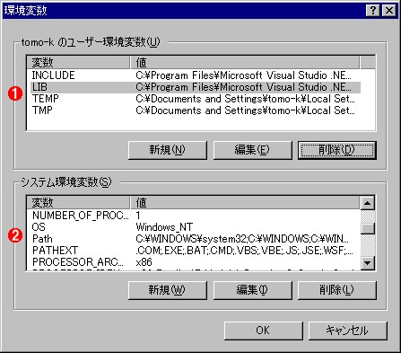 +
System 및 User 환경 변수는 이 대화 상자에서 확인할 수 있다. 동일한 환경 변수가 양쪽에 모두 정의되어 있는 경우도 있다.

* (1) 현재 로그온한 사용자의 User 환경 변수 목록.
* (2) 이 컴퓨터의 System 환경 변수 목록.

Environment 속성이 반환하는 컬렉션은 WshEnvironment 클래스의 객체이며, 다음 4가지 메서드와 속성을 사용할 수 있다.

[%autowidth]
|===
|메서드/속성     |내용
|Item 속성       |변수명을 나타내는 문자열을 매개변수로 하여, 해당 값을 가져오거나 설정한다
|Count 메서드    |환경 변수의 개수를 가져온다(주로 VBScript용)
|length 속성     |환경 변수의 개수를 가져온다(주로 JScript용)
|Remove 메서드   |변수명을 나타내는 문자열을 매개변수로 받아 해당 환경 변수를 삭제한다
|===

다음 코드는 Environment 속성을 사용한 간단한 예제이다(파일명은 environment.vbs 로 했다).

[source.js]
----
1: Set objShell = WScript.CreateObject(“WScript.Shell”)
2: Set colEnv = objShell.Environment(“User”)
3:
4: WScript.Echo objShell.ExpandEnvironmentStrings(“%TEMP%”)
5: WScript.Echo colEnv.Item(“TEMP”)
6:
7: colEnv.Item(“NewVar”) = ‘NewValue’
8: WScript.Echo colEnv.Item(“NewVar”)
9: colEnv.Remove(“NewVar”)
----

실행하면 다음과 같은 결과가 나온다.

----
D:\WSH> cscript environment.vbs
C:\DOCUME~1\tomo-k\LOCALS~1\Temp
%USERPROFILE%\Local Settings\Temp
NewValue

D:\WSH>
----

이 스크립트는 2행에서 User 환경 변수의 컬렉션을 가져오고, 이어지는 4행과 5행에서 동일한 TEMP 환경 변수에 두 가지 방법을 비교하고 있다.

결과로 알 수 있듯이, ExpandEnvironmentStrings 메서드를 사용해서 환경 변수를 가져온 경우는 완전히 확장된 경로가 표시되고, Environment 속성을 사용한 경우는 %USERPROFILE% 라는 다른 환경 변수의 부분이 그대로 표시된다는 것을 알 수 있다.

7번째 줄은 새로운 ‘NewVar’ 환경 변수를 생성해서 문자열 “NewValue” 를 설정하고, 8번째 줄에서 생성한 환경 변수를 표시하며, 9번째 줄에서 생성한 환경 변수를 삭제하고 있다. 9번째 줄을 삭제하고 스크립트를 실행하면, 실행 후 시스템 속성을 확인해서 새로운 ‘NewVar’ 라는 환경 변수가 설정되어 있음을 확인할 수 있다.

=== 바로가기 만들기――　CreateShortcut 메서드　――

잘 알려진 것 같이 Windows는 파일, 폴더, 웹 페이지에 대한 바로가기를 생성하고 이를 다양한 위치에 배치함으로써, 자주 사용하는 파일이나 웹 페이지에 빠르게 접근할 수 있다. 바탕화면 등에 배치되는 바로가기 외에도, 시작 메뉴나 작업 표시줄의 빠른 실행, 파일을 마우스 오른쪽 버튼으로 클릭했을 때 나타나는 ‘보내기’ 메뉴에 등록하는 등, 바로가기는 폭넓게 사용되고 있다. CreateShortcut 메서드를 이용하면 WSH 스크립트에서 이 바로가기를 생성할 수 있다.

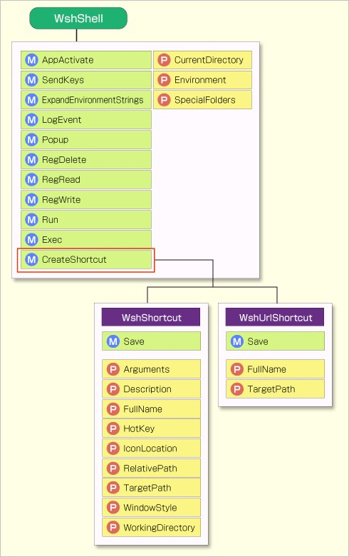 +

바로 가기 생성 절차는 3단계로 나뉜다. 먼저, 파일 이름을 지정해서 CreateShortcut 메서드를 호출해서 바로 가기를 나타내는 객체를 생성하고, 다음으로 해당 객체의 속성을 설정하며, 마지막으로 Save 메서드를 사용해서 저장하는 순서이다.

.WSH 스크립트를 이용한 바로가기 생성 절차
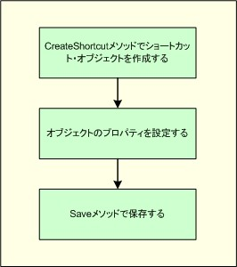 +
WSH 스크립트로 바로가기를 생성하려면 다음 3단계의 절차를 따릅니다.

또한, 단순히 ‘바로가기’ 라고 해도 파일이나 폴더의 바로가기와 웹 페이지의 바로가기는 그 실체와 기능이 다르므로, 스크립트는 이를 구분해서 처리해야 합니다.

파일 및 폴더 바로가기::
파일 및 폴더 바로가기의 실체는 확장자 ‘.lnk’ 를 가진 파일이다. 스크립트는 지정하는 파일 이름의 확장자를 ‘.lnk’ 로 설정함으로써 파일이나 폴더에 대한 링크를 생성할 수 있다. 이 경우, CreateShortcut 메서드의 반환값은 바로가기를 나타내는 WshShortCut 객체가 된다.

WshShortCut 객체는 다음 속성을 사용할 수 있다(앞서 언급한 클래스 다이어그램은 이들에 더해 ‘RelativePath’ 라는 속성이 있는 것으로 되어 있지만, 아직 구현되지 않은 것으로 보여 표에 포함하지 않았다).

.WshShortCut 객체의 속성
[%autowidth]
|===
|속성     |의미

|TargetPath           |링크 대상 파일명
|WorkingDirectory     |작업 폴더
|Hotkey               |키보드 단축키
|WindowStyle          |실행 시 크기
|Description          |바로 가기 설명
|IconLocation         |바로 가기 아이콘
|Arguments            |실행 파일에 전달할 매개변수
|FullName             |(읽기 전용) 바로 가기 파일의 전체 경로
|===

이것을 보면 알 수 있듯이, GUI의 바로 가기 속성에 설정할 수 있는 항목은 모두 스크립트도 설정할 수 있다. 또한, TargetPath 이외의 속성은 필요하지 않으면 설정하지 않더라도 무방하다.

.바로 가기 속성 화면
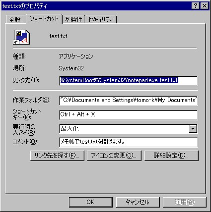 +
GUI에서 설정할 수 있는 모든 항목이 WshShortCut 객체의 속성으로 정의되어 있음을 알 수 있다.

그럼, CreateShortcut 을 이용해서 바탕화면에 메모장 바로 가기를 만들어 보자.

[source,vb]
----
1: Set objShell = WScript.CreateObject(“WScript.Shell”)
2: strDesktop = objShell.SpecialFolders(“Desktop”)
3: strFileName = strDesktop + “\메모장.lnk”
4:
5: Set objShortCut = objShell.CreateShortcut (strFileName)
6: objShortCut.TargetPath = “%SystemRoot%\System32\notepad.exe”
7: objShortCut.Save
8:
9: WScript.Echo strFileName & “에 바로가기를 생성했습니다.”
----

바탕화면에 바로가기를 생성하기 위해 SpecialFolders 메서드를 사용해서 바탕화면의 경로를 가져옵니다. 그 경로에 바로가기 이름과 ‘.lnk’ 를 붙인 이름을 CreateShortcut 메서드에 전달합니다. 5행에서 CreateShortcut 메서드를 호출하고, 6행에서 대상 경로를 지정하며, 7행에서 저장합니다. 이를 실행하면 바탕화면에 ‘메모장’ 이라는 바로가기를 생성할 수 있습니다.

그 외의 속성을 설정하려면 다음과 같이 합니다.

[source,vb]
----
 1: Const MAXIMIZE_WINDOW = 3
 2: Set objShell = WScript.CreateObject(“WScript.Shell”)
 3: strDesktop = objShell.SpecialFolders(“Desktop”)
 4: strMyDocuments = objShell.SpecialFolders(“MyDocuments”)
 5: strFileName = strDesktop + “\test.txt.lnk”
 6:
 7: Set objShortCut = objShell.CreateShortcut(strFileName)
 8: objShortCut.TargetPath = “%SystemRoot%\System32\notepad.exe”
 9: objShortCut.WorkingDirectory = strMyDocuments
10: objShortCut.Arguments = “test.txt”
11: objShortCut.Hotkey = “Ctrl+Alt+X”
12: objShortCut.WindowStyle = MAXIMIZE_WINDOW
13: objShortCut.Description = “메모장에서 test.txt를 엽니다.”
14: objShortCut.IconLocation = “%SystemRoot%\system32\SHELL32.dll, 1”
15: objShortCut.Save
16:
17: WScript.Echo strFileName & “에 바로 가기를 생성했습니다.”
----

9행은 작업을 수행할 때의 현재 디렉터리(작업 폴더)를 ‘내 문서’ 로 설정하고, 10행은 메모장에 전달할 매개변수로 test.txt 라는 파일 이름을 지정하고 있다. 파일 경로가 지정되지 않았으므로, 현재 디렉터리인 ‘내 문서’ 에 있는 test.txt 파일이 열리게 된다.

11행은 키보드 단축키를 설정하고 있다. 키보드 단축키를 설정하면, 바탕화면이나 시작 메뉴의 바로 가기를 키 조작만으로 실행할 수 있게 된다. 여기서는 예시로 Ctrl+Alt+X 키를 설정했다. 이를 설정하면 마우스를 사용하지 않고 Ctrl+Alt+X 키를 누르기만 해도 언제든지 바로 가기를 실행할 수 있다. Hotkey 속성은 ‘Alt+’, ‘Ctrl+’, ‘Shift+’ 와 영숫자의 조합으로 표현된다. 12행은 창의 표시 방법이다. 이는 Run 메서드에서 창을 표시하는 방법과 마찬가지로 0부터 10까지의 정수를 지정한다. 지정할 숫자는 지난 기사에 목록이 있으니 참조하기 바란다. 13행은 바로가기의 설명으로, 마우스를 바로가기에 올렸을 때 여기에 지정한 설명이 표시된다. 14행은 표시할 아이콘으로, 아이콘이 포함된 파일명과 해당 파일 내의 번호를 쉼표로 구분해서 지정한다.

웹 페이지 바로 가기::
인터넷상의 웹 페이지 바로 가기는 확장자가 ‘.url’ 인 파일이다. 지정하는 파일명의 확장자를 ‘.url’ 로 지정하면 웹 페이지로 연결되는 링크를 만들 수 있다. 이 경우, CreateShortcut 메서드의 반환 값은 URL 바로 가기를 나타내는 WshUrlShortcut 객체가 된다. WshUrlShortcut 객체는 WshShortcut처럼 다양한 속성을 설정할 수 없으며, TargetPath 와 FullName 만 사용할 수 있다.

.WshUrlShortcut 객체의 속성
[%autowidth]
|===
|속성        |의미

|TargetPath  |링크 대상 파일명
|FullName    |(읽기 전용) 바로 가기 파일의 전체 경로
|===

바탕화면에 ‘Windows Server Insider’ (본 사이트)로 연결되는 바로 가기를 만들려면 다음과 같은 코드를 작성하면 된다.

[source,vb]
----
1: Set objShell = WScript.CreateObject(“WScript.Shell”)
2: strDesktop = objShell.SpecialFolders(“Desktop”)
3: strFileName = strDesktop + “\Windows Insider.url”
4:
5: Set objShortCut = objShell.CreateShortcut(strFileName)
6: objShortCut.TargetPath = “http://www.atmarkit.co.jp/fwin2k/”
7: objShortCut.Save
8:
9: WScript.Echo strFileName & “에 바로 가기를 생성했습니다.”
----

이처럼 확장자를 ‘.url’ 로 지정하고, TargetPath 에 링크 대상 URL을 설정하면, 파일이나 폴더에 대한 바로 가기와 동일한 코드로 웹 페이지에 대한 바로 가기도 생성할 수 있다.

특수 폴더 활용::
특수 폴더에 바로가기를 생성하면 시작 메뉴나 실행 내용도 변경할 수 있다. 여기서는 해당 폴더를 지정하는 방법을 소개하겠다.

[%autowidth]
|===
|특수 폴더     |지정 방법

|시작 메뉴(모든 프로그램)     |objShell.SpecialFolders(“Programs”)
|시작 메뉴의 ‘시작 프로그램’  |objShell.SpecialFolders(“Startup”)
|컨텍스트 메뉴의 ‘보내기’     |objShell.SpecialFolders(“SendTo”)
|즐겨찾기                     |objShell.SpecialFolders(“Favorites”)
|빠른 실행                    |objShell.ExpandEnvironmentStrings( _“%APPDATA%\Microsoft\Internet Explorer\Quick Launch”)
|===

바탕화면이 아닌 빠른 실행에 ‘Windows Server Insider’ 를 추가하려면 다음과 같이 변경한다.

[source,vb]
----
1: Set objShell = WScript.CreateObject(“WScript.Shell”)
2: strQL = objShell.ExpandEnvironmentStrings( _
3:   “%APPDATA%\Microsoft\Internet Explorer\Quick Launch”)
4: strFileName = strQL + “\Windows Insider.url”
5:
6: Set objShortCut = objShell.CreateShortcut(strFileName)
7: objShortCut.TargetPath = “http://www.atmarkit.co.jp/fwin2k/”
8: objShortCut.Save
----

이 코드를 실행하고 다시 로그온하면, 시작 버튼 옆의 ‘빠른 실행’ 에 새로운 바로 가기가 추가된 것을 확인할 수 있을 것이다(‘빠른 실행’ 이 표시되지 않는 경우, 작업 표시줄의 빈 공간을 마우스 오른쪽 버튼으로 클릭하고, 팝업 메뉴에서 [도구 모음] – [빠른 실행] 을 켜면 된다).

바로가기 삭제::
WshShell 객체는 바로가기를 생성할 수는 있지만 삭제할 수는 없다. 하지만 바로가기도 하나의 파일이므로, 일반 파일과 마찬가지로 처리하면 바로가기도 삭제할 수 있다. WSH는 파일 삭제에 File System Object(FSO) 라는 객체를 이용한다. FSO는 이 연재에서 아직 소개하지 않았지만, 삭제를 수행하는 코드만 여기서 소개해 두겠다.

[source,vb]
----
1: Set objShell = WScript.CreateObject(“WScript.Shell”)
2: Set objFSO = CreateObject(“Scripting.FileSystemObject”)
3: strQL = objShell.ExpandEnvironmentStrings( _
4:   “%APPDATA%\Microsoft\Internet Explorer\Quick Launch”)
5: strFileName = strQL + “\Windows Insider.url”
6: objFSO.DeleteFile(strFileName)
----

이처럼 FSO 객체를 생성하고, DeleteFile 메서드에 파일 이름을 전달하면 생성한 바로 가기를 삭제할 수 있다.

다음 시간에도 WshShell 객체의 기능으로, 애플리케이션 이벤트 로그 생성 및 레지스트리 정보 조회·설정에 대해 설명하겠다.

==  제7회　WshShell 객체 상세 설명 (3)

레지스트리는 Windows 환경을 관리하는 데이터베이스이다. 이를 조작함으로써 다양한 관리 작업을 스크립트로 자동화할 수 있다.

지난 번에 이어 WshShell 객체에 대해 설명한다.

=== 애플리케이션 이벤트 로그 생성 ―― LogEvent 메서드 ――

스크립트를 이용한 배치 처리를 수행할 경우, 지정된 시간 등에 무인 상태로 처리가 실행되도록 하는 경우가 많다. 사용자가 대화형으로 이용하는 일반적인 애플리케이션이라면, 오류 발생 시나 처리 완료 시 각각을 나타내는 메시지를 화면에 표시하면 되지만, 무인 실행 시 오류 메시지를 화면에 표시한다고 해도 아무런 도움이 되지 않는다. 일반적으로 이런 경우는 이메일 전송이나 이벤트 로그 기록 등의 방법을 통해 상황을 관리자에게 알리게 된다. 스크립트를 이용해서 이메일 알림을 보내려면 CDO(Collaboration Data Objects)라는 컴포넌트를 사용할 수 있다(자세한 내용은 관련 기사 참조). 한편, WshShell 객체의 LogEvent 메서드를 사용하면 스크립트를 통해 임의의 정보를 애플리케이션 이벤트 로그에 기록할 수 있다.

 +

이벤트 로그는 Windows OS의 다양한 상황을 로그로 기록하기 위한 기능으로, Windows NT 커널 기반 OS(Windows NT, Windows 2000, Windows XP, Windows Server 2003)에서 사용할 수 있다. 기록된 로그 내용은 전용 도구인 ‘이벤트 뷰어’ 에서 확인할 수 있다(제어판의 [관리 도구] – [이벤트 뷰어] 항목을 통해 실행한다).

.이벤트 뷰어
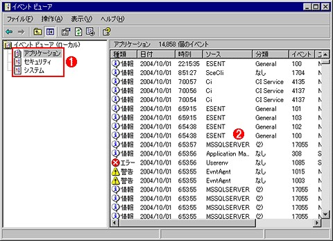 +
Windows NT 커널 기반의 Windows OS는 OS 실행 시의 각종 정보 로그가 이벤트 로그로 기록된다. 로그 내용은 ‘이벤트 뷰어’ 라는 도구를 통해 확인할 수 있다. 이처럼 기본적으로 3가지 카테고리별로 로그가 기록된다.

* (1) 카테고리. 이벤트는 각 카테고리별로 분류되어 기록된다.
* (2) 이벤트 목록. 이는 ‘응용 프로그램’ 카테고리의 이벤트를 표시한 화면이다.

화면에서 알 수 있듯이, 이벤트는 ‘응용 프로그램’, ‘보안’, ‘시스템’ 같은 카테고리별로 기록되어 있다(기본 설정 시. 서버 OS 등은 이 외에도 ‘DNS 서버’, ‘디렉터리 서비스’, ‘파일 복제 서비스’ 등의 카테고리가 추가되는 경우도 있다). 이 중 WSH 스크립트를 통해 기록할 수 있는 것은 ‘응용 프로그램’ 카테고리의 이벤트 로그이다.

이벤트 로그에 기록되는 각 로그는 ‘정보’, ‘경고’, ‘오류’ 등의 분류가 있다. 이벤트 뷰어는 정보의 종류를 나타내는 아이콘을 표시해서 필요한 정보를 빠르게 찾을 수 있도록 하고 있다. 설정 가능한 로그의 종류는 다음 6가지이다. (실제로 ‘성공’ 은 이벤트 뷰어에서 ‘종류 없음’ 으로 표시되며, 목록 표시 시에는 ‘정보’ 로 표시된다)

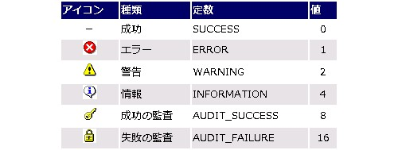 +

WSH 스크립트는 표에 있는 이 ‘유형’ 을 나타내는 ‘값’ 과 로그에 기록할 문자열을 LogEvent 메서드에 전달함으로써, 애플리케이션 이벤트 로그에 기록할 수 있다. 구체적으로는 다음과 같이 한다.

[source,vb]
----
Set objShell = WScript.CreateObject(“WScript.Shell”)
objShell.LogEvent (유형), “(기록할 문자열)”
----

이것만으로도 이벤트 로그에 기록이 완료된다. 예를 들어 다음 예제는 모든 종류의 로그를 기록하고 있다.

[source,vb]
----
Set objShell = WScript.CreateObject(“WScript.Shell”)
objShell.LogEvent 0, “성공 테스트입니다.”
objShell.LogEvent 1, “오류 테스트입니다.”
objShell.LogEvent 2, “경고 테스트입니다.”
objShell.LogEvent 4, “정보 테스트입니다.”
objShell.LogEvent 8, “성공 감사 테스트입니다.”
objShell.LogEvent 16, “실패 감사 테스트입니다.”
----

이 코드를 실행하고 이벤트 뷰어를 열면 6개의 로그가 추가된 것을 확인할 수 있다. 이렇게 이벤트 로그에 정보를 기록해 두면, 이벤트 뷰어를 비롯한 이벤트 로그 관련 도구 및 명령어(eventcreate.exe, eventquery.vbs, eventtriggers.exe 등. 이들은 Windows XP/Windows Server 2003에서 사용 가능)를 이용해서 나중에 정보를 확인하거나 정리할 수 있다.

.샘플 스크립트 실행 후의 이벤트 뷰어
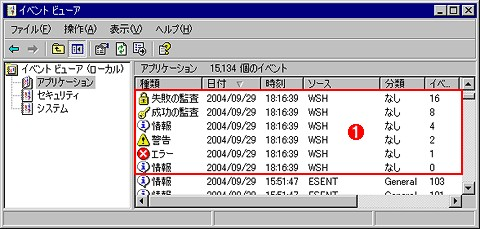 +
샘플 스크립트 실행으로 인해 6개의 로그가 기록되었다. 단, ‘성공’ 로그는 ‘정보’ 로 표시된다.

* (1) 샘플 스크립트 실행으로 기록된 이벤트.

또한, 세 번째 매개변수로 컴퓨터 이름을 지정하면, 권한이 있는 경우 다른 컴퓨터의 이벤트 로그에 기록할 수도 있다. 이 기능을 사용할 경우 코드는 다음과 같다.

[source,vb]
----
objShell.LogEvent (유형), “(기록할 문자열)”, “(컴퓨터 이름)”
----

=== 레지스트리 값 가져오기 및 설정 ―― RegRead／RegWrite／RegDelete 메서드 ――

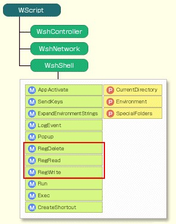 +

Windows는 OS의 상태(시작 시 실행되는 응용 프로그램, 시스템에 추가된 구성 요소 등)나 각종 응용 프로그램 설정 등 다양한 정보가 레지스트리(registry)라고 불리는 데이터베이스에 저장되어 있다. 따라서 이 레지스트리의 값을 참조해서 OS나 응용 프로그램의 현재 상태를 파악할 수 있을 뿐만 아니라, 레지스트리의 값을 변경해서 OS나 응용 프로그램의 동작을 바꿀 수도 있다. WSH 스크립트를 이용해서 시스템 관리를 수행한다는 측면에서 볼 때, 레지스트리 조작은 핵심 작업 중 하나라고 할 수 있다.

WshShell 객체의 RegRead 메서드, RegWrite 메서드, RegDelete 메서드를 이용하면 WSH 스크립트에서 레지스트리 값을 가져오거나 설정하거나 삭제할 수 있다.

각 메서드의 사용법을 설명하기 전에, WSH 스크립트에서 레지스트리를 다룰 때의 기본 사항에 대해 간단히 설명해 두자.

레지스트리는 폴더 구조와 유사한 트리 구조로 되어 있으며, 특정 항목을 지정하려면 루트 키부터의 경로를 백슬래시로 구분해서 표현한다. 예를 들어 ‘HKEY_CLASSES_ROOT\.html\Content Type’ 이라는 항목은 루트 키 ‘HKEY_CLASSES_ROOT’ 내의 ‘.html’ 키에 있는 ‘Content Type’ 이라는 값을 나타낸다. ‘키’ 를 폴더로, ‘값’ 을 파일로 생각하면 이해하기 쉬울 것이다.

루트 키는 아래 표에 나와 있는 5가지 종류가 있는데, 그중 ‘HKEY_CURRENT_USER’, ‘HKEY_LOCAL_MACHINE’, ‘HKEY_CLASSES_ROOT’ 는 ‘HKCU’, ‘HKLM’, ‘HKCR’ 이라는 약칭 사용이 허용된다(스크립트도 약칭을 사용할 수 있다). 이 약어 표기법을 사용하면, 예를 들어 ‘HKCR\.html\Content Type’ 같이 짧은 표기로 항목을 나타낼 수 있어 편리하다.

[%autowidth]
|===
|루트 키               |약어

|HKEY_CURRENT_USER     |HKCU
|HKEY_LOCAL_MACHINE    |HKLM
|HKEY_CLASSES_ROOT     |HKCR
|HKEY_USERS            |HKEY_USERS
|HKEY_CURRENT_CONFIG   |HKEY_CURRENT_CONFIG
|===

하나의 키는 이름이 없는 ‘기본’ 값이 하나 있으며, 그 외에 이름이 지정된 값이 몇 개 설정된다. WSH는 백슬래시로 끝나는 경로는 기본값으로 인식된다. 예를 들어 ‘HKEY_CLASSES_ROOT\.html\’ 은 ‘.html’ 키의 기본값을 나타낸다. 이름이 지정된 값을 지정할 때는 끝에 ‘\’ 를 붙여서는 안 되며, 기본값을 지정할 때는 끝에 ‘\’ 를 붙여야 하므로 주의가 필요하다.

각 값은 유형이 있으며, 문자열, 정수, 이진수, 환경 변수로 전개 가능한 문자열, 문자열 배열을 각각 저장할 수 있다. 유형 목록과 VBScript에서 대응하는 유형을 다음 표에 나타낸다.

[%autowidth]
|===
|형식명          |의미                |VBScript에서의 형식

|REG_SZ          |문자열              |문자열
|REG_DWORD       |정수                |정수
|REG_BINARY      |이진수              |정수의 VBArray
|REG_EXPAND_SZ   |확장 가능한 문자열  |문자열
|REG_MULTI_SZ    |문자열 배열         |문자열의 VBArray
|===

VBScript는 ‘2진수’ 가 1바이트 단위로 구분된 숫자 배열로 처리된다(구체적인 예시는 후술한다). ‘확장 가능한 문자열’ 은 ‘%SystemRoot%’ 같이 환경 변수를 “%” 로 묶은 표기법을 사용할 수 있다. 최종적으로 지난 시간에 설명한 ExpandEnvironmentStrings 메서드를 통해 확장되어 사용된다.

=== 레지스트리에서 값 가져오기 ―― RegRead 메서드 ――

RegRead 메서드는 레지스트리의 값을 가져오는 메서드이다. 매개변수로 레지스트리 경로를 지정하면 해당 값을 읽어올 수 있다.

[source,vb]
----
1: Set objShell = WScript.CreateObject(“WScript.Shell”)
2: WScript.Echo objShell.RegRead(“HKCR\.html\Content Type”)
3: WScript.Echo objShell.RegRead(“HKCR\.html\”)
4: WScript.Echo objShell.ExpandEnvironmentStrings( objShell.RegRead( _
  “HKLM\SOFTWARE\Microsoft\Windows\CurrentVersion\WallPaperDir”) )
----

4번째 줄의 예에서 레지스트리 값 “WallPaperDir” 의 값은 “%SystemRoot%\Web\Wallpaper” 이며, 이 실행 결과를 ExpandEnvironmentStrings 메서드의 매개변수로 전달함으로써 환경 변수가 확장되어 최종적으로 “C:\WINDOWS\Web\Wallpaper” 를 얻게 된다. 전체 실행 결과는 다음과 같다.

----
D:\WSH> cscript regread.vbs
text/html
htmlfile
C:\WINDOWS\Web\Wallpaper

D:\WSH>
----

REG_MULTI_SZ형이나 REG_BINARY형 값은 배열이므로, For Each 문 등으로 처리한다.

[source,vb]
----
1: Set objShell = WScript.CreateObject(“WScript.Shell”)
2: colEventSource = objShell.RegRead _
3:   ("HKLM\SYSTEM\CurrentControlSet\Services\EventLog\Application
\Sources")
4:
5: For Each strSrc In colEventSource
6:   If Left(strSrc,1) = “W” Then
7:     WScript.Echo strSrc
8:   End If
9: Next
----

2~3행에서 지정된 “HKLM\SYSTEM\CurrentControlSet\Services\EventLog\Application\Sources” 는 애플리케이션 이벤트 로그에 데이터를 기록한 애플리케이션 목록이 저장되어 있다. 이를 변수 colEventSource 에 할당하고, For Each 문을 사용해서 하나씩 처리한다. 필자의 환경에서 테스트해 본 결과, 목록에 수많은 애플리케이션이 기록되어 있었으므로, 여기서는 첫 글자가 ‘W’ 인 경우만 화면에 출력하기로 했다. 실행 결과는 다음과 같았다.

----
D:\WSH> cscript regread.vbs
WSH
WMIAdapter
WmdmPmSN
WinMgmt
Winlogon
Windows Product Activation
Windows 3.1 Migration
Website Installer
WebClient
WebClassRuntime
W3Ctrs

D:\WSH>
----

1행에 ‘WSH’ 가 출력되는데, 이는 앞서 예시에서 WSH가 애플리케이션 이벤트 로그에 기록을 수행했기 때문에 표시된 것이다. 이벤트 로그를 이용하면 이벤트 로그용으로 지원되는 각종 기능을 사용할 수 있다고 앞서 언급했는데, 이것이 그 구체적인 예 중 하나이다.

=== 레지스트리에 데이터 쓰기 ―― RegWrite 메서드 ――

레지스트리에 값을 쓰려면 RegWrite 메서드를 사용한다. 데이터를 쓰려는 레지스트리 경로와 쓸 값을 매개변수로 지정한다. 이때, 이미 값이 존재하면 지정한 값으로 업데이트되고, 존재하지 않으면 새로운 값으로 추가된다. 일반적인 문자열 값(REG_SZ)이나 정수 값(REG_DWORD)은 이 방법으로 쓸 수 있다. 레지스트리에 저장되는 데이터 대부분은 이 중 하나이므로, 일반적인 처리라면 RegWrite 메서드만으로도 문제없이 실행할 수 있을 것이다.

RegWrite 메서드는 REG_MULTI_SZ(문자열 배열) 값이나 REG_BINARY(2진수) 값 등은 쓸 수 없다! 이런 값을 쓰려면, 레지스트리 편집기나 Reg.exe 를 호출해서 변경하는 방법을 사용한다(자세한 내용은 후술한다).

여기서 주의할 점이 하나 있다. 레지스트리에 저장된 데이터는 애플리케이션이나 OS가 동작하는 데 기초가 되는 중요한 정보이며, 잘못된 값을 기록하면 시스템이 제대로 작동하지 않거나 불안정해지거나, 최악의 경우 부팅이 불가능해질 위험도 있다. 레지스트리에 값을 기록할 때는 각별히 주의해야 한다. 특히 중요한 서버에서 실행하거나, 다수의 클라이언트에 스크립트를 배포하는 경우 등은 만일 사고가 발생할 경우 그 영향이 크기 때문에 각별한 주의가 필요하다. 충분히 테스트한 후에 배포하도록 유의해야 한다.

우선 예시로, HKEY_CURRENT_USER 아래에 ‘WshTest’ 라는 키를 만들고, 몇 가지 값을 써 넣어 보자.

[source,vb]
----
1: Set objShell = WScript.CreateObject(“WScript.Shell”)
2: objShell.RegWrite “HKCU\WshTest\Test1”, “Test #1”
3: objShell.RegWrite “HKCU\WshTest\Test2”, 2
4: objShell.RegWrite “HKCU\WshTest\Test3”, “Test #3”, “REG_SZ”
5: objShell.RegWrite “HKCU\WshTest\Test4”, 4, ‘REG_DWORD’
6: objShell.RegWrite “HKCU\WshTest\Test5”, “%SystemRoot% #5”, “REG_EXPAND_SZ”
7: objShell.RegWrite “HKCU\WshTest\”, “Test #6”, “REG_SZ”
----

RegWrite 메서드의 첫 번째 매개변수에 레지스트리 경로를, 두 번째 매개변수에 기록할 값을, 세 번째 매개변수에 기록할 값의 유형을 각각 지정한다. 이 중 세 번째 매개변수는 생략할 수 있으며, 생략한 경우는 REG_SZ(문자열) 형식으로 쓰기가 수행된다.

이 코드를 실행해도 화면에 아무것도 표시되지 않으므로, 쓰기가 올바르게 수행되었는지 확인하기 위해 [시작] 메뉴의 ‘파일 이름 지정해서 실행’ 에 ‘regedit’ 를 입력해서 레지스트리 편집기를 실행하고 결과를 확인해 보자.

.레지스트리 편집기에서 확인
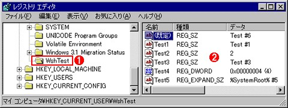 +
스크립트에서 지정한 ‘WshTest’ 키가 생성되었고, 각 값이 기록되어 있다.

* (1) 생성된 키.
* (2) 추가된 값.

Test1 과 Test2 는 형식을 생략하고 기록했기 때문에(2~3행), REG_SZ(문자열) 형식으로 기록되었다. Test2 처럼 정수 값을 기록하더라도 형식은 REG_SZ 형식이 되어 버리므로 주의가 필요하다. Test3, Test4, Test5 는 각각 REG_SZ(문자열) 형식, REG_DWORD(정수) 형식, REG_EXPAND_SZ(확장 가능한 문자열) 형식으로 기록이 이루어졌다. 마지막 기록은 경로가 ‘\’ 로 끝나며, ‘(기본)’ 값이 설정되었다.

특수한 데이터 형을 사용한 쓰기::
REG_BINARY(2진수) 값은 1바이트, 2바이트, 4바이트 값만 쓸 수 있다. 최종적으로 몇 바이트가 쓰여지는지는 설정하는 값에 지정된 VBScript의 형에 따라 달라진다. 일반적인 정수는 2바이트이므로, 쓰기도 2바이트로 이루어진다.

1바이트나 4바이트로 쓰기를 원한다면, 매개변수로 지정할 값을 각각 Byte형이나 Long형으로 변환해서 RegWrite 메서드에 전달함으로써 쓸 수 있다. 다만, 이 외의 바이트 수인 경우는 쓸 수 없으며, 또한 2바이트, 4바이트의 경우 쓰기와 읽기 시 바이트 순서(바이트 오더)가 반전되는 등의 문제가 있으므로, 그리 사용하기 편하다고는 할 수 없다.

REG_MULTI_SZ(문자열 배열) 값이나 REG_BINARY 값을 스크립트에서 기록할 경우는, RegWrite 메서드로 직접 기록하는 대신, 미리 레지스트리 편집기의 [파일] - [내보내기] 를 통해 레지스트리 파일(확장자 .reg)을 생성하고, 이 .reg 파일에 기록하려는 데이터를 설정한 다음, 스크립트에서 레지스트리 편집기를 호출해서 값을 변경하는 방법도 있다. 스크립트에서 레지스트리 편집기를 실행하려면 다음과 같이 하면 된다.

[source,vb]
----
1: Set objShell = WScript.CreateObject(“WScript.Shell”)
2: objShell.Run “regedit /s data.reg”
----

regedit를 통해 값을 기록할 때는 보통 ‘레지스트리에 정보를 추가하시겠습니까?’, ‘입력되었습니다’ 같은 메시지가 표시되지만, 이처럼 ‘/s’ 옵션을 추가하면 이런 메시지를 숨길 수 있다.

또한 Windows XP와 Windows Server 2003의 경우, Reg.exe 라는 명령줄 도구를 사용할 수도 있다. 다음은 이를 사용해서 REG_MULTI_SZ 값이나 REG_BINARY 값을 기록하는 예시이다.

[source,vb]
----
 1: Set objShell = WScript.CreateObject(“WScript.Shell”)
 2: objShell.Exec “reg add HKCU\WshTest /v Test7 /t REG_BINARY /d deadbeef1234 /f”
 3: ' 키 HKCU\WshTest
 4: ' 값 이름(/v) Test7
 5: ' 유형(/t) REG_BINARY
 6: ' 값(/d) deadbeef1234(16진수 표기)
 7: objShell.Exec “reg add HKCU\WshTest /ve /t REG_MULTI_SZ /s , /d abc,def,ghi /f”
 8: ' 키 HKCU\WshTest
 9: ' 값 이름(/ve) 없음(기본값)
10: ' 유형(/t) REG_MULTI_SZ
11: ' 구분 문자(/s) 「,」
12: ' 값(/d) 「abc」「def」「ghi」
----

이처럼 Reg.exe 는 쓰기 대상 레지스트리 키, 값, 유형, 데이터를 옵션으로 지정할 수 있다.

=== 레지스트리 항목 삭제 ―― RegDelete 메서드 ――

레지스트리 항목을 삭제하려면 RegDelete 메서드를 이용한다. RegDelete 메서드는 개별 값을 하나씩 삭제할 수도 있고, 키 전체를 삭제할 수도 있다. 키를 삭제할 경우는 경로 끝에 ‘\’ 를 붙이고, 값을 삭제할 경우는 ‘\’ 를 붙이지 않는다. 키를 삭제하면 그 아래의 값은 모두 삭제되지만, 하위 키가 존재하는 경우는 오류가 발생해서 삭제 처리 전체가 취소된다. 또한 조사해 본 바에 따르면, 기본값만 지정해서 삭제하는 방법은 제공되지 않는 것으로 보인다.

다음 예제는 WshTest 키의 값 Test1 을 삭제한다.

[source,vb]
----
1: Set objShell = WScript.CreateObject(“WScript.Shell”)
2: objShell.RegDelete “HKCU\WshTest\Test1”
----

이 코드를 실행하고 레지스트리 편집기에서 확인하면, ‘Test1’ 값이 사라진 것을 알 수 있다. 또한, WshTest 키 전체를 삭제하려면 다음과 같이 한다.

[source,vb]
----
1: Set objShell = WScript.CreateObject(“WScript.Shell”)
2: objShell.RegDelete “HKCU\WshTest\”
----

=== 현재 디렉터리 가져오기 및 변경 ―― CurrentDirectory 속성 ――

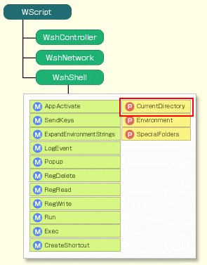 +

스크립트 파일이 위치한 곳이나 스크립트 엔진의 파일명은 WScript 객체를 통해 가져올 수 있다(관련 링크: 제4회). 그러나 실제 작업 폴더는 이와 다를 수 있다. 작업 폴더를 가져오려면 WshShell 객체의 CurrentDirectory 속성을 이용한다. 또한, 이 속성에 값을 설정함으로써 작업 폴더를 변경할 수 있다.

CurrentDirectory 속성의 사용 예는 다음과 같다. 디렉터리 이동을 테스트하기 위해 첫 번째 스크립트를 ‘D:\WSH\curdir.vbs’ 에, 두 번째 스크립트를 ‘D:\WSH\Test\a.vbs’ 에 생성한다.

[source,vb]
----
1: Set objShell = WScript.CreateObject(“WScript.Shell”)
2: Wscript.Echo objShell.CurrentDirectory
3: objShell.CurrentDirectory = “D:\WSH\Test”
4: Wscript.Echo objShell.CurrentDirectory
5: objShell.Run “wscript a.vbs”
D:\WSH\curdir.vbs

WScript.Echo “a.vbs가 실행되었습니다!”
D:\WSH\Test\a.vbs
----

이 예제는 먼저 현재 디렉터리를 표시하고(curdir.vbs 의 2행), 다음으로 ‘D:\WSH\Test’ 로 이동한 후(3행), 다시 한 번 현재 디렉터리를 표시합니다(4행). 그리고 마지막으로 ‘a.vbs’ 를 WScript로 실행한다(5행). 이 ‘a.vbs’ 는 이동한 후의 ‘D:\WSH\Test’ 폴더에 두어야 한다. 현재 디렉터리가 올바르게 이동되면, 경로를 지정하지 않아도 이 스크립트 파일을 찾을 수 있을 것이다.

실행하면 다음과 같다.

.샘플 스크립트의 실행 결과
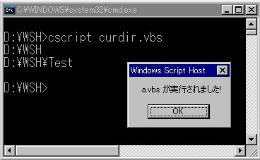 +

확실히 a.vbs 가 실행되었다. 또한, 현재 디렉터리의 이동은 WSH 프로세스 내에서만 이루어지기 때문에, 명령 프롬프트의 현재 디렉터리는 WSH 실행이 종료된 후에도 원래의 ‘D:\WSH’ 상태로 유지된다.

=== 대화 상자 표시 ―― Popup 메서드 ――

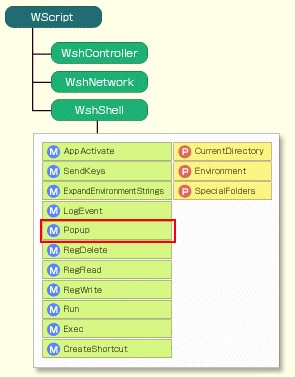 +

Popup 메서드는 화면에 메시지 상자를 표시하는 메서드이다. GUI 모드의 wscript 에서 실행하든, 명령줄 모드의 cscript 에서 실행하든 메시지 상자 창이 표시된다. WScript 객체의 WScript.Echo 메서드나 VBScript의 MsgBox 함수를 사용해도 메시지 상자를 표시할 수 있지만, WshShell 객체의 Popup 메서드를 이용하면 버튼이나 아이콘을 자유롭게 설정할 수 있을뿐만 아니라, 메시지 상자가 표시되는 시간에 제한을 둘 수도 있다.

시간 제한을 설정함으로써, 스크립트 실행 시 사용자가 없는 경우도 자동으로 실행을 진행할 수 있다. 이를 활용하면, 누군가 컴퓨터를 사용할 때는 몇 가지 선택지를 제시하고, 사용자가 없으면 표준 동작을 수행하는 등의 사용이 가능해진다.

Popup 메서드에 전달하는 매개변수는 표시할 메시지, 시간 제한, 제목, 유형의 4가지이다. 이 중 표시할 메시지 이외의 항목은 생략할 수 있다. 메시지와 제목은 문자열을, 제한 시간은 초 단위로 시간을 지정한다. 초 단위의 시간을 생략하거나 0으로 설정한 경우는 일반적인 메시지 상자와 마찬가지로 사용자가 버튼을 누를 때까지 대기한다.

유형은 메시지 상자에 표시할 버튼과 아이콘을 숫자로 지정한다. 이 숫자는 VBScript의 경우 미리 정해진 상수를 이용할 수 있다. 버튼과 아이콘의 종류는 다음과 같다.

.버튼의 종류
[%autowidth]
|===
|값    |상수                |의미

|0     |vbOKOnly            |[OK]만 표시
|1     |vbOKCancel          |[OK] [취소]를 표시
|2     |vbAbortRetryIgnore  |[중지] [재시도] [무시]를 표시
|3     |vbYesNoCancel       |[예] [아니오] [취소]를 표시
|4     |vbYesNo             |[예] [아니요]를 표시한다
|5     |vbRetryCancel       |[다시 시도] [취소]를 표시한다
|===

.아이콘 종류
[%autowidth]
|===
|값     |상수           |의미

|0      |없음           |아이콘을 표시하지 않는다
|16     |vbCritical     |「STOP」 아이콘을 표시한다
|32 	|vbQuestion     |‘?’ 아이콘을 표시합니다
|48     |vbExclamation  |‘!’ 아이콘을 표시합니다
|64     |vbInformation  |‘i’ 아이콘을 표시합니다
|===

.기본적으로 입력 포커스가 설정되는 버튼
[%autowidth]
|===
|값     |상수                 |의미

|0      |vbDefaultButton1     |첫 번째 버튼에 포커스를 설정합니다
|256 	|vbDefaultButton2     |두 번째 버튼에 포커스를 설정한다
|512    |vbDefaultButton3     |세 번째 버튼에 포커스를 설정한다
|===

실제로 Popup 메서드를 호출할 때는, 버튼의 종류를 나타내는 값과 아이콘의 종류를 나타내는 값을 더해서 지정한다. 이런 수치는 Win32 API의 MessageBox 함수에서 지정하는 것과 동일하다.

Popup 메서드는 반환값으로 눌린 버튼에 해당하는 숫자를 반환한다. 제한 시간 내에 버튼이 눌리지 않은 경우 -1 이 반환된다. 다음은 눌린 버튼에 해당하는 숫자이다.

.Popup 메서드의 반환값
[%autowidth]
|===
|값     |상수      |의미

|1     |vbOK       |[OK]가 눌렸다
|2     |vbCancel   |[취소]가 눌렸다
|3 	   |vbAbort    |[중지]가 눌렸다
|4     |vbRetry    |[다시 시도]가 눌렸다
|5     |vbIgnore   |[무시]가 눌렸다
|6     |vbYes      |[예]가 눌렸다
|7     |vbNo       |[아니오]가 눌렸다
|-1    |없음       |제한 시간이 경과했다
|===

다음 예제는 [OK] 와 [취소] 버튼이 있는 메시지 상자를 표시하고 있다.

[source,vb]
----
 1: Set objShell = WScript.CreateObject(“WScript.Shell”)
 2: iBtn = objShell.Popup( _
 3:   “중지하려면 '취소'를 누르십시오.”, _
 4:   5, “처리를 실행하시겠습니까?”, vbOKCancel+vbQuestion)
 5:
 6: Select Case iBtn
 7:   Case vbOK
 8:     objShell.Popup “실행했습니다.”, 5,, vbInformation
 9:   Case vbCancel
10:     objShell.Popup “취소했습니다.”, 5,, vbInformation
11:   Case -1
12:     objShell.Popup “자동으로 실행했습니다.”, 5,, vbInformation
13: End Select
----

2행부터 4행까지에서 [OK] 와 [취소] 버튼이 있는 메시지 상자가 표시되며, 클릭된 버튼의 정보가 반환값으로 돌아와 iBtn 변수에 저장된다. 후반부는 Select Case 문(참조 링크: Select Case 문)을 사용해서 눌린 버튼에 따라 경우를 구분하고(6행), [OK] 버튼만 있는 메시지 상자를 표시한다. 실행하면 다음과 같은 대화 상자가 표시된다.

.샘플 스크립트 실행 결과 1
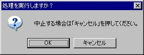 +

이 메시지 상자에서 [확인] 버튼이나 [취소] 버튼을 클릭하면 각각 “실행했습니다”, “취소했습니다” 라는 메시지가 표시되며, 5초 동안 그대로 기다리면 “자동으로 실행했습니다” 라는 메시지가 표시된다. 다음 그림은 5초 동안 기다렸을 때 나타나는 메시지이다.

.샘플 스크립트 실행 결과 2
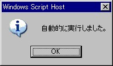 +

이번까지 총 3회에 걸쳐 WshShell 객체에 대해 설명했다. 다음 시간에는 WshNetwork 객체에 대해 설명하겠다.

==  제8회　WshNetwork 객체에 대한 상세 설명

사용자 정보를 기반으로 한 처리가 가능하도록 하는 사용자 이름 및 컴퓨터 이름 조회 방법과, 네트워크 드라이브 및 프린터 사용법에 대해 설명한다.

지난번 WshShell 객체에 이어, 이번에는 WshNetwork 객체를 설명한다.

=== WshNetwork 객체

WshNetwork 객체는 스크립트에서 네트워크 드라이브나 네트워크 프린터에 액세스하기 위한 객체이다. WshShell 객체와 마찬가지로, 미리 CreateObject 메서드를 사용해서 인스턴스를 생성해야 한다(반면, WScript 객체의 인스턴스는 암시적으로 생성된다). WshNetwork 객체의 프로그램 ID는 “WScript.Network” 이므로, 스크립트 시작 부분에 다음과 같이 작성하면 objNetwork를 WshNetwork 객체로 사용할 수 있다.

[source,vb]
----
Set objNetwork = WScript.CreateObject(“WScript.Network”)
----

.WSH 객체 모델
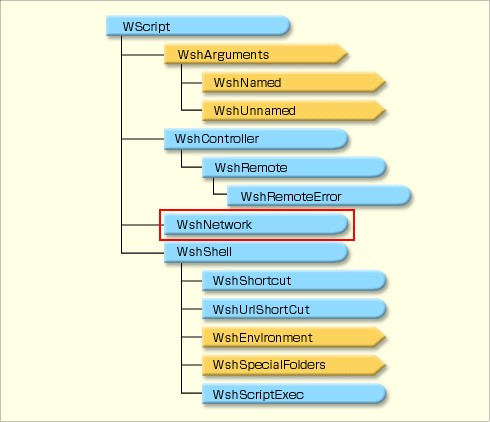 +
WSH의 내장 객체 목록. 이번에는 이 중 WshNetwork 객체에 대해 설명한다.

다음 표는 WshNetwork 객체에 포함된 각 메서드/속성과 그 역할을 정리한 것이다.

.WshNetwork 객체의 메서드와 속성
[%autowidth]
|===
|메서드/속성                            |역할

|MapNetworkDrive                        |네트워크 드라이브 연결
|RemoveNetworkDrive                     |네트워크 드라이브 연결 해제
|EnumNetworkDrives                      |네트워크 드라이브 열거
|AddPrinterConnection／AddWindowsPrinterConnection     |네트워크 프린터 연결
|RemovePrinterConnection                |네트워크 프린터 연결 해제
|EnumPrinterConnections                 |네트워크 프린터 열거
|SetDefaultPrinter                      |기본 프린터 설정
|ComputerName／UserDomain／UserName     |스크립트를 실행 중인 컴퓨터 및 사용자 정보 가져오기
|===

이처럼 WshNetwork 객체를 사용하면 네트워크 드라이브나 네트워크 프린터를 이용하고 제어할 수 있을 뿐만 아니라, 스크립트를 실행 중인 컴퓨터나 도메인, 사용자의 정보를 가져올 수 있다. 이런 정보를 바탕으로 처리를 전환하는 스크립트(특정 도메인이나 특정 사용자에게만 특정 처리를 실행하는 스크립트)에서 활용할 수 있다.

.WshNetwork의 객체 모델
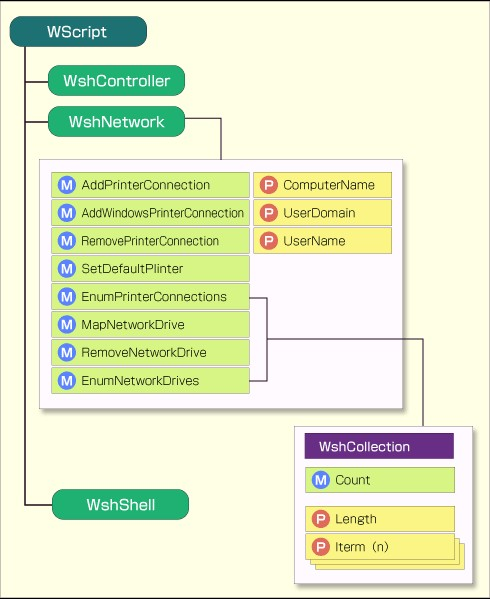 +
네트워크 드라이브 및 네트워크 프린터의 연결 및 끊기, 스크립트를 실행 중인 컴퓨터의 컴퓨터 이름, 사용자 이름, 도메인 이름 등을 가져올 수 있다.

=== 네트워크 드라이브 연결 ―― MapNetworkDrive 메서드 ――

현재는 범용성이 좀 더 높은 UNC를 사용해서 네트워크 공유 폴더에 접근할 수 있다. 예를 들어 “Server” 라는 서버의 “Share” 라는 공유 폴더에 있는 “Sample.txt” 라는 파일이면, “\\Server\Share\Sample.txt” 라는 이름으로 접근할 수 있다. UNC를 사용한 이름은 LAN 내부에서 항상 고유하게 결정되므로, 어느 컴퓨터든 동일한 UNC 이름으로 같은 공유 파일에 접근할 수 있다.

.UNC를 사용한 공유 파일 지정 방법
 +
UNC를 사용한 파일 지정은 LAN 내부에서 항상 고유하게 결정되므로, 어느 컴퓨터에서든 동일한 UNC 이름으로 같은 공유 파일에 접근할 수 있다.

UNC 외에도 MS-DOS 시대부터 익숙하게 사용해 온 ‘드라이브 이름’ 도 사용할 수 있다. 예를 들어 앞서 언급한 ‘\\Server\Share\Sample.txt’ 는 ‘\\Server\Share’ 를 X: 드라이브에 할당하면(‘X: 드라이브에 매핑한다’ 라고 함), ‘X:\Sample.txt’ 로 접근할 수 있다. 일단 드라이브를 할당하면, ‘파일 열기’ 대화 상자 등에서 일반 드라이브와 마찬가지로 X: 드라이브를 표시할 수 있다.

.내 컴퓨터에 표시된 네트워크 드라이브
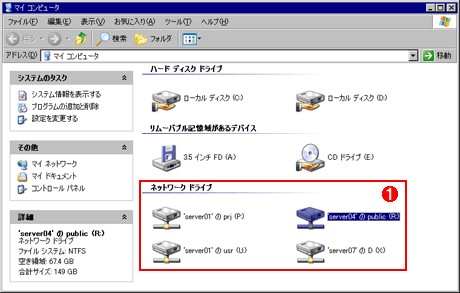 +
공유 폴더에 사용되지 않은 드라이브 이름을 할당하면, 물리적 하드 디스크 드라이브와 마찬가지로 드라이브 이름으로 파일에 접근할 수 있게 된다.

* (1) 드라이브 이름을 할당받은 공유 폴더.

특정 컴퓨터에 의존하는 드라이브 이름보다 UNC 표기법이 범용성은 더 높지만, 역사적인 경위로 인해 드라이브 이름 표기법이 애플리케이션과의 호환성은 좀 더 높다. UNC를 사용할 수 있게 된지 10년 가까이 지났지만, 여전히 UNC를 지원하지 않아 파일명을 지정할 때 드라이브 이름만 사용할 수 있는 경우도 드물지 않다.

MapNetworkDrive 메서드는 네트워크상의 공유 폴더를 네트워크 드라이브로 연결하고 드라이브 이름을 할당하는 메서드이다. 다음과 같이 사용한다.

----
objNetwork.MapNetworkDrive 드라이브명, UNC명 [, 사용자 프로필에 기록] [, 사용자명] [, 비밀번호]
----

매개변수를 정리하면 다음과 같다.

.MapNetworkDrive의 매개변수
[%autowidth]
|===
|매개변수          |유형      |기본값*     |의미

|제1매개변수 (strLocalName)     |문자열     |－     |네트워크 드라이브로 할당할 드라이브 이름. 생략 불가
|제2매개변수 (strRemoteName)    |문자열     |－     |공유 폴더의 UNC 이름. 생략 불가
|제3 매개변수 (bUpdateProfile)  |Boolean    |False  |연결 정보를 사용자 프로필에 저장하고 로그온 시 자동 재연결 (True=저장/재연결, False=저장하지 않음)
|제4 매개변수 (strUser)         |문자열     |(현재 사용자 사용)     |연결할 사용자의 사용자 이름
|제5 매개변수 (strPassword)     |문자열     |(현재 사용자 사용)     |연결할 사용자의 암호
|===

*매개변수 지정을 생략했을 때의 선택 사항

매개변수가 5개 있으나, 이 중 후반 3개는 생략할 수 있다. 제1매개변수는 “X:” 같이, 설정할 드라이브 이름을 알파벳 1자와 「:」(콜론) 기호로 지정한다.

두 번째 매개변수는 해당 드라이브에서 연결할 공유 폴더를 UNC 형식으로 지정한다. 예를 들어 “\\Server\Share” 같이 지정한다.

세 번째 매개변수는 이 드라이브에 대한 할당 설정을 사용자 프로필에 기록할지 여부를 True 또는 False 로 지정한다. 생략할 경우 False 가 되며, 사용자가 로그오프하면 네트워크 드라이브가 끊어지고, 다시 로그온하더라도 드라이브는 자동으로 연결되지 않는다. 반면 True 를 지정하면 할당 정보가 사용자 프로필에 저장된다. 다만 필자가 테스트해 본 결과, 이때 저장되는 정보는 할당할 드라이브 이름과 연결 대상 공유 폴더 뿐이며, 사용자 이름이나 암호(다음에서 설명할 제4, 제5 매개변수) 정보는 저장되지 않는다. 따라서 이 매개변수를 이용해서 연결 정보를 기록했더라도, 재연결 시 사용자 이름과 암호를 연결 대상에 전송해야 하는 경우(워크그룹 네트워크를 이용하는 경우 등)는 재연결 시 사용자 이름과 암호 입력이 요구된다.

현재 로그온 중인 사용자와 다른 사용자 권한으로 연결하는 경우는, 제4, 제5 매개변수에 사용자 이름과 비밀번호를 각각 지정한다. 이런 매개변수를 생략한 경우는 로그온 중인 사용자의 권한으로 연결이 이루어진다.

예를 들어 다음 스크립트는, ‘Server’ 라는 이름의 서버에 ‘Share1’, ‘Share2’, ‘Share3’ 이라는 공유 폴더가 있을 때, 이를 각각 ‘X:’ ‘Y:’, ‘Z:’ 드라이브로 지정해서 네트워크 드라이브에 할당하는 것이다. 참고로 X: 드라이브는 현재 사용자의 일시적인 연결, Y: 드라이브는 영구적인 연결, Z: 드라이브는 사용자 이름과 비밀번호를 지정해서 현재 사용자와 다른 사용자로 연결하고 있다.

[source,vb]
----
1: Set objNetwork = WScript.CreateObject(“WScript.Network”)
2: objNetwork.MapNetworkDrive “X:”, “\\Server\Share1”
3: objNetwork.MapNetworkDrive “Y:”, “\\Server\Share2”, True
4: objNetwork.MapNetworkDrive “Z:”, “\\Server\Share3”, False, ‘user01’, “password”
----

4번째 줄 같이 사용자 이름과 암호를 지정하면, 워크그룹 환경 등의 경우도 수동으로 암호를 입력하는 수고를 덜 수 있다. 로그온할 때마다 자동으로 연결하려면, 위와 같은 네트워크 드라이브 할당 스크립트를 [시작] 메뉴나 작업 스케줄러에 등록하면 된다(사용자 프로필에 기록하도록 지정하는 것만으로는, 재로그온 후 드라이브를 할당할 때 암호를 다시 입력해야 한다). 다만, 이 스크립트는 비밀번호가 평문 그대로 저장되므로, Windows Script Encoder(스크립트를 암호화해서 사람이 읽을 수 없게 만드는 도구)를 사용해서 인코딩하는 등 보안에 각별히 주의해야 한다. Windows Script Encoder는 다음 마이크로소프트 다운로드 사이트에서 다운로드할 수 있다.

* Windows Script Encoder(마이크로소프트 다운로드 센터)

=== 네트워크 드라이브 연결 해제 —— RemoveNetworkDrive 메서드 ——

RemoveNetworkDrive 메서드는 현재 연결된 네트워크 드라이브의 연결을 해제하는 메서드이다. 다음과 같이 사용한다.

----
objNetwork. RemoveNetworkDrive 드라이브명［,강제 해제］［,사용자 프로필 삭제］
----

매개변수를 정리하면 다음과 같다.

.RemoveNetworkDrive의 매개변수
[%autowidth]
|===
|매개변수                |유형       |기본값*     |의미

|제1매개변수 (strName)   |문자열     |－          |연결을 끊을 네트워크 드라이브의 드라이브 이름(생략 불가)
|제2매개변수 (bForce)    |Boolean    |False       |강제 연결 끊기 여부(사용 중이라도 강제로 연결을 끊을지 여부)
|제3 매개변수 (bUpdateProfile)     |Boolean     |False     |사용자 프로필 정보 삭제
|===

*매개변수 지정을 생략했을 때의 선택지

RemoveNetworkDrive 의 매개변수는 3개이며, 그중 후반 2개는 생략 가능하다.

첫 번째 매개변수는 연결을 끊을 드라이브 이름을 지정한다.

두 번째 매개변수는 어떤 애플리케이션이 연결을 끊을 네트워크 드라이브를 사용 중일 경우, 강제로 연결을 끊을지 여부를 지정한다. 생략 시는 False 가 되며, 네트워크 드라이브가 사용 중이면 오류 메시지가 표시되고 연결은 끊어지지 않는다. 반면, 명시적으로 True 를 지정하면 애플리케이션이 사용 중이어도 네트워크 드라이브가 강제로 연결이 끊어진다.

세 번째 매개변수는 저장된 사용자 프로필 정보를 삭제할지 여부를 지정한다. 생략 시는 False 이며, 사용자 프로필에 기록된 드라이브 연결 정보는 그대로 유지되고, 재로그온 시 자동으로 재연결된다. 반면 여기에 True 를 지정하면 기록이 삭제되며, 재로그온 시 재연결이 이루어지지 않는다. 참고로, 직접 테스트해 본 결과, 사용자 프로필에 연결 정보가 기록되지 않은 드라이브에 제3 매개변수에 True 를 지정하고 RemoveNetworkDrive 를 실행해도 특별한 오류는 발생하지 않으며, 단순히 현재 연결이 끊어질 뿐인 것으로 보인다.

MapNetworkDrive 메서드의 샘플 코드로 생성한 X:, Y:, Z: 네트워크 드라이브를 삭제하려면 다음 스크립트를 실행한다.

[source,vb]
----
1: Set objNetwork = WScript.CreateObject(“WScript.Network”)
2: objNetwork.RemoveNetworkDrive “X:”
3: objNetwork.RemoveNetworkDrive “Y:”, True
4: objNetwork.RemoveNetworkDrive “Z:”
----

=== 네트워크 드라이브 목록 가져오기　――　EnumNetworkDrives 메서드　――

EnumNetworkDrives 메서드는 네트워크 드라이브 목록을 반환하는 메서드이다. 목록은 드라이브 이름과 UNC 이름을 번갈아 저장한 컬렉션 형태로 반환된다. 0번째, 2번째, 4번째 등 짝수 번째 항목은 드라이브 이름이고, 1번째, 3번째, 5번째 등 홀수 번째 항목은 UNC 이름이 된다. 이 컬렉션은 WSH의 다른 컬렉션과 마찬가지로 Count 메서드와 Length 속성을 통해 전체 개수를 확인할 수 있다. 단, 이때 구해지는 값은 드라이브 이름과 UNC 이름을 합친 컬렉션 전체의 개수가 되므로, 존재하는 네트워크 드라이브 수의 2배가 된다.

.EnumNetworkDrives 메서드가 반환하는 컬렉션
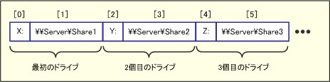 +
EnumNetworkDrives 메서드는 드라이브 이름과 UNC 이름을 번갈아 저장한 컬렉션 형태로 네트워크 드라이브 목록이 반환된다. 0번째, 2번째, 4번째 등 짝수 번째 항목은 드라이브 이름이고, 1번째, 3번째, 5번째 등 홀수 번째 항목은 UNC 이름이 된다.

VBScript에서 EnumNetworkDrives 메서드를 사용할 경우, For Each 문 대신 For 문을 사용하고 ‘Step 2’ 를 지정함으로써 각 드라이브에 루프 처리를 수행할 수 있다. 루프 카운터를 i 라고 하면, Item(i) 는 드라이브 이름이, Item(i+1) 는 UNC 이름이 저장된다. 다음 예제는 현재 네트워크 드라이브의 개수와 각각의 연결 대상을 표시한다.

[source,vb]
----
1: Set objNetwork = WScript.CreateObject(“WScript.Network”)
2: Set colDrives = objNetwork.EnumNetworkDrives
3: WScript.Echo “네트워크 드라이브는” & (colDrives.Count / 2) & “개 있습니다.”
4: WScript.Echo “네트워크 드라이브 목록을 표시합니다:”
5: For i = 0 to colDrives.Count - 1 Step 2
6: Wscript.Echo colDrives.Item(i) & “ → ” & colDrives.Item (i + 1)
7: Next
----

이 코드를 실행하면 다음과 같은 결과가 표시됩니다.

----
D:\WSH> cscript enumdrives.vbs
네트워크 드라이브가 3개 있습니다.
네트워크 드라이브 목록을 표시합니다:
X: → \\Server\Share1
Y: → \\Server\Share2
Z: → \\Server\Share3

D:\WSH>
----

=== 네트워크 프린터 연결 ―― AddWindowsPrinterConnection, AddPrinterConnection 메서드 ――

새로운 클라이언트 컴퓨터를 추가하거나 네트워크에 새로운 사용자를 추가할 때 등, 사용 가능한 프린터를 설정하는 일은 번거로운 작업 중 하나일 것이다. 흑백 레이저, 컬러 레이저, 컬러 잉크젯 등 용도에 따라 여러 대의 프린터를 선택할 수 있도록 설정한 경우는 각 프린터의 위치를 확인하고 설치한 뒤, 기본 프린터(기본 출력 대상으로 지정되는 프린터)를 설정해야 한다. WSH를 이용해서 미리 프린터 설정용 스크립트로 준비하면, 이런 번거로운 설정 작업을 효율화할 수 있다.

AddWindowsPrinterConnection 메서드와 AddPrinterConnection 메서드는 네트워크상의 프린터에 연결하는 메서드이다. AddWindowsPrinterConnection 메서드는 제어판의 ‘프린터 및 팩스’ 에서 프린터를 추가하는 것과 마찬가지로, Windows 기반의 연결을 수행한다. 이 방법으로 프린터를 연결하면 이후부터는 Windows 애플리케이션에서 인쇄할 수 있게 된다(Windows 애플리케이션의 ‘인쇄’ 대화 상자에 표시되게 된다).

반면 AddPrinterConnection 메서드는 MS-DOS 기반의 프린터 연결을 수행한다. MS-DOS 기반의 프린터 연결이란, 명령 프롬프트의 ‘LPT1’ 등의 프린터 포트에 프린터를 연결하는 것을 말한다. 여기서 연결한 프린터로 인쇄하려면 명령 프롬프트에서 print 명령 등을 이용해야 한다.

.[프린터 및 팩스] 대화 상자
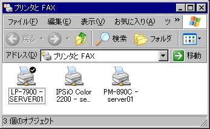 +
Windows 기반의 프린터 연결 상태는 이 화면에서 확인할 수 있다.

Windows NT, 2000, XP, 2003에서 Windows 기반 연결을 수행하려면 프린터의 UNC 이름을 AddWindowsPrinterConnection 메서드에 전달하면 된다. 다음 코드를 사용하면 ‘\\Server\Printer1’ 이라는 프린터에 연결할 수 있다. Windows 95, 98, Me는 프린터의 UNC 이름뿐만 아니라 드라이버 이름도 지정해야 하지만, 이 연재는 설명하지 않는다. 이에 대한 자세한 내용이 필요하면 MSDN 라이브러리를 참조하기 바란다.

[source,vb]
----
Set objNetwork = WScript.CreateObject(“WScript.Network”)
objNetwork.AddWindowsPrinterConnection “\\Server\Printer1”
----

AddPrinterConnection 메서드를 이용해서 MS-DOS 기반 연결을 수행하려면, 프린터의 UNC 이름에 더해 연결할 포트 이름을 지정해야 한다. 또한 MapNetworkDrive 메서드와 마찬가지로, 생략 가능한 제3, 제4, 제5 매개변수를 통해 프로필 설정 기록(True 또는 False)과 연결 대상의 사용자 이름, 암호를 지정할 수 있다.

----
objNetwork.AddPrinterConnection 포트명, UNC명 [,프로필 설정] [,사용자 이름] [,암호]
----

연결에 성공하더라도 MS-DOS 기반 연결은 제어판의 ‘프린터 및 팩스’ 에 표시되지 않으므로, 연결 상태를 확인하려면 명령 프롬프트에서 ‘net use’ 명령을 실행하거나, 후술할 EnumPrinterConnections 를 이용한 스크립트 등을 사용해야 한다. 다음 예제는 프린터 포트로 ‘LPT2’ 를 지정하고 있다.

[source,vb]
----
Set objNetwork = WScript.CreateObject(“WScript.Network”)
objNetwork.AddPrinterConnection “LPT2”, “\\Server\Printer2”
----

=== 네트워크 프린터 연결 끊기 ――　RemovePrinterConnection 메서드 ――

RemovePrinterConnection 메서드는 네트워크 프린터 연결을 끊는 메서드이다. 다음과 같이 사용한다.

----
objNetwork.RemovePrinterConnection 프린터명［,강제 연결 해제］［,프로필 설정］
----

.RemovePrinterConnection의 매개변수
[%autowidth]
|===
|매개변수                        |유형     |기본값*     |의미

|제1매개변수 (strName)           |문자열   |－          |연결을 해제할 네트워크 프린터의 프린터명(생략 불가)
|제2 매개변수 (bForce)           |Boolean  |False       |강제 연결 해지 여부(사용 중이라도 강제로 연결을 끊을지 여부)
|제3 매개변수 (bUpdateProfile)   |Boolean  |False       |사용자 프로필 정보 삭제
|===

*매개변수 지정을 생략한 경우의 선택지

RemoveNetworkDrive 와 마찬가지로, 두 번째 및 세 번째 매개변수는 생략할 수 있다. 이 메서드는 AddWindowsPrinterConnection 이나 AddPrinterConnection 중 어느 쪽을 사용해서 연결했든 상관없이 연결을 끊을 수 있다. AddWindowsPrinterConnection 을 사용해서 연결한 프린터의 연결을 끊으려면 프린터 이름으로 프린터의 UNC 이름을 지정하고, AddPrinterConnection 을 사용해서 연결한 경우는 연결 시 설정한 포트 이름을 지정한다. 두 번째 매개변수는 프린터가 사용 중인 경우의 처리 방법(True = 강제 끊기, False = 강제 끊기 안 함)을, 세 번째 매개변수는 프로필 설정에서 연결 정보를 삭제할지 여부(True = 삭제, False = 삭제 안 함)를 지정한다. 이 두 매개변수가 생략된 경우는 모두 False 로 처리된다.

다음은 RemoveNetworkDrive 를 사용한 코드 예제를 제시한다.

[source,vb]
----
Set objNetwork = WScript.CreateObject(“WScript.Network”)
objNetwork.RemoveNetworkDrive “\\Server\Printer1”
objNetwork.RemoveNetworkDrive “LPT2”
----

=== 네트워크 프린터 목록 가져오기 ―― EnumPrinterConnections 메서드 ――

EnumPrinterConnections 메서드는 네트워크 프린터 목록을 반환하는 메서드이다. EnumNetworkDrives 와 마찬가지로, 로컬 이름과 UNC 이름을 번갈아 저장한 컬렉션이 반환된다. 0번째, 2번째, 4번째 등 짝수 번째 항목은 로컬 이름이고, 1번째, 3번째, 5번째 등 홀수 번째 항목은 UNC 이름이 된다. 다음 예제는 네트워크 프린터의 개수와 각각의 연결 대상을 표시한다.

[source,vb]
----
1: Set objNetwork = WScript.CreateObject(“WScript.Network”)
2: Set colPrinters = objNetwork.EnumPrinterConnections
3: WScript.Echo “네트워크 프린터는” & (colPrinters.Count / 2) & “개 있습니다.”
4: WScript.Echo “네트워크 프린터 목록을 표시합니다: ”
5: For i = 0 to colPrinters.Count - 1 Step 2
6:  Wscript.Echo colPrinters.Item(i) & “ → ” & colPrinters.Item (i + 1)
7: Next
----

실행 결과는 다음과 같습니다.

----
D:\WSH > cscript enumprinter.vbs
네트워크 프린터는 3개 있습니다.
네트워크 프린터 목록을 표시합니다:
LPT2 → \\Server01\PM-890C
192.168.0.92:lp2 → \\Server01\IPSiO Color 2200
IP_192.168.0.93 → \\SERVER01\LP-7900

D:\WSH>
----

=== 기본 프린터 설정 ―― SetDefaultPrinter 메서드 ――

SetDefaultPrinter 메서드는 기본 프린터를 변경하는 메서드이다. 인쇄 시 명시적으로 프린터를 지정하지 않으면 기본 프린터가 사용된다. MS-DOS 기반 프린터 연결은 기본 프린터를 설정할 수 없으므로, 이 메서드는 AddWindowsPrinterConnection 으로 연결한 프린터나 수동으로 연결한 Windows 기반 프린터 연결에서만 사용할 수 있다. 사용법은 프린터의 UNC 이름을 지정하면 된다.

----
objNetwork.SetDefaultPrinter 프린터명
----

다음 코드는 \\Server\Printer1 을 기본 프린터로 지정한다.

[source,vb]
----
Set objNetwork = WScript.CreateObject(“WScript.Network”)
objNetwork.SetDefaultPrinter “\\Server\Printer1”
----

=== 컴퓨터 이름 및 사용자 정보 가져오기 ――　ComputerName 속성, UserDomain 속성, UserName 속성 ――

ComputerName, UserDomain, UserName 속성을 이용하면 스크립트를 실행 중인 컴퓨터의 이름과, 스크립트를 실행 중인 사용자의 도메인 및 사용자 이름을 가져올 수 있다. 단, WshNetwork 객체로 가져올 수 있는 정보는 이 세 가지 뿐이다. Active Directory에 등록된 이름(성 및 이름)이나 표시 이름, 이메일 주소, 소속 그룹 등 좀 더 자세한 정보가 필요한 경우는 ADSI(Active Directory Service Interface)를 이용해야 한다.

전형적인 용도는 UserName 속성을 사용해서 스크립트를 실행하는 사용자에 따라 처리를 전환하는 것 등이 있을 것이다. 단, 이 세 가지 속성은 “읽기 전용” 이므로 데이터를 변경할 수 없다.

[source,vb]
----
Set objNetwork = WScript.CreateObject(“WScript.Network”)
WScript.Echo objNetwork.ComputerName
WScript.Echo objNetwork.UserDomain
WScript.Echo objNetwork.UserName
----

이 예제는 컴퓨터 이름과 도메인 이름, 사용자 이름을 단순히 출력하는 코드이다. 실행하면 다음과 같은 정보를 얻을 수 있다.

----
D:\WSH > cscript userinfo.vbs
DAPC21
D-ADVANTAGE
tomo-k

D:\WSH>
----

사용자에 따라 처리를 전환하려면 다음과 같이 한다. 이 예제는 ‘tomo-k’ 라는 사용자가 실행했을 때만 네트워크 드라이브 설정을 수행한다.

[source,vb]
----
Set objNetwork = WScript.CreateObject(“WScript.Network”)
If objNetwork.UserName = “tomo-k” Then
  objNetwork.MapNetworkDrive “X:”, “\\Server\Share1”
End If
----

이번에는 WshNetwork 객체에 대해 설명했습니다. 다음 시간은 WshController 객체에 대해 설명하겠습니다.

==  제9회　WshController 객체에 대한 상세 설명

WSH를 사용하면 원격 컴퓨터에 스크립트를 전송해서 실행할 수 있다. 이를 통해 여러 대의 컴퓨터를 중앙에서 관리하는 등의 작업이 가능해진다.

이번에는 WshController/WshRemote 객체에 대해 설명한다. 지금까지 Windows Script Host의 표준 객체를 차례로 설명해 왔다. 이번 편으로 WScript에 포함된 표준 객체에 대한 설명은 끝이다.

=== WshController 객체, WshRemote 객체

이번에는 WshController 객체 및 WshRemote 객체에 대해 설명한다. WshController 객체와 WshRemote 객체는 로컬 컴퓨터가 아닌 네트워크상의 다른 컴퓨터에서 스크립트를 실행하기 위한 객체이다. 이런 객체를 이용하면 관리자의 컴퓨터에서 하나의 스크립트를 실행하는 것만으로 네트워크에 있는 여러 대의 컴퓨터에서 스크립트를 실행할 수 있다. 일일이 여러 대의 컴퓨터에 스크립트 파일을 복사하거나, 각 컴퓨터에 로그온해서 스크립트를 실행할 필요가 없다. 이 기능은 관리자가 다수의 컴퓨터를 일괄 관리하는 경우 등에 유용할 것이다. 단, 이를 위해서는 콘솔 역할을 처리하는 컴퓨터와 조작 대상이 되는 컴퓨터 양쪽 모두에 WSH 5.6 이상의 환경이 필요하다.

WshController 객체를 이용하려면, WshShell 객체나 WshNetwork 객체와 마찬가지로 미리 CreateObject 메서드를 사용해서 인스턴스를 생성해야 한다. WshController 객체의 프로그램 ID는 객체 이름 그대로인 “WshController” 이다. WshShell 객체(프로그램 ID는 “WScript.Shell”)나 WshNetwork 객체(프로그램 ID는 “WScript.Network”)는 프로그램 ID가 “WScript.” 로 시작하지만, WshController 는 WSH 5.6에 추가된 “새로운 객체” 이며, 이름 지정 규칙이 변경된 것으로 보인다.

예를 들어 WshController 객체를 생성하려면 다음과 같이 한다.

[source,vb]
----
Set objController = WScript.CreateObject(“WshController”)
----

.WSH 객체 모델
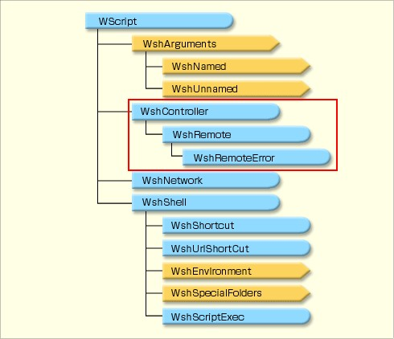 +
WSH의 내장 객체 목록. 이번에는 그중 WshController, WshRemote, WshRemoteError 객체에 대해 설명한다.

=== WshController 객체를 이용한 원격 스크립트 실행의 원리

WshController의 객체 모델은 다음과 같다.

.WshController의 객체 모델
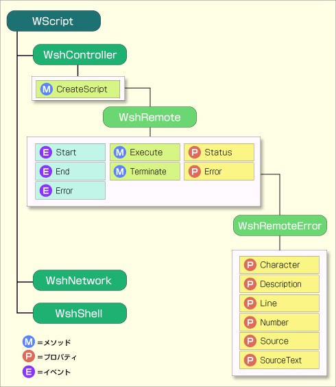 +
WshController 를 이용하면 원격 컴퓨터에서 스크립트 실행을 제어할 수 있다.

그림에서 알 수 있듯이, WshController 객체에서 호출할 수 있는 메서드는 CreateScript 메서드 뿐이다. 이 CreateScript 메서드를 실행하면 결과적으로 WshRemote 객체를 얻을 수 있다. 이 WshRemote 객체를 조작함으로써 원격 컴퓨터에서 스크립트의 시작 및 종료를 제어할 수 있다. 원격 컴퓨터에서 스크립트의 시작 및 종료는 각각 Start 이벤트, End 이벤트로 WshRemote 객체 측에 통보된다.

WshController 객체를 이용한 원격 스크립트 실행의 원리를 도식으로 나타내면 다음과 같다.

.WshController 객체를 이용한 원격 스크립트 실행의 원리
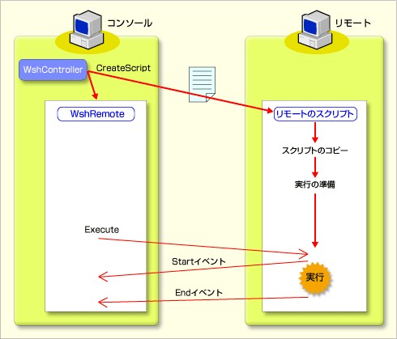 +
WshController 의 CreateScript 메서드를 실행하면 WshRemote 객체가 생성되며, 이를 통해 원격 스크립트를 제어할 수 있게 된다.

다음 표는 WshRemote 객체에 포함된 각 메서드/속성과 그 역할을 정리한 것이다.

[%autowidth]
|===
|메서드/속성/이벤트                                   |역할

|Execute 메서드/Terminate 메서드     원격 스크립트의  |실행 및 종료
|Status 속성/Start 이벤트/End 이벤트/Error 이벤트     |원격 스크립트의 실행 상태 모니터링 및 알림
|Error 속성                                           |원격 스크립트의 오류 정보 획득
|===

=== 보안 설정에 주의 (WshController 사용 시 주의사항)

네트워크 관리 용도 등에서는 “원격으로 스크립트를 실행할 수 있다” 는 점이 매우 편리하지만, “악의적인 공격자가 이를 악용할 위험이 있다” 는 점도 고려해야 한다. 이 때문에 Windows의 기본 설정은 원격에서 스크립트를 실행할 수 없도록 되어 있다. WshController 를 이용해서 원격에서 스크립트를 실행하려면, 대상이 되는 모든 컴퓨터(및 콘솔이 되는 컴퓨터)의 레지스트리에 새로운 항목을 생성해야 한다. 구체적으로는 ‘HKEY_LOCAL_MACHINE\SOFTWARE\Microsoft\Windows Script Host\Settings’ 키 안에 ‘Remote’ 라는 이름의 문자열(REG_SZ) 값을 생성하고, 그 값을 “1” 로 설정해야 한다.

WARNINIG: 레지스트리에 잘못된 값을 입력하면 시스템에 심각한 장애를 초래할 수 있으며, 최악의 경우 시스템을 재설치해야 할 수도 있다. 레지스트리 편집 조작은 신중하게 수행하고, 설정은 전적으로 본인의 책임 하에 진행해야 한다. 어떤 장애가 발생하더라도 본 Windows Server Insider 편집부는 책임을 지지 않는다. 이런 점 양해 부탁드린다.

.레지스트리 편집기에서 값을 추가하는 중
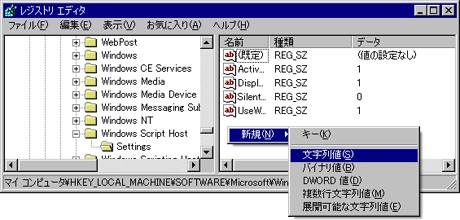 +
HKEY_LOCAL_MACHINE\SOFTWARE\Microsoft\Windows Script Host\Settings 에 새로운 문자열 값을 생성한다.

원격 컴퓨터에 대한 관리자 권한이 있다면, WMI(Windows Management Instrumentation, Windows 관리용 인터페이스)를 사용해서 이 작업을 원격으로 수행할 수도 있다. WMI를 사용해서 레지스트리를 설정하려면 다음과 같은 코드를 실행한다. strComputer 의 값은 대상 컴퓨터의 컴퓨터 이름이다.

[source,vb]
----
01: Const HKEY_LOCAL_MACHINE = &H80000002
02: strComputer = “ComputerName”
03:
04: Set objRegProv = GetObject(“winmgmts:{impersonationLevel=Impersonate}” & _
05:                  “!\\” & strComputer & “\root\default:StdRegProv”)
06:
07: strKeyPath = “SOFTWARE\Microsoft\Windows Script Host\Settings”
08: objRegProv.SetStringValue HKEY_LOCAL_MACHINE,strKeyPath,“Remote”,“1”
----

WMI에 대한 설명은 본고의 범위를 벗어나므로, 이 코드에 대한 자세한 설명은 여기서는 생략한다. StdRegProv 객체에 대한 자세한 내용을 알려면, 다음 MSDN 페이지(영문)를 참조하기 바란다.

* StrRegProv［영문］ (Platform SDK WMI)

또한, 위의 내용은 보안을 확보하기 위한 사양이지만, 마이크로소프트가 자사의 지원 기술 정보로 공개한 내용에 따르면, Windows XP는 원격 스크립트 설정이 초기 상태에서 정상적으로 이루어지지 않는 버그가 있으므로, 원격 스크립트를 실행하려면 명령 프롬프트에서 미리 ‘wscript -regserver’ 명령을 실행해야 한다. 따라서 Windows XP의 경우, 어떤 방법으로든 미리 해당 명령을 실행해야 한다.

TIP: 버그: Windows Script Host를 사용해서 원격 스크립트를 실행할 때 발생하는 오류 메시지: ActiveX 구성 요소가 개체를 만들 수 없음 [영어] (MSKB 311269)

=== 간단한 원격 스크립트 예제

그럼 이제 실제로 WshController 객체를 활용해서 원격 스크립트를 실행하는 구체적인 방법을 설명하겠다. 가장 간단한 코드는 다음과 같다. 이를 예로 들어 설명하겠다. 이 예제는 ‘PC01’ 이라는 이름의 컴퓨터에서 ‘test.vbs’ 라는 스크립트를 실행한다.

[source,vb]
----
01: strComputer = “PC01”
02: strScript = “ test.vbs”
03:
04: set objController = WScript.CreateObject(“WshController”)
05: set objRemote = objController.CreateScript(strScript, strComputer)
06: WScript.Echo “원격으로 스크립트를 실행합니다.”
07: objRemote.Execute
08: Do Until objRemote.Status = 2
09:    WScript.Sleep 100
10: Loop
11: WScript.Echo “원격 실행이 완료되었습니다.”
----

원격에서 스크립트를 실행하려면, 먼저 WshController 객체를 생성하고(4행), 다음으로 실행하려는 스크립트 이름으로 CreateScript 메서드를 호출한다(5행). CreateScript 메서드를 호출하면 WshRemote 객체가 생성되며, 이 객체가 반환값으로 돌아온다. 다음으로, 생성된 WshRemote 객체의 Execute 메서드를 호출함으로써 원격 컴퓨터에서 스크립트 실행을 시작할 수 있다(7행). 이때 실행할 스크립트 파일은 실행 대상 컴퓨터에 있는 파일이 아니라, 조작을 수행하는 콘솔 측의 파일을 지정한다(물론 UNC를 이용해서 네트워크상의 파일을 지정해도 된다). 즉, 원격으로 스크립트를 실행한다고 해도 미리 스크립트 파일을 배포해 둘 필요는 없다. 경로를 지정하지 않으면 현재 디렉터리에 있는 스크립트가 사용된다(현재 디렉터리 설정에 관해서는 관련 기사를 참조).

Execute 메서드는 원격에서 스크립트 실행을 시작하지만, 종료까지 기다리지 않는다. 원격에서 실행된 스크립트가 종료되든 안되든 상관없이 Execute 메서드의 실행은 “즉시 완료” 되며, 콘솔 측의 스크립트는 그대로 다음 줄(8행 이후)을 실행한다.

8~10행은 원격 컴퓨터에서 스크립트 실행이 완료될 때까지 기다리기 위한 루프이다. 원격 컴퓨터에서 스크립트 실행이 시작되기도 전에 콘솔 측 스크립트가 종료되면, 원격 스크립트가 올바르게 시작되지 않을 수도 있으므로, 일반적으로 이런 (지연) 루프를 사용해서 원격 스크립트가 종료될 때까지 대기한다.

8행에 나와 있듯이, 원격 스크립트가 종료된지 여부는 WshRemote 객체의 Status 속성을 확인해서 판단할 수 있다. Status 속성은 읽기 전용 속성이며, 값으로는 0, 1, 2 중 하나를 가진다. 각 반환 값의 의미는 다음 표와 같다.

[%autowidth]
|===
|값     |의미

|0      |스크립트는 아직 실행되지 않았다
|1      |스크립트는 실행 중이다
|2      |스크립트 실행이 종료되었다
|===

CreateScript 메서드로 객체가 생성된 시점은 Status 속성이 0이며, Execute 메서드가 실행되면 1이 되고, 스크립트가 종료되면 2가 된다. 스크립트의 종료를 기다릴 경우는 앞서 소개한 샘플 스크립트처럼 Status 속성이 2가 될 때까지 루프를 돌리면 된다.

원격으로 실행되는 스크립트는 디스플레이(원격 컴퓨터의 디스플레이)에 아무것도 표시하지 않고 “백그라운드에서 동작” 한다. 메시지 상자를 표시하거나 표준 입력을 읽어들이는 프로그램을 실행한 경우도 모두 백그라운드에서 처리된다. 따라서 사용자의 입력이나 OK 버튼 클릭 등은 스크립트에서 수신할 수 없으며, 처리할 수도 없다. 따라서 이런 입력이 필요한 스크립트는 입력을 기다리는 상태에서 데드락에 빠지게 되므로 주의가 필요하다. 이 경우, 위의 샘플 코드는 원격 스크립트가 정상적으로 종료되지 않으므로, Do 루프에서 영원히 빠져나오지 못해 무한 루프에 빠지게 된다. 원격 컴퓨터에서 실행하는 스크립트는 사용자 입력을 필요로 하지 않도록 처리해야 한다. 또한, 스크립트 디버깅 등으로 인해 입력 대기나 무한 루프로 인해 WSH 스크립트 프로세스를 종료할 수 없게 된 경우는, 작업 관리자에서 ‘wscript.exe’ 프로세스를 종료함으로써 강제 종료할 수 있다.

콘솔 측 컴퓨터는 test.vbs 의 실행을 화면에서 확인할 수 없고, 원격 컴퓨터에서 실행 결과를 반환할 수도 없으므로, test.vbs 는 실행 결과를 파일에 기록하기로 한다. 파일 처리는 FileSystemObject(FSO) 라는 객체를 사용한다. FSO에 대한 구체적인 설명은 다음 시간에 다룰 예정이다. 이번 예제는 다음 코드를 사용해서 D:\WSH\test.txt 라는 파일에 현재 시각을 기록하기로 했다.

[source,vb]
----
Set objFSO = WScript.CreateObject(“Scripting.FileSystemObject”)
Set objFile = objFSO.OpenTextFile(“D:\WSH\test.txt”, 8, True)
objFile.WriteLine Now
objFile.Close
test.vbs의 내용
----

위의 두 스크립트를 준비해서 실행하면, 컴퓨터 “PC01” 에서 test.vbs 를 실행할 수 있다. test.vbs 의 처리가 정상적으로 종료된지 확인하려면, 대상 머신의 D:\WSH\test.txt 파일이 업데이트된지 확인하면 된다.

또한, Status 속성이 2가 될 때까지 루프를 돌며 종료를 기다리면, 원격 스크립트가 어떤 이유로든 오작동할 때 콘솔 측의 스크립트도 무한 루프에 빠지게 된다. 이를 피하려면, WshRemote 객체의 Terminate 메서드를 사용해서 원격 스크립트를 강제 종료할 수도 있다. 하지만 처리 중에 프로세스를 종료하면 처리 중인 데이터가 손상될 가능성이 있으므로, 예외적인 경우를 제외하고 Terminate 메서드를 가급적 사용하지 말고 원격 스크립트 자체가 종료되도록 설정하는 것이 좋다.

원격 코드를 강제 종료하려면 다음과 같이 한다.

[source,vb]
----
01: strComputer = “PC01”
02: strScript = “ test.vbs”
03:
04: set objController = WScript.CreateObject(“WshController”)
05: set objRemote = objController.CreateScript(strScript, strComputer)
06: WScript.Echo “원격으로 스크립트를 실행합니다.”
07: objRemote.Execute
08: WScript.Sleep 1000
09: If objRemote.Status <> 2 Then
10:   objRemote.Terminate
11:   WScript.Echo “원격 실행을 강제 종료했습니다.”
12: Else
13:   WScript.Echo “원격 실행이 종료되었습니다.”
14: End If
----

이 스크립트는 실행 시작 후 1초 동안 대기한 뒤(8행), 원격 스크립트가 종료된지 여부를 확인하고(9행), 종료되지 않았을 경우 강제 종료한다(10행).

=== 이벤트 핸들러 활용하기

앞서 소개한 샘플 스크립트는 WshRemote 객체의 Status 속성 값을 사용해서 원격 스크립트의 상태에 따라 처리를 전환했다. 이 외에도 원격 스크립트의 상태에 따라 알림이 전송되는 이벤트를 활용하는 방법이 있다. 이벤트는 Start, End, Error 세 가지 유형이 있으며, 각각 스크립트의 시작, 종료, 오류 발생을 감지해서 이벤트별로 필요한 처리를 수행할 수 있도록 되어 있다.

이벤트를 이용하려면 WScript 객체의 ConnectObject 메서드를 사용해서 WshRemote 객체에 이벤트 핸들러가 될 함수의 접두사를 매핑한다. 이벤트 핸들러란 이벤트가 발생했을 때 호출되어 필요한 처리를 실행하는 함수이다.

예를 들어, “Remote_” 라는 접두사를 등록하면 원격 스크립트가 시작될 때 Remote_Start 함수가, 종료될 때 Remote_End 함수가, 오류 발생 시에는 Remote_Error 함수가 각각 실행되도록 된다. 함수명의 후반부는 이벤트 이름이 그대로 사용되므로 변경할 수 없다. 이런 함수들은 Sub 문으로 미리 정의해 둔다. 또한, End 이벤트는 오류 종료 시에도 발생하므로, 오류 발생 시에는 Remote_Error 함수가 실행된 직후에 Remote_End 함수가 실행되게 된다. 다음은 그 예이다.

[source,vb]
----
01: strComputer = “PC01”
02: strScript = “test.vbs”
03:
04: set objController = WScript.CreateObject(“WshController”)
05: set objRemote = objController.CreateScript(strScript, strComputer)
06: WScript.ConnectObject objRemote, “Remote_”
07: objRemote.Execute
08: Do Until objRemote.Status = 2
09:   WScript.Sleep 100
10: Loop
11:
12: Sub Remote_Start
13:   WScript.Echo “원격에서 스크립트 실행을 시작했습니다.”
14: End Sub
15:
16: Sub Remote_Error
17:   WScript.Echo “원격에서 스크립트 오류가 발생했습니다.”
18: End Sub
19:
20: Sub Remote_End
21:   WScript.Echo “원격 실행이 종료되었습니다.”
22: End Sub
----

6행에서 objRemote 객체에서 발생하는 이벤트에 “Remote_” 로 시작하는 함수를 대응시키고 있다. 이벤트 핸들러는 12행에 있다. 이 예제는 Remote_Start, Remote_Error, Remote_End 를 모두 정의하고 있지만, 반드시 이 세 가지를 모두 만들 필요는 없다. 대응하는 함수가 없으면 이벤트 발생 시에 아무 일도 일어나지 않고 처리가 계속된다.

=== 오류 정보 가져오기

원격 스크립트에서 오류가 발생했을 때는 WshRemote 객체의 Error 속성을 사용해서 오류 정보를 가져올 수 있다. Error 속성의 내용은 WshRemoteError 개체이며, 이 개체에 포함된 속성을 확인함으로써 스크립트 내 어디서 어떤 오류가 발생했는지 확인할 수 있다. 예를 들어, 간단한 오류 메시지는 Description 속성에 설정되므로, objRemote 개체에서 발생한 오류의 메시지는 “objRemote.Error.Description” 으로 가져올 수 있다.

WshRemoteError 개체에 포함된 속성에는 다음 6가지가 있다.

[%autowidth]
|===
|속성             |값의 내용

|Description      |오류 메시지
|Line             |오류가 발생한 스크립트 내의 줄 번호
|Character        |오류가 발생한 위치의 줄 시작부터의 문자 수
|Source           |COM 개체에서 오류가 발생한 경우, 해당 COM 개체의 이름
|SourceText       |오류가 발생한 줄의 내용
|Number           |오류 코드
|===

직접 테스트해 본 결과, Source 속성의 내용은 스크립트에서 사용 중인 COM 개체와 관계없이, VBScript 컴파일 시 오류면 ‘Microsoft VBScript 컴파일 오류’ 로, VBScript 실행 시 오류면 ‘Microsoft VBScript 실행 시 오류’ 로 표시되는 것으로 보인다. 오류 발생 시 6가지 정보를 모두 출력하려면 다음과 같은 스크립트를 작성하면 된다.

[source,vb]
----
01: strComputer = “PC01”
02: strScript = “test.vbs”
03:
04: set objController = WScript.CreateObject(“WshController”)
05: set objRemote = objController.CreateScript(strScript, strComputer)
06: Wscript.ConnectObject objRemote, “Remote_”
07: WScript.Echo “원격으로 스크립트를 실행합니다.”
08: objRemote.Execute
09: Do Until objRemote.Status = 2
10:   WScript.Sleep 100
11: Loop
12: WScript.Echo “원격 실행이 완료되었습니다.”
13:
14: Sub Remote_Error
15:   WScript.Echo “원격에서 스크립트 오류가 발생했습니다.”
16:   WScript.Echo “줄      :” & objRemote.Error.Line
17:   WScript.Echo “문자    :” & objRemote.Error.Character
18:   WScript.Echo “오류  :” & objRemote.Error.Description
19:   WScript.Echo “코드  :” & objRemote.Error.Number
20:   WScript.Echo “소스  :” & objRemote.Error.Source
21:   WScript.Echo “텍스트:” & objRemote.Error.SourceText
22:   WScript.Quit
23: End Sub
----

이 코드는 오류 정보를 출력한 후 WScript.Quit 을 사용해서 스크립트 실행을 종료하고 있다(22행). 시험 삼아 test.vbs 에서 파일을 열 때 오류가 발생하도록 존재하지 않는 경로를 설정해 보자.

[source,vb]
----
Set objFSO = WScript.CreateObject(“Scripting.FileSystemObject”)
Set objFile = objFSO.OpenTextFile(“D:\WSH\dummy\test.txt”, 8, True)
objFile.WriteLine Now
objFile.Close
----

이대로 실행하면 다음과 같이 오류 정보가 출력됩니다.

----
스크립트를 원격으로 실행합니다.
스크립트 실행 중 원격 오류가 발생했습니다.
줄      :2
문자    :1
오류  :경로를 찾을 수 없습니다.
코드  :-2146828212
출처: Microsoft VBScript 런타임 오류
텍스트:
objFile.WriteLine Now
----

이 출력 결과를 보면, 2행 1열에서 시작하는 Set 문 처리 중에 ‘경로를 찾을 수 없습니다’ 라는 오류가 발생했음을 알 수 있다. Source는 ‘Microsoft VBScript 런타임 오류’ 로 표시되었다. 그러나 SourceText 속성은 줄바꿈에서 시작해서 다음 행이 추출되어 버렸다. 이는 그다지 정확한 정보라고 할 수 없을 것 같다.

이상으로 Windows Script Host 표준 객체 모델에 대한 설명을 마친다. 다음 시간은 표준 객체는 아니지만, 파일 입출력 용도로 WSH 내에서 자주 사용되는 FileSystemObject 객체에 대해 설명할 예정이다.

==  제10회　WSH 스크립트를 통한 파일 조작 (1)

WSH는 기본적으로 파일 조작용 객체가 없다! 하지만 범용 FSO 객체를 이용하면 이것이 가능해진다.

지금까지는 Windows Script Host(WSH)의 표준 객체에 대해 소개하고, 기본적인 사용법을 설명해 왔다. 이번과 다음 시간은 WSH 표준 객체가 아닌, 범용 COM 객체인 FileSystemObject(FSO) 를 다룰 것이다. FSO를 이용하면 WSH의 표준 객체만으로는 불가능한 파일 처리가 가능해진다.

=== FileSystemObject 객체

앞서 설명한 것 같이, FSO는 WSH의 표준 객체가 아니라 Active Server Pages 등 WSH 이외의 스크립팅 환경에서 이용할 수 있는 “범용 COM 객체” 이다. 웹 페이지용 스크립트 언어로 개발된 VBScript나 JScript의 언어 사양만으로는, 또는 WSH의 표준 객체만으로는 파일을 다룰 수 없다! 그러나 FSO를 이용하면 WSH 스크립트에서 파일의 읽기·쓰기 등이 가능해진다.

.FileSystemObject
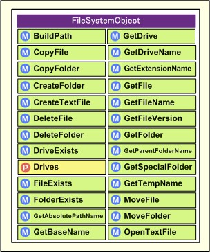 +
FSO는 WSH 이외의 스크립팅 환경에서 사용할 수 있는 범용 COM 객체로, 다양한 파일 조작이 가능하다.

WSH 표준 객체는 아니지만, CreateObject 메서드를 사용해서 인스턴스를 생성하고 필요한 메서드를 호출하는 흐름은 지금까지 소개한 WshShell 객체나 WshNetwork 객체 등과 동일하다. FSO 객체의 프로그램 ID는 “Scripting.FileSystemObject” 이다. 인스턴스 생성 코드는 다음과 같다.

[source,vb]
----
Set objFSO = WScript.CreateObject(“Scripting.FileSystemObject”)
----

=== 텍스트 파일의 읽기 및 쓰기

FSO 객체의 OpenTextFile 메서드를 사용해서 파일을 열면 텍스트 파일을 읽고 쓸 수 있다.

----
Set objStream = objFSO.OpenTextFile(filename [, iomode] [, create] [, format])
----

매개변수의 의미는 다음과 같다.
[%autowidth]
|===
|매개변수                        |유형     |기본값     |의미

|첫 번째 매개변수 (filename)     |문자열   |－         |열 파일의 이름. 생략 불가
|제2 매개변수 (iomode)           |정수     |1          |파일 열기 모드를 다음 수치 중 하나로 지정한다. 1=읽기 모드, 2=쓰기 모드, 8=추가 쓰기 모드
|제3 매개변수 (create)           |부울     |False      |파일이 존재하지 않을 때, True이면 새 파일을 생성한다. False인 경우 오류가 발생한다
|제4 매개변수(format)            |정수     |0          |파일의 문자 코드가 ASCII인 경우 0, 유니코드(UTF-16)인 경우 -1, 시스템의 기본 인코딩을 사용하는 경우 -2를 지정한다
|===

제1 매개변수는 열 파일의 이름을 지정한다. 파일 경로는 절대 경로/상대 경로 중 어느 것을 사용해도 된다.

두 번째 매개변수는 읽기 모드인지 쓰기 모드인지 지정한다. 이때 쓰기 모드(2)를 지정하면 기존 파일을 덮어쓴다. 반면 기존 파일의 끝에 내용을 추가하려면 추가 쓰기 모드(8)를 지정한다. 미리 다음과 같이 상수를 정의하면 코드를 이해하기 쉬워진다.

[source,vb]
----
Const ForReading = 1, ForWriting = 2, ForAppending = 8
----

세 번째 매개변수는 파일이 존재하지 않을 경우 새 파일을 생성할지 여부를 지정한다. 매개변수를 지정하지 않으면 False 가 되며, 파일이 존재하지 않으면 오류가 발생한다. 쓰기 모드의 경우도 새 파일을 생성해서 데이터를 기록하려면 True 를 지정해야 한다(False 인 경우, 존재하지 않는 파일에 기록하려고 시도하면 오류가 발생한다). 읽기 모드에서 True 를 지정한 경우, 파일이 존재하지 않으면 크기가 0인 파일이 생성되어 열린다.

네 번째 매개변수는 문자 코드를 지정한다. 두 번째 매개변수와 마찬가지로 정수 값으로 지정하지만, VBScript의 내장 상수인 vbFalse, vbTrue, vbUseDefault 를 사용할 수 있다. 이 값들은 각각 ASCII, 유니코드, 시스템 기본값에 해당한다. FSO가 지원하는 문자 코드는 ASCII와 유니코드 뿐이지만, Shift_JIS 코드 파일도 ASCII로 처리하는 것이 가능하다. 또한, 현재 사용 중인 일본어판 Windows XP 환경에서 테스트해 본 결과, 시스템 기본값을 지정했을 때는 ASCII 코드를 지정한 경우와 동일한 동작을 보였다.

OpenTextFile 의 반환 값은 TextStream 객체이며, WScript 객체나 WshScriptExec 객체의 StdIn, StdOut, StdErr 속성과 마찬가지로 Read, ReadAll, ReadLine, Write, WriteLine 등의 메서드를 사용할 수 있다(WScript 객체의 표준 입출력 조작 메서드는 연재 제3회 참조). 물론, 읽기 모드로 열었을 경우는 출력용 메서드를 사용할 수 없고, 쓰기 모드로 열었을 경우는 입력용 메서드를 사용할 수 없다.

열린 파일은 스크립트가 종료될 때 자동으로 닫히므로, 일반적으로 스크립트에서 명시적으로 파일을 닫을 필요는 없다. 파일을 다시 읽거나 삭제할 경우는 TextStream 객체의 Close 메서드를 호출해서 명시적으로 파일을 닫을 수 있다.

다음 예제는 text1.txt 를 읽어와 알파벳을 모두 대문자로 변환한 후 text2.txt 에 출력하는 스크립트이다.

[source,vb]
----
 1: Set objFSO = WScript.CreateObject(“Scripting.FileSystemObject”)
 2: Const ForReading = 1, ForWriting = 2, ForAppending = 8
 3: Set objInput = objFSO.OpenTextFile(“test1.txt”, ForReading)  ' text1.txt를 읽기 모드로 엽니다
 4: Set objOutput = objFSO.OpenTextFile(“test2.txt”, ForWriting, True)  ' text2.txt를 쓰기 모드로 엽니다
 5: Do Until objInput.AtEndOfStream  ' 입력 파일의 끝까지 반복
 6:   strLine = objInput.ReadLine  ' 입력 파일을 한 줄씩 읽기
 7:   objOutput.WriteLine UCase(strLine)  ' UCase 함수를 사용하여 대문자로 변환한 후 출력 파일에 기록
 8: Loop
 9: objInput.Close
10: objOutput.Close
----

다음으로, 파일의 읽기·쓰기가 아닌 파일 자체를 다루는 방법에 대해 설명한다. FSO 객체를 사용하면 파일을 복사하거나, 이동하거나, 삭제할 수 있다. 이런 처리는 FSO 객체를 직접 이용하는 방법과 File 객체를 생성해서 이용하는 방법, 두 가지가 있다. 이 중 먼저 FSO 객체를 직접 이용하는 방법부터 살펴보도록 하자. 다음은 FSO 객체의 메서드 중 파일과 관련된 것들의 목록이다.

[%autowidth]
|===
|메서드                 |기능

|CopyFile 메서드        |파일을 복사한다
|MoveFile 메서드        |파일을 이동한다
|DeleteFile 메서드      |파일을 삭제한다
|FileExists 메서드      |파일이 존재하는지 여부를 확인한다
|GetFileVersion 메서드  |파일의 버전 정보를 가져온다
|OpenTextFile 메서드    |파일을 열고 TextStream 객체를 반환한다
|CreateTextFile 메서드  |파일을 생성하고 TextStream 객체를 반환한다
|GetTempName 메서드     |임시 파일용 임의의 이름을 가져온다
|GetFile 메서드         |File 객체를 반환한다
|===

=== 파일 복사

파일을 복사하려면 CopyFile 메서드를 사용한다. CopyFile 메서드에 복사 원본 파일명과 복사 대상 파일명을 전달함으로써 파일을 복사할 수 있다. 일반적으로 복사 대상에 이미 파일이 있는 경우 파일을 덮어쓰지만, 세 번째 매개변수에 False 를 지정하면 파일을 덮어쓰지 않고 오류가 발생하도록 설정할 수 있다.

----
objFSO.CopyFile source, destination [, overwrite]
----

복사 대상에 파일명이 아닌 폴더명을 지정할 수도 있다. 폴더를 지정할 경우, 두 번째 인자인 복사 대상 문자열을 ‘\’ 기호로 끝내야 한다. 복사 대상으로 폴더를 지정한 경우, 원본과 동일한 파일명을 유지한 채로 지정한 폴더 안에 파일이 복사된다.

복사 원본 파일명에 와일드카드를 지정할 수도 있다. ‘*’ 기호는 임의의 문자열을, ‘?’ 기호는 임의의 한 문자를 나타낸다. 예를 들어, ‘*.txt’ 는 모든 텍스트 파일을, ‘a???.txt’ 는 a로 시작하고 4자 이름을 가진 텍스트 파일을 나타낸다. 단, 와일드카드를 지정할 수 있는 것은 파일명의 일부 뿐이며, 경로 부분에는 지정할 수 없다. 와일드카드를 지정한 경우는 여러 파일이 복사될 가능성이 있으므로, 복사 대상은 파일명이 아닌 폴더명으로 인식된다. 와일드카드로 지정한 원본 파일명과 일치하는 파일이 없는 경우는 오류가 발생한다.

=== 파일 이동

파일을 이동하려면 MoveFile 메서드를 사용한다. MoveFile 메서드는 파일명과 이동 대상을 전달한다.

----
objFSO.MoveFile source, destination
----

CopyFile 메서드와 마찬가지로, 이동 대상에 파일명이 아닌 폴더명을 지정할 수 있다. 또한, 이동할 파일을 와일드카드로 지정하는 것도 가능하다. 이동 대상에 이미 파일이 있는 경우, CopyFile 메서드와 달리 항상 오류가 발생한다. 오류를 발생시키지 않고 기존 파일을 덮어쓰려면, 미리 이동 대상의 파일을 삭제하거나, 이동 대신 복사한 후에 원본 파일을 삭제한다.

파일 이름을 변경할 경우도 MoveFile 메서드를 이용할 수 있다. 구체적으로 이동 대상으로 원본과 같은 폴더 내의 새로운 파일 이름을 지정함으로써 파일 이름을 변경할 수 있다.

=== 파일 삭제

파일을 삭제할 때는 DeleteFile 메서드를 사용한다. DeleteFile 메서드는 파일 이름을 전달한다. DeleteFile 메서드는 일반적으로 읽기 전용 속성을 가진 파일은 삭제하지 않지만, 두 번째 매개변수에 True 를 지정하면 읽기 전용 속성을 가진 파일도 삭제한다.

----
objFSO.DeleteFile filespec [, force]
----

DeleteFile 메서드도 와일드카드를 사용할 수 있다. 단, 삭제할 파일이 하나도 없으면 오류가 발생한다. 또한 DeleteFile 메서드로 삭제한 파일은 휴지통으로 이동되는 것이 아니라 “직접 삭제” 되므로, 중요한 파일을 실수로 삭제하지 않도록 주의해야 한다.

=== 파일 존재 여부 확인

FileExists 메서드는 파일이 존재할 경우 True 를, 존재하지 않을 경우 False 를 반환하는 메서드이다. 앞서 설명한 것 같이, 파일 복사나 이동, 삭제 등은 파일이 존재하지 않으면 오류가 발생하므로, 파일의 존재 여부가 확실치 않은 경우는 먼저 FileExists 메서드로 확인한 후 처리하는 것이 좋다. 다만, FileExists 메서드는 와일드카드를 사용할 수 없으므로, 와일드카드와 일치하는 파일이 존재하는지 여부는 확인할 수 없다.

다음 예제는 test.txt 라는 파일이 존재하면 삭제한다.

[source,vb]
----
1: Set objFSO = WScript.CreateObject(“Scripting.FileSystemObject”)
2: If objFSO.FileExists(“test.txt”) Then
3:   objFSO.DeleteFile “test.txt”
4: Else
5:   WScript.Echo “test.txt는 존재하지 않습니다.”
6: End If
----

=== 파일 버전 가져오기

GetFileVersion 메서드는 실행 파일의 버전 정보를 가져옵니다. 버전 정보가 없는 파일을 지정하면 빈 문자열이 반환됩니다. 다음 예제는 cscript.exe 의 버전 정보를 가져와 표시한다.

[source,vb]
----
Set objFSO = WScript.CreateObject(“Scripting.FileSystemObject”)
WScript.Echo objFSO.GetFileVersion(“C:\WINDOWS\system32\cscript.exe”)
----

실행하면 다음과 같이 ‘5.6.0.8820’이라는 버전 번호가 표시되었다.

----
D:\WSH>cscript getfileversion.vbs
5.6.0.8820

D:\WSH>
----

== 파일 생성하기

앞서 언급한 것 같이, OpenTextFile 메서드의 세 번째 매개변수에 True 를 지정하면 파일이 존재하지 않을 때 자동으로 새 파일을 생성할 수 있다. 하지만 파일 생성을 위해 CreateTextFile 이라는 독립된 메서드도 마련되어 있다. CreateTextFile 메서드를 호출하면 파일이 생성되고, 해당 파일이 쓰기 모드로 열린다. CreateTextFile 메서드의 반환 값은 TextStream 객체이다. 몇 가지 세부적인 차이점을 제외하면, CreateTextFile 메서드는 OpenTextFile 메서드와 거의 동일한 기능을 갖는다.

----
Set objStream = objFSO. CreateTextFile(filename [, overwrite] [, unicode])
----

매개변수는 다음과 같다.

[%autowidth]
|===
|매개변수                     |유형     |기본값     |의미

|제1매개변수 (filename)       |문자열   |－         |생성할 파일의 이름. 생략 불가
|두 번째 매개변수 (overwrite) |Boolean  |False      |파일이 존재할 경우, True이면 파일을 덮어쓴다. False이면 오류가 발생한다
|세 번째 매개변수 (unicode)   |Boolean  |False      |ASCII 파일을 생성할 경우 False, 유니코드(UTF-16) 파일을 생성할 경우 True를 지정한다
|===

첫 번째 매개변수로 파일 이름을 지정한다. 두 번째 매개변수는 파일이 존재할 경우 덮어쓸지 여부를 지정한다. 생략하거나 False 를 지정한 경우, 파일이 이미 존재하면 오류가 발생한다. 세 번째 매개변수는 문자 코드를 지정한다. OpenTextFile 은 정수값으로 지정했지만, CreateTextFile 은 ‘시스템 기본값 사용’ 이라는 선택지가 사라지고 일반적인 부울 값으로 변경되었다. CreateTextFile 로 연 파일은 항상 쓰기 모드가 되므로, OpenTextFile 에 있던 모드 지정은 사라졌다. OpenTextFile 메서드와 CreateTextFile 을 비교하면 다음과 같다.

[%autowidth]
|===
|차이점                      |OpenTextFile                      |CreateTextFile

|모드 종류                   |읽기, 쓰기, 추가 쓰기             |쓰기 전용 (추가 쓰기 불가)
|파일이 존재할 경우          |모드에 따라 덮어쓰기 또는 추가 쓰기     |두 번째 매개변수로 덮어쓰기할지 오류로 처리할지 지정
|파일이 존재하지 않을 경우   |세 번째 매개변수로 파일을 생성할지 오류로 처리할지 지정     |파일 생성
|문자 코드                   |ASCII, 유니코드, 시스템 기본값    |ASCII, 유니코드
|===

임시 파일을 생성할 경우는 GetTempName 메서드를 CreateTextFile 과 함께 사용하면 편리하다. GetTempName 메서드는 임시 파일용으로 확장자 ‘.tmp’ 를 가진 파일 이름을 무작위로 생성해서 반환한다.

[source,vb]
----
Set objFSO = WScript.CreateObject(“Scripting.FileSystemObject”)
strTempName = objFSO.GetTempName
Set objOutput = objFSO.CreateTextFile(strTempName)
WScript.Echo strTempName & “을(를) 생성했습니다.”
objOutput.Close
objFSO.DeleteFile(strTempName)
WScript.Echo strTempName & “를 삭제했습니다.”
----

실행하면 다음과 같은 파일명이 생성되었다.

----
D:\WSH>cscript temp.vbs
rad98B74.tmp를 생성했습니다.
rad98B74.tmp를 삭제했습니다.

D:\WSH>
----

지금까지는 FSO 객체가 제공하는 메서드를 이용한 파일 조작에 대해 설명했다. 이 외에도 FSO는 파일을 객체로 나타내는 File 객체가 마련되어 있다. File 객체를 이용하면 파일 복사, 이동, 삭제 등을 할 수 있을 뿐만 아니라, 파일이 가진 다양한 속성을 가져오거나 설정할 수도 있다. 이제부터 File 객체를 이용한 파일 조작 방법에 대해 설명하겠다.

.File 객체
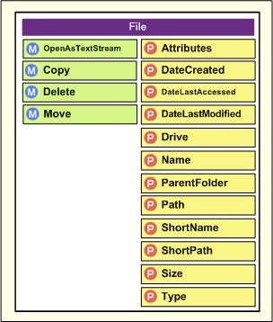 +
파일 복사, 이동, 삭제 및 파일 속성 조회/설정이 가능하다.

File 객체는 FSO 객체의 GetFile 메서드나, 후술할 Folder 객체의 Files 속성을 통해 얻을 수 있다. 예를 들어, ‘D:\WSH\test.txt’ 를 나타내는 File 객체를 얻으려면 다음과 같이 한다. 단, 지정한 파일이 존재하지 않으면 GetFile 메서드는 오류를 발생시킨다.

[source,vb]
----
Set objFSO = WScript.CreateObject(“Scripting.FileSystemObject”)
Set objFile = objFSO.GetFile(“D:\WSH\test.txt ”)
----

File 객체는 다음과 같은 메서드와 속성이 있다.

[%autowidth]
|===
|메서드/속성                 |기능
|OpenAsTextStream 메서드     |파일을 열고 TextStream 객체를 반환합니다.
|Copy 메서드                 |파일을 복사합니다.
|Move 메서드                 |파일을 이동합니다.
|Delete 메서드               |파일을 삭제합니다.
|Attributes 속성             |속성을 가져오고 설정합니다.
|DateCreated 속성            |생성 날짜 및 시간을 가져옵니다
|DateLastAccessed 속성       |마지막 액세스 날짜 및 시간을 가져옵니다
|DateLastModified 속성       |마지막 수정 날짜 및 시간을 가져옵니다
|Drive 속성                  |파일이 저장된 드라이브를 나타내는 Drive 객체를 가져옵니다
|Name 속성                   |파일 이름을 가져오고 설정합니다
|ParentFolder 속성           |상위 폴더를 나타내는 Folder 객체를 가져옵니다.
|Path 속성                   |파일의 경로를 가져옵니다.
|ShortName 속성              |MS-DOS 형식의 파일 이름을 가져옵니다.
|ShortPath 속성              |MS-DOS 형식의 경로를 가져옵니다.
|Size 속성                   |파일의 크기를 가져옵니다.
|Type 속성                   |파일의 종류를 가져옵니다.
|===

=== 파일 열기

OpenAsTextStream 메서드는 OpenTextFile 메서드와 마찬가지로 파일을 열고 TextStream 객체를 반환하는 메서드이다. File 객체로 표현되는 파일을 열기 때문에, 매개변수를 통해 파일을 지정할 필요는 없다. 또한 File 객체로 표현되는 파일은 존재한다는 것이 확인되었으므로, 파일이 존재하지 않을 경우 파일을 생성하는 기능은 없다. 따라서 매개변수는 읽기 모드인지 쓰기 모드인지의 지정과 문자 코드 지정만 수행한다. 이런 매개변수에 지정하는 값은 OpenTextFile 메서드와 동일하다.

----
Set objStream = objFile.OpenAsTextStream([iomode] [, format])
----

=== 파일 복사, 이동, 삭제

Copy, Move, Delete 메서드는 각각 파일의 복사, 이동, 삭제를 수행하는 메서드이다. 이들 역시 FSO 객체의 CopyFile, MoveFile, DeleteFile 과 동일한 기능을 가지지만, 대상 파일은 File 객체로 표현되는 파일이며, 매개변수는 대상 파일을 지정하지 않는다. 따라서 File 객체의 Copy, Move, Delete 메서드는 와일드카드를 지정해서 여러 파일을 처리하는 기능이 없다.

----
objFile.Copy destination [, overwrite]
objFile.Move destination
objFile.Delete [force]
----

=== 파일 속성 가져오기 및 설정

Attributes 속성을 이용하면 파일의 속성을 가져오고 설정할 수 있다. 단, 이 속성에서 다루는 속성은 ‘읽기 전용’ 이나 ‘숨김 파일’ 등, 켜기/끄기로만 표현되는 정보이며, 파일 크기나 날짜 등의 정보는 포함되지 않는다. 각 속성은 대응하는 수치 값이 정해져 있으며, Attributes 속성은 활성화된 모든 속성의 값을 합산한 수치를 반환한다. 수치에서 알 수 있듯이, 각 속성은 특정 비트 값이 대응되어 있다. 다음 표는 속성 목록이다.

[%autowidth]
|===
|속성 이름     |수치     |가능한 작업   |내용

|ReadOnly      |1        |조회/설정     |읽기 전용 파일
|Hidden        |2        |조회/설정     |숨겨진 파일
|System        |4        |조회/설정     |시스템 파일
|Volume        |8        |조회 전용     |디스크 드라이브 볼륨 레이블
|Directory     |16       |조회 전용     |폴더/디렉터리
|Archive       |32       |조회/설정     |마지막 백업 이후 변경된 경우 1
|Alias         |64       |조회 전용     |링크/바로 가기
|Compressed    |128      |조회 전용     |압축 파일
|===

예를 들어 읽기 전용 숨김 파일의 경우, Attributes 속성은 1＋2＝3 이 된다. 속성 값의 의미는 파일과 폴더에서 동일하며, 이 목록은 디렉터리임을 나타내는 값 등도 포함되어 있다.

VBScript에서 특정 속성이 켜져 있는지 꺼져 있는지 확인하거나 업데이트할 때는 And 연산자나 Or 연산자를 사용하는 것이 편리하다. 숫자에 And 나 Or 등의 논리 연산자를 사용하면, 비트 단위로 And / Or 연산이 적용된다. 다음 예제는 test.txt 파일의 System 속성을 확인하고, Hidden 속성을 켜고, ReadOnly 속성을 끈다.

[source,vb]
----
 1: Set objFSO = WScript.CreateObject(“Scripting.FileSystemObject”)
 2: Set objFile = objFSO.GetFile(“test.txt ”)
 3: WScript.Echo “속성=” & objFile.Attributes
 4: ' System 속성(값 4)을 확인
 5: If (objFile.Attributes And 4) > 0 Then
 6:   WScript.Echo “System 속성이 켜져 있습니다.”
 7: Else
 8:   WScript.Echo “System 속성이 꺼져 있습니다.”
 9: End If
10: ' Hidden 속성(값 2)을 켭니다
11: objFile.Attributes = (objFile.Attributes Or 2)
12: ' ReadOnly 속성(값 1)을 끕니다
13: objFile.Attributes = (objFile.Attributes And (255 - 1))
14: WScript.Echo “속성=” & objFile.Attributes
----

5행은 And 연산을 통해 조사하려는 비트 값의 내용을 검사하고 있다(비트 값이 1인지, 0인지 검사하고 있다). 11행은 켜고 싶은 값과의 Or 연산을 통해 Hidden 속성을 켠 값을 계산하고 있다. 원래 Hidden 속성이 켜져 있다면 값은 변하지 않는다.

13행은 모든 속성이 켜져 있는 255라는 값에서, 끄고 싶은 1이라는 값을 빼서 ReadOnly 만 0인 값(마스크)을 계산하고, Attributes 와의 And 연산을 통해 ReadOnly 비트를 끄고 있다. 원래 ReadOnly 속성이 꺼져 있다면 값은 변하지 않는다. 실행 결과는 다음과 같다. 이 예제는 원래 test.txt 의 속성 중 Archive 속성만 켜져 있었다.

----
D:\WSH>cscript attributes.vbs
속성=32
System 속성은 꺼져 있습니다.
속성=34

D:\WSH>
----

=== 파일 정보 가져오기

파일의 날짜, 이름, 크기 등의 정보는 각각 File 객체의 속성으로 제공된다. Name 속성을 제외하고 정보 가져오기만 가능하다. 다음 코드는 test.txt 의 정보를 표시하는 예이다. Drive 메서드와 ParentFolder 메서드는 후술할 Drive 객체와 Folder 객체를 반환하므로, 여기서는 각각이 가진 Path 속성을 표시하고 있다.

[source,vb]
----
Set objFSO = WScript.CreateObject(“Scripting.FileSystemObject”)
Set objFile = objFSO.GetFile(“longfilename.txt ”)
WScript.Echo “생성 날짜      : ” & objFile.DateCreated
WScript.Echo “마지막 액세스 날짜 : ” & objFile.DateLastAccessed
WScript.Echo “마지막 수정 날짜 : ” & objFile.DateLastModified
WScript.Echo “드라이브            : ” & objFile.Drive.Path
WScript.Echo “이름             : ” & objFile.Name
WScript.Echo “상위 폴더     : ” & objFile.ParentFolder.Path
WScript.Echo “경로             : ” & objFile.Path
WScript.Echo “짧은 이름        : ” & objFile.ShortName
WScript.Echo “짧은 경로        : ” & objFile.ShortPath
WScript.Echo “크기             : ” & objFile.Size
WScript.Echo “유형             : ” & objFile.Type
----

실행하면 다음과 같이 파일 정보가 표시된다.

----
D:\WSH>cscript file.vbs
생성 날짜      : 2005/09/22 22:19:28
마지막 액세스 날짜 : 2005/09/22 22:45:49
마지막 수정 날짜 : 2005/09/22 22:45:49
드라이브            : D:
이름             : longfilename.txt
상위 폴더     : D:\WSH
경로             : D:\WSH\longfilename.txt
짧은 이름        : LONGFI~1.txt
짧은 경로        : D:\WSH\LONGFI~1.txt
크기             : 18
유형             : 텍스트 문서

D:\WSH>
----

==  제11회(최종회) WSH 스크립트를 통한 파일 조작(2)

FileSystemObject 를 활용한 WSH를 통한 파일 조작 방법. 이번에는 폴더 조작과 드라이브 조작에 대해 설명한다.

지금까지는 파일 조작에 대해 설명했다. 다음으로, 폴더 조작 방법에 대해 설명하겠다. 폴더도 파일 처리와 마찬가지로 복사, 이동, 삭제, 생성, 정보 조회가 가능하다. 처리 방법도 파일의 경우와 마찬가지로, FSO 객체를 직접 이용하는 방법과 Folder 객체를 생성해서 이용하는 방법, 두 가지가 제공된다. 먼저 FSO 객체를 사용하는 방법을 설명한 다음, Folder 객체를 사용하는 방법에 대해 설명하겠다.

다음은 FSO 객체의 메서드 중 폴더와 관련된 것들의 목록이다.

[%autowidth]
|===
|메서드                    |기능

|CopyFolder 메서드         |폴더를 복사한다
|MoveFolder 메서드         |폴더를 이동한다
|DeleteFolder 메서드       |폴더를 삭제한다
|FolderExists 메서드       |폴더가 존재하는지 여부를 확인한다
|CreateFolder 메서드       |폴더를 생성한다
|GetFolder 메서드          |Folder 객체를 반환한다
|GetSpecialFolder 메서드   |특수 폴더의 Folder 객체를 반환한다
|===

=== 폴더 복사

폴더를 복사하려면 CopyFolder 메서드를 사용한다. CopyFolder 메서드에 복사 원본 폴더 이름과 복사 대상 폴더 이름을 전달함으로써 폴더를 복사할 수 있다. 이 경우, 폴더에 포함된 파일이나 하위 폴더도 함께 복사된다. 일반적으로 복사 대상 위치에 이미 폴더가 있는 경우 기존 폴더 내의 파일이 덮어쓰여지지만, 세 번째 매개변수에 False 를 지정하면 파일을 덮어쓰지 않고 오류를 발생시킬 수 있다.

----
objFSO.CopyFolder source , destination [, overwrite]
----

복사 대상 문자열이 ‘\’ 로 끝나는 경우, 지정한 폴더 바로 아래에 원본과 동일한 폴더 이름으로 폴더가 복사된다. 그렇지 않은 경우, 지정한 폴더 이름으로 복사 대상 폴더가 생성된다. 예를 들어, 다음 코드의 1행은 ‘D:\WSH\Folder2’ 라는 폴더가 생성되고, 2행은 ‘D:\WSH\Folder2\Folder1’ 이라는 폴더가 생성된다.

[source,vb]
----
1: objFSO.CopyFolder “D:\WSH\Folder1”, “D:\WSH\Folder2”
2: objFSO.CopyFolder “D:\WSH\Folder1”, “D:\WSH\Folder2\”
----

복사 원본 폴더 이름에 와일드카드를 지정할 수도 있다. 단, 와일드카드를 지정할 수 있는 것은 마지막 ‘\’ 기호 이후의, 실제로 복사가 이루어지는 폴더 이름 뿐이며, 경로 부분에 지정할 수 없다. 와일드카드를 지정한 경우는 여러 폴더가 복사될 가능성이 있으므로, 복사 대상은 항상 기존 폴더 이름으로 인식된다. 와일드카드로 지정한 복사 원본 폴더 이름과 일치하는 폴더가 없는 경우는 오류가 발생한다.

=== 폴더 이동

폴더를 이동하려면 MoveFolder 메서드를 사용한다.

----
objFSO.MoveFolder source, destination
----

CopyFolder 메서드와 마찬가지로, 복사 대상 문자열이 ‘\’ 로 끝나는 경우, 지정한 폴더 바로 아래에 원본과 동일한 폴더 이름으로 폴더가 복사된다. 그렇지 않은 경우, 지정한 폴더 이름으로 복사 대상 폴더가 생성된다. 이동 대상에 이미 같은 이름의 폴더가 존재하는 경우 오류가 발생한다. 이동 원본 폴더 이름 지정 시 와일드카드를 사용할 수 있다.

=== 폴더 삭제

폴더를 삭제하려면 DeleteFolder 메서드를 사용한다. 이때 폴더 내에 파일이나 하위 폴더가 있는 경우, 이들 또한 삭제된다. 일반적으로 읽기 전용 속성을 가진 폴더는 삭제하지 않지만, 두 번째 매개변수에 True 를 지정하면 읽기 전용 속성을 가진 폴더도 삭제할 수 있다. 삭제할 폴더 이름에 와일드카드를 사용할 수 있다.

----
objFSO.DeleteFolder folderspec [, force]
----

=== 폴더의 존재 여부 확인

FolderExists 메서드는 폴더가 존재할 경우 True 를, 존재하지 않을 경우 False 를 반환하는 메서드이다.

----
objFSO.FolderExists(folderspec)
----

=== 폴더 생성하기

CreateFolder 메서드는 폴더를 생성하는 메서드이다. 지정한 폴더가 이미 존재하거나 상위 폴더가 존재하지 않는 경우 오류가 발생한다. CreateFolder 메서드는 반환값으로 후술할 Folder 객체를 반환한다.

CreateFolder 메서드나 CreateTextFile 메서드는 상위 폴더가 존재하지 않으면 오류가 발생한다. 필요한 폴더를 자동으로 생성하려면 다음과 같은 프로시저를 정의하면 된다.

[source,vb]
----
 1: Sub CreateFolder2(objFSO, strFolder)
 2:   strParent = objFSO.GetParentFolderName(strFolder)
 3:   If Not objFSO.FolderExists(strParent) Then
 4:     CreateFolder2 objFSO, strParent
 5:   End If
 6:   objFSO.CreateFolder(strFolder)
 7: End Sub
 8:
 9: Function CreateTextFile2(objFSO, strFile)
10:   strParent = objFSO.GetParentFolderName(strFile)
11:   If Not objFSO.FolderExists(strParent) Then
12:     CreateFolder2 objFSO, strParent
13:   End If
14:   Set CreateTextFile2 = objFSO.CreateTextFile(strFile)
15: End Function
16:
17: Set objFSO = WScript.CreateObject(“Scripting.FileSystemObject”)
18: Set objOutput = CreateTextFile2(objFSO, “D:\WSH\Folder1\Folder2\Test.txt”)
19: objOutput.WriteLine Now
----

GetParentFolderName 메서드는 폴더명이나 파일명에 해당 상위 폴더의 이름을 반환하는 메서드이다. CreateFolder2 프로시저는 상위 폴더가 존재하지 않으면 재귀적으로 상위 폴더를 생성한 후, 지정된 폴더를 생성한다. CreateTextFile2 프로시저는 상위 폴더가 존재하지 않으면 상위 폴더를 생성한 후 일반적인 CreateTextFile 을 호출한다. 이런 처리를 통해 18행은 필요에 따라 Folder1, Folder2 가 생성된 후 Test.txt 가 만들어진다.

=== 특수 폴더 가져오기

WSH는 특수 폴더를 가져오는 방법으로 WshShell 객체의 SpecialFolders 속성이나 ExpandEnvironmentStrings 메서드가 제공된다(이에 대한 자세한 내용은 연재 제6회 참조). 그러나 FSO 객체의 GetSpecialFolder 메서드를 사용해도 Windows 폴더, System 폴더, Temp 폴더 등 3가지 종류의 특수 폴더를 가져올 수 있다.

GetSpecialFolder 메서드는 어떤 특수 폴더를 가져올지 정수 값으로 지정한다. 구체적으로 Windows 폴더는 0, System 폴더는 1, Temp 폴더는 2 를 지정한다. GetSpecialFolder 메서드는 폴더 이름이 아닌 Folder 객체를 반환한다. 다음 예제는 이렇게 가져온 Folder 객체의 Path 속성 값을 표시하고 있다.

[source,vb]
----
Set objFSO = WScript.CreateObject(“Scripting.FileSystemObject”)
WScript.Echo objFSO.GetSpecialFolder(0).Path
WScript.Echo objFSO.GetSpecialFolder(1).Path
WScript.Echo objFSO.GetSpecialFolder(2).Path
----

----
D:\WSH>cscript specialfolder.vbs
C:\WINDOWS
C:\WINDOWS\system32
C:\DOCUME~1\tomo-k\LOCALS~1\Temp

D:\WSH>
----

=== Folder 객체

Folder 객체는 폴더를 나타내는 객체이다. 이 객체를 이용해서 폴더의 복사, 이동, 삭제, 폴더가 가진 속성의 조회 및 설정이 가능할 뿐만 아니라, 폴더 내의 파일이나 하위 폴더를 열거할 수 있다.

.Folder 객체
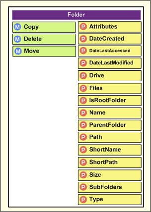 +
폴더의 복사, 삭제, 속성 조회 및 설정을 수행할 수 있다.

Folder 객체를 얻으려면 FSO 객체의 GetFolder 메서드, GetSpecialFolder 메서드, CreateFolder 메서드, File 객체의 ParentFolder 속성, Folder 객체 자체가 가진 ParentFolder 속성이나 SubFolders 속성, 후술할 Drive 객체의 RootFolder 속성을 이용한다. 폴더 이름을 알고 있는 경우는 이 중 GetFolder 메서드를 사용할 수 있다. 예를 들어, ‘D:\WSH’ 라는 폴더를 나타내는 Folder 객체를 가져오려면 다음과 같이 한다.

[source,vb]
----
Set objFSO = WScript.CreateObject(“Scripting.FileSystemObject”)
Set objFolder = objFSO.GetFolder(“D:\WSH ”)
----

Folder 객체에는 다음과 같은 메서드와 속성이 있다.

[%autowidth]
|===
|메서드/속성               |기능

|Copy 메서드               |폴더를 복사합니다.
|Delete 메서드             |폴더를 삭제합니다.
|Move 메서드               |폴더를 이동합니다.
|Attributes 속성           |속성을 가져오거나 설정합니다.
|DateCreated 속성          |생성 날짜 및 시간을 가져옵니다.
|DateLastAccessed 속성     |마지막 액세스 날짜 및 시간을 가져옵니다.
|DateLastModified 속성     |마지막 수정 날짜 및 시간을 가져옵니다.
|Drive 속성                |폴더가 저장된 드라이브를 나타내는 Drive 객체를 가져옵니다.
|Files 속성                |폴더 내 파일의 컬렉션을 반환합니다.
|IsRootFolder 속성         |루트 폴더인 경우 True를 반환합니다.
|Name 속성                 |폴더 이름을 가져오거나 설정합니다.
|ParentFolder 속성         |상위 폴더를 나타내는 Folder 객체를 가져옵니다.
|Path 속성                 |폴더의 경로를 가져옵니다.
|ShortName 속성            |MS-DOS 형식의 폴더 이름을 가져옵니다.
|ShortPath 속성            |MS-DOS 형식의 경로를 가져옵니다.
|Size 속성                 |폴더의 총 크기를 가져옵니다.
|SubFolders 속성           |하위 폴더 컬렉션을 반환합니다.
|Type 속성                 |폴더의 종류를 가져옵니다.
|===

이런 메서드/속성은 대부분 File 객체와 공통된 것이며, 사용법도 File 객체의 경우와 다르지 않다. File 객체와 다른 속성은 Files 속성, SubFolders 속성, IsRootFolder 속성, 이 세 가지 뿐이다. 여기서는 이런 Folder 객체 고유의 속성에 대해 설명한다.

Files／SubFolders／IsRootFolder 속성::
Files 속성은 폴더 내 파일 목록을 가져오는 속성이며, SubFolders 속성은 하위 폴더 목록을 가져오는 속성이다. 이 두 속성을 활용하면 폴더의 계층 구조를 따라가며 처리를 수행할 수 있다.

가장 전형적인 사용법은 특정 폴더 안에 있는 모든 파일을 처리하는 것일 것이다. 특정 폴더 아래에 있는 파일은 Files 속성으로 가져올 수 있으며, 하위 폴더 내의 파일을 가져오려면 SubFolders 속성을 통해 가져올 수 있는 모든 하위 폴더의 Files 속성을 확인하면 된다.

Files 속성과 SubFolders 속성은 컬렉션 객체를 반환한다. 컬렉션 객체의 내용을 순서대로 처리하려면 VBScript의 For Each 문을 사용한다. 또한, 컬렉션 객체의 Count 속성을 통해 개수를 확인할 수 있다. 다른 컬렉션과 마찬가지로 Item 속성도 마련되어 있지만, 연번이 아닌 파일명이나 폴더명을 Item 속성에 전달함으로써 해당 File 객체나 Folder 객체를 얻을 수 있는 구조로 되어 있어, 파일명/폴더명에 관계없이 모든 요소를 처리할 경우는 Item 속성을 사용할 수 없다. 참고로, JScript는 Enumerator 객체를 사용해서 모든 요소에 접근한다.

다음 예제는 특정 폴더 내의 파일 목록과 하위 폴더 목록을 표시한다.

[source,vb]
----
 1: Set objFSO = WScript.CreateObject(“Scripting.FileSystemObject”)
 2: Set objFolder = objFSO.GetFolder(“D:\WSH\Folder1”)
 3:
 4: WScript.Echo objFolder.Path & “내의 파일:”
 5: For Each objFile In objFolder.Files
 6:   WScript.Echo “  ” & objFile.Name
 7: Next
 8:
 9: WScript.Echo objFolder.Path & “내의 하위 폴더:”
10: For Each objSubFolder In objFolder.SubFolders
11:   WScript.Echo “  ” & objSubFolder.Name
12: Next
----

실행하면 다음과 같이 파일과 하위 폴더가 표시된다.

----
D:\WSH>cscript files.vbs
D:\WSH\Folder1 내의 파일:
  Test1.txt
  Test2.txt
  Test3.txt
D:\WSH\Folder1 내의 하위 폴더:
  SubFolder1
  SubFolder2

D:\WSH>
----

하위 폴더를 포함해서 특정 폴더 내의 모든 파일을 처리하려면 다음과 같이 프로시저를 작성해서 재귀적으로 처리한다. 이 예제는 ‘D:\WSH\Folder1’ 이하의 모든 파일에 대한 읽기 전용 속성을 해제한다.

[source,vb]
----
 1: Sub TurnOffReadOnly(objFolder)
 2:   ' 폴더 자체의 읽기 전용 속성 해제
 3:   objFolder.Attributes = (objFolder.Attributes And (255 - 1))
 4:   ' 바로 아래에 있는 파일의 읽기 전용 속성 해제
 5:   For Each objFile In objFolder.Files
 6:     objFile.Attributes = (objFile.Attributes And (255 - 1))
 7:   Next
 8:   ' 재귀적으로 하위 폴더의 읽기 전용 속성을 해제
 9:   For Each objSubFolder In objFolder.SubFolders
10:     TurnOffReadOnly(objSubFolder)
11:   Next
12: End Sub
13:
14: Set objFSO = WScript.CreateObject(“Scripting.FileSystemObject”)
15: Set objFolder = objFSO.GetFolder(“D:\WSH\Folder1”)
16: TurnOffReadOnly(objFolder)
----

IsRootFolder 속성은 Folder 객체가 루트 폴더인 경우 True 를, 그렇지 않은 경우 False 를 반환합니다. 다음 예제는 상위 폴더를 순서대로 열거한다.

[source,vb]
----
1: Set objFSO = WScript.CreateObject(“Scripting.FileSystemObject”)
2: Set objFolder = objFSO.GetFolder(“D:\WSH\Folder1\SubFolder1”
----

=== 드라이브 정보 가져오기

다음으로, 드라이브 정보 가져오기에 대해 설명한다. FSO 객체를 사용하면 드라이브를 열거하거나 드라이브의 여유 공간 크기를 가져올 수 있다. 단, FSO 객체는 드라이브 정보를 가져올 수만 있을 뿐, 드라이브 설정을 업데이트할 수는 없다. 네트워크 드라이브의 연결 및 끊기는 FSO 객체가 아닌, 제8회에서 설명한 WshNetwork 객체를 이용한다. FSO는 드라이브를 나타내는 Drive 객체가 있으며, 드라이브 정보는 Drive 객체의 속성으로 가져온다.

.Drive 객체
 +
드라이브 정보를 가져올 수 있다. 단, Drive 객체를 통해 드라이브 설정을 변경할 수는 없다.

FSO 객체 자체가 가진 드라이브 관련 메서드/속성은 다음 3가지이다.

[%autowidth]
|===
|메서드/속성           |기능

|DriveExists 메서드    |드라이브가 존재하는지 여부를 확인한다
|GetDrive 메서드       |Drive 객체를 반환한다
|Drives 속성           |드라이브 목록을 반환한다
|===

DriveExists 메서드는 매개변수로 드라이브 이름을 받아, 드라이브가 존재하면 True 를, 존재하지 않으면 False 를 반환한다. GetDrive 메서드는 전달된 드라이브 이름에 해당하는 Drive 객체를 반환한다. 이 두 메서드는 드라이브 문자(C) 외에도 콜론이 붙은 드라이브 이름(C:), 콜론과 ‘\’ 기호가 붙은 드라이브 이름(C:\), 네트워크 드라이브의 UNC 이름(\\Server\Share) 등도 전달할 수 있다. Drives 속성은 Files, SubFolders 등과 마찬가지로 드라이브 목록을 컬렉션 형태로 반환한다.

[source,vb]
----
Set objFSO = WScript.CreateObject(“Scripting.FileSystemObject”)
WScript.Echo CStr(objFSO.DriveExists(“A”))
WScript.Echo CStr(objFSO.DriveExists(“B:”))
WScript.Echo CStr(objFSO.DriveExists(“C:\”))
WScript.Echo CStr(objFSO.DriveExists(“\\Server04\public”))
----

----
D:\WSH>cscript driveexists.vbs
True
False
True
True

D:\WSH>
----

=== Drive 개체

Drive 개체는 드라이브를 나타내는 개체이다. FSO 개체의 GetDrive 메서드, Drives 속성, File 개체 및 Folder 개체의 Drive 속성을 통해 얻을 수 있다. 

Drive 개체는 다음과 같은 12가지 속성이 있다.

[%autowidth]
|===
|속성                    |기능

|AvailableSpace 속성     |사용 가능한 여유 공간의 크기를 가져온다
|DriveLetter 속성        |드라이브 이름(‘C’ 등)을 가져온다
|DriveType 속성          |드라이브의 종류를 가져온다
|FileSystem 속성         |드라이브의 파일 시스템을 가져온다
|FreeSpace 속성          |디스크의 여유 공간 크기를 가져온다
|IsReady 속성            |드라이브가 준비되어 있는지 여부를 가져온다
|Path 속성               |콜론이 포함된 드라이브 이름을 가져옵니다.
|RootFolder 속성         |루트 폴더를 나타내는 Folder 객체를 가져옵니다.
|SerialNumber 속성       |디스크의 일련번호를 가져옵니다.
|ShareName 속성          |네트워크 드라이브의 공유 이름을 가져옵니다.
|TotalSize 속성          |디스크의 총 용량을 가져옵니다.
|VolumeName 속성         |드라이브의 볼륨 이름을 가져옵니다.
|===

AvailableSpace 속성과 FreeSpace 속성은 일반적으로 동일한 값을 반환한다. 디스크에 할당량 제한이 설정된 경우, 이 두 값은 서로 다른 값을 반환한다.

DriveType 속성은 드라이브의 종류에 따라 0부터 5까지의 정수 값을 반환한다. 0은 알 수 없는 드라이브, 1은 이동식 디스크, 2는 하드 디스크, 3은 네트워크 드라이브, 4는 CD-ROM, 5는 RAM 디스크를 나타낸다.

FileSystem 속성은 ‘NTFS’, ‘FAT’, ‘CDFS’ 중 하나를 반환한다.

ShareName 속성은 네트워크 드라이브가 아닌 드라이브의 경우 빈 문자열(“”)을 반환한다.

다음 예제는 D 드라이브의 정보를 표시한다.

[source,vb]
----
 1: Set objFSO = WScript.CreateObject(“Scripting.FileSystemObject”)
 2: Set objDrive = objFSO.GetDrive(“D”)
 3: WScript.Echo “사용 가능한 공간 : ” & objDrive.AvailableSpace
 4: WScript.Echo “드라이브 문자    : ” & objDrive.DriveLetter
 5: WScript.Echo “드라이브 유형      : ” & objDrive.DriveType
 6: WScript.Echo “파일 시스템     : ” & objDrive.FileSystem
 7: WScript.Echo “사용 가능한 공간      : ” & objDrive.FreeSpace
 8: WScript.Echo “준비 상태        : ” & objDrive.IsReady
 9: WScript.Echo “경로           : ” & objDrive.Path
10: WScript.Echo “루트 폴더     : ” & objDrive.RootFolder.Path
11: WScript.Echo “일련번호   : ” & objDrive.SerialNumber
12: WScript.Echo “공유 이름      : ” & objDrive.ShareName
13: WScript.Echo “TotalSize      : ” & objDrive.TotalSize
14: WScript.Echo “VolumeName     : ” & objDrive.VolumeName
----

----
D:\WSH>cscript drive.vbs
AvailableSpace : 3479191552
DriveLetter    : D
DriveType      : 2
FileSystem     : NTFS
FreeSpace      : 3479191552
IsReady        : True
Path           : D:
RootFolder     : D:\
SerialNumber   : -1333760323
ShareName      :
TotalSize      : 4713082880
VolumeName     : 로컬 디스크

D:\WSH>
----

=== 경로 문자열 처리

마지막으로, 경로 문자열을 처리하기 위한 메서드를 소개한다. 파일 이름이나 상위 폴더 등은 File 객체나 Folder 객체를 사용해도 얻을 수 있지만, 문자열 그대로 처리함으로써 “실제로 존재하지 않는 경로도 다룰 수 있다” 는 점이 장점이라고 할 수 있다.

경로 문자열을 처리하는 메서드에는 다음 7가지가 있다.

[%autowidth]
|===
|메서드                       |기능

|GetDriveName 메서드          |경로의 드라이브 이름을 가져온다
|GetFileName 메서드           |경로의 파일 이름을 가져온다
|GetBaseName 메서드           |경로의 확장자를 제외한 이름을 가져온다
|GetExtensionName 메서드      |경로의 확장자를 가져온다
|GetParentFolderName 메서드   |경로의 상위 폴더 경로를 가져온다
|GetAbsolutePathName 메서드   |상대 경로를 절대 경로로 변환한다
|BuildPath 메서드             |경로와 파일 이름을 결합한다
|===

GetDriveName 메서드, GetFileName 메서드, GetBaseName 메서드, GetExtensionName 메서드, GetParentFolderName 메서드는 경로 문자열에서 일부를 추출하는 메서드이다. 예를 들어, “D:\WSH\test.txt” 인 경우 다음과 같다.

[source,vb]
----
Set objFSO = WScript.CreateObject(“Scripting.FileSystemObject”)
strPath = “D:\WSH\test.txt”
WScript.Echo “GetDriveName        : ” & objFSO.GetDriveName(strPath)
WScript.Echo “GetFileName         : ” & objFSO.GetFileName(strPath)
WScript.Echo “GetBaseName         : ” & objFSO.GetBaseName(strPath)
WScript.Echo “GetExtensionName    : ” & objFSO.GetExtensionName(strPath)
WScript.Echo “GetParentFolderName : ” & objFSO.GetParentFolderName(strPath)
----

----
D:\WSH>cscript path1.vbs
GetDriveName        : D:
GetFileName         : test.txt
GetBaseName         : test
GetExtensionName    : txt
GetParentFolderName : D:\WSH

D:\WSH>
----

GetAbsolutePathName 메서드는 현재 디렉터리를 기준으로 상대 경로를 절대 경로로 변환한다. 절대 경로를 전달한 경우도 절대 경로가 반환된다. BuildPath 는 두 개의 매개변수를 받아, 두 문자열을 ‘\’ 기호로 연결한 문자열을 반환한다. ‘\’ 기호의 개수는 BuildPath 메서드에 의해 조정되지만, 절대 경로/상대 경로 등은 처리되지 않는다.

[source,vb]
----
Set objFSO = WScript.CreateObject(“Scripting.FileSystemObject”)
WScript.Echo objFSO.GetAbsolutePathName(“Folder1”)
WScript.Echo objFSO.GetAbsolutePathName(“\Test1\Test2”)
WScript.Echo objFSO.GetAbsolutePathName(“C:\Test1\Test2”)
WScript.Echo objFSO.GetAbsolutePathName(“..\Test2”)
WScript.StdOut.WriteLine
WScript.Echo objFSO.BuildPath(“D:\Dummy”, “File1”)
WScript.Echo objFSO.BuildPath(“Dummy”, “File1”)
WScript.Echo objFSO.BuildPath(“D:\Dummy\”, “\Test1\Test2”)
WScript.Echo objFSO.BuildPath(“D:\Dummy\”, “..\Test2”)
----

----
D:\WSH>cscript path.vbs
D:\WSH\Folder1
D:\Test1\Test2
C:\Test1\Test2
D:\Test2

D:\Dummy\File1
Dummy\File1
D:\Dummy\Test1\Test2
D:\Dummy\..\Test2

D:\WSH>
----

도중에 잠시 공백이 있기도 했지만, 이 연재도 이번 편으로 마무리된다. 본 연재는 Windows 관리의 번거로운 반복 작업을 자동화하는 방법으로, WSH를 활용하기 위한 기초에 대해 설명했다. 어디까지나 기초 해설에 집중했기 때문에, 당장 도움되는 실용적인 스크립트 등은 소개하지 못했지만, 이에 대해서는 마이크로소프트가 인터넷에 공개한 다음 사이트가 큰 도움이 될 것이다.

* Microsoft TechNet 스크립트 센터

이 스크립트 센터는 Windows 시스템 관리자를 대상으로 한 실용적인 샘플 스크립트가 다수 공개되어 있다. 스크립트를 직접 처음부터 작성하기 전에, 이미 활용할 수 있는 샘플이 소개되어 있는지부터 검색하는 것이 좋을 것이다.

이 연재물이 독자 여러분의 관리 업무 부담을 조금이라도 덜어주는 데 도움된다면 더할나위 없이 기쁘겠다.

