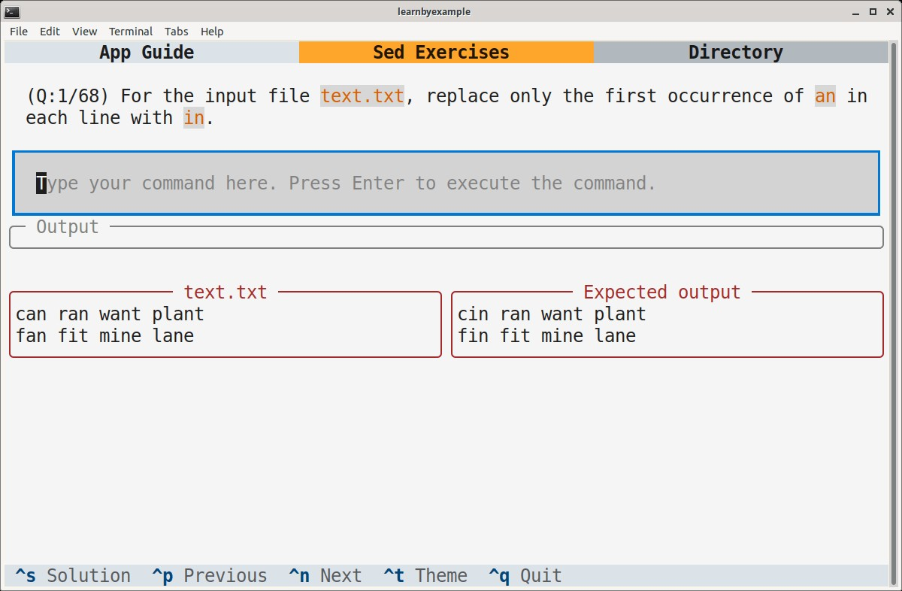

= CLI text processing with GNU sed
Author Name <piljin.kwon@gmail.com>
:experimental:
:doctype: book
:lang: ko
:source-language: asciidoc
:source-highlighter: coderay
:showtitle:
:toc: left
:toclevels: 1
:toc-title: 목차
:partnums:
:sectnums:
:sectlinks:
:sectnumlevels: 4
:chapter-label: 
:icons: font
:imagesdir!: ./images
:example-caption: 예제
:table-caption: 표
:figure-caption: 그림
:appendix-caption: 부록
ifdef::env-github[]
:tip-caption: :bulb:
:note-caption: :information_source:
:important-caption: :heavy_exclamation_mark:
:caution-caption: :fire:
:warning-caption: :warning:
endif::[]

== Preface

특정 문자열이 나타나는 위치를 찾아 다른 내용으로 바꾸기 위해 ‘찾기 및 바꾸기’ 대화 상자(보통 Ctrl+H 단축키로 호출됨)를 사용하는 방법은 이미 잘 알고 계실 것입니다. sed 명령어는 명령줄에서 사용할 수 있는 검색 및 바꾸기 작업을 위한 다재다능하고 기능이 풍부한 도구입니다. GUI 애플리케이션에 없을 수도 있는 중요한 기능 중 하나는 “정규 표현식” 인데 이는 일치 조건을 정확하게 정의할 수 있는 소규모 프로그래밍 언어입니다.

이 책은 예제를 중심으로 각 기능을 하나씩 설명합니다. 명령어 옵션 외에도 정규 표현식도 자세히 다룰 것입니다. 다만, 데이터 버퍼를 조작하는 명령어와 여러 줄을 다루는 기법은 간략하게만 다루며 일부 명령어는 아예 생략할 예정입니다.

각 예제를 직접 입력해 보는 것을 권장합니다. 제시된 해결책뿐만 아니라 예제 입력 내용도 이해하려고 노력하고 입력이나 명령어의 일부를 변경했을 때 출력이 어떻게 달라지는지(혹은 달라지지 않는지!) 확인해 보시기 바랍니다. 비유하자면 자동차 운전을 배우는 것과 같습니다. 아무리 관련 서적을 읽거나 설명을 듣더라도 숙달되려면 실전 경험이 필요합니다.

=== Prerequisites

유닉스 계열 환경에서 명령줄 사용법에 익숙해야 합니다. 또한 파일 리디렉션이나 명령어 파이프라인 같은 개념도 이해해야 합니다. grep 명령어의 기본을 알고 있으면 sed의 필터링 기능을 이해하는 데 도움될 것입니다.

명령줄을 처음 접하는 분이라면 이 책을 시작하기 전에 제가 쓴 https://github.com/learnbyexample/cli-computing[『Linux Command Line Computing』 전자책^] 과 https://learnbyexample.github.io/curated_resources/linux_cli_scripting.html[Linux CLI 및 셸 스크립팅에 관한 엄선된 자료들^] 을 먼저 살펴보시기 바랍니다.

=== Conventions

* 여기에 제시된 예제들은 GNU sed 버전 4.9 에서 테스트했으며 이전 버전에서 사용할 수 없는 기능이 포함될 수 있습니다.

* 코드 조각들은 GNU bash 셸에 복사해서 붙여넣은 후 설명의 편의를 위해 수정했습니다. 일부 명령어 앞에는 맥락과 설명을 제공하기 위해 주석이 붙어 있습니다. 가독성을 높이기 위해 빈 줄을 삽입했으며 속도 비교를 위해 실제 시간만 표시했고 wget 같은 명령어의 출력은 생략했습니다.

* 별도로 명시되지 않는 한 모든 예제와 설명은 ASCII 입력을 기준으로 합니다.

* 별도로 명시되지 않는 한 ‘sed’ 는 GNU sed를, ‘grep’ 은 GNU grep을 의미합니다.

* 이 책 전반에 걸쳐 특정 주제를 좀 더 깊이 탐구할 수 있도록 외부 링크가 제공됩니다.

* https://github.com/learnbyexample/learn_gnused[learn_gnused 저장소^] 는 예제, 연습 문제 및 이 책과 관련된 기타 세부 사항에 사용된 모든 코드 스니펫과 파일이 포함되어 있습니다. git 명령어에 익숙치 않다면 웹 페이지의 ‘Code’ 버튼을 클릭해서 파일을 다운로드 받으시기 바랍니다.

=== Acknowledgements

* https://www.gnu.org/software/sed/manual/sed.html[GNU sed 문서^] — 매뉴얼 및 예제

* https://stackoverflow.com/[stackoverflow^] 및 https://unix.stackexchange.com/[unix.stackexchange^] — sed 및 관련 명령어에 대한 관련 질문의 답변을 얻기 위해

* https://tex.stackexchange.com/[tex.stackexchange^] — https://github.com/jgm/pandoc/[pandoc^] 및 `tex` 관련 질문에 대한 도움을 얻기 위해

* https://old.reddit.com/r/commandline[/r/commandline/^], https://old.reddit.com/r/linux4noobs/[/r/linux4noobs/^], https://old.reddit.com/r/linuxquestions/[/r/linuxquestions/^] 및 https://old.reddit.com/r/linux/[/r/linux/^] — 유용한 포럼

* https://www.canva.com/[canva^] — 표지 이미지

* https://github.com/shssoichiro/oxipng[oxipng^], https://pngquant.org/[pngquant^] 및 https://github.com/RazrFalcon/svgcleaner[svgcleaner^] — 이미지 최적화

* https://commons.wikimedia.org/wiki/User:Amada44[Amada44^] 가 제작한 https://commons.wikimedia.org/wiki/File:Warning_icon.svg[경고^] 및 https://commons.wikimedia.org/wiki/File:Info_icon_002.svg[정보 아이콘^] (퍼블릭 도메인)

* 모호한 설명을 지적해 준 https://github.com/arifmahmudrana[arifmahmudrana^]

* https://github.com/rust-lang/mdBook[mdBook^] — 현재 읽고 계신 책의 웹 버전 제공

** https://github.com/JorelAli/mdBook-pagetoc[mdBook-pagetoc^] — 각 장별 목차 추가

** https://github.com/wilsonzlin/minify-html[minify-html^] — HTML 파일 압축

특히 어려운 시기에 도움과 지원, 격려를 아끼지 않은 모든 친구들과 온라인 지인들에게 깊은 감사를 드립니다.

=== Feedback and Errata

이 책에 대해 어떻게 생각하셨는지 알려주시면 대단히 감사하겠습니다. 간단한 감사의 말씀부터 오타나 코드 스니펫의 오류 지적, 책의 어떤 부분이 도움이 되었는지(혹은 그렇지 않았는지) 등 어떤 내용이라도 좋습니다. 독자의 피드백은 매우 중요하며 특히 자비 출판 작가는 더욱 그렇습니다.

다음 경로를 통해 저에게 연락해 주실 수 있습니다:

* 이슈 매니저: https://github.com/learnbyexample/learn_gnused/issues
* 이메일: learnbyexample.net@gmail.com
* 트위터: https://twitter.com/learn_byexample

=== Author info

선딥 아가르왈(_Sundeep Agarwal_)은 소박한 생활비를 충당할 만큼만 일하는 것을 선호하는 게으른 사람이다. 그는 아날로그 디바이스(_Analog Devices_)에서 설계 엔지니어로 일하며 막대한 재산을 모았고 스물여덟 살이라는 젊은 나이에 기업 생활을 은퇴했다. 불행하게도 그는 몇 년 만에 저축한 돈을 탕진해 버렸고 생계를 꾸리기 위해 허둥지둥해야만 했다. 모든 역경을 딛고 프로그래밍 전자책을 판매함으로써 게으른 그는 다시 일자리를 찾아다닐 필요에서 벗어날 수 있었다. 이제 그는 읽고 싶은 판타지 전자책을 마음껏 살 수 있게 되었으며 인터넷을 서핑하는 데 지나치게 많은 시간을 보내고 있다.

창의적인 영감이 떠오르면 그는 또 다른 프로그래밍 전자책을 집필하고 있는 모습을 볼 수 있다(이 책에는 어김없이 정규 표현식이 포함된 예제가 적어도 하나는 들어간다). 전자책 집필을 위한 자료 조사와 일상적인 소셜 미디어 사용으로 북마크가 넘쳐나자 정신 건강을 위해 엄선된 자료 목록을 관리하고 있다. 그는 무료 학습 자료와 오픈 소스 도구에 감사하고 있다. 그가 직접 기여한 내용은 https://github.com/learnbyexample 에서 확인할 수 있다.

도서 목록: https://learnbyexample.github.io/books/

=== License

이 저작물은 크리에이티브 커먼즈 저작자표시-비영리-동일조건변경허락 4.0 국제 라이선스에 따라 이용 가능합니다.

코드 스니펫은 MIT 라이선스에 따라 이용 가능합니다.

감사의 글 섹션에 언급된 자료들은 각 자료의 원래 라이선스에 따라 이용 가능합니다.

=== Book version

2.1

각 책 버전의 변경 내역을 확인하려면 https://github.com/learnbyexample/learn_gnused/blob/master/Version_changes.md[Version_changes.md^] 를 참조합니다.

== Introduction

sed 명령어의 이름은 ‘스트림 에디터(**s**tream **ed**itor)’ 에서 유래했습니다. 여기서 ‘스트림’ 이란 쉘 파이프를 통해 전달되는 데이터를 의미합니다. 따라서 이 명령어의 주요 기능은 표준 입력(_stdin_) 의 데이터를 텍스트 편집기로 처리하고 표준 출력(_stdout_)을 출력 대상으로 사용하는 것입니다. 현재는 파일 입력에 sed를 사용하거나 파일을 직접 편집하는 데도 흔히 사용됩니다.

이 장은 최신 버전의 sed를 설치하는 방법을 설명하고 이어서 관련 문서에 대한 세부 정보를 다룹니다. 그 다음으로 가장 흔히 사용되는 기능인 _substitute_ 명령어에 대해 소개합니다. 이후의 장은 _substitute_ 명령어에 대한 자세한 내용을 다루고 다른 명령어와 명령줄 옵션에 대해 설명합니다. 또한 각 장 마지막에는 치트시트, 요약 및 연습 문제가 포함되어 있습니다.

=== Installation

유닉스 계열의 시스템을 사용 중이면 대개 어떤 버전의 sed가 이미 설치되어 있을 것입니다. 이 책은 주로 “GNU sed” 에 대해 다룹니다. 다양한 구현체 간에는 구문과 기능에 차이가 있으므로 이 책에 제시된 예제를 따라 하려면 반드시 GNU sed를 사용해야 합니다.

GNU sed는 텍스트 생성 및 편집 도구의 일부이며 GNU/Linux 배포판에 기본적으로 포함되어 있습니다. 특정 버전을 설치하려면 https://www.gnu.org/software/sed/[gnu: sed 소프트웨어 페이지^]를 방문합니다. 버전 간 변경 사항에 대한 개요는 https://savannah.gnu.org/news/?group=sed[릴리스 노트^] 를, 특정 명령어가 예상대로 작동하지 않는다고 생각되면 https://debbugs.gnu.org/cgi/pkgreport.cgi?package=sed[버그 목록^] 을 참조합니다.

[source,bash]
----
$ wget https://ftp.gnu.org/gnu/sed/sed-4.9.tar.xz
$ tar -Jxf sed-4.9.tar.xz
$ cd sed-4.9/
# see https://askubuntu.com/q/237576 if you get compiler not found error
$ ./configure
$ make
$ sudo make install

$ sed --version | head -n1
sed (GNU sed) 4.9
----

리눅스 배포판을 사용하지 않는 경우 아래 옵션 중 하나를 사용해서 GNU sed에 접근할 수 있습니다:

* https://git-scm.com/downloads[Git for Windows^] — 명령줄에서 Git을 실행하는 데 사용되는 Bash 에뮬레이션을 제공합니다.

* https://en.wikipedia.org/wiki/Windows_Subsystem_for_Linux[Windows Subsystem for Linux^] — Windows에서 리눅스 바이너리 실행 파일을 네이티브로 실행하기 위한 호환성 레이어입니다.

* https://brew.sh/[brew^] — macOS(또는 리눅스)용 패키지 관리자입니다.

=== Documentation

항상 문서를 어디서 찾을 수 있는지는 미리 알아두는 것이 좋습니다. 명령줄에서 `man sed` 를 입력하면 간단한 설명서를, `info sed` 를 입력하면 전체 문서를 확인할 수 있습니다. 저는 https://www.gnu.org/software/sed/manual/sed.html[온라인 GNU sed 설명서^] 를 선호하는데 사용하기 훨씬 쉽고 탐색하기도 편하기 때문입니다.

[source,bash]
----
$ man sed
SED(1)                          User Commands                         SED(1)  

NAME
       sed - stream editor for filtering and transforming text

SYNOPSIS
       sed [-V] [--version] [--help] [-n] [--quiet] [--silent]
           [-l N] [--line-length=N] [-u] [--unbuffered]
           [-E] [-r] [--regexp-extended]
           [-e script] [--expression=script]
           [-f script-file] [--file=script-file]
           [script-if-no-other-script]
           [file...]

DESCRIPTION
       Sed  is  a  stream  editor.  A stream editor is used to perform basic
       text transformations on an input stream (a file or input from a pipe‐
       line).   While  in  some  ways  similar  to  an  editor which permits
       scripted edits (such as ed), sed works by making only one  pass  over
       the  input(s),  and  is consequently more efficient.  But it is sed's
       ability to filter text in a pipeline which particularly distinguishes
       it from other types of editors.
----

=== Options overview

사용 가능한 모든 옵션을 빠르게 확인하려면 명령줄에서 `sed --help` 를 실행합니다.

[source,bash]
----
# only partial output shown here
$ sed --help
  -n, --quiet, --silent
                 suppress automatic printing of pattern space
      --debug
                 annotate program execution
  -e script, --expression=script
                 add the script to the commands to be executed
  -f script-file, --file=script-file
                 add the contents of script-file to the commands to be executed
  --follow-symlinks
                 follow symlinks when processing in place
  -i[SUFFIX], --in-place[=SUFFIX]
                 edit files in place (makes backup if SUFFIX supplied)
  -l N, --line-length=N
                 specify the desired line-wrap length for the 'l' command
  --posix
                 disable all GNU extensions.
  -E, -r, --regexp-extended
                 use extended regular expressions in the script
                 (for portability use POSIX -E).
  -s, --separate
                 consider files as separate rather than as a single,
                 continuous long stream.
      --sandbox
                 operate in sandbox mode (disable e/r/w commands).
  -u, --unbuffered
                 load minimal amounts of data from the input files and flush
                 the output buffers more often
  -z, --null-data
                 separate lines by NUL characters
      --help     display this help and exit
      --version  output version information and exit

If no -e, --expression, -f, or --file option is given, then the first
non-option argument is taken as the sed script to interpret.  All
remaining arguments are names of input files; if no input files are
specified, then the standard input is read.
----

=== Editing standard input

sed는 텍스트를 조작하는 다양한 명령어가 있습니다. _substitute_ 명령어는 가장 흔히 사용되는 연산으로 일치하는 부분을 다른 내용으로 대체하는 데 도움이 됩니다. 구문은 s/REGEXP/REPLACEMENT/FLAGS 이며, 여기서:

* s 는 _substitute_ 명령어를 의미합니다.

* / 는 명령어의 여러 부분을 구분하는 관용적인 구분자입니다.

* REGEXP 는 정규식을 의미합니다.

* REPLACEMENT 는 대체할 문자열을 의미합니다

* FLAGS 는 명령어의 기본 동작을 변경하는 옵션입니다

지금으로서는 “s 명령어가 검색 및 대체 작업에 사용된다” 는 점만 알아두면 충분합니다.

[source,bash]
----
# 편집을 위해 sed로 전달될 입력 데이터
$ printf '1,2,3,4\na,b,c,d\n'
1,2,3,4
a,b,c,d

# 각 입력 줄에 첫 번째 ‘,' 만 ’-' 로 변경
$ printf '1,2,3,4\na,b,c,d\n' | sed 's/,/-/'
1-2,3,4
a-b,c,d

# ‘g’ 플래그를 추가해서 일치하는 모든 부분을 변경
$ printf '1,2,3,4\na,b,c,d\n' | sed 's/,/-/g'
1-2-3-4
a-b-c-d
----

위의 예제는 스트림 편집 기능을 보여주기 위해 printf 명령어를 사용해서 입력 데이터를 생성했습니다. 기본적으로 sed는 입력을 한 줄씩 처리합니다. 줄 바꿈 문자 \n 은 기본적으로 “줄 구분자” 로 사용됩니다. 첫 번째 sed 명령어는 , (쉼표)가 처음 나타나는 부분만 - (하이픈)로 대체합니다. 두 번째 명령어는 `g` 플래그(g 는 _global_ 을 의미)도 함께 사용했기 때문에 , 가 나타나는 모든 부분을 대체합니다.

TIP: 모범 사례로 스크립트의 인수는 항상 작은 따옴표로 묶어 사용합니다. 셸 해석이 필요한 예제는 나중에 다룰 예정입니다.

WARNING 
====
입력 파일의 줄 끝이 \r\n (캐리지 리턴 및 줄 바꿈 문자)인 경우 처리하기 전에 입력 파일을 유닉스 스타일로 변환합니다. 자세한 설명과 해결 방법은 https://stackoverflow.com/q/45772525/4082052[stackoverflow: Why does my tool output overwrite itself and how do I fix it?^] 를 참조합니다.

[source,bash]
----
# Unix style
$ printf '42\n' | file -
/dev/stdin: ASCII text

# DOS style
$ printf '42\r\n' | file -
/dev/stdin: ASCII text, with CRLF line terminators
----
====

=== Editing file input

sed라는 이름은 스트림 편집(**s**tream **ed**iting)에서 유래했지만 일반적으로 sed를 파일 편집에 사용하는 경우가 많습니다. 이를 위해 하나 이상의 입력 파일 이름을 인수로 전달할 수 있습니다. - 를 사용해서 표준 입력(_stdin_)을 입력 소스 중 하나로 지정할 수 있습니다. 기본적으로 수정된 데이터는 표준 출력(_stdout_) 스트림으로 전송되며 입력 파일은 수정되지 않습니다! ‘파일 인플레이스 편집’ 장에서 변경 사항을 원본 파일에 다시 적용하는 방법에 대해 다룰 것입니다.

NOTE: example_files 디렉터리는 예제에 사용된 모든 파일이 포함되어 있습니다.

[source,bash]
----
$ cat greeting.txt
Hi there
Have a nice day

# 각 줄마다 'day' 가 처음 나오는 부분을 'weekend' 로 변경
$ sed ‘s/day/weekend/’ greeting.txt
Hi there
Have a nice weekend

# 'e' 가 나오는 모든 부분을 'E' 로 변경합니다
# 수정된 데이터를 다른 파일로 리디렉션합니다
$ sed ‘s/e/E/g’ greeting.txt > out.txt
$ cat out.txt
Hi thErE
HavE a nicE day
----

앞서 살펴본 예제들은 모든 입력 행이 검색 조건에 일치했습니다. 여기서 첫 번째 sed 명령어는 ‘day’ 를 검색했는데 이는 greeting.txt 파일의 첫 번째 행과 일치하지 않았습니다. 기본적으로 행이 검색 조건을 충족하지 않더라도 출력 결과에 포함됩니다. 수정된 행만 추출하는 방법은 ‘Print 명령어’ 섹션에서 살펴볼 것입니다.

=== Cheatsheet and summary

[%autowidth]
|===
|참고                          |설명

|man sed                       |간략한 매뉴얼
|sed --help                    |모든 명령줄 옵션에 대한 간략한 설명
|info sed                      |포괄적인 매뉴얼
|온라인 GNU sed 매뉴얼         |서식이 잘 정리되어 있어 읽기 쉽고 탐색하기 편리함
|s/REGEXP/REPLACEMENT/FLAGS    |substitute 명령어의 구문
|sed ‘s/,/-/’                  |각 줄에서 첫 번째 , 를 - 로 바꾸기
|sed ‘s/,/-/g’                 |모든 , 를 - 로 바꾸기
|===

이 입문 장은 설치 과정, 문서, 그리고 명령줄에서 sed를 사용해서 텍스트를 검색하고 바꾸는 방법을 다루었습니다. 다음 장들은 명령줄 텍스트 처리에서 sed를 중요한 도구로 만들어 주는 좀 더 많은 명령어와 기능을 배울 것입니다. 그중 하나가 바로 파일을 원본에서 직접 편집하는 기능이며 이에 대해서는 다음 장에서 다룰 예정입니다.

=== Interactive exercises

이 책에 수록된 연습문제 중 일부를 대화형으로 풀 수 있도록 도와주는 TUI 앱을 만들었습니다. 설치 방법은 https://github.com/learnbyexample/TUI-apps/tree/main/SedExercises[SedExercises 저장소^] 를, 앱 사용법은 https://github.com/learnbyexample/TUI-apps/blob/main/SedExercises/app_guide.md[app_guide.md 파일^] 을 참고하시기 바랍니다.

다음은 샘플 스크린샷입니다:

=== Exercises

NOTE: 모든 연습 문제는 https://github.com/learnbyexample/learn_gnused/blob/master/exercises/Exercises.md[Exercises.md^] 파일에 한 곳에 정리되어 있습니다. 해답은 https://github.com/learnbyexample/learn_gnused/blob/master/exercises/Exercise_solutions.md[Exercise_solutions.md^] 에서 확인할 수 있습니다.

NOTE: exercises 디렉토리는 이 섹션에서 사용된 모든 파일이 포함되어 있습니다.

*1)* 주어진 표준 입력(_stdin_) 소스에서 5 가 처음 나오는 곳만 five 로 바꾸십시오.

[source,bash]
----
$ echo ‘They ate 5 apples and 5 mangoes’ | sed ‘s/5/five/’
They ate five apples and 5 mangoes
----

*2)* 5 가 나오는 모든 곳을 five 로 바꾸십시오.

[source,bash]
----
$ echo ‘They ate 5 apples and 5 mangoes’ | sed ‘s/5/five/g’
They ate five apples and five mangoes
----

*3)* 주어진 입력 파일에서 0xA0 이 나타나는 모든 곳을 0x50 으로, 0xFF 가 나타나는 모든 곳을 0x7F 로 바꾸십시오.

[source,bash]
----
$ cat hex.txt
시작 주소: 0xA0, func1 주소: 0xA0
종료 주소: 0xFF, func2 주소: 0xB0

# 여러 명령어를 지정하는 방법을 이미 알고 있다면,
# 더 나은 해결책은 다음과 같습니다: sed ‘s/0xA0/0x50/g; s/0xFF/0x7F/g’ hex.txt
$ sed ‘s/0xA0/0x50/g’ hex.txt | sed ‘s/0xFF/0x7F/g’
시작 주소: 0x50, func1 주소: 0x50
종료 주소: 0x7F, func2 주소: 0xB0
----

*4)* _substitute_ 명령어는 문자열을 검색하고 대체합니다. 하나 이상의 문자를 다른 대응되는 문자 집합으로 매핑해야 할 때는 `y` 명령어를 사용할 수 있습니다. 매뉴얼에서 인용하면 다음과 같습니다.

[sidebar]
--
y/src/dst/ 패턴 영역(_passtern space_)에서 소스 문자(_source-chars_) 중 하나와 일치하는 모든 문자를 대상 문자(_dest-chars_)의 대응되는 문자로 변환합니다.
--

`y` 명령어를 사용해서 주어진 입력 문자열을 변환하면 아래와 같은 출력 문자열을 얻을 수 있습니다.

[source,bash]
----
$ echo ‘goal new user sit eat dinner’ | sed ‘y/aeiou/AEIOU/’
gOAl nEw UsEr sIt EAt dInnEr
----

*5)* 다음 명령어가 왜 오류를 발생시키나요? 어떻게 해결했나요?

공백은 셸 메타문자로 셸에 의해 해석되는 것을 방지하기 위해 sed 스크립트를 따옴표로 묶어야 합니다.

[source,bash]
----
$ echo ‘a sunny day’ | sed s/sunny day/cloudy day/
sed: -e expression #1, char 7: `s' 명령이 종료되지 않음

# 예상 출력
$ echo ‘a sunny day’ | sed ‘s/sunny day/cloudy day/’
a cloudy day
----

== In-place file editing

지금까지 살펴본 예제는 sed의 출력 결과가 터미널에 표시되거나 다른 파일로 리디렉션되었습니다. 이 장은 `-i` 명령줄 옵션을 사용해서 변경 내용을 입력 파일에 다시 기록하는 방법에 대해 설명합니다. 이 옵션을 구성해서 원본 내용의 백업을 생성하거나 생성하지 않고 입력 파일을 변경할 수 있습니다. 백업이 필요한 경우 원본 파일 이름에 접두사나 접미사 또는 둘 다를 추가할 수 있습니다. 또한 백업 파일은 필요에 따라 동일한 디렉터리나 다른 디렉터리에 저장할 수 있습니다.

NOTE: example_files 디렉터리는 예제에서 사용된 모든 파일이 포함되어 있습니다.

=== With backup

`-i` 옵션의 인수로 확장자가 지정되면 입력 파일의 원래 내용이 지정된 확장자에 따라 보존됩니다. 예를 들어, 입력 파일이 ip.txt 이고 `-i.orig` 를 사용하면 백업 파일의 이름은 ip.txt.orig 가 됩니다.

[source,bash]
----
$ cat colors.txt
deep blue
light orange
blue delight

# -i 옵션이 사용되었으므로 터미널에 출력이 표시되지 않습니다.
# -i 와 확장자 사이에는 공백을 넣을 수 없습니다.
$ sed -i.bkp ‘s/blue/green/’ colors.txt
# sed의 출력이 'colors.txt' 에 다시 기록됩니다.
$ cat colors.txt
deep green
light orange
green delight

# 원본 파일은 'colors.txt.bkp' 에 보존됩니다.
$ cat colors.txt.bkp
deep blue
light orange
blue delight
----

=== Without backup

때로는 백업을 원하지 않는 경우도 있습니다. 이런 경우, 인수를 지정하지 않고 `-i` 옵션을 사용할 수 있습니다. 단, 변경 내용은 되돌릴 수 없으므로 주의해야 합니다. 실제 파일에 `-i` 옵션을 적용하기 전에 샘플 입력으로 명령어를 미리 테스트하는 것이 좋습니다. 또한 백업을 생성한 후 diff 프로그램을 사용해서 차이점을 비교한 다음 백업을 삭제할 수도 있습니다.

[source,bash]
----
$ cat fruits.txt
banana
papaya
mango

$ sed -i ‘s/an/AN/g’ fruits.txt
$ cat fruits.txt
bANANa
papaya
mANgo
----

=== Multiple files

여러 입력 파일은 각각 개별적으로 처리되며 변경된 내용은 각 파일에 다시 기록됩니다.

[source,bash]
----
$ cat f1.txt
have a nice day
bad morning
what a pleasant evening
$ cat f2.txt
worse than ever
too bad

$ sed -i.bkp 's/bad/good/' f1.txt f2.txt
$ ls f?.*
f1.txt  f1.txt.bkp  f2.txt  f2.txt.bkp

$ cat f1.txt
have a nice day
good morning
what a pleasant evening
$ cat f2.txt
worse than ever
too good
----

=== Prefix backup name

`-i` 옵션의 인자에서 * 문자는 “특수 문자” 입니다. 이 문자는 입력 파일 이름으로 대체됩니다. 이는 백업 파일 이름에 접미사 대신 접두사를 사용해야 할 때 유용합니다. 또는 그 밖의 필요한 조합을 사용할 때도 마찬가지입니다.

[source,bash]
----
$ ls *colors*
colors.txt  colors.txt.bkp

# * 문자는 쉘에서 특수 문자로 사용되므로 작은따옴표를 사용해야 합니다.
$ sed -i'bkp.*‘ 's/green/yellow/’ colors.txt

$ ls *colors*
bkp.colors.txt  colors.txt  colors.txt.bkp
----

=== Place backups in a different directory

* 기호를 사용하면 백업 파일을 입력 파일의 상위 디렉터리가 아닌 다른 디렉터리에 저장할 수 있습니다. 이 기능이 작동하려면 백업 디렉터리가 미리 존재해야 합니다.

[source,bash]
----
$ mkdir backups
$ sed -i'backups/*' 's/good/nice/' f1.txt f2.txt
$ ls backups/
f1.txt  f2.txt
----

=== Cheatsheet and summary

[%autowidth]
|===
|참고             |설명

|-i               |처리 후 변경 사항을 원본 파일에 다시 기록합니다. 한 번 변경된 내용은 되돌릴 수 없으므로 이 옵션을 사용할 때는 주의합니다.
|-i.bkp           |직접 편집 외에도 원본 내용을 파일로 보존합니다. 파일 이름은 입력 파일 이름에 .bkp 확장자를 붙여 생성됩니다.
|-i'bkp.*'        |여기서 * 는 입력 파일 이름으로 대체됩니다. 따라서 접미사 대신 접두사를 추가할 수 있는 방법을 제공합니다
|-i'backups/*'    |이 옵션은 백업 사본을 원본 디렉터리 대신 다른 기존 디렉터리에 저장합니다
|===

이 장은 파일을 제자리에서 편집할 때 유용한 `-i` 옵션에 대해 다루었습니다. 이 옵션은 특히 자동화 스크립트에서 유용합니다. 하지만 백업을 생성하지 않고 이 옵션을 사용할 경우 실제 파일에 적용하기 전에 반드시 sed 명령을 테스트하시기 바랍니다. 

다음 장은 sed의 필터링 기능과 이를 통해 모든 줄이 아닌 특정 입력 줄에만 명령을 적용하는 방법을 배우게 될 것입니다.

=== Exercises

*1)* 입력 파일 text.txt 에서 'in' 이 나타나는 모든 부분을 'an' 으로 바꾸고 변경된 내용을 text.txt 파일에 다시 저장하십시오. 원본 내용은 text.txt.orig 파일에 저장되야 합니다.

[source,bash]
----
$ cat text.txt
can ran want plant
tin fin fit mine line
$ sed -i.orig 's/in/an/g' text.txt

$ cat text.txt
can ran want plant
tan fan fit mane lane
$ cat text.txt.orig
can ran want plant
tin fin fit mine line
----

*2)* 입력 파일 text.txt 에서 'an' 이 나오는 모든 부분을 'in' 으로 바꾸고 변경된 내용을 text.txt 파일에 직접 다시 저장하십시오. 이 연습 문제에서는 백업 파일을 생성하지 마십시오. 이 문제를 시작하기 전에 “이전 연습 문제를 해결해야 한다” 는 점에 유의하십시오.

[source,bash]
----
$ cat text.txt
can ran want plant
tan fan fit mane lane
$ sed -i 's/an/in/g' text.txt

$ cat text.txt
cin rin wint plint
tin fin fit mine line
$ diff text.txt text.txt.orig
1c1
< cin rin wint plint
---
> can ran want plant
----

*3)* 입력 파일인 copyright.txt 에서 “copyright: 2018” 을 “copyright: 2019” 로 바꾸고 변경된 내용을 copyright.txt 파일에 다시 저장합니다. 원본 내용은 2018_copyright.txt.bkp 파일에 저장되야 합니다.

[source,bash]
----
$ cat copyright.txt
bla bla 2015 bla
blah 2018 blah
bla bla bla
copyright: 2018
$ sed -i'2018_*.bkp' 's/copyright: 2018/copyright: 2019/' copyright.txt

$ cat copyright.txt
bla bla 2015 bla
blah 2018 blah
bla bla bla
copyright: 2019
$ cat 2018_copyright.txt.bkp
bla bla 2015 bla
blah 2018 blah
bla bla bla
copyright: 2018
----

*4)* 아래에 표시된 코드 예제는 echo 명령어의 출력을 리디렉션해서 두 개의 파일을 생성합니다. 그런 다음 sed 명령어를 사용해서 b1.txt 를 제자리에서 편집하고 bkp.b1.txt 라는 이름의 백업 파일을 생성합니다. sed 명령어가 예상대로 작동할까요? 그렇지 않다면 이유는 무엇일까요?

[source,bash]
----
$ echo '2 apples' > b1.txt
$ echo '5 bananas' > -ibkp.txt
$ sed -ibkp.* 's/2/two/' b1.txt
----

명령줄에서 따옴표로 묶이지 않은 문자열은 “셸에 의해 해석” 됩니다. 따라서 -ibkp.* 는 -ibkp.txt 로 확장됩니다(이름이 -ibkp. 로 시작하는 파일이 존재하기 때문입니다). 그 결과 백업 파일 이름이 b1.txtbkp.txt 가 됩니다(bkp.txt 가 b1.txt 에 추가될 접미사로 처리되기 때문입니다). 백업 파일 이름을 bkp.b1.txt 로 만들려면 sed -i'bkp.*‘ 's/2/two/’ b1.txt 같이 올바르게 사용해야 합니다.

*5)* 입력 파일 pets.txt 에서 각 줄의 첫 번째 “I like” 를 제거하고 변경된 내용을 pets.txt 파일에 다시 기록하십시오. 원본 내용은 bkp 디렉터리 내에 동일한 파일 이름으로 저장되야 합니다. “현재 작업 디렉터리에 bkp 디렉터리가 존재하는지 여부를 알 수 없다” 고 가정합니다.

[source,bash]
----
$ cat pets.txt
I like cats
I like parrots
I like dogs

$ mkdir -p bkp
$ sed -i'bkp/*' 's/I like //' pets.txt

$ cat pets.txt
cats
parrots
dogs
$ cat bkp/pets.txt
I like cats
I like parrots
I like dogs
----

== Selective editing

기본적으로 sed는 입력 내용 전체를 대상으로 작동합니다. 종종 입력 내용 중 특정 부분에만 작업을 적용하고 싶을 때가 있습니다. 이를 위해 sed는 grep, head, tail 같은 도구와 유사한 줄 필터링 기능이 있습니다. sed는 별다른 번거로움 없이 grep 의 필터링 기능 대부분을 구현할 수 있습니다. 또한 줄 번호를 기반으로 한 필터링, 두 패턴 사이의 줄 선택, 상대 주소 지정 등과 같은 추가 기능도 갖추고 있습니다. 함수형 프로그래밍에 익숙하다면 map, filter, reduce 패러다임을 접해 보셨을 것입니다. sed를 사용하는 전형적인 작업은 입력의 일부를 필터링한 다음 이를 수정(매핑)하는 것입니다. 때로는 이전 장의 예제에서 볼 수 있듯이 그 일부가 전체 입력인 경우도 있습니다.

NOTE: 가능한 경우 특정 기능에 최적화된 도구를 우선적으로 사용하는 것이 좋습니다. 동등한 줄 필터링 작업을 수행할 때 grep, head, tail 은 sed 에 비해 성능 면에서 더 우수합니다.

NOTE: example_files 디렉토리는 예제에서 사용된 모든 파일이 포함되어 있습니다.

=== REGEXP filtering

앞서 살펴본 것 같이 _substitute_ 명령어의 구문은 s/REGEXP/REPLACEMENT/FLAGS 입니다. /REGEXP/FLAGS 부분은 조건식으로 사용할 수 있으므로 해당 패턴과 일치하는 행에 대해서만 명령어가 실행되도록 처리할 수 있습니다.

[source,bash]
----
# 입력 행에 '2' 가 포함된 경우에만 쉼표를 하이픈으로 변경
# 필터와 명령어 사이의 공백은 선택 사항입니다
$ printf ‘1,2,3,4\na,b,c,d\n’ | sed ‘/2/ s/,/-/g’
1-2-3-4
a,b,c,d
----

일치하는 줄 이외의 줄에 작업을 적용하려면 /REGEXP/FLAGS! 를 사용합니다.

[source,bash]
----
# 입력 행에 '2' 가 포함되지 않은 경우 쉼표를 하이픈으로 변경
# ! 앞뒤의 공백은 선택 사항
$ printf ‘1,2,3,4\na,b,c,d\n’ | sed '/2/! s/,/-/g'
1,2,3,4
a-b-c-d
----

/REGEXP/ 는 필터를 정의하는 방법 중 하나이며 매뉴얼에서는 ‘주소(_address_)’ 라고 합니다. 다른 방법들은 이 장 뒷부분에서 다룰 예정입니다.

NOTE: 정규 표현식에 대해서는 나중에 설명하겠습니다. 이 장에서 /REGEXP/ 필터링을 사용하는 예제들은 고정된 문자열(정확한 문자열 비교)만 사용합니다.

=== Delete command

필터링된 줄을 삭제하려면 `d` 명령어를 사용합니다. “기본적으로 모든 입력 줄이 출력된다” 는 점을 기억합니다.

[source,bash]
----
# 다음 명령과 동일: grep -v ‘at’
$ printf ‘sea\neat\ndrop\n’ | sed ‘/at/d’
sea
drop
----

기본 grep 필터링을 적용하려면 `!d` 조합을 사용합니다. 때로는 부정 논리를 사용하는 것이 헷갈릴 수 있습니다. 이는 프로그래밍 언어에서 if 와 unless 조건문 중 하나를 선택하는 것과 마찬가지로 결국 “개인의 선호도에 따라 결정” 됩니다.

[source,bash]
----
# 다음 명령과 동일: grep ‘at’
$ printf ‘sea\neat\ndrop\n’ | sed ‘/at/!d’
eat
----

NOTE: 주소 사용은 “선택 사항” 입니다. 예를 들어, sed ‘!d’ file 은 cat file 명령과 동일합니다.

[source,bash]
----
# 다음 명령과 동일: cat greeting.txt
$ sed ‘!d’ greeting.txt
Hi there
Have a nice day
----

=== Print command

필터링된 줄을 출력하려면 `p` 명령어를 사용합니다. 하지만 “기본적으로 모든 입력 줄이 출력된다” 는 점을 기억합니다. 따라서 이 명령어는 일반적으로 기본 출력 기능을 비활성화하는 `-n` 옵션과 함께 사용됩니다.

[source,bash]
----
$ cat rhymes.txt
it is a warm and cozy day
listen to what I say
go play in the park
come back before the sky turns dark

There are so many delights to cherish
Apple, Banana and Cherry
Bread, Butter and Jelly
Try them all before you perish

# 다음 명령과 동일: grep ‘warm’ rhymes.txt
$ sed -n '/warm/p' rhymes.txt
it is a warm and cozy day

# 다음 명령과 동일: grep ‘n t’ rhymes.txt
$ sed -n '/n t/p' rhymes.txt
listen to what I say
go play in the park
----

대체(_substitute_) 명령어는 `p` 를 플래그로 제공합니다. 이 경우 대체가 성공했을 때만 수정된 줄이 출력됩니다.

[source,bash]
----
$ sed -n ‘s/warm/cool/gp’ rhymes.txt
it is a cool and cozy day

# 필터 + 치환 + p 조합
$ sed -n '/the/ s/ark/ARK/gp' rhymes.txt
go play in the pARK
come back before the sky turns dARK
----

`-n` 옵션과 함께 `!p` 를 사용하면 `d` 명령을 사용하는 것과 동일합니다.

[source,bash]
----
# 다음 명령과 동일: sed ‘/at/d’
$ printf ‘sea\neat\ndrop\n’ | sed -n ‘/at/!p’
sea
drop
----

다음은 `-n` 옵션 없이 `p` 명령을 사용하는 예시입니다.

[source,bash]
----
# 모든 줄을 복제
$ seq 2 | sed ‘p’
1
1
2
2
----

=== Quit commands

`q` 명령어를 사용하면 sed가 즉시 종료됩니다. 나머지 명령어와 입력 행은 처리되지 않습니다.

[source,bash]
----
# 'say' 가 포함된 입력 행이 발견되면 종료합니다.
$ sed ‘/say/q’ rhymes.txt
it is a warm and cozy day
listen to what I say
----

`Q` 명령어는 `q` 와 비슷하지만 일치하는 행을 출력하지 않습니다.

[source,bash]
----
# 일치하는 줄은 출력되지 않습니다
$ sed ‘/say/Q’ rhymes.txt
it is a warm and cozy day
----

tac 을 사용하면 파일 전체에서 검색 문자열이 마지막으로 나타난 위치부터 시작하는 모든 줄을 얻을 수 있습니다.

[source,bash]
----
$ tac rhymes.txt | sed ‘/an/q’ | tac
Bread, Butter and Jelly
Try them all before you perish
----

선택적으로 종료 명령어와 함께 종료 상태(0~255)를 지정할 수 있습니다.

[source,bash]
----
$ printf ‘sea\neat\ndrop\n’ | sed ‘/at/q2’
sea
eat
$ echo $?
2

$ printf ‘sea\neat\ndrop\n’ | sed ‘/at/Q3’
sea
$ echo $?
3
----

WARNING: 여러 파일에 `q` 또는 `Q` 명령을 사용할 경우 주의해야 합니다. 처리할 파일이 남아 있더라도 sed가 중지될 수 있기 때문입니다. 해결책으로 혼합 주소 범위를 사용할 수 있습니다. 자세한 내용은 https://unix.stackexchange.com/q/309514/109046[unix.stackexchange: 여러 파일에 q 적용하기^] 를 참조합니다.

=== Multiple commands

지금까지 살펴본 명령어는 `;` 로 구분하거나 `-e` 옵션을 여러 번 사용해서 한 번 이상 지정할 수 있습니다. 자세한 내용은 sed 매뉴얼의 ‘여러 명령어 구문’ 을 참조합니다.

[source,bash]
----
# 수정된 줄뿐만 아니라 모든 입력 줄을 출력합니다.
$ printf ‘sea\neat\ndrop\n’ | sed -n -e ‘p’ -e ‘s/at/AT/p’
sea
eat
eAT
drop

# -e 대신 ; 를 사용한 위 예제와 동등한 명령어
# ; 앞뒤의 공백은 선택 사항입니다
$ printf ‘sea\neat\ndrop\n’ | sed -n ‘p; s/at/AT/p’
sea
eat
eAT
drop
----

리터럴 줄바꿈 문자를 사용해서 명령어를 구분할 수 있습니다. 여러 줄이 필요한 경우는 대신 sed 스크립트를 사용하는 것이 좋습니다.

[source,bash]
----
# 여기서는 각 명령어가 리터럴 개행 문자로 구분됩니다
# 기본 프롬프트 PS1 을 나타내는 $ 와 마찬가지로,
# > 는 보조 프롬프트 PS2 를 나타냅니다
$ sed -n '
> /the/ s/ark/ARK/gp
> s/warm/cool/gp
> s/Bread/Cake/gp
> ' rhymes.txt
it is a cool and cozy day
go play in the pARK
come back before the sky turns dARK
Cake, Butter and Jelly
----

[WARNING]
====
아래와 같이 출력에 줄이 중복될 수 있으므로 여러 검색 문자열의 조건부 OR 연산을 구성하기 위해 여러 명령어를 사용하지 마십시오. 이런 경우는 정규 표현식의 대안(_alternation_) 기능을 사용할 수 있습니다.

[source,bash]
----
$ sed -ne ‘/play/p’ -e ‘/ark/p’ rhymes.txt
go play in the park
go play in the park
come back before the sky turns dark
----
====

공통 필터에 여러 명령을 실행하려면 { } 를 사용해서 명령을 묶습니다. 필요한 경우 명령을 중첩할 수 있습니다.

[source,bash]
----
# {} 주변의 공백은 선택 사항입니다.
$ printf ‘gates\nnot\nused\n’ | sed ‘/e/{s/s/*/g; s/t/*/g}’
ga*e*
not
u*ed

$ sed -n ‘/the/{s/for/FOR/gp; /play/{p; s/park/PARK/gp}}’ rhymes.txt
go play in the park
go play in the PARK
come back beFORe the sky turns dark
Try them all beFORe you perish
----

명령어 묶기(_group_)는 여러 검색 문자열에 대한 조건부 AND 연산을 구성하는 쉬운 방법입니다.

[source,bash]
----
# 다음 명령과 동일: grep ‘ark’ rhymes.txt | grep ‘play’
$ sed -n ‘/ark/{/play/p}’ rhymes.txt
go play in the park

# 다음 명령과 동일: grep ‘the’ rhymes.txt | grep ‘for’ | grep 'urn'
$ sed -n ‘/the/{/for/{/urn/p}}’ rhymes.txt
come back before the sky turns dark

# 다음 명령과 동일: grep ‘for’ rhymes.txt | grep -v ‘sky’
$ sed -n ‘/for/{/sky/!p}’ rhymes.txt
Try them all before you perish
----

정규 표현식의 대체 기능과 sed의 제어 구조를 활용한 다른 해결책들은 나중에 다루겠습니다.

=== Line addressing

줄 번호도 필터링 기준으로 사용할 수 있습니다.

[source,bash]
----
# 여기서 3 은 print 명령어의 주소를 나타냅니다.
# 다음 명령어와 동일합니다: head -n3 rhymes.txt | tail -n1
# 다음 명령어와 동일합니다: sed ‘3!d’
$ sed -n ‘3p’ rhymes.txt
go play in the park

# 2번째와 6번째 줄 출력
$ sed -n ‘2p; 6p’ rhymes.txt
listen to what I say
There are so many delights to cherish

# 2번째 줄에만 치환 적용
$ printf ‘gates\nnot\nused\n’ | sed ‘2 s/t/*/g’
gates
no*
used
----

특별한 경우로 $ 는 “입력의 마지막 줄” 을 나타냅니다.

[source,bash]
----
# 다음 명령과 동일: tail -n1 rhymes.txt
$ sed -n ‘$p’ rhymes.txt
Try them all before you perish
----

대용량 입력 파일의 경우 불필요한 입력 줄을 처리하지 않도록 `q` 명령을 사용합니다.

[source,bash]
----
$ seq 3542 4623452 | sed -n ‘2452{p; q}’
5993
$ seq 3542 4623452 | sed -n ‘250p; 2452{p; q}’
3791
5993

# 다음은 시간 비교 예시입니다.
$ time seq 3542 4623452 | sed -n ‘2452{p; q}’ > f1
real    0m0.005s
$ time seq 3542 4623452 | sed -n ‘2452p’ > f2
real    0m0.121s
$ rm f1 f2
----

줄 번호 지정과 `q` 명령어를 사용해서 head 명령어를 모방합니다.

[source,bash]
----
# 다음 명령어와 동일: seq 23 45 | head -n5
$ seq 23 45 | sed ‘5q’
23
24
25
26
27
----

=== Print only the line number

`=` 명령어를 사용하면 일치하는 줄의 줄 번호가 표시됩니다.

[source,bash]
----
# 일치하는 줄의 줄 번호와 해당 줄을 모두 출력합니다.
$ grep -n ‘the’ rhymes.txt
3:go play in the park
4:come back before the sky turns dark
9:Try them all before you perish

# 일치하는 줄의 줄 번호만 출력합니다.
# 기본 출력 기능을 피하기 위해 -n 옵션을 사용했다는 점에 유의하세요.
$ sed -n ‘/the/=’ rhymes.txt
3
4
9
----

필요한 경우 일치하는 줄의 내용도 출력할 수 있습니다. 단, 일치하는 줄과 줄 번호 사이에는 줄바꿈 문자가 삽입됩니다.

[source,bash]
----
$ sed -n ‘/what/{=; p}’ rhymes.txt
2
listen to what I say

$ sed -n ‘/what/{p; =}’ rhymes.txt
listen to what I say
2
----

=== Address range

지금까지는 특정 줄 번호나 주어진 정규식(REGEXP) 패턴에 일치하는 줄을 기준으로 필터링했습니다. 주소 범위 기능을 사용하면 쉼표로 구분된 시작 주소와 끝 주소를 정의할 수 있습니다.

[source,bash]
----
# 일치하는 모든 범위가 출력된다는 점에 유의합니다.
$ sed -n ‘/to/,/pl/p’ rhymes.txt
listen to what I say
go play in the park
There are so many delights to cherish
Apple, Banana and Cherry

# 다음 명령과 동일: sed -n ‘3,8!p’
$ seq 15 24 | sed ‘3,8d’
15
16
23
24
----

줄 번호와 정규식 필터링을 함께 사용할 수 있습니다.

[source,bash]
----
$ sed -n ‘6,/utter/p’ rhymes.txt
There are so many delights to cherish
Apple, Banana and Cherry
Bread, Butter and Jelly

# 다음 명령과 동일: sed ‘/play/Q’ rhymes.txt
# 비효율적이지만 여러 파일을 입력으로 받을 때는 이 방법이 작동합니다
$ sed ‘/play/,$d’ rhymes.txt
it is a warm and cozy day
listen to what I say
----

두 번째 필터링 조건이 일치하지 않으면 첫 번째 조건부터 입력 파일의 마지막 줄까지 시작하는 줄들이 일치하게 됩니다.

[source,bash]
----
# 'Banana'가 포함된 줄이 있지만 일치하는 쌍은 발견되지 않음
$ sed -n ‘/Banana/,/XYZ/p’ rhymes.txt
Apple, Banana and Cherry
Bread, Butter and Jelly
Try them all before you perish
----

두 번째 주소는 항상 첫 번째 주소가 일치한 줄 바로 다음 줄부터 필터링 조건으로만 사용됩니다. 예를 들어, 두 주소에 동일한 검색 패턴을 적용하면 출력 결과에는 최소 두 줄이 포함됩니다(입력에서 첫 번째 일치 줄 뒤에 다른 줄이 있다고 가정할 때).

[source,bash]
----
$ sed -n ‘/w/,/w/p’ rhymes.txt
it is a warm and cozy day
listen to what I say

# 7번째 줄 이후는 'Cherry' 가 포함된 줄이 없으므로
# 파일의 나머지 부분이 출력됩니다.
$ sed -n ‘7,/Cherry/p’ rhymes.txt
Apple, Banana and Cherry
Bread, Butter and Jelly
Try them all before you perish
----

특별한 경우로 두 번째 주소가 정규식(REGEXP) 필터인 경우 첫 번째 주소는 0 이 될 수 있습니다. 이를 통해 파일의 첫 번째 줄을 검색 패턴과 비교할 수 있습니다.

[source,bash]
----
# 다음 명령과 동일: sed ‘/cozy/q’
# 비효율적이지만, 여러 파일을 입력으로 사용할 때는 작동합니다
$ sed -n ‘0,/cozy/p’ rhymes.txt
it is a warm and cozy day

# 다음 명령과 동일: sed ‘/say/q’
$ sed -n ‘0,/say/p’ rhymes.txt
it is a warm and cozy day
listen to what I say
----

=== Relative addressing

grep 명령어는 -A 옵션이 있어 일치하는 줄 뒤에 오는 줄들을 살펴볼 수 있습니다. sed 명령어도 두 번째 주소에 사용되는 번호 앞에 + 문자를 붙이면 비슷한 기능을 사용할 수 있습니다. grep 과 비교했을 때 한 가지 차이점은 “주변 줄들이 첫 번째 주소에 대한 새로운 일치를 유발하지 않는다” 는 점입니다.

[source,bash]
----
# 'the'가 포함된 줄을 일치시키고 다음 줄도 함께 표시
# 다음 명령어와 동일하지 않음: grep -A1 --no-group-separator ‘the’
$ sed -n ‘/the/,+1p’ rhymes.txt
go play in the park
come back before the sky turns dark
Try them all before you perish

# 첫 번째 주소는 줄 번호일 수도 있습니다
# 스크립트에서 프로그래밍 방식으로 생성될 때 유용합니다
$ sed -n ‘6,+2p’ rhymes.txt
There are so many delights to cherish
Apple, Banana and Cherry
Bread, Butter and Jelly
----

~ 기호로 시작 번호와 간격 값을 구분해서 등차수열을 구성할 수 있습니다. i~j 는 i+0j, i+1j, i+2j, i+3j 등의 번호를 가진 줄을 필터링합니다. 따라서 1~2 는 모든 홀수 번호의 줄을 의미하고, 5~3 은 5번째, 8번째, 11번째 등의 줄을 의미합니다.

[source,bash]
----
# 짝수 행 출력
$ seq 10 | sed -n ‘2~2p’
2
4
6
8
10

# 2+0*4, 2+1*4, 2+2*4 등(2, 6, 10 등)의 행 삭제
$ seq 7 | sed ‘2~4d’
1
3
4
5
7
----

i,~j 를 사용하면(쉼표(,)에 유의) 의미가 완전히 달라집니다. 시작 주소 이후 j 의 배수인 가장 가까운 줄 번호가 끝 주소를 표시합니다. 시작 주소는 정규식(REGEXP) 기반 필터링으로도 지정할 수 있습니다.

[source,bash]
----
# 여기서는 4의 배수 중 가장 가까운 것이 4번째 줄입니다
$ seq 10 | sed -n ‘2,~4p’
2
3
4
# 여기서는 4의 배수 중 가장 가까운 것이 8번째 줄입니다
$ seq 10 | sed -n ‘5,~4p’
5
6
7
8

# 'many'와 일치하는 줄은 6번째 줄이며, 3의 배수 중 가장 가까운 것은 9번째 줄입니다.
$ sed -n ‘/many/,~3p’ rhymes.txt
There are so many delights to cherish
Apple, Banana and Cherry
Bread, Butter and Jelly
Try them all before you perish
----

=== n and N commands

지금까지 살펴본 명령어들은 모두 “한 번에 한 줄씩만 처리” 했습니다. 주소 범위 옵션을 사용하면 여러 줄을 묶어 처리할 수 있지만 해당 그룹에 대해서도 명령어는 여전히 “한 줄씩 순차적으로 작동” 합니다. 명령어가 여러 줄로 구성된 문자열을 처리할 경우도 있습니다. 서문에 언급했듯이 이 책은 다중 줄 처리와 관련된 고급 명령어는 다루지 않을 것이며 이런 경우는 awk 나 perl 을 사용할 것을 “강력히 권장” 합니다. 하지만 이 절은 사용법이 비교적 간단하고 향후 장에도 자주 등장할 두 가지 명령어인 `n` 과 `N` 을 소개하겠습니다.

또한 이 부분은 sed의 작동 원리에 대해 자세히 알아볼 수 있는 좋은 기회이기도 합니다. sed 매뉴얼의 https://www.gnu.org/software/sed/manual/sed.html#Execution-Cycle[sed의 작동 원리^] 부분을 인용하면 다음과 같습니다:

****
sed는 두 개의 데이터 버퍼를 유지합니다: 활성 패턴 공간과 보조 홀드 공간입니다. 두 공간 모두 처음에는 비어 있습니다.

sed는 입력의 각 줄에 대해 다음과 같은 주기를 반복하며 작동합니다. 먼저, sed는 입력 스트림에서 한 줄을 읽고 끝의 개행 문자를 제거한 후 이를 패턴 공간에 저장합니다. 그런 다음 명령이 실행됩니다. 각 명령은 주소가 연관될 수 있습니다. 주소는 일종의 조건 코드이며 명령이 실행되기 전에 조건이 충족되야만 해당 명령이 실행됩니다.

스크립트의 끝까지 도달하면 `-n` 옵션이 사용되지 않는 한 패턴 공간의 내용이 출력 스트림으로 출력되며 제거된 끝 부분의 개행 문자가 다시 추가됩니다. 그런 다음 다음 입력 줄에 대한 다음 명령 주기가 시작됩니다.
****

지금까지 살펴본 모든 예제에서 패턴 공간 버퍼는 단 한 줄의 입력만 포함되어 있었습니다. `n` 및 `N` 명령어를 사용하면 패턴 공간의 내용을 변경하고 이 데이터 버퍼의 전체 내용에 대해 명령어를 실행할 수 있습니다. 예를 들어, 두 줄 이상의 내용을 한 번에 치환할 수 있습니다.

먼저, `n` 명령어부터 살펴보겠습니다. sed 매뉴얼의 ‘자주 사용되는 명령어’ 부분을 인용하면 다음과 같습니다.

****
자동 출력 기능이 비활성화되지 않은 경우 패턴 공간을 출력한 다음 해당 여부와 관계없이 패턴 공간을 다음 입력 행으로 대체합니다. 더 이상 입력이 없으면 sed는 나머지 명령어를 처리하지 않고 종료됩니다.
****

[source,bash]
----
# 다음 명령어와 동일: sed -n '2~2p'
# n 은 패턴 공간을 다음 입력 줄로 대체합니다
# -n 옵션이 사용되었으므로 대체된 줄은 출력되지 않습니다
# 그 다음 p 명령어가 새로운 줄을 출력합니다
$ seq 10 | sed -n ‘n; p’
2
4
6
8
10

# 줄에 't' 가 포함되면 패턴 공간을 다음 줄로 대체합니다
# 이렇게 가져온 새 줄에서 모든 't' 를 'TTT' 로 치환
# 치환된 줄은 't' 가 치환되지 않았다는 점에 유의합니다
# 여기서는 -n 옵션이 사용되지 않았으므로 치환된 패턴 공간이 출력됩니다
$ printf ‘gates\nnot\nused\n’ | sed ‘/t/{n; s/t/TTT/g}’
gates
noTTT
used
----

다음은 `N` 명령어입니다. sed 매뉴얼에서 인용하면: https://www.gnu.org/software/sed/manual/sed.html#Other-Commands[덜 자주 사용되는 명령어^]:

****
패턴 공간에 줄바꿈을 추가한 다음 입력의 다음 줄을 패턴 공간에 추가합니다. 더 이상 입력이 없으면 sed는 나머지 명령을 처리하지 않고 종료됩니다.
`-z` 옵션을 사용하면 줄 사이에 줄바꿈 대신 0바이트(ASCII ‘NUL’ 문자)가 추가됩니다.
****

[source,bash]
----
# 다음 줄을 패턴 공간에 추가하고
# 줄바꿈 문자를 콜론 문자로 치환합니다
$ seq 7 | sed ‘N; s/\n/:/’
1:2
3:4
5:6
7

# 줄에 'at' 이 포함되면 다음 줄이 패턴 공간에 추가되고
# 버퍼에 있는 두 줄에 치환이 수행됩니다
$ printf ‘gates\nnot\nused\n’ | sed ‘/at/{N; s/s\nnot/d/}’
gated
used
----

NOTE: sed 매뉴얼의 마지막 줄에 있는 `N` 명령어도 참조합니다. \n 같은 이스케이프 시퀀스는 나중에 자세히 다룰 예정입니다.

NOTE: 데이터 버퍼에 대해 자세히 알아보고 다양한 다중 행 명령어를 배우려면 https://www.grymoire.com/Unix/Sed.html[grymoire: sed 튜토리얼^] 을 참조합니다.

=== Cheatsheet and summary

[%autowidth]
|===
|참고                 |설명

|ADDR cmd             |입력 행이 ADDR 조건을 만족할 때만 cmd 를 실행합니다. ADDR 은 REGEXP, 행 번호 또는 이들의 조합일 수 있습니다.
|/at/d                |지정된 REGEXP 에 만족하는 모든 행을 삭제합니다.
|/at/!d               |지정된 REGEXP 와 일치하는 행은 삭제하지 않습니다.
|/twice/p             |주어진 정규 표현식에 따라 모든 줄을 출력합니다. 출력이 기본 동작이므로 일반적으로 p 는 -n 과 함께 사용됩니다
|/not/ s/in/out/gp    |줄이 주어진 정규 표현식과 일치할 때만 치환하고 치환이 성공했을 때만 출력합니다
|/if/q                |현재 패턴 공간을 출력한 후 즉시 종료합니다. 이후 입력 파일이 있더라도 처리되지 않습니다.
|/if/Q                |현재 패턴 공간을 출력하지 않고 즉시 종료합니다.
|/at/q2               |q 와 Q 모두 종료 코드로 0~255 를 추가로 사용할 수 있습니다.
|-e ‘cmd1’ -e ‘cmd2’  |여러 명령을 차례로 실행합니다.
|cmd1; cmd2           |여러 명령을 차례로 실행합니다 모든 명령이 이런 방식으로 구성될 수 있는 것은 아닙니다. 명령은 리터럴 개행 문자로 구분할 수도 있습니다
|ADDR {cmds}          |지정된 ADDR 에 실행할 하나 이상의 명령을 그룹화합니다. 그룹은 중첩될 수 있습니다. 예: /in/{/not/{/you/p}} 3개의 정규 표현식에 대한 조건부 AND 연산
|2p                   |줄 주소 지정, 2번째 줄만 출력합니다.
|$                    |입력의 마지막 줄을 나타내는 특수 주소입니다.
|2452{p; q}           |불필요한 줄 처리를 피하기 위해 조기에 종료합니다.
|/not/=               |일치하는 줄 대신 줄 번호를 출력합니다.
|ADDR1,ADDR2          |처리할 시작 및 종료 주소. ADDR2 가 일치하지 않으면 파일 끝까지의 줄이 처리됩니다
|/are/,/by/p          |정규 표현식에 일치하는 모든 그룹의 줄을 출력합니다.
|3,8d                 |3번부터 8번까지의 줄을 삭제합니다.
|5,/use/p             |줄 번호와 정규 표현식을 함께 사용할 수 있습니다.
|0,/not/p             |/not/q 와 동등하지만 비효율적이며 여러 파일에 작동합니다.
|ADDR,+N              |ADDR 에 일치하는 모든 줄과 그 뒤의 N개 줄입니다.
|i~j                  |i 를 시작점으로 j 를 간격으로 하는 등차수열입니다.
|ADDR,~j              |ADDR 에 일치하는 줄을 기준으로 j 의 가장 가까운 배수입니다.
|패턴 공간            |활성 데이터 버퍼, 명령어는 이 내용을 대상으로 작동합니다
|n                    |-n 옵션이 사용되지 않으면 패턴 공간이 출력됩니다. 그 후 패턴 공간은 입력의 다음 줄로 대체됩니다. 더 이상 입력이 없으면 다른 명령을 실행하지 않고 종료합니다.
|N                    |패턴 공간에 줄바꿈(또는 -z 옵션 사용 시 NUL)을 추가합니다. 그 후 입력의 다음 줄을 뒤에 덧붙입니다. 더 이상 입력이 없으면 다른 명령을 실행하지 않고 종료합니다.
|===

이 장은 sed의 필터링 기능과, 전체 입력 내용이 아닌 관심 있는 행만 처리하기 위해 sed 명령어와 필터링을 어떻게 결합할 수 있는지 살펴봤습니다. 필터링은 정규식(REGEXP), 행 번호 또는 이 둘을 조합해서 지정할 수 있습니다. 또한 여러 sed 명령어를 조합하는 다양한 방법도 배웠습니다. 

다음 장은 sed 명령어가 지원하는 정규식의 구문과 기능에 대해 배우게 될 것입니다.

=== Exercises

*1)* 주어진 입력에서 세 번째 줄을 제외한 나머지를 출력하십시오.

[source,bash]
----
$ seq 34 37 | sed ‘3d’
34
35
37
----

*2)* 주어진 입력에서 네 번째, 다섯 번째, 여섯 번째, 일곱 번째 줄만 출력하십시오.

[source,bash]
----
$ seq 65 78 | sed -n ‘4,7p’
68
69
70
71
----

*3)* 입력 파일 addr.txt 에서 4번째 줄부터 파일 끝까지 'are' 가 나오는 모든 부분을 'are not' 으로, 'is' 가 나오는 모든 부분을 'is not' 으로 바꾸십시오. 또한, 출력에는 변경된 줄만 표시되야 합니다.

[source,bash]
----
$ cat addr.txt
Hello World
How are you
This game is good
Today is sunny
12345
You are funny

$ sed -n ‘4,$ {s/are/are not/gp; s/is/is not/gp}’ addr.txt
Today is not sunny
You are not funny
----

*4)* 주어진 입력에 sed를 사용해서 아래와 같은 출력을 얻으십시오. 먼저 입력을 출력으로 변환하는 논리를 이해한 다음 이 장에서 소개된 명령어를 사용해서 해결책을 구성해야 합니다.

[source,bash]
----
# 다음 명령어도 사용할 수 있습니다: sed -n ‘2~5{p; n; n; p}’
$ seq 15 | sed -n ‘n; p; n; n; p; n’
2
4
7
9
12
14
----

*5)* 입력 파일 addr.txt 에 파일 시작 부분부터 'is' 가 처음 나타나는 위치까지의 모든 줄을 출력하십시오.

[source,bash]
----
$ sed ‘/is/q’ addr.txt
Hello World
How are you
This game is good
----

*6)* 입력 파일 addr.txt 에 'is' 는 포함되지만 'good' 은 포함되지 않은 모든 줄을 출력하십시오.

[source,bash]
----
$ sed -n ‘/is/{/good/!p}’ addr.txt
Today is sunny
----

*7)* `n` 및 `N` 명령어는 더 이상 가져올 입력 행이 없을 경우 후속 명령어를 실행하지 않습니다. 예상되는 출력을 얻기 위해 아래에 표시된 명령어를 수정하십시오.

[source,bash]
----
# 잘못된 출력
$ seq 11 | sed ‘N; N; s/\n/-/g’
1-2-3
4-5-6
7-8-9
10
11

# 예상 출력
# 다음 방법도 사용할 수 있습니다: sed ‘N; $!N; s/\n/-/g’
$ seq 11 | sed ‘N; $!N; y/\n/-/’
1-2-3
4-5-6
7-8-9
10-11
----

*8)* 입력 파일 addr.txt 에 아래와 같은 형식으로 줄 번호를 추가하세요.

[source,bash]
----
$ sed ‘=’ addr.txt
1
Hello World
2
How are you
3
This game is good
4
Today is sunny
5
12345
6
You are funny
----

*9)* 입력 파일 addr.txt 에서 'are' 가 포함된 모든 줄과 그 다음 줄(있는 경우)을 출력하십시오.

[source,bash]
----
$ sed -n ‘/are/,+1 p’ addr.txt
How are you
This game is good
You are funny
----

*보너스* : 위의 입력 파일에 `sed -n ‘/is/,+1 p’ addr.txt` 명령어가 `grep -A1 ‘is’ addr.txt` 와 동일한 결과를 산출할까요? 그렇지 않다면 그 이유는 무엇일까요?

아니요! sed는 문맥 줄에서 'is' 와 일치시키지 않는 반면 grep 은 문맥 줄도 검색어를 일치시킵니다. 또한 일반적으로 grep 이 서로 다른 일치 그룹 사이에 구분 기호를 추가하지 않으려면 --no-group-separator 옵션을 사용해야 합니다.

*10)* 줄 번호가 1, 15, 29, 43 등의 순서를 따르는 모든 줄을 출력하되 줄에 숫자 4가 포함된 경우는 제외하십시오.

[source,bash]
----
$ seq 32 100 | sed -n ‘1~14 {/4/!p}’
32
60
88
----

*11)* 입력 파일 sample.txt 에서 파일 시작 부분부터 'are' 가 처음 나타나는 위치까지를 일치하는 줄을 제외하고 출력하십시오.

[source,bash]
----
$ cat sample.txt
Hello World

Hi there
How are you

Just do-it
Believe it

banana
papaya
mango

Much ado about nothing
He he he
Adios amigo

$ sed ‘/are/Q’ sample.txt
Hello World

Hi there
----

*12)* 입력 파일 sample.txt 에서 'do' 가 마지막으로 나타나는 위치부터 파일 끝까지의 내용을 출력하십시오.

[source,bash]
----
$ tac sample.txt | sed ‘/do/q’ | tac
Much ado about nothing
He he he
Adios amigo
----

*13)* 입력 파일 sample.txt 에서 9번째 줄부터 'go' 가 포함된 줄까지의 내용을 출력하십시오.

[source,bash]
----
$ sed -n ‘9,/go/p’ sample.txt
banana
papaya
mango
----

*14)* 입력 파일 sample.txt 에서 'it' 이 포함된 줄부터 3 으로 나누어 떨어지는 다음 줄 번호까지 출력하십시오.

[source,bash]
----
$ sed -n ‘/9,/go/p’ sample.txt
banana
papaya
mango
----

*14)* 입력 파일 sample.txt 에서 ‘it' 이 포함된 줄부터 3의 배수가 되는 다음 줄 번호까지 출력하세요.

[source,bash]
----
$ sed -n ’/it/,~3p' sample.txt
Just do-it
Believe it

banana
----

*15)* addr.txt에서 홀수 줄만 출력하세요.

[source,bash]
----
# 다음 명령어도 사용할 수 있습니다: sed -n ‘1~2p’ addr.txt
$ sed -n ‘p; n’ addr.txt
Hello World
This game is good
12345
----

== BRE/ERE Regular Expressions

이 장은 GNU sed에 구현된 기본 정규 표현식(BRE)과 확장 정규 표현식(ERE)에 대해 다룹니다. 별도로 명시되지 않는 한 예제와 설명은 ASCII 입력을 전제로 합니다.

기본적으로 sed는 검색 패턴을 기본 정규 표현식(BRE)으로 처리합니다. `-E` 옵션을 사용하면 확장 정규 표현식(ERE)을 활성화할 수 있습니다. 이전 버전의 sed는 ERE 를 위해 `-r` 옵션을 사용했으나 이 옵션은 여전히 사용할 수도 있지만 `-E` 가 좀 더 이식성이 높습니다. GNU sed에서 BRE와 ERE는 메타문자의 표현 방식만 다를 뿐 기능상의 차이는 없습니다.

NOTE: BRE 및 ERE 에 대한 https://pubs.opengroup.org/onlinepubs/9799919799/basedefs/V1_chap09.html[POSIX 사양^] 도 참조합니다.

NOTE: example_files 디렉토리는 예제에 사용된 모든 파일이 포함되어 있습니다.

=== Line Anchors

줄 내 어디서나 일치시키는 대신 일정한 “제한 조건을 지정” 할 수 있습니다. 이런 제한은 특정 문자와 이스케이프 시퀀스에 특별한 의미를 부여함으로써 가능해집니다. 특별한 의미를 지닌 문자들은 정규 표현식 용어에서 ‘메타문자’ 라고 합니다. 해당 문자들을 문자 그대로 일치시켜야 하는 경우, \ 문자로 이스케이프 처리해야 합니다(‘메타문자 일치’ 섹션에서 설명함).

두 가지 줄 앵커가 있습니다:

* ^ 메타문자는 일치를 줄의 시작 부분으로 제한합니다.

* $ 메타문자는 일치를 줄의 끝 부분으로 제한합니다.

[source,bash]
----
$ cat anchors.txt
sub par
spar
apparent effort
two spare computers
cart part tart mart

# 's' 로 시작하는 줄
$ sed -n ‘/^s/p’ anchors.txt
sub par
spar

# 'rt' 로 끝나는 줄
$ sed -n ‘/rt$/p’ anchors.txt
apparent effort
cart part tart mart

# 전체 줄이 'par' 인 경우만 변경
$ printf ‘spared no one\npar\nspar\n’ | sed ‘s/^par$/PAR/’
spared no one
PAR
spar
----

앵커는 그 자체로도 패턴으로 사용할 수 있습니다. 입력 행의 시작/끝에 텍스트를 삽입해서 문자열 연결 작업을 모방하는 데 도움이 됩니다. 이 기능이 그다지 유용해 보이지 않을 수도 있지만 다른 기능과 결합하면 꽤 편리한 도구가 됩니다.

[source,bash]
----
# 모든 입력 행의 시작 부분에 ‘* ’ 추가
$ printf ‘spared no one\npar\nspar\n’ | sed 's/^/* /'
* spared no one
* par
* spar

# 줄에 공백 문자가 포함되지 않은 경우만 '.' 를 추가
$ printf ‘spared no one\npar\nspar\n’ | sed ‘/ /! s/$/./’
spared no one
par.
spar.
----

=== Word Anchors

두 번째 유형의 제한은 단어 앵커입니다. 단어 문자는 대소문자를 불문한 모든 알파벳, 숫자 및 밑줄 문자를 말합니다. 왜 알파벳뿐만 아니라 숫자와 밑줄도 포함되는지 궁금할 수 있습니다. 이는 변수 및 함수 명명 규칙에서 비롯된 것으로 일반적으로 알파벳, 숫자 및 밑줄이 허용됩니다. 따라서 이 정의는 자연어보다 프로그래밍 언어에 좀 더 중점을 두고 있습니다.

이탈 시퀀스(_escape sequence_) \b 는 단어 경계를 나타냅니다. 이는 단어 시작 및 단어 끝 앵커링 모두에 적용됩니다. 단어 시작이란? 단어 바로 앞의 문자가 비-단어 문자이거나 문자가 없는 경우(줄 시작)를 의미합니다. 마찬가지로, 단어 끝이란? 단어 바로 뒤의 문자가 비-단어 문자이거나 문자가 없는 경우(줄 끝)를 의미합니다. 이는 “단어 문자가 없으면 단어 경계를 가질 수 없음” 을 의미합니다. 다음은 몇 가지 예시입니다:

[source,bash]
----
$ cat anchors.txt
sub par
spar
apparent effort
two spare computers
cart part tart mart

# 'par' 로 시작하는 단어
$ sed -n ‘/\bpar/p’ anchors.txt
sub par
cart part tart mart

# 'par' 로 끝나는 단어
$ sed -n ‘/par\b/p’ anchors.txt
sub par
spar

# 전체 단어 'par' 만 교체
$ sed -n ‘s/\bpar\b/***/p’ anchors.txt
sub ***
----

NOTE: 또는 \< 를 사용해서 단어 앵커의 시작을, \> 를 사용해서 단어 앵커의 끝을 지정할 수도 있습니다. \b 는 다른 정규식 구현에서 좀 더 일반적으로 사용되며 그 반대 개념으로 \B 가 있으므로 \b 를 사용하는 것이 권장됩니다.

CAUTION: \bREGEXP\b 는 \<REGEXP\> 와 동작 방식이 약간 다릅니다. 자세한 내용은 ‘단어 경계 차이’ 섹션을 참조합니다.

=== Opposite Word Anchor

'단어 경계' 라는 개념도 반대되는 앵커가 있습니다. \B 는 \b 가 일치하지 않는 모든 위치와 일치합니다. 이런 쌍대칭성은 나중에 다른 이스케이프 시퀀스에서 확인할 수 있습니다.

[source,bash]
----
# 'par' 가 단어 문자로 둘러싸여 있을 때 일치시키기
$ sed -n ‘/\Bpar\B/p’ anchors.txt
apparent effort
two spare computers

# 단어의 시작 부분이 아닌 곳에서 'par' 를 일치시킵니다.
$ sed -n ‘/\Bpar/p’ anchors.txt
spar
apparent effort
two spare computers

# 단어의 끝 부분이 아닌 곳에서 'par' 를 일치시킵니다.
$ sed -n ‘/par\B/p’ anchors.txt
apparent effort
two spare computers
cart part tart mart

$ echo ‘copper’ | sed ‘s/\b/:/g’
:copper:
$ echo ‘copper’ | sed ‘s/\B/:/g’
c:o:p:p:e:r
----

CAUTION: 부정 논리는 많은 텍스트 처리 상황에서 유용합니다. 하지만 주의해서 사용해야 합니다. 의도하지 않은 내용을 일치시킬 수도 있습니다.

=== Alternation

여러 번에 걸쳐 여러 용어를 검색할 때가 많습니다. 조건식은 논리 연산자를 사용해서 여러 조건을 결합할 수 있습니다. 정규 표현식에서 | 메타문자는 논리적 OR과 유사합니다. | 로 구분된 패턴 중에서 하나라도 충족되면 정규 표현식이 일치합니다.

| 메타문자의 구문은 BRE와 ERE에 따라 다릅니다. 매뉴얼을 인용하면 다음과 같습니다:

****
GNU sed에서 기본 정규 표현식(BRE)과 확장 정규 표현식(ERE)의 유일한 차이점은 ?, +, 괄호, 중괄호({ }), | 같은 몇 가지 특수 문자의 동작 방식에 있습니다.
****

다음은 몇 가지 예시입니다:

[source,bash]
----
# BRE vs ERE
$ sed -n ‘/two\|sub/p’ anchors.txt
sub par
two spare computers
$ sed -nE ‘/two|sub/p’ anchors.txt
sub par
two spare computers

# ‘cat’, ‘dog’ 또는 ‘fox’ 일치
# 여러 번의 치환을 위해 ‘g’ 플래그를 사용하는 점에 유의합니다.
$ echo ‘cats dog bee parrot foxed’ | sed -E 's/cat|dog|fox/--/g'
--s -- bee parrot --ed
----

다음은 각각 고유한 앵커를 가진 대체 패턴의 예시입니다:

[source,bash]
----
# 전체 단어 'par' 가 포함된 줄 또는 's' 로 끝나는 줄
$ sed -nE ‘/\bpar\b|s$/p’ anchors.txt
sub par
two spare computers
----

=== Alternation precedence

대체 연산자를 사용할 때 몇 가지 까다로운 예외 사례가 있습니다. 한 줄을 필터링하는 데 사용하면 모호함이 없습니다. 하지만 치환과 같은 용도의 경우 몇 가지 요인에 따라 달라집니다. 예를 들어, ‘are’ 와 ‘spared’ 중 하나를 치환할 때 어느 쪽이 우선순위를 가져야 할까요? 좀 더 긴 단어인 ‘spared’ 일까요, 아니면 그 안에 포함된 부분 문자열인 ‘are’ 일까요, 아니면 다른 기준에 따라 결정될까요?

입력에서 가장 먼저 일치하는 대안이 우선순위를 갖습니다!

[source,bash]
----
# 여기서는 대체 순서와 상관없이 출력이 동일합니다.
# 여기서 ‘g’ 플래그가 사용되지 않았으므로 첫 번째 일치 항목만 대체된다는 점에 유의합니다.
$ echo ‘cats dog bee parrot foxed’ | sed -E ‘s/bee|parrot|at/--/’
c--s dog bee parrot foxed
$ echo ‘cats dog bee parrot foxed’ | sed -E ‘s/parrot|at|bee/--/’
c--s dog bee parrot foxed
----

예를 들어 'spar' 와 'spared' 처럼 같은 위치에서 시작하는 일치 항목의 경우 가장 긴 일치 부분이 우선합니다. 다른 정규식 구현체와 달리 대체 규칙에 대한 좌우 우선순위는 일치 항목의 길이가 동일한 경우만 적용됩니다. 좀 더 많은 예제는 ‘가장 긴 일치 항목 우선’ 및 ‘역참조’ 섹션을 참조합니다. 이 주제에 대한 자세한 내용은 https://www.regular-expressions.info/alternation.html[regular-expressions: alternation^] 을 참조합니다.

[source,bash]
----
$ echo ‘spared party parent’ | sed -E ‘s/spa|spared/**/g’
** party parent
$ echo ‘spared party parent’ | sed -E ‘s/spared|spa/**/g’
** party parent

# Perl 같은 다른 정규 표현식 구현체는 왼쪽에서 오른쪽으로 우선순위를 따릅니다.
$ echo ‘spared party parent’ | perl -pe ‘s/spa|spared/**/’
**red party parent
----

=== Grouping

종종 정규 표현식의 여러 대안들 사이에 공통된 요소들이 있습니다. 이는 일반적인 문자이거나 앵커 같은 한정자일 수 있습니다. 이런 경우 괄호 메타문자 쌍을 사용해서 이를 그룹화할 수 있습니다. 수학에서 a(b+c)d = abd+acd 와 마찬가지로 정규 표현식은 a(b|c)d = abd|acd 가 됩니다.

[source,bash]
----
# 그룹화하지 않은 경우
$ printf ‘red\nreform\nread\ncrest\n’ | sed -nE ‘/reform|rest/p’
reform
crest
# 그룹화한 경우
$ printf ‘red\nreform\nread\ncrest\n’ | sed -nE ‘/re(form|st)/p’
reform
crest

# 그룹화 없이
$ sed -nE ‘/\bpar\b|\bpart\b/p’ anchors.txt
sub par
cart part tart mart
# 공통 앵커 제거
$ sed -nE ‘/\b(par|part)\b/p’ anchors.txt
sub par
cart part tart mart
# 공통 문자도 함께 제거하기
# 나중에 빈 대체 문자열을 사용하는 대신 더 나은 기법을 배우게 될 것입니다
$ sed -nE ‘/\bpar(|t)\b/p’ anchors.txt
sub par
cart part tart mart
----

=== Matching the metacharacters

정규식을 구성하는 데 도움되는 몇 가지 메타문자와 이스케이프 시퀀스를 이미 살펴봤습니다. 메타문자를 문자 그대로 일치시키려면 즉 특수 의미를 제거하려면 해당 문자 앞에 \ 문자를 붙입니다. \ 문자를 문자 그대로 나타내려면 \\ 를 사용합니다. 줄 앵커 같은 일부 메타문자는 BRE 구문에서 통상적인 위치에 사용되지 않을 때는 특수 의미를 잃게 됩니다. 이스케이프해야 할 메타문자가 많다면 ERE와 BRE를 전환해서 명령어를 단순화할 수 있는지 검토해 보시기 바랍니다.

[source,bash]
----
# BRE는 통상적인 위치가 아닌 곳에서는 줄 앵커가 특별한 의미를 갖지 않습니다.
$ printf ‘a^2 + b^2 - C*3\nd = c^2’ | sed -n ‘/b^2/p’
a^2 + b^2 - C*3
# 하지만 ERE는 이스케이프 처리해야 합니다: sed -nE ‘/\$b/p’
$ printf ‘$a = $b + $c\n$x = 4’ | sed -n ‘/$b/p’
$a = $b + $c

# 다음은 BRE를 사용하더라도 $ 에 이스케이프 처리가 필요합니다
$ echo ‘$a = $b + $c’ | sed ‘s/\$//g’
a = b + c

# BRE vs ERE
$ printf ‘(a/b) + c\n3 + (a/b) - c\n’ | sed -n ‘/^(a\/b)/p’
(a/b) + c
$ printf ‘(a/b) + c\n3 + (a/b) - c\n’ | sed -nE ‘/^\(a\/b\)/p’
(a/b) + c
----

치환 부분의 메타문자 처리는 ‘역참조’ 섹션에서 다루겠습니다.

=== Using different delimiters

'/‘ 문자는 관용적으로 정규식(REGEXP) 구분자로 사용됩니다. 하지만 ’\' 와 줄바꿈 문자를 제외한 다른 어떤 문자도 대신 사용할 수 있습니다. 이를 통해 구분자 문자에 대한 이스케이프 처리가 필요없거나 필요성을 줄일 수 있습니다. 치환 및 음역 명령어의 구문은 간단하며 ‘/’ 대신 다른 문자를 사용하면 됩니다.

[source,bash]
----
# 다음과 같이
$ echo ‘/home/learnbyexample/reports’ | sed ‘s/\/home\/learnbyexample\//~\//’
~/reports
# 다른 구분자를 사용
$ echo ‘/home/learnbyexample/reports’ | sed ‘s#/home/learnbyexample/#~/#’
~/reports

$ echo ‘a/b/c/d’ | sed ‘y/a\/d/1-4/’
1-b-c-4
$ echo ‘a/b/c/d’ | sed ‘y,a/d,1-4,’
1-b-c-4
----

주소 일치 검색의 경우 구문이 약간 다릅니다. 첫 번째 구분자는 이스케이프 처리해야 합니다. 주소 범위의 경우 시작과 끝 정규 표현식은 서로 독립적이므로 서로 다른 구분자를 사용할 수 있습니다.

[source,bash]
----
$ printf ‘/home/joe/1\n/home/john/1\n’
/home/joe/1
/home/john/1

# 여기서는 ; 가 구분자로 사용됩니다
$ printf ‘/home/joe/1\n/home/john/1\n’ | sed -n ‘\;/home/joe/;p’
/home/joe/1
----

NOTE: / 가 일반적으로 구분자로 사용되는 이유에 대한 https://old.reddit.com/r/commandline/comments/3lhgwh/deleted_by_user/cvgie7j/[약간의 역사^] 도 함께 확인해 보시기 바랍니다.

=== The dot meta character

점(.) 메타문자는 모든 문자(줄바꿈 문자 포함)를 일치시키는 자리 표시자 역할을 합니다. 나중에 제한된 문자 집합에 대해 사용자 정의 자리 표시자를 정의하는 방법을 배우게 될 것입니다.

[source,bash]
----
# 'c' 로 시작하고 't' 로 끝나는 3자 문자열
$ echo ‘tac tin cot abc:tyz excited’ | sed ‘s/c.t/-/g’
ta-in - ab-yz ex-ed

# 임의의 문자에 3이 뒤따르고 다시 임의의 문자가 오는 경우
$ printf ‘42\t3500\n’ | sed ‘s/.3.//’
4200

# 여기서 N 명령어를 사용하면 . 이 \n 과 일치한다는 것을 확인할 수 있습니다.
$ printf ‘abc\nxyz\n’ | sed ‘N; s/c.x/ /’
ab yz
----

=== Quantifiers

교대(_Alternation_)는 여러 패턴 중 하나와 일치시키는 데 도움됩니다. 점(.) 메타문자를 수량자(_Quantifiers_)와 결합하고(필요한 경우 교대도 함께 사용) 패턴 간에 논리적 AND 연산을 수행할 수 있습니다. 예를 들어, 문자열이 두 패턴과 일치하며 그 사이에 임의의 개수의 문자가 포함되는지 확인하는 경우입니다. 수량자는 문자, 그룹 및 나중에 설명할 몇 가지 다른 구문에 적용될 수 있습니다. 정확한 개수와 제한된 범위를 지정할 수 있을뿐만 아니라 제한 없는 가변 개수도 일치시킬 수 있습니다.

먼저 `?` 메타문자는 문자나 그룹을 0 회 또는 1 회 일치시키도록 수량화합니다. 이를 통해 선택적 패턴을 정의하고 좀 더 간결한 패턴을 만들 수 있습니다.

[source,bash]
----
# 다음 명령과 동일: sed -E ‘s/\b(fe.d|fed)\b/X/g’
# BRE 버전: sed ‘s/fe.\?d\b/X/g’
$ echo ‘fed fold fe:d feeder’ | sed -E 's/\bfe.?d\b/X/g'
X fold X feeder

# 다음 명령과 동일: sed -nE ‘/\bpar(|t)\b/p’
$ sed -nE ‘/\bpart?\b/p’ anchors.txt
sub par
cart part tart mart

# 다음 명령과 동일: sed -E 's/part|parrot/X/g'
$ echo ‘par part parrot parent’ | sed -E ‘s/par(ro)?t/X/g’
par X X parent
# 다음 명령과 동일: sed -E 's/part|parrot|parent/X/g'
$ echo ‘par part parrot parent’ | sed -E ‘s/par(en|ro)?t/X/g’
par X X X

# ‘<’ 또는 ‘\<' 와 일치하며, 둘 다 ’\<' 로 대체됨
$ echo ‘apple \< fig ice < apple cream <’ | sed -E ‘s/\\?</\\</g’
apple \< fig ice \< apple cream \<
----

`*` 메타문자는 특정 문자나 문자 그룹이 0 회 이상 반복되도록 지정합니다.

[source,bash]
----
# ‘f’ 뒤에 'e' 가 0개 이상 이어지고 그 뒤에 'd' 가 오는 경우
$ echo ‘fd fed fod fe:d feeeeder’ | sed ‘s/fe*d/X/g’
X X fod fe:d Xer

# '1' 이 0개 이상 이어지고 그 뒤에 '2' 가 오는 경우
$ echo ‘3111111111125111142’ | sed ‘s/1*2/-/g’
3-511114-
----

`+` 메타문자는 문자나 그룹을 1회 이상 일치시키도록 수량화합니다.

[source,bash]
----
# ‘f’ 뒤에 'e' 가 하나 이상 오고 그 뒤에 'd' 가 오는 경우
# BRE 버전: sed ‘s/fe\+d/X/g’
$ echo ‘fd fed fod fe:d feeeeder’ | sed -E ‘s/fe+d/X/g’
fd X fod fe:d Xer

# '1' 이 하나 이상 오고 선택적으로 '4' 가 온 다음 '2' 가 오는 경우
$ echo ‘3111111111125111142’ | sed -E ‘s/1+4?2/-/g’
3-5-
----

`{ }` 메타문자를 사용해서 상한 및 하한이 지정된 정수 범위와 상한 또는 하한이 없는 정수 범위를 지정할 수 있습니다. 이 수량자를 사용하는 방법은 아래에 나열된 네 가지가 있습니다:

[%autowidth]
|===
|양정자    |설명

|{m,n}     |m에서 n번까지 일치
|{m,}      |최소 m번 일치
|{,n}      |최대 n번까지 일치 (0번 포함)
|{n}       |정확히 n번 일치
|===

[source,bash]
----
# {} 내에서는 공백 같은 불필요한 문자가 어디에도 허용되지 않는다는 점에 유의합니다.
# BRE 버전: sed ‘s/ab\{1,4\}c/X/g’
$ echo ‘ac abc abbc abbbc abbbbbbbbc’ | sed -E ‘s/ab{1,4}c/X/g’
ac X X X abbbbbbbbc

$ echo ‘ac abc abbc abbbc abbbbbbbbc’ | sed -E ‘s/ab{3,}c/X/g’
ac abc abbc X X

$ echo ‘ac abc abbc abbbc abbbbbbbbc’ | sed -E ‘s/ab{,2}c/X/g’
X X X abbbc abbbbbbbbc

$ echo ‘ac abc abbc abbbc abbbbbbbbc’ | sed -E ‘s/ab{3}c/X/g’
ac abc abbc X abbbbbbbbc
----

[NOTE] 
====
ERE는 { 를 리터럴로 표현하기 위해 이스케이프 처리해야 합니다. ) 와 달리 } 문자는 이스케이프 처리할 필요가 없습니다.

[source,bash]
----
$ echo ‘a{5} = 10’ | sed -E ‘s/a\{5}/x/’
x = 10

$ echo ‘report_{a,b}.txt’ | sed -E ‘s/_{a,b}/_c/’
sed: -e 표현식 #1, 12번째 문자: \{\}의 내용이 유효하지 않습니다.
$ echo ‘report_{a,b}.txt’ | sed -E ‘s/_\{a,b}/_c/’
report_c.txt
----
====

=== Conditional AND

다음으로 점(.) 메타문자와 수량자를 사용해서 AND 조건문을 구성해 보겠습니다.

[source,bash]
----
# ‘Error’ 뒤에 0개 이상의 문자가 오고 그 뒤에 'valid' 가 오는 패턴에 일치
$ echo ‘Error: not a valid input’ | sed -n ‘/Error.*valid/p’
Error: not a valid input
----

순서에 상관없이 일치시키려면 선택 조건도 함께 사용해야 합니다.

[source,bash]
----
# ‘cat’ 뒤에 ‘dog' 이 오거나 'dog’ 뒤에 'cat' 이 오는 경우
$ echo ‘two cats and a dog’ | sed -E ‘s/cat.*dog|dog.*cat/pets/’
two pets
$ echo ‘two dogs and a cat’ | sed -E ‘s/cat.*dog|dog.*cat/pets/’
two pets
----

=== Longest match wins

대안들이 같은 위치에서 시작될 때 가장 긴 일치 부분이 선택되는 예는 이미 살펴봤습니다. 예를 들어, spar|spared 의 경우 spar 대신 spared 가 선택됩니다. 같은 시작 위치에서 두 개 이상의 일치 가능성이 있을 때마다 동일한 원리가 적용됩니다. 예를 들어, 일치시킬 입력 문자열이 foot 인 경우 f.?o 는 fo 대신 foo 와 일치합니다.

[source,bash]
----
# 여기서는 ‘foo' 와 'fo’ 중 가장 긴 일치 부분이 우선합니다
$ echo ‘foot’ | sed -E ‘s/f.?o/X/’
Xt
# 여기서는 모든 내용이 일치합니다
$ echo ‘car bat cod map scat dot abacus’ | sed ‘s/.*/X/’
X

# (1|2|3)+ 가 '1233' 까지만 일치할 때 가장 긴 일치가 발생합니다
# 따라서 '12apple' 도 일치할 수 있습니다
$ echo ‘fig123312apple’ | sed -E ‘s/g(1|2|3)+(12apple)?/X/’
fiX
# Perl 같은 다른 구현체는 그렇지 않습니다.
# 탐욕적 수량자(greedy quantifiers)의 경우 우선순위는 왼쪽에서 오른쪽으로 적용됩니다.
$ echo ‘fig123312apple’ | perl -pe ‘s/g(1|2|3)+(12apple)?/X/’
fiXapple
----

가장 긴 일치 부분을 결정할 때 전체 정규식의 일치 여부도 함께 고려됩니다. 이것이 바로 Error.*valid 예제가 작동하는 방식입니다. 만약 .* 가 Error 뒤의 모든 문자를 소비해 버렸다면 valid 와 일치시킬 수 있는 문자가 더 이상 남지 않게 됩니다. 따라서 .* 에 일치시킬 수 있는 다양한 길이의 문자열 중에서 전체 정규식을 만족하는 가장 긴 부분이 선택됩니다. a.*b 같은 패턴은 입력 문자열의 첫 번째 a 부터 마지막 b 까지 일치시킵니다. Perl 같은 다른 구현체는 이를 ‘백트래킹(_backtracking_)’ 이라는 과정을 통해 달성합니다. 이런 접근 방식은 각각 장단점이 있으며 패턴에 따라 지수적인 시간 소모가 발생하는 경우도 있습니다.

[source,bash]
----
# 줄의 시작부터 줄의 마지막 'b' 까지
$ echo ‘car bat cod map scat dot abacus’ | sed ‘s/.*b/-/’
-acus

# 줄의 첫 번째 'b' 부터 마지막 't' 까지
$ echo ‘car bat cod map scat dot abacus’ | sed ‘s/b.*t/-/’
car - abacus

# 줄의 첫 번째 'b' 부터 마지막 'at' 까지
$ echo ‘car bat cod map scat dot abacus’ | sed ‘s/b.*at/-/’
car - dot abacus

# 여기서 'm*' 은 가장 긴 일치 결과를 주므로 'm' 이 0번 나오는 경우와 일치합니다
$ echo ‘car bat cod map scat dot abacus’ | sed ‘s/a.*m*/-/’
c-
----

=== Character classes

제한된 문자 집합에 대한 사용자 정의 자리 표시자를 만들려면 해당 문자들을 [] 메타문자로 묶어주면 됩니다. 이는 그룹 내의 단일 문자 대체를 사용하는 것과 유사하지만 좀 더 큰 유연성과 기능을 제공합니다. 문자 클래스는 고유한 메타문자가 있으며 일반적인 사용 사례를 위해 미리 정의된 특수 집합을 제공합니다. 수량자도 문자 클래스에 적용할 수 있습니다.

[source,bash]
----
# 다음 명령과 동일: sed -nE ‘/cot|cut/p’ 및 sed -nE ‘/c(o|u)t/p’
$ printf ‘cute\ncat\ncot\ncoat\ncost\nscuttle\n’ | sed -n ‘/c[ou]t/p’
cute
cot
scuttle

# 다음 명령과 동일: sed -nE ‘/.(a|e|o)t/p’
$ printf ‘meeting\ncute\nboat\nat\nfoot\n’ | sed -n ‘/.[aeo]t/p’
meeting
boat
foot

# 다음 명령과 동일: sed -E ‘s/\b(s|o|t)(o|n)\b/X/g’
$ echo ‘no so in to do on’ | sed ‘s/\b[sot][on]\b/X/g’
no X in X do X

# 'o' 와 'n' 으로 구성된 줄, 줄 길이가 2단어 이상인 경우
# words.txt 파일에는 사전 단어가 한 줄에 하나씩 포함되어 있음
$ sed -nE ‘/^[on]{2,}$/p’ words.txt
no
non
noon
on
----

=== Character class metacharacters

문자 클래스는 집합을 간결하게 정의하는 데 도움되는 고유한 메타문자가 있습니다. ^, $, () 등과 같이 문자 클래스 외부에서 사용되는 메타문자는 특별한 의미가 없거나 문자 클래스 내부에서는 완전히 다른 의미를 가집니다.

먼저, `-` 메타문자는 모든 문자를 일일이 지정할 필요없이 문자 범위를 정의하는 데 도움됩니다.

[source,bash]
----
# 다음 명령과 동일: sed -E ‘s/[0123456789]+/-/g’
$ echo ‘Sample123string42with777numbers’ | sed -E 's/[0-9]+/-/g'
Sample-string-with-numbers

# 소문자와 숫자로만 구성된 전체 단어
$ echo ‘coat Bin food tar12 best’ | sed -E ‘s/\b[a-z0-9]+\b/X/g’
X Bin X X X

# 'p' 부터 'z' 까지로 시작하는 소문자로만 구성된 전체 단어
$ echo ‘road i post grip read eat pit’ | sed -E ‘s/\b[p-z][a-z]*\b/X/g’
X i X grip X eat X
----

문자 클래스를 사용해서 숫자 범위를 구성할 수 있습니다. 하지만 예외적인 경우를 놓치기 쉽고 일부 범위는 구성하기 복잡합니다.

[source,bash]
----
# 10부터 29 사이의 숫자
$ echo ‘23 154 12 26 34’ | sed -E ‘s/\b[12][0-9]\b/X/g’
X 154 X X 34

# 선행 0 이 있을 수도 있는 100 이상의 숫자
$ echo ‘0501 035 154 12 26 98234’ | sed -E ‘s/\b0*[1-9][0-9]{2,}\b/X/g’
X 035 X 12 26 X
----

다음 메타문자는 `^` 이며 이는 문자 클래스의 첫 번째 문자로 지정되야 합니다. 이 문자는 문자 집합을 부정하므로 지정된 문자를 제외한 모든 문자가 일치하게 됩니다. 앞서 강조했듯이 부정 논리를 다룰 때는 주의해야 합니다. 그렇지 않으면 의도한 것보다 더 많은 문자가 일치할 수 있습니다.

[source,bash]
----
# 숫자가 아닌 모든 문자를 대체
$ echo ‘Sample123string42with777numbers’ | sed -E ‘s/[^0-9]+/-/g’
-123-42-777-

# 마지막 두 열 삭제
$ echo ‘apple:123:banana:cherry’ | sed -E ‘s/(:[^:]+){2}$//’
apple:123

# 큰따옴표로 둘러싸인 문자열
$ echo ‘I like “mango” and ‘guava’’ | sed -E 's/“[^”]+"/X/g'
I like X and X

# 때로는 부정보다 집합을 긍정적으로 정의하는 것이 더 간단할 수 있습니다.
# 다음 명령과 동일합니다: sed -n ‘/^[^aeiou]*$/p’
$ printf ‘tryst\nfun\nglyph\npity\nwhy\n’ | sed ‘/[aeiou]/d’
tryst
glyph
why
----

=== Escape sequence sets

흔히 사용되는 문자 집합 중 일부는 미리 정의된 이스케이프 시퀀스가 있습니다:

* \w 는 모든 단어 문자 [a-zA-Z0-9_] 와 일치합니다(단어 경계에 대한 설명을 떠올려 보세요).

* \W 는 모든 비-단어 문자와 일치합니다(앞서 살펴본 \b 와 \B 같은 쌍대칭성을 떠올려 보세요).

* \s 는 모든 공백 문자(탭, 줄바꿈, 수직 탭, 양식 이동, 캐리지 리턴 및 공백)와 일치합니다.

* \S 는 모든 비-공백 문자를 일치시킵니다.

이런 이스케이프 시퀀스는 문자 클래스 내부에서는 사용할 수 없습니다. 또한 앞서 언급했듯이 이런 정의는 ASCII 입력을 전제로 합니다.

[source,bash]
----
# 비-단어 문자와 일치시키기
$ printf ‘%s\n’ 'load;err_msg--\nant,r2..not' | sed -E ‘s/\W+/-/g’
load-err_msg-nant-r2-not

# 공백 문자열을 단일 공백으로 바꾸기
$ printf ‘hi  \v\f  there.\thave   \ra nice\t\tday\n’ | sed -E ‘s/\s+/ /g’
hi there. have a nice day

# \w 는 문자 클래스 내에서 \ 와 w 만 일치시킵니다.
$ printf ‘%s\n’ 'w=y\x+9*3' | sed ‘s/[\w=]//g’
yx+9*3
----

[CAUTION]
====
sed는 다른 구현체에서 모든 숫자와 비-숫자를 나타내는 단축어로 흔히 사용되는 \d 및 \D 를 지원하지 않습니다!!

[source,bash]
----
# \d 는 ‘d’ 문자만 일치시킵니다
$ printf ‘%s\n’ '42\d123' | sed -E ‘s/\d+/-/g’
42\-123

# 여기서 \d 는 숫자 문자를 일치시킵니다
$ printf ‘%s\n’ '42\d123' | perl -pe ‘s/\d+/-/g’
-\d-
----
====

=== Named character sets

명명된 문자 집합은 [: 와 :] 로 묶인 이름으로 정의되며 필요에 따라 다른 문자와 함께 문자 클래스 [] 내에서 사용해야 합니다.

[%autowidth]
|===
|명명된 집합    |설명

|[:digit:]      |[0-9]
|[:lower:]      |[a-z]
|[:upper:]      |[A-Z]
|[:alpha:]      |[a-zA-Z]
|[:alnum:]      |[0-9a-zA-Z]
|[:xdigit:]     |[0-9a-fA-F]
|[:cntrl:]      |제어 문자 — ASCII의 첫 32개 문자와 127번째 문자(DEL)
|[:punct:]      |모든 구두점 문자
|[:graph:]      |[:alnum:] 및 [:punct:]
|[:print:]      |[:alnum:], [:punct:] 및 공백
|[:blank:]      |공백 및 탭 문자
|[:space:]      |공백 문자, \s 와 동일
|===

다음은 몇 가지 예시입니다:

[source,bash]
----
$ s='err_msg xerox ant m_2 P2 load1 eel'
$ echo “$s” | sed -E ‘s/\b[[:lower:]]+\b/X/g’
err_msg X X m_2 P2 load1 X

$ echo “$s” | sed -E ‘s/\b[[:lower:]_]+\b/X/g’
X X X m_2 P2 load1 X

$ echo “$s” | sed -E ‘s/\b[[:alnum:]]+\b/X/g’
err_msg X X m_2 X X X

$ echo ‘,pie tie#ink-eat_42’ | sed -E ‘s/[^[:punct:]]+//g’
,#-_
----

=== Matching character class metacharacters literally

문자 클래스 메타문자를 문자 그대로 일치시키려면 특정 위치 지정이 필요합니다.

`-` 는 첫 번째 또는 마지막 문자가 되어야 합니다.

[source,bash]
----
# 다음 명령과 동일: sed -E ‘s/[-a-z]{2,}/X/g’
$ echo ‘ab-cd gh-c 12-423’ | sed -E 's/[a-z-]{2,}/X/g'
X X 12-423
----

] 는 첫 번째 문자가 되어야 합니다.

[source,bash]
----
# 일치하지 않음
$ printf ‘int a[5]\nfig\n1+1=2\n’ | sed -n '/[=]]/p'

# 올바른 사용법
$ printf ‘int a[5]\nfig\n1+1=2\n’ | sed -n ‘/[]=]/p’
int a[5]
1+1=2
----

[ 는 문자 집합 내 어디서나 사용할 수 있지만 [.] 나 [:] 같은 조합은 사용할 수 없습니다. [][] 를 사용하면 [ 와 ] 모두 일치합니다.

[source,bash]
----
$ echo ‘int a[5]’ | sed -n ‘/[x[.y]/p’
sed: -e expression #1, char 9: unterminated address regex

$ echo ‘int a[5]’ | sed -n ‘/[x[y.]/p’
int a[5]
----

^ 는 첫 번째 문자가 아니어야 합니다.

[source,bash]
----
$ echo ‘f*(a^b) - 3*(a+b)/(a-b)’ | sed ‘s/a[+^]b/c/g’
f*(c) - 3*(c)/(a-b)
----

CAUTION: 위의 예에서 볼 수 있듯이 [. 이나 [: 같은 조합은 [] 내에서 특별한 의미를 가지므로 두 개의 개별 문자를 나타내기 위해 함께 사용할 수 없습니다. 자세한 내용은 https://www.gnu.org/software/sed/manual/sed.html#Character-Classes-and-Bracket-Expressions[info sed의 ‘문자 클래스 및 대괄호 표현식’ 섹션^] 을 참조합니다.

=== Escape sequences

탭 \t, 캐리지 리턴 \r, 줄바꿈 \n 같은 특정 ASCII 문자는 이를 나타내기 위한 이스케이프 시퀀스가 있습니다. 또한, 모든 문자는 10진수 \dNNN, 8진수 \oNNN 또는 16진수 \xNN 형식의 ASCII 값을 사용해서 표현할 수 있습니다. \w 같은 문자 집합 이스케이프 시퀀스와 달리 이런 이스케이프 시퀀스는 문자 클래스 내부에서도 사용할 수 있습니다. 문자 클래스 내에서 \ 는 특수 문자로 간주되므로 이를 리터럴 문자로 표현하려면 \\ 를 사용해야 합니다(기술적으로 말하면 \ 와 그 뒤에 오는 문자의 조합이 유효한 이스케이프 시퀀스인 경우만 필요합니다).

[source,bash]
----
# \t 는 탭 문자를 나타냅니다.
$ printf ‘apple\tbanana\tcherry\n’ | sed ‘s/\t/ /g’
apple banana cherry
$ echo ‘a b c’ | sed ‘s/ /\t/g’
a       b       c

# 이런 이스케이프 시퀀스는 문자 클래스 내에서도 작동합니다.
$ printf ‘a\t\r\fb\vc\n’ | sed -E ‘s/[\t\v\f\r]+/:/g’
a:b:c

# 작은따옴표 표현
# 10진수 형식과 8진수 형식에는 각각 \d039 와 \o047 을 사용합니다.
$ echo “universe: ‘42’” | sed ‘s/\x27/"/g’
universe: “42”
$ echo ‘universe: “42”’ | sed ‘s/"/\x27/g’
universe: '42'
----

검색 섹션에서 ASCII 값 형식을 사용해서 메타문자를 지정하면 해당 문자는 여전히 메타문자로 작동합니다. 그러나 치환 섹션에서 ASCII 값 형식을 사용해서 지정된 메타문자는 리터럴 문자로 작동합니다. 정의되지 않은 이스케이프 시퀀스(검색 및 치환 섹션 모두)는 이스케이프 대상 문자로 처리됩니다. 예를 들어, \e 는 e 와 일치합니다(\ 와 e 가 아닌).

[source,bash]
----
# \x5e 는 ^ 문자이며 여기서는 줄 앵커 역할을 합니다.
$ printf ‘cute\ncot\ncat\ncoat\n’ | sed -n ‘/\x5eco/p’
cot
coat

# 치환 섹션의 & 메타문자는 다음 섹션에서 설명하겠습니다.
# 이는 일치한 전체 부분을 나타냅니다.
$ echo ‘hello world’ | sed 's/.*/“&”/'
“hello world”
# \x26 는 & 문자로 여기서는 리터럴 문자로 작용합니다.
$ echo ‘hello world’ | sed ‘s/.*/“\x26”/’
“&”
----

NOTE: 우선순위 규칙 등 전체 목록과 자세한 내용은 https://www.gnu.org/software/sed/manual/sed.html#Escapes[sed 매뉴얼의 ‘Escapes’ 항목^] 을 참조합니다. 또한 https://stackoverflow.com/q/66302004/4082052[stackoverflow의 ‘문자 클래스 내 ASCII 값 형식의 동작’ 항목^] 도 참조합니다.

=== Backreferences

그룹화 메타문자 () 는 “캡처 그룹” 이라고도 합니다. 프로그래밍 언어의 변수와 마찬가지로 () 로 캡처된 부분은 나중에 “역참조” 를 사용해서 참조할 수 있습니다. 구문은 \N 이며 여기서 N 은 원하는 캡처 그룹의 번호를 나타냅니다. 정규 표현식에서 가장 왼쪽의 () 는 \1, 그 다음은 \2 이며 이와 같이 \9 까지 이어집니다. 역참조는 검색 및 치환 부분 모두에서 사용할 수 있습니다.

[source,bash]
----
# 연속해서 반복되는 문자가 하나 이상 포함된 전체 단어
# 가장 긴 일치 항목이 우선하므로 여기서는 단어 경계가 필요하지 않습니다
$ echo ‘effort flee facade oddball rat tool’ | sed -E ‘s/\w*(\w)\1\w*/X/g’
X X facade X rat X

# \\ 를 \ 로 변환하고 단일 \ 인 경우 삭제
$ printf ‘%s\n’ '\[\] and \\w and \[a-zA-Z0-9\_\]‘ | sed -E 's/(\\?)\\/\1/g’
[] and \w and [a-zA-Z0-9_]

# 공백으로 구분된 중복된 단어 두 개 이상 제거
# \b 는 ‘the theatre’, ‘sand and stone’ 같은 잘못된 일치를 방지합니다
$ echo ‘aa a a a 42 f_1 f_1 f_13.14’ | sed -E ‘s/\b(\w+)( \1)+\b/\1/g’
aa a 42 f_1 f_13.14

# 줄의 시작과 끝에 동일한 소문자 3자가 있는 8자짜리 줄
$ sed -nE ‘/^([a-z]{3})..\1$/p’ words.txt
mesdames
respires
restores
testates
----

\0 또는 & 는 치환 부분에서 일치한 문자열 전체를 나타냅니다.

[source,bash]
----
# 첫 번째 열의 값을 복제해서 마지막 열로 추가합니다.
# 다음 명령과 동일합니다: sed -E ‘s/^([^,]+).*/\0,\1/’
$ echo ‘one,2,3.14,42’ | sed -E ‘s/^([^,]+).*/&,\1/’
one,2,3.14,42,one

# 전체 줄을 큰따옴표로 감싸기
$ echo ‘hello world’ | sed ‘s/.*/“&”/’
“hello world”

$ echo ‘hello world’ | sed ‘s/.*/Hi. &. Have a nice day/’
Hi. hello world. Have a nice day
----

() 메타문자 안으로 묶인 패턴에 수량자가 적용된 경우 일치하는 부분을 캡처하려면 바깥쪽 () 그룹이 필요합니다. PCRE(Perl 호환 정규 표현식) 같은 다른 정규 표현식 엔진들은 이런 경우를 처리하기 위해 비-캡처 그룹을 제공합니다. sed는 추가 캡처 그룹을 고려해야 합니다.

[source,bash]
----
# 첫 번째 열의 첫 글자를 대문자로 변환합니다(\u 는 나중에 설명하겠습니다).
# 세 번째 열을 큰따옴표로 감싸기
# 치환 부분에 사용된 숫자에 유의합니다.
$ echo ‘one,2,3.14,42’ | sed -E ‘s/^(([^,]+,){2})([^,]+)/\u\1“\3”/’
One,2,“3.14”,42
----

다음은 일치하는 부분의 길이가 같을 때 대체 순서가 중요한 예시입니다. 목표는 g 나 p 로 시작하고 y 를 포함하지 않는 모든 단어를 삭제하는 것입니다. 다른 사용 사례는 https://stackoverflow.com/q/1103149/4082052[stackoverflow: sed에서 비-탐욕적 일치(Non greedy matching in sed)^] 를 참고합니다.

[source,bash]
----
$ s=‘tryst,fun,glyph,pity,why,group’

# 여기서 \b\w+\b 가 우선순위를 가지므로 모든 단어가 삭제됩니다.
$ echo “$s” | sed -E ‘s/\b\w+\b|(\b[gp]\w*y\w*\b)/\1/g’
,,,,,

# 여기서는 캡처 그룹이 우선시되므로 캡처 그룹에 포함된 단어들은 유지됩니다.
$ echo “$s” | sed -E ‘s/(\b[gp]\w*y\w*\b)|\b\w+\b/\1/g’
,,glyph,pity,,
----

\ 와 & 는 치환 부분에서 특수 문자로 처리되므로 리터럴로 표현하려면 각각 \\ 와 \& 를 사용합니다.

[source,bash]
----
$ echo ‘apple and fig’ | sed ‘s/and/[&]/’
apple [and] fig
$ echo ‘apple and fig’ | sed ‘s/and/[\&]/’
apple [&] fig

$ echo ‘apple and fig’ | sed ‘s/and/\\/’
apple \ fig
----

CAUTION: 역참조는 캡처 그룹 내부의 패턴이 아닌 일치된 문자열을 반환합니다. 예를 들어, ([0-9][a-f]) 가 3b 와 일치하는 경우 역참조는 8f, 0a 같은 다른 유효한 일치 결과가 아닌 3b 를 반환합니다. 이는 프로그래밍에서 변수가 작동하는 방식과 유사하며 변수 할당 후에는 표현식 자체가 아닌 표현식의 결과만 남게 됩니다.

=== Known Bugs

알려진 문제점은 https://debbugs.gnu.org/cgi/pkgreport.cgi?package=sed[sed 버그 목록^] 을 참조합니다.

다음은 제가 직접 제기한 역참조와 수량자(_quantifier_)의 특정 사용 방식과 관련된 문제입니다.

[source,bash]
----
# 시간이 다소 걸리며 출력이 전혀 나오지 않습니다.
# 목표는 반복되는 문자가 두 번 나타나는 단어를 추출하는 것입니다.
# perl을 사용하면 작동합니다: -ne 'print if /^(\w*(\w)\2\w*){2}$/'
$ sed -nE ‘/^(\w*(\w)\2\w*){2}$/p’ words.txt | head -n5

# 중첩을 펼치면 작동합니다.
$ sed -nE ‘/^\w*(\w)\1\w*(\w)\2\w*$/p’ words.txt | head -n5
Abbott
Annabelle
Annette
Appaloosa
Appleseed
----

https://unix.stackexchange.com/q/579889/109046[unix.stackexchange: 왜 이 sed 명령어는 끝에서 세 번째 “and”를 바꾸지 않나요?^] 는 단어 경계와 그룹 반복이 관련될 때 나타나는 또 다른 흥미로운 버그를 보여줍니다. 몇 가지 예시는 아래와 같습니다. 다시 말하지만 해결 방법은 그룹을 펼치는 것입니다.

[source,bash]
----
# 잘못된 출력
$ echo ‘cocoa’ | sed -nE ‘/(\bco){2}/p’
cocoa
# 올바른 동작, 출력 없음
$ echo ‘cocoa’ | sed -nE ‘/\bco\bco/p’

# 잘못된 출력, ‘with’ 뒤에 'it' 이라는 전체 단어가 단 하나만 있음
$ echo ‘it line with it here sit too’ | sed -E ‘s/with(.*\bit\b){2}/XYZ/’
it line XYZ too
# 올바른 동작, 입력값이 수정되지 않음
$ echo ‘it line with it here sit too’ | sed -E ‘s/with.*\bit\b.*\bit\b/XYZ/’
it line with it here sit too
----

단어 경계를 \< 와 \> 로 변경하면 또 다른 문제가 발생합니다:

[source,bash]
----
# 이 명령은 입력 내용을 수정하지 않습니다(정상 동작).
$ echo ‘it line with it here sit too’ | sed -E ‘s/with(.*\<it\>){2}/XYZ/’
it line with it here sit too

# 이 명령은 입력 내용을 올바르게 수정합니다.
$ echo ‘it line with it here it too’ | sed -E ‘s/with(.*\<it\>){2}/XYZ/’
it line XYZ too

# 하지만 이 코드는 입력을 수정하지 못합니다.
# 예상 출력: it line XYZ too sit
$ echo ‘it line with it here it too sit’ | sed -E ‘s/with(.*\<it\>){2}/XYZ/’
it line with it here it too sit
----

=== Cheatsheet and summary

[%autowidth]
|===
|참고                     |설명

|BRE                      |기본 정규식, 기본적으로 활성화됩니다.
|ERE                      |확장 정규식, -E 옵션을 사용해서 활성화됩니다. 참고: 아래서는 ERE 구문만 다룹니다.
|메타문자                 |정규 표현식에서 특별한 의미를 갖는 문자입니다.
|^                        |일치 대상을 줄의 시작 부분으로 제한합니다.
|$                        |일치 대상을 줄의 끝 부분으로 제한합니다.
|\b                       |일치 대상을 단어의 시작/끝 부분으로 제한합니다. 단어 문자: 알파벳, 숫자, 밑줄
|\B                       |\b 가 일치하지 않는 모든 위치와 일치합니다.
|\<                       |단어 시작 앵커입니다.
|\>                       |단어 끝 앵커입니다.
|pat1\|pat2                |여러 패턴을 조건부 OR로 결합합니다. 각 대안은 독립적인 앵커를 가질 수 있습니다. 입력에서 가장 먼저 일치하는 대안이 우선순위를 가집니다. 동일한 경우 가장 왼쪽에 있는 가장 긴 부분이 우선합니다.
|()                       |패턴을 그룹화합니다.
|a(b|c)d                  |abd|acd 와 동일합니다.
|\^                       |메타문자를 문자 그대로 일치시키려면 앞에 \ 를 붙입니다.
|\\                       |\ 를 문자 그대로 일치시킵니다. 경우에 따라 ERE와 BRE를 번갈아 사용하는 것이 도움이 됩니다. 
|/                        |일반적으로 REGEXP 의 구분자로 사용됩니다. \ 및 줄바꿈 문자를 제외한 모든 문자를 구분자로 사용할 수 있습니다.
|.                        |모든 문자(줄바꿈 문자 포함)와 일치합니다.
|?                        |0회 또는 1회 일치합니다.
|*                        |0회 이상 일치합니다.
|+                        |1회 이상 일치합니다.
|{m,n}                    |m회에서 n회까지 일치합니다.
|{m,}                     |최소 m회 일치합니다.
|{,n}                     |최대 n회까지 일치합니다(0회 포함).
|{n}                      |정확히 n회 일치합니다.
|pat1.*pat2               |pat1과 pat2 사이에 있는 임의의 개수의 문자입니다.
|pat1.*pat2\|pat2.*pat1    |pat1과 pat2를 순서에 상관없이 모두 일치시킵니다.
|[ae;o]                   |이들 문자 중 하나를 한 번만 일치시킵니다. 수량자는 문자 클래스도 적용됩니다.
|[3-7]                    |3에서 7까지의 문자 범위입니다.
|[^=b2]                   |=, b 또는 2 이외의 문자와 일치합니다.
|[a-z-]                   |- 는 문자 그대로 일치할 첫 번째/마지막 문자가 되어야 합니다.
|[+^]                     |^ 는 첫 번째 문자가 되어서는 안 됩니다.
|[]=]                     |] 는 첫 번째 문자가 되어야 합니다. [.] 또는 [:] 같은 조합은 특별한 의미를 가집니다.
|\w                       |단어 문자와 일치시키기 위한 [a-zA-Z0-9_]와 유사합니다.
|\s                       |공백 문자를 일치시키는 [ \t\n\r\f\v]와 유사합니다. 반대 의미를 나타내려면 각각 \W 와 \S 를 사용합니다.
|[:digit:]                |명명된 문자 집합, [0-9] 와 동일합니다.
|\xNN                     |16진수 형식의 ASCII 값을 사용해서 문자를 나타냅니다. 10진수 표기는 \dNNN 을, 8진수 표기는 \oNNN 을 사용합니다.
|\N                       |역참조로, N번째 캡처 그룹의 일치 부분을 반환합니다. 검색 및 치환 섹션 모두에 적용됩니다. 사용 가능한 값: \1, \2 ~ \9
|\0 또는 &                |치환 섹션에서 일치한 전체 문자열을 나타냅니다.
|===

정규 표현식은 다양한 명령줄 프로그램과 프로그래밍 언어에서 접하는 기능입니다. 이는 텍스트 처리를 위한 다목적 도구입니다. BRE/ERE 구현이 제공하는 기능은 프로그래밍 언어에 비해 제한적이지만 명령줄 사용 시 필요한 대부분의 작업에는 충분합니다. 정규 표현식의 구문과 기능에 익숙해지려면 상당한 시간이 걸리므로 많이 연습하고 메모로 남기시길 권장합니다. 또한 정규 표현식의 유연성과 복잡성을 고려할 때 이를 그 자체로 하나의 소규모 프로그래밍 언어로 여기는 것도 도움될 것입니다. 

다음 장은 정규 표현식 사용에 좀 더 많은 기능을 추가해 주는 플래그에 대해 배우게 될 것입니다.

=== Exercises

*1)* 입력 파일 patterns.txt 에서 den 으로 시작하거나 ly 로 끝나는 모든 줄을 표시하십시오.

[source,bash]
----
$ sed -nE ‘/^den|ly$/p’ patterns.txt
2 lonely
dent
lovely
----

*2)* 입력 파일 patterns.txt 에서 단어의 끝이나 시작에 있는 경우를 제외하고 42가 나타나는 모든 부분을 [42]로 바꾸십시오. 수정된 줄만 표시하십시오.

[source,bash]
----
$ sed -n ‘s/\B42\B/[&]/gp’ patterns.txt
Hi[42]Bye nice1[42]3 bad42
eqn2 = pressure*3+42/5-1[42]56
cool_[42]a 42fake
_[42]_
----

*3)* 입력 파일 patterns.txt 에서, s 로 시작하고 e 와 t 가 순서에 상관없이 포함된 단어 주위에 [] 를 추가하십시오. 수정된 줄만 표시하십시오.

[source,bash]
----
$ sed -nE ‘s/\bs\w*(e\w*t|t\w*e)\w*/[&]/gp’ patterns.txt
[sets] tests Sauerkraut
[site] cite kite bite [store_2]
[subtle] sequoia
a [set]
----

*4)* 입력 파일 patterns.txt 에서 첫 번째 단어와 마지막 단어의 첫 글자가 같은 줄을 출력하십시오.

[source,bash]
----
# 다음 명령어도 사용할 수 있습니다: sed -nE ‘/^(\w|(\w).*\2)$/p’ patterns.txt
$ sed -nE ‘/^(\w)(.*\1)?$/p’ patterns.txt
Not a pip DOWN
y
1 dentist 1
_42_
----

*5)* 입력 파일 patterns.txt 에서 *[5] 가 문자 그대로 포함된 줄을 출력하십시오.

[source,bash]
----
$ sed -n ‘/\*\[5]/p’ patterns.txt
(9-2)*[5]
----

*6)* sed -nE ‘/\b[a-z](on|no)[a-z]\b/p' 는 sed -nE ’/\b[a-z][on]{2}[a-z]\b/p' 와 동일합니까? 참인가, 거짓인가? 아래에 제시된 예제 입력을 보면 차이가 있다면 그 차이를 이해하는 데 도움될 것입니다.

틀렸습니다! [on]{2} 는 oo 와 nn 도 일치합니다.

[source,bash]
----
$ printf ‘known\nmood\nknow\npony\ninns\n’
known
mood
know
pony
inns
----

*7)* 입력 파일 patterns.txt 에서 hand 로 시작하고 s, y, le 로 끝나거나 그 뒤에 더 이상 문자가 없는 모든 줄을 출력하십시오.

[source,bash]
----
$ sed -nE ‘/^hand([sy]|le)?$/p’ patterns.txt
handle
handy
hands
hand
----

*8)* 입력 파일 patterns.txt 에서 42//5 또는 42/5 를 8 로 바꾸십시오. 수정된 줄만 출력하십시오.

[source,bash]
----
$ sed -nE ‘s#42//?5#8#gp’ patterns.txt
eqn3 = r*42-5/3+42///5-83+a
eqn1 = a+8-c
eqn2 = pressure*3+8-14256
----

*9)* 주어진 수량자에 {m,n} 표기법을 사용할 때 이에 상응하는 형태는 무엇일까요?

* ? 는 {,1} 과 같습니다.

* * 는 {0,} 과 같습니다.

* + 는 {1,}과 같습니다.

*10)* ERE에서 (a*|b*) 는 (a|b)* 와 같은가요? — 참인가요, 거짓인가요?

거짓! (a*|b*) 는 a, aaa, bb, bbbbbbbb 같은 시퀀스만 일치하기 때문입니다. 하지만 (a|b)* 는 ababbba 같은 혼합 시퀀스도 일치할 수 있습니다.

*11)* 입력 파일 patterns.txt에서 아래와 같은 출력을 얻기 위해 두 개의 서로 다른 정규식을 구성하십시오. 수정된 줄만 표시하십시오.

[source,bash]
----
# ‘(' 부터 다음 ’)' 까지 삭제
$ sed -n ‘s/([^)]*)//gp’ patterns.txt
a/b + c%d
*[5]
def factorial
12- *4)
Hi there. Nice day

# ‘(' 부터 다음 ’)' 까지 삭제하되 그 사이에 '(' 가 있는 경우 제외
$ sed -n ‘s/([^()]*)//gp’ patterns.txt
a/b + c%d
*[5]
def factorial
12- (e+*4)
Hi there. Nice day(a
----

*12)* 입력 파일 anchors.txt 에서 마크다운 앵커를 아래와 같이 해당 하이퍼링크로 변환하세요.

[source,bash]
----
$ cat anchors.txt
# Regular Expressions
## Subexpression calls
## The dot meta character

$ sed -E 's|[^"]+"([^"]+)"></a>(.+)|[\2](#\1)|' anchors.txt
[Regular Expressions](#regular-expressions)
[Subexpression calls](#subexpression-calls)
[The dot meta character](#the-dot-meta-character)
----

*13)* 입력 파일 patterns.txt 에서 단어가 a 또는 r 로 끝나는 경우 그 뒤에 나오는 공백 문자를 줄바꿈 문자로 바꾸되 해당 줄에 대문자가 포함된 경우만 적용하십시오. 수정된 줄만 표시하십시오.

[source,bash]
----
$ sed -nE ‘/[A-Z]/ s/([ar])\b /\1\n/gp’ patterns.txt
par
car
tar
far
Cart
Not a
pip DOWN
----

*14)* 모든 전체 단어를 ( ) 로 묶으십시오. 또한, 전체 단어가 imp 또는 ant 인 경우 이를 삭제하십시오. 단일 치환으로 이 작업을 수행할 수 있습니까?

[source,bash]
----
$ words=‘tiger imp goat eagle ant important’
$ echo “$words” | sed -E 's/\b(imp|ant|(\w+))\b/(\2)/g'
(tiger) () (goat) (eagle) () (important)
----

*15)* 입력 파일 patterns.txt 에서 'car' 가 포함되어 있지만 전체 단어가 아닌 줄을 출력하세요.

[source,bash]
----
$ sed -nE ‘/\Bcar|car\B/p’ patterns.txt
scar
care
a huge discarded pile of books
scare
part cart mart
----

*16)* ERE 패턴 ^a\w+([0-9]+:fig)? 는 입력값 apple42:banana314 와 apple42:fig100 에서 동일한 문자를 일치시킬까요? 그렇지 않다면, 그 이유는 무엇입니까?

[source,bash]
----
$ echo ‘apple42:banana314’ | sed -E 's/^a\w+([0-9]+:fig)?/[&]/'
[apple42]:banana314

$ echo ‘apple42:fig100’ | sed -E ‘s/^a\w+([0-9]+:fig)?/[&]/’
[apple42:fig]100
----

동일한 시작 위치에서 일치하는 패턴의 경우 BRE/ERE 변형은 가장 긴 일치가 우선합니다. 따라서 \w+ 는 ([0-9]+:fig)? 도 두 번째 경우에 일치할 수 있도록 문자를 양보합니다. PCRE 같은 다른 변형은 두 경우 모두 apple42 가 일치합니다.

*17)* 입력 파일 patterns.txt 에서 4, - 또는 u, sub, care 로 시작하는 줄을 표시하세요.

[source,bash]
----
$ sed -nE ‘/^([4u-]|sub|care)/p’ patterns.txt
care
4*5]
-handy
subtle sequoia
unhand
----

*18)* 주어진 입력 문자열에서 모든 숫자 시퀀스를 중복되지 않는 고유한 시퀀스로만 대체하십시오. 예를 들어, 232323 은 23 으로, 897897 은 897 로 변경되야 합니다. 중복이 없거나(예: 1234) 중복이 조기에 끝나는 경우(예: 12121)는 변경하지 마십시오.

[source,bash]
----
$ s=‘1234 2323 453545354535 9339 11 60260260’
$ echo “$s” | sed -E 's/\b([0-9]+)\1+\b/\1/g'
1234 23 4535 9339 1 60260260
----

*19)* : 또는 . 으로 구분된 단어들로 구성된 시퀀스를 해당 시퀀스의 첫 번째 단어로 대체합니다. 이런 시퀀스는 : 또는 . 뒤에 단어 문자가 나오지 않을 때 끝납니다.

[source,bash]
----
$ ip='wow:Good:2_two.five: hi-2 bye kite.777:water.'
$ echo “$ip” | sed -E ‘s/([:.]\w*)+//g’
wow hi-2 bye kite
----

*20)* : 또는 . 으로 구분된 단어들로 구성된 문자열을 해당 문자열의 마지막 단어로 대체합니다. 이러한 문자열은 : 또는 . 뒤에 단어 문자가 나오지 않을 때 끝납니다.

[source,bash]
----
$ ip='wow:Good:2_two.five: hi-2 bye kite.777:water.'
$ echo “$ip” | sed -E ‘s/((\w+)[:.])+/\2/g’
five hi-2 bye water
----

*21)* a ( 문자가 앞에 오지 않는 한 모든 단어 전체를 X 로 바꾸십시오.

[source,bash]
----
$ s=‘guava (apple) berry) apple (mango) (grape’
$ echo “$s” | sed -E ‘s/(^|[^(])\b\w+/\1X/g’
X (apple) X) X (mango) (grape
----

*22)* 단어 뒤에 :, , 또는 - 가 오는 경우만 해당 단어를 [] 로 묶으십시오.

[source,bash]
----
$ ip=‘Poke,on=-=so_good:ink.to/is(vast)ever2-sit’
$ echo “$ip” | sed -E ‘s/(\w+)([:,-])/[\1]\2/g’
[Poke],on=-=[so_good]:ink.to/is(vast)[ever2]-sit
----

*23)* fields.txt 파일에는 : 문자로 구분된 필드들이 있습니다. 마지막 필드 앞 어디든 숫자 문자가 있다면 : 과 마지막 필드를 삭제하십시오.

[source,bash]
----
$ cat fields.txt
42:cat
twelve:a2b
we:be:he:0:a:b:bother
apple:banana-42:cherry:
dragon:unicorn:centaur

# 다음 명령어도 사용할 수 있습니다: sed -E ‘/[0-9].*:/ s/:[^:]*$//’ fields.txt
$ sed -E ‘s/([0-9].*):.*/\1/’ fields.txt
42
twelve:a2b
we:be:he:0:a:b
apple:banana-42:cherry
dragon:unicorn:centaur
----

*24)* sed -n ‘/a^b/p' 와 sed -nE ’/a^b/p' 명령어는 같은 의미인가요?

둘은 같은 의미가 아닙니다. BRE는 ^ 가 통상적인 위치에 사용되지 않을 때 특수 문자로 간주되지 않습니다. ERE는 ^ 를 리터럴로 일치시키려면 이스케이프 처리해야 합니다. $ 메타문자도 이와 동일한 원칙이 적용됩니다.

[source,bash]
----
$ echo ‘a^b+c’ | sed -n ‘/a^b/p’
a^b+c

$ echo ‘a^b+c’ | sed -nE ‘/a^b/p’
a^b+c
$ echo ‘a^b+c’ | sed -nE ‘/a\^b/p’
a^b+c
----

*25)* REGEXP 구분자로 사용할 수 있는 문자는 무엇입니까?

\ 및 줄바꿈 문자를 제외한 모든 문자를 구분자로 사용할 수 있습니다.

== Flags

옵션이 셸 명령어의 기본 동작을 변경하는 것과 마찬가지로 플래그는 정규 표현식의 특정 속성을 변경하는 데 사용됩니다. `g` 나 `p` 같은 일부 플래그는 이미 다루었습니다. 내용을 보완하기 위해 이 장에서 다시 한 번 설명하겠습니다. 정규 표현식 용어에서 플래그는 ‘수정자(_modifier_)’ 라고도 불립니다.

NOTE: example_files 디렉토리는 예제에서 사용된 모든 파일이 들어 있습니다.

=== Case insensitive matching

I 플래그를 사용하면 대소문자를 구분하지 않고 패턴을 일치시킬 수 있습니다.

[source,bash]
----
# 대소문자를 구분해서 ‘cat’ 일치시키기
$ printf ‘Cat\ncOnCaT\nscatter\ncot\n’ | sed -n ‘/cat/p’
scatter

# 대소문자를 구분하지 않고 ‘cat’ 일치시키기
# 플래그 앞에는 명령어(예: p)를 사용할 수 없다는 점에 유의하세요
$ printf ‘Cat\ncOnCaT\nscatter\ncot\n’ | sed -n ‘/cat/Ip’
Cat
cOnCaT
scatter

# 'cat' 을 대소문자를 구분하지 않고 일치시키고 'dog' 로 대체
$ printf ‘Cat\ncOnCaT\nscatter\ncot\n’ | sed ‘s/cat/dog/I’
dog
cOndog
sdogter
cot
----

NOTE: 일반적으로 이런 용도로는 `i` 가 사용됩니다(예: grep -i). 하지만 `i` 는 명령어(‘추가, 변경, 삽입’ 장에서 다룸)이므로 /REGEXP/i 는 사용할 수 없습니다. _substitute_ 명령어는 `i` 와 `I` 모두 허용되지만 일관성을 위해 `I` 를 사용하는 것이 권장됩니다.

=== Changing case in the replacement section

이 절은 `I` 플래그를 보완하기 위해 수록되었습니다. sed는 백레퍼런스, 셸 변수 등이 포함될 수 있는 치환 문자열의 대소문자를 변경하기 위한 이스케이프 시퀀스를 제공합니다.

[%autowidth]
|===
|시퀀스    |설명

|\E        |대소문자 변환의 끝을 나타냅니다.
|\l        |다음 문자를 소문자로 변환합니다.
|\u        |다음 문자를 대문자로 변환합니다.
|\L        |뒤따르는 문자를 소문자로 변환합니다(\U 또는 \E 에 의해 재정의됨).
|\U        |뒤따르는 문자를 대문자로 변환합니다(\L 또는 \E 에 의해 재정의됨).
|===

먼저, 이스케이프 시퀀스 바로 뒤의 문자만 대소문자를 변경하는 방법을 살펴보겠습니다.

[source,bash]
----
# 단어의 첫 번째 문자만 일치시킵니다.
# & 를 사용해서 일치된 문자를 역참조합니다.
# 그러면 \u 가 해당 문자를 대문자로 변경합니다.
$ echo ‘hello there. how are you?’ | sed ‘s/\b\w/\u&/g’
Hello There. How Are You?

# 단어의 첫 번째 문자를 소문자로 변경합니다.
$ echo ‘HELLO THERE. HOW ARE YOU?’ | sed ‘s/\b\w/\l&/g’
hELLO tHERE. hOW aRE yOU?

# 소문자, 밑줄, 소문자 순으로 이어지는 문자열을 일치시킵니다.
# 밑줄을 삭제하고 두 번째 소문자를 대문자로 변환합니다.
$ echo ‘_fig aug_price next_line’ | sed -E ‘s/([a-z])_([a-z])/\1\u\2/g’
_fig augPrice nextLine
----

다음으로, 한 번에 여러 문자의 대소문자를 변경하는 방법입니다.

[source,bash]
----
# 모든 알파벳을 소문자로 변경합니다.
$ echo ‘HaVE a nICe dAy’ | sed ‘s/.*/\L&/’
have a nice day
# 모든 알파벳을 대문자로 변경합니다.
$ echo ‘HaVE a nICe dAy’ | sed 's/.*/\U&/'
HAVE A NICE DAY

# \E 는 추가 변환을 중지합니다.
$ echo ‘fig_ aug_price next_line’ | sed -E ‘s/([a-z]+)(_[a-z]+)/\U\1\E\2/g’
fig_ AUG_price NEXT_line
# \L 또는 \U 는 기존 변환을 무시합니다.
$ echo ‘HeLLo:bYe gOoD:beTTEr’ | sed -E ‘s/([a-z]+)(:[a-z]+)/\L\1\U\2/Ig’
hello:BYE good:BETTER
----

마지막으로, 이스케이프 문자가 서로 나란히 사용되는 예시입니다.

[source,bash]
----
# 단어의 첫 글자를 대문자로 변환합니다.
# 나머지 글자는 소문자로 변환합니다.
# 이스케이프 시퀀스의 순서에 유의합니다. \u\L 은 작동하지 않습니다.
$ echo ‘HeLLo:bYe gOoD:beTTEr’ | sed -E 's/[a-z]+/\L\u&/Ig'
Hello:Bye Good:Better

# 단어의 첫 글자를 소문자로 변환합니다.
# 나머지 글자는 대문자로 변환합니다.
$ echo ‘HeLLo:bYe gOoD:beTTEr’ | sed -E ‘s/[a-z]+/\U\l&/Ig’
hELLO:bYE gOOD:beTTEr
----

=== Global replace

=== Replace specific occurrences

기본적으로 _substitute_ 명령어는 일치하는 부분 중 첫 번째 발생 위치만 대체합니다. `g` 플래그를 사용하면 모든 일치 항목을 대체할 수 있습니다.

[source,bash]
----
# 각 입력 줄에서 첫 번째 ‘,'만 ’-'로 변경합니다.
$ printf ‘1,2,3,4\na,b,c,d\n’ | sed 's/,/-/'
1-2,3,4
a-b,c,d

# ‘g’ 플래그를 추가해서 일치하는 모든 부분을 변경합니다.
$ printf ‘1,2,3,4\na,b,c,d\n’ | sed ‘s/,/-/g’
1-2-3-4
a-b-c-d
----

=== Replace specific occurrences

플래그로 지정된 숫자는 N번째 일치 항목만 대체합니다.

[source,bash]
----
$ s=‘apple:banana:cherry:fig:mango’

# 두 번째로 나타나는 항목만 대체합니다.
$ echo “$s” | sed ‘s/:/---/2’
apple:banana---cherry:fig:mango
$ echo “$s” | sed -E ‘s/[^:]+/“&”/2’
apple:“banana”:cherry:fig:mango

# 세 번째로 나타나는 부분만 치환(이후에도 동일하게 적용)합니다.
$ echo “$s” | sed ‘s/:/---/3’
apple:banana:cherry---fig:mango
$ echo “$s” | sed -E ‘s/[^:]+/“&”/3’
apple:banana:“cherry”:fig:mango
----

캡처 그룹과 수량자를 조합해서 줄 끝에서 N번째로 나오는 일치 항목을 치환합니다.

[source,bash]
----
$ s=‘car,art,pot,tap,urn,ray,ear’

# 마지막 일치 항목을 대체합니다.
# sed -E 's/,([^,]*)$/[]\1/'을 사용할 수도 있습니다.
$ echo “$s” | sed -E ‘s/(.*),/\1[]/’
car,art,pot,tap,urn,ray[]ear

# 마지막에서 두 번째 일치 항목 교체합니다.
$ echo “$s” | sed -E ‘s/(.*),(.*,)/\1[]\2/’
car,art,pot,tap,urn[]ray,ear

# {N}이 마지막에서 N번째를 가리키는 일반화된 버전입니다.
$ echo “$s” | sed -E 's/(.*),((.*,){3})/\1[]\2/'
car,art,pot[]tap,urn,ray,ear
----

CAUTION: ((pat){N}) 일반 사례에서 단어 경계 사용과 관련된 버그는 https://unix.stackexchange.com/q/579889/109046[unix.stackexchange: “왜 이 sed 명령어는 끝에서 세 번째 'and'를 치환하지 않나요?”^] 를 참조합니다.

숫자와 `g` 플래그를 함께 사용하면 처음 N-1번을 제외한 모든 일치 항목을 대체합니다. 즉, N번째부터 시작되는 모든 일치 항목이 대체됩니다.

[source,bash]
----
$ s=‘apple:banana:cherry:fig:mango’

# 첫 번째 일치 항목을 제외한 나머지 모두를 대체합니다.
$ echo “$s” | sed -E 's/:/---/2g'
apple:banana---cherry---fig---mango

# 처음 세 번의 일치 항목을 제외한 나머지 일치 항목을 모두 치환합니다.
$ echo “$s” | sed -E ‘s/:/---/4g’
apple:banana:cherry:fig---mango
----

여러 개의 N번째 일치 항목을 치환해야 하는 경우 가독성을 위해 내림차순으로 지정합니다.

[source,bash]
----
$ s=‘car,art,pot,tap,urn,ray,ear’

# 두 번째와 세 번째 발생을 치환합니다.
# 다음 명령과 동일: sed ‘s/,/[]/2; s/,/[]/2’
$ echo “$s” | sed ‘s/,/[]/3; s/,/[]/2’
car,art[]pot[]tap,urn,ray,ear

# 두 번째, 세 번째, 다섯 번째 출현을 치환합니다.
$ echo “$s” | sed ‘s/,/[]/5; s/,/[]/3; s/,/[]/2’
car,art[]pot[]tap,urn[]ray,ear
----

=== Print flag

이 플래그는 ‘선택적 편집’ 장에서 이미 소개한 바 있습니다.

[source,bash]
----
# 치환에 실패하면 아무것도 출력하지 않습니다.
$ echo ‘hi there. have a nice day’ | sed -n ‘s/xyz/XYZ/p’

# 치환에 성공하면 수정된 줄을 출력합니다.
$ echo ‘hi there. have a nice day’ | sed -n ‘s/\bh/H/pg’
Hi there. Have a nice day
----

=== Write to a file

`w` 플래그는 내용을 지정된 파일명으로 리디렉션하는 데 도움됩니다. 이 플래그는 필터링 명령과 치환 명령 모두에 적용됩니다. 왜 단순히 셸 리디렉션을 사용하지 않는지 궁금할 수도 있습니다. sed는 여러 명령을 허용하므로 `w` 플래그를 선택적으로 사용해서 여러 파일에 쓰기 등을 수행할 수 있습니다.

[source,bash]
----
# w 와 파일명 사이의 공백은 선택 사항입니다.
# 다음 명령과 동일합니다: sed -n ‘s/3/three/p’ > 3.txt
$ seq 20 | sed -n ‘s/3/three/w 3.txt’
$ cat 3.txt
three
1three

# 출력을 파일에 기록하는 동시에 화면에 표시할 경우 -n 을 사용하지 마십시오.
$ printf ‘1,2,3,4\na,b,c,d\n’ | sed 's/,/:/gw cols.txt'
1:2:3:4
a:b:c:d
$ cat cols.txt
1:2:3:4
a:b:c:d
----

출력 파일이 여러 개인 경우 명령어를 구분하기 위해 `-e` 옵션을 사용합니다. 명령어 사이에 `;` 을 사용하면 파일 이름의 일부로 해석되므로 사용하지 마십시오!

[source,bash]
----
$ seq 20 | sed -n -e ‘s/5/five/w 5.txt’ -e ‘s/7/seven/w 7.txt’
$ cat 5.txt
five
1five
$ cat 7.txt
seven
1seven
----

다음과 같은 특수 파일 이름도 사용할 수 있습니다:

* /dev/stdout: *stdout* 스트림을 나타냅니다.

* /dev/stderr: *stderr* 스트림을 나타냅니다.

[source,bash]
----
# 파일을 직접 편집하고 변경 내용을 stdout 에도 출력합니다.
# 3.txt 는 이 섹션의 시작 부분에서 생성되었습니다.
$ sed -i ‘s/three/3/w /dev/stdout’ 3.txt
3
13
$ cat 3.txt
3
13
----

=== Executing external commands

`e` 플래그는 sed 내에서 셸 명령의 출력을 사용할 수 있게 해줍니다. 외부 명령은 패턴 공간의 내용을 기반으로 하거나 인수로 지정할 수 있습니다. 매뉴얼에서 인용하면 다음과 같습니다:

****
이 명령을 사용하면 셸 명령의 입력을 패턴 공간으로 파이프할 수 있습니다. 인수가 없는 경우 `e` 명령은 패턴 공간의 명령을 실행하고 패턴 공간을 출력 결과로 대체하며 끝의 줄바꿈은 제거됩니다.

반면, 인수가 지정된 경우 `e` 명령어는 이를 명령어로 해석해서 출력 결과를 출력 스트림으로 보냅니다. 명령어는 여러 줄에 걸쳐 작성될 수 있으며 마지막 줄을 제외한 모든 줄은 백슬래시로 끝나야 합니다.

두 경우 모두 실행할 명령어에 NUL 문자가 포함되면 결과는 정의되지 않습니다.
****

먼저, 치환 명령어를 사용한 예제를 살펴보겠습니다.

[source,bash]
----
# 입력 예시입니다.
$ printf ‘Date:\nreplace this line\n’
Date:
replace this line

# 전체 줄을 쉘 명령어의 출력으로 대체합니다.
$ printf ‘Date:\nreplace this line\n’ | sed ‘s/^replace.*/date/e’
Date:
Friday 04 April 2025 08:58:13 AM IST
----

`p` 플래그도 함께 사용하는 경우는 순서가 중요합니다. 매뉴얼을 인용하면 다음과 같습니다.

****
`p` 옵션과 `e` 옵션이 모두 지정된 경우 두 옵션의 상대적 순서에 따라 결과가 크게 달라집니다. 일반적으로 `ep` (평가 후 출력)가 바람직하지만 디버깅을 위해서는 반대 순서로 실행하는 것이 유용할 수 있습니다. 이런 이유로 현재 버전의 GNU sed는 `e` 앞뒤에 `p` 옵션이 모두 지정된 경우를 특별히 처리해서 평가 전과 평가 후의 패턴 공간을 각각 출력합니다. 반면 일반적으로 `s` 대체 명령어의 플래그는 한 번만 효과를 나타냅니다. 이 동작은 문서에 명시되어 있지만 향후 버전에서 변경될 수 있습니다.
****

[source,bash]
----
$ printf 'Date:\nreplace this line\n' | sed -n 's/^replace.*/date/ep'
Friday 04 April 2025 08:59:47 AM IST

$ printf 'Date:\nreplace this line\n' | sed -n 's/^replace.*/date/pe'
date
----

줄의 일부만 대체된 경우 대체 후의 수정된 전체 줄이 쉘 명령어로 실행됩니다.

[source,bash]
----
# 대체 후 실행되는 명령어는 'seq 5' 입니다.
$ echo ‘xyz 5’ | sed ‘s/xyz/seq/e’
1
2
3
4
5
----

다음은 필터링만 적용한 예제입니다.

[source,bash]
----
# 일치하는 줄 전체를 셸 명령어로 실행합니다.
# 일치하는 줄을 명령어의 출력 결과로 대체합니다.
$ printf ‘date\ndate -I\n’ | sed ‘/date/e’
Friday 04 April 2025 09:00:03 AM IST
2025-04-04
$ printf ‘date\ndate -I\n’ | sed ‘2e’
date
2025-04-04
----

다음은 명령어가 인수로 제공되는 예시입니다. 이 경우 명령어의 출력이 일치하는 줄 앞에 삽입됩니다.

[source,bash]
----
$ printf ‘show\nexample\n’ | sed ‘/am/e seq 2’
show
1
2
example
----

=== Multiline mode

`m` (또는 `M`) 플래그는 ^, $ 및 . 메타문자의 동작을 변경합니다. 이는 처리할 패턴 영역에 여러 줄이 있는 경우 예를 들어 `N` 명령을 사용할 때만 적용됩니다.

`m` 플래그를 사용하면 . 메타문자는 줄바꿈 문자와 일치하지 않습니다!!

[source,bash]
----
# ‘m’ 플래그가 없을 때 . (점)은 줄바꿈 문자와 일치합니다.
$ printf ‘Hi there\nHave a Nice Day\n’ | sed ‘N; s/H.*e/X/’
X Day

# ‘m’ 플래그가 있을 때 . 은 줄을 넘어서 일치하지 않습니다.
$ printf ‘Hi there\nHave a Nice Day\n’ | sed ‘N; s/H.*e/X/gm’
X
X Day
----

`m` 플래그를 사용할 경우 ^ 및 $ 앵커는 각 줄의 시작과 끝 위치에 일치합니다.

[source,bash]
----
# ‘m’ 플래그를 사용하지 않으면 줄 앵커는 전체 문자열에 대해 한 번만 일치합니다.
$ printf 'Hi there\nHave a Nice Day\n' | sed 'N; s/^/* /g'
* Hi there
Have a Nice Day
$ printf 'Hi there\nHave a Nice Day\n' | sed 'N; s/$/./g'
Hi there
Have a Nice Day.

# ‘m’ 플래그를 사용하면 줄 앵커가 모든 줄에 적용됩니다.
$ printf 'Hi there\nHave a Nice Day\n' | sed 'N; s/^/* /gm'
* Hi there
* Have a Nice Day
$ printf 'Hi there\nHave a Nice Day\n' | sed 'N; s/$/./gm'
Hi there.
Have a Nice Day.
----

\` 및 \' 앵커는 단일 행 모드든 다중 행 모드든 상관없이 항상 전체 문자열의 시작과 끝과 일치합니다.

[source,bash]
----
# 다른 정규식 변형에서 볼 수 있는 \A (문자열 시작) 앵커와 유사합니다.
$ printf ‘Hi there\nHave a Nice Day\n’ | sed ‘N; s/\`/* /gm’
* Hi there
Have a Nice Day

# 다른 정규 표현식 구현체에서 볼 수 있는 \Z (문자열 끝 앵커)와 유사합니다.
# 큰따옴표 사용에 유의합니다.
# 작은따옴표를 사용할 경우 다음과 동일합니다: sed ‘N; s/\’\'‘/./gm’
$ printf ‘Hi there\nHave a Nice Day\n’ | sed “N; s/\'/./gm”
Hi there
Have a Nice Day.
----

일반적으로 정규 표현식 구현체는 . 메타문자와 줄 앵커의 동작을 제어하는 별도의 플래그가 있습니다. 단일 플래그만 사용하면 유연성이 제한됩니다. 예를 들어, `m` 플래그가 활성화된 상태는 . (점)이 줄을 넘나들며 일치하도록 처리할 수 없습니다. 이런 경우는 아래와 같이 창의적인 대안을 찾아야 합니다.

[source,bash]
----
# \w|\W 또는 .|\n 도 사용할 수 있습니다.
# sed는 [] 안의 문자 집합 시퀀스를 허용하지 않는다는 점을 기억합니다.
$ printf ‘Hi there\nHave a Nice Day\n’ | sed -E ‘N; s/H(\s|\S)*e/X/m’
X Day

# 이 예제는 선택 기호를 사용하지 않습니다.
$ printf ‘Hi there\nHave a Nice Day\n’ | sed -E ‘N; s/H(.*\n.*)*e/X/m’
X Day
----

=== Cheatsheet and summary

[%autowidth]
|===
|참고        |설명

|flag        |필터링 및 치환 명령의 기본 동작을 변경합니다.
|I           |REGEXP 주소의 대소문자를 구분하지 않고 일치시킵니다.
|i 또는 I    |치환 명령에서 대소문자를 구분하지 않고 일치시킵니다.
|\E          |치환 섹션에서 대소문자 변환의 끝을 나타냅니다.
|\l          |다음 문자를 소문자로 변환합니다.
|\u          |다음 문자를 대문자로 변환합니다.
|\L          |다음 문자들을 소문자로 변환합니다(\U 또는 \E 에 의해 재정의됨).
|\U          |다음 문자들을 대문자로 변환합니다(\L 또는 \E 에 의해 재정의됨).
|g           |첫 번째 일치 항목뿐만 아니라 모든 일치 항목을 치환합니다.
|N           |숫자를 지정하면 N번째 일치 항목만 치환됩니다.
|p           |치환이 성공한 경우에만 출력합니다(-n이 활성화된 경우).
|w 파일명    |REGEXP 주소가 일치하거나 치환에 성공할 때마다 패턴 공간의 내용을 지정된 파일명에 기록합니다.
|e           |패턴 공간의 내용을 쉘 명령어로 실행하고 패턴 공간을 명령어 출력으로 대체합니다. 인수가 전달된 경우 해당 외부 명령어를 실행하고 일치하는 줄 앞에 출력을 삽입합니다.
|m 또는 M    |다중 행 모드 플래그입니다. . (점)은 줄바꿈 문자와 일치하지 않습니다. ^ 및 $ 는 모든 줄의 시작 및 끝 위치와 일치합니다.
|\`          |다중 줄 플래그와 관계없이 항상 문자열의 시작과 일치합니다.
|\'          |다중 줄 플래그와 관계없이 항상 문자열의 끝과 일치합니다.
|===

이 장은 플래그를 활용해서 추가 기능을 구현하는 방법을 살펴봤습니다. 일부 플래그는 셸과 연동됩니다. 

다음 장은 sed 명령어를 동적으로 구성할 때 셸 변수와 명령어 출력을 활용하는 방법을 배우게 될 것입니다.

=== Exercises

*1)* 입력 파일 para.txt 에서 줄의 시작이 'start' 로 시작하고 끝이 'end' 로 끝나는 모든 줄 그룹을 제거하십시오. 이 두 마커는 대소문자를 구분하지 않고 일치시킵니다.

[source,bash]
----
$ cat para.txt
good start
Start working on that
project you always wanted
to, do not let it end
hi there
start and try to
finish the End
bye

$ sed ‘/^start/I,/end$/I d’ para.txt
good start
hi there
bye
----

*2)* headers.txt 파일에는 한 줄에 하나의 헤더가 포함되어 있으며 한 개 이상의 # 문자로 시작하고 그 뒤에 한 개 이상의 공백 문자가 오며 그 뒤에 몇 개의 단어가 이어집니다. 이런 줄들을 아래와 같은 출력 형태로 변환하십시오.

[source,bash]
----
$ cat headers.txt
# 정규 표현식
## 하위 표현식 호출
## 점 메타 문자

$ sed -E ‘s/^#+\s+(.+)/\L\1/; y/ /-/’ headers.txt
regular-expressions
subexpression-calls
the-dot-meta-character
----

*3)* para.txt 를 사용해서 길이가 5인 전체 단어가 포함된 줄로 구성된 five.txt 파일과 길이가 7인 전체 단어가 포함된 줄로 구성된 seven.txt 파일을 생성하십시오.

[source,bash]
----
$ sed -nE -e ‘/\b\w{5}\b/w five.txt’ -e ‘/\b\w{7}\b/w seven.txt’ para.txt

$ cat five.txt
good start
Start working on that
hi there
start and try to

$ cat seven.txt
Start working on that
project you always wanted
----

*4)* 주어진 예제 문자열은 쉼표(,)로 구분된 필드를 포함하며 필드 값은 비어 있을 수도 있습니다. sed를 사용해서 세 번째 필드를 42로 대체하세요.

[source,bash]
----
$ echo ‘lion,,ant,road,neon’ | sed ‘s/[^,]*/42/3’
lion,,42,road,neon

$ echo ‘,,,’ | sed 's/[^,]*/42/3'
,,42,
----

*5)* 처음 두 번 일치하는 경우를 제외하고 e 가 나타나는 모든 부분을 3 으로 바꾸십시오.

[source,bash]
----
$ echo ‘asset sets tests site’ | sed ‘s/e/3/3g’
asset sets t3sts sit3

$ echo ‘sample item teem eel’ | sed ‘s/e/3/3g’
sample item t33m 33l
----

*6)* 입력 파일 addr.txt 에서 모든 입력 줄을 해당 줄의 문자 수로 대체합니다. 아래에서 볼 수 있듯이 wc -L 은 줄의 길이를 구하는 방법 중 하나입니다. 입력 파일에 작은따옴표나 큰따옴표가 없다고 가정합니다.

[source,bash]
----
# 줄바꿈 문자는 계산되지 않는다는 점에 유의합니다. 이 경우는 바람직합니다.
$ echo “Hello World” | wc -L
11

$ sed ‘s/.*/echo “&” | wc -L/e’ addr.txt
11
11
17
14
5
13
----

*7)* 입력 파일 para.txt 의 경우 줄 수가 항상 4의 배수라고 가정합니다. 패턴 공간에 한 번에 4줄이 포함되도록 sed 명령어를 사용합니다. 그런 다음 start 가 줄의 시작 부분에서만 일치할 경우 start 부터 end 까지를 삭제합니다. 또한 이 두 키워드는 대소문자를 구분하지 않고 일치시켜야 합니다.

[source,bash]
----
$ sed -E ‘N;N;N; s/^start(\s|\S)*end//Im’ para.txt
good start

hi there

bye
----

*8)* 입력 파일 patterns.txt 에서 'ar' 이 세 번 이상 등장하는 줄을 필터링합니다. 해당 줄에서 'ar' 이 등장하는 부분 중 마지막에서 세 번째를 X 로 대체합니다.

[source,bash]
----
$ sed -nE ‘s/(.*)ar((.*ar){2})/\1X\2/p’ patterns.txt
par car tX far Cart
pXt cart mart
----

*9)* sample.txt 파일에서 다음 두 조건을 모두 만족하는 줄을 표시하십시오.

* he 는 대소문자를 구분하지 않고 일치

* World 또는 Hi는 대소문자를 구분하여 일치

[source,bash]
----
$ sed -nE ‘/he/I{/World|Hi/p}’ sample.txt
Hello World
Hi there
----

*10)* 입력 파일 patterns.txt에서 최소 4자 이상의 16진수 문자열을 [] 로 묶으십시오. 0x 는 선택적 접두사로 일치시키되 길이 계산 시에는 포함하지 마십시오. 문자는 대소문자를 구분하지 않고 일치시켜야 하며 해당 문자열은 다른 단어 문자로 둘러싸여서는 안 됩니다. 수정된 줄만 출력하십시오.

[source,bash]
----
# 다음 명령어도 사용할 수 있습니다: sed -nE ‘s/\b(0x)?[[:xdigit:]]{4,}\b/[&]/Igp’ patterns.txt
$ sed -nE 's/\b(0x)?[0-9a-f]{4,}\b/[&]/Igp' patterns.txt
"should not match [0XdeadBEEF]"
Hi42Bye nice1423 [bad42]
took 0xbad 22 [0x0ff1ce]
eqn2 = pressure*3+42/5-[14256]
----

== Shell substitutions

지금까지 sed 명령어는 정적으로 구성되었습니다. 처리할 줄 번호, 검색 정규식(REGEXP), 대체 문자열 등 모든 세부 사항이 미리 알려져 있었습니다. 자동화나 스크립팅의 경우 사용자 입력이나 파일 내용 등을 바탕으로 명령어를 동적으로 구성해야 하는 경우가 종종 있습니다. 또한 때로는 셸 명령어의 출력을 대체 문자열의 일부로 사용할 때도 있습니다. 

이 장은 셸 변수와 명령어의 출력을 활용해서 sed 명령어를 동적으로 구성하는 방법에 대해 다룰 것입니다. 앞서 언급했듯이 이 책은 “GNU bash를 셸로 사용한다” 고 가정합니다.

NOTE: 예제로 명령어가 동적으로 구성되는 실용적인 셸 스크립트인 제 도구 https://github.com/learnbyexample/command_help/blob/master/ch[ch: command help^] 를 참고합니다.

=== Variable substitution

명령줄에 입력한 문자는 실행되기 전에 먼저 셸에 의해 해석됩니다. 와일드카드가 파일 이름과 일치되는지 확인되고, 파이프와 리디렉션이 설정되며, 큰따옴표 안의 값이 보간되는 등의 처리가 이루어집니다. 일부 사용 사례는 sed 명령어에 전달되는 스크립트에 작은따옴표 대신 큰따옴표를 사용하는 것이 좀 더 간편합니다. 이렇게 하면 셸 변수가 해당 값으로 대체됩니다.

NOTE: bash의 다양한 따옴표 처리 방식과 따옴표 사용이 필요한 경우에 대한 자세한 내용은 https://mywiki.wooledge.org/Quotes[wooledge: Quotes^] 및 https://unix.stackexchange.com/q/131766/109046[unix.stackexchange: Why does my shell script choke on whitespace or other special characters?^] 를 참조합니다.

아래 예제는 시작 및 종료 숫자 주소 값이 셸 변수로 제공됩니다. 이런 경우 전체 스크립트를 큰따옴표로 안전하게 묶을 수 있습니다.

[source,bash]
----
$ start=6; step=1
$ sed -n “${start},+${step}p” rhymes.txt
There are so many delights to cherish
Apple, Banana and Cherry

$ step=3
$ sed -n “${start},+${step}p” rhymes.txt
There are so many delights to cherish
Apple, Banana and Cherry
Bread, Butter and Jelly
Try them all before you perish
----

하지만 셸 변수에 숫자뿐만 아니라 일반적인 문자열도 포함될 수 있다면 필요한 경우만 큰따옴표를 사용하는 것이 좋습니다. 그렇지 않으면 sed 명령어의 일부인 일반 문자가 큰따옴표 때문에 삽입될 수 있습니다. Bash 셸은 따옴표가 없는 문자열, 작은따옴표로 묶인 문자열, 큰따옴표로 묶인 문자열을 단순히 나란히 배치하는 것만으로도 연결할 수 있습니다.

[source,bash]
----
# ! 는 큰따옴표 안에서는 특수 문자입니다.
# !d 는 내 기록에서 'date -Is' 로 확장되어 오류가 발생했습니다.
$ word=‘at’
$ printf ‘sea\neat\ndrop\n’ | sed “/${word}/!d”
printf ‘sea\neat\ndrop\n’ | sed “/${word}/!d”
sed: -e expression #1, char 6: extra characters after command

# 변수 대체에만 큰따옴표를 사용하고
# 그 외에는 모두 작은따옴표를 사용하세요
# 이 명령어는 ‘/’, “${word}”, '/!d'를 연결한 것입니다
$ printf ‘sea\neat\ndrop\n’ | sed ‘/’“${word}”‘/!d’
eat
----

단일 따옴표와 큰따옴표로 구분된 부분을 적절히 분리했다면 안정적인 동적 명령어를 구성하기 위해 몇 가지 사항을 주의해야 합니다. 첫째, 검색 및 치환 작업에 사용되는 구분 기호와 충돌하지 않도록 셸 변수가 올바르게 전처리되도록 해야 합니다.

NOTE: 아래 예제에서 사용된 Bash 기능에 대한 자세한 내용은 https://mywiki.wooledge.org/BashGuide/Parameters#Parameter_Expansion[wooledge: 매개변수 확장^] 을 참조합니다.

[source,bash]
----
# HOME 값 내부의 ‘/' 가 구분자로 사용되는 ’/' 와 충돌하여 오류가 발생합니다.
$ echo ‘home path is:’ | sed ‘s/$/ ’“${HOME}”‘/’
sed: -e expression #1, char 7: unknown option to `s'
# 이런 특정 경우는 다른 구분자를 사용하면 도움됩니다.
$ echo ‘home path is:’ | sed ‘s|$| ’“${HOME}”‘|’
home path is: /home/learnbyexample

# 하지만 구분자를 마음대로 선택할 수 없는 경우도 있습니다.
# 이런 경우 변수 대입 전에 모든 구분자 문자를 이스케이프 처리해야 합니다.
$ home=${HOME//\//\\/}
$ echo 'home path is:' | sed 's/$/ '"${home}"'/'
home path is: /home/learnbyexample
----

WARNING: 변수 값이 사용자 입력과 같은 외부 소스에서 가져온 것이라면 보안 문제도 고려해야 합니다. 자세한 내용은 https://unix.stackexchange.com/q/297122/109046[unix.stackexchange: 셸 치환 사용 시 보안 고려 사항^] 을 참조합니다.

=== Escaping metacharacters

다음으로 셸 변수가 검색 문자열로 사용되는지 아니면 치환 문자열로 사용되는지에 따라 모든 메타문자를 적절히 이스케이프 처리해야 합니다. 이는 변수의 내용을 리터럴로 처리할 때만 필요합니다. 다음은 하나의 메타문자를 예로 들어 이 문제를 설명한 예시입니다.

[source,bash]
----
$ c=‘&’
# & 는 일치한 전체 부분을 역참조합니다.
$ echo ‘a and b and c’ | sed ‘s/and/[’“${c}”‘]/g’
a [and] b [and] c

# & 가 리터럴로 삽입되도록 모든 & 를 이스케이프 처리합니다.
$ c1=${c//&/\\&}
$ echo ‘a and b and c’ | sed ‘s/and/[’“${c1}”‘]/g’
a [&] b [&] c
----

일반적으로 치환 부분에서 사용되는 변수의 구분자와 \, & 기호는 이스케이프 처리해야 합니다. 검색 부분의 경우 이스케이프 처리할 문자는 BRE를 사용하는지 ERE를 사용하는지에 따라 달라집니다.

[source,bash]
----
# 치환 문자열
$ r=‘a/b&c\d’
$ r=$(printf ‘%s’ “$r” | sed ‘s#[\&/]#\\&#g’)

# 검색 문자열에 대한 ERE 버전
$ s=‘{[(\ta^b/d).*+?^$|]}’
$ s=$(printf ‘%s’ “$s” | sed ‘s#[{[()^$*?+.\|/]#\\&#g’)
$ printf ‘%s\n’ 'f*{[(\ta^b/d).*+?^$|]} - 3' | sed -E ‘s/’“$s”‘/’“$r”‘/g’
f*a/b&c\d - 3

# 검색 문자열용 BRE 버전
$ s=‘{[(\ta^b/d).*+?^$|]}’
$ s=$(printf ‘%s’ “$s” | sed ‘s#[[^$*.\/]#\\&#g’)
$ printf ‘%s\n’ 'f*{[(\ta^b/d).*+?^$|]} - 3' | sed ‘s/’“$s”‘/’“$r”‘/g’
f*a/b&c\d - 3
----

메타문자 이스케이프에 대한 더 자세한 분석은 다음 Q&A 스레드를 참고하세요:

* https://unix.stackexchange.com/q/129059/109046[unix.stackexchange: sed 치환에 삽입된 문자열에서 모든 메타문자를 이스케이프 처리하는 방법^] — 치환 문자열 내의 리터럴 줄바꿈을 이스케이프하는 방법도 보여줍니다.

* https://stackoverflow.com/q/29613304/4082052[stackoverflow: sed를 사용하여 정규식 메타문자를 안정적으로 이스케이프할 수 있나요?^]

* https://unix.stackexchange.com/q/32907/109046[unix.stackexchange: 스크립트에서 sed를 사용할 때 어떤 문자를 이스케이프해야 하나요?^]

NOTE: https://mywiki.wooledge.org/BashFAQ/082[wooledge: 왜 백틱보다 $()를 선호하나요?^]

=== Command substitution

이 섹션은 셸 명령어의 출력을 sed 스크립트의 일부로 사용하는 예제를 보여줍니다. 앞서 살펴본 모든 주의사항은 여기서도 적용됩니다.

[source,bash]
----
# 명령어 출력의 마지막 줄바꿈 문자가 제거된다는 점에 유의합니다.
$ echo ‘today is date.’ | sed ‘s/date/’“$(date -I)”‘/’
today is 2023-05-30.

# 경우에 따라 구분자만 변경해도 충분합니다.
$ printf ‘f1.txt\nf2.txt\n’ | sed ‘s|^|’“$(pwd)”‘/|’
/home/learnbyexample/f1.txt
/home/learnbyexample/f2.txt

# 안정적인 해결책을 위해 항상 명령어 출력을 사전 처리해야 합니다.
$ p=$(pwd | sed ‘s|/|\\/|g’)
$ printf ‘f1.txt\nf2.txt\n’ | sed ‘s/^/’“${p}”‘\//’
/home/learnbyexample/f1.txt
/home/learnbyexample/f2.txt
----

[WARNING] 
====
여러 줄로 구성된 명령어 출력은 이런 방식으로 대체할 수 없습니다! _substitute_ 명령어는 이스케이프 처리되지 않은 경우 대체 부분에서 리터럴 개행 문자를 허용하지 않기 때문입니다.

[source,bash]
----
$ printf ‘a\n[x]\nb\n’ | sed ‘s/x/’“$(seq 3)”'/'
sed: -e expression #1, char 5: unterminated `s' command
# prefix literal newlines with \ except the last newline
$ printf 'a\n[x]\nb\n' | sed 's/x/'"$(seq 3 | sed '$!s/$/\\/' )"'/'
a
[1
2
3]
b
----
====

=== Cheatsheet and summary

[%autowidth]
|===
|참고                            |설명

|sed -n “${start},+${step}p”     |동적으로 구성된 sed 명령어. start와 step은 쉘 변수입니다. sed가 실행되기 전에 해당 변수의 값이 대입됩니다.
|sed “/${word}/!d”               |대괄호 안에 전체 명령어를 넣는 것은 위험합니다. 대괄호 안에서는 $, \, !, ` 가 특수 문자로 처리됩니다.
|sed ‘/’“${word}”'/!d'	         |필요한 경우만 큰따옴표를 사용합니다. 변수 내용을 제어하지 못하는 경우 변수 내용은 sed 메타문자와 충돌 및 보안 문제를 방지하기 위해 사전 처리되야 합니다.
|sed ‘s#[\&/]#\\&#g’             |치환 부분에서 메타문자를 이스케이프 처리합니다.
|sed ‘$!s/$/\\/’                 |치환 부분에서 리터럴 줄바꿈을 이스케이프 처리합니다.
|sed ‘s#[{[()^$*?+.\|/]#\\&#g’   |검색 부분(ERE)의 메타문자에 이스케이프 처리합니다.
|sed ‘s#[[^$*.\/]#\\&#g’         |검색 부분(BRE)의 메타문자에 이스케이프 처리합니다.
|sed ‘s/date/’“$(date -I)”‘/’    |명령어 대체 예시. 명령어 출력의 마지막 줄바꿈 문자는 제거됩니다. 그 외의 리터럴 줄바꿈 문자가 있다면 이스케이프 처리해야 합니다.
|===

이 장은 sed 명령어를 동적으로 구성하는 몇 가지 방법을 다루었습니다. 소프트웨어 프로그래밍의 대부분의 경우와 마찬가지로 90%의 경우는 비교적 쉽게 해결할 수 있습니다. 하지만 나머지 10%는 상당히 복잡해질 수 있습니다. 셸과 sed의 메타문자 간 충돌을 다루는 일은 매우 번거로우므로 복잡성을 줄이기 위해 perl 같은 대안을 찾아보는 것도 권장합니다. 

다음 장은 몇 가지 추가적인 명령줄 옵션을 다룰 것입니다.

=== Exercises

*1)* #expr# 을 usr_ip 쉘 변수의 값으로 대체하십시오. 이 변수는 아래 예시와 같이 표시된 메타문자만 포함될 수 있다고 가정하십시오.

[source,bash]
----
$ usr_ip='c = (a/b) && (x-5)'
$ mod_ip=$(echo "$usr_ip" | sed 's|[/&]|\\&|g')
$ echo 'Expression: #expr#' | sed 's/#expr#/'"$mod_ip"'/'
Expression: c = (a/b) && (x-5)
----

*2)* 이전 연습을 반복하되 이번에는 임시 변수를 사용하는 대신 명령어 대체를 사용하십시오.

[source,bash]
----
$ usr_ip='c = (a/b/y) && (x-5)'
$ echo 'Expression: #expr#' | sed 's/#expr#/'"$(echo "$usr_ip" | sed 's|[/&]|\\&|g')"'/'
Expression: c = (a/b/y) && (x-5)
----

== z, s and f command line options

이 장은 `-z`, `-s` 및 `-f` 명령줄 옵션을 다룹니다. 이 옵션들은 특정 사용 사례에서 유용하게 쓰입니다. 예를 들어, `-z` 옵션은 ASCII NUL 문자로 구분된 입력을 처리하는 데 도움되며 `-f` 옵션을 사용하면 파일에서 sed 명령을 전달할 수 있습니다.

=== NUL separated lines

`-z` 옵션을 사용하면 줄이 줄바꿈 문자가 아닌 ASCII NUL 문자를 기준으로 구분됩니다. 줄바꿈 기반 처리와 마찬가지로 입력 줄에서 NUL 문자가 있으면 제거되고 출력 줄이 인쇄될 때 그에 따라 다시 추가됩니다.

NOTE: 파일 이름은 NUL 문자가 포함될 수 없기 때문에 NUL 구분 기능은 파일 이름을 구분하는 데 매우 유용합니다. 예를 들어, grep -Z 와 find -print0 은 NUL로 구분된 파일 이름을 출력하는 반면 grep -z 와 xargs -0 은 NUL로 구분된 입력을 받아들입니다.

[source,bash]
----
$ printf ‘earn xerox\0at\nmare\npart\0learn eye\n’ | sed -nz ‘/are/p’
at
mare
part

# 출력 끝의 \0 은 입력에 \0 문자가 포함되어 있는지에 따라 달라집니다.
$ printf ‘earn xerox\0at\nmare\npart\0learn eye\n’ | sed -nz ‘/are/p’ | od -c
0000000   a   t  \n   m   a   r   e  \n   p   a   r   t  \0
0000015
$ printf ‘earn xerox\0at\nmare\npart\0learn eye\n’ | sed -nz ‘/eye/p’ | od -c
0000000   l   e   a   r   n       e   y   e  \n
0000012
----

입력에 NUL 문자가 포함되지 않으면 `-z` 옵션을 사용하면 전체 입력을 단일 문자열로 처리하는 데 유용합니다. 출력에도 NUL 문자가 포함되지 않습니다(출력에 항상 줄 구분자를 추가하는 GNU grep 과 달리). 이 방법은 사용 가능한 시스템 메모리에 들어갈 만큼 작은 파일에만 효과적입니다. 또한 정규 표현식에 따라 달라질 수 있는데 일부 패턴은 데이터 크기에 대해 기하급수적인 관계를 보이기 때문입니다.

[source,bash]
----
# 현재 줄이 c 로 시작하면 이전 줄에 ; 를 추가합니다.
$ printf ‘cater\ndog\ncoat\ncutter\nmat\n’ | sed -z ‘s/\nc/;&/g’
cater
dog;
coat;
cutter
mat
----

NOTE: 더 많은 예제는 제 블로그 https://learnbyexample.github.io/multiline-search-and-replace/#gnu-sed[게시물 “다중 줄 고정 문자열 검색 및 교체” 를 참조^] 합니다.

=== Separate files

`-s` 옵션을 사용하면 sed가 여러 입력 파일을 하나의 연결된 입력으로 취급하지 않고 각각 별도로 처리합니다. 이는 각 입력 파일에서 줄 번호 참조가 제대로 작동해야 할 때 유용합니다. `-i` 옵션이 활성화되면 `-s` 옵션도 암시적으로 적용됩니다.

[source,bash]
----
# -s 옵션이 없으면 연결된 내용에 첫 번째 줄만 존재합니다.
# F 명령어는 지정된 주소에 현재 파일의 파일명을 삽입합니다.
$ sed ‘1F’ greeting.txt ip.txt
greeting.txt
Hi there
Have a nice day
    * sky
    * apple

# -s 옵션을 사용하면 각 파일에 고유한 주소가 할당됩니다.
# 이는 ‘cat’ 명령과 유사하지만 헤더에 파일명이 포함된다는 점이 다릅니다.
$ sed -s ‘1F’ greeting.txt ip.txt
greeting.txt
Hi there
Have a nice day
ip.txt
    * sky
    * apple
----   
    

=== File as the source of sed commands

sed 명령어가 명령줄에 쉽게 들어가지 않는 경우 명령어를 파일에 저장한 다음 `-f` 옵션을 사용해서 해당 파일을 실행할 명령어의 소스로 지정할 수 있습니다. 이 방법은 다음과 같은 장점도 있습니다.

* 명령어 사이에 리터럴 줄바꿈을 사용할 수 있습니다.

* 쉘 메타문자와 충돌하지 않으므로 작은따옴표를 자유롭게 사용할 수 있습니다.

* # 문자 뒤에 주석을 지정할 수 있습니다.

** 주석 사용에 대한 자세한 내용은 https://www.gnu.org/software/sed/manual/sed.html#Common-Commands[sed 매뉴얼: 자주 사용되는 명령어^] 를 참조합니다.

다음 입력 파일과 일반 텍스트 파일에 저장된 sed 스크립트를 살펴보겠습니다.

[source,bash]
----
$ cat sample.txt
Hi there
cats and dogs running around
Have a nice day

# 파일에 저장된 sed 스크립트
$ cat word_mapping.sed
# 단어 매핑
s/cat/Cat/g
s/dog/Dog/g
s/Hi/Hey/g
# 다른 줄 추가
/there|running/ s/$/\n----------/
----

`#` 문자로 시작하는 두 줄은 주석 줄입니다. 다른 프로그래밍 언어와 마찬가지로 필요한 경우 명령줄 끝에 주석을 추가할 수도 있습니다. `-f` 옵션을 사용해서 파일 내용을 sed 명령으로 전달합니다. `-n, -z, -E` 같은 다른 명령줄 옵션은 지금까지 해왔던 것처럼 sed 호출과 함께 명시해야 합니다.

[source,bash]
----
# 처음 3개의 치환은 정상적으로 작동합니다.
# 하지만 마지막 치환은 | 가 BRE 메타문자가 아니기 때문에 작동하지 않습니다.
$ sed -f word_mapping.sed sample.txt
Hey there
Cats and Dogs running around
Have a nice day

# -E 옵션을 사용해서 ERE가 활성화되었으므로 이제 | 가 작동합니다.
$ sed -E -f word_mapping.sed sample.txt
Hey there
----------
Cats and Dogs running around
----------
Have a nice day
----

실행 가능한 Bash, Perl 또는 Python 스크립트를 만드는 것과 마찬가지로 sed 스크립트 파일에 쉬뱅(shebang) 줄(자세한 내용은 위키백과: 셰방 참조)을 추가할 수 있습니다.

[source,bash]
----
# 명령어의 전체 경로를 확인하려면
$ type sed
sed is /usr/local/bin/sed

# 쉬뱅이 포함된 sed 스크립트. 명령어 경로 뒤에 -f 가 사용된 점에 유의합니다.
$ cat executable.sed
#!/usr/local/bin/sed -f
s/cats\|dogs/‘&’/g

# 스크립트에 실행 권한 부여
$ chmod +x executable.sed

# 스크립트 실행
$ ./executable.sed sample.txt
Hi there
'cats' and 'dogs' running around
Have a nice day
----

WARNING: `-n, -z, -E` 같은 다른 명령줄 옵션을 추가하는 것은 여러 요인에 따라 달라집니다. 자세한 내용은 https://stackoverflow.com/q/4303128/4082052[stackoverflow: shebang과 함께 옵션 사용법^] 을 참조합니다.

NOTE: sed 매뉴얼의 https://www.gnu.org/software/sed/manual/sed.html#Examples[‘Some Sample Scripts’^] 및 sed로 작성된 https://aurelio.net/projects/sedsokoban/[Sokoban 게임^] 도 참조합니다.

=== Cheatsheet and summary

[%autowidth]
|===
|참고    |설명

|-z      |줄 구분자를 줄바꿈에서 ASCII NUL 문자로 변경합니다. grep -Z 및 find -print0 는 NUL로 구분된 데이터의 예시입니다. -z 옵션은 입력 파일이 메모리에 들어갈 만큼 충분히 작다고 가정할 때 입력 전체를 NUL 문자가 포함되지 않은 단일 문자열로 처리하는 데도 유용합니다.
|-s      |여러 파일 입력에 대해 주소를 별도로 지정합니다. -i 가 활성화되면 -s 가 암시적으로 적용됩니다.
|-f      |파일에서 명령어를 공급합니다. 명령어 간에는 리터럴 개행 문자를 사용해서 구분할 수 있습니다. 작은 따옴표를 자유롭게 사용할 수 있습니다. # 문자 뒤에 주석을 지정할 수 있습니다.
|F       |지정된 주소에 입력 파일 이름을 삽입하는 명령어입니다.
|===

이 장은 특정 상황에서 유용한 세 가지 명령줄 옵션을 다루었습니다. 또한 파이프라인이나 셸 스크립트에서 다른 명령과 함께 해결책의 일부로 sed를 사용하는 몇 가지 예제도 살펴봤습니다. 

다음 장은 좀 더 전문적인 명령들을 배우게 될 것입니다.

=== Exercises

*1)* 아래에 표시된 예시 파일 이름에서 ‘word’ 및 ‘.’ 문자를 제외한 모든 문자를 ‘_’ 문자로 대체하십시오.

[source,bash]
----
$ mkdir test_dir && cd $_
$ touch ‘file with spaces.txt’ $‘weird$ch\nars.txt’ '!f@oo.txt'
# > 기호는 줄의 시작 부분에 표시되며 여러 줄로 구성된 셸 명령의 연속을 나타냅니다.
$ for file in *; do
>   new_name=$(printf ‘%s’ “$file” | sed -z ‘s/[^a-z0-9_.]/_/Ig’)
>   mv “$file” “$new_name”
> done

$ ls
file_with_spaces.txt  _f_oo.txt  weird_ch_ars.txt
$ cd .. && rm -r test_dir
----

*2)* addr.txt, para.txt, copyright.txt 입력 파일 중에서 세 번째 줄이 있다면 해당 줄만 출력하세요.

[source,bash]
----
$ sed -sn ‘3p’ addr.txt para.txt copyright.txt
This game is good
project you always wanted
bla bla bla
----

*3)* 입력 파일 hex.txt 에서 replace.txt 의 내용을 사용해서 검색 및 치환 작업을 수행합니다. replace.txt 의 각 줄은 검색어로 시작하고 그 뒤에 공백이 하나 그리고 치환어가 이어집니다. 이 용어들에 “sed 메타문자가 포함되어 있지 않다” 고 가정합니다.

[source,bash]
----
$ cat hex.txt
start address: 0xA0, func1 address: 0xA0
end address: 0xFF, func2 address: 0xB0
$ cat replace.txt
0xA0 0x5000
0xB0 0x6000
0xFF 0x7000

$ sed -f <(sed -E 's|(.+) (.+)|s/\1/\2/g|' replace.txt) hex.txt
start address: 0x5000, func1 address: 0x5000
end address: 0x7000, func2 address: 0x6000
----

*4)* 입력 파일 nul_separated 의 경우 ASCII NUL 문자를 줄 구분자로 사용해서 fig 가 포함된 줄만 출력하십시오. 또한, 출력에서 NUL 문자를 줄바꿈 문자로 변경하십시오.

[source,bash]
----
$ sed -zn ‘/fig/p’ nul_separated | tr ‘\0’ '\n'
apple
fig
mango
icecream
----

*5)* 입력 파일 addr.txt 에서 대문자 앞에 오는 줄바꿈 문자를 '.' 과 그 뒤에 공백 문자로 변경하십시오. “입력 파일에는 ASCII NUL 문자가 없다” 고 가정합니다.

[source,bash]
----
$ sed -zE ‘s/\n([A-Z])/. \1/g’ addr.txt
Hello World. How are you. This game is good. Today is sunny
12345. You are funny
----

== append, change, insert

다음 세 가지 명령어는 이름에서 알 수 있듯이 특정 작업을 수행할 때 유용합니다. _substitute_ 명령어만으로도 이 명령어들이 제공하는 대부분의 기능을 처리할 수 있습니다. 하지만 상황에 따라서 이 명령어들을 사용하는 것이 좀 더 편리할 수 있습니다.

NOTE: 별도로 명시되지 않는 한 다음 섹션에서 언급된 규칙은 이 세 가지 명령어 모두에 동일하게 적용됩니다.

=== Basic usage

_substitute_ 명령어와 마찬가지로 이 세 가지 이름의 첫 글자는 sed 스크립트에서 해당 명령어를 나타냅니다.

* `a`: 일치하는 각 주소의 줄 끝 뒤에 주어진 문자열을 추가합니다.

* `c`: 일치하는 각 주소의 전체 내용을 주어진 문자열로 변경합니다.

* `i`: 일치하는 각 주소의 줄 시작 부분 앞에 주어진 문자열을 삽입합니다.

이 명령어들의 문자열 값은 명령어 문자가 뒤에 따라옵니다. 문자와 문자열 값 사이의 공백은 무시됩니다. 먼저 단일 주소를 한정자로 사용하는 몇 가지 예제를 살펴보겠습니다.

[source,bash]
----
# 다음 명령과 동일: sed ‘2 s/$/\nhello/’
$ seq 3 | sed ‘2a hello’
1
2
hello
3

# 다음 명령과 동일: sed ‘/[24]/ s/.*/hello/’
$ seq 5 | sed ‘/[24]/c hello’
1
hello
3
hello
5

# 다음 명령과 동일: sed ‘2 s/^/hello\n/’
$ seq 3 | sed ‘2i hello’
1
hello
2
3
----

다음으로 주소 범위를 사용한 예제를 살펴보겠습니다.

[source,bash]
----
# 주소 범위 내의 일치하는 각 줄에 추가 및 삽입이 적용됩니다.
$ seq 5 | sed ‘2,4i hi there!’
1
hi there!
2
hi there!
3
hi there!
4
5

# change 명령어는 일치하는 범위 전체를 지정된 문자열로 대체합니다.
$ seq 5 | sed ‘2,4c hi there!’
1
hi there!
5

# 일치하는 모든 줄을 변경하려면 substitute 명령어를 사용합니다.
$ seq 5 | sed ‘2,4 s/.*/hi there!/’
1
hi there!
hi there!
hi there!
5
----

=== Escape sequences

_substitute_ 명령어의 치환 문자열과 마찬가지로 \t 및 \n 같은 이스케이프 시퀀스나 \xNN 같은 형식을 사용할 수 있습니다.

[source,bash]
---
$ seq 3 | sed ‘2c rat\tdog\nwolf’
1
rat     dog
wolf
3
$ seq 3 | sed ‘2a fruit: \x27mango\x27’
1
2
fruit: ‘mango’
3
----

앞서 언급했듯이 명령어와 문자열 사이의 공백은 무시됩니다. 이를 방지하려면 명령어 문자 뒤에 \ 를 사용할 수 있습니다.

[source,bash]
----
$ seq 3 | sed ‘2c         hello’
1
hello
3

$ seq 3 | sed ‘2c\         hello’
1
         hello
3
----

`\` 는 명령어 문자의 바로 뒤에 사용될 때 다른 의미를 가지므로 문자열의 시작 부분에 일반적인 이스케이프 시퀀스가 있는 경우 \ 를 하나 더 추가해야 합니다.

[source,bash]
----
$ seq 3 | sed ‘2c\nhi’
1
nhi
3

$ seq 3 | sed ‘2c\\nhi’
1

hi
3
----

NOTE: https://stackoverflow.com/q/41343062/4082052[stackoverflow의 “입력의 마지막 줄에 줄바꿈 문자가 없을 경우 줄바꿈 문자 추가하기”^] 항목도 참조합니다.

=== Multiple commands

이 세 가지 명령어 모두 명령어 문자가 온 뒤의 모든 내용을 문자열 인수로 처리합니다. 따라서 ; 을 명령어 구분자로 사용하거나 # 을 주석 시작 기호로 사용할 수 없습니다! {} 를 사용한 명령어 그룹화도 `-e` 옵션을 사용하거나 닫는 } 를 구분하기 위해 리터럴 줄바꿈 문자를 사용하지 않는 한 실패합니다.

[source,bash]
----
# 'hi ; 3a bye' 는 하나의 문자열 인수로 처리됩니다.
$ seq 4 | sed ‘2c hi ; 3a bye’
1
hi ; 3a bye
3
4
# } 는 append 명령어의 인자 일부로 처리되므로 오류가 발생합니다.
$ seq 3 | sed ‘2{s/^/*/; a hi}’
sed: -e expression #1, char 0: unmatched `{'

# -e 옵션을 사용하거나 리터럴 줄바꿈을 사용해서 명령어를 구분합니다.
$ seq 4 | sed -e ‘2c hi’ -e ‘3a bye’
1
hi
3
bye
4
$ seq 3 | sed '2{s/^/*/; a hi
> }'
1
*2
hi
3
----

=== Shell substitution

이 섹션은 셸 대체에 대한 좀 더 많은 예시를 보여주고 잠재적인 함정에 대해 경고하기 위해 이 장에 포함되었습니다.

[source,bash]
----
# 변수 대체
$ text=‘good\tone\nfood\tpun’
$ seq 13 15 | sed ‘2c’“$text”
13
good    one
food    pun
15

# 명령어 대체
$ seq 13 15 | sed ‘3i’“$(date +%A)”
13
14
Wednesday
15
----

대체된 문자열에 리터럴 개행 문자가 포함되면 내용에 따라 오류가 발생할 수 있습니다. 아래에 표시된 동작을 피하려면 ‘명령어 대체’ 섹션에서 설명한 대로 명령어 출력을 처리합니다.

[source,bash]
----
$ seq 13 15 | sed ‘3i’“$(printf ‘hi\n123’)”
sed: -e expression #1, char 8: missing command

# 여기서는 줄바꿈 뒤의 내용이 명령어로 실행됩니다.
# 다음 명령어와 동일합니다: sed -e ‘3i hi’ -e 's/5/five/'
$ seq 13 15 | sed ‘3i’“$(printf ‘hi\ns/5/five/’)”
13
14
hi
1five
----

=== Cheatsheet and summary

[%autowidth]
|===
|참고    |설명

|a       |일치하는 각 주소의 줄 끝 뒤에 지정된 문자열을 추가합니다.
|c       |일치하는 주소의 전체 내용을 지정된 문자열로 변경합니다.
|i       |일치하는 각 주소의 줄 시작 부분 앞에 지정된 문자열을 삽입합니다. 이 명령어들의 문자열 값은 명령어 문자 뒤에 지정됩니다. 문자열 값 내에서 \t, \n, \xNN 같은 이스케이프 시퀀스를 사용할 수 있습니다. 명령어 문자와 문자열 값 사이의 공백은 무시됩니다. 단, \ 가 명령어 문자 다음의 첫 번째 비공백 문자인 경우는 예외입니다. 따라서 문자열 인수가 이스케이프 시퀀스로 시작하는 경우 추가적인 \ 가 필요합니다. -e 또는 리터럴 개행 문자가 있어야만 후속 명령어를 구분할 수 있습니다.
|===

이 장은 특정 사용 사례를 위해 치환 명령어와 유사하게 작동하는 세 가지 sed 명령어를 추가로 다루었습니다. 이 명령어들의 문자열 인자는 이스케이프 시퀀스를 사용할 수 있습니다. 파일 내용을 그대로 삽입하려면 다음 장에서 다루는 명령어를 사용합니다.

=== Exercises

*1)* 입력 파일 addr.txt 에서 세 번째 줄을 ----- 로 둘러싸서 출력하십시오.

[source,bash]
----
$ sed -n -e ‘3 {i-----’ -e ‘p; a-----’ -e ‘}’ addr.txt
-----
This game is good
-----
----

*2)* 입력 파일 addr.txt 에서 'you' 가 포함된 줄부터 파일 끝까지의 모든 줄을 빈 줄과 그 뒤에 'Have a nice day' 가 오는 형태로 바꾸십시오.

[source,bash]
----
$ sed ‘/you/,$ c\\nHave a nice day’ addr.txt
Hello World

Have a nice day
----

*3)* 입력 파일 addr.txt 에서 짝수 번호를 가진 줄을 --- 로 바꾸십시오.

[source,bash]
----
$ sed ‘n; c---’ addr.txt
Hello World
---
This game is good
---
12345
---
----

==  Adding content from file

이전 장은 `a`, `c`, `i` 명령어를 사용해서 일치하는 주소에 주어진 문자열을 추가, 변경 또는 삽입하는 방법에 대해 설명했습니다. 문자열 인자 내의 \ 는 sed 이스케이프 시퀀스 규칙에 따라 처리되며 리터럴 줄바꿈 문자는 허용되지 않습니다.

`r` 및 `R` 명령어는 파일 내용을 소스 문자열로 사용하며 이 문자열은 항상 리터럴로 처리되며 줄바꿈 문자를 포함할 수 있습니다. 따라서 이 두 명령어는 텍스트를 리터럴로 추가하는 안정적인 방법을 제공합니다. 그러나 이 명령어들은 추가 기능만 제공합니다. 변경 및 삽입 변형을 구성하는 데는 다른 sed 기능들이 사용될 것입니다.

=== Append entire file using r

`r` 명령어는 파일명 인수를 받아들이며 지정된 파일의 전체 내용이 일치하는 각 줄 뒤에 추가됩니다.

[source,bash]
----
$ cat ip.txt
    * sky
    * apple
$ cat fav_color.txt
deep red
yellow
reddish
brown

# r 과 파일명 사이의 공백은 선택 사항입니다.
# 'red' 가 포함된 각 줄 뒤에 'ip.txt' 의 전체 내용을 추가합니다.
$ sed ‘/red/r ip.txt’ fav_color.txt
deep red
    * sky
    * apple
yellow
reddish
    * sky
    * apple
brown
----

WARNING: 지정된 파일명이 존재하지 않으면 sed는 아무런 메시지없이 이를 무시하고 파일이 비어 있는 것처럼 처리합니다. 사용된 sed 명령어에서 다른 오류가 발생하지 않는 한 종료 상태는 0 이 됩니다.

명령어의 출력을 입력 파일 소스로 사용하려면 파일 이름으로 /dev/stdin 을 지정할 수 있습니다. 하지만 /dev/stdin 의 내용이 모두 소진되면 더 이상 데이터를 가져올 수 없습니다. 따라서 /dev/stdin 을 사용하는 것이 파일 이름을 지정하는 것과 기능적으로 항상 동일한 것은 아닙니다. 예를 들어, `cat ip.txt | sed ‘/red/r /dev/stdin’ fav_color.txt` 의 출력과 `sed ‘/red/r ip.txt’ fav_color.txt` 의 출력을 비교합니다. 따라서 일치하는 항목이 여러 개인 경우 먼저 명령어 출력을 파일에 저장한 다음 /dev/stdin 대신 해당 파일 이름을 `r` 명령과 함께 사용합니다.

[source,bash]
----
$ text='good\tone\nfood\tpun'
$ echo “$text” | sed ‘1r /dev/stdin’ ip.txt
    * sky
good\tone\nfood\tpun
    * apple

# 여러 줄로 된 명령어 출력을 추가하는 예시
$ seq 2 | sed ‘2r /dev/stdin’ ip.txt
    * sky
    * apple
1
2

# 읽어들인 파일 내용에는 줄바꿈이 추가되지 않는다는 점에 유의하세요
$ printf ‘123’ | sed ‘1r /dev/stdin’ ip.txt
    * sky
123    * apple
----

[NOTE]
====
0 을 주소로 지정하면 파일 내용을 첫 번째 줄 앞에 삽입할 수 있습니다. 이 기능은 GNU sed 4.9에서 `r` 명령어에 추가되었습니다.

[source,bash]
----
$ sed ‘0r ip.txt’ greeting.txt
    * sky
    * apple
Hi there
Have a nice day
----
====

다음은 _change_ 명령어의 기능을 모방한 몇 가지 예시입니다. 이전 장에서 살펴본 것 같이 여러 명령어가 필요한 경우는 `-e` 옵션을 사용하거나 리터럴 줄바꿈을 사용합니다. https://unix.stackexchange.com/q/396445/109046[unix.stackexchange: file1의 M번째 줄을 file2의 N번째 줄로 대체하는 다양한 방법^] 도 참고합니다.

[source,bash]
----
# 2번째 줄만 교체합니다. 순서가 중요하며 먼저 r 을 사용한 다음 d 를 사용해야 합니다.
# 주소를 반복하지 않기 위해 명령어 그룹화를 사용하는 점에 유의합니다.
$ items=‘    * blue\n    * green\n’
$ printf ‘%b’ “$items” | sed -e ‘2 {r /dev/stdin’ -e ‘d}’ ip.txt
    * sky
    * blue
    * green

# 일정한 범위의 줄을 치환
# 명령어 그룹화를 사용하면 일치하는 각 줄에 대해 파일 내용이 추가됩니다.
# 따라서 주소 중 하나에만 r 을 사용하고 나머지 범위는 삭제해야 합니다.
# // 는 주소 중복을 방지합니다.
# 다음 명령과 동일합니다: sed -e ‘/^red/r ip.txt’ -e ‘/yellow/,//d’ fav_color.txt
$ sed -e ‘/yellow/r ip.txt’ -e ‘//,/^red/d’ fav_color.txt
deep red
    * sky
    * apple
brown
----

매뉴얼에서 인용하면:

****
빈 정규식 // 는 마지막으로 일치한 정규식을 반복합니다(빈 정규식이 `s` 명령어에 전달되는 경우도 마찬가지입니다). 정규식에 대한 수정자는 정규식이 컴파일될 때 평가되므로 빈 정규식과 함께 지정하는 것은 유효하지 않습니다.
****

`r` 명령어를 사용해서 _insert_ 명령어의 기능을 구현하려면 sed의 고급 사용법이 필요하며 이는 이 책의 범위를 벗어납니다. 예제는 https://unix.stackexchange.com/q/32908/109046[unix.stackexchange: insert file contents before matching line^] 을 참조합니다. 대신 다음 섹션에서 이 목적을 위해 `e` 플래그를 사용하는 방법을 보여드리겠습니다.

=== Insert file using e and cat

매뉴얼에는 `e` 플래그에 대해 다음과 같은 유용한 설명이 있습니다:

****
`r` 명령어와 달리 “이 명령어의 출력은 즉시 표시된다” 는 점에 유의합니다. 반면 `r` 명령어는 출력을 현재 사이클이 끝날 때까지 지연시킵니다.
****

따라서 `e` 플래그는 일치하는 줄 앞에 파일 내용을 삽입하는 가장 쉬운 방법입니다. `r` 명령어와 마찬가지로 외부 명령어의 출력은 문자 그대로 삽입됩니다. 하지만 `r` 명령어와 다른 점은 외부 cat 명령어에 전달된 파일명이 존재하지 않을 경우 해당 “오류 메시지가 삽입된다” 는 것입니다.

[source,bash]
----
$ sed ‘/red/e cat ip.txt’ fav_color.txt
    * sky
    * apple
deep red
yellow
    * sky
    * apple
reddish
brown
----

=== Append line by line using R

`R` 명령어는 `r` 명령어와 매우 유사합니다. 하지만 `R` 은 파일 내용을 통째로 읽는 대신 주소가 일치할 때 소스 파일에서 한 줄씩 읽어옵니다. 파일 전체가 이미 처리된 상태에서 또 다른 일치 항목이 발견되면 sed는 다음 읽을 줄이 비어 있는 것처럼 처리를 진행합니다.

[source,bash]
----
$ sed ‘/red/R ip.txt’ fav_color.txt
deep red
    * sky
yellow
reddish
    * apple
brown

# 두 파일의 내용을 교차 배치하기
$ seq 4 | sed ‘R /dev/stdin’ fav_color.txt
deep red
1
yellow
2
reddish
3
brown
4
----

NOTE: https://stackoverflow.com/q/48382204/4082052[stackoverflow: 처음 몇 줄을 다른 파일의 처음 몇 줄로 대체하기^] 를 참고합니다.

=== Cheatsheet and summary

[%autowidth]
|===
|참고            |설명

|r 파일명        |일치하는 각 줄 뒤에 파일 전체 내용이 추가됩니다.
|e cat 파일명    |일치하는 각 줄 앞에 파일 전체 내용이 추가됩니다.
|R 파일명        |일치하는 각 줄 뒤에 한 줄씩 추가합니다. 명령어와 파일명 사이의 공백은 선택 사항입니다. 파일명으로 /dev/stdin 을 지정하면 표준 입력(stdin) 데이터를 사용합니다. a, c, i 명령어와 달리 내용이 문자 그대로 추가됩니다.
|===

이 장은 파일이나 명령어 출력에서 텍스트를 그대로 추가하는 강력한 해결책을 살펴봤습니다. 이런 방법은 키워드가 포함된 줄을 다른 곳의 텍스트로 대체하는 템플릿 솔루션에 특히 유용합니다. 

다음 장은 분기 명령어를 사용해서 제어 구조를 구현하는 방법을 배우게 될 것입니다.

=== Exercises

*1)* 입력 파일 addr.txt 의 3번째 줄부터 5번째 줄까지를 para.txt 의 2번째 줄부터 4번째 줄까지로 대체하십시오.

[source,bash]
----
$ sed -n ‘2,4p’ para.txt | sed -e ‘5r /dev/stdin’ -e ‘3,5d’ addr.txt
Hello World
How are you
Start working on that
project you always wanted
to, do not let it end
You are funny
----

*2)* copyright.txt 의 두 줄마다 hex.txt 의 한 줄을 추가하세요.

[source,bash]
----
$ sed 'n; R hex.txt' copyright.txt
bla bla 2015 bla
blah 2018 blah
start address: 0xA0, func1 address: 0xA0
bla bla bla
copyright: 2019
end address: 0xFF, func2 address: 0xB0
----

*3)* 입력 파일 hex.txt 의 각 줄 앞에 --- 를 삽입하고 아래와 같이 replace.txt 의 한 줄을 추가하세요.

[source,bash]
----
$ sed -e ‘R replace.txt’ -e ‘i---’ hex.txt
---
$ sed -e 'R replace.txt' -e 'i---' hex.txt
---
start address: 0xA0, func1 address: 0xA0
0xA0 0x5000
---
end address: 0xFF, func2 address: 0xB0
0xB0 0x6000
----

*4)* 입력 파일 replace.txt 에서 0x6000 과 일치하는 줄 앞에 hex.txt 의 내용을 삽입하십시오.

[source,bash]
----
$ sed '/0x6000/e cat hex.txt' replace.txt
0xA0 0x5000
start address: 0xA0, func1 address: 0xA0
end address: 0xFF, func2 address: 0xB0
0xB0 0x6000
0xFF 0x7000
----

*5)* 입력 파일 addr.txt 에서 'are' 가 포함된 줄을 hex.txt 의 내용으로 대체하십시오.

[source,bash]
----
$ sed -e '/are/r hex.txt' -e '//d' addr.txt
Hello World
start address: 0xA0, func1 address: 0xA0
end address: 0xFF, func2 address: 0xB0
This game is good
Today is sunny
12345
start address: 0xA0, func1 address: 0xA0
end address: 0xFF, func2 address: 0xB0
----

*6)* 아래에 표시된 두 명령어는 동일합니다. 참인가요, 거짓인가요?

[source,bash]
----
sed '/are/r pets.txt' addr.txt

cat pets.txt | sed '/are/r /dev/stdin' addr.txt
----

거짓입니다! 첫 번째 방법은 'are' 와 일치하는 모든 줄에 pets.txt 의 내용을 추가합니다. 두 번째 방법은 stdin 데이터가 후속 일치 항목에 사용할 수 없기 때문에 단 한 번만 추가합니다.

*7)* sed ‘0r file1’ file2 와 sed ‘0R file1’ file2 명령어는 무엇을 처리하는가요?

sed ‘0r file1’ file2 는 file2 의 첫 번째 줄 앞에 file1 의 내용을 삽입합니다. 두 번째 명령어는 `R` 명령어에서 주소로 0 을 사용할 수 없기 때문에 오류가 발생합니다.

==  Control structures

sed는 제어 구조를 구성하기 위한 두 가지 유형의 분기 명령어를 지원합니다. 이런 명령어(그리고 이 책에서 다루지 않은 기타 고급 기능들)를 사용하면 프로그래밍 언어에서 흔히 볼 수 있는 다양한 기능을 구현할 수 있습니다. 이 장은 기본적인 예제를 살펴보며 후속 장에서 좀 더 많은 사용 사례를 확인할 수 있습니다.

NOTE: https://catonmat.net/proof-that-sed-is-turing-complete[catonmat: 유닉스 유틸리티 sed가 튜링 완전하다는 증명^] 을 참고합니다.

=== Branch commands

[%autowidth]
|===
|명령어     |설명

|b label    |지정된 레이블로 무조건 분기합니다.
|b          |나머지 명령어를 건너뛰고 다음 주기를 시작합니다.
|t label    |대체에 성공하면 지정된 레이블로 분기합니다.
|t          |대체에 성공하면 나머지 명령어를 건너뛰고 다음 주기를 시작합니다.
|T label    |대체에 실패하면 지정된 레이블로 분기합니다.
|T          |대체에 실패하면 나머지 명령어를 건너뛰고 다음 주기를 시작합니다.
|===

라벨은 명령어 앞에 :label 을 붙여 지정하며 여기서 label 은 분기 명령어를 통해 다른 곳에서 참조하기 위해 부여된 이름입니다. `t` 명령어의 경우 마지막 입력 행이 읽힌 후 또는 조건부 분기 이후 발생한 “모든 성공적인 치환이 고려된다” 는 점에 유의합니다. 따라서 순서에 상관없이 몇 번의 실패한 치환과 단 한 번의 성공적인 치환이 있으면 분기가 실행됩니다. 마찬가지로 `T` 명령어는 마지막 입력 줄이 읽히거나 조건부 분기가 발생한 이후 성공적인 치환이 한 번도 없었을 때만 분기를 실행합니다.

=== if-then-else

분기 명령어를 사용하면 if-then-else 같은 제어 구조를 구성할 수 있습니다. 예를 들어 숫자가 한 열로 나열된 입력 파일이 있고 양수를 음수로, 음수를 양수로 바꾸는 작업이 주어졌다고 가정합니다. 줄이 - 문자로 시작하면 해당 줄을 삭제해야 합니다. 그렇지 않은 경우 양수를 음수로 변환하기 위해 줄의 맨 앞에 - 를 삽입해야 합니다. 아래와 같이 `b` 명령어와 `t` 명령어 모두 여기서 사용할 수 있습니다.

[source,bash]
----
$ cat nums.txt
3.14
-20000
-51
4567

# REGEXP 섹션이 비어 있으면 마지막 REGEXP 일치 결과(이 경우 /^-/)가 재사용됩니다.
# 또한 {} 명령어 그룹 뒤의 ; 사용에 유의합니다.
# 두 번째 대체 명령어는 줄이 - 로 시작하지 않는 경우만 실행됩니다.
$ sed '/^-/{s///; b}; s/^/-/' nums.txt
-3.14
20000
51
-4567

# t 명령어는 첫 번째 대체 명령어가 성공한 경우만 적용됩니다.
# 이 경우 두 번째 대체 명령어는 실행되지 않습니다.
$ sed ‘/^-/ s///; t; s/^/-/’ nums.txt
-3.14
20000
51
-4567
----

`T` 명령어는 마지막 입력을 읽은 후 또는 조건부 분기가 수행된 후 성공적인 치환이 한 번도 없던 경우만 분기합니다. 즉, `T` 분기 이후의 명령어는 적어도 한 번의 성공적인 치환이 있었을 때만 실행됩니다.

[source,bash]
-----
# 두 번째 치환은 첫 번째 치환이 성공한 경우만 작동합니다.
# 다음 명령과 동일합니다: sed ‘/o/{s//-/g; s/d/*/g}’
$ printf ‘good\nbad\n’ | sed ‘s/o/-/g; T; s/d/*/g’
g--*
bad

# append는 치환 중 하나라도 성공하면 작동합니다.
$ printf ‘fig\ngood\nbad\nspeed\n’ | sed ‘s/o/-/g; s/a/%/g; T; a ----’
fig
g--d
----
b%d
----
speed
-----

=== loop

라벨 인수를 지정하지 않고 분기 명령을 사용하면 sed는 스크립트의 나머지 부분을 건너뛰고 입력의 다음 줄을 처리하기 시작합니다. 명령 위치에 라벨을 지정해 두면 필요할 때 해당 위치로 분기할 수 있습니다. 이런 경우도 sed는 여전히 현재 패턴 공간을 처리하고 있습니다.

아래 예제는 줄 시작 부분부터 연속된 모든 숫자 문자를 * 문자로 대체합니다. :a 는 _substitute_ 명령에 a 라는 레이블을 지정하며 _substitute_ 명령이 성공하면 ta 가 이 레이블로 분기합니다. 결과적으로 _substitute_ 조건이 충족되는 한 현재 줄을 계속 대체하는 “루프 메커니즘” 을 얻을 수 있습니다.

[source,bash]
----
# 다음 명령과 동일: perl -pe ‘s/\G\d/*/g’
# 먼저 * 가 0 회 일치한 뒤 숫자 1 이 이어집니다.
# 다음으로 * 가 1회 일치한 뒤 숫자 1 이 이어집니다.
# 그 다음 * 가 2회 일치한 뒤 숫자 3 이 이어집니다.
# 공백 문자가 루프를 끊을 때까지 이 과정이 반복됩니다.
$ echo ‘12345 hello42’ | sed -E ‘:a s/^(\**)[0-9]/\1*/; ta’
***** hello42

# 여기서는 x 문자가 루프를 중단시킵니다.
$ echo ‘123x45 hello42’ | sed -E ‘:a s/^(\**)[0-9]/\1*/; ta’
***x45 hello42
# 입력 값이 숫자로 시작하지 않았으므로 변경 사항은 없습니다.
$ echo ‘hi 12345 hello42’ | sed -E ‘:a s/^(\**)[0-9]/\1*/; ta’
hi 12345 hello42
----

디버깅을 위해 그리고 초보자들이 이 명령어를 좀 더 잘 이해할 수 있도록 돕기 위해 루프를 펼친 후 명령어를 테스트합니다. 위 예제의 경우 sed -E 's/^(\**)[0-9]/\1*/' 를 실행한 다음 sed -E 's/^(\**)[0-9]/\1*/; s//\1*/' 를 실행하는 방식으로 차례대로 시도합니다.

NOTE: `:` 과 레이블 사이의 공백은 선택 사항입니다. 마찬가지로 분기 명령어와 대상 레이블 사이의 공백도 선택 사항입니다.

다음은 필드 처리의 예시입니다. awk 와 perl 이 필드 처리에 좀 더 적합하지만 나머지 텍스트 처리가 이미 sed에서 이루어지는 경우 sed를 사용하는 것이 편리할 수 있습니다.

[source,bash]
----
# 두 번째 열에 대해서만 공백을 밑줄로 대체합니다.
# [^,]* 는 첫 번째 열을 캡처합니다(쉼표는 필드 구분자입니다).
# [^,]* 는 공백과 쉼표가 아닌 문자를 일치시킵니다.
# 줄 끝이나 또 다른 쉼표가 나오면 루프가 종료됩니다.
$ echo ‘he be me,1 2 3 4,nice slice’ | sed -E ‘:b s/^([^,]*,[^ ,]*) /\1_/; tb’
he be me,1_2_3_4,nice slice
----

또한 루프 구문은 sed에서 사용할 수 없는 룩-어라운드(_lookarounds_) 같은 특정 고급 정규 표현식 기능을 에뮬레이트하는 데 도움됩니다(룩어라운드에 대한 자세한 내용은 https://stackoverflow.com/q/22937618/4082052[stackoverflow: regex faq^] 를 참조합니다). 더 많은 예제는 제 블로그 게시물 https://learnbyexample.github.io/sed-lookarounds/[“GNU sed에서 정규 표현식 룩어라운드 에뮬레이트하기”^] 를 참고합니다.

[source,bash]
----
# 빈 필드를 NA 로 대체합니다.
# ,,, 의 경우 단순한 대체만으로 작동하지 않습니다.
$ echo ‘1,,,two,,3’ | sed ‘s/,,/,NA,/g’
1,NA,,two,NA,3
# 루핑을 활용하면 해결됩니다.
$ echo ‘1,,,two,,3’ | sed -E ‘:c s/,,/,NA,/g; tc’
1,NA,NA,two,NA,3
----

아래 예제는 이전 예제와 유사한 해결책을 제시하지만 문제 상황이 달라 룩-어라운드(_lookarounds_)를 사용해서 해결할 수 없습니다. 여기서는 치환을 수행하는 과정에서 생성된 출력 문자열이 다시 검색 패턴과 일치하게 됩니다.

[source,bash]
----
# 'fin' 을 삭제하면 'cofing' 가 되는데 이 역시 'fin' 과 일치할 수 있습니다.
$ echo ‘coffining’ | sed ‘s/fin//’
cofing
# 치환 횟수를 알고 있다면 s 명령어를 더 추가합니다.
$ echo ‘coffining’ | sed ‘s/fin//; s///’
cog
# 횟수를 모를 때는 루프를 사용합니다.
$ echo ‘coffining’ | sed ‘:d s/fin//; td’
cog
----

=== Cheatsheet and summary

[%autowidth]
|===
|참고      |설명

|b 라벨    |지정된 라벨로 무조건 분기합니다.
|b         |나머지 명령어를 건너뛰고 다음 주기를 시작합니다.
|t 라벨    |대체에 성공하면 지정된 라벨로 분기합니다.
|t         |대체에 성공하면 나머지 명령어를 건너뛰고 다음 주기를 시작합니다.
|T 라벨    |대체에 실패하면 지정된 라벨로 분기합니다.
|T         |대체에 실패하면 나머지 명령어를 건너뛰고 다음 주기를 시작합니다.
|===

이 장은 if-else 나 루프 같은 프로그래밍 기능을 에뮬레이트하는 데 사용할 수 있는 분기 명령어를 소개했습니다. 이런 명령어는 특정 상황에서 특히 sed의 필터링 기능과 결합할 때 유용합니다. 필터링 기능에 대해 말하자면 다음 장에서 다양한 사용 사례에 대한 주소 범위 사용법에 전적으로 초점을 맞출 것입니다.

=== Exercises

*1)* 입력 파일 para.txt 를 사용해서 ‘start’ 또는 'end' 가 포함된 모든 줄(대소문자 구분 없이 일치)을 담은 markers.txt 라는 파일과 나머지 줄을 담은 rest.txt 라는 파일을 생성하십시오.

[source,bash]
----
$ sed -nE -e '/start|end/I{w markers.txt' -e 'b}' -e 'w rest.txt' para.txt

$ cat markers.txt
good start
Start working on that
to, do not let it end
start and try to
finish the End

$ cat rest.txt
project you always wanted
hi there
bye
----

*2)* 입력 파일 addr.txt 의 경우 행에 'e' 가 포함되어 있으면 연속해서 반복되는 모든 문자를 {} 로 묶고 해당 문자를 대문자로 변환하십시오. 그렇지 않은 경우, 행에 'u' 가 포함되어 있으면 해당 행의 모든 대문자를 [] 로 묶으십시오.

[source,bash]
----
# 두 번째 줄의 H 와 마지막 줄의 Y 는 수정되지 않는다는 점에 유의합니다.
$ sed -E '/e/ {s/(.)\1/{\U&}/g; b}; /u/ s/[A-Z]/[&]/g' addr.txt
He{LL}o World
How are you
This game is g{OO}d
[T]oday is sunny
12345
You are fu{NN}y
----

*3)* nums.txt 파일은 공백 문자를 필드 구분자로 사용합니다. 일부 줄의 첫 번째 필드는 - 문자로 구분된 하나 이상의 숫자가 있습니다. 아래와 같이 첫 번째 필드의 해당 숫자들을 [] 로 묶습니다.

[source,bash]
----
$ cat nums.txt
123-87-593 42-3 fig
apple 42-42-42 1000 banana 4-3
53783-0913 hi 3 4-2
1000 guava mango

$ sed -E ':a s/^((\[[0-9]+\]-)*)?([0-9]+)/\1[\3]/; ta' nums.txt
[123]-[87]-[593] 42-3 fig
apple 42-42-42 1000 banana 4-3
[53783]-[0913] hi 3 4-2
[1000] guava mango
----

*4)* headers.txt 의 내용을 anchors.txt 의 내용과 일치하도록 변환하십시오. 입력 파일 headers.txt 에는 한 줄에 하나의 헤더가 포함되어 있으며 각 헤더는 하나 이상의 # 문자로 시작하고 그 뒤에 공백 문자가 오며 그 다음에 제목이 이어집니다. 이런 헤더들을 anchors.txt 의 내용에 표시된 대로 앵커 태그로 변환해야 합니다. 출력 결과를 out.txt 에 저장하십시오.

[source,bash]
----
$ cat headers.txt
# Regular Expressions
## Subexpression calls
## The dot meta character
$ cat anchors.txt
# Regular Expressions
## Subexpression calls
## The dot meta character

$ sed -E 's|\w.*|&|; :a s/("[^"]+) ([^"]+")/\1-\2/; ta' headers.txt > out.txt
$ diff -s out.txt anchors.txt
Files out.txt and anchors.txt are identical
----

*5)* `t` 명령과 `T` 명령의 차이점은 무엇입니까?

성공적인 치환이 발생하면 `t` 명령이 실행됩니다. `T` 는 이전의 모든 치환이 실패한 경우만 실행됩니다.

*6)* blocks.txt 파일은 %=%= 를 사용해서 줄 그룹을 구분합니다. 이런 그룹 중 첫 번째를 표시하십시오.

[source,bash]
----
$ cat blocks.txt
%=%=
apple
banana
%=%=
3.14
42
1000
%=%=
brown
green
%=%=
hi
hello there
bye

$ sed ':a n; /%=%=/Q; ba' blocks.txt
%=%=
apple
banana
----

==  Processing lines bounded by distinct markers

주소 범위는 앞선 장에서 이미 소개한 바 있습니다. 이 장은 시작 패턴과 종료 패턴으로 정의된 일련의 줄을 처리해야 하는 다양한 사용 사례를 다룰 것입니다. 몇 가지 예제는 복잡한 sed 전용 솔루션에 비해 좀 더 간단한 한 줄짜리 명령어를 구성하기 위해 다른 텍스트 처리 명령어도 함께 사용할 것입니다.

=== Uniform markers

이 절은 입력 파일에 시작 패턴과 끝 패턴의 개수가 항상 같고 이들이 번갈아 가면서 배열된 경우를 다룹니다. 예를 들어, 끝 패턴 없이 두 개의 시작 패턴이 연속해서 나타나거나 그 반대의 경우도 있을 수 없습니다. 이런 그룹 내부 및 그룹 사이의 텍스트 줄은 선택 사항입니다.

이 절의 예시를 설명하기 위해 아래에 제시된 샘플 파일을 사용할 것입니다. 설명을 보다 단순화하기 위해 시작 패턴은 ‘start’ 로, 끝 패턴은 ‘end’ 로 표시된 것으로 가정합니다. 또한 출력 결과를 분석하기 쉽도록 각 그룹에 번호를 부여했습니다.

[source,bash]
----
$ cat uniform.txt
mango
icecream
--start 1--
1234
6789
**end 1**
how are you
have a nice day
--start 2--
a
b
c
**end 2**
par,far,mar,tar
----

*사례 1:* 고유한 마커를 기준으로 모든 줄 그룹을 처리하며 여기는 마커 자체와 일치하는 줄도 포함됩니다. 단순화를 위해 아래 명령어는 이런 모든 줄을 출력하기만 합니다. 이 사용 사례는 ‘주소 범위’ 섹션에서 이미 다루었습니다.

[source,bash]
----
$ sed -n '/start/,/end/p' uniform.txt
--start 1--
1234
6789
**end 1**
--start 2--
a
b
c
**end 2**
----

*사례 2:* 마커 자체와 일치하는 줄을 제외하고 나머지 모든 줄 그룹을 처리하는 경우.

[source,bash]
----
# // 는 마지막으로 일치한 정규식을 나타낸다는 점을 상기합니다.
$ sed -n ‘/start/,/end/{//! s/^/* /p}’ uniform.txt
* 1234
* 6789
* a
* b
* c
----

*사례 3:* 모든 줄 그룹을 처리하되 끝 마커는 제외하는 경우.

[source,bash]
----
$ sed -n ‘/start/,/end/{/end/!p}’ uniform.txt
--start 1--
1234
6789
--start 2--
a
b
c
----

*사례 4:* 모든 줄 그룹을 처리하되 시작 마커는 제외하는 경우.

[source,bash]
----
$ sed -n ‘/start/,/end/{/end/!p}’ uniform.txt
1234
6789
**end 1**
a
b
c
**end 2**
----

*사례 5:* 마커로 둘러싸인 줄 그룹을 제외한 모든 입력 줄을 처리하는 경우.

[source,bash]
----
$ sed ‘/start/,/end/d; s/$/./’ uniform.txt
mango.
icecream.
how are you.
have a nice day.
par,far,mar,tar.
----

*사례 6:* 마커 사이에 있는 줄 그룹을 제외한 모든 입력 줄을 처리합니다.

[source,bash]
----
$ sed ‘/start/,/end/{//!d}’ uniform.txt
mango
icecream
--start 1--
**end 1**
how are you
have a nice day
--start 2--
**end 2**
par,far,mar,tar
----

*사례 7:* 사례 6과 유사하지만 시작 마커를 포함합니다.

[source,bash]
----
$ sed ‘/start/,/end/{/start/!d}’ uniform.txt
mango
icecream
--start 1--
how are you
have a nice day
--start 2--
par,far,mar,tar
----

*사례 8:* 사례 6과 유사하지만 끝 마커를 포함합니다.

[source,bash]
----
$ sed ‘/start/,/end/{/end/!d}’ uniform.txt
mango
icecream
**end 1**
how are you
have a nice day
**end 2**
par,far,mar,tar
----

=== Extracting the first or last group

이전 섹션에서 사용한 것과 동일한 샘플 입력 파일을 이 섹션의 예제에서 사용할 것입니다. 이 작업의 목표는 마커로 정의된 줄 그룹 중 첫 번째 또는 맨 마지막 그룹만 추출하는 것입니다.

첫 번째 블록을 얻으려면 끝 마커가 일치할 때 `q` 명령을 적용하면 됩니다.

[source,bash]
----
$ sed -n ‘/start/,/end/{p; /end/q}’ uniform.txt
--start 1--
1234
6789
**end 1**

# 필요에 따라 이전 섹션에서 다룬 다른 기법을 활용합니다.
$ sed -n ‘/start/,/end/{//!p; /end/q}’ uniform.txt
1234
6789
----

마지막 블록을 얻으려면 입력을 줄 단위로 역순으로 뒤집고 주소 범위의 순서를 변경한 다음 첫 번째 블록을 추출한 후 다시 줄 단위로 역순으로 뒤집습니다.

[source,bash]
----
$ tac uniform.txt | sed -n ‘/end/,/start/{p; /start/q}’ | tac
--start 2--
a
b
c
**end 2**
----

=== Broken groups

때로는 시작 마커와 끝 마커가 항상 일정한 쌍을 이루며 나타나지 않는 경우가 있습니다. 예를 들어, 아래와 같이 여러 개의 경고 메시지가 나온 뒤에 오류 메시지가 하나 나오는 로그 파일을 가정합니다.

[source,bash]
----
$ cat log.txt
foo baz 123
--> warning 1
a,b,c,d
42
--> warning 2
x,y,z
--> warning 3
4,3,1
==> error 1
hi bye
----

오류 행을 종료 마커로 간주할 때 시작 마커는 두 가지 가능성 중 하나일 수 있습니다. 모든 경고 메시지를 추출하거나 오류 직전에 나타나는 마지막 경고 메시지만 추출하는 것입니다.

[source,bash]
----
$ sed -n '/warning/,/error/p' log.txt
--> warning 1
a,b,c,d
42
--> warning 2
x,y,z
--> warning 3
4,3,1
==> error 1

$ tac log.txt | sed -n '/error/,/warning/p' | tac
--> warning 3
4,3,1
==> error 1
----

NOTE: 시작 마커와 종료 마커가 모두 여러 번 나타날 수 있는 경우 awk 나 perl 을 사용하는 것이 더 적합합니다.

=== Summary

이 장은 새로운 기능을 소개하기 보다는 주소 범위 필터가 필요한 다양한 사용 사례를 다루었습니다. 그중 일부는 해결 방법을 좀 더 간단하게 만들기 위해 다른 명령어를 사용해야 했습니다. 

다음 장은 sed를 사용하면서 마주칠 수 있는 여러 가지 주의점과 성능을 높이는 몇 가지 요령을 다룰 예정입니다. 그 다음 장은 좀 더 깊이 공부할 수 있는 참고 자료 링크를 모아두었습니다. sed가 흥미롭고 유용한 도구로 느껴지셨기를 바랍니다. 즐거운 코딩 되세요!

=== Exercises

*1)* blocks.txt 파일은 %=%= 를 사용해서 줄 그룹을 구분합니다. 이런 그룹 중 마지막 것을 표시하십시오.

[source,bash]
----
$ tac blocks.txt | sed ‘/%=%=/q’ | tac
%=%=
hi
hello there
bye
----

*2)* code.txt 파일은 %%Code: python%% 및 %%end%% 로 둘러싸인 코드 조각들이 있습니다. 이런 코드 조각 끝에는 항상 빈 줄이 이어집니다. “마커 사이에는 항상 적어도 한 줄의 코드가 있다” 고 가정합니다. 이런 모든 코드 조각과 그 뒤에 오는 빈 줄을 삭제하십시오.

[source,bash]
----
$ sed '/^%%Code: python%%$/,/^%%end%%$/{//N; d}' code.txt
H1: Introduction

REPL is a good way to learn Python for beginners.

H2: String methods

Python comes loaded with awesome methods.
Enjoy learning Python.
----

*3)* code.txt 파일은 %%Code: python%% 및 %%end%% 를 포함하는 전체 줄로 둘러싸인 코드 스니펫이 있습니다. 첫 번째 블록만 이런 마커 사이에 있는 줄을 표시하세요.

[source,bash]
----
$ sed -n ‘/^%%Code: python%%$/,/^%%end%%$/{//!p; /^%%end%%$/q}’ code.txt
>>> 3 + 7
10
>>> 22 / 7
3.142857142857143
>>> 22 // 7
3
----

*4)* 입력 파일 broken.txt 는 ‘top' 이 포함된 줄로 시작하며 그 뒤에 일부 내용이 이어지다가 'bottom' 이 포함된 줄이 나타납니다. 이 두 마커로 둘러싸인 줄 블록들은 마지막 블록을 제외하고 반복되는데 마지막 블록은 'bottom’ 마커가 없기 때문입니다. 아래에 표시된 첫 번째 sed 명령어는 마커가 누락되어 파일 끝까지 일치 시도를 하기 때문에 작동하지 않습니다. 이 명령어를 수정해서 아래에 표시된 예상 출력을 얻으십시오.

[source,bash]
----
$ cat broken.txt
--top--
3.14
[bottom]
--top--
1234567890
[bottom]
--top--
Hi there
Have a nice day
Good bye

# 잘못된 출력
$ sed -n ‘/top/,/bottom/ {//!p}’ broken.txt
3.14
1234567890
Hi there
Have a nice day
Good bye

# 잘못된 출력
$ sed -n ‘/top/,/bottom/ {//!p}’ broken.txt
3.14
1234567890
----

*5)* 입력 파일 addr.txt 에서 How 와 12345 사이의 줄을 파일 hex.txt 의 내용으로 대체하십시오.

[source,bash]
----
$ sed -e '/How/r hex.txt' -e '//,/12345/{//!d}' addr.txt
Hello World
How are you
start address: 0xA0, func1 address: 0xA0
end address: 0xFF, func2 address: 0xB0
12345
You are funny
----

==  Gotchas and Tricks

이 장은 초보자들이 흔히 저지르는 실수 몇 가지와 예외적인 경우 그리고 성능을 향상시키는 몇 가지 요령을 다룰 것입니다. 예제 중 일부는 이전 장에서 이미 다루었습니다.

=== Shell quoting

쉘 메타문자의 잠재적 충돌을 피하려면 명령줄에서 스크립트를 작은따옴표로 묶어야 합니다.

[source,bash]
----
# 공백은 쉘 메타문자이므로 오류가 발생합니다.
$ echo ‘a sunny day’ | sed s/sunny day/cloudy day/
sed: -e expression #1, char 7: unterminated `s' command

# 쉘은 작은따옴표 안의 문자를 문자 그대로 처리합니다.
$ echo ‘a sunny day’ | sed ‘s/sunny day/cloudy evening/’
a cloudy evening
----

반면, 초보자들은 종종 작은 따옴표와 큰 따옴표의 차이를 제대로 인식하지 못하고 작은 따옴표 안에서도 셸 대체 기능이 작동할 것이라고 기대합니다. 다양한 따옴표 처리 방식에 대한 자세한 내용은 https://mywiki.wooledge.org/Quotes[wooledge: Quotes^] 및 https://unix.stackexchange.com/q/131766/109046[unix.stackexchange: Why does my shell script choke on whitespace or other special characters?^] 를 참조합니다.

[source,bash]
----
# 작은 따옴표 안에서는 $USER 가 확장되지 않습니다.
$ echo 'User name: ' | sed 's/$/$USER/'
User name: $USER

# 이런 경우는 큰 따옴표를 사용합니다.
$ echo 'User name: ' | sed "s/$/$USER/"
User name: learnbyexample
----

셸 대체가 필요한 경우 전체 명령어를 큰따옴표로 묶으면 sed와 bash의 특수 문자 간 충돌로 인해 문제가 발생할 수 있습니다. 따라서 큰따옴표는 필요한 명령어 부분에만 사용합니다.

[source,bash]
----
# ! 는 큰따옴표 안의 특수 셸 문자 중 하나입니다.
$ word=‘at’
# !d 는 내 기록에서 'date -Is' 로 확장되어 오류가 발생했습니다.
$ printf ‘sea\neat\ndrop\n’ | sed “/${word}/!d”
printf ‘sea\neat\ndrop\n’ | sed “/${word}/!d”
sed: -e expression #1, char 6: extra characters after command

# 필요한 부분만 큰따옴표로 묶으면 올바르게 작동합니다
$ printf ‘sea\neat\ndrop\n’ | sed ‘/’“${word}”‘/!d’
eat
----

=== Escaping metacharacters

변수나 명령어 치환을 적용할 때 주의할 또 다른 점은 “sed 메타문자와 치환된 문자열의 값 사이에 충돌이 발생할 수 있다” 는 것입니다.

[source,bash]
----
# 대체되는 변수는 구분자 문자가 포함되어서는 안 됩니다.
$ printf ‘path\n’ | sed ‘s/$/: ’“$HOME”‘/’
sed: -e expression #1, char 8: unknown option to `s'

# 변수 값과 충돌하지 않는 다른 구분자를 사용합니다.
$ printf ‘path\n’ | sed ‘s|$|: ’“$HOME”‘|’
path: /home/learnbyexample
----

하지만 쉘 변수의 문자와 충돌하지 않는 구분자를 마음대로 선택할 수 있는 여유가 없을 수도 있습니다. 또한, 리터럴 검색 및 치환의 경우 메타문자를 이스케이프 처리하기 위해 변수 내용을 사전 처리해야 합니다. 이런 경우에 대한 자세한 내용과 예제는 ‘쉘 치환’ 장을 참조합니다.

=== Options at the end of the command

명령어 끝부분에서 명령줄 옵션을 지정할 수 있습니다. 옵션을 몇 가지 빠뜨렸을 때 셸 기록에서 이전 명령어를 수정할 때 유용합니다.

[source,bash]
----
# 기본 BRE는 + 가 특수 문자가 아니므로 출력이 없습니다.
$ printf ‘boat\nsite\nfoot\n’ | sed -n 's/[aeo]+t/(&)/p'

# 위쪽 화살표 키를 누르면 기록에서 마지막 명령이 표시됩니다.
# 그런 다음 명령의 끝에 필요한 옵션을 추가할 수 있습니다.
$ printf ‘boat\nsite\nfoot\n’ | sed -n ‘s/[aeo]+t/(&)/p’ -E
b(oat)
f(oot)
----

부수적으로 파일 이름이 - 로 시작하는 경우 이를 이스케이프 처리하거나 더 이상 “옵션이 사용되지 않음” 을 나타내기 위해 -- 를 옵션으로 사용해야 합니다. -- 기능은 sed 명령어에만 국한된 것이 아니라 다른 많은 명령어도 적용되며 일반적으로 파일 이름이 다른 소스에서 가져오거나 *.txt 같은 쉘 글로브로 확장될 때 사용됩니다.

[source,bash]
----
$ echo ‘hi hello’ > -dash.txt
$ sed ‘s/hi/HI/’ -dash.txt
sed: invalid option -- 'd'

$ sed -- ‘s/hi/HI/’ -dash.txt
HI hello

# 임시 파일 정리
$ rm -- -dash.txt
----

=== DOS style line endings

입력 내용에 DOS 스타일의 줄바꿈이 포함되어 있으면 명령어가 작동하지 않거나 이상한 출력이 발생할 수 있습니다.

[source,bash]
----
# DOS 스타일의 줄바꿈 때문에 치환이 작동하지 않습니다.
$ printf ‘hi there\r\ngood day\r\n’ | sed -E 's/\w+$/123/'
hi there
good day
# \r 을 선택적으로 일치시키는 것이 이 문제를 해결하는 한 가지 방법입니다.
# 이렇게 하면 \r\n 과 \n 줄 끝 모두에서 작동합니다.
$ printf ‘hi there\r\ngood day\r\n’ | sed -E ‘s/\w+(\r?)$/123\1/’
hi 123
good 123

# 두 열마다 순서를 바꾸면 \n 줄 끝에서 잘 작동합니다.
$ printf ‘good,bad,42,24\n’ | sed -E ‘s/([^,]+),([^,]+)/\2,\1/g’
bad,good,24,42
# \r\n 줄 끝 표시를 사용하면 출력이 뒤죽박죽이 됩니다.
$ printf ‘good,bad,42,24\r\n’ | sed -E ‘s/([^,]+),([^,]+)/\2,\1/g’
,42,good,24
----

저는 DOS와 Unix 스타일의 줄 끝 표시를 쉽게 전환하기 위해 ( .bashrc 설정의 일부로) 이런 bash 함수를 사용합니다. 일부 리눅스 배포판은 이런 명령어가 기본적으로 설치되어 있을 수 있습니다. https://stackoverflow.com/q/45772525/4082052[stackoverflow의 “왜 내 도구 출력이 스스로 덮어쓰는지, 그리고 어떻게 고칠 수 있는지”^] 도 참고합니다.

[source,bash]
----
unix2dos() { sed -i ‘s/$/\r/’ “$@” ; }
dos2unix() { sed -i ‘s/\r$//’ “$@” ; }
----

=== No newline at the end of the last input line

grep 과 달리 sed는 입력의 마지막 줄에 줄바꿈이 없으면 줄바꿈을 추가하지 않습니다.

[source,bash]
----
# 'drop' 이 줄바꿈으로 끝나지 않더라도 grep 은 줄바꿈을 추가합니다.
$ printf ‘sea\neat\ndrop’ | grep -v ‘at’
sea
drop

# sed는 그렇게 처리하지 않습니다.
# ‘drop’ 뒤에 프롬프트가 나타나는 것을 확인합니다.
$ printf ‘sea\neat\ndrop’ | sed ‘/at/d’
sea
drop$
----

=== Command grouping and -e option

일부 명령어(예: `s` 명령어)는 세미콜론이나 } (명령어 그룹화)로 종료할 수 있습니다. 하지만 `a` 나 `r` 같은 명령어는 이를 문자열 인수의 일부로 간주합니다. 이런 명령어를 종료하려면 리터럴 줄바꿈을 사용하거나 아래와 같이 `-e` 옵션을 사용할 수 있습니다.

[source,bash]
----
# } 는 문자열 인수의 일부로 처리되므로 오류가 발생합니다.
$ seq 3 | sed ‘2{s/^/*/; a hi}’
sed: -e expression #1, char 0: unmatched `{'

# -e 옵션으로 해결
# 명령어의 첫 부분에도 -e 옵션을 사용했다는 점에 유의합니다.
$ seq 3 | sed -e ‘2{s/^/*/; a hi’ -e ‘}’
1
*2
hi
3
----

=== Longest match wins

sed는 Perl이나 Python 같은 다른 언어에서 볼 수 있는 비-탐욕적 양정자(_non-greedy quantifier_) 같은 기능을 지원하지 않습니다. 자세한 내용은 “가장 긴 일치 항목이 우선” 섹션을 참조합니다.

[source,bash]
----
$ s=‘food land bark sand band cue combat’
# 이 명령은 항상 첫 번째 'foo' 부터 마지막 'ba' 까지 일치시킵니다.
$ echo “$s” | sed ‘s/foo.*ba/X/’
Xt

# 첫 번째 'foo' 부터 첫 번째 'ba' 까지 일치시키려면,
# 비-탐욕적 수량자를 지원하는 도구를 사용합니다.
$ echo “$s” | perl -pe ‘s/foo.*?ba/X/’
Xrk sand band cue combat
----

특정 경우는 문자 클래스를 사용해서 관련 문자만 일치시키는 데 도움될 수 있습니다. 또한 경우에 따라 .* 대신 더 많은 한정자를 추가하는 것이 도움될 수 있습니다. 예시는 https://stackoverflow.com/q/45168607/4082052[stackoverflow: 첫 번째 발생 위치까지의 모든 내용을 대체하는 방법^] 에서 확인합니다.

[source,bash]
----
# 첫 번째 { 부터 마지막 } 까지 일치합니다.
$ echo ‘{52} apples and {31} mangoes’ | sed ‘s/{.*}/42/g’
42 mangoes

# { 부터 바로 다음 } 까지 일치합니다.
$ echo ‘{52} apples and {31} mangoes’ | sed ‘s/{[^}]*}/42/g’
42 apples and 42 mangoes
----

=== Empty matches with * quantifier

`*` 정량자를 사용할 때는 빈 일치에 주의합니다.

[source,bash]
----
# * 는 0회 이상 일치합니다.
$ echo ‘42,,,,,hello,bye,,,hi’ | sed ‘s/,*/,/g’
,4,2,h,e,l,l,o,b,y,e,h,i,

# + 는 1회 이상 일치합니다.
$ echo ‘42,,,,,hello,bye,,,hi’ | sed -E ‘s/,+/,/g’
42,hello,bye,hi
----

=== BRE vs ERE

다른 sed 구현체와 달리 GNU sed는 BRE와 ERE 방식 간에 기능상의 차이가 없습니다. 매뉴얼을 인용하면 다음과 같습니다.

****
GNU sed에서 기본 정규 표현식(BRE)과 확장 정규 표현식(ERE)의 유일한 차이는 ?, +, 괄호, 중괄호({}), | 같은 몇 가지 특수 문자의 동작에 있습니다.
****

[source,bash]
----
# 기본 BRE는 + 가 특수 문자가 아니므로 일치하지 않습니다.
$ echo ‘52 apples and 31234 mangoes’ | sed ‘s/[0-9]+/[&]/g’
52 apples and 31234 mangoes
# 따라서 BRE는 \+ 를 사용하거나 ERE는 + 를 사용해야 합니다.
$ echo ‘52 apples and 31234 mangoes’ | sed 's/[0-9]\+/[&]/g'
[52] apples and [31234] mangoes

# 반대의 경우도 초보자들이 흔히 저지르는 실수입니다.
$ echo ‘get {} set’ | sed ‘s/\{\}/[]/’
sed: -e expression #1, char 10: Invalid preceding regular expression
$ echo ‘get {} set’ | sed ‘s/{}/[]/’
get [] set
----

=== Using online regexp tools

https://regex101.com/[regex101^] 이나 https://www.debuggex.com/[debuggex^] 같은 온라인 도구는 특히 디버깅 목적에 매우 유용할 수 있습니다. 하지만 이런 도구들의 인기가 높아지면서 사용자들이 해당 사이트에서 작성한 정규식을 그대로 grep, sed, awk 같은 명령줄 도구에서도 작동할 것이라고 기대하는 경우가 생겼습니다. 문제는 비-탐욕적(_non-greedy_) 검색이나 룩-어라운드(_lookarounds_) 같은 기능이 사용될 때 발생하는데 이런 기능들은 BRE/ERE에선 작동하지 않기 때문입니다. https://unix.stackexchange.com/q/119905/109046[unix.stackexchange: 왜 내 정규 표현식은 X에서는 작동하지만 Y에서는 작동하지 않나요?^] 를 참조합니다.

[source,bash]
----
$ echo ‘1,,,two,,3’ | sed -E ‘s/,\K(?=,)/NA/g’
sed: -e expression #1, char 15: Invalid preceding regular expression
$ echo ‘1,,,two,,3’ | perl -pe ‘s/,\K(?=,)/NA/g’
1,NA,NA,two,NA,3

# \d 는 문자 집합 이스케이프 시퀀스로 사용할 수 없습니다.
# 대신 'd' 와 일치합니다.
$ echo ‘52 apples and 31234 mangoes’ | sed -E ‘s/\d+/[&]/g’
52 apples an[d] 31234 mangoes
$ echo ‘52 apples and 31234 mangoes’ | perl -pe ‘s/\d+/[$&]/g’
[52] apples and [31234] mangoes
----

=== End of line matching

줄 끝 일치에 문제가 발생하는 경우 이는 대개 DOS 스타일의 줄 끝 문자(이 장의 앞부분에서 다룬 것 같이)나 줄 끝에 있는 공백 문자 때문인 경우가 많습니다.

[source,bash]
----
# 줄 끝에 공백 문자가 있다는 것을 나타내는 시각적인 단서는 없습니다.
$ printf ‘food bark \n1234 6789\t\n’
food bark
1234 6789
# 일치하지 않음
$ printf ‘food bark \n1234 6789\t\n’ | sed -E ‘s/\w+$/xyz/’
food bark
1234 6789

# cat 명령어는 줄 끝, 탭 등을 표시하는 옵션이 있습니다.
$ printf ‘food bark \n1234 6789\t\n’ | cat -A
food bark $
1234 6789^I$
# 이제 끝 부분의 공백 문자도 일치하므로 정상 작동합니다.
$ printf ‘food bark \n1234 6789\t\n’ | sed -E ‘s/\w+\s*$/xyz/’
food xyz
1234 xyz
----

=== Word boundary differences

단어 경계 \b 는 단어의 시작과 끝 위치 모두에 일치합니다. 반면, \< 와 \> 는 각각 단어의 시작과 끝 위치에 정확히 일치합니다. 이로 인해 원하는 결과에 따라 어떤 단어 경계를 사용할지 선택해야 하는 경우가 발생합니다. 아래 이미지 같이 수직 막대로 단어 경계가 표시된 “I have 12, he has 2!” 라는 예시 텍스트를 생각해 봅시다. 마지막 문자 ! 는 단어 문자가 아니기 때문에 단어 끝 경계 표시자가 없습니다.

[source,bash]
----
# \b 는 단어의 시작과 끝 경계를 모두 일치시킵니다.
# 여기서 첫 번째 일치는 'I' 와 'have' 의 시작 경계를 사용했습니다.
$ echo ‘I have 12, he has 2!’ | sed ‘s/\b..\b/[&]/g’
[I ]have [12][, ][he] has[ 2]!

# \< 와 \> 는 각각 단어의 시작 경계와 끝 경계만 일치시킵니다.
$ echo ‘I have 12, he has 2!’ | sed ‘s/\<..\>/[&]/g’
I have [12], [he] has 2!
----

다음은 두 가지 유형의 단어 경계 간의 차이를 보여주는 또 다른 예시입니다.

[source,bash]
----
# 단어의 시작과 끝 모두에 무언가를 추가합니다.
$ echo ‘hi log_42 12b’ | sed ‘s/\b/:/g’
:hi: :log_42: :12b:

# 단어의 시작 부분에만 무언가를 추가합니다.
$ echo ‘hi log_42 12b’ | sed ‘s/\b/:/g’
:hi: :log_42: :12b:

# 단어의 끝 부분에만 무언가를 추가합니다.
$ echo ‘hi log_42 12b’ | sed ‘s/\>/:/g’
hi: log_42: 12b:
----

=== Filter and then substitute

경우에 따라 단순히 치환만 사용하는 대신 필터 조건을 추가함으로써 치환 명령의 구조를 단순화하고 가독성을 높일 수 있습니다.

[source,bash]
----
# 줄에 '42' 가 포함되어 있으면 줄의 시작 부분에 'Error: ' 를 삽입합니다.
# 또한, 해당 줄에서 다른 모든 시작 공백을 제거합니다.
$ printf ‘1423\n214\n   425\n’ | sed -E ‘s/^\s*(.*42)/Error: \1/’
Error: 1423
214
Error: 425

# 좀 더 간단하고 이해하기 쉬운 예제입니다.
# 또한 -E 옵션이 더 이상 필요하지 않다는 점에 유의합니다.
$ printf ‘1423\n214\n   425\n’ | sed ‘/42/ s/^\s*/Error: /’
Error: 1423
214
Error: 425
----

=== Addressing input that only has a single line

입력 데이터가 한 줄뿐인 경우 1 과 $ 모두 주소로 일치합니다.

[source,bash]
----
$ printf ‘3.14\nhi\n42\n’ | sed ‘1 s/^/start: /; $ s/$/ :end/’
start: 3.14
hi
42 :end
$ echo ‘3.14’ | sed ‘1 s/^/start: /; $ s/$/ :end/’
start: 3.14 :end

# 해결책으로 제어 구조를 사용할 수 있습니다.
# 이렇게 하면 입력 데이터가 한 줄뿐인 경우 끝 주소 일치가 발생하지 않습니다.
$ echo ‘3.14’ | sed ‘1{s/^/start: /; b}; $ s/$/ :end/’
start: 3.14
# 이 방법은 입력에 한 줄만 있을 때 시작 주소 일치를 방지합니다.
$ echo ‘3.14’ | sed ‘${s/$/ :end/; b}; 1 s/^/start: /’
3.14 :end
----

=== Behavior of n and N commands at the end of input

`n` 및 `N` 명령어는 더 이상 가져올 입력 행이 없을 경우 후속 명령어를 실행하지 않습니다.

[source,bash]
----
# 마지막 행이 필터링 조건에 부합합니다.
# 하지만 마지막 행은 치환이 적용되지 않았습니다.
$ printf ‘red\nblue\ncredible\n’ | sed ‘/red/{N; s/e.*e/2/}’
r2
credible

# $!N 을 사용하면 입력의 마지막 줄에 N 명령어가 실행되지 않습니다.
$ printf ‘red\nblue\ncredible\n’ | sed ‘/red/{$!N; s/e.*e/2/}’
r2
cr2
----

=== Faster execution for ASCII input

로케일을 ASCII로 변경하면(기본값이 ASCII가 아니라고 가정할 때) 속도가 상당히 향상될 수 있습니다.

[source,bash]
----
# 표시된 시간은 여러 번 실행한 결과 중 가장 좋은 결과입니다.
# 속도 향상 정도는 컴퓨팅 리소스, 입력 데이터 등에 따라 달라질 수 있습니다.
$ time sed -nE ‘/^([a-d][r-z]){3}$/p’ words.txt > f1
real    0m0.023s

# LC_ALL=C 를 설정하면 ASCII 로케일이 적용되며 이 명령어만 유효합니다.
$ time LC_ALL=C sed -nE ‘/^([a-d][r-z]){3}$/p’ words.txt > f2
real    0m0.012s

# 두 명령어의 결과가 동일한지 확인
$ diff -s f1 f2
Files f1 and f2 are identical
----

또 다른 예시입니다.

[source,bash]
----
$ time sed -nE '/^([a-z]..)\1$/p' words.txt > f1
real    0m0.050s

$ time LC_ALL=C sed -nE '/^([a-z]..)\1$/p' words.txt > f2
real    0m0.029s

# 임시 파일 정리
$ rm f[12]
----

=== Substitution with ripgrep command

https://github.com/BurntSushi/ripgrep[ripgrep^] (명령어 이름 `rg`)는 주로 grep 명령어의 대안으로 사용되지만 검색 및 치환 기능도 지원합니다. BRE/ERE에 비해 좀 더 많은 정규식 기능을 갖추고 있으며 유니코드, 여러 줄 및 고정 문자열 일치를 지원하고 일반적으로 sed보다 더 빠릅니다. rg --passthru -N ‘search’ -r ‘replace’ file 명령어를 사용하면 sed의 ‘s/search/replace/g’ file 명령어를 모방할 수 있습니다. 치환 기능이 제한적임에도 불구하고(인플레이스 지원 없음, 주소 필터링 없음, 제어 구조 없음 등) `rg` 를 배우는 것을 추천할 만한 이유는 많습니다.

[source,bash]
----
# 다음 명령과 동일: sed ‘s/e/E/g’ greeting.txt
# 검색 패턴과 일치하지 않는 줄을 출력하려면 --passthru 가 필요합니다.
$ rg --passthru -N ‘e’ -r ‘E’ greeting.txt
Hi thErE
HavE a nicE day
# 비-탐욕적 수량자
$ s='food land bark sand band cue combat'
$ echo “$s” | rg --passthru ‘foo.*?ba’ -r ‘X’
Xrk sand band cue combat
# 여러 줄에 걸친 검색 및 치환
$ printf ‘42\nHi there\nHave a Nice Day’ | rg --passthru -U ‘(?s)the.*ice’ -r ‘’
42
Hi  Day
# 고정 문자열 일치 예시, 이 예제는 [4]* 를 2 로 치환합니다.
$ printf ‘2.3/[4]*6\nfig\n5.3-[4]*9\n’ | rg --passthru -F ‘[4]*’ -r ‘2’
2.3/26
fig
5.3-29
# 유니코드 지원
$ echo ‘fox:αλεπού,eagle:αετός’ | rg ‘\p{L}+’ -r ‘($0)’
(fox):(αλεπού),(eagle):(αετός)

# 좀 더 고급 기능이 필요한 경우 -P 옵션을 사용해서 PCRE를 활성화할 수 있습니다.
$ echo ‘car bat cod map’ | rg -Pw ‘(bat|map)(*SKIP)(*F)|\w+’ -r ‘[$0]’
[car] bat [cod] map
----

NOTE: 좀 더 많은 예제와 자세한 내용은 저의 https://github.com/learnbyexample/learn_gnugrep_ripgrep[전자책 《GNU grep 및 ripgrep을 이용한 CLI 텍스트 처리》^] 를 참조합니다.

=== Compiling sed script

https://github.com/lhoursquentin/sed-bin[sed-bin: POSIX sed를 C로 변환하는 도구^] 에서 인용:

****
이 프로젝트를 통해 sed 코드를 C 코드로 변환해서 결과물을 컴파일하고 원본 sed 스크립트와 정확히 동일한 동작을 처리하는 바이너리를 생성할 수 있습니다.
****

이는 복잡한 sed 스크립트의 디버깅, 코드 난독화, 성능 향상 등에 도움될 수 있습니다.

==  Further Reading

* man sed, info sed 및 https://www.gnu.org/software/sed/manual/sed.html[온라인 매뉴얼^]

* sed의 다양한 구현체에 대한 정보

** http://sed.sourceforge.net/sedfaq.html[sed FAQ^], 훌륭한 자료지만 마지막 수정일이 2003년 3월 10일입니다.

** https://stackoverflow.com/q/24275070/4082052[stackoverflow: BSD/macOS sed vs GNU sed vs POSIX sed 사양^]

** https://unix.stackexchange.com/q/13711/109046[unix.stackexchange: Mac OSX의 sed와 다른 표준 sed 간의 차이점^]

** https://www.grymoire.com/Unix/Sed.html[grymoire: sed 튜토리얼^] — 다양한 sed 버전 간의 차이점에 대한 자세한 내용도 포함되어 있습니다.

* stackoverflow/stackexchange의 Q&A는 훌륭한 학습 자료이며, 실습 문제로도 유용합니다

** https://unix.stackexchange.com/questions/tagged/sed?sort=votes&pageSize=15[unix stackexchange의 sed Q&A^]

** https://stackoverflow.com/questions/tagged/sed?sort=votes&pageSize=15[stackoverflow의 sed Q&A^]

* 정규 표현식 배우기 (BRE/ERE 이외의 변형에 대한 정보도 포함)

** https://www.regular-expressions.info/[regular-expressions^] — 튜토리얼 및 도구

** https://www.rexegg.com/[rexegg^] — 튜토리얼, 요령 등

** https://stackoverflow.com/q/22937618/4082052[stackoverflow: 이 정규 표현식은 무엇을 의미하나요?^]

** https://regex101.com/[온라인 정규 표현식 테스터 및 디버거^] — CLI 도구에 적합하지 않지만 대부분의 ERE 구문은 작동합니다.

* 관련 도구

** https://unix.stackexchange.com/a/251742/109046[rpl^] — 검색 및 교체 도구로 대화형 모드 및 재귀 모드 같은 흥미로운 옵션을 제공합니다.

** https://github.com/aureliojargas/sedsed[sedsed^] — sed 스크립트용 디버거, 인덴터 및 HTML 변환기

** https://github.com/ezekg/xo[xo^] — 정규식 일치 그룹을 구성합니다.

** https://github.com/chmln/sd[sd^] — Rust로 구현된 간단한 검색 및 교체 도구

* https://learnbyexample.github.io/books/[CLI 텍스트 처리 도구에 관한 저의 전자책^]

다음은 특정 주제에 대한 자료 링크입니다:

* ASCII 참조 및 로케일 사용법

** https://ascii.cl/[ASCII 코드 표^]

** https://wiki.archlinux.org/title/Locale[wiki.archlinux: 로케일^]

** https://www.shellhacks.com/linux-define-locale-language-settings/[shellhacks: 로케일 및 언어 설정 정의하기^]

** https://unix.stackexchange.com/q/87745/109046[unix.stackexchange: LC_ALL=C는 어떤 역할을 하나요?^]

* https://unix.stackexchange.com/q/303044/109046[unix.stackexchange: grep, sed, awk, perl 등을 언제 사용해야 할까요?^]

* https://unix.stackexchange.com/q/26284/109046[unix.stackexchange: 여러 줄에 걸친 문자열 교체하기^]

* https://stackoverflow.com/q/16414410/4082052[stackoverflow: 공백이 포함된 빈 줄 삭제하기^]

* https://unix.stackexchange.com/q/264489/109046[unix.stackexchange: 일치하는 줄 바로 위의 줄만 출력하기^]

* https://stackoverflow.com/q/39960075/4082052[stackoverflow: 두 패턴 사이에 세 번째 패턴이 있을 때만 그 사이의 줄을 가져오기^]

** https://unix.stackexchange.com/q/228699/109046[unix.stackexchange: 유사한 예제^]

