= Stream Editor
Author Name <piljin.kwon@gmail.com>
:experimental:
:doctype: book
:lang: ko
:source-language: asciidoc
:source-highlighter: coderay
:showtitle:
:toc: left
:toclevels: 1
:toc-title: 목차
:partnums:
:sectnums:
:sectlinks:
:sectnumlevels: 4
:chapter-label: 
:icons: font
:imagesdir!: ./images
:example-caption: 예제
:table-caption: 표
:figure-caption: 그림
:appendix-caption: 부록
ifdef::env-github[]
:tip-caption: :bulb:
:note-caption: :information_source:
:important-caption: :heavy_exclamation_mark:
:caution-caption: :fire:
:warning-caption: :warning:
endif::[]

* https://mug896.github.io/sed-stream-editor/index.html[Reference^]

== Introduction

Shell 에서 제일 중요하고 기본이 되는 명령이 sed 입니다. 왜냐하면 모든 명령의 텍스트 출력은 sed 를 이용해서 컨트롤할 수 있기 때문입니다. Unix 운영체제가 처음 만들어졌을 때 3 가지 주요 구성요소가 _assembler_, _editor_, _shell_ 이였는데요. 당시에는 컴퓨터가 메모리도 적고, 모뎀 속도도 느리고, 콘솔로 _teletype_ 같은 라인 프린터를 사용했기 때문에 라인 에디터를 사용했습니다. 현재 리눅스에서 볼 수 있는 /bin/ed 명령이 바로 라인 에디터인데요. 이 라인 에디터가 이후에 sed, ex, vi, grep 같은 명령들의 기반이 됩니다. sed 는 ed 명령의 _stream_ 버전으로 대부분 명령과 사용방법이 같습니다.

TIP: ex 명령은 ed 명령의 확장 버전으로 vi 에서 : 을 이용한 _command mode_ 로 사용됩니다. 실질적으로 ex 명령의 _visual mode_ 버전이 vi 입니다.

NOTE: 본 강좌는 필요에 따라 수시로 업데이트 되므로 파일을 다운로드하는 것보다는 웹에서 보는 것이 좋습니다. 흰색 바탕이 너무 밝을 경우 좌측 상단에 보면 어두운 바탕으로 테마를 변경할 수 있습니다. ( 참고로 본 페이지는 Night 모드에서 작성했습니다. )

== Basics

=== Sed basics

stream 에디터의 장점은 아무리 사이즈가 큰 파일이라도 처리하는데 “메모리를 거의 사용하지 않는다!” 는 점입니다. 일반 텍스트 에디터의 경우는 파일 내용을 모두 메모리로 읽어 들여야지만 stream 에디터의 경우는 “한 번에 하나의 라인” 만 읽어들이면 되기 때문입니다.

스트림 에디터가 가지는 단점은 “한 번 입력된 라인이 지나가면 다시 사용할 수가 없다!” 는 것입니다. 그러므로 텍스트 에디터처럼 특정 라인을 손쉽게 앞부분으로 옮길 수 없습니다. 그렇다고 불가능한 것은 아니고 버퍼에 이전 라인을 저장해 놓는 과정이 필요합니다.

쉘 스크립트에 사용되는 sed 명령의 첫인상은 “난해하다, regex 가 더해져서 암호문 같다!” 정도인데요. 이것은 sed 가 가지는 몇 가지 특징에 기인한 것으로 알고 보면 실제 구성은 간단한 것을 잘 알 수 있습니다. sed 는 “원시적인 프로그래밍 언어” 로 생각할 정도로 프로그래밍 언어에서나 볼수 있는 문장 종료 문자 ;, 명령 그룹을 구성할 수 있는 { }, branch 분기 기능을 모두 제공합니다.

==== sed는 모든 명령을 하나의 문자로 표시합니다.

프로그래밍 언어는 함수명을 이용해서 _print_, _delete_ 같이 작성하지만 sed는 `p`, `d` 같이 “단일 문자를 사용” 합니다. 이것은 sed 가 제공하는 명령이 몇 개 안 되는 이유도 있지만 sed 는 기본적으로 shell 에서 스크립트를 작성할 때 간단히 사용하기 좋게 만들어졌기 때문입니다. ( 명령 실행시 출력 결과를 잠시 조작하는데 매번 if, else, while ... 프로그래밍을 할 수는 없겠죠? )

간혹 sed 를 perl 과 비교하는 경우가 있는데요. perl 은 완전한 하나의 스크립트 언어로 “sed + awk + α” 라고 볼 수 있습니다. 그러니까 sed 나 awk 로 처리할 수 있는 것은 perl 로도 처리할 수 있고 속도적인 면에서도 그렇게 차이나지 않습니다. 하지만 쉘 스크립트에서 sed 를 많이 사용하는 이유는 sed 는 스트림 조작이 필요할 때 간단히 사용하기에 좋기 때문입니다.

sed 는 시스템 디렉토리에서 /bin/sed 에 위치합니다. 이것은 sed 가 시스템을 구성하는데 있어 “기본 명령” 이라는 의미입니다. 다시 말해 sed 는 텍스트 스트림 조작을 위한 전용 명령이라고 생각하면 되겠습니다.

==== sed 는 모든 텍스트 조작을 regex 을 이용해서 처리합니다.

이것은 바꾸어 말하면 대부분 필요한 “텍스트 조작을 regex 를 이용해서 처리할 수 있다” 는 의미이기도 합니다. regex 가 얼마나 강력한 기능인지 잘 알 수 있는 부분입니다.

==== 다른 언어처럼 여러 가지 함수를 제공하지 않습니다.

sed 는 간단한 덧셈, 뺄셈을 처리할 수 있는 산술연산자도 스트링을 조작하는데 사용할 수 있는 함수도 제공하지 않습니다. 제공하는 명령들을 기능적으로 분류해 보면 대략 10 가지 정도밖에 되지 않습니다. 입력된 모든 데이터는 텍스트 스트링으로 취급하고 regex 에 의해 처리됩니다.

==== sed 가 처리하는 단위는 line 이다.

라인은 마지막 문자가 newline(\n) 으로 끝나는 것을 의미합니다. 이는 sed 뿐만 아니라 텍스트 스트림을 처리하는 명령들은 기본적으로 라인 단위로 처리합니다. 처리를 위해 버퍼( _pattern space_ )에 데이터를 읽어들일 때도 라인 단위고 출력할 때도 라인 단위로 합니다. 한 가지 많은 분들이 sed 에 대해 잘못 알고 있는 점은 sed 가 “라인 단위로 처리한다” 고 해서 “한 번에 한 라인만 처리할 수 있다” 고 생각하는 것입니다. 실제로는 그렇지 않고 sed 는 _multiple lines_ 을 처리하는데 필요한 명령과 버퍼를 제공합니다.

=== Sed 기본 구조

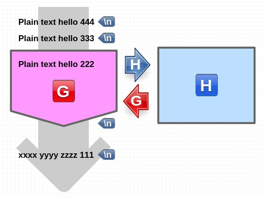

sed 는 2 개의 버퍼가 존재합니다. 하나는 “_pattern space_” (red) 이고 다른 하나는 “_hold space_” (blue) 인데요. 용어는 이렇게 분류했지만 실제로는 사용할수 있는 변수가 2 개 있는 것과 같습니다.

sed 가 입력 스트림에서 라인을 하나 읽어들이면 위치하는 곳이 _pattern space_ 입니다. sed 에 제공되는 프린트 명령, 수정 명령들이 실행될 때 적용되는 공간도 _pattern space_ 입니다.

_hold space_ 는 단순히 “임시 저장소 역할” 만 처리합니다. _pattern space_ 의 데이터를 _hold space_ 로 옮기면 수정 명령이 실행될 때 영향을 받지 않고, 나중에 필요할때 다시 _pattern space_ 로 옮겨서 사용할 수 있습니다.

TIP: 위의 그림을 보면 _pattern space_ 를 문자 `G` 로 표시한 것을 볼수 있는데요. 이것은 _hold space_ 의 라인을 _pattern space_ 으로 옮기는 명령이 `g`, `G` 이기 때문입니다. 문자 `p` 는 _print_ 명령으로 사용되므로 데이터를 _hold space_ 에서 _get_ 한다는 의미에서 `g`, `G` 를 생각하면 됩니다.

==== 명령 Cycle

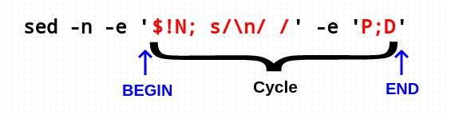

위의 그림에서 명령의 BEGIN 에서 END 까지를 “명령 사이클” 이라 부릅니다. sed 는 기본적으로 명령 사이클을 시작하기 전에 입력 스트림에서 라인을 하나 읽어들여 _pattern space_ 에 저장하는데 어떤 명령은 라인을 읽지 않고 사이클을 시작하기도 합니다. sed 는 명령 사이클 중에 직접 명령을 이용해서 라인을 읽어들일 수도 있습니다.

새로운 사이클을 시작할 때마다 라인을 읽는 경우::
입력 스트림에서 라인을 하나 _pattern space_ 로 읽은 후에 BEGIN 부터 명령 사이클을 시작하고 END 를 지나 한 사이클이 종료되는 경우입니다. 이후는 다시 BEGIN 으로 돌아가서 이전과 동일하게 입력 스트림에서 라인을 읽고 새로운 명령 사이클을 시작합니다. 이때 기존의 _pattern space_ 의 데이터는 삭제되고 새로 읽은 라인으로 대체됩니다.

sed 자체 명령을 이용하여 직접 라인을 읽어들이는 경우::
sed 는 명령 사이클 처리 중에 직접 명령을 이용해서 _pattern space_ 로 라인을 읽기도 하고 삭제할 수도 있습니다. 기본적인 명령 사이클을 거칠 경우 기존의 _pattern space_ 의 내용은 삭제되어 이전 라인을 사용할 수 없으므로 필요에 따라 직접 명령을 이용해서 라인을 읽어야 합니다. 위 그림의 예제 같은 경우 sed 명령이 시작하면서 처음 라인을 읽어들인 후 전체 데이터가 처리될 때까지 한번도 END 를 거치지 않고 명령 사이클을 반복해서 모든 데이터를 처리하고 있습니다.

==== sed 의 default 출력 옵션 `-n`

sed 는 기본적으로 명령 사이클이 끝날때 현재 _pattern space_ 의 내용을 출력합니다.

[source,bash]
----
$ seq 111 111 555 | sed ''
111
222
333
444
555
----

이때 2번 라인을 삭제하고 프린트하려면 `2d` 명령을 사용합니다.

[source,bash]
----
$ seq 111 111 555 | sed '2d'
111
333
444
555
----

이번에는 2번, 4번 라인을 삭제하겠습니다.

[source,bash]
----
$ seq 111 111 555 | sed '2d; 4d'
111
333
555
----

이번에는 3번 라인만 남기고 모두 삭제하려면 어떻게 할까요?

[source,bash]
----
$ seq 111 111 555 | sed '1d; 2d; 4d; 5d'
333
----

물론 이 방법도 틀린 방법은 아닙니다만 처리할 데이터가 많을 경우 모두 `d` 명령을 이용해서 삭제할 수 없습니다. 이때 사용할 수 있는 sed 옵션이 `-n` (_no copy_)입니다. `-n` 옵션을 사용하면 sed 가 명령 사이클이 끝날 때 _pattern space_ 의 내용을 자동으로 출력하지 않습니다. 따라서, 원하는 라인을 출력하려면 직접 `p` (_print_)명령을 사용해야 합니다. 이번에는 `-n` 옵션을 이용해서 위의 예제를 다시 작성해 보겠습니다.

[source,bash]
----
$ seq 111 111 555 | sed -n '3p'
333
----

이렇듯 경우에 따라 어떤 _default_ 출력 옵션을 사용하느냐에 따라 명령이 간단해질 수도 있습니다.

TIP: sed 에서 `-n` 옵션을 사용하지 않은 상태를 “자동 출력 모드” 라고 부릅니다.

==== sed 는 원시적인 언어이다.

sed 를 공부할 때는 1 주일 정도면 문법을 마스터할 수 있는 프로그래밍 언어로 접근하는 것이 좋습니다. sed 는 문장 종료를 나타내는 ; 문자, 명령 그룹을 구성할수 있는 { }, 그리고 branch 명령을 제공하므로 “기본적인 프로그래밍 언어의 형태” 를 갖추고 있습니다.

명령들이 각 라인별로 위치할 경우는 ; 을 붙이지 않아도 되지만 한 라인에 여러 명령을 연이어 사용할 경우는 ; 를 사용해야 합니다. 특정 _address_ 에 처리할 명령이 여러 개일 경우 { } 명령 그룹을 사용하고 마찬가지로 뒤에 ; 을 붙여야 합니다.

_comment_ 는 `#` 문자를 사용하고 라인 마지막까지 실행에서 제외(무시)됩니다.

[source,bash]
----
# 해당 address 에 여러개의 명령을 사용하려면 { } 를 사용합니다.
$ seq 5 | sed -n '2p; 4{p;p}; $p'
2
4
4
5

# 명령들이 각 라인별로 위치할 경우는 `;` 를 붙이지 않아도 된다.
LC_ALL=C git merge -s help 2>&1 |
sed -n -e '/[Aa]vailable strategies are: /,/^$/ {
    s/\.$//
    s/.*://
    s/^[     ]*//
    s/[     ]*$//
    p
}'
----

==== sed 는 Turing complete 하다.

sed 를 처음 사용할 때는 종종 “이건 sed 로 안된다_” 라든가 “여기서 변수를 하나 더 사용할 수 있으면...”, “여기서 이런 함수를 사용할 수 있으면 좋을 텐데...” 같은 생각이 드는데요. sed 는 연산 결과를 저장할 수 있는 임시 저장 공간을 제공하고 조건 분기와 반복을 처리할 수 있으므로 “_Turing complete_ 하다!” 고 표현합니다. 그러니까 스트링을 조작하는데 있어 이론상으론 “모든 문제를 sed 로 해결이 가능하다” 는 이야기입니다. 만약 _Turing machine_ 의 작동 방법이 궁금하면 sed 를 사용하면 됩니다.

=== Regex

문자를 다루는 _Regular expression_ 은 소프트웨어 공학에서 제일 중요하고 기초가 되는 부분입니다. 쉘에서 명령을 실행했을 때 발생하는 출력도 문자이고, 컴파일러가 파싱을 위해 읽어들이는 소스 코드도 프로그래머가 작성한 문자들이기 때문입니다. _Regular expression_ 은 “규칙이 있는 표현식” 이란 의미로 특정 메타문자를 이용해서 규칙을 표현하면 해당 규칙에 맞는 스트링을 매칭할 수 있습니다. 

`regex` 는 보통 3가지로 분류합니다. BRE( _Basic Regular Expressions_ ), ERE( _Extended Regular Expressions_ ), PRE( _Perl Regular Expressions_ ) 입니다. 기본적으로 사용하는 문법은 같은데 기능은 PRE 가 제일 많습니다. 당연히 perl 에서 사용하는데 grep 같은 명령도 툴 특성상 부분적으로 제공하고 있습니다. 하지만 대부분의 명령에서 제공하는 것은 BRE, ERE 입니다. 굳이 PRE 의 기능을 제공하지 않아도 대부분 문제 해결이 되기 때문이기도 하겠습니다.

NOTE: regex 이 암호문 같다고 싫어하는 사람이 많은데 생각보다 중요하고 많은 능력을 가지고 있습니다. 입력값을 파싱하는데 수십줄이나 소요되는 코드를 `regex` 한 두개로 처리하는 사람도 있습니다. _Regular Expressions_ 을 테스트할 수 있는 사이트 : https://regex101.com/

=== BRE, ERE

예전에는 ERE 가 BRE 에 비해 좀 더 확장된 기능을 가지고 있었다는데 지금은 “기능 상의 차이는 없고 단지 syntax 만 다르다” 고 합니다.

`?`, `+`, `|`, `( )`, `{ }`

위의 문자들은 `regex` 에서 특수한 기능을 처리하는 메타문자입니다. 이런 문자를 _escape_ 해서 사용하면 BRE 고 그렇지 않으면 ERE 입니다.

[source,bash]
----
# BRE
$ echo AA22-CC1234 | sed -n 's/[A-Z]\{2\}[0-9]\+-\([A-Z]\{2\}[0-9]*\)/\1/p'
CC1234

# ERE
$ echo AA22-CC1234 | sed -En 's/[A-Z]{2}[0-9]+-([A-Z]{2}[0-9]*)/\1/p'
CC1234
------------------------------------

# BRE
$ echo ABCD | sed -n '/CC\?\|EE\?/p'
ABCD

# ERE
$ echo ABCD | sed -En '/CC?|EE?/p'
ABCD
----

위의 예제는 ERE 가 간결해 보이지만 만약 스트링에 위의 `regex` 메타문자가 많이 포함되면 ERE 로 작성하는게 식이 좀 더 간단할 수 있습니다. BRE 는 모두 _escape_ 해야 되니까요. sed 는 _default_ 가 BRE 입니다. 그러므로 ERE _syntax_ 를 사용하려면 다음과 같이 `-E` 또는 `-r` 옵션을 사용해야 합니다.

[source,bash]
----
# ERE 가 더 간단하다.
$ echo '{AA22}+(CC1234)' | sed -n '/{AA22}+(CC1234)/p'
{AA22}+(CC1234)

# BRE 는 모두 escape 해야 한다.
$ echo '{AA22}+(CC1234)' | sed -En '/\{AA22\}\+\(CC1234\)/p'
{AA22}+(CC1234)

$ sed '...'         # BRE (default)

$ sed -E '...'      # ERE

$ sed -r '...'      # ERE
----

=== BRE, ERE 공통 문자

다음 문자는 공통적으로 _escape_ 하지 않고 사용하는 `regex` 메타문자입니다. 그러므로 일반 텍스트 문자로 사용하려면 BRE, ERE 모두에서 \ 를 이용해서 _escape_ 해야 합니다.

TIP: [ ] 와 { } 를 _escape_ 할 때는 첫 번째 문자만 하면 됩니다.

----
^, $, *, ., [ \
----

[source,bash]
----
# BRE (escape 해서 사용)
$ echo '^*.\[]$' | sed 's/\^\*\.\\\[]\$/xxx/'
xxx

# ERE (escape 해서 사용)
$ echo '^*.\[]$' | sed -E 's/\^\*\.\\\[]\$/xxx/'
xxx
----

=== Character Classes and Bracket Expressions

[ ] 표현식은 안에 있는 문자들 중에 하나를 의미합니다. 그러므로 다음과 같은 경우 gray 또는 grey 단어가 blue 로 치환됩니다.

[source,bash]
sed 's/gr[ae]y/blue/'

`-` 기호를 사용해서 두 문자를 연결할 수 있는데 이 때는 문자 사이에 존재하는 모든 문자를 포함합니다.

[source,bash]
gr[a-d]y : gray grby grcy grdy

이처럼 문자들을 비슷한 의미를 가진 그룹으로 나누어 놓은 것이 _character classes_ 입니다. +[[:alnum:]]+ 의미는 [ ] 표현식 내에서 [:alnum:] 이라는 클래스가 사용되어 결과적으로 [A-Za-z0-9] 의미를 가지게 됩니다. 따라서 +[[:upper:][:digit:]]+ 의 의미는 [A-Z0-9] 와 같게 됩니다.

[%autowidth]
|===
|Class	        |Represented	        |Description
									    
|+[[:alnum:]]+	|[A-Za-z0-9]	        |Alphanumeric characters
|+[[:alpha:]]+	|[A-Za-z]	            |Alphabetic characters
|+[[:lower:]]+	|[a-z]	                |Lower-case alphabetic characters
|+[[:upper:]]+	|[A-Z]	                |Upper-case alphabetic characters
|+[[:digit:]]+	|[0-9]	                |Numeric characters
|+[[:xdigit:]]+	|[0-9a-fA-F]	        |Hexadecimal digit characters
|+[[:space:]]+	|[ \t\n\v\f\r]	        |All whitespace chars (form feed \x0c)
|+[[:blank:]]+	|[ \t]	                |Space, tab only
|+[[:punct:]]+	|[!@#$%^&*(){}[]...]	|키보드에 있는 숫자, 대,소문자 빼고 모든 문자
|+[[:graph:]]+	|[!-~]	                |Printable and visible characters (ASCII 테이블에서 ! 부터 ~ 까지)
|+[[:print:]]+	|[ -~]	                |Printable (non-Control) characters (ASCII 테이블에서 space 부터 ~ 까지)
|+[[:cntrl:]]+	|[\x00-\x19\x7F]	    |Control characters
|===

TIP: +[[:graph:]]+ 와 +[[:print:]]+ 는 space 를 포함하고 안 하고 차이.

[ ] 표현식 에서 - 를 일반 문자로 사용할 때는 두 문자 사이에 위치하지 않게 처음이나 마지막에 위치시키고 [, ] 문자는 처음에 위치시킵니다.

[source,bash]
----
# 'allow-all' 'vm-process-priority' 와 같은 소문자와 '-' 문자로 이루어진 단어 매칭
[[:lower:]-]+ or [a-z-]+

# 전달된 스트링에서 ']' or '[' or '@' 문자를 삭제 
$ echo '[@foo]' | sed 's/[][@]//g'
foo

# 전달된 스트링이 ']' or '[' or '[:alnum:]' 으로 구성되면 매칭
$ echo '-t[imestamp]' | sed -En '/^-[][[:alnum:]]+$/p'
-t[imestamp
----

기본적으로 [ ] 표현식 안에서는 *, ?, ., | 같은 `regex` 메타문자를 _escape_ 하지 않아도 됩니다.

[source,bash]
----
# * + ? [ ] { } ( ) | . ^ $  모두 escape 하지 않아도된다.
$ echo '*+?[]{}()|.^$' | sed -En '/[][{}()*+?|.^$]/p'
*+?[]{}()|.^$
----

==== logical NOT 을 나타내는 ^

[ ] 표현식의 맨앞에 ^ 를 위치시키면 _logical_ NOT 의 역할을 합니다.

[source,bash]
----
# '\n' 을 제외한 모든 문자 (newline 만 아니면 매칭 성공)
[^\n]

# 숫자를 제외한 모든 문자 (숫자만 아니면 매칭 성공)
[^[:digit:]] or [^0-9]

# ']', '[', '|', '-' 문자가 아니면 매칭 성공
[^][|-]
----

==== Regular expression Extensions

이 기능은 BRE, ERE 모두에서 사용할 수 있습니다. 소문자와 대문자가 같이 있는데 대문자는 소문자의 _logical_ NOT 과 같습니다. 이 확장 기능은 [ ] 에는 사용할 수 없습니다. 다시 말해 [\w] 는 \, w 두 문자를 나타냅니다.

\s, \S::
\s 는 +[[:space:]]+ 를 \S 는 [^[:space::]] 를 나타냅니다.

\w, \W::
\w 는 [[:alnum:]_] 를 나타냅니다. 즉 [:alnum:] 클래스에 _ 가 추가된 것입니다. (- 는 포함되지 않습니다.)

\W 는 [^[:alnum:]_] 을 나타냅니다.

\b, \B::
_word boundary_ 를 나타냅니다.

[source,bash]
----
# \b 의 경우
$ echo 'abc %-= def.' | sed 's/\b/X/g'
XabcX %-= XdefX.

# \B 의 경우
$ echo 'abc %-= def.' | sed 's/\B/X/g'
aXbXc X%X-X=X dXeXf.X
----

\<, \>::
\< 는 _word boundary_ 인데 word 시작 부분, \> 는 word 끝부분을 나타냅니다.

[source,bash]
----
# '\<' 의 경우
$ echo "abc %-= def." | sed 's/\</X/g'
Xabc %-= Xdef.

# '\>' 의 경우
$ echo "abc %-= def." | sed 's/\>/X/g'
abcX %-= defX.
----

=== Subexpressions and Back-references

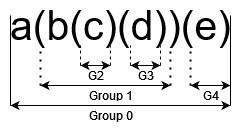

`regex` 에서 ( ) 를 하면 _subexpression_ 이 됩니다. 이 _subexpression_ 은 { }, +, * 같은 수량 한정자와 같이 사용할 수 있습니다.

[source,bash]
----
$ echo "aaa@bbb@" | sed -En '/^\w+@$/p'

$ echo "aaa@bbb@" | sed -En '/^(\w+@){2}$/p'
aaa@bbb@

$ echo "aaa@bbb@" | sed -En '/^(\w+@)+$/p'
aaa@bbb@

# 중복 매칭 구하기, 'sed' 단어가 2번 이상 포함될 경우만 프린트
$ echo "111sed22sss333" | sed -En '/(sed.*){2,}/p' 

$ echo "111sed22sed333" | sed -En '/(sed.*){2,}/p' 
111sed22sed333

# sed 두 단어가 붙어 있을 수도 있으므로 '.*' 를 사용
$ echo "111sedsed333" | sed -En '/(sed.*){2,}/p' 
111sedsed333
----

또한 ( ) 에서 OR 연산자를 사용할 수 있습니다.

[source,bash]
----
$ echo 'AA11 AA22 AA33 AA44 AAAA' | sed -E 's/AA(11|22|[^0-9]{2})/XX/g'
XX XX AA33 AA44 XX

# %pK 는 놔두고 %p 만 %pK 로 변경
$ echo '%pK %p-%p' | sed -E 's/%p([^K])/%pK\1/g'
%pK %pK-%p

$ echo '%pK %p-%p' | sed -E 's/%p([^K]|$)/%pK\1/g'
%pK %pK-%pK
---------------------------------------------------------------------

# 다음 두 식은 같은 결과를 같습니다. 
# 참고로 [ ] 안에서 '.' 문자를 사용할땐 escape 하지 않아도 되는걸 알 수 있습니다.
$ echo '__123-45.67__' | sed -En '/^(0|1|2|3|4|5|6|7|8|9|\.|_|-)+$/p'
__123-45.67__

$ echo '__123-45.67__' | sed -En '/^[0-9._-]+$/p'
__123-45.67__
----

( ) 를 하면 _back-reference_ 를 위한 번호가 매겨지고 \1 \2 \3 ... \9 같은 형태로 참조할 수 있습니다.

[source,bash]
----
$ echo "aaa@bbb@ccc" | sed -E 's/(\w+)@(\w+)@(\w+)/\1/'
aaa

$ echo "aaa@bbb@ccc" | sed -E 's/(\w+)@(\w+)@(\w+)/\2/'
bbb

$ echo "aaa@bbb@ccc" | sed -E 's/(\w+)@(\w+)@(\w+)/\3/'
ccc
----

이 back-reference 번호는 regex 에서도 사용될 수 있습니다.

[source,bash]
----
# 여기서 '\1' 은 (\w+) 를 나타내는 것이 아니고 매칭 된 결과 그러니까 aaa 를 나타냅니다.
# aaa 와 ccc 는 틀리므로 매칭이 안됨
$ echo "aaa@bbb@ccc" | sed -En '/(\w+)@\w+@\1/p'

# aaa 와 aaa 는 매칭이 되므로 내용이 프린트가 된다
$ echo "aaa@bbb@aaa" | sed -En '/(\w+)@\w+@\1/p'
aaa@bbb@aaa

# 이번에는 word boundary 로 'sed' 단어가 2번 이상 포함될 경우만 프린트
$ echo "111 sedsed 33" | sed -En '/(\bsed\b).*\1/p' 

$ echo "111 sed sed 33" | sed -En '/(\bsed\b).*\1/p' 
111 sed sed 33
----

( ) 는 _nesting_ 해서 사용할 수 있습니다. 바깥쪽 괄호가 작은 번호가 됩니다.

[source,bash]
----
$ echo "aaa@bbb@ccc" | sed -E 's/(((\w+)@\w+)@\w+)/\1/'
aaa@bbb@ccc

$ echo "aaa@bbb@ccc" | sed -E 's/(((\w+)@\w+)@\w+)/\2/'
aaa@bbb

$ echo "aaa@bbb@ccc" | sed -E 's/(((\w+)@\w+)@\w+)/\3/'
aaa
----

=== regex 로 매칭된 전부를 나타내는 & 문자

[source,bash]
----
$ echo '111 AB 222 CD 333' | sed -E 's/.*/X&X/'
X111 AB 222 CD 333X

$ echo '111 AB 222 CD 333' | sed -E 's/[A-Z]+/X&X/'
111 XABX 222 CD 333

$ echo '111 AB 222 CD 333' | sed -E 's/[A-Z]+/X&X/g'
111 XABX 222 XCDX 333

$ echo '111 AB 222 CD 333' | sed -E 's/[A-Z]+.*/X&X/'
111 XAB 222 CD 333X
----

=== * 와 + 는 greedy 하므로 주의가 필요하다.

`regex` 에서 *, + 를 이용해서 매칭을 시도할 때 한 가지 문제가 있습니다. 가령 아래와 같은 라인이 있을 때 /AA.*AA/ or /AA.+AA/ 로 매칭을 시도하면 어디까지 매칭해야 하는가 라는 것입니다.

[source,bash]
----
AA 111 AA 222 AA 333 AA              # lazy matching
^^^^^^^^^

AA 111 AA 222 AA 333 AA              # greedy matching
^^^^^^^^^^^^^^^^^^^^^^^
----

`regex` 는 기본적으로 두번째 greedy (longest) matching 을 처리합니다. 따라서 `regex` 를 작성할 때 다음과 같은 경우는 주의할 필요가 있습니다.

[source,bash]
----
# 숫자 부분을 추출하려고 하는데 마지막 문자만 표시된다.
$ echo "abc123" | sed -En 's/.*([0-9]+)/\1/p'
3

# 첫 번째 'img' 태그를 삭제하려고 하는데 '<html>' 만 남고 모두 삭제된다. 
$ echo '<html>abc</html>' |
  sed -En 's///p'
<html>

# 앞쪽의 'aa=11,xx=00,bb' 를 'cc' 로 변경하려고 하는데 마지막 'bb' 까지 매칭이 된다.
$ echo 'aa=11,xx=00,bb=22,aa=33,yy=00,bb=44' | sed -E 's/aa.*bb/cc/'
cc=44
----

sed 에서 _lazy matching_ 을 처리하려면 다음과 같이 합니다.

[source,bash]
----
$ echo "abc123" | sed -En 's/[^0-9]*([0-9]+)/\1/p'
123

$ echo '<html>abc</html>' |
  sed -En 's/]*>//p'
<html>abc</html>

$ echo 'aa=11,xx=00,bb=22,aa=33,yy=00,bb=44' | sed -E 's/aa[^b]*bb/cc/'
cc=22,aa=33,yy=00,bb=44

# 다음은 앞쪽이 아니라 뒤쪽을 cc 로 바꿀경우
# 마지막 '=44' 는 regex 매칭에는 포함되지 않은 hidden 이다.
$ echo 'aa=11,xx=00,bb=22,aa=33,yy=00,bb=44' | sed -E 's/(.*)aa.*bb/\1cc/'
aa=11,xx=00,bb=22,cc=44

# 다음의 경우는 두 개의 greedy (.*) 가 사용되었는데요.
# 결과적으로 앞쪽이 먼저 처리되는 것을 볼수 있습니다.
$ echo 'aa=11,xx=00,bb=22,aa=33,yy=00,bb=44' | sed -E 's/aa.*bb(.*)/cc\1/'
cc=44
----

TIP: 특정 스트링을 _lazy_ 매칭하는 방법은 https://mug896.github.io/sed-stream-editor/move.html#quiz[이곳^] 에서 볼 수 있습니다.

=== * 와 + 의 backtracking 기능

`*` 와 `+` 는 임의의 수량을 나타내기 때문에 만약 다음에 오는 값이 매칭이 안될 경우 매칭하기 위해 다시 뒤로 갈수도 있습니다. 일종의 고급 기능으로 특정 상황에선 유용하게 사용할 수 있습니다.

[source,bash]
----
$ echo  'model <dell,847483992,16G> AMD' | sed -En 's/<[^>]*/</p'
model <> AMD

$ echo  'model <dell,847483992,16G> AMD' | sed -En 's/<[^>]*,/</p'     # "," 추가 
model <16G> AMD

1. 먼저 <[^>]* 식에 의해서 <dell,847483992,16G 까지 매칭이 됩니다.

2. 그런데 <[^>]* 식 뒤에 "," 가 와서 "> AMD" 와 매칭이 안되므로 매칭이 될때까지 
   다시 backtracking 을 하게되어 <dell,847483992, 에서 매칭이 되게 됩니다.
----

다음은 Go 언어에서 사용하는 함수 형식인데 _backtracking_ 을 이용해서 함수명을 추출하는 예입니다.

[source,bash]
----
func TeeReader(r Reader, w Writer) Reader { ...
func (l *LimitedReader) Read(p []byte) (n int, err error) { ...
func Print[T1 any, T2 any](a T1, b T2) { ...

$ echo 'func (l *LimitedReader) Read(p []byte) (n int, err error) { ...' | 
    sed -En 's/^func[^{]* (\w+)[[(].*/\1/p'
Read

1. 먼저 ^func[^{]* 식에 의해 func 에서부터 { 문자 앞부분까지 매칭이 됩니다.
2. 그다음 ^func[^{]* 식에 이어서 " (\w+)[[(].*" 이 오는데 "{" 와는 매칭이 안되죠.
3. 따라서 매칭이 될때까지 backtracking 을 하면 ... Read( 에서 매칭이 되게 됩니다.
----

`.*` 와 `.+` 는 _greedy_ 하지만 구분자로 사용되는 , 문자가 사이에 존재하면 매칭되어 필드 값을 추출할 수 있습니다.

[source,bash]
----
$ echo "111,222,333,444" | sed -En 's/(.*),(.*),(.*),(.*)/\1:\2:\3:\4/p'
111:222:333:444

1. 첫번째 (.*) 식에 의해 111,222,333,444 전체가 매칭이 됩니다.
2. 그런데 다음에 "," 가 오므로 backtracking 을 하면 111,222,333, 에서 매칭이 됩니다.
3. 두번째 (.*) 식에 의해 앞서 매칭된 111,222,333, 와 444 가 매칭이 됩니다.
4. 그런데 다음에 또 "," 가 오므로 매칭이 실패하게 되어 첫번째 와 두번째 (.*) 가 모두
   다시 backtracking 을 하게 되어 첫번째는 111,222, 에서 매칭이 되고 두번째는
   333, 에서 매칭이 되게 됩니다.
5. 세번째 (.*) 식에 의해 앞서 매칭된 111,222, 와 333, 와 444 가 매칭이 됩니다.
6. 그런데 다음에 또 "," 가 와서 매칭이 실패하게 되어 ...
( 기본적인 로직이 이렇다는 것이고 실제는 빠른 처리를 위해 최적화가 이루어집니다.)
----

=== regex 를 이용한 추출

입력 값에서 특정 스트링만 추출할 때는 grep -o 나 awk 명령을 사용하는 것이 더 편리하지만 sed 도 `regex` 을 이용해서 추출을 할 수 있습니다.

[source,bash]
----
# 다음은 스트링에 숫자가 포함되어 있을 경우 특정 위치의 숫자만 추출합니다.

$ echo "aaa123bbb456ccc789ddd" | sed -E 's/([a-z]+([0-9]+)).*/\2/'        # 첫번째 숫자
123
$ echo "aaa123bbb456ccc789ddd" | sed -E 's/([0-9]+).*|./\1/g'
123

$ echo "aaa123bbb456ccc789ddd" | sed -E 's/([a-z]+([0-9]+)){2}.*/\2/'     # 두번째 숫자
456

$ echo "aaa123bbb456ccc789ddd" | sed -E 's/([a-z]+([0-9]+)){3}.*/\2/'     # 세번째 숫자
789

----------------------------------------------------------------------

# "숫자%" 로 구성된 항목만 추출
$ df -h | sed -E 's/([0-9]+%)|./\1/g'
0%
1%
49%
1%

$ echo '/dev/sda1 511% 7.1M 504M 24% /boot/efi' |
    sed -E 's/([0-9]+% )|./\1/g' 
511% 24%

1. "/dev/sda1 " 앞부분은 ([0-9]+% ) 식과 매칭이 되지 않으므로 "." 와 매칭이 되어 출력에서 제외가 됩니다.
2. "511% " 는 ([0-9]+% ) 식과 매칭이 되어 \1 에의해 출력에 남게 됩니다.
3. "7.1M 504M " 부분도 ([0-9]+% ) 식과 매칭이 되지 않으므로 "." 와 매칭이 되어 출력에서 제외가 됩니다.
4. "24% " 는 ([0-9]+% ) 식과 매칭이 되어 \1 에의해 출력에 남게 됩니다.
5. "/boot/efi" 부분도 ([0-9]+% ) 식과 매칭이 되지 않으므로 "." 와 매칭이 되어 출력에서 제외가 됩니다.

# 다음은 "[숫자]" or "<숫자>" 형태만 추출합니다.
$ echo "aa [12] bb <34> cc [5X6] dd <78> ee [99] ff" | 
    sed -E 's/(\[[0-9]+] |<[0-9]+> )|./\1/g'
[12] <34> <78> [99]
----

=== { } 수량 한정자

`*` 는 {,} 와 같고 `+` 는 {1,} 과 같습니다.

[source,bash]
----
$ echo "XYXYXY12345" | sed -E 's/^(XY)*/ZZZ/' 
ZZZ12345
$ echo "XYXYXY12345" | sed -E 's/^(XY){,}/ZZZ/'
ZZZ12345
$ echo "XYXYXY12345" | sed -E 's/^(XY)+/ZZZ/'
ZZZ12345
$ echo "XYXYXY12345" | sed -E 's/^(XY){1,}/ZZZ/'
ZZZ12345

$ echo "12345" | sed -E 's/^(XY)*/ZZZ/'
ZZZ12345
$ echo "12345" | sed -E 's/^(XY){,}/ZZZ/'
ZZZ12345
$ echo "12345" | sed -E 's/^(XY)+/ZZZ/'
12345
$ echo "12345" | sed -E 's/^(XY){1,}/ZZZ/'
12345
----

? 는 {,1} 와 같습니다.

[source,bash]
----
$ echo "XY12345" | sed -E 's/^(XY)?/ZZZ/' 
ZZZ12345
$ echo "XY12345" | sed -E 's/^(XY){,1}/ZZZ/' 
ZZZ12345
$ echo "12345" | sed -E 's/^(XY)?/ZZZ/' 
ZZZ12345
$ echo "12345" | sed -E 's/^(XY){,1}/ZZZ/' 
ZZZ12345
----

=== hidden 에 주의

`regex` 매칭에 포함되지 않는 부분은 _hidden_ 으로 출력에 포함되므로 주의해야 합니다.

[source,bash]
----
# 여기서 'AAA' 는 매칭에 포함되지 않은 hidden 이다.
$ echo 'AAA CONFIG_FOO BBB' | sed -E 's/(CONFIG_\w+).*/\1/'
AAA CONFIG_FOO

# hidden 이 생기지 않게 하려면 다음과 같은 방법으로 전체 라인을 매칭을 해야 한다.
$ echo AAA CONFIG_FOO BBB | sed -E 's/.*(CONFIG_\w+).*/\1/'
CONFIG_FOO

# 여기서는 2017 이 hidden 이고 greedy '.*' 에 의해 1000 까지 매칭이 된다.
$ echo '2017-01-19:31:51 15333 37723 - MATCH: 1000 [text]' |
  sed -E 's/-.* ([0-9]+) .*/-\1/'
2017-1000
----

다음은 strace 출력에서 함수 이름을 추출한 것인데요. 출력 결과를 보면 마지막 라인은 표시되지 않아야 하는데 출력되고 있습니다.

[source,bash]
----
$ cat some.strace
26074 exit(0)                           = ?
26074 +++ exited with 0 +++
26073 close(65)                         = 0
26073 gettid()                          = 26073
26074 <... madvise resumed> )           = 0
26073 gettid()                          = 26073
26073 <... futex resumed> )             = -1 EAGAIN (Resource temporarily unavailabl

$ sed -En 's/[0-9]+ (\w+).*/\1/p' some.strace
exit
close
gettid
gettid
26073 <... futex resumed> )             = -EAGAIN
----

26073 <... futex resumed> ) = - 부분이 _hidden_ 되기 때문입니다.

[source,bash]
----
$ sed -En 's/[0-9]+ (\w+).*/XXX\1YYY/p' some.strace
XXXexitYYY
XXXcloseYYY
XXXgettidYYY
XXXgettidYYY
26073 <... futex resumed> )             = -XXXEAGAINYYY
----

따라서 다음과 같이 앞에 ^ _anchor_ 를 붙여야 합니다.

[source,bash]
----
$ sed -En 's/^[0-9]+ (\w+).*/\1/p' some.strace
exit
close
gettid
gettid
----

=== 예제 1

다음 데이터는 CSV( _comma-separated values_ ) 인데요. 여러 가지 방법을 이용해서 필드의 위치를 변경합니다.

[source,bash]
----
# 2번째 필드와 3번째 필드 바꾸기
# 여기서 매칭이 안되는 111, 444 는 hidden 이다.
$ echo '111,222,333,444' | sed -E 's/,(.*),(.*),/,\2,\1,/'
111,333,222,444

# 4번째 필드를 1번째로, 1,2번째 필드를 마지막으로
# '.*' 가 복수개 이상 사용되면 첫 번째 것이 greedy 가 된다.
# 결과적으로 매칭은 (111,222),(333),(444)
$ echo '111,222,333,444' | sed -E 's/(.*),(.*),(.*)/\3,\2,\1/'
444,333,111,222

# 4번째 필드와 1번째 필드 바꾸기
$ echo '111,222,333,444' | sed -E 's/(.*),(.*),(.*),(.*)/\4,\2,\3,\1/'
444,222,333,111
----

=== 예제 2

IP 주소는 4 개의 숫자로 이루어지는데 각각 범위가 0 ~ 255 까지입니다. `regex` 을 이용해서 IP 주소가 맞는지 확인하는 것입니다.

[source,bash]
----
$ sed -En '/(([0-9]{1,2}|1[0-9]{2}|2[0-4][0-9]|25[0-5])\.){3}([0-9]{1,2}|1[0-9]{2}|2[0-4][0-9]|25[0-5])/p' <<\@
192.168.0.1
127.0.0.1
123.456.789.101      # 456 789 는 IP 주소가 아니다.
10.1.2.4
@

192.168.0.1
127.0.0.1
10.1.2.4
----

=== 예제 3

다음은 "[숫자 - 숫자]" 형태의 필드에서 첫 번째 숫자만 추출해서 표시합니다.

[source,bash]
----
# 숫자에 소수점이 포함되므로 '[0-9.]' 을 사용
$ echo '10368,"Verizon DSL",DSL,NY,NORTHEAST,-5,-4,"[1.1 - 3.0]","[0.384 - 0.768]"' |
sed -E 's#"\[([0-9.]*)[^"]*"#"\1"#g'

10368,"Verizon DSL",DSL,NY,NORTHEAST,-5,-4,"1.1","0.384"
----

=== 예제 4

두 번째 _double quote_ 으로 둘러싸인 값을 [ ] 안으로 넣고 각각의 값들을 _comma_ 로 분리해서 _double quote_ 합니다.

[source,bash]
----
# Before
{"name": "john , jane, gordon ,matthew"} 

# After    
{"name": ["john","jane","gordon","matthew"]}

-------------------------------------------

$ sed -E '
    s/"([^"]+)".*"([^"]+)"/"\1": ["\2"]/    # quotes 으로 둘러싸인 첫번째, 두번째값 분리
    s/ ?, ?/","/g                           # comma 로 분리된 각각의 값들을 quote 처리
' file

{"name": ["john","jane","gordon","matthew"]}
----

=== 예제 5

이번 예제는 ( ) 의 _nesting_ 기능과 .* 의 _greedy_ 한 속성을 이용해서 데이터를 변경합니다.

[source,bash]
----
# Before
     //svn.server.address/repos/module1/branches/issue-001-name1
     //svn.server.address/repos/module2/branches/issue-002-name2
     //svn.server.address/repos/module3/branches/issue-003-name3

$ sed -E 's#\s+(.*/(.*))#svn co \1 \2#' file

# After
svn co //svn.server.address/repos/module1/branches/issue-001-name1 issue-001-name1
svn co //svn.server.address/repos/module2/branches/issue-002-name2 issue-002-name2
svn co //svn.server.address/repos/module3/branches/issue-003-name3 issue-003-name3
----

=== Quiz

사용자에게 C/C++ 함수의 원형을 입력받아 매칭이 존재하는지 확인하는 스크립트를 만들려고 합니다. sed 명령문을 어떻게 작성하면 좋을까요?

. C/C++ 함수의 원형에는 `regex` 에 사용되는 (, ) 문자가 존재하므로 ERE 보다는 BRE 로 작성하는것이 좋겠습니다. 

. 그리고 * , . , [ 문자는 BRE, ERE 모두에서 `regex` 문자로 사용되므로 _escape_ 해야 합니다.

[source,bash]
----
# C/C++ 함수의 원형에는 regex 에서 사용되는 ( , ) , [ , * 문자가 존재한다.

int foobar(const char*, int (*) [3])

----------------------------------------------------------

# 사용자가 위의 함수 원형을 입력했다고 가정하고 변수에 대입해서 매칭을 해보겠습니다.
$ input='int foobar(const char*, int (*) [3])'

# sed 명령문을 BRE 로 작성하였지만 매칭이 되지 않는다.
$ echo 'int foobar(const char*, int (*) [3])' | sed -n '/'"$input"'/p'
$

# shell 의 매개변수 확장 기능을 이용해 * 문자를 \* 로 [ 문자를 \[ 로 escape 해 줍니다.
$ input=${input//\*/\\*}
$ input=${input//[/\\[}
$ echo "$input"
int foobar(const char\*, int (\*) \[3])

# 이제 정상적으로 매칭이 되는것을 볼 수 있습니다.
$ echo 'int foobar(const char*, int (*) [3])' | sed -n '/'"$input"'/p'
int foobar(const char*, int (*) [3])
----

=== Escape sequences

[%autowidth]
|===
|Escape Sequence	|Character represented

|\a	                |alert (bell)
|\f	                |form feed
|\n	                |newline
|\r	                |carriage return
|\t	                |horizontal tab
|\v	                |vertical tab
|\cx	            |Ctrl-x 문자, 가령 \cz 는 Ctrl-z (^Z)
|\dNNN	            |10 진수 ASCII 문자 NNN
|\oNNN	            |8 진수 ASCII 문자 NNN
|\xHH	            |16 진수 ASCII 문자 HH
|===

TIP: \b (_backspace_) 는 `regex` 에서 _word boundary_ (\b) 와 겹치므로 제외했습니다.

[source,bash]
----
# NUL 문자는 `\x0` 를 사용하면 됩니다.
$ find ...  -print0 | sed -z 'N; s/\x0/.../'

# 유니코드 문자는 다음과 같이 shell 의 $' ' 을 사용하면 됩니다.
$ echo aaa | sed 's/a/'$'\U2665''/g'
♥♥♥
----

== Addresses

Address 는 입력되는 라인들 중에서 원하는 라인을 선택하기 위해 사용하는 방법입니다. 각 라인들은 라인 넘버를 가지므로 첫 번째로 라인 넘버를 이용하는 방법이 있구요. 두 번째는 `regex` 매칭을 이용해서 지정할 수 있습니다. address 뒤에 ! 문자를 붙이면 _logical_ NOT 역할을 합니다. , 문자를 이용해서 두 개의 _address_ 를 연결하면 일종의 _address range_ 를 형성할 수 있습니다.

_address_ 에 해당하는 명령이 복수 개 이상일 경우 { } 명령 그룹을 이용합니다.

=== Numeric Addresses

다음은 라인 넘버를 이용해서 _address_ 를 지정하는 예입니다.

[source,bash]
----
# 10번 라인만 프린트
$ sed -n '10p'

# 10번 라인만 삭제
$ sed '10d'

# 20번 라인만 foo 를 bar 로 수정
$ sed '20s/foo/bar/'
----

==== $ (마지막 라인)

_address_ 에 사용되는 $ 는 마지막 라인을 뜻합니다. 이문자가 /regex/ 에서 사용되면 라인의 끝을 나타냅니다.

[source,bash]
----
# 마지막 라인만 프린트
$ seq 10 | sed -n '$p'
10
----

==== first ~ step

_first_ 에 계속해서 _step_ 을 더한다고 생각하면 됩니다.

[source,bash]
----
# 1, 4, 7, 10, 13, 16 ...
$ seq 10 | sed -n '1 ~ 3p'
1
4
7
10

# 4, 8, 12, 16, 20 ...  주소 0 의 의미는 뒤에도 나옵니다.
$ seq 10 | sed -n '0 ~ 4p'
4
8

# 위와 같은 결과입니다.
$ seq 10 | sed -n '4 ~ 4p'  
4
8
----

[source,bash]
----
$ ip -4 address | cat -n
     1  1: lo: <LOOPBACK,UP,LOWER_UP> mtu 65536 qdisc noqueue state UNKNOWN ...
     2      inet 127.0.0.1/8 scope host lo
     3         valid_lft forever preferred_lft forever
     4  2: enp0s25: <BROADCAST,MULTICAST,UP,LOWER_UP> mtu 1500 qdisc ...
     5      inet 220.85.92.78/24 brd 220.85.92.255 scope global dynamic ...
     6         valid_lft 4903sec preferred_lft 4903sec
     7  4: lxdbr0: <NO-CARRIER,BROADCAST,MULTICAST,UP> mtu 1500 qdisc noqueue state ...
     8      inet 10.24.244.1/24 scope global lxdbr0
     9         valid_lft forever preferred_lft forever
    10  5: br-958737dcc5b0: <NO-CARRIER,BROADCAST,MULTICAST,UP> mtu 1500 qdisc ...
    11      inet 172.18.0.1/16 brd 172.18.255.255 scope global br-958737dcc5b0
    12         valid_lft forever preferred_lft forever
    13  6: docker0: <NO-CARRIER,BROADCAST,MULTICAST,UP> mtu 1500 qdisc noqueue ...
    14      inet 172.17.0.1/16 brd 172.17.255.255 scope global docker0
    15         valid_lft forever preferred_lft forever

$ ip -4 address | sed -n '2 ~ 3p'
    inet 127.0.0.1/8 scope host lo
    inet 220.85.92.78/24 brd 220.85.92.255 scope global dynamic noprefixroute enp0s25
    inet 10.24.244.1/24 scope global lxdbr0
    inet 172.18.0.1/16 brd 172.18.255.255 scope global br-958737dcc5b0
    inet 172.17.0.1/16 brd 172.17.255.255 scope global docker0
----

=== Regex Addresses

regex 를 이용한 address 지정은 /regex/ 형식을 사용합니다.

[source,bash]
----
# 라인에 apple 이 포함될 경우만 프린트
$ sed -n '/apple/p' 

# 라인이 file[0-9]+ 과 매칭될 경우만 프린트
$ sed -En '/file[0-9]+/p' 

# 라인에 apple 이 포함될 경우만 foo 를 bar 로 수정
$ sed '/apple/ s/foo/bar/'
----

==== /regex/I

I 옵션을 사용하면 매칭을 할때 대, 소문자를 구분하지 않습니다. ( `s` 수정 명령에서도 동일하게 사용할 수 있습니다.)

[source,bash]
----
# 대문자 'LL' 과 소문자 'll' 이 매칭 되지 않는다.
$ echo heLLo | sed -n '/hello/p'
$

# 'I' 옵션을 사용하면 대, 소문자 구분 없이 매칭할 수 있다.
$ echo heLLo | sed -n '/hello/Ip'
heLLo
----

==== /regex/M

_pattern space_ 에 라인이 여러개 들어있을 경우 multi-line 모드를 사용할 수 있는데 이 부분은 따로 Multiple lines 메뉴에서 다루겠습니다.

==== /.../ 구분자를 다른 문자로 사용하기

regex 패턴에 디렉토리명과 같이 / 문자가 포함될 경우 /.../ 문자와 겹치므로 모두 escape 해야하는데요. 이때 다음과 같은 방법을 사용하여 식을 간단히 할 수 있습니다.

[source,bash]
----
# '/' 문자를 모두 escape 해야 되기 때문에 가독성이 떨어진다.
$ sed -n '/\/usr\/local\/bin/p'

# 구분자로 사용할 임의의 문자를 선정한 후 첫번째 문자만 escape 한다.
$ sed -n '\@/usr/local/bin@p'

$ sed -n '\#/usr/local/bin#p'

$ sed -n '\,/usr/local/bin,p'
----

==== /^$/ (공백 라인)

sed 에서 공백 라인은 /^$/ 로 표현됩니다. 라인의 처음과(^) 끝($) 사이에 아무것도 없으니 공백 라인이 되겠죠.

[source,bash]
----
# 공백라인을 모두 제거하고 프린트
$ sed -n '/^$/!p' file

# 공백라인에 space 나 tab 문자가 포함될 경우
$ sed -n '/^[[:blank:]]*$/!p' file
----

=== Range Addresses

address range 에 사용되는 address1, address2 는 numeric 과 regex 를 혼합해서 사용할 수 있습니다.

[source,bash]
----
# 10번 부터 20번 라인까지 프린트
$ sed -n '10,20p'

# 'BEGIN' 이 포함되는 라인부터, 'END' 가 포함되는 라인까지 프린트
$ sed -n '/BEGIN/,/END/p'

# 'BEGIN' 이 포함되는 라인부터, 공백 라인까지 프린트
$ sed -n '/BEGIN/,/^$/p'

# 10번 라인부터 'END' 가 포함되는 라인까지 프린트
$ sed -n '10,/END/p'

# 'MIDDLE' 이 포함되는 라인부터 마지막 라인까지 프린트
$ sed -n '/MIDDLE/,$p'

# 2번 부터 4번 라인까지만 [0-9] 를 X 로 치환 
$ cat <<\--- | sed '2,4 s/[0-9]/X/g'
11
22
33
44
55
66
---
11
XX
XX
XX
55
66

$ cat <<\--- | sed -n '/[0-9]/,/[0-9]/p'
AA
11
BB            
22               
CC                   # 'CC' 가 빠졌고 '33', 'DD' 까지 프린트 됩니다.
---                  # 항상 sed 는 stream editor 라는 생각을 가지고 있어야 합니다.
11                   $ cat <<\--- | sed -n '/[0-9]/,/[0-9]/p'
BB                   AA
22                   11
                     BB
                     22
                     CC
                     33
                     DD
                     ---
                     11
                     BB
                     22
                     33
                     DD
----

==== address1 , +N

address1 부터 이후 +N 라인 까지에 해당합니다.

[source,bash]
----
# 3 부터 이후 +2 라인 까지 이므로 결과적으로 3,5p 가 됩니다. 
$ seq 10 | sed -n '3,+2p'
3
4
5

$ cat <<\--- | sed -n '/MIDDLE/,+2p'        $ cat <<\--- | sed '/MIDDLE/,+2d'
111                                         111
222                                         222
MIDDLE                                      MIDDLE
333                                         333
444                                         444
555                                         555
---                                         ---
MIDDLE                                      111
333                                         222
444                                         555
----

==== address1 , ~N

~ 문자 는 위에 first ~ step 에서도 한번 나왔는데요. 배수를 뜻합니다. 그러니까 address1 부터 숫자 N 의 배수까지라는 의미가 됩니다.

[source,bash]
----
# 6 을 지나는 4 의 배수는 8 이므로 결과적으로 6,8p 가 됩니다.
$ seq 20 | sed -n '6,~4p'
6
7
8
----

==== 0 , /regex/

address range 는 결과가 프린트될때 최소 2 라인이 표시됩니다. 그래서 만약에 1번 라인이 address2 에 매칭 되었을때 1번 라인만 프린트할 수가 없는데요.
이때 사용할수 있는 방법이 address 0 입니다.

[source,bash]
----
# address range 는 최소 2 라인이 표시된다.
$ seq 10 | sed -n '1,/[0-9]/p'
1
2

# address '0' 을 이용하면 1번 라인만 프린트할수 있다.
$ seq 10 | sed -n '0,/[0-9]/p'
1
----

=== Logical NOT

address range 에서는 ! 를 각각의 주소에 사용할 수 없습니다. addr1 , addr2 ! 의 의미는 addr1 , addr2 를 제외한 나머지 부분이라고 생각하면 됩니다.

[source,bash]
----
# 3번 라인을 제외하고 모두 프린트
$ seq 5 | sed -n '3!p'             # sed '3d' 와 같습니다.
1
2
4
5

# 10 ~ 20 라인을 제외하고 모든 라인에서 foo 를 bar 로 수정
$ sed '10,20! s/foo/bar/'

# 3 ~ 8 라인을 제외하고 모두 프린트
$ seq 10 | sed -n '3,8!p'
1
2
9
10

$ echo -e "AA\n11\nBB\n22\nCC" | sed -n '/[0-9]/,/[0-9]/!p'
AA
CC

$ echo -e "AA\n11\nBB\n22\nCC\n33\nDD" | sed -n '/[0-9]/,/[0-9]/!p'
AA
CC

$ echo -e "AA\n11\nBB\n22\nCC\n33\nDD\n44\nFF" | sed -n '/[0-9]/,/[0-9]/!p'
AA
CC
FF
----

=== 예제 1

. <parent> 와 </parent> 로 둘러싸인 값만 프린트 합니다.
. <parent> 와 </parent> 로 둘러싸인 값을 제거하고 나머지 부분을 프린트 합니다.
. <parent> 와 </parent> 로 둘러싸인 값에서 "-SNAPSHOT" 을 삭제합니다.

[source,bash]
----
# 데이터 내용
<modelVersion>4.0.0</modelVersion>
<version>5.1.3-SNAPSHOT</version>

<parent>
    <artifactId>xxx</artifactId>
    <groupId>group</groupId>
    <version>5.1.3-SNAPSHOT</version>
</parent>

<artifactId>yyy</artifactId>
<packaging>pom</packaging>
<name>artifact name</name>

-------------------------------------

# 1번 해답
$ sed -n '/<parent>/,/<\/parent>/p'

# 2번 해답
$ sed '/<parent>/,/<\/parent>/d'

$ sed -n '/<parent>/,/<\/parent>/!p'

# 3번 해답
$ sed '/<parent>/,/<\/parent>/ s/-SNAPSHOT//'
----

=== 예제 2

공백 라인에 의해 레코드가 분리되어 있고 [name] 형식의 헤더를 갖습니다. 이때 [shovel] 헤더를 갖는 레코드에서 enabled = 0 항목을 enabled = 1 로 변경합니다.

[source,bash]
----
# 데이터 내용
[purple]
auth = no
enabled = 0
username = 
password =
priority = 0
host = True

[shovel]
group = 
manual = False
enabled = 0
username = 

--------------------

$ sed '/\[shovel]/,/^$/ { /enabled/ s/0/1/ }' file
----

== AND, OR, NOT

sed 는 간단히 사칙연산을 할 수 있는 연산자도 없을뿐더러 AND, OR 연산자도 없습니다. 하지만 sed 의 기본기능을 활용하면 AND, OR 연산을 처리할 수가 있습니다.

=== AND

AND 연산은 보통 프로그래밍 언어에서 && 연산자로 표현되는데요. sed 에서는 다음과 같은 방식으로 AND 연산 결과를 얻을 수 있습니다.

==== AA && BB

[source,bash]
----
$ echo "AA 11 BB 22 CC" | sed -n '/AA/{ /BB/p }'
AA 11 BB 22 CC
----

==== AA && BB && CC

[source,bash]
----
$ echo "AA 11 BB 22 CC" | sed -n '/AA/{ /BB/{ /CC/p } }'
AA 11 BB 22 CC
----

=== OR

OR 연산은 프로그래밍 언어에서 || 연산자에 해당하는데요. sed 에서는 regex 에서 제공하는 | 연산자를 이용할 수 있습니다.

==== AA || BB

[source,bash]
----
$ echo "11 BB 22 CC 33" | sed -En '/AA|BB/p'
11 BB 22 CC 33

$ echo "11 BB 22 CC 33" | sed -En -e '/AA/{bX}; /BB/{bX}; b' -e ':X p'
11 BB 22 CC 33
----

==== AA || BB || CC

[source,bash]
----
$ echo "11 CC 22 DD 33" | sed -En '/AA|BB|CC/p'
11 CC 22 DD 33

$ echo "11 CC 22 DD 33" | sed -En -e '/AA/{bX}; /BB/{bX}; /CC/{bX}; b' -e ':X p'
AA 11 BB 22 CC
----

=== AND, OR

==== AA && ( 11 || 22 )

[source,bash]
----
$ echo "AA 22 BB 33 CC" | sed -En '/AA/{ /11|22/p }'
AA 22 BB 33 CC
----

==== AA && BB && ( 11 || 22 || 33 )

[source,bash]
----
$ echo "AA 33 BB 44 CC" | sed -En '/AA/{ /BB/{ /11|22|33/p } }'
AA 33 BB 44 CC
----

==== AA || ( 11 && 22 )

[source,bash]
----
$ echo "BB 11 CC 22 DD" | sed -En -e '/AA/{bX}; /11/{ /22/{bX} }; b' -e ':X p'
BB 11 CC 22 DD
----

==== AA || BB || ( 11 && 22 && 33 )

[source,bash]
----
$ echo "11 CC 22 DD 33" | sed -En -e '/AA|BB/{bX}; /11/{ /22/{ /33/{bX} } }; b' -e ':X p'
11 CC 22 DD 33
----

=== NOT

/.../ 뒤에 ! 문자를 붙이면 logical NOT 이 됩니다.

[source,bash]
----
# 라인이 foo 로 시작하지 않을 경우 맨앞 또는 맨뒤에 'X' 를 붙인다.
$ echo "goobar 111 222" | sed -E '/^foo/! s/^|$/X/g'
Xgoobar 111 222X

# 뒤 이어지는 명령이 두 개 이상일 경우는 다음과 같이 { } 를 사용해야 합니다.
$ echo "goobar 111 222" | sed -E '/^foo/! { s/^|$/X/g; s/111/aaa/ }'
Xgoobar aaa 222X

$ echo "foobar 111 222" | sed -E '/^foo/! s/^|$/X/g'
foobar 111 222

# 다음식은 모두 동일한 것으로 공백라인 또는 '#' 문자로 시작하지 않을 경우 프린트됩니다.
sed -En '/^\s*$|^#/!p'

sed -En '/^\s*$/!{ /^#/!p }'

sed -En '/^#/!{ /^\s*$/!p }'
----

=== 예제 1

데이터 파일 내용 중에서 rocommunity 가 있는 라인을 삭제합니다. 그런데 라인이 127.0.0.1 를 포함하고 있으면 삭제하지 않고 프린트합니다.

[source,bash]
----
$ cat file
rocommunity hedona 127.0.0.1
rocommunity hedona linux1 
rocommunity hedona linux12
rocommunity hedona linux13
rocommunity hedona linux15
rocommunity hedona linux16
rocommunity hedona linux17
syscontact linux 67
syslocation UNKNOWN
trapcommunity hedona
trapsink  linux76 parshedona

$ sed '/rocommunity/{ /127\.0\.0\.1/!d }' file
rocommunity hedona 127.0.0.1
syscontact linux 67
syslocation UNKNOWN
trapcommunity hedona
trapsink  linux76 parshedona
----

== Commands

sed 는 제공하는 명령이 몇개 되지 않기 때문에 원하는 결과를 얻기 위해서는 sed 가 가지고 있는 기본 기능을 최대한 활용해야 합니다. 이때 각 명령들이 하는 역할을 명확하게 알고 있지 못하면 활용하기가 어렵습니다.

sed 는 모든 텍스트 조작을 regex 을 이용해 합니다. 그러므로 regex 을 잘 알고 활용할 수 있으면 sed 를 사용하는 것이 어렵지 않습니다. sed 를 하게 되면 좋은점 또한 regex 을 활용하는 법을 배울 수 있다는 점입니다.

아래는 sed 에서 사용되는 명령들인데요. 보기에는 많은것 같지만 대, 소문자로 중복되는 기능, 잘 사용하지 않는 명령들을 제외하면 실제 사용되는 명령은 몇개 되지 않습니다.

=== `p, P` Print

==== `p`

1. 현재 pattern space 에 있는 내용을 프린트합니다.

p 명령은 주로 -n 옵션과 함께 사용됩니다. -n 옵션을 사용하지 않은 상태에서 p 명령을 사용하면 p 명령에 의해 한번, 명령 사이클이 끝날때 sed 에 의해 한번, 두번 pattern space 의 내용이 출력됩니다.

[source,bash]
----
$ seq 111 111 555 | sed '3p'
111
222
333
333      # '-n' 옵션을 사용하지 않은 상태이므로 3번 라인이 두번 출력
444
555
----

==== 라인이 pattern space 에 입,출력 되는 과정

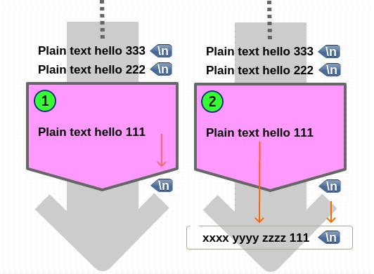

새로운 명령 사이클이 시작되거나 아니면 n, N 명령에 의해 입력 스트림으로 부터 라인이 하나 pattern space 에 입력되면 위 그림에서 1번 상태가 됩니다. 이때 한가지 주목해야 될 점은 newline 이 pattern space 밖으로 제외된다는 점입니다. 그러므로 수정 명령이 적용될때 newline 은 포함되지 않습니다. 사용자가 입력한 명령들이 pattern space 에 적용되고 명령 사이클이 끝나거나, 아니면 사이클 중에 p 명령을 실행했을 경우 그림 2번 에서와 같이 현재 pattern space 에 있는 내용과 제외되었던 newline 더해져서 출력됩니다.

위의 경우는 입력되는 라인에 newline 이 포함되는 일반적인 경우에 해당합니다. 가령 bash 에서 echo -n 111 명령을 사용하게 되면 출력에 newline 이 포함되지 않게 되는데요. 이때는 sed 명령의 출력에도 newline 이 포함되지 않게 되므로 개행이 되지 않습니다.

[source,bash]
----
$ echo 111 | sed ''                  
111                                  # 입력되는 라인에 newline 이 포함되는 경우
mug896@EliteBook [pts/7] ~/tmp

$ echo -n 111 | sed ''               # echo 명령에 -n 옵션을 사용
111mug896@EliteBook [pts/7] ~/tmp    # 입력되는 라인에 newline 이 없으므로
$                                    # 출력때 개행이 되지 않는다.
----

명령 사이클이 끝나거나, p 명령에 의해서 pattern space 에 있는 내용이 프린트될 때는 현재 pattern space 에 있는 전체 내용이 프린트됩니다.

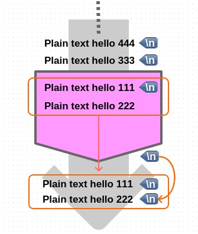

==== `P`

1. pattern space 에서 첫번째 라인만 프린트합니다.

pattern space 에 라인이 하나뿐이 없으면 p 명령과 차이가 없습니다. 이 명령은 주로 multiple lines 를 다룰 때 pattern space 에서 첫 번째 라인을 삭제하는 D 명령과 함께 사용됩니다.

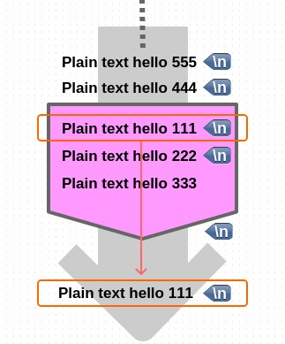

=== delete

==== `d`

1. pattern space 에 있는 내용을 전부 삭제합니다.

2. pattern space 에 데이터가 없으므로 명령 사이클을 중단하고 다음 사이클을 시작합니다.

3. 읽어들일 라인이 없으면 exit 합니다.

d 명령을 사용할 때 기억해야 될 것은 명령이 실행되면 현재 사이클이 중단되고 새로운 사이클을 시작한다는 것입니다. 만약에 pattern space 삭제후 현재 위치에서 실행을 계속하려면 z 명령 을 사용할 수 있습니다.

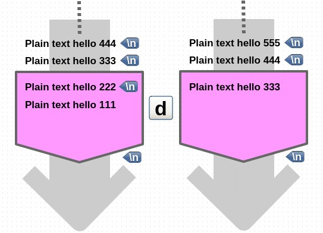

==== `D`

1. pattern space 에서 첫 번째 라인을 삭제합니다.

2. 명령 사이클의 BEGIN 위치로 가서 다음 사이클을 시작합니다. ( 이때 라인을 읽어들이지 않습니다 )

3. pattern space 에 라인이 하나만 남았을 경우는 d 명령과 같은 역할을 합니다.

이 명령은 multiple lines 을 처리할 때 사용하는 명령으로 pattern space 에 라인이 하나만 남았을 경우는 삭제되면 이어지는 명령에서 처리할 데이터가 없으므로 d 명령과 같은 역할을 합니다.

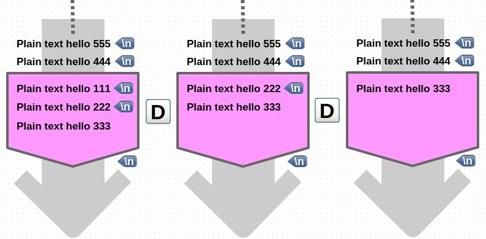

==== 예제 1

파일 내용중에 구분자로 사용되는 스트링값 --- 이 여러군대 나올 수 있는데 마지막 구분자 이후의 내용만 출력하는것 입니다.

[source,bash]
----
$ cat file
111
222
333
---
444
555
666
---
777
888
999

$ sed -E '
    :X          # 레이블 X 를 지정
    /---$/d     # pattern space 의 마지막 라인 그러니까 가장 최근에 append 한 라인이
                # "---" 구분자 일경우 d 명령으로 pattern space 를 모두 삭제하고 새로운 사이클 시작
    N           # N 명령으로 다음 라인을 읽어들여 pattern space 에 append
    bX          # 레이블 X 로 (b) 분기
}' file

777
888
999
----

==== 예제 2

[FILE] 아래 [LINE] 이 없는 경우 삭제합니다. [LINE] 은 모두 표시합니다.

[source,bash]
----
$ cat file
[FILE]: C:\Users\user\git\build.xml
[FILE]: C:\Users\user\git\dataload-pom.xml
[FILE]: C:\Users\user\git\local.properties
    [LINE]:  [job.mail.toAddress=]
    [LINE]:  [log.mail.toAddress=]
    [LINE]:  [log.mail.client.toAddress=]
    [LINE]:  [bill.report.toAddress=]
[FILE]: C:\Users\user\git\pom.xml
[FILE]: C:\Users\user\git\release.properties
    [LINE]:  [job.mail.toAddress=]
    [LINE]:  [log.mail.client.toAddress=]
.............................................

$ sed -E '
    /\[FILE]/{             # [FILE] 라인이 입력되면 
        N                  # `N` 명령으로 다음 라인을 pattern space 에 append

        /\n\[FILE]: /D     # 두 번째 라인도 [FILE] 라인일 경우 `D` 명령으로
                           # 첫 번째 라인을 삭제하고 명령 사이클의 BEGIN 으로 분기
    }
' file

[FILE]: C:\Users\user\git\local.properties
    [LINE]:  [job.mail.toAddress=]
    [LINE]:  [log.mail.toAddress=]
    [LINE]:  [log.mail.client.toAddress=]
    [LINE]:  [bill.report.toAddress=]
[FILE]: C:\Users\user\git\release.properties
    [LINE]:  [job.mail.toAddress=]
    [LINE]:  [log.mail.client.toAddress=]
----

=== quit

----
q [exit-code] , Q [exit-code]
----

1. 더 이상 명령 사이클을 진행하지 않고 종료합니다.

2. 종료 상태 값을 지정할 수 있습니다.

sed 는 기본적으로 항상 실행 결과 종료 상태 값이 0 입니다. 따라서 grep 명령과 같이 특정 상황에서 오류 종료 상태 값을 반환하려면 quit 명령을 사용할 수 있습니다. q 와 Q 명령의 차이점은 자동 출력 모드일 경우 q 명령은 종료전에 현재 pattern space 의 내용을 출력하고 Q 명령은 출력하지 않습니다. sed 에서 -n 옵션이 사용되면 두 명령은 차이가 없습니다.

[source,bash]
----
$ echo -e "AA\nBB\nCC\nDD\nEE" | sed 'N;N;q3'     # q 
AA                                                # 종료시 patten space 에 있는 
BB                                                # 내용이 출력된다.
CC

$ echo $?
3
---------------------------------------------

$ echo -e "AA\nBB\nCC\nDD\nEE" | sed 'N;N;Q4'     # Q
$
$ echo $?
4
---------------------------------------------

# 입력되는 값 중에 "226 Transfer complete" 문장이 있을 경우 종료 상태 값 0 을 반환하고 종료하고
$ echo "
230 Login successful.
226 Transfer complete.
250 Directory successfully changed.
" | sed '/226 Transfer complete/Q0; $!d; Q1'

$ echo $?
0

# 그렇지 않을 경우는 종료 상태 값 1 을 반환하고 종료
$ echo "
230 Login successful.
XXX Transfer complete.
250 Directory successfully changed.
" | sed '/226 Transfer complete/Q0; $!d; Q1'

$ echo $?
1
----

==== sed 는 항상 파일의 처음부터 끝까지 모두 스캔합니다.

sed 는 stream editor 로써 기본적으로 어떤 출력 옵션을 사용하던 상관없이 파일의 처음부터 끝까지를 모두 스캔합니다. 그러므로 처리하는 파일의 사이즈가 클 경우 항상 연산이 완료되는 시점에서 quit 명령을 사용해서 종료해야 합니다.

[source,bash]
----
# 3 번째 라인을 출력하고 스캔이 종료되지 않는다.
$ sed -n '3p' very_big_file
# 파일 스캔이 /END/ 에서 종료되지 않는다.
$ sed -n '/BEGIN/,/END/{ p }' very_big_file

# 그러므로 연산이 완료되면 quit 명령으로 종료해야 합니다.
$ sed -n '3{p;Q}' very_big_file

$ sed -n '/BEGIN/,/END/{ p; /END/Q }' very_big_file
----

또한 파일 사이즈가 크지 않더라도 다음과 같이 branch loop 를 사용한다면 regex 매칭 영역이 계속해서 증가하므로 처리 속도가 크게 떨어질 수 있습니다. 따라서 매칭 영역이 너무 커지지 않도록 하고 마찬가지로 연산이 완료되면 quit 명령으로 종료해야 합니다.

[source,bash]
----
$ time sed -n '/typedef struct/{ :X N; /ZZZ/!bX; p }' /usr/include/elf.h

real    0m0.328s
user    0m0.327s
sys     0m0.001s
----

==== tail 명령과 같이 사용

다음의 경우는 sed 에서 마지막 라인을 출력하는 예인데요. 이와 같은 경우는 그냥 tail 명령을 사용하는 것이 좋습니다. tail 명령은 sed 처럼 파일의 처음부터 끝까지를 모두 스캔하지 않고 바로 파일 포지션을 끝부분으로 이동시키기 때문에 명령이 즉시 실행됩니다.

[source,bash]
----
# 파일의 처음부터 끝까지를 모두 스캔하므로 시간이 오래 걸린다.
$ sed -n '$p' very_big_file

# tail 명령은 즉시 실행된다.
$ tail -n1 very_big_file

# 사이즈가 큰 파일의 뒷부분만 처리하려면 다음과 같이 하는 것이 효율적이다.
$ tail -n100000 very_big_file | sed '...'
----

==== Quiz

데이터 파일에서 특정 라인을 추출하는데 제일 빠른 방법은? 약 1G 정도 되는 파일에서 중간 위치의 라인을 추출하는데 tail, head 방법이 제일 빨랐습니다.

[source,bash]
----
# 총 96,603,415 라인의 파일에서 중간 라인을 추출
$ time wc -l file.txt
96603415 file.txt

real    0m0.885s
user    0m0.744s
sys     0m0.140s

$ time tail -n 48301710 file.txt | head -n1
AH3ZM5G9TA

real    0m0.442s
user    0m0.376s
sys     0m0.064s

$ time head -n 48301707 file.txt | tail -n1
AH3ZM5G9TA

real    0m0.627s
user    0m0.708s
sys     0m0.404s

$ time sed -n '48301707{p;Q}' file.txt
AH3ZM5G9TA

real    0m2.402s
user    0m2.336s
sys     0m0.064s
----

=== substitute

----
s / regex / replacement / [flags]
----

sed 에서 pattern space 에 있는 내용을 수정할 때 사용하는 메인 명령으로 여러 flags 를 통해서 다양한 기능을 제공합니다.

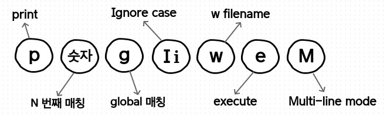

TIP: i, I 플래그는 차이가 없이 같은 역할을 합니다. [flags] 자리에 s/foo/bar/{ ... } 와 같이 명령 그룹을 사용할 수 없습니다.

==== 명령 성공에 상관없이 모든 라인이 표시된다

sed 는 기본적으로 명령 사이클이 종료될 때 pattern space 에 있는 내용을 출력하므로 s 명령의 성공에 상관없이 모든 라인이 출력됩니다. 이때 변경에 성공한 라인만 출력하고자 한다면 sed 명령의 -n 옵션과 s 명령의 p flag 를 사용할 수 있습니다.

[source,bash]
----
# 파일 내용
$ cat file
1_11
2_22
X_33
3_44
Y_55

# 기본적으로 's' 명령의 성공에 상관없이 모든 라인이 표시된다.
$ sed 's/^[A-Z]/@@/' file
1_11
2_22
@@_33
3_44
@@_55

# '-n' 옵션과 'p' flag 를 이용하면 's' 명령이 성공한 라인만 표시할 수 있다.
$ sed -n 's/^[A-Z]/@@/p' file
@@_33
@@_55
----

==== 매칭 번호를 사용하지 않으면 default 는 1 이다.

[source,bash]
----
# 매칭 번호를 사용하지 않았으므로 s/../../1 과 같다
$ echo "11 aa 22 bb 33 cc" | sed -E 's/[a-z]+/X&X/'
11 XaaX 22 bb 33 cc

$ echo "11 aa 22 bb 33 cc" | sed -E 's/[a-z]+/X&X/2'
11 aa 22 XbbX 33 cc

$ echo "11 aa 22 bb 33 cc" | sed -E 's/[a-z]+/X&X/3'
11 aa 22 bb 33 XccX

$ echo "11 aa 22 bb 33 cc" | sed -E 's/[a-z]+/X&X/g'
11 XaaX 22 XbbX 33 XccX

$ echo "11 aa 22 bb 33 cc" | sed -E 's/[a-z]+/X&X/2g'  # 두번째 이후로 전부
11 aa 22 XbbX 33 XccX
-----------------------------------------------------

$ cat file
PHP is a server-side scripting language.
PHP is an open-source language and PHP is case-sensitive.
PHP is platform-independent.

# 두번째 PHP 단어 뒤에 New Text 추가
$ sed 's/\(PHP\)/\1 (New Text added)/2' file
PHP is a server-side scripting language.
PHP is an open-source language and PHP (New Text added) is case-sensitive.
PHP is platform-independent.

# PHP 단어가 2 번 존재하는 라인만 삭제
$ sed -e 's/PHP/PHP/2; tX; b' -e ':X d' file
PHP is a server-side scripting language.
PHP is platform-independent.
----

regex | (or) 을 사용할 때는 g 플래그를 사용해야 합니다.

[source,bash]
----
$ echo "11 aa 22 bb 33 cc" | sed -E 's/aa|bb/X&X/'
11 XaaX 22 bb 33 cc

$ echo "11 aa 22 bb 33 cc" | sed -E 's/aa|bb/X&X/g'
11 XaaX 22 XbbX 33 cc
----

==== Capturing Groups and Backreferences

[source,bash]
----
$ echo "SED language" | sed  's/\(SED\)/Learn \1 programming/'
Learn SED programming language

$ echo "Learn SED language programming" | sed 's/\(language\) \(programming\)/\2 \1/'
Learn SED programming language

$ sed -En '/^(.)(.)(.)\3\2\1$/p' /usr/share/dict/words
redder
----

& 문자는 매칭된 영역을 나타냅니다.

[source,bash]
----
$ echo "SED Language" | sed 's/[A-Z]\+/Learn & programming/'
Learn SED programming Language

# 일반 문자로 사용하려면 escape 해야합니다.
$ sed 's/user=&uid/user=\&sysuserid/'
----

대, 소문자 변환을 위한 \U \u \L \l \E

[source,bash]
----
# '\U' 는 이후로 모든 영역을 대문자로 변환합니다.
$ echo "sed language" | sed 's/[a-z]\+/learn \U& programming/'
learn SED PROGRAMMING language

# 만약에 중간 중단하고 싶으면 '\E' 를 사용합니다.
$ echo "sed language" | sed 's/[a-z]\+/learn \U&\E programming/'
learn SED programming language

# '\u' 는 바로 뒤의 첫문자만 대문자로 변환합니다.
$ echo "sed language" | sed 's/[a-z]\+/learn \u& programming/'
learn Sed programming language

# '\L' 는 이후로 모든 영역을 소문자로 변환합니다.
$ echo "SED LANGUAGE" | sed 's/[A-Z]\+/LEARN \L& PROGRAMMING/'
LEARN sed programming LANGUAGE

# 만약에 중간 중단하고 싶으면 '\E' 를 사용합니다.
$ echo "SED LANGUAGE" | sed 's/[A-Z]\+/LEARN \L&\E PROGRAMMING/'
LEARN sed PROGRAMMING LANGUAGE

# '\l' 는 바로 뒤의 첫문자만 소문자로 변환합니다.
$ echo "SED LANGUAGE" | sed 's/[A-Z]\+/LEARN \l& PROGRAMMING/'
LEARN sED PROGRAMMING LANGUAGE
..............................................................

# 다음은 모든 단어의 첫문자를 대문자로 변환합니다.
$ echo "learn sed programming language" | sed -E 's/\b[a-z]+\b/\u&/g'
Learn Sed Programming Language
----

==== 이전에 사용된 regex 중복 작성 방지하기

명령문을 작성하다 보면 종종 address 에서 사용된 regex 이나 이전 s 명령에서 사용된 regex 이 동일하게 다시 사용되는 경우가 있는데요. 이럴 경우 sed 는 중복 작성을 방지하기 위해 s//.../ 형식을 제공합니다. 여기서 // 부분이 이전에 사용된 regex 으로 대체됩니다.

[source,bash]
----
# 값 123 을 id 값에 붙이기 
$ echo '<pagenum page="normal" id="page">123</pagenum>' |
sed -E '
    /(<pagenum page="normal" id=")(\w+)(">)([0-9]*)(<\/pagenum>)/ {

        # 첫 번째 방법
        # s/(<pagenum page="normal" id=")(\w+)(">)([0-9]*)(<\/pagenum>)/\1\2\4\3\4\5/

        # 두 번째 방법
        # "//" 를 사용하면 중복 작성을 피할 수 있다.
        s//\1\2\4\3\4\5/
    }
'
# 결과 "page123"
<pagenum page="normal" id="page123">123</pagenum>

-------------------------------------------------

# 이전 's' 명령에서 사용된 '[A-Z]' 가 두 번째 's' 명령에서 재사용됨
$ echo "111 A 222 B 333 C 444 D 555" | sed '/111/{ s/[A-Z]/XXX/4; s//YYY/ }'

111 YYY 222 B 333 C 444 XXX 555
----

/address1/,/address2/ 와 같은 range address 를 사용할 경우 기본적으로 매칭 되는 라인도 함께 출력에 포함됩니다. 하지만 경우에 따라서 매칭 라인은 제외해야 될 때가 있는데요. 이럴 경우 // 를 이용하여 식을 간단히 할 수 있습니다.

[source,bash]
----
$ readelf -WS /bin/date | sed -n '/Section Headers:/,/Key to Flags:/p'      
Section Headers:    <----- 매칭 라인이 출력에 포함됨
  [Nr] Name            Type         Address          Off    Size   ES Flg Lk Inf Al
  [ 0]                 NULL         0000000000000000 000000 000000 00      0   0  0
  [ 1] .interp         PROGBITS     0000000000000318 000318 00001c 00   A  0   0  1
  . . . .
  . . . .
  [26] .gnu_debuglink  PROGBITS     0000000000000000 01a0a0 000034 00      0   0  4
  [27] .shstrtab       STRTAB       0000000000000000 01a0d4 00011d 00      0   0  1
Key to Flags:       <----- 매칭 라인이 출력에 포함됨

# '//d' 으로 매칭 라인을 제거할 수 있습니다.
$ readelf -Wa /bin/date | sed -n '/Section Headers:/,/Key to Flags:/{//d;p}'
  [Nr] Name            Type         Address          Off    Size   ES Flg Lk Inf Al
  [ 0]                 NULL         0000000000000000 000000 000000 00      0   0  0
  [ 1] .interp         PROGBITS     0000000000000318 000318 00001c 00   A  0   0  1
  . . . .
  . . . .
  [26] .gnu_debuglink  PROGBITS     0000000000000000 01a0a0 000034 00      0   0  4
  [27] .shstrtab       STRTAB       0000000000000000 01a0d4 00011d 00      0   0  1
----

//d 를 사용할때 한가지 주의할 점은 특정 라인부터 마지막까지 출력할 때입니다. 이때는 마지막 라인을 나타내는 $ 를 사용하면 안되고 매칭이 되지 않는 임의의 스트링을 사용해야 합니다.

[source,bash]
----
# 결과가 올바르지 않다. Displaying notes ... 라인이 모두 삭제가 된다.
$ readelf -Wa /bin/date | sed -En '/Displaying notes/,${ //d; p }'

# OK. 첫번째 Displaying notes ... 라인만 삭제가 된다.
$ readelf -Wa /bin/date | sed -En '/Displaying notes/,/\a/{ //d; p }'
----

==== /../../ 구분자를 다른 문자로 사용하기

이 기능은 addresses 메뉴에서도 나왔는데요. s 명령에서도 동일하게 이용할 수 있습니다.
차이점은 s 명령에서는 구분자로 사용되는 첫 번째 문자를 escape 할 필요가 없습니다.

[source,bash]
----
# '\' 문자를 모두 escape 해야 되기 때문에 가독성이 떨어진다.
$ sed -E 's/\/usr\/local\/bin\/(\w+)/\1/'

# 구분자로 임의의 문자를 선정해서 사용할 수 있다.
$ sed -E 's@/usr/local/bin/(\w+)@\1@'

$ sed -E 's#/usr/local/bin/(\w+)#\1#'

$ sed -E 's,/usr/local/bin/(\w+),\1,'
----

==== \a non-printable 문자의 활용

s 명령을 사용하다 보면 이런 문제가 생기는 경우가 있습니다. 예를 들어 문서에 포함된 스트링을 ab -> bc 로 변경하고 bc -> ab 로 변경하는 것입니다. 두 가지 경우를 모두 s 명령으로 연이어 처리하면 안 되는 것이 ab 를 bc 로 변경한 후에 bc 를 ab 로 변경하면 모두 ab 가 돼 버리기 때문입니다.

이때는 약간 문서 수정을 해야 합니다. 먼저 ab 를 __ab__ 로 변경하고 bc 를 ab 로 변경한후에 마지막으로 __ab__ 를 bc 로 바꾸는 것입니다. 하지만 문서 내에 __ab__ 스트링이 존재할 수도 있기 때문에 주로 사용하는 방법은 non-printable 문자인 \a 를 이용하는 것입니다.

[source,bash]
----
# ab -> bc
# bc -> ab 

$ echo 'abbc' | sed 's/ab/bc/g; s/bc/ab/g'
abab

$ echo abbc | sed 's/ab/\a/g; s/bc/ab/g; s/\a/bc/g'
bcab
----

TIP: \a 문자를 이용하는 방법은 여러 가지 상황에서 활용될 수 있습니다.

==== w filename 플래그 사용시 주의할 점

filename 은 해당식에서 마지막에 위치해야 하고 뒤에 이어서 다른 문자나 명령이 오면 안됩니다. 이후 연이어서 명령을 사용하려면 -e 옵션을 이용해 식을 분리해야 합니다.

==== Quiz

입력 라인에서 foo 와 zoo 단어 사이에 bar 가 있을 경우만 출력하려면 .* 메타문자를 이용해서 다음과 같이 간단히 처리할 수 있는데요.

[source,bash]
----
$ echo -e 'x foo bar zoo x' | sed -En '/.*foo.*bar.*zoo.*/p'
foo bar zoo

$ echo -e 'x foo xxx zoo x' | sed -En '/.*foo.*bar.*zoo.*/p'
$
----

반대로 foo 와 zoo 단어 사이에 bar 가 없을 경우만 출력하려면 어떻게 할까요?

[source,bash]
----
$ echo -e 'x foo bar zoo x' | sed -En -e 'h; s/.*foo(.*)zoo.*/\1/; tX; b; :X /bar/!{g;p}'
$

$ echo -e 'x foo xxx zoo x' | sed -En -e 'h; s/.*foo(.*)zoo.*/\1/; tX; b; :X /bar/!{g;p}'
x foo xxx zoo x

1. h; 먼저 입력값을 hold space 에 저장해 놓습니다.
2. s/.*foo(.*)zoo.*/\1/ 매칭에 실패하면 b; 명령으로 종료합니다.
   매칭에 성공하면 foo 와 zoo 단어가 있는 것이므로 tX; 명령으로 :X 레이블로 분기합니다.
3. :X 레이블에서는 현재 pattern space 에 남아있는 값에서 bar 있는지 체크하고
   없을 경우 g; 명령으로 저장해둔 원본 값을 가져와 출력합니다.

---------------------------------------------------------------------

# perl 의 경우는 다음과 같이 negative lookahead 를 사용할 수 있습니다.
$ echo -e 'x foo xxx zoo x' | perl -ne '/.*foo(?!.*bar).*zoo.*/ && print'
x foo xxx zoo x
----

==== 2 .

bc 명령을 이용하면 입력과 출력에 사용되는 base ( 진법 ) 을 마음대로 조정할 수가 있는데요. 출력을 2 진법으로 했을 때 byte 단위로 숫자를 8 개씩 구분해서 출력하려면 어떻게 할까요?

[source,bash]
----
# 입력은 16 진수, 출력은 2 진수로 했을때 byte 단위로 구분하기가 어렵다.
$ echo "obase=2; ibase=16; EAB080" | bc
111010101011000010000000

$ echo "obase=2; ibase=16; EAB080" | bc | sed -E 's/.{8}/& /g'
11101010 10110000 10000000 

$ echo "obase=2; ibase=16; EAB080" | bc | fold -b8
11101010
10110000
10000000
----

TIP: bc 명령을 사용할땐 obase 가 ibase 앞에 와야 합니다.

==== 3 .

다음 file 내용의 마지막 라인을 "Unix and Linux" 로 만들려고 합니다. >> redirection 을 이용해 append 를 하면 결과가 오른쪽과 같이 되는데요. 어떻게 하면 될까요?

[source,bash]
----
$ cat file                          $ echo " and Linux" >> file
Hello                               
Welcome to                          $ cat file
Unix                                Hello
                                    Welcome to
                                    Unix
                                     and Linux
----

아래 첫 번째 $ 문자는 sed 에서 사용되는 메타문자로 마지막 라인을 의미하고 두 번째 $ 문자는 regex 에서 사용되는 메타문자로 라인의 끝을 나타냅니다. 결과적으로 마지막 라인의 끝에 " and Linux" 가 추가되게 됩니다.

[source,bash]
----
$ sed '$ s/$/ and Linux/' file
Hello
Welcome to
Unix and Linux
----

==== 4 .

다음 파일 내용을 보면 시작과 끝부분에 여분의 newline 들이 존재하는데요. 제거 하려면 어떻게 할까요?

[source,bash]
----
sh$ cat file

                       <---- newlines
Hello

Welcome to
Unix and Linux

                       <---- newlines
----

이때는 sed 의 -z 옵션을 사용해 해결할 수 있습니다. sed 의 -z 옵션을 사용하면 파일 내용을 한 번에 전부 읽어 들일 수 있습니다. 그다음 시작 부분 (^) 과 마지막 부분 ($) 의 newline 들을 제거하면 됩니다.

[source,bash]
----
$ sed -Ez 's/^\n+//; s/\n+$/\n/' file
Hello

Welcome to
Unix and Linux
----

=== next

==== `n`

1. 자동 출력 모드일 경우 현재 pattern space 내용을 프린트합니다.

2. pattern space 내용이 전부 삭제됩니다.

3. 입력 스트림으로부터 새로 라인을 읽어들이고 현재 명령 사이클 위치에서 진행을 계속합니다.

4. 읽어들일 라인이 없으면 exit 합니다.

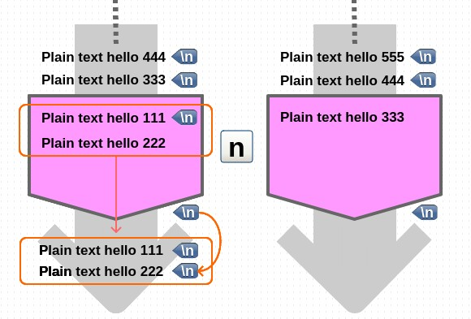

==== `N`

1. 먼저 newline 을 pattern space 에 append 합니다.

2. 입력 스트림으로 부터 라인을 읽어들여서 append 합니다.

3. 읽어들일 라인이 없으면 exit 합니다.

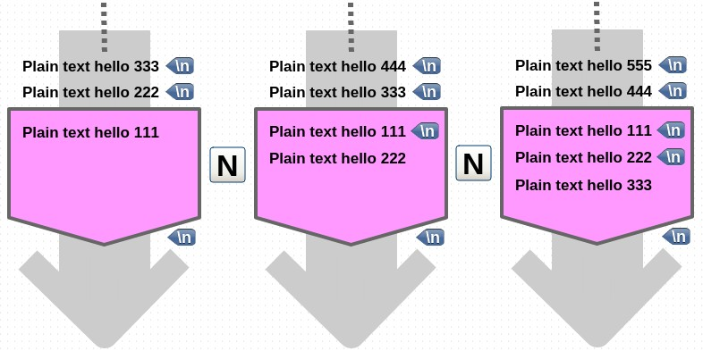

==== $!N 의 사용

N 명령에서 주의 깊게 봐야 될 항목은 3번 읽어들일 라인이 없으면 exit 한다 입니다. N 명령은 주로 multiple lines 를 다룰 때 사용하는데 현재 pattern space 에 마지막 라인이 입력된 상태에서 N 명령을 만나게 되면 이후 명령들이 실행되지 않고 exit 되기 때문에 필요에 따라서 $!N (마지막 라인이 아닐 경우만 다음 라인을 읽어들인다) 형식을 사용해야 합니다.

다음의 예제는 숫자 라인 다음에 알파벳 라인이 올 경우 XXX 로 변경하는 스크립트입니다. 이때 N 명령을 사용하게 되면 마지막 라인인 555 가 표시되지 않는 것을 볼수 있습니다. 좀 더 자세한 내용은 multiple lines 메뉴에서 찾아볼수 있습니다.

[source,bash]
----
$ cat file
111
222
ABC
333
444
DEF
555

# 'N' 을 사용할 경우
$ sed -En 'N; s/[0-9]+\n[A-Z]+/XXX/; P;D' file
111
XXX
333
XXX   
    <---- 마지막 라인 555 가 표시되지 않는다.

# '$!N' 을 사용할 경우
$ sed -En '$!N; s/[0-9]+\n[A-Z]+/XXX/; P;D' file
111
XXX
333
XXX
555  <---- 정상적으로 마지막 라인이 표시된다.
----

==== Quiz

어떤 명령의 출력이 아래와 같이 title 과 value 두 개의 라인으로 반복됩니다. 이것을 title : value 하나의 라인으로 만들어서 출력하려면 어떻게 할까요?

[source,bash]
----
$ syscat ...
[ physical_block_size ]
512
[ logical_block_size ]
512
[ zone_append_max_bytes ]
0
[ io_timeout ]
30000
[ nr_requests ]
64
[ write_cache ]
write back
[ max_segment_size ]
65536
. . .
----

pattern space 에 라인이 입력됐을 때 N 명령을 이용해 라인을 하나 더 읽어들여 append 하고 newline 을 space 로 변경하면 됩니다.

[source,bash]
----
$ syscat ... | sed 'N; s/\n/ /'
[ physical_block_size ] 512
[ logical_block_size ] 512
[ zone_append_max_bytes ] 0
[ io_timeout ] 30000
[ nr_requests ] 64
[ write_cache ] write back
[ max_segment_size ] 65536
. . .
----

==== 2 .

다음과 같이 이름, 나이, 직업을 항목으로 갖는 레코드가 있습니다. 이중에서 나이가 39 이고 직업이 수학자인 레코드를 출력하는 것입니다.

[source,bash]
----
$ cat ./list.txt
이름: 아이유
나이: 29
직업: 가수

이름: 허준이
나이: 39
직업: 수학자

이름: 백종원
나이: 56
직업: 요리연구가

--------------------

$ sed -n '/이름/ {             # 입력라인이 "이름" 과 매칭이 되면
    N                         # 다음 라인을 읽어들여 append 합니다.
    /나이: 39$/! d             # 마지막 라인이 매칭이 안되면 d 로 삭제하고 다시시작.
    N                         # 다음 라인을 읽어들여 append 합니다.
    /직업: 수학자$/! d          # 마지막 라인이 매칭이 안되면 d 로 삭제하고 다시시작.
    p                         # pattern space 에 있는 내용을 모두 출력합니다.
}' ./list.txt

이름: 허준이
나이: 39
직업: 수학자
----

=== `h, H, x, g, G` move between spaces

소문자로 된 명령은 copy 입니다.
목적지 기존 데이터는 삭제되고 source 내용이 dest 로 copy 됩니다.
대문자로 된 명령은 append 입니다.
먼저 newline 이 dest 에 append 되고 이어 source 내용이 dest 에 append 됩니다.

TIP: 기본적으로 'x' 명령을 제외하고 source 내용은 변하지 않습니다.

==== `h` hold (copy)

1. 현재 hold space 에 있는 내용은 전부 삭제됩니다.

2. pattern space 에 있는 내용이 hold space 로 copy 됩니다.

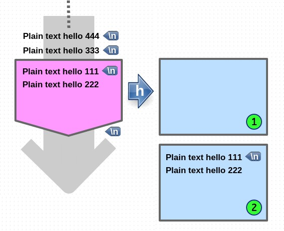

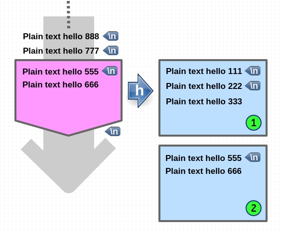

==== `H` Hold (append)

1. 먼저 hold space 에 newline 을 append 합니다.

2. pattern space 에 있는 내용이 copy 되어 hold space 로 append 됩니다.

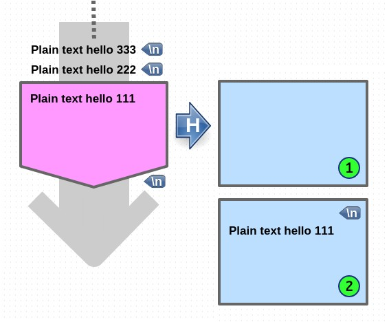

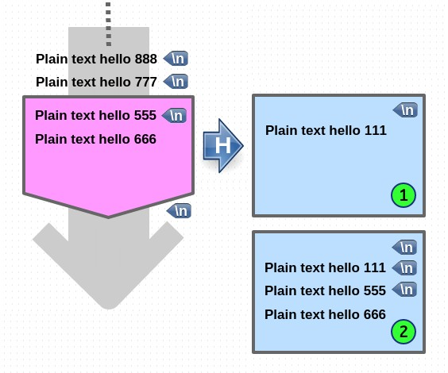

==== `g` go to pattern space (copy)

1. 현재 pattern space 에 있는 내용은 전부 삭제됩니다.

2. hold space 에 있는 내용이 pattern space 로 copy 됩니다.

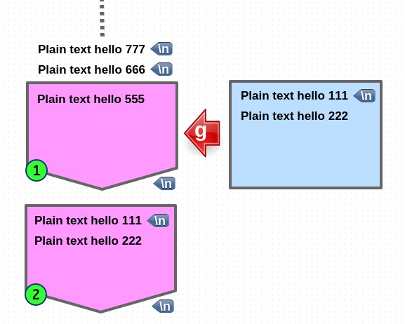

==== `G` Go to pattern space (append)

1. 먼저 pattern space 에 newline 을 append 합니다.

2. hold space 에 있는 내용이 copy 되어 pattern space 로 append 됩니다.

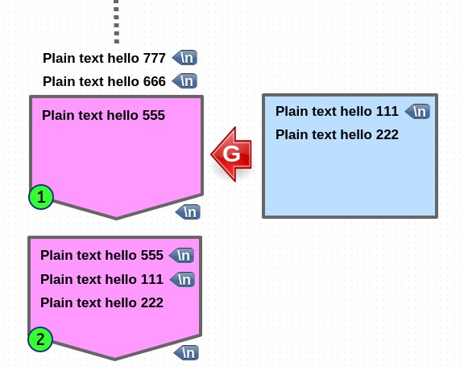

==== `x` eXchange

1. pattern space 에 있는 내용과 hold space 에 있는 내용을 서로 맞바꿉니다.

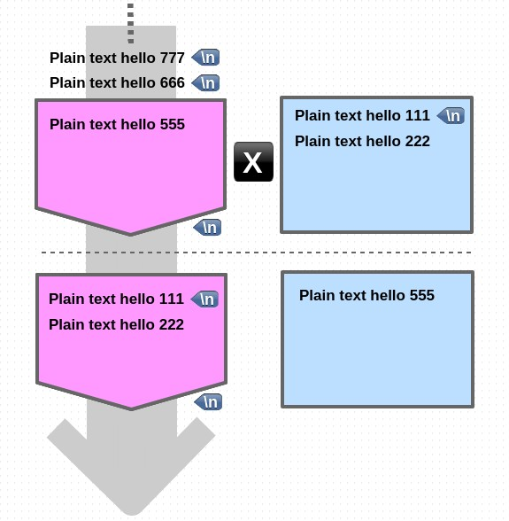

==== 그림으로 보는 예제

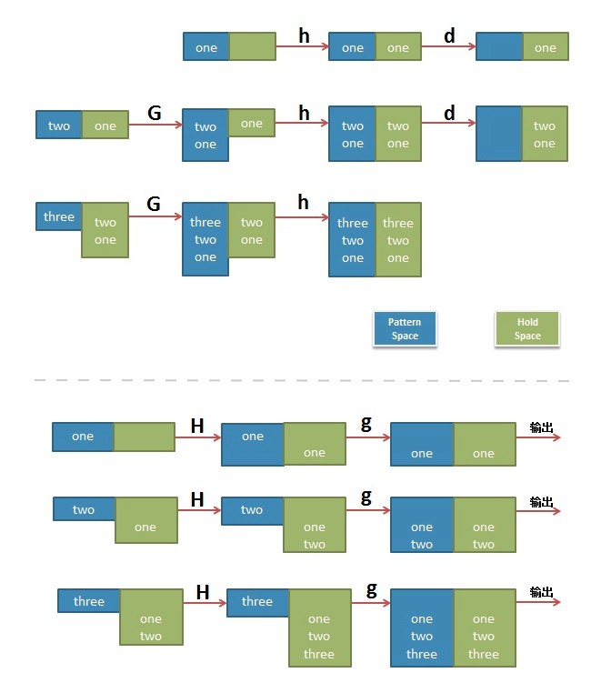

==== 예제 1

다음 예제는 어떤 명령의 실행 결과인데요. md5sum 을 구해서 파일 사이즈와 함께 표시하는데 항상 출력이 다음과 같은 순서로 표시가 됩니다. 이것을 sed 를 이용해 파일명 -> gz -> bz2 순서로 변경하는 것입니다.

[source,bash]
----
$ command ...
e805c26ff46c6e138e3cd198cff281ea 301 Packages.bz2
15bfecb2b041d5387aacdd32879e4e56 324 Packages
b97a7252f202566a1e5fdc5b50c2ffdf 283 Packages.gz
---------------------------------------------------

# 'n' 명령은 자동 출력 모드에서 pattern space 의 내용을 출력하므로 '-n' 옵션을 사용
$ command ... | sed -n 'h; n; N; G; p'
15bfecb2b041d5387aacdd32879e4e56 324 Packages
b97a7252f202566a1e5fdc5b50c2ffdf 283 Packages.gz
e805c26ff46c6e138e3cd198cff281ea 301 Packages.bz2
----

==== 예제 2

다음은 docker hub 에서 특정 이미지의 tag list 를 조회해 sort 한 결과인데 이미지에 따라서 latest 가 다음과 같이 임의의 위치에 나타날 수 있습니다. 어떤 경우에서든 latest 를 항상 마지막에 표시하려면 어떻게 할까요?

[source,bash]
----
$ docker-taglist alpine                         # latest 가 없는경우
latest             2.6                2.6               2.6
2.6                2.7                2.7               2.7
2.7                3                  3                 3
3                  3.1                3.1               3.1
3.1                3.2                3.2               3.2
3.2                3.3                3.3               3.3
3.3                latest             3.4               3.4
3.4                3.4                3.5               3.5
3.5                3.5                3.6               3.6
3.6                3.6                latest
--------------------------------------------------------------

# 입력 라인이 'latest' 가 아닐 경우 출력한 후 :X 레이블로 branch 합니다.
/^latest$/!{p; bX};

# 입력 라인이 'latest' 일 경우는 hold space 에 저장합니다.
h;

# 마지막 라인일 경우 hold space 의 내용을 pattern space 로 가져오는데
# 이때 값이 없는 경우가 있을 수 있으므로 /^$/! 로 체크하여 프린트합니다.
${g; /^$/!p}' 

$ cat taglist | sed -n '/^latest$/!{p; bX}; h; :X ${g; /^$/!p}'
----

==== 예제 3

/usr/include/elf.h 파일 내용을 보면 여러개의 typedef struct 이 있는데요. 그중에서 Elf64_Ehdr 부분만 추출합니다.

[source,bash]
----
# "typedef struct" 을 포함하는 라인을 만나면 hold space 로 이동하고 식의 끝으로 branch 합니다.
# 이때 기존에 hold space 에 내용이 있었다면 삭제됩니다.
/typedef struct/{h;b}
# 이후부터는 라인을 hold space 에 계속 append 합니다. 
H
# "Elf64_Ehdr;" 가 포함된 라인을 만나면 hold space 에 있는 내용을 pattern space 로 옮긴 후
# 프린트하고 종료합니다. 
/Elf64_Ehdr;/{g;p;Q}/ 

$ sed -n '/typedef struct/{h;b}; H; /Elf64_Ehdr;/{g;p;Q}' /usr/include/elf.h      
typedef struct
{
  unsigned char e_ident[EI_NIDENT];     /* Magic number and other info */
  Elf64_Half    e_type;                 /* Object file type */
  Elf64_Half    e_machine;              /* Architecture */
  Elf64_Word    e_version;              /* Object file version */
  Elf64_Addr    e_entry;                /* Entry point virtual address */
  Elf64_Off     e_phoff;                /* Program header table file offset */
  Elf64_Off     e_shoff;                /* Section header table file offset */
  Elf64_Word    e_flags;                /* Processor-specific flags */
  Elf64_Half    e_ehsize;               /* ELF header size in bytes */
  Elf64_Half    e_phentsize;            /* Program header table entry size */
  Elf64_Half    e_phnum;                /* Program header table entry count */
  Elf64_Half    e_shentsize;            /* Section header table entry size */
  Elf64_Half    e_shnum;                /* Section header table entry count */
  Elf64_Half    e_shstrndx;             /* Section header string table index */
} Elf64_Ehdr;
----

다음은 -z 옵션을 이용해 전체 파일을 읽어들인 후 regex 을 활용하는 방법입니다.

[source,bash]
----
$ sed -z -rn 's/.*(typedef struct\n.+} Elf64_Ehdr;\n).*/\1/p' /usr/include/elf.h
----

==== 예제 4

다음과 같이 AAA 뒤에 숫자 데이터가 이어지는데요. 이것을 한개의 라인으로 만드는것 입니다.

[source,bash]
----
# 데이터 내용
AAA
1
34
AAA
5
32
61
17
AAA
71
4
15
...................

$ sed -En '
    /AAA/{
        :X 
        x          # `x` 명령으로 hold space 내용과 pattern space 내용을 교환합니다.
        s/\n/ /g   # newline 을 space 로 변경하여 한 줄로 만듭니다.
        p          # 내용을 프린트하고
        b          # 명령 사이클의 END 로 분기합니다.
    } 
    H              # AAA 와 매칭이 되지 않은 경우는 `H` 명령으로 hold space 에 append 합니다.
    $bX            # 마지막 라인일 경우 :X 로 분기하여 hold space 에 있는 내용을 프린트합니다.
' file

AAA 1 34
AAA 5 32 61 17
AAA 71 4 15
----

==== 예제 5

필드가 space 로 분리되어 있는 레코드에서 /config 과 /service 필드를 추출합니다. 그런데 여기서 문제는 필드의 위치나 순서가 정해져 있지가 않습니다.

[source,bash]
----
# 데이터 내용
build 345 /config:launcher.mxres /nickname:prod /service:session
auto 4986 /nickname:deal /service:engine /config:launcher5.mxres
build 912 /config:launcher_binary.mxres /service:scanner /nickname:input 
.........................................................................

$ sed -E '
    h                            # 먼저 원본 라인을 hold 하여 복사

    s#.*(/config:[^ ]+).*#\1#    # /config 값을 추출한 후 `H` 명령으로 hold space 에 append.
    H;g                          # 현재 pattern space 는 /config 값만 남고 삭제된 상태이므로
                                 # `g` 명령을 이용해 hold space 값을 pattern space 로 복사

    s#.*(/service:[^ ]+).*#\1#   # 위와 같은 방법으로 /service 값 추출
    H;g                          # `g` 명령을 이용해 hold space 값을 pattern space 로 복사

    s#.*\n(.*)\n(.*)#\1 \2#      # 현재 pattern space 에는 원본 라인과 /config, /service
                                 # 3개의 라인이 존재하므로 /config, /service 값만 추출
' file

/config:launcher.mxres /service:session
/config:launcher5.mxres /service:engine
/config:launcher_binary.mxres /service:scanner
----

==== Quiz

앞서 regex 메뉴에서 lazy 매칭을 하는 방법에 대해서 알아보았는데요. 단일 문자가 아니라 특정 스트링을 lazy 매칭해서 삭제하려면 어떻게 할까요?

[source,bash]
----
# .* 는 greedy 하므로 마지막 foo 단어까지 삭제가 된다.
$ echo "111 foo 222 foo 333" | sed -E 's/.*foo//'
 333

$ echo "111 foo 222 foo 333" | sed -E 'h; s/(foo).*$/\1/; G; s/^([^\n]+)\n\1//'
 222 foo 333

1. h; 먼저 입력값을 hold space 에 저장해 놓습니다.
2. s/(foo).*$/\1/ 식으로 greedy 매칭을 뒤에서 부터하면 pattern space 에는
   111 foo 만 남게됩니다.
3. G 명령으로 hold space 에 저장해 놓은 원본값을 pattern space 에 append 합니다.
   111 foo
   111 foo 222 foo 333
4. s/^([^\n]+)\n\1//  (여기서 \1 은 ([^\n]+) 매칭된 값과 동일한 값이 됩니다.)
   식을 이용해 pattern space 에서 앞부분을 삭제하면 222 foo 333 만 남게됩니다.

-------------------------------------------------------

# perl 에서는 .*? 를 이용해 lazy 매칭을 할 수 있습니다.
$ echo "111 foo 222 foo 333" | perl -pe 's/.*?(foo)//'
 222 foo 333
----

다음은 FOO 에서부터 BAR 까지 lazy 매칭하여 XXX 로 치환하는 것입니다.

[source,bash]
----
$ echo sss FOO uuu BAR nnn FOO ccc BAR rrr |
    sed 's/BAR/\a/g; s/FOO[^\a]*\a/XXX/; s/\a/BAR/g'
sss XXX nnn FOO ccc BAR rrr

1. 먼저 BAR 를 \a 문자로 모두 치환합니다.
2. 그다음 FOO 에서부터 \a 문자 까지를 XXX 값으로 치환합니다.
3. 마지막으로 남은 \a 문자를 다시 BAR 로 모두 치환합니다.

# 만약에 FOO 나 BAR 단어에 regex 이 포함될 경우는 다음과 같이하면 됩니다.
$ echo "sss FXO uuu BXR nnn FYO ccc BYR rrr" |
    sed -E 's/(B[A-Z]R)/\a\1/g; s/F[A-Z]O[^\a]*\aB[A-Z]R/XXX/; s/\a//g'
sss XXX nnn FYO ccc BYR rrr

------------------------------------------------------------------------

$ echo "sss FOO uuu BAR nnn FOO ccc BAR rrr" | perl -pe 's/FOO.*?BAR/XXX/'
sss XXX nnn FOO ccc BAR rrr
----

이번에는 BAR 쪽 뿐만 아니라 FOO 쪽도 lazy 매칭을 적용하는 것입니다.

[source,bash]
----
# FOO 쪽은 lazy 매칭이 적용되지 않아 FOO 두개가 모두 삭제된다.
$ echo sss FOO uuu FOO w BAR nnn FOO ccc BAR rrr | perl -pe 's/FOO.*?BAR/XXX/'
sss XXX nnn FOO ccc BAR rrr

$ echo sss FOO uuu FOO w BAR nnn FOO ccc BAR rrr |
    sed 's/FOO/\a/g; s/BAR/\v/g; s/\a[^\a\v]*\v/XXX/; s/\a/FOO/g; s/\v/BAR/g'
sss FOO uuu XXX nnn FOO ccc BAR rrr
----

=== `i, a, c` insert, append, change

라인 에디터인 ed 를 stream 버전으로 만든 것이 sed 이므로 sed 를 이용하면 파일을 쉽게 수정할 수 있습니다.

https://mug896.github.io/sed-stream-editor/images/file_editing.mp4

[source,bash]
----
# multiple lines 을 입력하는 방법 ( 라인 끝에 '\' 문자를 붙인다 )
sed -i '2a \
192.168.100.1     gateway\
192.168.100.2     webserver\
192.168.100.3     dbserver
' hosts

# 공백 라인을 만들려면
$ sed -i '4a\\' hosts       # 공백 라인 1 개
$ sed -i '4a\\n' hosts      # 공백 라인 2 개
$ sed -i '4a\\n\n' hosts    # 공백 라인 3 개
----

이 명령들은 기본적으로 pattern space 와는 관계가 없는 명령들로 입력한 값이 sed 에의해 queue 되었다가 프린트됩니다. 그러므로 -n 옵션으로 출력을 금지할 수도 없고 s 명령으로 수정을 할 수도 없습니다.

TIP: pattern space 에 직접 insert, append 하는 방법은 Tips 메뉴를 참조하세요.

==== `i, a`

1. 현재 pattern space 내용에는 영향을 주지 않습니다.

2. -n 옵션 설정에 관계없이 입력한 값이 프린트됩니다.

3. 뒤이어 계속해서 명령을 사용하려면 -e 옵션을 이용해서 분리해야 합니다.

[source,bash]
--------
$ seq 3 | sed 'i ---'              $ seq 3 | sed 'a ---'
---                                1
1                                  ---
---                                2
2                                  ---
---                                3
3                                  ---

$ seq 5 | sed '2,3 a ---'          $ seq 5 | sed '2,3 c ---'
1                                  1
2                                  ---
---                                4
3                                  5
---
4
5

$ seq 3 | sed -e '2i -----' -e '2a ====='
1
-----
2
=====
3

$ seq 3 | sed -e '2{i -----' -e 'a =====' -e '}' 
1
-----
2
=====
3

$ echo abc | sed -e '/ab/{i ----' -e '}' -e '/bc/{i ====' -e '}'
----
====
abc
--------

-n 옵션 설정에 관계없이 입력한 값이 프린트되며 다음과 같은 차이가 있습니다.

[source,bash]
--------
# 'i' 는 해당 명령이 위치한 곳에서 프린트되지만
# 'a' 는 명령 위치에 상관없이 항상 마지막에 append 됩니다.
$ seq 3 | sed -n -e '2a ====='  -e 's/2/XXXXX/p' -e '2i -----'
XXXXX
-----
=====

$ seq 3 | sed -n -e '2a =====' -e '2i -----' -e 's/2/XXXXX/p'
-----
XXXXX
=====

# '-n' 옵션을 사용하지 않은 경우는 차이가 없다.
$ seq 3 | sed -e '2a =====' -e 's/2/XXXXX/' -e '2i -----'
1
-----
XXXXX
=====
3

$ seq 3 | sed -e '2a =====' -e '2i -----' -e 's/2/XXXXX/'
1
-----
XXXXX
=====
3
--------

i, a 명령의 입력값은 일반 텍스트 스트링이므로 공백을 포함해서 ; 문자도 올 수 있기 때문에 뒤이어 계속해서 명령을 사용하려면 -e 옵션을 이용해 분리해야 합니다.

[source,bash]
----
# '-e' 옵션을 이용해 분리하지 않을 경우 
$ seq 3 | sed -e '2i -----; 2a ====='
1
-----; 2a =====
2
3
----

다음은 multiple lines 을 입력하는 방법입니다. a 명령도 방법은 같습니다.

[source,bash]
----
$ seq 3 | sed '2i -----\               $ seq 3 | sed '2i \
-----\                                 -----\
-----'                                 -----\
                                       -----'
1                                      
-----                                  1
-----                                  -----
-----                                  -----
2                                      -----
3                                      2
                                       3
----

다음은 shell 변수를 사용하는 방법입니다.

[source,bash]
----
$ AA=100

$ seq 3 | sed -e "2a --${AA}--"
1
2
--100--
3

$ seq 3 | sed -e '2a\' -e "--${AA}--"
1
2
--100--
3
----

==== `c`

1. 현재 pattern space 에 있는 내용을 전부 삭제합니다.

2. -n 옵션 설정에 관계없이 입력한 값이 프린트됩니다.

3. pattern space 내용이 전부 삭제된 상태이므로 명령 사이클을 종료하고 new cycle 을 시작합니다. 그러므로 i, a 명령과 같이 사용하려면 c 명령이 제일 뒤에 와야 합니다.

[source,bash]
--------
$ seq 5 | sed '2c XXXXX'
1
XXXXX
3
4
5

# 'c' 명령이 실행되고 사이클이 종료되므로 'i', 'a' 값은 표시가 안된다.
$ seq 5 | sed -e '2c XXXXX' -e '2i -----' -e '2a =====' 
1
XXXXX
3
4
5

# 'c' 명령이 제일 뒤에 와야 한다.
$ seq 5 | sed  -e '2i -----' -e '2a =====' -e '2c XXXXX'
1
-----
XXXXX
=====
3
4
5

$ seq 5 | sed -e '2,4c XXXXX' -e '2,4i -----' -e '2,4a =====' 
1
XXXXX
5

$ seq 5 | sed  -e '2,4i -----' -e '2,4a =====' -e '2,4c XXXXX'
1
-----
=====
-----
=====
-----
XXXXX
=====
5

# 기본적으로 pattern space 에 있는 내용이 전부 삭제된다.
$ seq 5 | sed  -e 'N;N' -e '3c -----'
-----
4
5
--------

=== `r, R, w, W` read, write

이 명령들도 pattern space 와 관계가 없는 명령들로 읽어들인 파일 내용이 sed 에의해 queue 되었다가 프린트됩니다. 그러므로 -n 옵션으로 출력을 금지할 수도 없고 s 명령으로 수정을 할 수도 없습니다.

한가지 주의할 점은 unix 에서 파일명은 /, NUL 문자를 제외하고 모두 허용하므로 파일명 뒤에 다른 문자가 오면 안됩니다. 연이어서 명령을 사용하려면 -e 옵션을 이용해 식을 분리해 작성해야 합니다.

==== `r, R`
 
1. 현재 pattern space 내용에는 영향을 주지 않습니다.

2. -n 옵션 설정에 관계없이 읽어들인 파일 내용이 프린트됩니다.

3. a (append) 명령과 같이 항상 라인 마지막에 파일 내용을 출력합니다.

4. r 명령은 파일 전체 라인을 읽어들이고, R 명령은 첫 번째 라인부터 순차적으로 읽어들입니다.

5. 파일이 존재하지 않을 경우 에러 메시지 없이 empty 파일로 간주하고 진행합니다.

6. 파일명 뒤에 계속해서 명령을 사용하려면 -e 옵션을 이용해 식을 분리해야 합니다.

[source,bash]
----
$ cat file1
aaa
bbb
ccc

$ seq 5 | sed '2r file1'   
1
2
aaa
bbb
ccc
3
4
5

# 'R' 명령은 첫 번째 라인부터 순차적으로 읽어들입니다.
$ seq 5 | sed 'R file1'
1
aaa
2
bbb
3
ccc
4
5
----

==== `w, W`

1. open 된 파일은 sed 명령이 종료될 때까지 close 되지 않고 계속해서 append 됩니다.
   이것은 s/../../w file 명령에서 사용되는 동일한 이름의 파일과도 연계됩니다.

2. w 은 현재 pattern space 내용 전체를 write 합니다.

3. W 은 현재 pattern space 에 있는 내용 중 첫 번째 라인만 write 합니다.

4. 파일명 뒤에 계속해서 명령을 사용하려면 -e 옵션을 이용해 식을 분리해야 합니다.

[source,bash]
----
# 명령 사이클이 시작하면서 sed 에의해 라인 하나가 읽혀지고
# 3개의 'N' 명령에 의해 3개의 라인이 추가로 읽혀지므로 
# 1,2,3,4 / 5,6,7,8 / 9,10,11,12 / ... 단위로 파일에 쓰여지게 됩니다.
# 그러므로 출력 결과에는 마지막 9,10 번 라인이 제외된걸 볼수가 있습니다.
$ seq 10 | sed -n 'N;N;N;w file2'  

$ cat file2
1
2
3
4
5
6
7
8

# 마찬가지로 1,2,3,4 / 5,6,7,8 / 9,10,11,12 / ... 단위로 파일에 쓰여지는데
# 'W' 명령은 첫 번째 라인만 쓰기를 하므로 1, 5번 라인만 저장이된걸 볼수가 있습니다.
$ seq 10 | sed -n 'N;N;N;W file2' 

$ cat file2
1
5
----

파일 이름은 해당 식에서 마지막에 위치해야 합니다. 그렇지 않으면 뒤이어지는 문자가 파일명으로 인식이 되어 오류가 발생합니다. 연이어서 명령을 작성하려면 -e 옵션을 이용해 식을 분리해야 합니다.

[source,bash]
----
# '/dev/stderr}' 가 파일 이름이 된다.
$ echo 111 | sed -n '/111/{w /dev/stderr}'
sed: couldn't open file /dev/stderr}: Permission denied

$ echo 111 | sed -n -e '/111/{w /dev/stderr' -e '}'
111

# '/dev/stderr;p' 가 파일 이름이 된다.
$ echo 111 | sed -n '/111/w /dev/stderr;p'
sed: couldn't open file /dev/stderr;p: Permission denied

# 다음과 같이 '-e' 옵션을 이용해 분리해 작성해야 한다.
$ echo 111 | sed -n -e '/111/w /dev/stderr' -e p
111
111
----

=== etc

==== `z` empty pattern space

이 명령은 현재 pattern space 를 empty 로 만듭니다. 그러므로 결과적으로는 s/.*// 명령과 같지만 좀 더 효율적으로 실행이 되고 . 로 매칭이 되지 않아 삭제가 안되는 invalid multibyte sequences 경우도 삭제를 할 수가 있습니다.

1. pattern space 가 삭제된 후 d 명령과는 다르게 현재 명령 사이클 위치에서 실행을 계속합니다.

==== `y` transliterate

----
y / source-chars / dest-chars /
----

source-chars 에 있는 문자들을 위치상으로 매칭 되는 dest-chars 문자로 바꿉니다. 그러니까 source-chars 와 dest-chars 는 문자 수가 같아야 합니다.

[source,bash]
----
$ echo "A00 B11 C22 D33 E44" | sed 'y/ABCDEFGHIJ/0123456789/'
000 111 222 333 444

$ echo -e "space tab\tnew\nline" | sed 'N; y# \t\n#XYZ#'
spaceXtabYnewZline

# 'y' 명령에서는 regex 메타문자들을 escape 하지 않아도 된다,
$ echo '^|$+' | sed 'y/$+|^/ABCD/'
DCAB
----

TIP: 한가지 참고할 사항은 y 명령이 위치한 행은 뒤에 comment 를 붙이면 오류가 발생합니다.

==== `=` line number

현재 라인 넘버를 출력합니다.

[source,bash]
----
$ ls -l /bin | sed = 
1
total 16396
2
-rwxr-xr-x 1 root root 1113504 2018-04-05 03:30 bash*
3
-rwxr-xr-x 1 root root  748968 2018-04-17 19:46 brltty*
4
-rwxr-xr-x 1 root root  716464 2018-03-13 08:04 btrfs*
. . .
. . .
178
-rwxr-xr-x 1 root root    2037 2017-04-28 12:50 zless*
179
-rwxr-xr-x 1 root root    1910 2017-04-28 12:50 zmore*
180
-rwxr-xr-x 1 root root    5047 2017-04-28 12:50 znew*
-----------------------------------------------------

$ ls -l /bin | sed 4=  
total 16396
-rwxr-xr-x 1 root root 1113504 2018-04-05 03:30 bash*
-rwxr-xr-x 1 root root  748968 2018-04-17 19:46 brltty*
4
-rwxr-xr-x 1 root root  716464 2018-03-13 08:04 btrfs*
lrwxrwxrwx 1 root root       5 2018-03-13 08:04 btrfsck -> btrfs*
-rwxr-xr-x 1 root root  375952 2018-03-13 08:04 btrfs-debug-tree*
-rwxr-xr-x 1 root root  371856 2018-03-13 08:04 btrfs-find-root*
. . .
. . .
----

다음은 total number of lines 를 구하는 예입니다.

[source,bash]
----
$ ls -l /usr/bin/ | wc -l
2954

$ ls -l /usr/bin/ | sed -n $= 
2954

$ ls -l /usr/bin/ | awk 'END {print NR}'
2954
----

==== 예제 )

다음과 같은 형식의 데이터 파일이 있을 경우 dev= 값과 port= 값이 모두 존재하는 경우만 dev=ke_1p,port=8001 형식으로 출력하는 것입니다.

[source,bash]
----
$ cat data
[p1]
seq=1
pr=13
pt=15
dev=ke_1p          # dev 값
ad=/asd/asd
port=8001          # port 값

[p2]
seq=2
pr=13
pt=15
dev=ke_2p
ad=/asd/qwe        # port 값이 없음

[p3]
seq=3
pr=13
pt=15              # dev 값이 없음
ad=/asd/qwe
port=8003

[p4]
seq=4
pr=13
pt=15
dev=ke_4p
ad=/asd/qwe
port=8004
------------------

$ sed -n '/^[[:blank:]]*$/{h;b}; {  # 공백 라인일 경우 hold 하면 hold space 도 clear 됩니다.
    /dev=/{h;b};            # dev= 라인일 경우 hold space 에 저장하고 식의 끝으로 분기합니다. 
    /port=/{ H;g;           # port= 라인일 경우 hold space 에 append 한후 다시 pattern space 로 가져와
        /dev=/{ s/\n/,/p }  # dev= 라인이 있는지 체크후 newline 을 ',' 로 변경해 출력합니다.
    }
}' data
dev=ke_1p,port=8001
dev=ke_4p,port=8004
----

==== Quiz

다음과 같이 주어진 스트링에서 (...) 괄호를 삭제하는 것입니다. 그런데 괄호안에 cat 또는 lion 이 있을경우는 삭제하지 않습니다.

[source,bash]
----
$ echo 'AAA (foo) (lion 80) BBB (bar 11) (cat 92) CCC' |
sed -E -e 's/\(([^)]*(cat|lion)[^)]*)\)/\a\1\v/g' \
       -e 's/\([^)]*\) //g' \
       -e 'y/\a\v/\(\)/'

AAA (lion 80) BBB (cat 92) CCC

-------------------------------------------------------

1. 먼저 's/\(([^)]*(cat|lion)[^)]*)\)/\a\1\v/g' 식에 의해 괄호안에 
   cat 또는 lion 이 있을경우 '(lion 80)' --> '\alion 80\v' 형태로 변경합니다.

2. 두번째 's/\([^)]*\) //g' 식에 의해 나머지 괄호는 모두 삭제됩니다.

3. 마지막으로 'y/\a\v/\(\)/' 식으로 '\a' --> '(' , '\v' --> ')' 로 변경합니다.
----

== `b, t, T` Branch

Branch 명령과 레이블을 이용하면 sed 에서도 if ~ else 문을 구현할 수 있습니다.

[source,bash]
----
# 입력 라인이 '000' 일 경우 'AAA' 로 출력하고 그렇지 않을경우 'BBB' 로 출력
$ echo -e '111\n000\n222' | sed -n 's/000/AAA/; tX; s/.*/BBB/; :X p'
BBB                                         # t 명령과 X 레이블 사용
AAA
BBB
$ echo -e '111\n000\n222' | sed -n '/000/{ s//AAA/; bX }; s/.*/BBB/; :X p'
BBB                                         # b 명령과 X 레이블 사용
AAA
BBB
----

----
b label , t label , T label
----

=== `b` Unconditional branch

1. 이 명령은 무조건 해당 label 로 분기합니다.

2. label 을 적지 않을 경우 명령 사이클의 END 로 분기하고 다음 사이클을 시작합니다.

=== `t, T` Conditional branch (test)

1. t 명령은 test flag 가 1 일 경우 분기, T 명령은 test flag 가 0 일 경우 분기합니다.

2. flag 값이 1 이 되는 때는 s/../../ 명령이 성공했을 때입니다.

3. flag 값이 0 이 되는 때는 t 명령으로 분기할 때, 라인을 읽어들일 때입니다.

4. default flag 값은 0 입니다.

TIP: 그러므로 s/../../ 명령이 성공했을 경우 t 명령에서 분기하게 되고 실패했을 경우는 T 명령에서 분기하게 됩니다.

5. test 에 성공했으나 label 을 적지 않았을 경우 END 로 분기하고 다음 사이클을 시작합니다.
조건 분기 명령을 다룰 때 잘못 생각하기 쉬운 부분이 s/../../ 명령이 실패하면 flag 값이 0 이 될거라는 생각입니다. 예를 들어 다음과 같은 시리즈의 명령이 있을때 T 명령은 테스트에 실패하여 분기하지 않고 t 명령은 분기합니다.

[source,bash]
----
# 앞에 (성공) 이 있으므로 현재 flag 값은 1 이다.

s/../../(성공); s/../../(실패); T XX1; t XX2
----

이제 t 명령으로 레이블 XX2 로 분기했으므로 이제는 flag 값이 1 에서 0 으로 되었습니다. 그러므로 다음과 같은 명령이 이어지면 T 명령에서는 YY1 로 분기하지만 t 명령은 분기하지 않습니다.

[source,bash]
----
# 't' 명령으로 분기했으므로 이제 flag 값은 0 이다.

T YY1; t YY2
----

이와 같은 동작 방식은 s 명령을 여러개 사용하게 될때 문제가 될 수 있는데요. 가령 앞선 s 명령이 성공이 돼버리면 뒤에 이어지는 s 명령에서는 성공, 실패를 구분해서 분기할 수가 없게 됩니다. 이럴때는 다음과 같이 s 명령 사용전에 flag 값을 0 으로 reset 해놓는 것이 필요합니다.

[source,bash]
----
# 1. ( ) 괄호로 둘러싸인 입력 스트링에서 먼저 ( ) 를 삭제하고
# 2. 그다음 "@" 문자를 ":" 로 치환하는데 성공하면 결과를 출력하고
# 3. 실패할 경우는 출력을 하지 않습니다.

# s/@/:/g 가 성공하면 tX 에의해 :X 레이블로 분기해 p 출력이 되게하고
# 실패할 경우는 b 명령에 의해 END 로 분기하여 출력이 되지 않게한다.
$ echo '(foo@bar@zoo)' | sed -En -e 's/\(|\)//g; s/@/:/g; tX; b; :X p'
foo:bar:zoo
# 또는
$ echo '(foo@bar@zoo)' | sed -En -e 's/\(|\)//g; s/@/:/g; T; p'
foo:bar:zoo

# 하지만 s/@/:/g 명령이 실패하였는데도 앞선 s 명령이 성공하여 값이 출력이 된다.
$ echo '(foo/bar/zoo)' | sed -En -e 's/\(|\)//g; s/@/:/g; tX; b; :X p'
foo/bar/zoo

# s/@/:/g 명령 사용전에 tR :R 를 이용해 flag 값을 0 으로 리셋한다.
# s/@/:/g 명령이 실패하여 기대하였던 것과 같이 값이 출력되지 않는다.
$ echo '(foo/bar/zoo)' | sed -En -e 's/\(|\)//g; tR :R s/@/:/g; tX; b; :X p'
$
----

=== substitute 명령의 g 플래그 와 branch 명령 비교

substitute 명령의 g 플래그

[source,bash]
----
$ echo "1234567890" | sed -E 's#([0-9]{2})([0-9]{2})#\1\\x\2#g'
12\x3456\x7890

$ echo "1234567890" | sed -E 's#([0-9]{2})([0-9]{2})#\\x\1\\x\2#g'
\x12\x34\x56\x7890

$ echo "1234567890" | sed -E 's#([0-9]{2})#\\x\1#g'
\x12\x34\x56\x78\x90

# *, + 수량 한정자를 사용하면 마지막 매칭값만 출력된다.
$ echo "1234567890" | sed -E 's#([0-9]{2})*#\\x\1#g'
\x90
----

branch 명령을 사용

[source,bash]
----
$ echo '1234567890' | sed -E ':X s/^([0-9]*)([0-9]{2})/\1\\x\2/; tX'
\x12\x34\x56\x78\x90

$ echo '1234567890' | sed -E ':X s/^([0-9]*)([0-9]{2})/\1\\x\2/; l; tX'    # 'l' 명령 사용
12345678\\x90$
123456\\x78\\x90$
1234\\x56\\x78\\x90$
12\\x34\\x56\\x78\\x90$
\\x12\\x34\\x56\\x78\\x90$
\\x12\\x34\\x56\\x78\\x90$
\x12\x34\x56\x78\x90
----

=== 예제 1

다음은 [ ] 괄호안에 포함되지 않는 단어들을 추출하는 예입니다. 단순히 괄호 안의 내용을 s 명령을 이용해 모두 삭제하면 될것 같지만 문제는 괄호가 중첩되어 있는 경우가 있다는 것입니다. 따라서 이와 같은 경우는 두번째 명령과 같이 branch loop 기능을 활용해야 합니다.

[source,bash]
----
$ cat file1
[--natsettings<1-N> [<mtu>],[<socksnd>], [<sockrcv>],[<tcpsnd>], [<tcprcv>]] hello 
[--natpf<1-N> [<rulename>],tcp|udp,[<hostip>], <hostport>,[<guestip>],<guestport>] 
[--natpf<1-N> delete <rulename>] world [--nataliasmode default|proxyonly, [sameports]]

$ sed -E 's/\[[^][]*\]//g' file1          # 괄호가 중첩되어 있어서 올바로 삭제되지 않는다.
[--natsettings<1-N> ,, ,, ] hello 
[--natpf<1-N> ,tcp|udp,, <hostport>,,<guestport>] 
 world [--nataliasmode default|proxyonly, ]

$ sed -E ':X s/\[[^][]*\]//g; tX' file1   # branch loop 를 사용해야 한다.
 hello   

 world
----

=== 예제 2

이번 예제는 파일에서 --string 형식의 스트링을 추출하는 것입니다. 먼저 파일 내용을 하나의 라인으로 만들기 위해 echo $(< file2) 를 사용했는데 이때 globbing 이 발생할 수 있으므로 set -f 옵션을 설정했습니다. 위 예제에 비해 좀 복잡해 보일 수 있는데 backreference 의 순서를 \2\n\1 와 같이 활용하는 것을 주의깊게 보세요.

[source,bash]
----
$ cat file2
Usage: VBoxManage sharedfolder add <uuid|vmname> --name <name> 
--hostpath <hostpath> [--readonly] [--automount] VBoxManage 
sharedfolder remove <uuid|vmname> --name <name> [--transient]

# 매칭이 되는 \2 는 계속 앞쪽으로 붙여넣기가 되고 \3 은 삭제가 된다. \1 의 (.*) 는 greedy 매칭
$ { set -f; echo $(< file2) ;} | 
    sed -En ':X s/(.*)(--[a-z-]+)(.*)/\2\n\1/; /--[a-z-]+\n$/{p;q}; tX'
--transient
--name
--hostpath
--readonly
--automount
--name

# `l` 명령을 이용하여 디버깅을 해보면 다음과 같습니다.
$ { set -f; echo `< file2` ;} |
    sed -En ':X s/(.*)(--[a-z-]+)(.*)/\2\n\1/; l; /--[a-z-]+\n$/{p;q}; tX'
--transient\nUsage: VBoxManage sharedfolder add <uuid|vmname> --name \
<name> --hostpath <hostpath> [--readonly] [--automount] VBoxManage sh\
aredfolder remove <uuid|vmname> --name <name> [$
--name\n--transient\nUsage: VBoxManage sharedfolder add <uuid|vmname>\
 --name <name> --hostpath <hostpath> [--readonly] [--automount] VBoxM\
anage sharedfolder remove <uuid|vmname> $
--automount\n--name\n--transient\nUsage: VBoxManage sharedfolder add \
<uuid|vmname> --name <name> --hostpath <hostpath> [--readonly] [$
--readonly\n--automount\n--name\n--transient\nUsage: VBoxManage share\
dfolder add <uuid|vmname> --name <name> --hostpath <hostpath> [$
--hostpath\n--readonly\n--automount\n--name\n--transient\nUsage: VBox\
Manage sharedfolder add <uuid|vmname> --name <name> $
--name\n--hostpath\n--readonly\n--automount\n--name\n--transient\nUsa\
ge: VBoxManage sharedfolder add <uuid|vmname> $
--transient\n--name\n--hostpath\n--readonly\n--automount\n--name\n$
--transient
--name
--hostpath
--readonly
--automount
--name
----

다음은 위와 비슷한 예제인데 {{string}} 형식의 스트링을 추출하는 것입니다.

[source,bash]
----
$ cat file3
Usage: VBoxManage sharedfolder add <uuid|vmname> {{name}}
<name> {{hostpath}} <hostpath> {{readonly}} {{automount}} 
VBoxManage sharedfolder remove <uuid|vmname> {{name}} <name> {{transient}}

$ { set -f; echo `< file3` ;} |
    sed -En ':X s/(.*)(\{\{[a-z]+}})(.*)/\2\n\1/; /\{\{[a-z]+}}\n$/{p;q}; tX'
{{transient}}
{{name}}
{{hostpath}}
{{readonly}}
{{automount}}
{{name}}
----

=== 예제 3

다음과 같은 xml 데이터가 이어질 경우 <ns1:queryDeviceInfoBtRequest.... 에서부터 </ns1:queryDeviceInfoBtRequest> 까지 데이터를 출력하는데 그중에서 equipmentId 값이 089471386301077634 일 경우만 프린트하는 것입니다.

[source,bash]
----
<ns1:queryDeviceInfoBtRequest xmlns:ns1="http://integration.sprint.com/test/">
<ns12:equipmentId>543211386301077634</ns12:equipmentId>
<ns3:messageHeaderVersion>2</ns3:messageHeaderVersion>
<ns3:serviceName>queryDeviceInfoBt</ns3:serviceName>
</ns1:queryDeviceInfoBtRequest>

<ns1:queryDeviceInfoBtRequest xmlns:ns1="http://integration.sprint.com/integration/">
<ns12:equipmentId>089471386301077634</ns12:equipmentId>
<ns3:messageHeaderVersion>2</ns3:messageHeaderVersion>
<ns3:serviceName>queryDeviceInfoBt</ns3:serviceName>
</ns1:queryDeviceInfoBtRequest>
---------------------------------------------------------

$ sed -En '
/<ns1:queryDeviceInfoBtRequest/!b         # 첫라인과 매칭이 안되는 라인이면 끝으로 분기하고
h                                         # 매칭이 되면 hold 합니다.
:X
n                                         # pattern space 에 다음 라인을 읽어들여서
/<\/ns1:queryDeviceInfoBtRequest>/ {      # 마지막 라인 매칭을 테스트 합니다.
    H                                     # 매칭이 되면 hold space 에 append 한후에(H)
    g                                     # 그동안 hold space 에 모아두었던 데이터를
    /equipmentId>089471386301077634

VBoxManage natnetwork       remove --netname <name>
VBoxManage natnetwork       modify --netname <name>

$ cat file | sed -En -e 's/VBoxManage natnetwork/\a&\a/;' \
    -e ':X s/\a.(.*)\a/ \a\1\a/; tX; s/\a\a//; p'
                            add --netname <name>
                            remove --netname <name>
                            modify --netname <name>

$ cat file | sed -En -e 's/VBoxManage natnetwork/\a&\a/;' \
    -e ':X s/\a.(.*)\a/ \a\1\a/; tX; s/\a\a//; s/[ ]{6}/foobar/; p'
foobar                      add --netname <name>
foobar                      remove --netname <name>
foobar                      modify --netname <name>

# perl 의경우는 e (execute) 플래그를 이용하면 치환값에 함수를 사용할 수 있습니다.
$ cat file | perl -pe 's/(VBoxManage natnetwork)/" " x length($1)/e'

$ cat file | perl -pe 's/(VBoxManage natnetwork)/foobar . " " x (length($1) - 6)/e'
----

다음은 [Ss]h 로 시작하는 단어를 length 를 유지하면서 모두 . 으로 치환합니다.

[source,bash]
----
$ echo "She sells sea shells by the sea shore" | 
    sed -E ':X s/([Ss]h\.*)[^. ]/\1./; tX; s/[Ss]h/../g'

... sells sea ...... by the sea .....
----

=== 3 .

옵션 스트링에 [ ] 괄호를 이용해서 선택 값을 나타낼 수 있는데요. 다음과 같이 확장이 되게 스크립트를 작성하는 것입니다. 괄호가 없는 경우는 그대로 출력하면 됩니다.

[source,bash]
----
--[no-]leading-underscore        -fenable-[tree|rtl|ipa]-bar=        -fbounds-check

--no-leading-underscore          -fenable-ipa-bar=                   -fbounds-check
--leading-underscore             -fenable-rtl-bar=  
                                 -fenable-tree-bar=
----

[source,bash]
----
# 첫 번째의 경우는 비교적 간단합니다.
$ echo '--[no-]leading-underscore' |  sed -En '           
    h; s/(.*)\[([^]]*)](.*)/\1\2\3/; p;      # [ ] 괄호 안에 있는 스트링을 추출해서 출력
    g; s/\[[^]]*]//; p;                      # [ ] 괄호 전체를 삭제해서 출력
'
--no-leading-underscore
--leading-underscore

# 두 번째가 좀 까다로운데 [tree|rtl|ipa] 값을 [(\|?(\w+))+] 을 이용해 추출하면
# \3 의 값은 마지막 ipa 가 됩니다. 그 다음 반복에서는 또 마지막 rtl 이 되고 ...
# 마지막 라인에서는 \|?\w+] 를 이용해 |ipa] 부분을 삭제해서 [tree|rtl] 로 만듭니다.
# 반복을 계속하다가 최종 [] 스트링만 남게되면 종료합니다. 
$ echo '-fenable-[tree|rtl|ipa]-bar=' |  sed -En '                          
    :X h; tR1; :R1 s/(.*)\[(\|?(\w+))+](.*)/\1\3\4/; p; T;
    g; s/\|?\w+]/]/; /\[]/!bX   
'
-fenable-ipa-bar=
-fenable-rtl-bar=
-fenable-tree-bar=

--------------------------------------------------

# 위의 두 작업을 하나로 합치면 다음과같이 됩니다.
$ echo  '-fenable-[tree|rtl|ipa]-bar=' |  sed -En '
    :X h; tR1; :R1 s/(.*)\[(\|?(\w+-?))+](.*)/\1\3\4/; p; T; 
    g; s/\|?\w+-?]/]/; tR2 :R2 s/-\/-\1/p; t; /\[]/!bX'
----

=== 4 .

텍스트 데이터 중에는 ( ), < >, { } 같은 괄호가 쌍으로 nesting 되어 있는 경우가 많습니다. 다음 스트링에서 괄호만 모두 제거하려면 어떻게 할까요?

첫번째 방법:

[source,bash]
----
$ echo 'foo (aa, ((bb, (cc)), (dd))) bar (xx, ((yy), zz)) zoo' |
sed -E ':X s/\([^()]*\)//g; l; tX'

foo (aa, ((bb, ), )) bar (xx, (, zz)) zoo$
foo (aa, (, )) bar (xx, ) zoo$
foo (aa, ) bar  zoo$
foo  bar  zoo$
foo  bar  zoo$
foo  bar  zoo
----

다음과 같이하면 괄호를 왼쪽에서부터 차례로 제거해 나갈수 있습니다.

[source,bash]
----
$ echo 'foo (aa, ((bb, (cc)), (dd))) bar (xx, ((yy), zz)) zoo' |
sed -E ':X s/([^)]*)(\([^)]*\))/\1/; l; tX'

foo (aa, ((bb, ), (dd))) bar (xx, ((yy), zz)) zoo$
foo (aa, (, (dd))) bar (xx, ((yy), zz)) zoo$
foo (aa, (, )) bar (xx, ((yy), zz)) zoo$
foo (aa, ) bar (xx, ((yy), zz)) zoo$
foo  bar (xx, ((yy), zz)) zoo$
foo  bar (xx, (, zz)) zoo$
foo  bar (xx, ) zoo$
foo  bar  zoo$
foo  bar  zoo$
foo  bar  zoo

-----------------------------------------------------------------

# 처음 (cc) 괄호가 삭제되는 과정을 살펴보면 다음과 같습니다.

1. 먼저 '[^)]*' regexp 에의해 'foo (aa, ((bb, (cc' 까지 매칭이 됩니다.

2. 그다음 '\([^)]*\)' regexp 에의해 '(...)' 형태가 매칭이 되어야 하는데
   이때 위의 1번을 만족하면서 2번이 매칭이될수 있는 형태는 다음과 같이 됩니다.

     foo (aa, ((bb,   (cc)
     ^^^^^^^^^^^^^^^  ^^^^
          1번          2번

3. 's/.../\1/' 식에 의해 1번만 취하게 되면 2번 이후는 hidden 이므로 결과적으로
   2번이 삭제되게 됩니다.
----

다음은 __attr__( 괄호 ) 형태의 스트링만 제거하는 것입니다.

[source,bash]
----
$ echo '((foo)) __attr__((aa,(cc)),(xx)) ((bar)) __attr__((dd,((xx)),aa)) ((zoo))' |
sed -E ':X s/__attr__\s*\([^()]*\)//g; s/(__attr__[^)]*)(\([^)]*\))/\1/g; l; tX'

((foo)) __attr__((aa,),(xx)) ((bar)) __attr__((dd,(),aa)) ((zoo))$
((foo)) __attr__(,(xx)) ((bar)) __attr__((dd,,aa)) ((zoo))$
((foo)) __attr__(,) ((bar)) __attr__() ((zoo))$
((foo))  ((bar))  ((zoo))$
((foo))  ((bar))  ((zoo))$
((foo))  ((bar))  ((zoo))
----

=== 5 .

다음은 괄호 안에 있는 , 콤마를 모두 제거하는 것입니다.

[source,bash]
----
$ echo "John Doe, model (dell, 24, inch), 847483992, (100, foo, infinity) loop" |
sed -E ':X s/(\([^)]*),/\1/g; l; tX'

John Doe, model (dell, 24 inch), 847483992, (100, foo infinity) loop$
John Doe, model (dell 24 inch), 847483992, (100 foo infinity) loop$
John Doe, model (dell 24 inch), 847483992, (100 foo infinity) loop$
John Doe, model (dell 24 inch), 847483992, (100 foo infinity) loop

---------------------------------------------------------------------

1. 먼저 '\([^)]*' 식에 의해 '(dell, 24, inch' 까지 매칭이 됩니다.

2. 그런데 위의식 바로뒤에 ',' 콤마가 붙었으므로 1번식 과 ',' 를 모두 만족하는 값은
   '(dell, 24,' 까지가 됩니다.

3. 이후 '\1' 에의해 ',' 콤마를 제외한 부분만 취하게 되면 괄호안에 있는 콤마가 삭제됩니다.
----

== Multiple lines

sed 에 대해서 많은 분들이 잘못 생각하고 있는 것 중에 하나가 sed 는 라인 단위로 처리를 하기 때문에 multiple lines 를 처리하지 못한다는 것입니다. 사실은 그렇지 않고 sed 는 multiple lines 를 처리하는데 필요한 flag 와 여러가지 명령들을 제공합니다.

[TIP]
====
multi-line 모드 M flag
pattern space 에 라인을 append 할 수 있는 N 명령
hold space 에 append 할 수 있는 H 명령
pattern space 에 있는 내용 중 첫 라인만 프린트하는 P 명령
pattern space 에 있는 내용 중 첫 라인만 삭제하는 D 명령
====

=== 간단히 사용할 수 있는 방법

sed 명령의 -z 옵션을 이용하면 전체 파일 내용을 pattern space 로 한번에 읽어 들일 수 있습니다. 이후에 s 명령을 이용하면 muti-line 을 간단히 처리할 수 있습니다. 이 방법의 단점은 전체 파일을 읽어들이므로 특정 구간에만 변경을 적용할 수 없고 M flag 를 이용한 multi-line 모드를 사용할 수 없습니다.

[source,bash]
----
$ cat sample.txt
This is a cat.
This is a dog.
This is a turtle.
This is a gecko.
This is a parrot.
This is a rabbit.

# turtle, gecko multi-line 삭제
$ sed -z 's#This is a turtle\.\nThis is a gecko\.\n##g' sample.txt
# turtle 단어가 들어있는 라인 바로 다음 라인에 gecko 가 들어있을 경우 삭제
$ sed -z 's#[^\n]*turtle[^\n]*\n[^\n]*gecko[^\n]*\n##g' sample.txt
This is a cat.
This is a dog.
This is a parrot.
This is a rabbit.

# HAMSTER 로 대체
$ sed -z 's#This is a turtle\.\nThis is a gecko\.#THIS IS A HAMSTER.#g' sample.txt
$ sed -z 's#[^\n]*turtle[^\n]*\n[^\n]*gecko[^\n]*#THIS IS A HAMSTER.#g' sample.txt
This is a cat.
This is a dog.
THIS IS A HAMSTER.
This is a parrot.
This is a rabbit.
------------------------------------------------------

# 특정 라인의 위, 아래에 라인을 추가하는 것은 -z 옵션 없이 할 수 있습니다.
# turtle 라인 아래 HAMSTER 추가
$ sed 's/.*turtle.*/&\nTHIS IS A HAMMSTER./' sample.txt
# 또는
$ sed '/turtle/ s/$/\nTHIS IS A HAMMSTER./' sample.txt
This is a cat.
This is a dog.
This is a turtle.
THIS IS A HAMMSTER.
This is a gecko.
This is a parrot.
This is a rabbit.

# turtle 라인 위에 HAMSTER 추가
$ sed 's/.*turtle.*/THIS IS A HAMMSTER.\n&/' sample.txt
# 또는
$ sed '/turtle/ s/^/THIS IS A HAMMSTER.\n/' sample.txt
This is a cat.
This is a dog.
THIS IS A HAMMSTER.
This is a turtle.
This is a gecko.
This is a parrot.
This is a rabbit.
----

=== `s` Substitute

위 그림은 pattern space 에 여러개의 라인이 들어있을 때를 나타내는데요. sed 는 기본적으로 pattern space 에 있는 데이터를 모두 하나의 라인으로 취급합니다. 그래서 pattern space 에 실질적으로 4개의 라인이 들어있어도 ^ , $ 문자는 각각 전체 데이터의 처음과 끝을 가리키고 s/.*// 명령은 pattern space 에 있는 내용 전체를 삭제합니다.

[source,bash]
----
$ echo -e "111\n222\n333\n444" | sed -En 'N;N;N; s/^/XXX/; s/$/YYY/; p'

# 'g' flag 를 사용해도 마찬가지이다. 
$ echo -e "111\n222\n333\n444" | sed -En 'N;N;N; s/^/XXX/g; s/$/YYY/g; p'
----

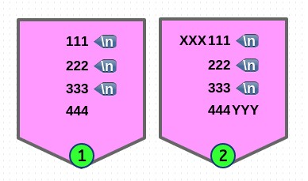

[source,bash]
----
# 's/.*//' 명령은 pattern space 에 있는 내용 전체를 삭제한다.

$ echo -e "111\n222\n333\n444" | sed -En 'N;N;N; s/.*//; p'
----

Multi-line 모드에서 ^ , $ , .* , .+ 는 특별하게 처리됩니다. ^ , $ 는 각 라인의 처음과 끝을 가리키고 .*, .+ 도 역시 각각의 라인과 매칭을 합니다. 이 4 가지 경우를 제외하고는 Multi-line 모드 라도 default 모드와 차이가 없습니다. 예를 들어서 s/X/Y/3 ( 3번째 매칭에서 X 를 Y 로 변경 ) 같은 명령은 s/X/Y/M3 에서도 같은 결과를 갖습니다.

s 명령에서 사용되는 숫자 나 g flag 은 각각 N 번째 매칭, global 매칭을 의미하는데 Multi-line 모드에서는 다음과 같이 작동합니다.

[source,bash]
----
# 'M' multi-line 모드, '1' 번째 매칭 이므로 첫 번째 라인의 처음과 끝을 가리킵니다.
$ echo -e "111\n222\n333\n444" | sed -En 'N;N;N; s/^/XXX/M1; s/$/YYY/M1; p'

# 매칭 넘버를 적지 않으면 default 값이 1 이므로 'M' 은 'M1' 과 같습니다.
$ echo -e "111\n222\n333\n444" | sed -En 'N;N;N; s/^/XXX/M; s/$/YYY/M; p'
----

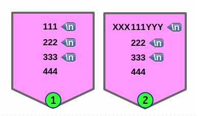

[source,bash]
----
# 'M' multi-line 모드, '2' 번째 매칭 이므로 두 번째 라인의 처음과 끝을 가리킵니다.
$ echo -e "111\n222\n333\n444" | sed -En 'N;N;N; s/^/XXX/M2; s/$/YYY/M2; p'
----

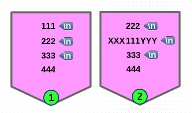

[source,bash]
----
# 'M' multi-line 모드, 'g' 는 global 매칭 이므로 전체 라인의 처음과 끝을 가리킵니다.
$ echo -e "111\n222\n333\n444" | sed -En 'N;N;N; s/^/XXX/Mg; s/$/YYY/Mg; p'
----

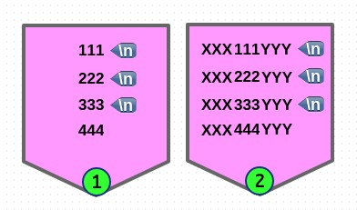

[source,bash]
----
# 'M' multi-line 모드, '3' 은 세 번째 매칭부터, 'g' 는 전부를 가리킵니다. 
echo -e "111\n222\n333\n444" | sed -En 'N;N;N; s/^/XXX/M3g; s/$/YYY/M3g; p'
----

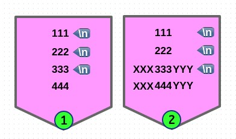

위의 경우는 regex 에서 단순히 ^, $ 문자만 사용했기 때문에 기본적으로 라인 전체가 매칭이 되지만 다음과 같이 라인 중에 일부분만 매칭이 될 수도 있습니다.

[source,bash]
----
# 전체 라인 중에서 2개만 매칭이 되는 경우
$ echo -e "A11\n2B2\nC33\n4D4" | sed -En 'N;N;N; s/^[A-Z]/XXX/Mg; p'
----

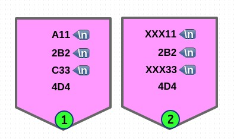

[source,bash]
----
# 'M' multi-line 모드, '2' 번째 매칭 이므로 세 번째 라인이 됩니다.
$ echo -e "A11\n2B2\nC33\n4D4" | sed -En 'N;N;N; s/^[A-Z]/XXX/M2; p'
----

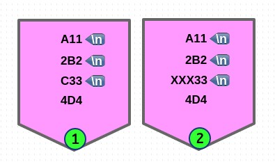

=== 라인 삭제 방법

Multi-line 모드를 이용하면 손쉽게 원하는 라인을 삭제할 수 있습니다. 이때 라인 개수는 그대로 남겨두고 내용만 삭제할 수도 있고 라인 자체를 삭제할 수도 있습니다.

다음은 해당 라인의 내용만 삭제하는 경우입니다. M flag 의 매칭 넘버 값이 해당 라인을 가리키는 것을 볼수 있습니다.

[source,bash]
----
$ cat file
Plain text 111
Plain text 222
Plain text 333
Plain text 444

# s/.*//M1 명령은 실질적으로 s/[^\n]*// 명령과 같습니다.
# s/.*//M3 명령은 실질적으로 s/[^\n]*//3 명령과 같습니다.

$ sed -En 'N;N;N; s/.*//M1; s/.*//M3p' file
----

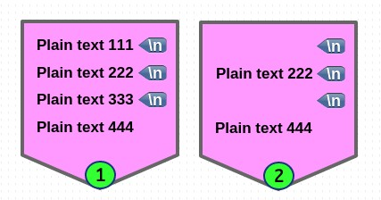

이번에는 라인 자체를 삭제하는 경우로 실행 후에는 라인 개수가 변경됩니다. 그러므로 M1 flag 으로 첫 번째 라인을 삭제한 후 두 번째 라인을 삭제할 때도 동일하게 M1 flag 가 사용된 것을 볼수 있습니다.

[source,bash]
----
# s/.*\n//M1 명령은 실질적으로  s/[^\n]*\n// 명령과 같습니다.

$ sed -En 'N;N;N; s/.*\n//M1; s/.*\n//M1p' file
----

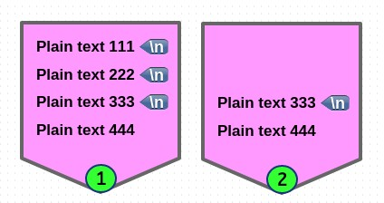

다음은 2번째 매칭 라인을 삭제하는 경우입니다.

[source,bash]
----
# s/.*\n//M2 명령은 실질적으로 s/[^\n]*\n//2 명령과 같습니다.

$ sed -En 'N;N;N; s/.*\n//M2p' file
----

=== Addresses

address 지정에 사용되는 /regex/ 에서도 M flag 을 사용할 수 있습니다. 이때 M 은 OR 역할을 합니다. 그러니까 전체 라인 중에서 하나만 매칭이 되어도 true 가 되는 것입니다. 다음과 같은 경우 ^[A-Z] 에 매칭 되는 라인이 3번째에 있기 때문에 M flag 을 사용하지 않고는 ^ 문자로 매칭이 되지 않습니다.

TIP: address 에서는 M 과 함께 숫자 나 g flag 은 사용되지 않습니다.

[source,bash]
----
# 'CC' 가 전체 데이터의 처음 위치에 있지 않으므로 매칭이 되지 않는다.
$ echo -e "111\n222\nCC3\n444" | sed -En 'N;N;N; /^[A-Z]/p'

# 'M' flag 을 사용하면 매칭이 된다.
$ echo -e "111\n222\nCC3\n444" | sed -En 'N;N;N; /^[A-Z]/Mp'
111
222
CC3
444
----

=== Multiple lines 를 다루는 기본 방법

sed 는 stream editor 이므로 한번 라인이 지나가면 다시 사용할 수 없습니다. 그러므로 multiple lines 을 처리하기 위해서는 기본적으로 원하는 만큼의 라인수를 버퍼에 저장하고 있어야 합니다.

다음은 버퍼에 지속해서 2개의 라인을 유지하면서 라인을 프린트하는 방법입니다.

[source,bash]
----
$ cat file
111
222
333
444
555

# 명령 사이클을 시작하면서 pattern space 에 라인 하나를 읽어들였는데
# 또 N 명령을 만났으므로 라인 하나를 더 읽어들여 append 합니다.
# 결과적으로 현재 pattern space 는 2개의 라인이 존재하게 됩니다.
# P 명령은 pattern space 에서 첫 번째 라인만 프린트를 하고 D 명령은 첫 번째 라인만 삭제합니다.
# D 명령은 이어 명령 사이클의 BEGIN 으로 분기합니다. (이때 라인을 읽어들이지 않습니다.)
# 이후 BEGIN 에서 다시 시작하면서 N 명령에 의해 라인이 pattern space 로 append 되므로
# pattern space 에는 항상 2개의 라인이 유지가 됩니다.
# 그런데 여기서 한가지 문제점은 마지막 555 라인이 표시되지 않는 것을 볼수 있습니다.
$ sed -En 'N; P;D' file
111
222
333
444

# 디버깅을 하기 위해 'l' 명령으로 pattern space 를 살펴보면 444 라인이 프린트되는 때는 이미
# pattern space 에 마지막 라인인 555 가 입력되어 있는 것을 볼수 있습니다.
# 444 라인이 P 명령에 의해 프린트되고 D 명령에 의해 삭제된 후 명령 사이클의 BEGIN 으로 가서
# N 명령이 실행되면 N 명령은 기본적으로 다음에 읽어들일 라인이 없으면 exit 하므로 이 부분에서
# 종료가 되는 것입니다. 다시 말해서 555 라인이 P 명령에 의해 표시되기 전에 종료가 됩니다.
# 따라서 N 명령이 마지막 라인에서는 실행되지 못하게 '$!N' 형식의 명령을 사용해야 합니다.
$ sed -En 'N; l; P;D' file
111\n222$
111
222\n333$
222
333\n444$
333
444\n555$
444

# 'N' 명령을 '$!N' 로 수정
$ sed -En '$!N; l; P;D' file
111\n222$
111
222\n333$
222
333\n444$
333
444\n555$
444
555$
555
----

이번에는 버퍼에 지속해서 3개의 라인을 유지하면서 라인을 프린트해보겠습니다.

[source,bash]
----
# 버퍼에 3개의 라인을  유지하기 위해 '1{$!N}' 를 추가하였습니다.
# '1{$!N}' 명령은 첫 번째 라인이 입력될 때만 실행됩니다.
# 그 이후로는 이어지는 '$!N' 명령에 의해 한 라인씩 append 됩니다.
# '$!N' 명령을 사용하였으므로 마지막 라인까지 모두 정상적으로 프린트되는 것을 볼수 있습니다.
$ sed -En '1{$!N}; $!N; l; P;D' file
111\n222\n333$
111
222\n333\n444$
222
333\n444\n555$
333
444\n555$
444
555$
555
----

비슷하게 버퍼에 지속해서 4개의 라인을 유지하려면 다음과 같이 하면 됩니다.

[source,bash]
----
$ sed -En '1{$!N; $!N}; $!N; l; P;D' file
111\n222\n333\n444$
111
222\n333\n444\n555$
222
333\n444\n555$
333
444\n555$
444
555$
555
----

이번에는 실제 데이터 파일을 가지고 수정 작업을 해보겠습니다.
파일 안에는 1번과 같이 3개의 라인이 값을 구성하고 있는데요. 이것을 2번 값으로 변경하겠습니다.

[source,bash]
----
# 1번
...
<servlet-name>
    cofaxTools
</servlet-name>
...

# 2번
...
<servlet-class>
    org.cofax.cms.CofaxToolsServlet
</servlet-class>
...

--------------------------------
$ sed -E '
    1{$!N}
    $!N
    \#(\s*)<servlet-name>(\s+)cofaxTools(\s+)</servlet-name># { 
        s##\1<servlet-class>\2org.cofax.cms.CofaxToolsServlet\3</servlet-class>#
    }
    P; D
' file
--------------------------------

# 다음은 -z 옵션을 사용할 경우
$ sed -Ez 's#(\s*)<servlet-name>(\s+)cofaxTools(\s+)</servlet-name>#'\
'\1<servlet-class>\2org.cofax.cms.CofaxToolsServlet\3</servlet-class>#' file
----

이번에는 2개의 라인을 유지하는 경우입니다. 아래와 같은 sql 문이 있을 경우 FULLTEXT KEY 라인을 삭제하려고 하는데요. 이때 그냥 해당 라인만 삭제해버리면 앞 라인에 , 가 남아 있기 때문에 sql 문 실행시 오류가 발생합니다. 그래서 , 도 함께 삭제해야 하는데 이때 multiple lines 방법을 이용할 수 있습니다.

[source,bash]
----
CREATE TABLE `table` (
  `id` int(10) NOT NULL auto_increment,
  `name` varchar(100) NOT NULL default '',
  `description` text NOT NULL,
  PRIMARY KEY  (`id`),
  FULLTEXT KEY `full_index` (`name`)
) ENGINE=MyISAM DEFAULT CHARSET=latin1;
----------------------------------------------

$ sed -En '$!N; s/,\s+FULLTEXT KEY.+// ;P;D' file

CREATE TABLE `table` (
  `id` int(10) NOT NULL auto_increment,
  `name` varchar(100) NOT NULL default '',
  `description` text NOT NULL,
  PRIMARY KEY  (`id`)                      <---- ',' 도 함께 제거 되었다.
) ENGINE=MyISAM DEFAULT CHARSET=latin1;
-----------------------------------------------

# -z 옵션을 사용할 경우
$ sed -Ez 's/,\s+FULLTEXT KEY[^\n]+//' file
----

multiple lines 를 다룰 때 한가지 생각해야 될 부분은 가령 pattern space 에서 3개의 라인을 유지하고 있는데 s 명령에 의해 라인이 1개로 줄어 버리는 경우입니다. 이럴 때는 s 명령이 실행되는 블록에서 $!N 명령을 이용하여 3개의 라인이 되도록 맞추어주어야 합니다.

[source,bash]
----
$ sed -En '
    1{$!N}
    $!N
    /aaa\nbbb\nccc/{
        s##xxx#        # "s" 명령에 의해 유지하고 있던 3개의 라인이 1개로 줄어듦
        $!N            # 2번 $!N 명령을 실행하여 3개의 라인으로 맞춥니다.
        $!N            
    }
    P;D
' file
----

이번에는 pattern space 에서 3개의 라인을 유지하는데 s 명령에 의해서 라인이 5개로 늘어나는 경우입니다. 이때는 초과되는 라인을 P 명령으로 프린트하고 M1 명령을 이용해 삭제하여 pattern space 에는 3개의 라인이 유지되도록 합니다.

[source,bash]
----
$ sed -En '
    1{$!N}
    $!N
    /aaa\nbbb\nccc/{        # "s" 명령에 의해 유지하고 있던 3개의 라인이 5개로 늘어남
        s##vvv\nwww\nxxx\nyyy\nzzz#  
        P; s/.*\n//M1       # "P" 명령으로 첫번째 라인 프린트, "M1" 명령으로 첫번째 라인 삭제
        P; s/.*\n//M1       # 여기서 "M1" 명령으로 삭제하는 것은 "D" 명령을 이용하면
    }                       # 실행 후 명령 사이클의 BEGIN 으로 분기하기 때문입니다.
    P;D
' file
----

=== 특정 구간에만 변경을 적용하기

다음은 --START-- 와 --END-- 사이의 구간에만 변경을 적용합니다.

[source,bash]
----
$ cat file
111
222
    <servlet-name>
        cofaxTools
    </servlet-name>
333
--START--
444
555
    <servlet-name>
        cofaxTools
    </servlet-name>
666
777
--END--
888
999
.....................................

$ sed -E '
/--START--/,/--END--/ {
    /--START--/{$!N}
    $!N
    s#(\s*)<servlet-name>(\s+)cofaxTools(\s+)</servlet-name>#\
\1<servlet-class>\2org.cofax.cms.CofaxToolsServlet\3</servlet-class>#
    P; D 
}
' file

############### output ###############
111
222
    <servlet-name>
        cofaxTools
    </servlet-name>
333
--START--
444
555
    <servlet-class>
        org.cofax.cms.CofaxToolsServlet
    </servlet-class>
666
777
--END--
888
999
----

=== 예제 1

다음과 같이 space 로 분리되는 4개의 필드를 갖는 레코드가 있습니다.
이때 3, 4번 필드 값을 5개 이내 문자로 제한해서 프린트합니다.

TIP: 꼭 원본 데이터를 있는 그대로 사용해야만 되는 것은 아니고 필요에 따라 수정해서 사용할 수 있습니다.

[source,bash]
----
# 데이터 내용
844388240 920009 XXXX YYYYYYYYYY
844388240 920009 XXXX 1234567890
800450220 910003 AAAAAAAAA BBB
800450220 910003 123456789 BBB
736458376 947883 HHH GG
800450220 910003 AAAAAAAAAAAAA YYYYYYYYYYYYYYY
800450220 910003 1234567890123 123456789012345

-----------------------------------------------

$ sed -E '
    s/ /\n/g              # multi-line 모드를 활용하기 위해 space 를 newline 으로 변경
    s/(.{,5}).*/\1/M3     # 3, 4 번째 매칭 라인의 값에서 앞 5문자만 추출
    s/(.{,5}).*/\1/M4 
    s/\n/ /g              # multi-line 모드 작업이 완료되었으므로 newline 을 space 로 변경
' file

844388240 920009 XXXX YYYYY
844388240 920009 XXXX 12345
800450220 910003 AAAAA BBB
800450220 910003 12345 BBB
736458376 947883 HHH GG
800450220 910003 AAAAA YYYYY
800450220 910003 12345 12345
----

=== 예제 2

공백 라인을 구분자로 하는 레코드입니다. Device=A 항목을 포함하는 레코드만 프린트합니다.

[source,bash]
----
# 데이터 파일 내용
--START--
Data=asdfasdf
Device=B
Lorem=Ipsum

--START--
Data=asdfasdf
Device=A
Lorem=Ipsum

--START--
Data=asdfasdf
Device=B

--START--
Data=asdfasdf
Device=A

--START--
Data=asdfasdf
Device=C
Lorem=Ipsum
.......................

# pattern space 의 마지막 문자가 newline 이라는 것은 공백 라인이 입력된 것을 의미합니다.
$ sed -n '
    /--START--/{ 
        :X 
        N            # 공백 라인이 입력될 때까지 계속해서 pattern space 에 append 합니다.
        /\n$/!bX     # 입력된 라인이 공백 라인이 아닐 경우 :X 로 분기
        /^Device=A/Mp    # /^Device=A/ 와 매칭이 되면 pattern space 에 있는 내용을 프린트
}' file

--START--
Data=asdfasdf
Device=A
Lorem=Ipsum

--START--
Data=asdfasdf
Device=A
----

=== 예제 3

이번 예제는 --START-- 를 만나면 이전 2라인을 포함해서 --END-- 까지의 내용을 프린트합니다.

[source,bash]
----
# 데이터 내용
111
222
333
--START--
444
555
--END--
AAA
BBB
CCC
DDD
--START--
EEE
--END--
FFF
GGG
...............

# /XXX[^\n]*$/ 형식은 pattern space 의 마지막 라인에 XXX 가 있는지 매칭할때 사용하는 방법입니다.
$ sed -En '
                              # --START-- 와 매칭 되면 이전 2라인을 프린트하기 위해    
    1{:X N;N}                 # pattern space 의 라인을 3개로 유지합니다.

    /--START--[^\n]*$/ {      # 마지막 라인이 --START-- 와 매칭 되면

        :Y 
        N                     # 라인을 하나 더 읽어 들이고
        /--END--[^\n]*$/!bY   # 마지막 라인이 --END-- 와 매칭이 되는지 체크합니다.
                              # 매칭이 안되면 다시 :Y 로 분기하여 `N` 명령에 의해
                              # 다음 라인을 읽어 들입니다.

        p                     # 매칭이 되면 현재 pattern space 내용을 프린트하고
        n                     # `n` 명령으로 현재 pattern space 의 내용을 새로 읽어들인
        bX                    # 라인으로 overwrite 하고 3개의 라인을 맞추기 위해 :X 로 분기
    }

    N;D                       # --START-- 와 매칭이 안될 경우 다음 라인을 읽어들여 append 하고
                              # `D` 명령으로 첫 번째 라인을 삭제한 후 명령 사이클의 BEGIN 으로
                              # 분기합니다.
' file

222
333
--START--
444
555
--END--
CCC
DDD
--START--
EEE
--END--
----

=== 예제 4

다음 예제는 forall 라인을 goal 라인 아래로 위치 시키는 것입니다. s 명령에서 사용된 regex 에서 첫 라인, 중간 라인들, 마지막 라인을 분리하는 방법을 주의깊게 보세요

[source,bash]
----
# 데이터 내용
goal identifier statement  
let statement 1  
let statement 2  
forall statement  
other statements

$ sed -E '/goal/{ 
    :X 
    N 
    /forall[^\n]*$/!bX

    s#^([^\n]*)(.*)(\n[^\n]*)$#\1\3\2# 

}' file

goal identifier statement  
forall statement  
let statement 1  
let statement 2  
other statements
----

=== Quiz

파일 내용 중에서 마우스로 선택한 영역을 간단히 다른 내용으로 변경하려면 어떻게 할까요?

이때는 복사한 내용을 먼저 here document 를 이용해 변수에 저장하고, sed 명령 실행시 오류가 생기는 것을 방지하고 정상적으로 처리되기 위해 필요한 escape 처리를 해주어야 합니다. 다음은 변수 AA 내용을 BB 내용으로 변경하는 예입니다.

[source,bash]
----
# copy 한 내용을 here document 을 이용해 변수에 대입합니다.
AA=$( cat <<\EOF
    $('#exampleModal').on('show.bs.modal', function (event) {
      var button = $(event.relatedTarget)         // Button that ....
      var recipient = button.data('whatever')     // Extract info ....
      var modal = $(this)
      modal.find('.modal-title').text("New message to " + recipient)
      modal.find('.modal-body input').val(recipient)
    })
EOF
)

BB=$( cat <<\EOF

EOF
)

# 변경하고자 하는 변수 AA 의 내용은 's' 명령의 왼쪽( regex 를 작성하는 곳 ) 에
# 위치하게 되므로 내용중에 regex 메타문자가 포함될 경우 escape 해야 합니다.
AA=$( echo "$AA" | sed -z -e 's#\([][^$*\.#]\)#\\\1#g' -e 's#\n#\\n#g' )

# BB 변수의 내용도 sed 명령문에서 문제가 생기지 않도록 escape 처리합니다.
BB=$( echo "$BB" | sed -z -e 's#\([&\#]\)#\\\1#g' -e 's#\n#\\n#g'  )

# sed 명령은 디폴트인 basic regular expression 으로 실행합니다.
sed -z -i "s#${AA}#${BB}#g" *.html
----

== Execute

이것은 sed 가지는 재미있는 기능 중 하나인데요. pattern space 에 있는 내용을 명령문으로 해서 sh -c 형태로 실행을 시킬 수가 있습니다. 그리고 실행 결과가 다시 pattern space 로 저장됩니다. 그러므로 원하는 대로 또 결과를 수정해서 사용할 수 있겠죠?

다음은 명령을 실행했을 때 프로세스 상태입니다.

[source,bash]
----
$ echo "2:3" | sed -E 's#([0-9]+):([0-9]+)#AA=$((\1+\2)); sleep $AA; echo $AA#e' 
5
----

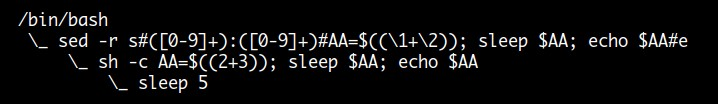

TIP: 프로세스가 새로 생성되어 실행되므로 반복해서 여러번 실행할 경우 속도가 느려질 수 있습니다.

e 명령이 실행되는 형태를 2가지로 분류해 볼수 있습니다.

1. s/../../e 를 이용하는 방법, 단독으로 e 명령을 실행하는 방법

이 방법들은 현재 pattern space 에 있는 내용을 명령문으로 하여 sh -c 형태로 실행하고 stdout 값이 다시 pattern space 로 저장됩니다. 단독으로 e 명령을 실행할땐 이후에 다른 문자가 오지 못하므로 -e 옵션을 사용해 분리해야 합니다.

[source,bash]
----
# 'echo hello' 가 pattern space 로 들어가고 'e' 명령에 의해 실행된다.
# 실행 결과 stdout 값이 다시 pattern space 로 저장된다.

$ echo "echo hello" | sed -e 'e' -e 's/.*/& execute/'
hello execute
----

2. pattern space 와 관계없이 e command 형식으로 직접 실행하는 방법

이 실행 방식은 i 명령과 동일합니다. 실행 결과가 patten space 에 영향을 주지 않고, -n 옵션에 상관없이 결과가 프린트됩니다. 명령문으로 사용되는 스트링은 어떤 값도 올수 있기 때문에 -e 옵션을 사용해 분리해야 합니다.

[source,bash]
----
$ echo "hello" |
sed -n  -e 'e echo ------------'  -e 's/.*/& execute/p' -e 'e echo ============'
------------
hello execute
============
----

=== 예제 1

다음 예제는 숫자가 포함된 데이터 파일을 읽어들여 max 값을 구한 후 출력합니다.
특별히 의미 있는 예제는 아니지만 여러 가지로 활용하는 방법을 보여줍니다.

TIP: sed 에서 사용되는 & , \ 문자를 shell 에서 사용하려면 escape 해야 합니다.

[source,bash]
----
# 데이터 파일
$ cat data
43
2
85
12
5
999
7
26

------------------------

$ sed -En '
    1{h;b}      # 처음 숫자일 경우 hold 하고 END 로 분기합니다.
    G           # 현재 pattern space 에 있는 숫자에 hold space 에 있는 숫자를 append 합니다.
    s/\n/ /     # newline 을 space 로 변경하여 shell 에서 사용될 수 있게 합니다.

    s#.*#set &; if [ $1 -gt $2 ]; then echo $1; else echo $2; fi #e

    h           # 연산 결과를 hold 합니다.
    $p          # 마지막 라인일 경우 값을 표시합니다.
' data

999
------------------------

$ sed -En '
    1{h;b}
    G
    s/\n/ /                 # f() 쉘 함수를 만들어 실행
    s#.*#f() { if [ $1 -gt $2 ]; then echo $1; else echo $2; fi ;}; f & #e
    h
    $p
' data

999
------------------------

# comp.sh script 를 만들어 실행
$ cat comp.sh 
#!/bin/sh

if [ "$1" -gt "$2" ]; then
    echo "$1"
else
    echo "$2"
fi
..........................

$ sed -En '
    1{h;b}
    G
    s/\n/ /
    s#.*#./comp.sh &#e     # comp.sh 스크립트를 실행
    h
    $p
' data

999
----

=== 예제 2

이번에는 각 라인의 합계를 구합니다.

[source,bash]
----
$ shuf -i 1-20 | paste - - - - - 
16      7       12      20      17
2       4       9       3       6
19      1       11      8       13
15      14      10      18      5

$ shuf -i 1-20 | paste - - - - - |
sed -E '
    p
# `s` 명령에 의해 다음과 같은 스트링이 `sh -c` 에 의해 실행됩니다.
# f() { for n; do  r=$((r+n)); done; echo "sum : $r" ;}; f 7   12   1   10   16

    s/^/f() { for n; do  r=$((r+n)); done; echo "sum : $r" ;}; f /e
'
7       12      1       10      16
sum : 46
11      2       18      17      8
sum : 56
13      5       4       3       15
sum : 40
19      6       9       20      14
sum : 68
----

=== 예제 3

다음은 데이터 파일에 있는 도메인의 ip 주소를 구하여 추가합니다.

[source,bash]
----
$ cat host
001 naver.com KR
002 daum.net KR
003 google.com US

$ sed -En '
    h
    s#.* (.*) .*#dig +short \1 | head -n1#e
    G
    s#(.*)\n(.*) (.*) (.*)#\2 \3 : \1 \4 #
    p
' host

001 naver.com : 202.179.177.22 KR 
002 daum.net : 61.111.62.173 KR 
003 google.com : 216.58.197.142 US
----

== Command-line options

sed 는 명령 라인에서 스크립트 스트링이나 -e, -f 옵션을 사용하지 않으면 인수로 사용된 파일명 중에서 첫번째 파일을 명령 스크립트 파일로 그리고 나머지 파일들을 데이터 파일로 취급합니다. 아무런 데이터 파일도 인수로 주지 않을 경우는 stdin 에서 입력을 받습니다.

----
-n, --quiet, --silent
----

sed 의 디폴트 출력 모드인 자동 출력 모드를 disable 합니다.

----
-e script, --expression=script
----

스크립트가 길어질 경우 가독성을 위해 -e 옵션을 이용해 분리해 작성할 수 있습니다. shell 에서 명령문을 작성할 때 파이프로 sed 명령이 중복되어 연결되어 있다면 -e 옵션을 이용해 한번의 명령 실행으로 바꿀 수 있습니다. 또한 insert, append, execute 같은 명령을 사용할 때 필요한 옵션입니다.

-e 옵션이 사용되면 처음 식에도 모두 -e 옵션을 붙여야 합니다.

----
-f script-file, --file=script-file
----

실행할 스크립트 파일을 지정합니다.

----
-E, -r, --regexp-extended
----

Extended Regular Expressions 을 사용합니다.

----
-u, --unbuffered
----

입, 출력에 버퍼를 사용하지 않습니다. tail -f 같은 명령과 함께 사용할때 필요한 옵션 입니다.

----
-s, --separate
----

sed 는 기본적으로 인수로 전달되는 데이터 파일들을 모두 합쳐서 하나의 스트림으로 취급합니다. 그러므로 10 개의 데이터 파일이 인수로 전달되어도 1p 명령은 한번만 출력됩니다. 하지만 -s 옵션을 사용하면 각각 분리된 스트림으로 취급하여 1p 명령은 10 번 출력됩니다.

----
-z, --null-data
----

라인 구분자로 newline 대신에 NUL 문자를 사용합니다. 특정 명령에서 라인 구분자를 NUL 문자로 하여 출력할 경우에 사용되는데 이외에도 파일 전체를 한번에 pattern space 로 읽어들이는 용도로 사용할 수 있습니다. 이때 M flag 를 이용한 multi-line 모드는 사용할 수 없습니다.

----
-l N, --line-length=N
----

l 명령은 pattern space 의 내용을 분석할 때 사용하는 명령인데요. 기본적으로 escape sequence 형태로 출력하므로 개행을 하지 않습니다. 이 옵션을 이용하면 line-wrap length 를 지정할 수 있습니다. default 는 70 이고 length 값을 0 으로 설정하면 no wrap 입니다.

----
-i[SUFFIX], --in-place[=SUFFIX]
----

이 옵션은 sed 를 이용해 파일 내용을 직접 수정할 때 사용합니다.
특히 디렉토리를 recursive 하게 검색해서 매칭 되는 파일들을 모두 수정할 때 편리합니다.

처리되는 순서는 다음과 같습니다.

. 먼저 임시 파일을 만들어서 처리중에 결과를 저장합니다.

. 처리가 완료되면 임시 파일을 원본 파일명으로 변경하고 원본 파일은 삭제합니다.

. 이때 SUFFIX 값이 주어졌으면 원본 파일을 삭제하지 않고 SUFFIX 를 붙여서 보관합니다.

그러므로 용량이 큰 파일일 경우 저장공간이 처리하고자 하는 파일의 2배가 필요하고 처리가 완료된 파일은 새로운 inode 를 갖는 파일이 됩니다.

[source,bash]
----
$ ls
data1  data2  data3

# SUFFIX 는 -i 옵션에 공백 없이 붙인다.
$ sed -i.orig 's/XXX/YYY/' * 

$ ls
data1  data1.orig  data2  data2.orig  data3  data3.orig
-------------------------------------------------------

# ./dir 디렉토리 이하 모든 파일을 검색해서 'hello' 를 포함하고 있을 경우 foo 를 bar 로 변경
$ grep -rl 'hello' ./dir | xargs sed -i.orig 's/foo/bar/g'
----

TIP: 옵션에 SUFFIX 를 사용할 때는 공백 없이 붙여야 합니다. 만약에 -i, -r 옵션 사용을 -ir 와같이 한다면 r 이 SUFFIX 가 되므로 주의해야 합니다.

----
--follow-symlinks
----

-i 옵션을 사용하여 직접 파일을 저장할 경우 대상 파일이 symbolic link 이면 처리되는 방식에 차이가 있습니다. 다음은 foo 가 파일 file.txt 의 symbolic link 일 경우 --follow-symlinks 옵션을 사용 안 했을 때와 했을 때의 차이를 비교한 것입니다.

[source,bash]
----
$ cat file.txt 
1111111111

$ ls -l        
total 4    # foo 는 file.txt 의 symbolic link
-rw-rw-r-- 1 mug896 mug896 11 2020-03-21 10:40 file.txt
lrwxrwxrwx 1 mug896 mug896  8 2020-03-21 10:42 foo -> file.txt
..............................................................

$ sed -i 's/1/22/g' foo 

$ ls -l
total 8    # foo symbolic link 가 일반 파일로 변경된다.
-rw-rw-r-- 1 mug896 mug896 11 2020-03-21 10:40 file.txt
-rw-rw-r-- 1 mug896 mug896 21 2020-03-21 10:44 foo

$ cat foo
22222222222222222222
$ cat file.txt
1111111111

# 다음은 --follow-symlinks 옵션을 사용했을 경우
$ sed --follow-symlinks -i 's/1/22/g' foo

$ ls -l
total 4    # foo symbolic link 는 그대로이고 연결된 file.txt 가 변경된다.
-rw-rw-r-- 1 mug896 mug896 21 2020-03-21 10:45 file.txt
lrwxrwxrwx 1 mug896 mug896  8 2020-03-21 10:45 foo -> file.txt

$ cat file.txt
22222222222222222222

############### 다음은 -i 옵션에 suffix 를 사용했을 경우 #############

$ sed -i.bak 's/1/22/g' foo

$ ls -l     # sed 명령의 처리 결과가 foo 파일로 저장되고 foo.bak 은 symbolic link 가 된다.
-rw-rw-r--  1 mug896 mug896     11 2018-06-21 23:20 file.txt
-rw-rw-r--  1 mug896 mug896     21 2018-07-14 15:36 foo
lrwxrwxrwx  1 mug896 mug896      8 2018-07-14 15:35 foo.bak -> file.txt

# 다음은 --follow-symlinks 옵션을 사용했을 경우
$ sed -i.bak --follow-symlinks 's/1/22/g' foo

$ ls -l     # foo symbolic link 는 그대로이고 연결된 file.txt 가 변경된다.
-rw-rw-r--  1 mug896 mug896     21 2018-07-14 16:06 file.txt
-rw-rw-r--  1 mug896 mug896     11 2018-07-14 15:44 file.txt.bak
lrwxrwxrwx  1 mug896 mug896      8 2018-07-14 16:04 foo -> file.txt

$ cat file.txt
22222222222222222222
$ cat file.txt.bak
1111111111
----

== Debugging

sed 는 따로 디버깅을 위한 옵션이나 기능을 제공하지 않습니다. 따라서 디버깅을 하려면 직접 p 명령을 이용해서 pattern space 에 있는 내용을 조회해야 하는데요. 그런데 p 명령은 printable 문자만 표시되기 때문에 내용 중에 non-printable 문자가 사용됐을 때는 정확한 값을 확인할 수가 없습니다. 따라서 sed 는 디버깅에 활용할 수 있도록 다음과 같은 명령을 제공합니다.

=== `l`

pattern space 에 있는 내용을 escape sequence 를 이용해 표시해줍니다.

[source,bash]
----
# '\a' 은 non-printable 문자로 아예 값이 표시되지 않는다.
# '\t', '\v' 값은 space, newline 과 구분하기가 어렵다.
$ echo -e "valX\a111\nvalY\t222\nvalZ\v333" | sed -En 'N;N;p'
valX111
valY    222
valZ
    333

# 'l' 명령을 사용하면 escape sequence 를 이용해 값을 있는 그대로 표시해줍니다.
$ echo -e "valX\a111\nvalY\t222\nvalZ\v333" | sed -En 'N;N;l'
valX\a111\nvalY\t222\nvalZ\v333$
----

TIP: l 명령은 출력이 newline 문자에 의해 개행이 되지 않기 때문에 따로 line-wrap length 값을 사용해 개행하는데요. sed 명령의 -l N 옵션을 통해서 값을 설정할 수 있습니다.

=== l 명령을 활용한 디버깅 예제

다음은 데이터 파일에 숫자 라인과 알파벳 라인이 혼합되어 있을 경우 숫자 라인 다음에 알파벳 라인이 올 경우만 값을 표시하는 스크립트입니다. 이때 l 명령을 이용함으로써 매 라인 입력 시마다 변경되는 pattern space 의 값을 조회해 볼수 있습니다.

[source,bash]
----
$ cat file
111
222
ABC
333
444
DEF
555

# 숫자 라인 다음에 알파벳 라인이 올 경우 프린트
$ sed -En '$!N; /[0-9]+\n[A-Z]+/p; D' file
222
ABC
444
DEF

# 'l' 명령을 이용함으로써 pattern space 의 내용을 확인할 수 있다.
$ sed -En '$!N; l; /[0-9]+\n[A-Z]+/p; D' file
111\n222$
222\nABC$  <---- match !
222
ABC
ABC\n333$
333\n444$
444\nDEF$  <---- match !
444
DEF
DEF\n555$
555$
----

TIP: $ 문자는 pattern space 의 끝을 나타냅니다.

=== `=`

현재 pattern space 에 입력된 라인넘버를 표시해줍니다.

[source,bash]
----
$ echo -e "valX\a111\nvalY\t222\nvalZ\v333\nvalA:444" | sed -E '='   
1
valX111
2
valY    222
3
valZ
    333
4
valA:444

$ echo -e "valX\a111\nvalY\t222\nvalZ\v333\nvalA:444" | sed -E 'N;=' 
2
valX111
valY    222
4
valZ
    333
valA:444
----

=== Regex 테스트

* https://regex101.com/ 사이트를 활용하면 도움이 됩니다.

* https://regexper.com/ regex railroad diagram generator

== Tips

=== sed 명령을 변수에 저장해 실행하기

[source,bash]
----
$ AA="s/^/X/" BB='s/$/Y/'

$ echo 12345 | sed "$AA; $BB"
X12345Y

$ CC="i-------"

$ echo 12345 | sed "$CC; $AA; $BB"            # i, a, c 명령은 
-------; s/^/X/; s/$/Y/
12345

$ echo 12345 | sed -e "$CC" -e "$AA; $BB"     # -e 옵션을 사용해 분리해야 한다.
-------
X12345Y
----

=== pattern space 에 라인을 insert, append 하기

i, a 명령은 pattern space 에는 라인이 추가되지 않습니다. pattern space 의 특정 위치에 라인을 insert, append 하려면 다음과 같은 방법을 이용합니다.

[source,bash]
----
# 3 번째 라인 앞에 추가
# ":X $!{N; bX};" 는 전체 라인을 pattern space 로 읽어 들입니다.
$ echo -e "111\n222\n333\n444" | sed -E ':X $!{N; bX}; s/^/XXXXX\n/M3'
111
222
XXXXX
333
444

# 3 번째 라인 뒤에 추가
$ echo -e "111\n222\n333\n444" | sed -E ':X $!{N; bX}; s/$/\nXXXXX/M3'
111
222
333
XXXXX
444

# 처음 라인 앞에 추가
$ echo -e "111\n222\n333" | sed -E ':X $!{N; bX}; s/^/XXXXX\n/'
XXXXX
111
222
333

# 마지막 라인 뒤에 추가
$ echo -e "111\n222\n333" | sed -E ':X $!{N; bX}; s/$/\nXXXXX/'
111
222
333
XXXXX
----

=== -i 옵션 사용시 터미널로 출력하기

-i 옵션을 이용해 파일을 수정할 경우 출력이 파일로 저장되기 때문에 터미널에는 아무런 메시지가 표시되지 않는데요. 다음과 같이 하면 필요할 경우 stderr 로 출력할 수 있습니다.

[source,bash]
----
# bar 가 zoo 로 치환될 경우 file 로 결과가 저장되는 동시에 stderr 로도 출력이 된다.
$ sed -i -e '/foo/{ s/bar/zoo/w /dev/stderr' -e '}' file
----

=== 데이터를 보는 안목을 기르자

[source,bash]
----
다음과 같이 숫자가 섞여있는 라인에서 N 번째 숫자를 추출하려고 합니다.
이와 같은 경우 먼저 숫자가 아닌 문자들을 삭제해버리면 이후에 추출하기가 수월해집니다.

# 세 번째 숫자에 해당하는 13963  추출하기
[ 2014/05/01 10:48:26 | 13963 | DEBUG ] It took 11.16837501525879 seconds to complete

$ sed -E 's#[^0-9./:]# #g' file
  2014/05/01 10:48:26   13963                   11.16837501525879  

$ sed -E 's#[^0-9./:]# #g; s/\s*(\S+\s+){2}(\S+).*/\2/' file
13963

# 또는
$ sed -E 's/([^0-9]*([0-9]+)){7}.*/\2/' file
13963
----

다음 예는 0 보다 큰 숫자들을 전부 1 로 변경하려고 하는데요.
이때는 각 컬럼 값을 0 보다 큰지 일일이 비교할 필요 없이 regex 를 이용해 해결할 수 있습니다.

[source,bash]
----
# 데이터 내용
        a       b       c
A       5       2       0
B       0       3       4
C       7       3       4
D       2       0       2

# 두 자리 이상의 숫자도 포할될 경우는 's/[0-9]{2,}|[1-9]/1/g' 
$ sed 's/[1-9]/1/g' file
        a       b       c
A       1       1       0
B       0       1       1
C       1       1       1
D       1       0       1
----

=== 스크립트가 길때 개행하는 방법

스크립트 명령은 -e 옵션으로 구분하여 실행 할 수 있습니다.

[source,bash]
----
$ sed  -e 's/hamster/this is a hamster./' \
       -e 's/parrot/this is a parror./'   \
       -e 's/turtle/this is a turtle./' file
----

-e 옵션은 명령 단위로 분리해 작성해야 하므로 만약에 s 하나의 명령이 길어질 경우는 위 방법으로는 안되고 다음과 같이 backslash-newline 을 사용해야 합니다.

[source,bash]
----
$ sed -Ez 's#(\s*)<servlet-name>(\s+)cofaxTools(\s+)</servlet-name>#'\
'\1<servlet-class>\2org.cofax.cms.CofaxToolsServlet\3</servlet-class>#' file

$ sed -En '/(([0-9]{1,2}|1[0-9]{2}|2[0-4][0-9]|25[0-5])\.){3}'\
'([0-9]{1,2}|1[0-9]{2}|2[0-4][0-9]|25[0-5])/p' <<\@
192.168.0.1
127.0.0.1
123.456.789.101
10.1.2.4
@

192.168.0.1
127.0.0.1
10.1.2.4
----

=== sed 보다 다른 명령을 사용하는게 효율적일 경우

특정 스트링을 추출하거나 N 번째 필드를 추출할 때는 sed 보다는 grep, awk 명령을 이용하는 것이 효율적입니다.

[source,bash]
----
$ df -h
Filesystem      Size  Used Avail Use% Mounted on
udev            7.8G     0  7.8G   0% /dev
tmpfs           1.6G  1.7M  1.6G   1% /run
/dev/sda5        28G   13G   14G  49% /
tmpfs           7.8G   67M  7.8G   1% /dev/shm

# "숫자%" 로 구성된 항목을 추출
$ df -h | sed -E 's/([0-9]+%)|./\1/g'
0%
1%
49%
1%

# grep 명령을 이용하는 것이 효율적입니다.
$ df -h | grep -Eo '[0-9]+%'
0%
1%
49%
1%
--------------------------------------------

# 4번째 컬럼 값을 추출
$ df -h | sed -E 's/(\S+\s+){3}(\S+).*/\2/'
Avail
7.8G
1.6G
14G
7.8G

# awk 명령을 이용하는 것이 효율적입니다.
$ df -h | awk '{ print $4 }'
Avail
7.8G
1.6G
14G
7.8G
----

