The complete WPF tutorial
---

현재 126개의 기사로 구성된 “WPF 튜토리얼” 에 오신 것을 환영합니다! 이곳에서 WPF UI 프레임워크를 사용해서 직접 애플리케이션을 만드는 방법을 배우실 수 있습니다. WPF를 처음 접하시는 분이라면 첫 번째 장부터 시작해서 전체 내용을 차례대로 읽어보시는 것을 권장합니다.

오른쪽의 목차를 살펴보시면 모든 장이 나열되어 있습니다. 새로운 장이 계속 추가될 예정이니 정기적으로 다시 방문해 주시기 바랍니다. 이 튜토리얼이 여러분이 WPF를 제대로 시작하는 데 도움이 되기를 바랍니다.

WPF 사용법을 배우실 때는 C#에 대한 기본 지식이 권장됩니다. 아직 C# 을 잘 모르신다면, C# 튜토리얼을 통해 C#에 대한 이해를 높이는 것이 좋습니다. XAML 및 스타일링 관련 주제를 다룰 때는 HTML과 CSS에 대한 올바른 이해가 큰 도움이 될 것입니다.

이 튜토리얼이 마음에 드셨다면, 여러분의 웹사이트에 링크를 걸어주시거나 페이스북, 트위터와 같은 소셜 미디어를 통해 친구들과 공유해 주시면 큰 도움이 됩니다. 

즐겁게 학습하시기 바랍니다!


# About WPF

## What is WPF?

`WPF` (Windows Presentation Foundation)는 .NET 프레임워크와 함께 사용되는 마이크로소프트의 최신 GUI 프레임워크입니다.

그런데 GUI 프레임워크란 정확히 무엇일까요? GUI는 그래픽 사용자 인터페이스(Graphical User Interface)의 약자로, 여러분이 지금 이를 통해 보고 계실 것입니다. Windows는 컴퓨터를 조작하기 위한 GUI가 있으며, 여러분이 이 문서를 읽고 계실 브라우저도 웹 서핑을 할 수 있게 해주는 GUI가 있습니다.

GUI 프레임워크를 사용하면 레이블, 텍스트 상자 등 널리 알려진 다양한 GUI 요소를 활용해서 애플리케이션을 만들 수 있습니다. GUI 프레임워크가 없다면 이런 요소를 수동으로 그려야 할 뿐만 아니라, 텍스트나 마우스 입력 같은 모든 사용자 상호작용 시나리오를 직접 처리해야 합니다. 이는 엄청난 작업량이기 때문에, 대부분의 개발자는 기본적인 작업을 모두 처리해 주고 개발자는 애플리케이션 제작에 집중할 수 있도록 해주는 GUI 프레임워크를 사용합니다.

시중에는 수많은 GUI 프레임워크가 있지만, .NET 개발자에게 현재 가장 주목할 만한 것은 WinForms 과 WPF 입니다. WPF가 가장 최신 기술이지만, 마이크로소프트는 여전히 WinForms 을 유지 관리하고 지원하고 있습니다. 다음 장에서 보겠지만, 두 프레임워크 간에는 꽤 많은 차이점이 있지만, 목적은 동일합니다. 바로 훌륭한 GUI를 갖춘 애플리케이션을 쉽게 만들 수 있도록 하는 것입니다.

다음 장에는 WinForms 과 WPF 의 차이점을 살펴보겠습니다.


## WPF vs. WinForms

이전 장에서 WPF가 무엇인지와 WinForms 에 대해 간략히 살펴보았습니다. 이번 장은 이 두 가지를 비교해 보려고 합니다. 두 프레임워크 모두 같은 목적을 수행하지만, 그 사이에는 정말 많은 차이점이 있기 때문입니다. 이전에 WinForms 을 다뤄본 적이 없다거나, 특히 WPF가 여러분이 접하는 첫 번째 GUI 프레임워크라면 이 장을 건너뛰셔도 됩니다. 하지만 두 프레임워크의 차이점에 관심이 있으시다면 계속 읽어보시기 바랍니다.

WinForms 과 WPF 사이의 중요한 차이점은, WinForms이 단순히 표준 Windows 컨트롤(예: TextBox) 위에 얹힌 레이어인 반면, WPF는 처음부터 새로 구축되어 거의 모든 상황에서 “표준 Windows 컨트롤에 의존하지 않는다” 는 사실입니다. 이는 미묘한 차이처럼 보일 수 있지만, 실제로는 그렇지 않습니다. Win32/WinAPI에 의존하는 프레임워크를 다뤄본 적이 있다면 이런 차이를 분명하게 느끼실 수 있을 것입니다.

이를 잘 보여주는 예로, 이미지와 텍스트가 포함된 버튼을 들 수 있습니다. 이는 표준 Windows 컨트롤이 아니기 때문에, WinForms은 기본적으로 이런 기능을 제공하지 않습니다. 대신 이미지를 직접 그리거나, 이미지를 지원하는 사용자 정의 버튼으로 구현하거나, 타사 컨트롤을 사용해야 합니다. WPF는 버튼이 본질적으로 콘텐츠와 다양한 상태(예: 터치, 호버, 누름)를 가진 “테두리” 이므로, 버튼 안에 무엇이든 포함할 수 있습니다. WPF 버튼은 다른 대부분의 WPF 컨트롤과 마찬가지로 “외관이 정해져 있지 않은” 구조로, 내부에 다양한 다른 컨트롤을 포함할 수 있습니다. 이미지와 텍스트가 포함된 버튼이 필요하신가요? 버튼 안에 Image 와 TextBlock 컨트롤을 넣으면 끝입니다! 표준 WinForms 컨트롤은 이런 유연성을 기대하기 어렵기 때문에, 이미지가 포함된 버튼 같은 비교적 단순한 컨트롤 구현을 위한 시장이 크게 형성되어 있습니다.

이런 유연성의 단점은, WinForms은 필요한 시나리오에 딱 맞춰 만들어져 있고 매우 쉽게 구현할 수 있던 기능을 구현하기 위해 때로는 좀 더 많은 노력을 기울여야 한다는 점입니다. 적어도 처음에는 그렇게 느껴집니다. 예를 들어, 이미지와 정렬이 잘 된 텍스트가 포함된 ListView 를 만들기 위해 템플릿을 직접 만들어야 하는 반면, WinForms의 ListViewItem 은 단 한 줄의 코드로 이를 처리해 주기 때문입니다.

이것은 단지 하나의 차이점일 뿐이지만, WPF를 다뤄보면 이것은 사실 다른 많은 차이점들의 근본적인 원인이라는 것을 깨닫게 될 것입니다. WPF는 좋든나쁘든 그저 자신만의 방식으로 일을 처리할 뿐입니다. 더 이상 Windows 방식에 얽매이지 않아도 되지만, 이런 유연성을 얻기 위해서는 단순히 Windows 방식으로만 작업을 하고 싶을 때조차 좀 더 많은 노력을 기울여야 합니다.

다음은 WPF와 WinForms의 주요 장점에 대한 전적으로 주관적인 목록입니다. 이를 통해 앞으로 어떤 상황에 직면할지 좀 더 잘 파악할 수 있을 것입니다.


### WPF advantages

- 좀 더 최신 기술이라 현재 표준에 잘 부합합니다.
- 마이크로소프트는 Visual Studio 같은 많은 새로운 애플리케이션에 이를 사용하고 있습니다.
- 좀 더 유연하기 때문에 새로운 컨트롤을 직접 작성하거나 구매하지 않고도 다양한 작업을 수행할 수 있습니다.
- 타사 컨트롤을 사용할 경우, 해당 컨트롤 개발자들은 WPF가 최신 기술이기 때문에 WPF에 집중할 가능성이 높습니다.
- XAML을 사용하면 GUI를 쉽게 만들고 편집할 수 있으며, 디자이너(XAML)와 프로그래머(C#, VB.NET 등)의 업무 분담이 가능합니다.
- 데이터 바인딩을 통해 데이터와 레이아웃을 명확하게 분리할 수 있습니다.
- GUI 렌더링에 하드웨어 가속을 사용해서 성능을 향상시킵니다.
- Windows 애플리케이션과 웹 애플리케이션(Silverlight/XBAP) 모두를 위한 사용자 인터페이스를 만들 수 있습니다.


### WinForms advantages 

- 이 기술은 역사가 길기 때문에 그만큼 검증도 많이 거쳤습니다.
- 이미 구매했거나 무료로 구할 수 있는 타사 컨트롤이 많이 있습니다.
- 이 글을 쓰는 시점에서 Visual Studio 디자이너는 WPF보다 WinForms에 적합하며, WPF의 경우 사용자가 직접 많은 작업을 수행해야 합니다.


# Getting started

## Visual Studio Community

앞서 설명한 것 같이, WPF는 XAML(마크업)과 C#/VB.NET/기타 .NET 언어를 결합한 것입니다. 이 모든 코드는 Windows에 포함된 메모장(Notepad)을 비롯한 어떤 텍스트 편집기도 편집할 수 있으며, 이후 명령줄에서 컴파일할 수 있습니다. 하지만 대부분의 개발자는 IDE(통합 개발 환경)를 사용하는 것을 선호하는데, 이는 코드 작성부터 인터페이스 설계, 그리고 전체 컴파일에 이르기까지 모든 과정을 훨씬 더 쉽게 만들어 주기 때문입니다.

.NET/WPF용 IDE로 가장 많이 선택되는 것은 Visual Studio지만, 비용이 꽤 많이 듭니다. 다행히 마이크로소프트는 누구나 .NET과 WPF를 쉽게, 그리고 완전히 무료로 시작할 수 있도록 하기 위해 ‘Visual Studio Community’ 라는 무료 버전의 Visual Studio를 출시했습니다. 이 버전은 정식 Visual Studio보다 기능이 약간 적지만, WPF를 배우고 실제 애플리케이션을 만드는 데 필요한 모든 기능을 갖추고 있습니다.

그러니 지금 바로 마이크로소프트에서 Visual Studio Community를 다운로드하세요. 무료이며 설치와 사용도 간편합니다:

https://www.visualstudio.com/vs/community/

다운로드 및 설치가 완료되면, 다음 기사로 이동해서 WPF 학습 과정을 시작해 보세요!


## Hello, WPF!

거의 모든 프로그래밍 튜토리얼에서 가장 먼저 등장하는 전형적인 예제는 “Hello, world!” 입니다. 하지만 이 튜토리얼은 좀 색다르게 “Hello, WPF!” 로 바꿔 보겠습니다. 목표는 단순히 이 텍스트를 화면에 표시해서, 시작하는 것이 얼마나 쉬운지 보여드리는 것입니다.

이 튜토리얼의 나머지 부분에는 IDE가 설치되어 있다고 가정합니다. 가급적이면 Visual Studio 나 Visual Studio Community 를 사용하는 것이 좋습니다(설치 방법은 이전 기사를 참조하세요). 다른 제품을 사용할 경우, 해당 제품에 맞게 지침을 조정해야 합니다.

Visual Studio에서 파일 메뉴의 ‘새 프로젝트’ 를 선택해서 시작합니다. 왼쪽에는 카테고리 트리가 표시되어 있을 것입니다. 이 튜토리얼은 코드가 포함될 때마다 C#에 중점을 둘 것이므로 템플릿 목록에서 C# 을 선택하며, Windows 애플리케이션을 만들 예정이므로 트리에서 ‘Windows’ 를 선택해야 합니다. 그러면 오른쪽에 사용 가능한 Windows 애플리케이션 유형 목록이 표시되는데, ‘WPF 애플리케이션’ 을 선택합니다. 저는 ‘이름’ 텍스트 필드에 프로젝트 이름을 “HelloWPF” 로 지정했습니다. 대화 상자 하단의 나머지 설정이 올바른지 확인한 후 ‘확인’ 버튼을 누릅니다.

새 프로젝트는 몇 개의 파일이 포함되어 있지만, 지금은 그 중 하나인 MainWindow.xaml 에 집중하겠습니다. 이 파일은 애플리케이션의 “기본 창” 으로, 별도로 설정하지 않는 한 애플리케이션을 실행했을 때 가장 먼저 표시되는 창입니다. 이 파일에 포함된 XAML 코드(XAML은 튜토리얼의 다른 장에서 자세히 다룹니다)는 대략 다음과 같을 것입니다:


```cs
<Window x:Class=“WpfApplication1.MainWindow”
    xmlns="http://schemas.microsoft.com/winfx/2006/xaml/presentation"
    xmlns:x=“http://schemas.microsoft.com/winfx/2006/xaml”
    Title="MainWindow" Height="350" Width="525">
    <Grid>

    </Grid>
</Window>
```

이것은 Visual Studio가 창을 위해 생성하는 기본적인 XAML이며, 그 모든 부분은 XAML 및 “창(The Window)” 에 관한 장에 설명되어 있습니다. 지금 바로 애플리케이션을 실행(디버그(Debug) -> 디버깅 시작(Start debugging)을 선택하거나 F5 키를 누름)해서 현재 애플리케이션으로 구성한 빈 창을 확인할 수 있지만, 지금은 화면에 메시지를 표시할 차례입니다.

Grid 패널에 TextBlock 컨트롤을 추가하고, 앞서 언급한 메시지로 설정해서 이를 구현하겠습니다:

```cs
<Window x:Class=“WpfApplication1.MainWindow”
    xmlns="http://schemas.microsoft.com/winfx/2006/xaml/presentation"
    xmlns:x=“http://schemas.microsoft.com/winfx/2006/xaml”
    Title=“MainWindow” Height="350" Width="525">
    <Grid>
        <TextBlock HorizontalAlignment="Center" VerticalAlignment="Center" FontSize="72">
            Hello, WPF!
        </TextBlock>
    </Grid>
</Window>
```

이제 애플리케이션을 실행합니다(‘디버그’ > ‘디버깅 시작’ 을 선택하거나 F5 키를 누르세요). 여러분의 노고가 빚어낸 멋진 결과물, 즉 첫 번째 WPF 애플리케이션을 확인합니다:

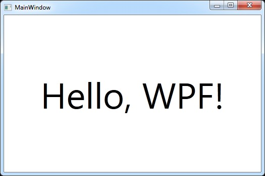 [Hello, WPF! - 결과]

TextBlock 에 세 가지 속성을 적용해서 (사용자 지정) 정렬(창 중앙)을 설정했고, FontSize 속성을 사용해서 텍스트 크기를 키웠다는 것을 알 수 있을 것입니다. 이런 개념들은 모두 이후 기사에서 다룰 것입니다.

여기까지 잘 해내신 것을 축하합니다!! 이제 튜토리얼의 나머지 부분을 읽어보시면 곧 WPF를 완벽하게 익히게 될 것입니다!!


# XAML

## What is XAML?

`XAML` (eXtensible Application Markup Language)은 GUI를 기술하기 위해 마이크로소프트가 개발한 “XML의 변형” 입니다. WinForms 같은 기존 GUI 프레임워크는 C#이나 VB.NET 같이 GUI와 상호작용하는 데 사용하는 언어와 동일한 언어로 GUI를 생성했으며, 일반적으로 디자이너(예: Visual Studio)를 통해 관리했습니다. 하지만 XAML을 통해 마이크로소프트는 다른 방식을 채택하고 있습니다. HTML과 유사하게, GUI를 쉽게 작성하거나 편집할 수 있습니다.

이 글은 엄밀히 말해 XAML 튜토리얼은 아니지만, XAML이 WPF의 핵심 요소이기 때문에 사용 방법에 대해 간략히 설명해 드리겠습니다. Window를 만들든 Page를 만들든, 이는 XAML 문서와 CodeBehind 파일로 구성되며, 이 둘이 결합되어 Window/Page 를 생성합니다. XAML 파일은 모든 요소를 포함한 인터페이스를 정의하는 반면, CodeBehind는 모든 이벤트를 처리하고 XAML 컨트롤을 조작할 수 있는 권한을 가집니다.

다음 장은 XAML이 어떻게 작동하는지, 그리고 이를 활용해서 인터페이스를 만드는 방법을 살펴보겠습니다.


## Basic XAML

이전 장은 XAML이 무엇이며 어떤 용도로 사용되는지에 대해 살펴보았는데, 그렇다면 XAML에서 컨트롤은 어떻게 생성할까요? 다음 예제에서 보시겠지만, XAML에서 컨트롤을 생성하는 것은 각괄호로 둘러싼 이름을 작성하는 것만큼이나 간단합니다. 

예를 들어, Button은 다음과 같습니다:

```cs
<Button>
```

XAML 태그는 종료 태그를 작성하거나 시작 태그 끝에 슬래시를 붙여 종료해야 합니다:

```cs
<Button></Button>
```

또는

```cs
<Button />
```

많은 컨트롤은 시작 태그와 종료 태그 사이에 내용을 넣을 수 있으며, 이 내용이 바로 해당 컨트롤의 콘텐츠가 됩니다. 예를 들어, Button 컨트롤은 시작 태그와 종료 태그 사이에 표시될 텍스트를 지정할 수 있습니다:

```cs
<Button>A button</Button>
```

HTML은 대소문자를 구분하지 않지만, XAML은 구분합니다!! 이는 컨트롤 이름이 .NET 프레임워크의 유형과 일치해야 하기 때문입니다. 컨트롤의 속성에 해당하는 속성 이름도 마찬가지입니다. 다음은 태그에 속성을 추가해서 몇 가지 속성을 정의한 버튼의 예입니다:

```cs
<Button FontWeight="Bold" Content="A button" />
```

FontWeight 속성을 설정해서 텍스트를 굵게 표시하고, Content 속성을 설정합니다. 이는 시작 태그와 종료 태그 사이에 텍스트를 직접 작성하는 것과 동일합니다. 그러나 컨트롤의 모든 속성은 다음과 같이, Control-Dot-Property 표기법을 사용해서 메인 컨트롤의 자식 태그로 표시되는 형태로 정의할 수도 있습니다:

```cs
<Button>
    <Button.FontWeight>Bold</Button.FontWeight>
    <Button.Content>A button</Button.Content>
</Button>
```

결과는 위와 정확히 동일하므로, 이 경우 순전히 구문상 차이일 뿐 다른 요인은 없습니다. 하지만 많은 컨트롤은 텍스트 이외의 콘텐츠, 예를 들어 다른 컨트롤을 허용합니다. 다음은 Button에 여러 개의 TextBlock 컨트롤을 사용해서 동일한 버튼에 서로 다른 색상의 텍스트를 표시한 예시입니다.

```cs
<Button>
    <Button.FontWeight>Bold</Button.FontWeight>
    <Button.Content>
        <WrapPanel>
            <TextBlock Foreground="Blue">Multi</TextBlock>
            <TextBlock Foreground="Red">Color</TextBlock>
            <TextBlock>Button</TextBlock>
        </WrapPanel>
    </Button.Content>
</Button>
```

Content 속성은 단일 자식 요소만 허용하므로, 서로 다른 색상의 텍스트 블록을 담기 위해 WrapPanel 을 사용합니다. WrapPanel 같은 패널은 WPF에서 중요한 역할을 처리하며, 나중에 훨씬 더 자세히 다룰 예정입니다. 당분간 “패널은 다른 컨트롤을 담는 컨테이너” 로만 생각하시면 됩니다.

다음 마크업을 사용해도 정확히 동일한 결과를 얻을 수 있으며, 이는 단순히 같은 내용을 다른 방식으로 작성한 것일 뿐입니다:

```cs
<Button FontWeight="Bold">
    <WrapPanel>
        <TextBlock Foreground="Blue">Multi</TextBlock>
        <TextBlock Foreground="Red">Color</TextBlock>
        <TextBlock>Button</TextBlock>
    </WrapPanel>
</Button>
```

### Code vs. XAML

위의 예제를 통해 XAML을 작성하는 것이 꽤 쉽지만, 이를 구현하는 방법이 다양하다는 점을 알 수 있었기를 바랍니다. 만약 위의 예제에서 텍스트 색상이 다르게 설정된 버튼을 만드는 데 마크업이 너무 많다고 생각된다면, C#으로 똑같은 작업을 수행하는 방법과 비교합니다:

```cs
Button btn = new Button();
btn.FontWeight = FontWeights.Bold;

WrapPanel pnl = new WrapPanel();

TextBlock txt = new TextBlock();
txt.Text = “Multi”;
txt.Foreground = Brushes.Blue;
pnl.Children.Add(txt);

txt = new TextBlock();
txt.Text = “Color”;
txt.Foreground = Brushes.Red;
pnl.Children.Add(txt);

txt = new TextBlock();
txt.Text = “Button”;
pnl.Children.Add(txt);

btn.Content = pnl;
pnlMain.Children.Add(btn);
```

물론 위의 예제는 더 간결하게, 즉 구문 단축 기법을 사용해서 작성할 수도 있겠지만, XAML이 인터페이스를 설명하는 데 있어 상당히 짧고 간결하다는 점은 여전히 유효하다고 생각합니다.


## Events in XAML

대부분의 최신 UI 프레임워크는 이벤트 기반이며, WPF도 마찬가지입니다. Window(이 역시 Control 클래스를 상속받음)를 포함한 모든 컨트롤은 사용자가 구독할 수 있는 다양한 이벤트를 제공합니다. 이런 이벤트를 구독하면, 이벤트가 발생할 때 애플리케이션에 알림이 전송되며 이에 대응할 수 있습니다.

이벤트는 여러 종류가 있지만, 가장 일반적으로 사용되는 것들은 사용자가 마우스나 키보드를 사용해서 애플리케이션과 상호작용할 때 이에 대응하기 위한 것입니다. 대부분의 컨트롤은 KeyDown, KeyUp, MouseDown, MouseEnter, MouseLeave, MouseUp 등의 이벤트를 찾을 수 있습니다.

이 주제는 꽤 복잡하므로 WPF에서 이벤트가 어떻게 작동하는지는 나중에 자세히 살펴보겠지만, 지금은 XAML의 컨트롤 이벤트를 코드 비하인드 파일의 코드 조각에 연결하는 방법을 알아두면 됩니다. 다음 예제를 살펴보세요.

```cs
<Window x:Class=“WpfTutorialSamples.XAML.EventsSample”
        xmlns="http://schemas.microsoft.com/winfx/2006/xaml/presentation"
        xmlns:x=“http://schemas.microsoft.com/winfx/2006/xaml”
        Title=“EventsSample” Height="300" Width="300">
    <Grid Name="pnlMainGrid" MouseUp="pnlMainGrid_MouseUp" Background="LightBlue">

    </Grid>
</Window>
```

MouseUp 이벤트는 사용자가 구독하는 MouseButtonEventHandler 델리게이트를 사용합니다. 이 델리게이트는 두 개의 매개변수가 있는데, 하나는 sender(이벤트를 발생시킨 컨트롤)이고, 다른 하나는 유용한 정보를 포함하는 MouseButtonEventArgs 객체입니다. 이 예제는 이를 사용해서 마우스 커서의 위치를 파악하고 사용자에게 해당 정보를 알려줍니다.

여러 이벤트가 동일한 델리게이트 유형을 사용할 수 있습니다. 예를 들어, MouseUp 과 MouseDown 은 모두 MouseButtonEventHandler 델리게이트를 사용하는 반면, MouseMove 이벤트는 MouseEventHandler 델리게이트를 사용합니다. 이벤트 핸들러 메서드를 정의할 때는 해당 메서드가 어떤 델리게이트를 사용하는지 알아야 하며, 이를 모를 경우 문서를 참조해서 확인할 수 있습니다.

다행히 Visual Studio는 이벤트에 대한 올바른 이벤트 핸들러를 생성하는 데 도움을 줍니다. 가장 쉬운 방법은 XAML에 이벤트 이름을 입력한 다음, VS의 IntelliSense가 나머지를 처리하도록 하는 것입니다:

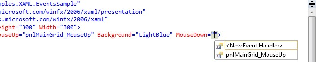 [Visual Studio가 새 이벤트 핸들러 생성을 돕는 모습]

`<New Event Handler>` 를 선택하면 Visual Studio가 코드-비하인드 파일에 적절한 이벤트 핸들러를 새로 생성합니다. 이 핸들러의 이름은 `<컨트롤 이름>_<이벤트 이름>` 형식이며, 예제의 경우 pnlMainGrid_MouseDown 입니다. 이벤트 이름을 마우스 오른쪽 버튼으로 클릭하고 ‘이벤트 핸들러로 이동(Navigate to Event Handler)’ 을 선택하면 Visual Studio는 해당 위치로 곧바로 이동합니다.

### Subscribing to an event from Code-behind

이벤트에 구독하는 가장 일반적인 방법은 위에서 설명했지만, 대신 코드 비하인드에서 직접 이벤트에 구독할 경우도 있을 수 있습니다. 이는 C#의 += 구문을 사용해서 객체에 직접 이벤트 핸들러를 추가하는 방식으로 이루어집니다. 이에 대한 자세한 설명은 별도의 C# 예제에서 다루지만, 비교를 위해 다음 예제를 살펴보겠습니다.

```cs
using System;
using System.Windows;
using System.Windows.Input;


namespace WpfTutorialSamples.XAML
{
    public partial class EventsSample : Window
    {
        public EventsSample()
        {
            InitializeComponent();
            pnlMainGrid.MouseUp += new MouseButtonEventHandler(pnlMainGrid_MouseUp);
        }

		private void pnlMainGrid_MouseUp(object sender, MouseButtonEventArgs e)
        {
            MessageBox.Show(“You clicked me at ” + e.GetPosition(this).ToString());
        }

    }
}
```

다시 한 번, 어떤 델리게이트를 사용하는지 알아야 하며, 이 부분도 Visual Studio가 도움을 줄 수 있습니다. 다음과 같이 작성하는 즉시:

```cs
pnlMainGrid.MouseDown +=
```

Visual Studio는 자동으로 도움을 제공합니다:

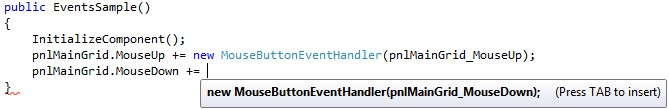 [Visual Studio가 새로운 코드비하인드 이벤트 핸들러 생성을 돕고 있음]

[Tab] 키를 두 번 누르면 Visual Studio가 현재 메서드 바로 아래에 구현할 준비가 완료된 올바른 이벤트 핸들러를 생성해 줍니다. 이와 같이 이벤트에 등록할 때는 XAML에서 별도로 처리할 필요가 없습니다.


# A WPF application

## A WPF Application - Introduction

이 튜토리얼은 WPF를 사용해서 애플리케이션을 만드는 데 중점을 둘 것입니다. 아시다시피, .NET은 .NET이 구현된 모든 플랫폼에서 실행될 수 있지만, 여전히 가장 일반적인 플랫폼은 Microsoft Windows입니다. 이 튜토리얼에서 Windows 애플리케이션이라 말할 때는 브라우저나 인터넷을 통해 원격으로 실행되는 것이 아니라 Windows(또는 다른 .NET 호환 플랫폼)에서 실행되는 애플리케이션을 의미합니다.

다른 모든 .NET 애플리케이션과 마찬가지로, WPF 애플리케이션도 실행하려면 .NET 프레임워크가 필요합니다. 다행히 마이크로소프트는 비스타(Vista) 이후 모든 Windows 버전에 .NET 프레임워크를 기본으로 포함하며, 이전 버전도 Windows 업데이트를 통해 프레임워크를 배포해 왔습니다. 즉, 대부분의 Windows 사용자가 여러분의 WPF 애플리케이션을 실행할 수 있을 것이라 확신해도 좋습니다.

다음 장은 WPF 애플리케이션의 구조와 다양한 측면을 살펴보겠습니다.


## The Window

WPF 애플리케이션을 만들 때 가장 먼저 접하는 것은 “Window 클래스” 입니다. 이 클래스는 창의 루트 역할을 하며, 표준 테두리, 제목 표시줄, 최대화, 최소화 및 닫기 버튼을 제공합니다. WPF 창은 `<Window>` 요소가 루트가 되는 XAML(.xaml) 파일과 CodeBehind(.cs) 파일로 구성됩니다. Visual Studio(Express)를 사용해서 새 WPF 애플리케이션을 생성하면 다음과 같은 모양의 기본적인 창이 자동으로 생성됩니다.

```cs
<Window x:Class=“WpfApplication1.Window1”
    xmlns="http://schemas.microsoft.com/winfx/2006/xaml/presentation"
    xmlns:x=“http://schemas.microsoft.com/winfx/2006/xaml”
    Title="Window1" Height="300" Width="300">
    <Grid>

    </Grid>
</Window>
```

x:class 속성은 XAML 파일에 사용할 클래스를 지정합니다. 이 경우 Window1 이며, Visual Studio에서 자동으로 생성해 줍니다. Visual Studio의 프로젝트 트리에서 해당 XAML 파일의 자식 노드로 이 클래스를 찾을 수 있습니다. 기본적으로 다음과 같은 형태를 띱니다:

```cs
using System;
using System.Windows;
using System.Windows.Controls;
//…추가 using 문

namespace WpfApplication1
{
    /// <summary>
    /// Window1.xaml에 대한 상호작용 로직
    /// </summary>
    public partial class Window1 : Window
    {
        public Window1()
        {
            InitializeComponent();
        }
    }
}
```

보시다시피, Window1 클래스는 런타임 시 XAML 파일과 결합되어 완전한 창을 생성하기 때문에 ‘partial’ 클래스로 정의되어 있습니다. 이것이 바로 InitializeComponent() 호출이 수행하는 작업이며, 따라서 창을 완전히 작동하도록 만들기 위해서는 이 호출이 **필수적** 입니다.

XAML 파일로 돌아가면, Window 요소에 몇 가지 흥미로운 속성이 있는 것을 확인할 수 있습니다. 예를 들어, Title 속성은 창 제목(제목 표시줄에 표시됨)과 초기 너비 및 높이를 정의합니다. 또한 몇 가지 네임스페이스 정의도 있는데, XAML 관련 장에서 자세히 다루겠습니다.

또한 Visual Studio가 Window 내부에 Grid 컨트롤을 생성했음을 알 수 있습니다. Grid 는 WPF 패널 중 하나이며, 어떤 패널이나 컨트롤을 사용해도 되지만 Window는 자식 컨트롤을 하나만 가질 수 있으므로, 여러 자식 컨트롤을 포함할 수 있는 Panel 을 사용하는 것은 일반적으로 좋은 선택입니다. 이 튜토리얼 후반부에서 WPF에서 매우 중요한 역할을 처리하는 다양한 유형의 패널에 대해 자세히 살펴볼 것입니다.


### Important Window properties

WPF Window 클래스는 애플리케이션 창의 모양과 동작을 제어하기 위해 설정할 수 있는 여러 가지 흥미로운 속성이 있습니다. 다음은 그중 가장 주목할 만한 속성들을 간략히 정리한 목록입니다.

**Icon** - 일반적으로 창 제목 왼쪽, 왼쪽 상단 모서리에 표시되는 창의 아이콘을 정의할 수 있습니다.

**ResizeMode** - 최종 사용자가 창의 크기를 조정할 수 있는지 여부와 방법을 제어합니다. 기본값은 CanResize 이며, 이 경우 사용자는 다른 창과 마찬가지로 최대화/최소화 버튼을 사용하거나 가장자리를 드래그해서 창 크기를 조정할 수 있습니다. CanMinimize 를 설정하면 사용자는 창을 최소화할 수 있지만, 최대화하거나 크기를 늘리거나 줄일 수 없습니다. NoResize 는 가장 제한적인 설정으로, 최대화 및 최소화 버튼이 제거되고 창 크기를 드래그해서 조정할 수 없습니다.

**ShowInTaskbar** - 기본값은 true 지만, false 로 설정하면 창은 작업 표시줄에 표시되지 않습니다. 메인 창이 아닌 창이나 트레이로 최소화하는 응용 프로그램에 유용합니다.

**SizeToContent** - 창이 내용에 맞도록 자동으로 크기가 조정되도록 처리할지 여부를 결정합니다. 기본값은 Manual 이며, 이는 창 크기가 자동으로 조정되지 않음을 의미합니다. 다른 옵션으로 Width, Height, WidthAndHeight 가 있으며, 각 옵션은 창 크기를 가로, 세로 또는 양쪽 모두에 맞춰 자동으로 조정합니다.

**Topmost** - 기본값은 false 지만, true 로 설정하면 창이 최소화되지 않는 한 다른 창보다 최상단에 표시됩니다. 특수한 상황에서만 유용합니다.

**WindowStartupLocation** - 창의 초기 위치를 제어합니다. 기본값은 Manual 이며, 이는 창의 Top 및 Left 속성에 따라 창이 초기 위치에 배치됨을 의미합니다. 다른 옵션으로 창을 소유자 창 중앙에 배치하는 CenterOwner 와, 창을 화면 중앙에 배치하는 CenterScreen 이 있습니다.

**WindowState** - 창의 초기 상태를 제어합니다. Normal, Maximized 또는 Minimized 중 하나를 선택할 수 있습니다. 기본값은 Normal 이며, 창을 최대화하거나 최소화된 상태로 시작하지 않은 경우 이 값을 사용해야 합니다.

이 외에도 많은 속성이 있으니 직접 살펴본 후 다음 장으로 넘어갑니다.


## Working with App.xaml

App.xaml 파일은 애플리케이션의 선언적인 시작점입니다. 새 WPF 애플리케이션을 시작할 때 Visual Studio는 App.xaml.cs 라는 코드-비하인드 파일을 포함해서 이 파일을 자동으로 생성합니다. 이 두 파일은 Window의 경우와 유사하게 작동하며, 두 파일 모두 부분 클래스(partial class)로 서로 연동되고 마크업(XAML)과 코드-비하인드 모두에서 작업할 수 있게 해줍니다.

App.xaml.cs 는 WPF Windows 애플리케이션의 핵심 클래스인 Application 클래스를 상속합니다. .NET은 이 클래스에서 시작 지침을 확인한 후, 해당 클래스에서 원하는 Window 또는 Page 를 시작합니다. 또한 이곳은 애플리케이션 시작, 처리되지 않은 예외 같은 중요한 애플리케이션 이벤트를 구독하는 곳이기도 합니다. 나중에 자세히 다루겠습니다.

App.xaml 파일에서 가장 흔히 사용되는 기능 중 하나는 애플리케이션 전반에 사용 및 액세스할 수 있는 전역 리소스(예: 전역 스타일)를 정의하는 것입니다. 나중에 자세히 다룰 예정입니다.


### App.xaml structure

새 애플리케이션을 생성하면 자동으로 생성된 App.xaml 은 다음과 같이 표시됩니다.

```cs
<Application x:Class=“WpfTutorialSamples.App”
             xmlns="http://schemas.microsoft.com/winfx/2006/xaml/presentation"
             xmlns:x=“http://schemas.microsoft.com/winfx/2006/xaml”
             StartupUri=“MainWindow.xaml”>
    <Application.Resources>

    </Application.Resources>
</Application>
```

여기서 주목할 핵심은 StartupUri 속성입니다. 이 속성은 실제로 애플리케이션이 실행될 때 어떤 Window 나 Page 를 시작할지 지정하는 부분입니다. 이 경우 MainWindow.xaml 로 시작되지만, 다른 창을 시작점으로 사용하려면 간단히 이 부분만 변경하면 됩니다.

특정 상황에서 첫 번째 창이 표시되는 방식과 시점을 좀 더 세밀하게 제어할 수 있습니다. 그럴 경우 StartupUri 속성과 값을 제거하고, 대신 코드-비하인드에서 모든 작업을 처리할 수 있습니다. 이에 대해서는 아래에서 시연해 보겠습니다.


### App.xaml.cs structure

새 프로젝트의 경우, 이에 대응하는 App.xaml.cs 파일은 대개 다음과 같은 형태를 띱니다.

```cs
using System;
using System.Collections.Generic;
using System.Windows;

namespace WpfTutorialSamples
{
    public partial class App : Application
    {

    }
}
```

이 클래스가 Application 클래스를 상속받아 애플리케이션 수준에서 작업을 수행할 수 있게 해주는 것을 확인할 수 있습니다. 예를 들어, Startup 이벤트에 등록해서 시작 창을 수동으로 생성할 수 있습니다.

다음은 그 예시입니다:

```cs
<Application x:Class=“WpfTutorialSamples.App”
             xmlns="http://schemas.microsoft.com/winfx/2006/xaml/presentation"
             xmlns:x=“http://schemas.microsoft.com/winfx/2006/xaml”
             Startup="Application_Startup">
    <Application.Resources></Application.Resources>
</Application>
```

StartupUri 가 Startup 이벤트 구독으로 대체된 점에 주목합니다(XAML을 통한 이벤트 구독은 다른 장에서 설명합니다). 코드-비하인드는 다음과 같이 이벤트를 사용할 수 있습니다:

```cs
using System;
using System.Collections.Generic;
using System.Windows;

namespace WpfTutorialSamples
{
    public partial class App : Application
    {

        private void Application_Startup(object sender, StartupEventArgs e)
        {
            // 시작 창 생성
			MainWindow wnd = new MainWindow();
            // 여기에서 작업 수행(예: 창 관련 작업)
            wnd.Title = “Something else”;
            // 창 표시
            wnd.Show();
        }
    }
}
```

예제에서 StartupUri 속성을 단순히 사용하는 것과 달리 특히 멋진 점은, 시작 창을 표시하기 전에 직접 조작할 수 있다는 것입니다. 여기서는 시작 창의 제목을 변경하는데, 그다지 유용하지 않지만, 이벤트를 구독하거나 스플래시 화면을 표시하는 등의 작업도 가능합니다. 모든 제어권을 갖게 되면 다양한 가능성이 열립니다. 이 튜토리얼의 다음 글에서 그중 몇 가지를 좀 더 자세히 살펴보겠습니다.


## Command-line parameters in WPF

명령줄 매개변수는 실행하려는 애플리케이션에 일련의 매개변수를 전달해서 해당 애플리케이션의 동작에 영향을 줄 수 있는 기술입니다. 일반적인 예로는, 편집기 등에서 애플리케이션을 실행할 때 특정 파일을 열도록 처리하는 것입니다. Windows에 기본 포함된 메모장 애플리케이션을 사용해서 직접 시도할 수 있습니다. 다음 명령을 실행합니다(시작 메뉴에서 ‘실행’ 을 선택하거나 [Windows-R] 키를 누릅니다):

```cs
notepad.exe c:\Windows\win.ini
```

이렇게 하면 win.ini 파일이 열린 상태로 메모장이 실행됩니다(사용 중인 시스템에 맞게 경로를 조정할 수도 있습니다). 메모장은 하나 또는 여러 개의 매개변수를 찾고 이를 사용하며, 여러분의 애플리케이션도 이와 똑같이 처리할 수 있습니다!

명령줄 매개변수는 App.xaml 기사에서 구독했던 Startup 이벤트를 통해 WPF 애플리케이션으로 전달됩니다. 이 예제도 동일한 방식을 사용한 다음, 메서드 인수를 통해 전달된 값을 활용할 것입니다. 먼저, App.xaml 파일을 살펴보겠습니다:

```cs
<Application x:Class=“WpfTutorialSamples.App”
             xmlns="http://schemas.microsoft.com/winfx/2006/xaml/presentation"
             xmlns:x=“http://schemas.microsoft.com/winfx/2006/xaml”
             Startup="Application_Startup">
    <Application.Resources></Application.Resources>
</Application>
```

여기서는 StartupUri 속성을 대체해서 Startup 이벤트에 등록하는 작업만 수행합니다. 이 이벤트는 App.xaml.cs 에 구현됩니다.

```cs
using System;
using System.Collections.Generic;
using System.Windows;

namespace WpfTutorialSamples
{
    public partial class App : Application
    {

		private void Application_Startup(object sender, StartupEventArgs e)
        {
            MainWindow wnd = new MainWindow();
            if (e.Args.Length == 1)
                MessageBox.Show(“이제 파일을 엽니다: \n\n” + e.Args[0]);
            wnd.Show();
        }
    }
}
```

여기서는 StartupEventArgs 를 사용합니다. 이 객체는 Application Startup 이벤트로 전달되며, 변수명은 e 입니다. 이 객체는 Args 라는 속성이 있는데, 이는 문자열 배열입니다. 명령줄 매개변수는 따옴표로 묶인 문자열 내부에 공백이 있는 경우를 제외하고 공백으로 구분됩니다.


### Testing the command-line parameter

위의 예제를 실행하면 명령줄 매개변수가 지정되지 않았기 때문에 아무 일도 일어나지 않습니다. 다행히 Visual Studio를 사용하면 애플리케이션에서 쉽게 테스트할 수 있습니다. ‘프로젝트’ 메뉴에서 “[프로젝트 이름] 속성” 을 선택한 다음 ‘디버그’ 탭으로 이동하면 명령줄 매개변수를 정의할 수 있습니다. 설정은 다음과 같이 표시됩니다.

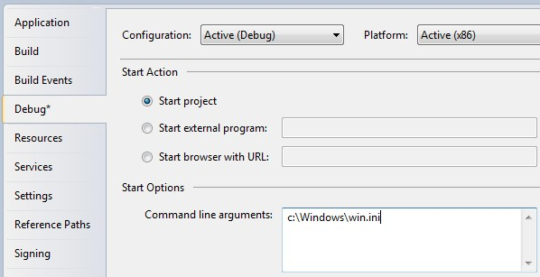 [명령줄 프로젝트 설정]

응용 프로그램을 실행하면 매개변수에 반응하는 것을 확인할 수 있습니다.

물론, 표시되는 메시지는 그다지 유용하지 않습니다. 대신 다음과 같이 메인 창의 생성자에 매개변수를 전달하거나, 메인 창의 공개 open 메서드를 호출할 수도 있습니다:

```cs
using System;
using System.Collections.Generic;
using System.Windows;

namespace WpfTutorialSamples
{
    public partial class App : Application
    {

        private void Application_Startup(object sender, StartupEventArgs e)
        {
            MainWindow wnd = new MainWindow();
            // OpenFile() 메서드는 매개변수를 활용해서 수행할 수 있는 작업의
            // 예시일 뿐입니다. 이 메서드는 MainWindow 클래스에 선언되야 하며,
            // 전달된 파일 경로를 처리하기 위해 다양한 메서드를 사용할 수 있습니다.
            if(e.Args.Length == 1)
                wnd.OpenFile(e.Args[0]);
            wnd.Show();
        }
    }
}
```

### Command-line possibilities

이 예제는 인수가 정확히 하나인지 확인하고, 있다면 이를 파일 이름으로 사용합니다. 실제 상황에는 여러 개의 인수를 수집해서 옵션으로 활용할 수도 있습니다. 예를 들어, 특정 기능을 켜거나 끄는 데 사용할 수 있습니다. 이를 위해 전달된 인수 목록 전체를 순회하면서 처리에 필요한 정보를 수집해야 하지만, 이는 이 글의 범위를 벗어납니다.


## Resources

WPF는 매우 유용한 개념을 도입했습니다. 데이터를 리소스로 저장할 수 있는 기능으로, 컨트롤 단위의 로컬, 전체 창 단위의 로컬, 또는 전체 애플리케이션 단위의 전역으로 저장할 수 있습니다. 데이터는 실제 정보부터 WPF 컨트롤의 계층 구조에 이르기까지 원하는 거의 모든 형태일 수 있습니다. 이를 통해 데이터를 한 곳에 저장한 뒤 여러 곳에서 재사용할 수 있므으로 매우 유용합니다.

이 개념은 스타일과 템플릿에서 많이 사용되며, 이 튜토리얼의 뒷부분에서 다루겠지만, 이 장에서 설명하듯이 다른 여러 용도로 활용할 수 있습니다. 간단한 예제를 통해 이를 시연하겠습니다.

```cs
<Window x:Class=“WpfTutorialSamples.WPF_Application.ResourceSample”
        xmlns=“http://schemas.microsoft.com/winfx/2006/xaml/presentation”
        xmlns:x=“http://schemas.microsoft.com/winfx/2006/xaml”
        xmlns:sys=“clr-namespace:System;assembly=mscorlib”
        Title="ResourceSample" Height="150" Width="350">
    <Window.Resources>
        <sys:String x:Key=“strHelloWorld”>Hello, world!</sys:String>
    </Window.Resources>
    <StackPanel Margin="10">
        <TextBlock Text="{StaticResource strHelloWorld}" FontSize="56" />
        <TextBlock>또 다른 “<TextBlock Text="{StaticResource strHelloWorld}" />” 예제입니다. 하지만 이번에는 리소스를 사용했습니다!</TextBlock>
    </StackPanel>
</Window>
```

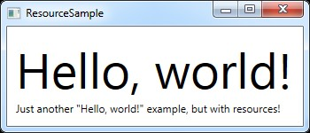 [간단한 리소스 예제]

리소스는 x:Key 속성을 사용해서 키가 지정되며, 이 키를 StaticResource 마크업 확장 기능과 함께 사용하면 애플리케이션의 다른 부분에서 해당 리소스를 참조할 수 있습니다. 이 예제는 간단한 문자열을 저장한 다음, 두 개의 서로 다른 TextBlock 컨트롤에서 이를 사용합니다.


### StaticResource vs. DynamicResource

지금까지 예제는 StaticResource 마크업 확장 기능을 사용해서 리소스를 참조했습니다. 하지만 DynamicResource 라는 대안도 있습니다.

두 가지의 주요 차이점은 정적 리소스는 XAML이 로드되는 시점에 “단 한 번만 해결된다” 는 점입니다. 이후 리소스가 변경되더라도 StaticResource 를 사용한 부분은 해당 변경 사항이 반영되지 않습니다.

반면 DynamicResource 는 실제로 필요할 때만 해결되며, 리소스가 변경되면 다시 해결됩니다. 이를 정적 값에 바인딩하는 것과, 해당 값을 모니터링하고 변경될 때마다 값을 전달하는 함수에 바인딩하는 것으로 생각하면 됩니다. 정확히 작동 방식은 이와 다르지만, 어떤 경우에 무엇을 사용해야 하는지 제대로 이해하는 데 도움이 될 것입니다. 또한 동적 리소스를 사용하면 디자인 타임에는 존재하지 않는 리소스도 사용할 수 있습니다. 예를 들어, 애플리케이션 시작 시 코드 비하인드에서 리소스를 추가하는 경우 등이 있습니다.


### More resource types

간단한 문자열 공유는 쉬웠지만, 그 외에도 처리할 수 있는 일이 훨씬 더 많습니다. 다음 예제는 배경에 사용할 그라데이션 브러시와 함께 전체 문자열 배열도 저장하겠습니다. 이를 통해 리소스를 활용해서 얼마나 다양한 작업을 수행할 수 있는지 제대로 파악할 수 있을 것입니다:

```cs
<Window x:Class=“WpfTutorialSamples.WPF_Application.ExtendedResourceSample”
        xmlns="http://schemas.microsoft.com/winfx/2006/xaml/presentation"
        xmlns:x=“http://schemas.microsoft.com/winfx/2006/xaml”
        xmlns:sys=“clr-namespace:System;assembly=mscorlib”
        Title="ExtendedResourceSample" Height="160" Width="300"
        Background="{DynamicResource WindowBackgroundBrush}">
    <Window.Resources>
        <sys:String x:Key=“ComboBoxTitle”>항목:</sys:String>

        <x:Array x:Key=“ComboBoxItems” Type="sys:String">
            <sys:String>항목 #1</sys:String>
            <sys:String>항목 #2</sys:String>
            <sys:String>항목 #3</sys:String>
        </x:Array>

        <LinearGradientBrush x:Key=“WindowBackgroundBrush”>
            <GradientStop Offset="0" Color="Silver"/>
            <GradientStop Offset="1" Color="Gray"/>
        </LinearGradientBrush>
    </Window.Resources>
    <StackPanel Margin="10">
        <Label Content="{StaticResource ComboBoxTitle}" />
        <ComboBox ItemsSource="{StaticResource ComboBoxItems}" />
    </StackPanel>
</Window>
```

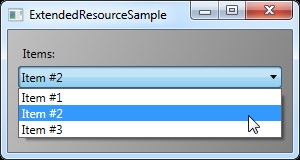 [여러 리소스 유형을 포함한 보다 고급 예제]

이번엔 리소스를 몇 가지 더 추가해서, 창에는 간단한 문자열 하나, 문자열 배열 하나, 그리고 LinearGradientBrush 하나가 포함되어 있습니다. 문자열은 레이블로 사용되고, 문자열 배열은 ComboBox 컨트롤의 항목으로 사용되며, 그라데이션 브러시는 창 전체의 배경으로 사용됩니다. 보시다시피, 거의 모든 것을 리소스로 저장할 수 있습니다.


### Local and application wide resources

현재 리소스는 창 단위로 저장되므로, 창 내 어디서나 해당 리소스에 접근할 수 있습니다.

특정 컨트롤만 리소스가 필요한 경우, 창이 아닌 해당 컨트롤에 리소스를 추가해서 좀 더 국소적인 범위로 제한할 수 있습니다. 작동 방식은 완전히 동일하며, 유일한 차이점은 리소스를 추가한 컨트롤의 “범위 내에서만 접근할 수 있다!” 는 점입니다:

```cs
<StackPanel Margin="10">
    <StackPanel.Resources>
        <sys:String x:Key=“ComboBoxTitle”>항목:</sys:String>
    </StackPanel.Resources>
    <Label Content="{StaticResource ComboBoxTitle}" />
</StackPanel>
```

이 경우, StackPanel 에 리소스를 추가한 다음 자식 컨트롤인 Label 에서 이를 사용합니다. StackPanel 내부의 다른 컨트롤들도 이 리소스를 사용할 수 있을 것이며, 자식 컨트롤들의 자식 요소들도 마찬가지로 리소스에 접근할 수 있을 것입니다. 하지만 이 특정 StackPanel 외부의 컨트롤들은 해당 리소스에 접근할 수 없습니다.

여러 창에서 리소스에 접근할 수 있는 기능이 필요하면, 이 또한 가능합니다. App.xaml 파일은 창이나 모든 종류의 WPF 컨트롤과 마찬가지로 리소스를 포함할 수 있으며, App.xaml 에 리소스를 저장하면 프로젝트의 모든 창과 사용자 컨트롤에서 “전역적으로 접근” 할 수 있습니다. 이는 창에 저장하고 사용하는 경우와 정확히 동일한 방식으로 작동합니다:

```cs
<Application x:Class=“WpfTutorialSamples.App”
             xmlns="http://schemas.microsoft.com/winfx/2006/xaml/presentation"
             xmlns:x=“http://schemas.microsoft.com/winfx/2006/xaml”
             xmlns:sys=“clr-namespace:System;assembly=mscorlib”
             StartupUri="WPF application/ExtendedResourceSample.xaml">
    <Application.Resources>
        <sys:String x:Key=“ComboBoxTitle”>항목:</sys:String>
    </Application.Resources>
</Application>
```

사용 방법도 마찬가지입니다. WPF는 지정된 리소스를 찾기 위해 로컬 컨트롤에서 창, 그리고 App.xaml 순으로 범위를 자동으로 위로 탐색합니다:

```cs
<Label Content="{StaticResource ComboBoxTitle}" />
```

### Resources from Code-behind

지금까지 마크업 확장을 사용해서 XAML에서 직접 모든 리소스에 접근했습니다. 하지만 코드-비하인드에서 리소스에 접근할 수 있으며, 이는 여러 상황에서 유용할 수 있습니다. 이전 예제는 리소스를 여러 곳에 저장하는 방법을 살펴봤으므로, 이번 예제는 각각 다른 범위에 저장된 세 가지 리소스에 코드-비하인드로 접근하겠습니다:

**App.xaml:**
```cs
<Application x:Class="WpfTutorialSamples.App"
             xmlns="http://schemas.microsoft.com/winfx/2006/xaml/presentation"
             xmlns:x="http://schemas.microsoft.com/winfx/2006/xaml"
             xmlns:sys="clr-namespace:System;assembly=mscorlib"
             StartupUri="WPF application/ResourcesFromCodeBehindSample.xaml">
    <Application.Resources>
        <sys:String x:Key="strApp">Hello, Application world!</sys:String>
    </Application.Resources>
</Application>
```

**Window:**
```cs
<Window x:Class="WpfTutorialSamples.WPF_Application.ResourcesFromCodeBehindSample"
        xmlns="http://schemas.microsoft.com/winfx/2006/xaml/presentation"
        xmlns:x="http://schemas.microsoft.com/winfx/2006/xaml"
        xmlns:sys="clr-namespace:System;assembly=mscorlib"
        Title="ResourcesFromCodeBehindSample" Height="175" Width="250">
    <Window.Resources>
        <sys:String x:Key="strWindow">Hello, Window world!</sys:String>
    </Window.Resources>
    <DockPanel Margin="10" Name="pnlMain">
        <DockPanel.Resources>
            <sys:String x:Key="strPanel">Hello, Panel world!</sys:String>
        </DockPanel.Resources>

        <WrapPanel DockPanel.Dock="Top" HorizontalAlignment="Center" Margin="10">
            <Button Name="btnClickMe" Click="btnClickMe_Click">Click me!</Button>
        </WrapPanel>

        <ListBox Name="lbResult" />
    </DockPanel>
</Window>
```

**Code-behind:**
```cs
using System;
using System.Windows;

namespace WpfTutorialSamples.WPF_Application
{
	public partial class ResourcesFromCodeBehindSample : Window
	{
		public ResourcesFromCodeBehindSample()
		{
			InitializeComponent();
		}

		private void btnClickMe_Click(object sender, RoutedEventArgs e)
		{
			lbResult.Items.Add(pnlMain.FindResource("strPanel").ToString());
			lbResult.Items.Add(this.FindResource("strWindow").ToString());
			lbResult.Items.Add(Application.Current.FindResource("strApp").ToString());
		}
	}
}
```

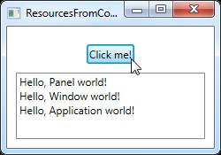 [코드-비하인드에서 가져온 리소스]

보시다시피, 세 가지 서로 다른 “Hello, world!” 메시지를 저장합니다. 하나는 App.xaml, 하나는 창 내부, 그리고 하나는 메인 패널용으로 로컬에 저장됩니다. 인터페이스는 버튼과 ListBox 로 구성되어 있습니다.

코드-비하인드는 버튼의 클릭 이벤트를 처리하며, 스크린샷에서 볼 수 있듯이 각 텍스트 문자열을 ListBox 에 추가합니다. FindResource() 메서드를 사용하면 (리소스가 발견된 경우) 리소스를 객체 형태로 반환하며, 이후 ToString() 메서드를 사용해서 이를 우리가 잘알고 있는 문자열로 변환합니다.

FindResource() 메서드를 서로 다른 범위에서 어떻게 사용하는지 주목합니다. 먼저 패널에서, 다음으로 창에서, 그리고 마지막으로 현재 Application 객체에서 순서대로 호출합니다. 리소스가 있는 것으로 알려진 위치부터 찾는 것이 합리적이지만, 앞서 언급했듯이 리소스가 발견되지 않으면 검색은 계층 구조를 따라 위쪽으로 진행됩니다. 따라서 원칙적으로 세 가지 경우 모두 패널에서 FindResource() 메서드를 사용할 수 있을 것입니다. 리소스가 발견되지 않으면 검색은 창 수준으로, 그 후 애플리케이션 수준까지 계속 진행됐을 것이기 때문입니다.

반대의 경우는 그렇지 않습니다. 검색은 트리 구조를 따라 아래로 내려가지 않기 때문에, 리소스가 컨트롤이나 창에 로컬로 정의되면 애플리케이션 수준에서 리소스 검색을 시작할 수 없습니다.


## Handling exceptions in WPF

C#이나 WPF와 함께 사용할 수 있는 다른 .NET 언어에 익숙하다면, 예외 처리는 낯선 개념이 아닐 것입니다. 예외가 발생할 가능성이 있는 코드 조각이 있을 때마다, 해당 코드를 try-catch 블록으로 감싸서 예외를 원활하게 처리해야 합니다. 예를 들어, 다음 예제를 살펴보겠습니다.

```cs
private void Button_Click(object sender, RoutedEventArgs e)
{
	string s = null;
    s.Trim();
}
```

현재 null 인 변수에 Trim() 메서드를 호출하므로, 당연히 오류가 발생합니다. 예외를 처리하지 않으면 애플리케이션은 중단되고 Windows가 문제를 처리해야 합니다. 보시다시피, 이는 사용자에게 그리 친절하지 않은 상황입니다:

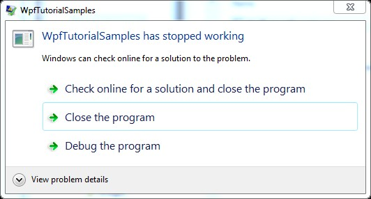 [Windows가 처리해야 하는 처리되지 않은 예외]

이 경우, 사용자는 이렇게 간단하고 쉽게 피할 수 있는 오류 때문에 어쩔 수 없이 애플리케이션을 종료할 것입니다. 따라서 문제가 발생할 가능성이 있다면 다음과 같이 try-catch 블록을 사용해야 합니다:

```cs
private void Button_Click(object sender, RoutedEventArgs e)
{
    string s = null;
    try
    {
        s.Trim();
    }
	catch(Exception ex)
    {
        MessageBox.Show(“처리된 예외가 발생했습니다: ” + ex.Message, “예외 예제”, MessageBoxButton.OK, MessageBoxImage.Warning);
    }
}
```

하지만 때로는 가장 단순한 코드도 예외가 발생할 수 있으며, 코드 한 줄 한 줄을 try-catch 블록으로 감싸는 대신, WPF는 처리되지 않은 모든 예외를 전역적으로 처리할 수 있게 해줍니다. 이는 Application 클래스의 DispatcherUnhandledException 이벤트를 통해 이루어집니다. 이 이벤트에 구독하면, 사용자 코드에서 처리되지 않은 예외가 발생했을 때 WPF가 구독된 메서드를 한 번 호출합니다. 방금 살펴본 내용을 바탕으로 처리한 예제는 다음과 같습니다.

```cs
<Window x:Class=“WpfTutorialSamples.WPF_Application.ExceptionHandlingSample”
        xmlns="http://schemas.microsoft.com/winfx/2006/xaml/presentation"
        xmlns:x=“http://schemas.microsoft.com/winfx/2006/xaml”
        Title=“ExceptionHandlingSample” Height="200" Width="200">
    <Grid>
        <Button HorizontalAlignment="Center" VerticalAlignment="Center" Click="Button_Click">
            무언가 잘못된 작업을 수행합니다!
        </Button>
    </Grid>
</Window>
```

```cs
using System;
using System.Windows;

namespace WpfTutorialSamples.WPF_Application
{
    public partial class ExceptionHandlingSample : Window
    {
        public ExceptionHandlingSample()
        {
            InitializeComponent();
        }

        private void Button_Click(object sender, RoutedEventArgs e)
        {
            string s = null;
			try
            {
                s.Trim();
            }
            catch(Exception ex)
            {
                MessageBox.Show(“처리된 예외가 방금 발생했습니다: ” + ex.Message, “예외 샘플”, MessageBoxButton.OK, MessageBoxImage.Warning);
            }
            s.Trim();
		}
    }
}
```

try-catch 블록 밖에서 Trim() 메서드를 한 번 더 호출해서, 첫 번째 호출은 처리되지만 두 번째 호출은 처리되지 않도록 했다는 점에 유의합니다. 두 번째 호출의 경우 App.xaml 의 특수 기능이 필요합니다:

```cs
<Application x:Class=“WpfTutorialSamples.App”
             xmlns="http://schemas.microsoft.com/winfx/2006/xaml/presentation"
             xmlns:x=“http://schemas.microsoft.com/winfx/2006/xaml”
             DispatcherUnhandledException="Application_DispatcherUnhandledException"
             StartupUri="WPF Application/ExceptionHandlingSample.xaml">
    <Application.Resources>
    </Application.Resources>
</Application>
```

```cs
using System;
using System.Windows;

namespace WpfTutorialSamples
{
    public partial class App : Application
    {
        private void Application_DispatcherUnhandledException(object sender, System.Windows.Threading.DispatcherUnhandledExceptionEventArgs e)
        {
			MessageBox.Show(“방금 처리되지 않은 예외가 발생했습니다: ” + e.Exception.Message, “예외 예제”, MessageBoxButton.OK, MessageBoxImage.Error);
            e.Handled = true;
        }
    }
}
```

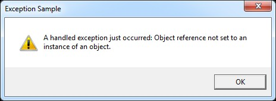 [로컬에서 처리된 예외] 

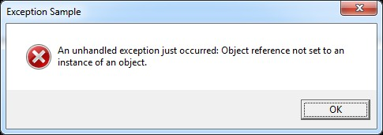 [전역에서 처리된 예외]

이 예외는 로컬에서 처리된 예외와 유사하게 처리되지만, 메시지 상자에 표시되는 텍스트와 이미지가 약간 다릅니다. 또한, e.Handled 속성을 true 로 설정했다는 점에 유의합니다. 이는 WPF에서 이 예외 처리가 완료되었으며 더 이상 이에 대해 수행할 작업이 없음을 알리는 것입니다.


### Summary

예외 처리는 모든 애플리케이션에서 매우 중요한 부분이며, 다행히 WPF와 .NET을 사용하면 로컬 및 전역 수준에서 예외를 쉽게 처리할 수 있습니다. 로컬 처리를 통해 문제를 보다 구체적으로 파악하고 특화된 방식으로 해결할 수 있으므로, 타당한 경우 로컬에서 예외를 처리하고 전역 처리는 오로지 대체 수단으로 사용해야 합니다.


## Application Culture / UICulture

이 튜토리얼에 실린 글 중 하나를 참고해서 WPF 애플리케이션에 숫자나 날짜를 조금이라도 다뤄본 적이 있다면, 꽤 멋진 점을 눈치챘을 수도 있습니다. 바로 숫자와 날짜가 사용자의 컴퓨터에서 사용되는 형식에 맞춰 “자동으로 표시된다!” 는 점입니다. 영어권 국가에 거주하면 별거 아닌 것처럼 보일 수도 있겠지만, 날짜나 숫자가 다르게 표시되는 수많은 국가 중 한 곳에 살고 있다면 정말 멋진 기능입니다.

혹시 “숫자나 날짜 같은 간단한 요소를 포맷팅하는 데 그렇게 많은 차이가 있을리가 없지 않나?” 라고 생각한다면, 이 샘플 앱을 한 번 살펴보시길 권합니다. 여기서는 미국, 독일, 스웨덴에서 선호하는 방식에 따라 동일한 숫자와 동일한 날짜를 포맷팅해 두었습니다:

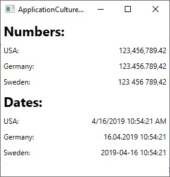 [다양한 문화권에 맞춰 포맷팅된 숫자와 날짜]

보시다시피, 숫자와 날짜가 표시되는 방식에 미묘한 차이가 많이 있습니다. 좋은 소식은 “.NET 프레임워크가 큰 도움이 될 수 있다!” 는 점입니다. 사실 이미 그렇게 하고 있습니다. 기본적으로 날짜와 숫자는 애플리케이션이 실행되는 컴퓨터 시스템 설정에 따라 서식이 지정됩니다. 나쁜 소식은 이런 동작이 항상 여러분이 원하는 대로 작동하지는 않을 수도 있다는 점입니다. 하지만 걱정하지 마세요. 이 설정은 쉽게 변경할 수 있습니다. 이는 모두 CultureInfo 클래스와 관련이 있으며, CultureInfo 에 대한 자세한 내용은 C# 튜토리얼 기사에서 확인할 수 있습니다. 지금은 이런 기법을 WPF 애플리케이션에 적용하는 방법에 대해 살펴보겠습니다.


### Ad-hoc formatting 

특정 정보(예: 단일 Label 컨트롤의 내용)에만 서식을 적용할 경우, ToString() 메서드와 CultureInfo 클래스를 함께 사용해서 쉽게 처리할 수 있습니다. 예를 들어, 위의 예제는 다음과 같이 문화권에 기반한 서로 다른 서식을 적용했습니다.

```cs
double largeNumber = 123456789.42;

CultureInfo usCulture = new CultureInfo(“en-US”);
CultureInfo deCulture = new CultureInfo(“de-DE”);
CultureInfo seCulture = new CultureInfo(“sv-SE”);

lblNumberUs.Content = largeNumber.ToString(“N2”, usCulture);
lblNumberDe.Content = largeNumber.ToString(“N2”, deCulture);
lblNumberSe.Content = largeNumber.ToString(“N2”, seCulture);
```

몇 군데만 특별한 서식이 필요한 경우는 이 방법도 충분하지만, 일반적으로 애플리케이션이 시스템 설정(기본값)을 사용할지, 아니면 애플리케이션 전체에 대해 특정 문화권 설정을 적용해서 이 동작을 재정의할지 결정해야 합니다.


### CurrentCulture & CurrentUICulture 

WPF 애플리케이션에 다른 문화를 적용하는 것은 꽤 쉽습니다. Thread 클래스의 CurrentThread 속성에서 찾을 수 있는 두 가지 속성, 즉 CurrentCulture 와 CurrentUICulture 를 다뤄야 할 가능성이 있습니다. 하지만 이 둘의 차이점은 무엇일까요?

CurrentCulture 속성은 숫자나 날짜 등의 서식 지정 방식을 제어하는 속성입니다. 기본값은 애플리케이션을 실행하는 컴퓨터의 운영 체제에서 제공되며, 해당 운영 체제가 사용하는 언어와 별개로 변경할 수 있습니다. 예를 들어, 독일에 거주하는 사용자가 Windows의 인터페이스 언어를 영어로 설정하면서 숫자와 날짜 표기 방식은 독일식 표기를 선호할 경우가 매우 흔합니다. 이런 상황에서 CurrentCulture 속성의 기본값이 독일어로 설정됩니다.

CurrentUICulture 속성은 인터페이스에서 사용할 언어를 지정합니다. 이 속성은 애플리케이션이 언어 리소스 파일을 통해 다국어를 지원하는 경우만 관련이 있습니다. 다시 말해, 이 속성을 사용하면 언어(예: 영어)에 하나의 문화권을 적용하고, 숫자나 날짜 등의 입출력을 처리할 때는 다른 문화권(예: 독일어)을 사용할 수 있습니다.

#### Changing the application Culture 

이를 염두에 두고, CurrentCulture 또는 CurrentUICulture 를 변경할지 여부를 결정해야 합니다. 이 작업은 원할 때 언제든지 수행할 수 있지만, 애플리케이션을 시작할 때 수행하는 것이 가장 합리적입니다. 그렇지 않으면, 변경하기 전에 일부 출력이 기본 문화권으로 이미 생성됐을 수도 있기 때문입니다. 

다음은 WPF 애플리케이션의 App.xaml.cs 파일에서 사용할 수 있는 Application_Startup() 이벤트에서 Culture 와 UICulture 를 모두 변경하는 예제입니다.

```cs
private void Application_Startup(object sender, StartupEventArgs e)
{
    Thread.CurrentThread.CurrentCulture = new CultureInfo(“de-DE”);
    Thread.CurrentThread.CurrentUICulture = new CultureInfo(“en-US”);
}
```

Thread 클래스와 CultureInfo 를 모두 사용하므로, 파일에 필요한 네임스페이스가 추가되지 않았다면 다음을 추가하는 것을 잊지 마시기 바랍니다:

```cs
using System.Threading;
using System.Globalization;
```

이 설정을 적용하면 숫자와 날짜는 독일어(de-DE) 형식으로 표시됩니다. 앞서 언급했듯이, 애플리케이션이 다국어를 지원하지 않으면 UICulture 에 대한 문화권 정의 줄(마지막 줄)은 생략해도 됩니다.

Application_Startup 이벤트 또는 늦어도 메인 창의 생성자에 문화를 변경하는 것이 가장 합리적입니다. CurrentCulture 속성을 변경해도 이미 생성된 값들은 자동으로 업데이트되지 않기 때문입니다. 하지만 그렇다고 해서 처리할 수 없다는 뜻은 아닙니다. 

다음 예제에서 볼 수 있듯이, 이 방법을 사용할 수도 있으며, CurrentCulture 속성이 출력에 어떤 영향을 미치는지 잘 보여주는 좋은 사례이기도 합니다:

```cs
<Window x:Class="WpfTutorialSamples.WPF_Application.ApplicationCultureSwitchSample"
    xmlns="http://schemas.microsoft.com/winfx/2006/xaml/presentation"
    xmlns:x="http://schemas.microsoft.com/winfx/2006/xaml"
    xmlns:d="http://schemas.microsoft.com/expression/blend/2008"
    xmlns:mc="http://schemas.openxmlformats.org/markup-compatibility/2006"
    xmlns:local="clr-namespace:WpfTutorialSamples.WPF_Application"
    mc:Ignorable="d"
    Title="ApplicationCultureSwitchSample" Height="200" Width="320">
    <StackPanel Margin="20">
    <Grid>
        <Grid.RowDefinitions>
        <RowDefinition Height="Auto" />
        <RowDefinition Height="Auto" />
        </Grid.RowDefinitions>
        <Grid.ColumnDefinitions>
        <ColumnDefinition Width="*" />
        <ColumnDefinition Width="*" />
        </Grid.ColumnDefinitions>
        <Label>Number:</Label>
        <Label Name="lblNumber" Grid.Column="1" />
        <Label Grid.Row="1">Date:</Label>
        <Label Name="lblDate" Grid.Row="1" Grid.Column="1" />
    </Grid>
    <StackPanel Orientation="Horizontal" HorizontalAlignment="Center" Margin="0,20">
        <Button Tag="en-US" Click="CultureInfoSwitchButton_Click" HorizontalContentAlignment="Stretch">English (US)</Button>
        <Button Tag="de-DE" Click="CultureInfoSwitchButton_Click" HorizontalContentAlignment="Stretch" Margin="10,0">German (DE)</Button>
        <Button Tag="sv-SE" Click="CultureInfoSwitchButton_Click" HorizontalContentAlignment="Stretch">Swedish (SE)</Button>
    </StackPanel>
    </StackPanel>
</Window>
```

```cs
using System;
using System.Globalization; 
using System.Threading; 
using System.Windows; 
using System.Windows.Controls; 

namespace WpfTutorialSamples.WPF_Application 
{ 
    public partial class ApplicationCultureSwitchSample : Window  
    {  
        public ApplicationCultureSwitchSample()  
        {  
            InitializeComponent();          
        }  
	    
        private void CultureInfoSwitchButton_Click(object sender, RoutedEventArgs e)  
        {  
            Thread.CurrentThread.CurrentCulture = new CultureInfo((sender as Button).Tag.ToString());          
            lblNumber.Content = (123456789.42d).ToString("N2");  
            lblDate.Content = DateTime.Now.ToString();  
        }  
    }  
}
```

흥미로운 부분은 CultureInfoSwitchButton_Click 이벤트인데, 어떤 버튼이 클릭된지에 따라 CurrentCulture 를 설정한 다음, 숫자와 날짜가 표시된 두 개의 레이블을 업데이트합니다.

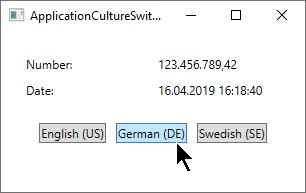 [문화권 전환 예제]


#### Culture & Threads: The DefaultThreadCurrentCulture property 

애플리케이션에 두 개 이상의 스레드를 사용할 경우, DefaultThreadCurrentCulture 속성을 사용할 것을 고려해야 합니다. 이 속성은 CultureInfo 클래스(.NET Framework 4.5 버전에서 도입됨)에서 찾을 수 있으며, 현재 스레드뿐만 아니라 향후 생성될 스레드까지 동일한 문화권을 사용하도록 보장합니다. 예를 들어 Application_Startup 이벤트에 다음과 같이 사용할 수 있습니다:

```cs
CultureInfo.DefaultThreadCurrentCulture = new CultureInfo(“de-DE”);
```

그렇다면, CurrentCulture 속성과 DefaultThreadCurrentCulture 속성을 모두 설정해야 할까요? 사실 그렇지 않습니다. 아직 CurrentCulture 속성을 변경하지 않았다면, DefaultThreadCurrentCulture 속성을 설정하는 것만으로도 CurrentCulture 속성에 해당 설정이 적용됩니다. 즉, 애플리케이션에 여러 스레드를 사용할 계획이라면 CurrentCulture 대신 DefaultThreadCurrentCulture 를 사용하는 것이 합리적입니다. 이렇게 하면 모든 시나리오를 한 번에 처리할 수 있기 때문입니다.


### Summary 

WPF 애플리케이션의 문화권 설정을 처리하는 것은 매우 중요하지만, 다행히 WPF는 기본적으로 많은 부분을 자동으로 처리해 줍니다. 기본 동작을 변경할 경우도, 이 기사의 수많은 예제에서 보여준 것처럼 CurrentCulture 및 CurrentUICulture 속성을 사용하면 쉽게 변경할 수 있습니다.


# Basic controls

## The TextBlock control

TextBlock 은 Control 클래스를 상속받지 않기 때문에 엄밀히 말해 컨트롤은 아니지만, WPF 프레임워크에서 다른 컨트롤과 유사하게 사용되므로, 설명을 간편하게 하기 위해 여기서는 이를 컨트롤이라고 부르겠습니다.

TextBlock 컨트롤은 WPF에서 “가장 기본적인 컨트롤” 중 하나면서 매우 유용합니다. Label 컨트롤과 마찬가지로 화면에 텍스트를 표시할 수 있지만, 좀 더 간단하고 리소스 소모가 적은 방식으로 작동합니다. 일반적으로 라벨(Label)은 짧고 한 줄짜리 텍스트(단, 이미지를 포함할 수도 있음)에 사용되는 반면, 텍스트블록(TextBlock)은 여러 줄로 된 문자열도 효과적이지만 텍스트(문자열)만 포함할 수 있습니다. 라벨과 텍스트블록은 각각 고유한 장단점을 가지므로, 어떤 것을 사용할지는 상황에 따라 달라집니다.

“Hello, WPF!” 기사에서 이미 TextBlock 컨트롤을 사용했지만, 지금은 간단한 형태의 TextBlock 을 살펴보겠습니다.

```cs
<Window x:Class=“WpfTutorialSamples.Basic_controls.TextBlockSample”
        xmlns="http://schemas.microsoft.com/winfx/2006/xaml/presentation"
        xmlns:x=“http://schemas.microsoft.com/winfx/2006/xaml”
        Title="TextBlockSample" Height="100" Width="200">
    <Grid>
        <TextBlock>This is a TextBlock</TextBlock>
    </Grid>
</Window>
```

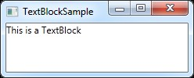 [간단한 TextBlock 컨트롤]

이보다 더 간단할 수는 없으며, 이 튜토리얼의 이전 장을 읽어보셨다면 새로운 내용은 없을 것입니다. TextBlock 사이의 텍스트는 단순히 TextBlock 의 Text 속성을 설정하는 지름길일 뿐입니다.

다음 예제는 TextBlock 이 긴 텍스트를 어떻게 처리하는지 보여주기 위해 좀 더 긴 텍스트를 사용했습니다. 또한 보기 좋게 만들기 위해 약간의 여백을 추가했습니다:

```cs
<Window x:Class=“WpfTutorialSamples.Basic_controls.TextBlockSample”
        xmlns="http://schemas.microsoft.com/winfx/2006/xaml/presentation"
        xmlns:x=“http://schemas.microsoft.com/winfx/2006/xaml”
        Title=“TextBlockSample” Height="100" Width="200">
    <Grid>
        <TextBlock Margin="10">이것은 TextBlock 컨트롤이며, 매우 긴 텍스트가 포함되어 있습니다</TextBlock>
    </Grid>
</Window>
```

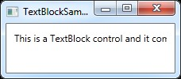 [텍스트가 너무 길어 화면에 다 들어가지 않는 간단한 TextBlock 컨트롤]


### Dealing with long strings

스크린샷을 보면 알 수 있듯이, TextBlock 은 길고 여러 줄로 된 텍스트를 완벽하게 처리할 수 있지만, 기본적으로 아무런 조치도 취하지 않습니다!! 이 경우 텍스트가 너무 길어 창에 모두 표시되지 않으므로, WPF는 가능한 한 많은 텍스트를 렌더링한 뒤 더이상 렌더링하지 않습니다.

다행히 이 문제를 해결할 수 있는 몇 가지 방법이 있습니다. 다음 예제는 모든 방법을 보여드린 후, 각각에 대해 자세히 설명드리겠습니다:

```cs
<Window x:Class=“WpfTutorialSamples.Basic_controls.TextBlockSample”
        xmlns="http://schemas.microsoft.com/winfx/2006/xaml/presentation"
        xmlns:x=“http://schemas.microsoft.com/winfx/2006/xaml”
        Title=“TextBlockSample” Height="200" Width="250">
    <StackPanel>
        <TextBlock Margin="10" Foreground="Red">
            이것은 여러 줄의 텍스트가 포함된 TextBlock 컨트롤입니다<LineBreak />
            .
        </TextBlock>
		<TextBlock Margin="10" TextTrimming="CharacterEllipsis" Foreground="Green">
            이 TextBlock 컨트롤의 텍스트는 완전히 렌더링되지 않을 수 있으며, 이 경우 줄임표로 표시됩니다.
		</TextBlock>
        <TextBlock Margin="10" TextWrapping="Wrap" Foreground="Blue">
            이것은 TextWrapping 속성을 사용하여 텍스트가 자동으로 줄바꿈되는 TextBlock 컨트롤입니다.
        </TextBlock>
    </StackPanel>
</Window>
```

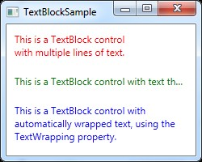 [긴 문자열을 처리하는 여러 가지 방법을 보여주는 TextBlock 컨트롤]

한 눈에 파악하기 쉽도록 각각 다른 색상(Foreground 속성 사용)을 가진 세 개의 TextBlock 컨트롤이 있습니다. 이 컨트롤들은 텍스트 내용이 너무 길다는 점을 각기 다른 방식으로 처리합니다.

빨간색 TextBlock 은 LineBreak 태그를 사용해서 지정된 위치에서 수동으로 줄 바꿈을 처리합니다. 이렇게 하면 텍스트가 새 줄로 넘어가는 위치를 절대적으로 제어할 수 있지만, 대부분의 상황에선 유연성이 떨어집니다. 사용자가 창 크기를 늘려도, 텍스트 전체를 한 줄에 담을 수 있는 공간이 생겼더라도 텍스트는 여전히 같은 위치에서 줄바꿈됩니다.

녹색 TextBlock 은 TextTrimming 속성에 CharacterEllipsis 값을 지정해서, 컨트롤에 더이상 텍스트를 담을 수 없을 때 줄임표(...)를 표시합니다. 이는 텍스트가 더 있지만 표시할 공간이 부족함을 나타내는 일반적인 방법입니다. 텍스트가 너무 길 수도 있지만 어떤 경우도 한 줄을 초과해서 표시되지 않도록 할 때 유용합니다. CharacterEllipsis 의 대안으로 WordEllipsis 를 사용할 수 있는데, 이 경우 마지막 문자가 아닌 마지막 단어 끝에서 텍스트를 잘라내어 단어가 부분적으로 표시되는 것을 방지합니다.

파란색 TextBlock 은 TextWrapping 속성 값을 ‘Wrap’ 으로 설정해서, 이전 줄에 더이상 텍스트를 담을 수 없을 때마다 TextBlock 의 텍스트가 다음 줄로 넘어가도록 처리합니다. 텍스트가 어디서 줄바꿈될지 수동으로 정의했던 첫 번째 TextBlock 과 달리, 이 과정은 완전히 자동으로 이루어지며, 더 좋은 점은 TextBlock 에 할당된 공간이 늘어나거나 줄어들면 줄바꿈 위치도 “자동으로 조정된다!” 는 것입니다. 예제의 창 크기를 키워보거나 줄여보면, 상황에 맞춰 줄 바꿈이 어떻게 업데이트되는지 확인할 수 있습니다.

지금까지 TextBlock 으로 간단한 문자열을 다루는 방법에 대해 알아봤습니다. 다음 장은 TextBlock 내에서 다양한 스타일의 텍스트를 생성하는 등의 TextBlock 의 고급 기능 몇 가지를 살펴보겠습니다.


## The TextBlock control - Inline formatting

지난 기사에서 TextBlock 컨트롤의 핵심 기능, 즉 간단한 문자열을 표시하고 필요한 경우 줄 바꿈을 적용하는 방법을 살펴봤습니다. 텍스트를 렌더링할 때 기본값과 다른 색상을 사용하기도 했지만, TextBlock 내의 모든 텍스트에 단순히 정적인 색상을 정의하는 것 이상의 작업을 처리하려면 어떻게 할까요?

다행히 TextBlock 컨트롤은 인라인 요소를 지원합니다. 이런 작은 컨트롤과 유사한 구조체들은 모두 Inline 클래스를 상속받기 때문에, 큰 텍스트의 일부로 인라인 방식으로 렌더링될 수 있습니다. 이 글을 작성하는 시점에서 지원되는 요소는 AnchoredBlock, Bold, Hyperlink, InlineUIContainer, Italic, LineBreak, Run, Span, Underline 등이 있습니다. 다음 예제는 이들 중 대부분을 살펴보겠습니다.


### Bold, Italic and Underline

이들은 아마 가장 간단한 인라인 요소 유형일 것입니다. 이름만 봐도 어떤 기능을 처리하는지 대략 짐작할 수 있겠지만, 사용 방법을 간단히 보여주는 예제를 하나 소개해 드리겠습니다.

```cs
<Window x:Class=“WpfTutorialSamples.Basic_controls.TextBlockInlineSample”
        xmlns=“http://schemas.microsoft.com/winfx/2006/xaml/presentation”
        xmlns:x=“http://schemas.microsoft.com/winfx/2006/xaml”
        Title="TextBlockInlineSample" Height="100" Width="300">
    <Grid>
		<TextBlock Margin="10" TextWrapping="Wrap">
            <Bold>굵은 글씨</Bold>, <Italic>이탤릭체</Italic> 및 <Underline>밑줄</Underline>이 적용된 TextBlock입니다.
        </TextBlock>
    </Grid>
</Window>
```

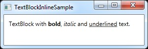 [인라인 굵은 글씨, 이탤릭체 및 밑줄 요소가 포함된 TextBlock 컨트롤]

HTML과 마찬가지로, 굵은 텍스트를 만들려면 텍스트를 Bold 태그로 감싸면 됩니다. 이를 통해 애플리케이션에서 다양한 텍스트를 매우 쉽게 생성하고 표시할 수 있습니다.

이 세 가지 태그는 모두 Span 요소의 자식 클래스이며, 각각 Span 요소의 특정 속성을 설정해서 원하는 효과를 만듭니다. 예를 들어, Bold 태그는 기본이 되는 Span 요소의 FontWeight 속성을 설정하고, Italic 태그는 FontStyle 속성을 설정하는 식입니다.


### LineBreak

텍스트에 줄 바꿈을 삽입합니다. LineBreak 요소를 사용하는 예제는 이전 장을 참고합니다.


### Hyperlink

Hyperlink 요소를 사용하면 텍스트에 링크를 삽입할 수 있습니다. 이 요소는 현재 Windows 테마에 맞는 스타일로 렌더링되며, 일반적으로 밑줄이 그어진 파란색 텍스트에 마우스를 올렸을 때 빨간색 효과가 나타나고 마우스 커서가 손 모양으로 변하는 형태입니다. NavigateUri 속성을 사용해서 이동할 URL을 지정할 수 있습니다. 다음은 예제입니다.

```cs
<Window x:Class="WpfTutorialSamples. Basic_controls.TextBlockHyperlinkSample"
        xmlns="http://schemas.microsoft.com/winfx/2006/xaml/presentation"
        xmlns:x=“http://schemas.microsoft.com/winfx/2006/xaml”
        Title="TextBlockHyperlinkSample" Height="100" Width="300">
	<Grid>
        <TextBlock Margin="10" TextWrapping="Wrap">
            이 텍스트에는 <Hyperlink RequestNavigate="Hyperlink_RequestNavigate" NavigateUri="https://www.google.com">링크</Hyperlink>가 포함되어 있습니다.
        </TextBlock>
    </Grid>
</Window>
```

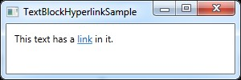 [Hyperlink 요소를 사용하여 클릭 가능한 링크를 생성하는 TextBlock 컨트롤]

Hyperlink 는 WPF 페이지 내부에도 사용되며, 이를 통해 페이지 사이를 이동할 수 있습니다. 이 경우 예제와 같이 RequestNavigate 이벤트를 별도로 처리할 필요는 없지만, 일반 WPF 애플리케이션에서 외부 URL을 실행하려면 이 이벤트와 Process 클래스의 도움이 약간 필요합니다. RequestNavigate 이벤트에 등록하면, 코드 비하인드 파일에서 다음과 같은 간단한 이벤트 핸들러를 통해 사용자의 기본 브라우저로 링크된 URL을 실행할 수 있습니다:

```cs
private void Hyperlink_RequestNavigate(object sender, System.Windows.Navigation.RequestNavigateEventArgs e)
{
	System.Diagnostics.Process.Start(e.Uri.AbsoluteUri);
}
```


### Run

Run 요소를 사용하면 Span 요소의 모든 속성을 활용해서 문자열의 스타일을 지정할 수 있지만, Span 요소는 다른 인라인 요소를 포함할 수 있는 반면, Run 요소는 일반 텍스트만 포함할 수 있습니다. 이로 인해 Span 요소가 좀 더 유연하므로 대부분의 경우 Span 요소를 선택하는 것이 합리적입니다.


### Span

Span 요소는 기본적으로 특정 렌더링이 설정되지 않지만, 글꼴 크기, 스타일, 굵기, 배경색, 전경색 등을 포함해서 거의 모든 종류의 렌더링을 설정할 수 있습니다. Span 요소의 가장 큰 장점은 내부에 다른 인라인 요소를 포함할 수 있으므로, 텍스트와 스타일을 정교하게 조합하는 작업도 쉽게 수행할 수 있다는 점입니다. 다음 예제는 여러 Span 요소를 사용해서 인라인 Span 요소를 활용할 때 처리 가능한 다양한 방법 중 일부를 보여드립니다.

```cs
<Window x:Class=“WpfTutorialSamples.Basic_controls.TextBlockSpanSample”
        xmlns="http://schemas.microsoft.com/winfx/2006/xaml/presentation"
        xmlns:x=“http://schemas.microsoft.com/winfx/2006/xaml”
        Title="TextBlockSpanSample" Height="100" Width="300">
    <Grid>
		<TextBlock Margin="10" TextWrapping="Wrap">
            이 <Span FontWeight="Bold"></Span>는
            <Span Background="Silver" Foreground="Maroon">TextBlock</Span>
            으로, <Span TextDecorations="Underline">여러 개의</Span>
			<Span FontStyle="Italic">Span</Span> 요소들이
            <Span Foreground="Blue">
                <Bold>다양한</Bold> <Italic>스타일</Italic>을
            </Span>사용하고 있습니다.
        </TextBlock>
	</Grid>
</Window>
```

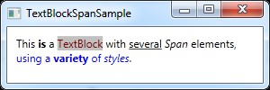 [사용자 정의 텍스트 서식을 위해 다양한 스타일의 Span 요소를 사용하는 TextBlock 컨트롤]

보시다시피, 다른 요소들이 현재 상황에 적합하지 않거나 텍스트 서식을 시작할 때 빈 캔버스를 원한다면 Span 요소가 가장 훌륭한 선택입니다.


### Formatting text from C#/Code-Behind

보시다시피, XAML을 통해 텍스트 서식을 지정하는 것은 매우 쉽지만, 경우에 따라 C# 코드 비하인드 파일에서 직접 서식을 지정하는 것이 좀 더 좋거나 심지어 필요할 수도 있습니다. 이 방법은 다소 번거롭지만, 다음과 같이 구현할 수 있습니다:

```cs
<Window x:Class=“WpfTutorialSamples.Basic_controls.TextBlockCodeBehindSample”
        xmlns="http://schemas.microsoft.com/winfx/2006/xaml/presentation"
        xmlns:x=“http://schemas.microsoft.com/winfx/2006/xaml”
        Title=“TextBlockCodeBehindSample” Height="100" Width="300">
    <Grid></Grid>
</Window>
```

```cs
using System;
using System.Windows;
using System.Windows.Controls;
using System.Windows.Documents;
using System.Windows.Media;

namespace WpfTutorialSamples.Basic_controls
{
    public partial class TextBlockCodeBehindSample : Window
    {
        public TextBlockCodeBehindSample()
        {
            InitializeComponent();
            TextBlock tb = new TextBlock();
			tb.TextWrapping = TextWrapping.Wrap;
            tb.Margin = new Thickness(10);
            tb.Inlines.Add(“An example on ”);
            tb.Inlines.Add(new Run(“the TextBlock control ”) { FontWeight = FontWeights.Bold });
			tb.Inlines.Add(“using ”);
            tb.Inlines.Add(new Run(“inline ”) { FontStyle = FontStyles.Italic });
            tb.Inlines.Add(new Run(“text formatting ”) { Foreground = Brushes.Blue });
			tb.Inlines.Add(“from ”);
            tb.Inlines.Add(new Run(“Code-Behind”) { TextDecorations = TextDecorations.Underline });
            tb.Inlines.Add(“.”);
            this.Content = tb;
        }
    }
}
```

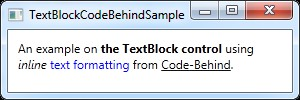 [XAML 대신 C# 코드로 생성된 사용자 정의 텍스트 서식이 적용된 TextBlock 컨트롤]

이런 가능성이 있다는 건 정말 좋은 일이며, 경우에 따라 이런 식으로 처리할 필요도 있겠지만, 이 예제를 보면 XAML의 장점을 더욱 깊이 깨닫게 될 것입니다.


https://wpf-tutorial.com/basic-controls/the-label-control/


## The Label control

## The TextBox control

## The Button control

## The CheckBox control

## The RadioButton control

## The PasswordBox control

## The Image control

# Control concepts

## Control ToolTips

## WPF text rendering

## Tab Order

## Access Keys

# Panels

## Introduction to WPF panels

## The Canvas control

## The WrapPanel control

## The StackPanel control

## The DockPanel control

## The Grid Control

## The Grid - Rows & columns

## The Grid - Units

## The Grid - Spanning

## The GridSplitter

## Using the Grid: A contact form

# UserControls & CustomControls

## Introduction

## Creating & using a UserControl

# Data binding

## Introduction to WPF data binding

## Hello, bound world!

## Using the DataContext

## Data binding via Code-behind

## The UpdateSourceTrigger property

## Responding to changes

## Value conversion with IValueConverter

## The StringFormat property

## Debugging data bindings

# Commands

## Introduction to WPF Commands

## Using WPF commands

## Implementing a custom WPF Command

# Dialogs

## The MessageBox

## The OpenFileDialog

## The SaveFileDialog

## The other dialogs

## Creating a custom input dialog

# Common interface controls

## The WPF Menu control

## The WPF ContextMenu

## The WPF ToolBar control

## The WPF StatusBar control

## The Ribbon control

# Rich Text controls

## Introduction to WPF Rich Text controls

## The FlowDocumentScrollViewer control

## The FlowDocumentPageViewer control

## The FlowDocumentReader control

## Creating a FlowDocument from Code-behind

## Advanced FlowDocument content

## The RichTextBox control

## How-to: Creating a Rich Text Editor

# Misc. controls

## The Border control

## The Slider control

## The ProgressBar control

## The WebBrowser control

## The WindowsFormsHost control

## The GroupBox control

## The Calendar control

## The DatePicker control

## The Expander control

# The TabControl

## Using the WPF TabControl

## WPF TabControl: Tab positions

## WPF TabControl: Styling the TabItems

# List controls

## The ItemsControl

## The ListBox control

## The ComboBox control

# The ListView control

## Introduction to the ListView control

## A simple ListView example

## ListView, data binding and ItemTemplate

## ListView with a GridView

## How-to: ListView with left aligned column names

## ListView grouping

## ListView sorting

## How-to: ListView with column sorting

## ListView filtering

# The TreeView control

## TreeView introduction

## A simple TreeView example

## TreeView, data binding and multiple templates

## TreeView - Selection/Expansion state

## Lazy loading TreeView items

# The DataGrid control

## The DataGrid control

## DataGrid columns

## DataGrid with row details

# Styles

## Introduction to WPF styles

## Using WPF styles

## Trigger, DataTrigger & EventTrigger

## WPF MultiTrigger and MultiDataTrigger

## Trigger animations

# Audio & Video

## Playing audio

## Playing video

## How-to: Creating a complete Audio/Video player

## Speech synthesis (making WPF talk)

## Speech recognition (making WPF listen)

# Misc.

## The DispatcherTimer

## Multi-threading with the BackgroundWorker

## Cancelling the BackgroundWorker

# Creating a Game: SnakeWPF

## Introduction

## Creating the game area

## Creating & moving the Snake

## Continuous movement with DispatcherTimer

## Adding food for the Snake

## Controlling the Snake

## Collision Detection

## Improving SnakeWPF: Making it look more like a game

## Improving SnakeWPF: Adding a high score list

## Improving SnakeWPF: Adding sound

## Full game & final words

