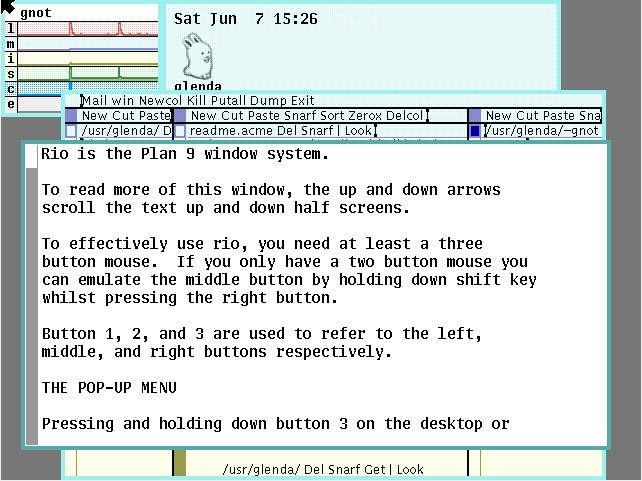
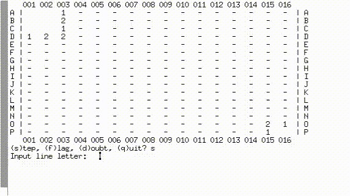
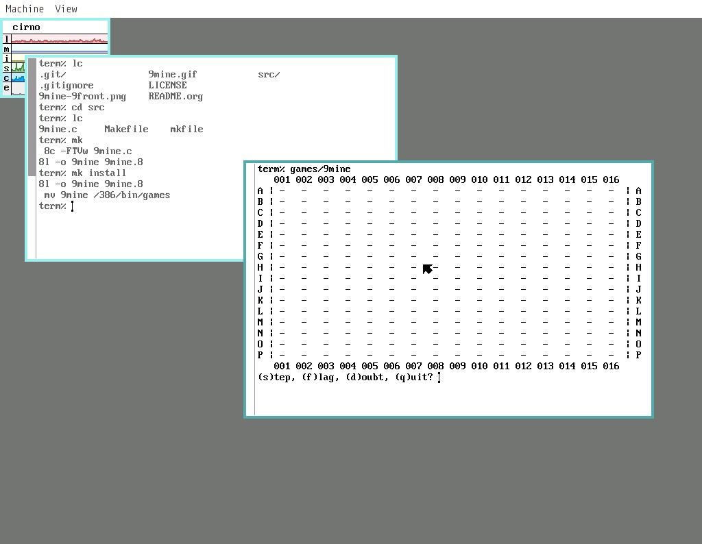

Bell Labs의 Plan 9에서 C 언어 프로그래밍

---

[Reference](https://luksamuk.codes/posts/plan9-c-dev.html)


# 소개

  
그림 1: 웹 서핑을 위해 우주복을 입은 Plan 9의 마스코트 글렌다(*Glenda*).

안녕하세요. 이 글은 C 언어로 간단한 게임을 프로그래밍하면서 겪었던 여러 측면과 어려움에 대해 살펴보고자 합니다. 다만, 이 글은 언어 자체나 프로젝트에 대해서는 거의 다루지 않고, 제가 게임을 개발하기로 결정한 운영 체제에 주로 초점을 맞추고 있습니다.

제 친구 한 명이 C++ 언어로 ‘지뢰 찾기(*Minesweeper*)’ 클론을 만드는 도전을 시작했는데, STL이나 객체 지향 프로그래밍을 사용하지 않고 좀 더 기본적인 구조에 초점을 맞추기로 했습니다. 그녀의 결정에 영감을 받아, 저도 주말 동안 같은 프로젝트를 진행하기로 했습니다.

하지만 어차피 복잡하게 만들 수 있는데 굳이 쉽게 만들 필요가 있을까요? 이미 C와 C++로 꽤 오랫동안 프로그래밍을 해왔기 때문에, 이번에는 색다른 시도를 해보기로 했습니다. 한동안 다른 운영 체제인 Plan 9용으로 C로 간단한 애플리케이션을 개발해 보고 싶었습니다. 유익한 일과 즐거움을 동시에 누릴 수 있다면, 인터페이스를 출력하기 위해 콘솔만 있으면 되는 아주 간단한 게임 하나를 만들 수 있을 테니까요.

이 글은 이 프로젝트를 진행하면서 겪은 어려움과 배운 점들을 살펴보는 것을 목표로 합니다. 흔한 일은 아니기 때문에 C 코드 작성 방식조차 달라지는데, 이에 대해서는 나중에 좀 더 자세히 이야기하겠습니다.

텔레그램을 통해 저에게 많은 방향을 제시해 주시고, 운영 체제에 대해 흥미로운 점들을 많이 가르쳐 주신 *Ricardo Lanziano* (arpunk)님께 미리 감사드립니다. 또한 이 프로젝트의 진정한 선구자가 되어 주신 *Sarah Orlando* 님께도 감사드립니다.


## Plan 9란 무엇인가?

  
그림 2: 시스템 작동 화면 캡처.

*Plan 9 From Bell Labs* 는 UNIX[^1] 운영 체제와 C 언어를 개발한 바로 그 연구팀의 연구 성과로 탄생한 운영 체제입니다. 이 시스템은 1980년대 후반에 등장했으며, 그래픽과 네트워크가 더욱 광범위하게 활용되기 시작한 시대에 UNIX의 개념을 발전시키려는 시도로 볼 수 있습니다.

“UNIX를 현대화하겠다!” 는 전망이 있었음에도 불구하고, Plan 9는 우리가 알고 있는 인터넷(브라우저 및 오늘날 일상에서 자주 사용되는 기타 도구들)이 아직 현실이 아니었던 시기에 개발되었습니다. 따라서 이 시스템은 현대의 요구 사항을 충족할 수 있는 웹 브라우저가 없습니다. 이 시스템의 일부 포크(다음 섹션에서 설명할 9front 등)에는 다소 “최신” 에 가까운 웹 브라우저도 포함되어 있지만, 현대적인 “웹에 대한 완전한 지원을 제공한다” 는 전제는 없습니다.

이 시스템은 개발자[^2]들에 의해 단순성과 명확성을 옹호하는 “논거” 이자, UNIX를 극한까지 밀어붙인 결과물로 묘사됩니다. Plan 9의 두드러진 특징 중 하나로, 분리된 기계들이 터미널이나 CPU 서버, 심지어 파일 서버 역할을 수행하는 분산 컴퓨팅 환경을 구축하고 관리하기 위한 시스템이라는 점을 꼽을 수 있습니다. 이런 방식으로 연결된 기계들은 클러스터처럼 작동하며, 서로 다양한 자원을 공유합니다.

*Plan 9 From Bell Labs* 는 안타깝게도 원래 개발자들에 의해 이미 버려진 시스템입니다!! 오늘날 이 시스템의 유산은 팬 커뮤니티에 의해 여러 포크 형태로 아주 잘 보존되고 있으며, 놀랍게도 이 포크들은 현재 현대적인 문제 해결, 특히 운영 체제 설계와 관련된 연구 대상으로 활용되고 있습니다.


## Plan 9의 포크

Plan 9는 현재까지 여전히 몇 가지 주목할 만한 포크(또는 배포판)가 운영되고 있습니다. 예를 들면 다음과 같습니다.

- [9legacy](http://9legacy.org/) : “원본” 시스템을 유지하는 것을 목표로 하며, 호환성 패치만 수용합니다.
- [9atom](http://www.quanstro.net/plan9/9atom/) : 커널에 몇 가지 추가 아키텍처를 도입하고, 하드웨어 및 일부 파일 시스템에 대한 추가 지원을 제공하는 것을 목표로 합니다.
- [9front](http://9front.org/) : 이 기사에서 주로 설명하는 프로젝트 테스트에 사용된 포크로, 눈에 띄는 패치를 수용하고 팬 커뮤니티를 포용하는 것을 목표로 하며, 현대적인 컴퓨터에서 가장 잘 작동하는 포크입니다;
- [Inferno](https://bitbucket.org/inferno-os/inferno-os/) : *Vita Nuova*사의 시스템으로, 특정 프로그래밍 언어인 `Limbo` 의 사용을 장려해서 애플리케이션의 단순화와 보안 유지를 도모하기 위해 자유 소프트웨어로 유지되고 있습니다;
- [Harvey](https://harvey-os.org/) : Plan 9를 ANSI 및 POSIX 표준에 부합하는 환경으로 가져오기 위해 개발된 64비트 운영 체제로, `gcc` 나 `clang`[^3] 같은 최신 컴파일러를 사용해서 컴파일할 수 있습니다;
- [Jehanne](http://jehanne.io/) : Plan 9의 단순성 원칙을 계승하고, “현대적인 운영 체제 설계의 단순성을 추구한다” 는 전제 하에 만들어진 포크입니다. 자유 소프트웨어로 배포되며, 블로그에서 활발한 활동이 이루어지고 있고 시스템 개발 애호가들에게 흥미로운 토론을 제공하고 있습니다.

Plan 9는 이와 다른 포크들도 있지만, 현재로는 위의 여섯 가지가 가장 주목할 만한 것들입니다.


## 9front의 사용 및 선택

이 프로젝트 서두에 언급했듯이, 제 컴퓨터의 별도 파티션에 9front가 설치되어 있기도 해서 테스트용으로 이를 사용했습니다. 이런 종류의 시스템을 설치해 두면 해당 “시스템의 리소스를 쉽게 찾을 수 있다!” 는 점이 장점입니다. 하지만 이 시스템은 꽤 ‘구식’ 인 탓에, 사용법이나 작동 원리에 관한 자료를 찾으려면 /sys/doc 디렉토리에 있는 여러 문서를 읽어야 합니다(모든 문서는 PostScript 형식으로 배포되므로, ‘즉석에서’ 컴파일해서 문서 뷰어[^4]에서 볼 수 있습니다). 그 외의 경우는 리눅스[^5]와 똑같은 방식으로 작동하는 매뉴얼 페이지, 즉 유명한 `manpage` 를 이용하면 됩니다.

또한, 이 시스템의 철학이 얼마나 흥미로운지 강조하고 싶습니다. 컴파일러는 모듈식이며 충분히 독립적이어서, 다양한 아키텍처에 대한 크로스 컴파일을 완전히 사소한 작업으로 만들어 줍니다. 즉, 시스템이 x86 아키텍처에서 실행 중이지만 사용자의 아키텍처가 x86-64인 경우, Plan 9 전체(커널 + 유저랜드)를 5분도 채 걸리지 않고 재컴파일할 수 있습니다. 이 시간을, 가능한 한 최소한의 기능만 포함하도록 컴파일한 리눅스 커널의 컴파일 시간과 비교해 보시기 바랍니다. 그럼에도 Plan 9는 훨씬 더 빠르게 컴파일되며, 이를 통해 즉시 작동 준비가 된 완전한 시스템을 얻을 수 있습니다.


# 개발 도구

## Linux에서의 개발

개발의 대부분은 저의 Void Linux x86-64 시스템에서 Emacs 텍스트 편집기를 사용해서 진행되었습니다. 어차피 코드를 작성하는 데 특별한 텍스트 편집기가 필요한 사람은 없으니까요. 저는 개발 시 Emacs를 사용하는 데 익숙하기 때문에, 이를 사용해도 문제는 없을 것이라고 확신했습니다.

일부 테스트는 plan9port 라는 도구를 사용해서 진행했는데, 이 도구는 Plan 9의 일부(전부는 아님) 도구를 리눅스에서 작동하도록 해줍니다. 특히 제가 사용한 것은 `9c` 컴파일러와 `9l` 링커(사실 리눅스용 컴파일러를 감싸는 래퍼입니다)였으며, 미적인 이유로 `9term` 터미널도 사용했습니다.

컴파일 스크립트의 경우, 처음에는 plan9port 의 `mk` 도구를 사용했으나, `mk` 를 사용하는 빌드 시스템을 실제 Plan 9에 맞게 조정할 때 곧바로 `make` 로 되돌렸습니다. 주요 차이점은 뒤에서 자세히 설명하겠습니다.


## 9front에서의 개발

저는 9front를 네이티브 환경과 Void Linux[^6] 내의 `QEMU` 를 통해 부팅 가능한 가상 드라이브 모두에 설치해 두었습니다. Linux에서 plan9port 를 사용한 개발이 끝난 후, 코드를 QEMU 로 옮긴 다음 네이티브 9front로 이식하면 되었으며, plan9port를 사용한 Linux 빌드는 영향을 미치지 않는 최소한의 변경만으로 프로젝트가 정상적으로 작동했습니다. 나머지 작업은 9front에서 작동하도록 mkfile 파일을 조정하는 데만 집중되었습니다(이 파일에 대해서는 아래에서 좀 더 자세히 설명하겠습니다).


# 프로젝트 구조

여기서 생성한 프로젝트 파일과 관련해서 몇 가지 사항을 강조하고, 또한 파일의 계층 구조 및 사용 방법에 대해서도 설명하겠습니다.

  
그림 3: Linux에서 plan9port를 통해 실행 중인 게임.


## 파일

이 프로젝트는 관련 파일이 단 세 개뿐입니다:

```
9mine.c
mkfile
Makefile
```

여기서 *9mine.c* 는 C 언어 소스 코드 파일이고, *mkfile* 은 Plan 9용 설정 및 빌드 파일이며, *Makefile* 파일은 Linux용 빌드 파일입니다.


## 컴파일 방법

프로젝트를 컴파일하기 위해 `make` (Linux/plan9port)와 `mk` (Plan 9)를 모두 사용했습니다.


### make

처음에는 Plan 9용 컴파일 환경을 완벽하게 에뮬레이트하기 위해 리눅스에서 plan9port 도구만 사용하려는 것이 목표였습니다. 하지만 plan9port는 정확히 이런 용도로 설계된 것이 아닙니다. 프로세서 아키텍처에 구애받지 않는 컴파일 스크립트 작성 같은 Plan 9 컴파일 유틸리티 중 일부는, 곧 설명할 시스템 고유의 의존성에 의해 작동하기 때문에 리눅스로 포팅되지 않았습니다.

리눅스에서 컴파일 과정은 빠른 프로토타이핑 시스템을 포함하고 있었으며, 프로세서 아키텍처나 시스템 설치 과정에 대한 고려가 필요하지 않았기 때문에, 저는 리눅스의 표준 빌드 스크립팅 도구인 ‘make’ 프로그램을 사용하기로 결정했습니다.


### mk

이 도구는 Plan 9에서 빌드를 용이하게 하는 표준 도구이며, 파일 관리 및 시스템 계층 구조 유지 관리에도 널리 사용됩니다[^7]. 공식 문서에 따르면, `mk` 는 Plan 9의 공식 셸인 `rc` 와 직접 상호작용하도록 설계되었으며, 이를 통해 유지보수 작업은 물론, 다중 프로세서 환경을 활용해서 작업을 병렬로 실행할 수도 있습니다. 이는 분산 시스템 개념과 원격 머신의 장치에 대한 접근성을 뒷받침합니다.

저는 이 애플리케이션을 프로젝트에서 Plan 9의 모든 포크에 대한 소프트웨어 지원 및 배포를 가능하게 만들기 위해 사용하고 있습니다. 이를 통해 여기서 논의된 게임을 컴파일하고 설치할 수 있습니다.


## 버전 관리 및 시스템 패치 유지 관리

사실, Plan 9의 어떤 포크도 제대로 된 버전 관리 시스템을 갖추고 있지 않습니다. `git` 과 비슷하게 작동하는 커뮤니티 스크립트가 하나 있었지만, 이는 본질적으로 `hget` (`wget` 과 유사)을 감싸는 래퍼에 불과합니다.[^8]

Mercurial을 지원하는 커뮤니티 도구도 있었는데, 이곳도 `hg` 로 불리지만, 저는 버전 관리에 Mercurial을 사용하지 않기 때문에 이 도구를 사용한 적은 없습니다. 이 도구가 “그럭저럭 쓸 만하다” 는 소문도 있지만, 많은 요구 사항을 충족시키기에는 부족합니다. 그럼에도 불구하고, 9front는 시스템 업데이트와 관련된 주요 도구로 사용되고 있습니다.

Plan 9용 버전 관리 시스템에 대한 이런 설명이 터무니없어 보일지도 모르지만, Plan 9는 우리가 알고 있는 인터넷이 등장하기 훨씬 이전부터 존재해 온 시스템이며, “올드스쿨” 방식을 선호하는 팬층을 보유하고 있다는 점을 기억해야 합니다. 따라서 이메일로 전송된 diff 형식의 패치를, 전용 도구를 사용해서 파일에 병합하는 방식이 좀 더 일반적일 것입니다. Plan 9와 버전 관리 시스템을 통합하는 프로젝트라면 아마 이를 위해 사용되는 도구를 활용할 것입니다. 따라서 Plan 9의 버전 관리 소프트웨어는 가급적 비-모놀리식이라야 한다는 점이 분명해집니다.

이 시스템이 일반적으로 어떻게 “업데이트” 되는지 궁금하시다면, 그 절차는 9p 프로토콜을 통해 사용 중인 포크의 유지보수자 서버에 연결된 원격 디렉터리를 마운트하는 과정을 거칩니다. 9p 프로토콜은 Plan 9의 대표적인 특징 중 하나지만, 안타깝게도 여기서는 이에 대해 자세히 다루지 않겠습니다[^9].


# 프로그래밍 시 주의할 핵심 차이점

이 시스템은 프로그래머가 C 표준 라이브러리와 상호작용하는 방식을 근본적으로 다르게 제안합니다. 이 섹션은 제가 중요하다고 판단한 몇 가지 기능을 담은 기본적인 프로그램들을 소개하겠습니다.


## C 프로그램의 기본 구조

앞서 언급했듯이, Plan 9용 C 기본 프로그램은 오늘날 Windows, Linux, OS X에서 보는 것과 극적으로 다를 수 있습니다. 아래는 아주 간단한 “Hello, world!” 예제가 있습니다.

```c
#include <u.h>
#include <libc.h>

void
main(void)
{
    print(“Hello, world!\n”);
    exits(0);
}
```

ANSI C에 익숙한 독자라면 이 예제를 보고 조금 당황할 수도 있습니다. 보시다시피, 화면에 무언가를 출력하고 있음에도 불구하고 *stdio.h* 나 *printf* 함수의 흔적조차 찾아볼 수 없습니다. 이는 Plan 9[^10]는 이런 함수가 존재하지 않기 때문입니다. 하지만 이것만으로는 충분하지 않다고 생각하는 것은 오산입니다. 방대한 표준을 구현하는 대신, 프로그래머에게 가능한 한 단순한 환경을 제공하는 데 중점을 두고 있습니다.

*u.h* 와 *libc.h* 헤더 파일은 Plan 9의 “표준 헤더 파일” 이며, 이미 수많은 특정 기능을 포함하고 있습니다. 링크 문제를 방지하려면 이 헤더 파일들을 정확히 이 순서대로 포함해야 합니다.

`print` [^11] 함수는 *printf* 함수와 정확히 동일한 방식으로 작동하지만, 몇 가지 차이점이 있습니다. Plan 9는 기본적으로 유니코드를 지원하므로, 예를 들어 UTF-8 문자를 나타내는 `Rune` 유형에 대한 플래그가 있습니다.

`exits` [^12] 함수는 임의의 프로세스를 종료하기 위한 일반적인 함수로, 매개변수로 (최대 길이가 ERRLEN 인) 문자 상수를 받아 프로세스 종료 사유를 간략하게 명시합니다. 그러나 기존의 유닉스 계열 시스템과 달리, “진입점 함수(main)는 반환 값을 갖지 않는다!” 는 점에 유의합니다. 따라서 제시된 사례에서 `exits` 함수의 사용은 선택 사항입니다. 또한, 이 함수에 `null` 포인터(이 경우 값 0 또는 nil 매크로)를 전달하면 프로세스가 정상적으로 종료되었음을 나타냅니다.


## 콘솔을 통한 입력

Plan 9는 `scanf` [^13] 함수에 직접적으로 대응하는 기능이 없습니다!! 대신, 콘솔을 통한 입력은 *libbio* 라이브러리에 위임된 작업입니다. 이것이 다소 생소하게 보일 수 있지만, 이는 UNIX 철학을 극한까지 밀어붙이는 시스템의 철학과 부합하는 방식입니다. 즉, 모든 것이 파일이고 파일이 스트림으로 읽힌다면, 콘솔 입력 역시 스트림으로 취급될 수 있습니다[^14].

또한, *libbio* 는 Biobuf 구조체에 할당된 버퍼 형식으로 파일 입출력을 처리합니다. *stdin* 을 사용해서 버퍼를 읽기 모드로 열면 됩니다:

```c
#include <u.h>
#include <libc.h>
#include <bio.h>        /* libbio 헤더 */


/* 애플리케이션 진입점 */
void
main(void)
{
    /* 버퍼 구조체 */
    Biobuf bstdin;

    /* 버퍼 열기. 인자 '0' 은 stdin 을 나타냅니다 */
    if(Binit(&bstdin, 0, OREAD) == Beof) {
        fprint(2, “stdin을 bio에 연결하는 중 오류 발생: %r”);
        exits(“Binit”);
    }

    /* stdin에서 한 줄 읽기 */
    char *str;
    int   len;

    str = Brdline(&bstdin, 10);       /* 10 = \n */
    len = Blinelen(&bstdin);

    /* 문자열에서 줄바꿈 문자 제거 */
    if(str) {
        str[--len] = ‘\0’;
    }

    print(“길이 %d 인 문구 \”%s\“ 를 읽었습니다\n”, str, len);

    /* 버퍼 닫기 */
    Bterm(&bstdin);
    exits(0);
}
```


## 명령줄 인자 파싱

일반적으로 C/C++로 애플리케이션을 작성할 때, main 함수의 매개변수로 전달되는 argc 와 argv 를 사용해서 콘솔을 통해 애플리케이션에 전달된 인수를 가져올 수 있다는 것을 잘 알고 있습니다. Plan 9도 마찬가지입니다.

제 게임은 디버그 모드가 있기 때문에, 콘솔을 통해 전달할 수 있는 -d 플래그가 필요했습니다. 그래서 이 문제에 대한 저의 첫 번째 접근 방식은 가장 단순한 방법이었습니다:

```c
void
main(int argc, char **argv)
{
    int i;
    int debug = 0;
    for(i = 1; i < argc; i++) {
        if(!strcmp(argv[i], “-d”)) {
            debug = 1;
            break;
        }
    }

    if(debug) {
        print(“Got a debug flag!\n”);
    }

    exits(0);
}
```

하지만 Plan 9는 매크로 형태로 이 문제를 해결할 수 있는 기능이 이미 있습니다! *Ricardo Lanziano* 가 제대로 지적했듯이, 이 문제를 다루는 훨씬 더 간단한 방법이 있습니다. 해석은 독자 여러분께 맡기겠습니다:

```c
void
main(int argc, char **argv)
{
    int debug = 0;

    ARGBEGIN {
        case ‘d’:
            debug = 1;
            break;
    } ARGEND;

    if(debug) {
        print(“디버그 플래그가 전달되었습니다!\n”);
    }

    exits(0);
}
```


# 컴파일 과정

  
그림 4: QEMU 환경에서 9front가 콘솔에서 9mine 프로젝트를 실행하는 모습.

리눅스에서 컴파일 과정은 간단합니다. plan9port가 설치되고 설정되어 있다면, 프로젝트의 src/ 디렉터리에서 `make` 를 입력하면 애플리케이션이 컴파일됩니다. 주된 목적이 Plan 9에 초점을 맞추는 것이므로, 설치용 타겟은 포함되지 않았습니다.

9front는, 프로젝트 디렉터리를 이미 컴퓨터에 클론했다면(버전 관리 섹션 참조), src/ 디렉터리로 이동해서 `mk` 를 입력하면 바이너리가 생성됩니다. 그 다음, `mk install` 을 입력하면 해당 아키텍처의 `/bin/games` 디렉터리에 바이너리가 설치됩니다. 게임 자체는 콘솔에서 `games/9mine[^15]` 명령어로 실행할 수 있습니다.


## mkfile 파일

*mkfile* 파일은 특별히 복잡하지도 않고, 우리가 알고 있는 *Makefile* 파일과 크게 다르지도 않습니다. 하지만 이 파일은 운영 체제와의 통합을 강화한다는 전제 하에 설계됐기 때문에, 미리 준비된 몇 가지 흥미로운 기법들이 포함되어 있습니다[^16].

아래는 9mine의 *mkfile* 파일을 그대로 복사했으며, 이에 대한 설명은 뒤에서 다루겠습니다.

```
</$objtype/mkfile

BIN=/$objtype/bin/games

9mine:  9mine.$O
        $LD -o $target $prereq

install: 9mine
         mv 9mine $BIN

%.$O:    %.c
$CC $CFLAGS $stem.c
```

이 스크립트는 시스템에서 제공하는 /$objtype/mkfile 파일의 내용을 “상속” 받기 때문에 반드시 아키텍처에 독립적입니다. $objtype 은 애플리케이션을 컴파일하려는 네이티브 아키텍처를 지정하는 환경 변수입니다. 시스템이 386 아키텍처에서 실행되기 때문에, 해당 디렉터리에서 `mk` 를 호출하기만 해도 리눅스의 .o 파일과 유사한 9mine.8 파일이 생성됩니다. 이 파일은 이후 링크되어 9mine 이라는 이름의 바이너리로 변환됩니다.

이 방법에서 흥미로운 점은 환경 변수에 의존하기 때문에, 단순히 해당 변수를 수정하는 것만으로도 “크로스 플랫폼 컴파일 지원이 가능해진다” 는 것입니다. Plan 9는 매우 간결하면서도 다양한 아키텍처에서 작동하는 C 컴파일러가 있으므로, 이 작업을 쉽게 수행할 수 있습니다[^17].

예를 들어, Raspberry Pi 2 또는 3에서 실행될 C 애플리케이션을 컴파일한다고 가정합니다. 이 장치들의 아키텍처는 ARM 이며, Plan 9 시스템을 ARM용으로 컴파일하는 것도 가능합니다[^18]. 따라서 Plan 9가 실행 중인 어떤 아키텍처의 개인용 컴퓨터든 다음 명령을 사용해서 ARM 아키텍처와 호환되는 바이너리를 생성할 수 있습니다:

```
objtype=arm mk
```

이렇게 하면 다음 명령어인 `mk` 에 대해 $objtype 변수가 재정의되며, 대상 아키텍처에 적합한 변수와 컴파일러가 사용됩니다. 따라서 이 스크립트는 9mine.5 라는 이름의 오브젝트를 생성하며, 점 뒤의 숫자는 대상 아키텍처를 나타냅니다[^19].


#결론


한때, 한 지인이 제게 평생에 걸쳐 다양한 유닉스 계열 시스템에 대한 지식을 쌓고, 항상 그 시스템들에 대해 좀 더 깊이 이해하려고 노력한다면, 한 시스템에서 다른 시스템으로 전환할 때 예상치 못한 문제가 발생하지 않을 것이라고 말해준 적이 있습니다. Plan 9가 산업계에서[^20] 큰 비중을 차지하지는 않지만, 이 운영 체제를 개발하는 데 있어 아키텍처와 명확성에 대한 고민이 뚜렷이 드러나며, 이는 제게 귀중한 본보기가 됩니다.

저는 Plan 9가 현대적인 환경에서도 그 용도가 있다고 믿습니다. 운영이 중앙 집중식 서버에 의존하지 않는 것처럼 보이는 인터넷의 새로운 흐름 속에서, 30년 전의 운영 체제는 유용성과 실현 가능성을 보여주는 길을 제시하는 듯합니다.

게다가 Plan 9의 코드와 아키텍처는 탁월함의 대명사입니다. 이 시스템은 엄격한 모범 사례와 유닉스(UNIX) 철학에 따라 C 언어로 작성된 가독성 높은 코드를 추구하고 전파함으로써, 소프트웨어 개발이 우리가 현재 겪고 있는 이런 ‘혼란’ 일 필요는 없음을 잘 보여줍니다. 이를 위한 비결은 물론, 단순히 공부하는 것뿐만 아니라 실제 사례를 제시하는 것도 있으며, 이는 벨 연구소의 Plan 9가 추구했던 방식과 같습니다.


[^1]: [UNIX 운영 체제](https://en.wikipedia.org/wiki/Unix)는 원래 프로그래머들이 소프트웨어를 쉽게 개발할 수 있도록 편리한 플랫폼으로 설계된 시스템이었습니다. 이 아키텍처는 유명한 ‘유닉스 철학’ 에 기반을 두고 있으며, 여기서 “모든 것은 파일이다!” 나 “단 한 가지 일을 잘하고, 그 일을 제대로 처리하는 프로그램을 만들라!” 같은 격언들이 탄생했습니다. 이런 극도의 모듈성과 단순성은 운영 체제의 설계 및 아키텍처 측면에서 유용함이 입증되었으며, 현대 시스템들(리눅스, BSD, OS X 같은 유명한 유닉스 계열 시스템)의 아키텍처에 큰 영향을 미쳤습니다.

[^2]: Plan 9의 목표에 대한 자세한 내용은 관련 매뉴얼 페이지인 [intro](http://man.9front.org/1/intro)에서 확인할 수 있습니다.

[^3]: 기여하거나 소스 코드를 연구할 만한 훌륭한 오픈소스 프로젝트를 찾고 계신다면, Harvey를 살펴보시기를 추천합니다. 소스 코드는 [여기](https://github.com/Harvey-OS/harvey)에서 확인할 수 있습니다.

[^4]: 이건 제가 구현한 수 있을 것 같은 흥미로운 기능입니다. 기사들 대부분 .ps 확장자를 가진 파일로 저장되어 있습니다. 터미널에서 /sys/doc 디렉토리로 이동한 다음, 해당 디렉토리에 있는 파일 목록을 확인해야 합니다. 그 후, 마우스로 파일 이름을 선택한 다음, 가운데 버튼을 클릭하고 ‘plumb’ 를 선택하면 됩니다. 그러면 즉시 ‘page’ 프로그램이 열리며, 해당 문서가 렌더링된 형태로 표시됩니다. 이 기능이 흥미로운 점은 PostScript 파일뿐만 아니라 어떤 파일이든 해당 파일에 적합한 프로그램에서 열 수 있고, 심지어 이 기능만으로도 자동으로 컴파일될 수도 있다는 것입니다.

[^5]: 부인할 수 없는 사실은, 이것이 제가 얻은 유일한 정보 출처는 아니라는 점입니다. 앞서 리카르도 란지아노(Ricardo Lanziano)씨가 시스템의 작동 및 운영과 관련해 많은 도움을 주었다고 언급한 바 있지만, 9front의 ‘자주 묻는 질문(Frequently Questioned Answers)’ [섹션](http://fqa.9front.org/fqa.html)을 읽은 것도 큰 도움이 되었습니다. 참고: 이 페이지는 유머와 정치적 부적절함을 진지하게 다루지만, 유용한 정보도 함께 담고 있습니다.

[^6]: 독자분들 중 저처럼 QEMU 에서 9front를 설치하고 싶으신 분은 [9front의 FAQ 페이지](http://fqa.9front.org/fqa3.html#3.3.1)를 참고하면 됩니다. 해당 페이지는 설치 방법에 대한 자세한 안내가 나와 있습니다. 같은 섹션에는 ‘실제’ 하드웨어에 9front를 설치하는 방법에 대한 안내도 포함되어 있습니다.

[^7]: 이 도구에 대해 자세히 알고 싶으시다면, 시스템의 /sys/doc 디렉터리에 포함되어 있는 [mk의 기사](http://www.vitanuova.com/inferno/papers/mk.pdf)를 읽어보시기를 권장합니다.

[^8]: 이 내용을 각주로 넣는 것이 그리 적절하지는 않다고 생각하지만, 좀 더 적합한 장소가 없으므로 향후 참고를 위해 여기에 남겨두겠습니다. 설치 방법은 9front 서버의 원격 시스템을 로컬에 마운트한 다음, git 스크립트를 로컬로 복사하는 것입니다. 여기는 다음 두 가지 명령이 포함됩니다: `9fs 9front; cp /n/extra/rc/git $home/bin/rc/`.

[^9]: 소스 코드로부터 9front를 컴파일하는 방법에 대한 전체 지침은 [여기](http://fqa.9front.org/fqa5.html)에서 확인할 수 있습니다. 9p(또는 9fs)에 대해 좀 더 알고 싶다면, Plan 9의 네트워크 구성을 다루는 [이 논문](https://plan9.io/sys/doc/net/net.pdf)에서 관련 정보를 찾을 수 있습니다.

[^10]: 사실 Plan 9는 이런 사소한 기능들에 대한 구현도 존재하지만, 이들은 시스템의 원래 설계에서 일반적으로 사용되지 않으며, 현재 활동 중인 개발자들도 이를 선호하지 않습니다. 따라서 저는 Plan 9와 다른 시스템 간의 호환성을 억지로 맞추기 보다는, Plan 9에서 C 언어를 “순수한” 형태로 계속 사용하기로 결정했습니다.

[^11]: 9front 온라인 매뉴얼에서 [print](http://man.9front.org/2/print)를 참조합니다.

[^12]: 9front 온라인 매뉴얼에서 [exits](http://man.9front.org/2/exits)를 참조합니다.

[^13]: Linux 온라인 매뉴얼에서 [scanf](https://linux.die.net/man/3/scanf)를 참조합니다.

[^14]: UNIX 스트림 개념을 잘 모르신다면, Dennis Ritchie의 [스트림에 관한 기사](https://doi.org/10.1002/j.1538-7305.1984.tb00071.x)를 찾아보실 수 있습니다.

[^15]: Plan 9에서 바이너리의 동작 방식에 뚜렷한 변화가 있음을 주목합니다. 9mine 이라는 바이너리가 bin 의 하위 디렉터리에 있다는 사실은, 해당 바이너리가 어느 하위 디렉터리에 위치해 있는지에 대한 정보만 있으면 계속 호출될 수 있음을 의미합니다. 이는 시스템의 파일 계층 구조에 네임스페이스가 사용되고 있음을 보여줍니다. 좀 더 자세한 정보를 원하신다면, 시스템의 초기 개발자들이 작성한 이 [훌륭한 논문](https://9p.io/sys/doc/names.pdf)을 참고하시기를 권합니다. 이 논문은 네임스페이스 계층 구조가 작동하는 방식과 그 용도에 대해 상세히 설명하고 있습니다.

[^16]: 또한, 시스템에 포함된 ‘[Plan 9 Mkfiles](https://plan9.io/sys/doc/mkfiles.pdf)’ 문서를 읽어보시기를 권합니다. 이 문서는 *mkfile* 사용법에 대한 포괄적인 내용이 담겨 있습니다.

[^17]: Plan 9 컴파일러가 지원하는 아키텍처에 대한 자세한 설명은 [관련 매뉴얼 페이지](http://man.cat-v.org/plan_9/1/2c)를 참조합니다.

[^18]: Raspberry Pi용 9front 컴파일 지침은 [여기](http://fqa.9front.org/appendixj.html)에서 확인할 수 있습니다.

[^19]: Plan 9의 C 컴파일러에 대한 좀 더 자세한 설명은 [이 기사](https://9p.io/sys/doc/compiler.html)에서, 해당 컴파일러 사용법에 대한 심층적인 설명은 [다른 기사](https://plan9.io/sys/doc/comp.pdf)에서 확인할 수 있습니다.

[^20]: 글쎄요… 꼭 그렇지만은 않죠? 최근 마이크로소프트는 Windows 10에서 [리눅스 서브시스템](https://devblogs.microsoft.com/commandline/whats-new-for-wsl-in-windows-10-version-1903/)에서 Windows 탐색기를 열 수 있는 기능을 추가하는 패치를 출시했습니다. 이 모든 마법은 로컬 파일 서버를 통해 이루어지는데, 이 서버는 “실제” 머신과 서브시스템 간의 통신에 Plan 9 고유의 9p 프로토콜을 사용합니다. 보아하니 좋은 아이디어는 결코 사라지지 않는 것 같습니다.


