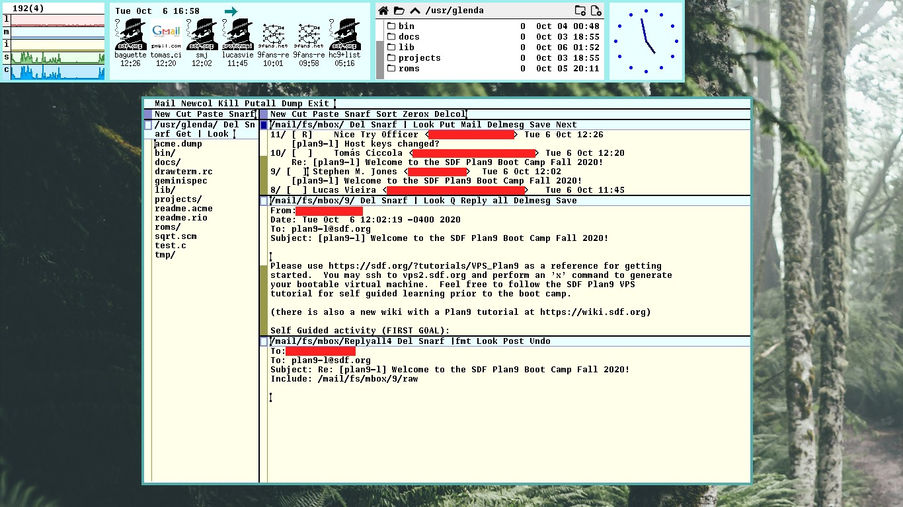
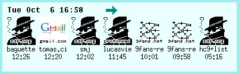
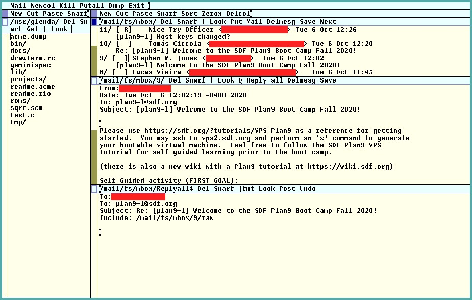

Reading E-mail from Gmail on Plan 9 from Bell Labs
---

# Introduction



지난 며칠 동안 SDF.org 에서 Plan 9 부트캠프가 진행되고 있습니다. 저는 운 좋게도 참가자 명단에 이름을 올린 사람 중 한 명이었는데, 저를 비롯한 여러 참가자들에게는 원격 접속을 통해 Plan 9에 직접 시도하고, 실험하며, 탐구할 수 있도록 임시 VPS 접속 권한이 부여되었습니다.

SDF는 35년째 운영되어 온 커뮤니티로, 유닉스 시스템에 대해 좀 더 배우려는 사람이라면 누구에게나 무료로 유닉스 셸 접속 권한을 제공하고 있습니다. 이곳은 초보자부터 노련한 해커에 이르기까지 모두를 따뜻하게 환영하는 커뮤니티입니다. 여기서 ‘해커’ 라는 단어는 가장 긍정적인 의미로 사용됩니다. 이곳의 사용자들은 기술 전반에 열정을 가진 사람들이며, 컴퓨팅의 황금기에서 비롯된 훌륭하고 오래된 기술들을 활용하는 동시에 새로운 것들도 배우고 있습니다.

이 글에서는 Plan 9에서 이메일을 읽고 보내도록 설정하기 위해 제가 수행한 작업 중 일부를 설명하겠습니다. 물론, Acme를 통해서도 동일한 작업을 수행할 수 있습니다.


## Before going forward

이 글은 Plan 9에 대한 입문서가 아닙니다. 이 글은 주로 Plan 9의 메일 기능 사용에 어려움을 겪는 해커들을 대상으로 합니다.

여러분이 sam에 대해 어느 정도 익숙하다고 가정합니다. 또한 단일 시스템의 Plan 9 머신에서 직접 작업하거나 drawterm 연결을 통해 수행할 수도 있습니다.

설명된 단계들은 텍스트 콘솔에서 ed 를 사용해서 수행할 수도 있지만, 권장하지는 않습니다. Plan 9는 3버튼 마우스를 사용한 그래픽 터미널에서 사용할 때 훨씬 더 즐겁기 때문입니다.


## Achtung!

이 글은 아래 링크들에서 큰 영감을 받았습니다. 이 링크들에는 앞으로 다룰 내용의 대부분이 담겨 있습니다.

- [9front FQA: 8.4.1.1.2 Gmail로 메일 보내기](http://fqa.9front.org/fqa8.html#8.4.1.1.2)
- [9p.io: 메일 설정](https://9p.io/wiki/plan9/Mail_configuration/index.html)
- [YouTube: Acme 메일 데모](https://www.youtube.com/watch?v=byoznMe8ab4)

마지막 링크는 Acme를 이용한 이메일 사용법을 자세히 보여주는 동영상입니다. 글을 다 읽은 후에 시청해 보시는 것도 좋습니다.

그럼 시작해 보겠습니다.


# Configuring Gmail

먼저, 원격 접속을 위해 Gmail 계정을 설정해야 합니다.

브라우저에서 Gmail에 접속한 후, 설정 > IMAP/POP 설정으로 이동해서 IMAP 및 SMTP 연결을 활성화합니다.

그 다음, Gmail에 ‘보안 수준이 낮은 앱’(즉, 2단계 인증이 적용되지 않은 앱)의 접속을 허용해야 합니다. 이 설정은 https://myaccount.google.com/lesssecureapps에서 확인할 수 있습니다.

비록 번거로운 절차가 수반되지만, 특정 프로그램 하나에만 비밀번호를 사용할 수 있는 방법이 있는 것으로 보입니다. offlineimap 이나 mbsync/isync 같은 다른 프로그램을 위해 Gmail을 설정하는 튜토리얼에서 이 방법을 찾을 수 있겠지만, 이는 이 글의 범위를 벗어납니다.


# Configuring passwords

IMAP 및 SMTP 인증에 사용할 수 있도록 비밀번호를 설정해야 합니다. 다음 명령어를 실행하면 factotum이 콘솔에서 비밀번호 입력을 요청하도록 설정됩니다.

대부분의 사람들은 factotum의 ctl 파일에 내용을 직접 echo로 출력하겠지만, 저는 의도적으로 그렇게 하지 않기로 했습니다. factotum은 애초에 콘솔에 출력되어서는 안 되는 정보를 요청할 수도 있기 때문입니다.

이 방식은 향후 ssh나 git의 비밀번호를 입력할 때도 유용하게 쓰일 수 있습니다.

자세한 내용은 man factotum을 실행해 보세요.

```
% auth/factotum -g ‘proto=pass server=imap.gmail.com service=imap user=your-mail@example.com !password?’
% auth/factotum -g 'proto=pass server=smtp.gmail.com service=smtp user=your.mail@example.com !password?'
```

선택적으로, 비밀번호를 명시적으로 지정할 수 있도록 해당 명령어를 약간 수정할 수도 있습니다. 인증 서버를 재부팅하더라도 factotum이 비밀번호 정보를 계속 기억하도록 하려면, 이러한 명령어를 세션 초기화 파일(예: /bin/termrc.local 또는 $home/lib/profile)에 추가하면 됩니다:

```
auth/factotum -g ‘proto=pass server=imap.gmail.com service=imap user=your.mail@example.com !password=YOURPASSWORD’
auth/factotum -g 'proto=pass server=smtp.gmail.com service=smtp user=your.mail@example.com !password=YOURPASSWORD'
```

물론, 비밀번호를 암호화된 상태로 유지하려는 경우 이 방법은 안전하지 않습니다.

Plan 9는 사용자가 항상 시스템을 종료하거나 완전히 재부팅할 것을 전제로 하는 운영 체제가 아닙니다. 사실 가장 좋은 방법은 factotum을 관리하는 전용 인증 서버를 운영하는 것입니다. 이렇게 하면 비밀번호를 한 번만 입력하고 서버를 계속 실행시켜 두면 되며, 해당 서버만 관리하면 됩니다. 가급적이면 암호화된 파일을 사용하는 것이 좋습니다.


# Starting upasfs and receiving mail over IMAP

upas/fs는 원격 사서함을 효과적으로 마운트하여 사용자가 로컬에서 이메일을 확인할 수 있도록 해줍니다. SSL 사용 여부와 관계없이 POP3 및 IMAP을 지원합니다.

여기서는 SSL을 사용하는 IMAP을 사용할 것입니다. 이를 위해 콘솔에서 다음 명령을 실행하고, 관련 부분에서 ‘mail’을 본인의 이메일 주소로 대체하십시오:

% upas/fs -f /imaps/imap.gmail.com/your.mail@example.com
이 명령어는 실패할 것이며, 대략 다음과 같은 서버 인증서 관련 오류가 표시될 것입니다:

upas/fs imap: 서버 인증서 sha256=xxxx가 인식되지 않음
sha256 해시 조각(sha256 부분 포함)을 복사한 후, tls에 이를 신뢰하도록 지시하십시오:

% echo ‘x509 sha256=xxxx’ >>/sys/lib/tls/mail
그 후, 위 명령어를 세션 초기화 파일에 복사하여 upas/fs가 시작 시 자동으로 실행되도록 설정하세요. 가급적이면 plumber를 시작한 후에 수행하는 것이 좋습니다. 모든 세션 시작 시 실행되는 $home/lib/profile 파일에 설정하는 것을 권장합니다.


## Caveats on the profile script

기본 프로필 스크립트를 사용하는 경우, upas/fs 시작 명령은 터미널 및 CPU 케이스 모두에 포함될 수 있습니다. 이는 “로컬” 연결(물리적으로, 해당 컴퓨터에서 키보드와 마우스를 직접 사용하는 경우)과 “원격” 연결(다른 터미널에서 drawterm을 사용하여 연결하는 경우)과 관련이 있습니다.

con 케이스는 단순히 원시 콘솔을 위한 경우로, 성능이 상당히 형편없으므로 어차피 사용하지 않는 것이 좋습니다.


# Running faces to see user icons

콘솔에서 faces를 실행하여 제대로 작동하는지 확인할 수 있습니다:

% faces -i
모든 것이 정상적으로 작동했다면 화면에 여러 아이콘이 표시될 것입니다. 각 아이콘은 여러분에게 이메일을 한 통씩 보낸 사용자를 나타냅니다.




아이콘을 마우스 오른쪽 버튼으로 클릭하면 nedmail이 실행된 콘솔이 열리고 이메일을 읽을 수 있지만, 이 방법은 그리 편리한 방식은 아닙니다. 따라서 나중에 Acme Mail을 설정해 보겠습니다.

마지막으로, 부팅 시 faces를 실행하고 싶다면 $home/bin/rc/riostart 스크립트에 추가하면 됩니다. 제 시스템에서는 다음과 같이 시작합니다:

window 161,0,560,117 faces -i


## Enabling riostart

drawterm에서 CPU 서버로 연결할 때 riostart가 비활성화되어 있을 수 있습니다.

rio가 $home/lib/profile에 있는 riostart 스크립트를 호출하는지 확인하십시오(특히 원격 연결 시 CPU 서버의 경우). 그렇지 않다면, rio의 시작 명령어를 다음과 같이 변경해 보십시오:

rio -i riostart


# Sending e-mail over SMTP

메일 서비스를 이용하기 전에, 메일을 보낼 수 있는지 확인해야 합니다. 이를 위해 SMTP를 설정할 수 있도록 몇 가지 추가 설정이 필요합니다.


## Setting up /mail/lib/rewrite

/mail/lib/rewrite 파일을 설정해야 합니다. 파일을 열면, 이미 작성된 텍스트에 따라 rewrite.gateway 또는 rewrite.direct 파일 중 하나를 복사하여 붙여넣으라는 안내가 표시됩니다. 이 두 파일은 모두 /mail/lib 디렉터리에 있습니다.

이메일 관리를 원격 Gmail 서버에 의존하고 있으므로, rewrite.gateway 파일의 내용을 모두 rewrite 파일에 복사하십시오.

이제 해당 파일에서 YOURDOMAIN.DOM 주소가 나열된 모든 부분을 gmail.com으로 바꾸십시오. 예를 들면 다음과 같습니다.

# 도메인이 없는 주소에 로컬 도메인을 추가합니다.
local!“(.+)”        alias     \1@gmail.com
local!(.*)       alias     \1@gmail.com
해당 파일과 그 기능에 대한 자세한 내용은 man rewrite를 참조하십시오.


## Setting up SMTP server variable

이제 /lib/ndb/local 파일을 엽니다. 파일 끝부분에 $smtp 변수를 다음과 같이 정의합니다:

smtp=smtp.gmail.com


## Setting up /mail/lib/remotemail

마지막으로, /mail/lib/remotemail 파일을 열어주세요. 이렇게 하면 Gmail 계정으로 메일을 전송할 수 있게 됩니다. 이 스크립트가 실제로 이메일을 발송하는 역할을 합니다.

```
#!/bin/rc
shift
sender=your.mail@example.com
shift
addr=tcp!smtp.gmail.com!587
shift
fd=‘{/bin/upas/aliasmail -f $sender}
switch($fd){
case *.*
    ;
case *
    fd=gmail.com
}
exec /bin/upas/smtp -u your.mail@example.com -a -h $fd $addr $sender $*
```


## Fixing SMTP certificates

이제 거의 다 끝났습니다. 유일한 문제는 Plan 9가 여전히 Gmail의 SMTP 서버를 신뢰하지 않는다는 점입니다.

다음과 같이 예시 이메일을 보내 보세요:

% echo hello | mail -s test your.username@gmail.com
이 작업은 실패할 뿐만 아니라 인증서 오류도 발생합니다. /sys/log/smtp 파일을 cat 명령어로 확인하면 이 오류를 볼 수 있습니다. 해당 파일에는 사용자의 IP 주소와 현재 날짜가 나열된 후, 다음과 같은 메시지가 이어집니다:

smtp.gmail.com의 인증서가 인식되지 않음: sha=xxxx
upas/fs에서 했던 것처럼 이 인증서를 신뢰할 수 있도록 설정해야 합니다. 다만 이번에는 다른 파일에 내용을 출력합니다:

% echo ‘x509 sha256=xxxx’ >>/sys/lib/tls/smtp
이제 이메일을 보내는 명령을 다시 실행해 보세요. 정상적으로 작동할 것입니다.


## Configuring mail headers

이메일을 보낼 때 자신의 정보가 포함된 헤더를 설정해 두는 것은 흥미로운 일입니다. 이는 /mail/box/$user/headers 파일을 통해 설정할 수 있습니다. 다음은 해당 파일에 입력할 수 있는 예시입니다:

From: “Glenda” <your.username@gmail.com>


# Using Acme Mail

이제 모든 설정이 완료되었으니, Acme를 사용하여 메일 클라이언트를 실행하기만 하면 됩니다. 실행이 완료되면, faces 아이콘을 마우스 오른쪽 버튼으로 클릭하면 Acme 창에서 해당 메일이 열립니다.

Acme 메일을 열려면, 아무 곳에나 “Mail”(따옴표 제외)이라고 입력한 다음, 그 부분을 마우스 중간 버튼으로 클릭하세요. 그러면 Acme가 이메일 목록이 담긴 버퍼를 열어줍니다.



각 이메일 왼쪽에 번호가 매겨진 디렉터리가 표시되어 있는 것을 확인할 수 있습니다. 해당 번호를 마우스 오른쪽 버튼으로 클릭하면 이메일이 새 버퍼에서 열립니다.

“답장”을 마우스 오른쪽 버튼으로 클릭하여 해당 이메일에 답장하거나, “Q”를 마우스 오른쪽 버튼으로 클릭하여 이메일을 인용하는 등의 작업을 할 수 있습니다.

메일링 리스트에 답장하려면 “모두에게 답장”을 선택하고 중간 마우스 버튼을 클릭하면 됩니다(또는 “모두에게 답장”을 중간 마우스 버튼으로 선택한 후 버튼을 놓아도 됩니다).

새 메일을 작성하려면 메일 목록 상단의 “Mail”이라는 단어를 마우스 오른쪽 버튼으로 클릭하기만 하면 됩니다(Acme 창 상단이 아닙니다!).

이메일 작성은 버퍼에 직접 내용을 입력하기만 하면 됩니다. 예를 들어, 다음과 같이 입력하면 됩니다.

받는 사람: <someone@example.com>
제목: 테스트 메일

Acme에서 이메일 테스트 중!
이것이 이메일 본문과 메타데이터를 작성하는 데 필요한 전부입니다.

작성이 끝나면 “게시”를 중클릭하거나, “Del”을 클릭하여 취소할 수 있습니다.


# Conclusion

지금은 여기까지입니다. 이 글은 간결한 튜토리얼을 목표로 했기 때문에, 오류가 있거나 제가 다루지 못한 부분이 있을 수 있습니다. 그런 점에 대해서는 독자 여러분께서 앞서 언급한 링크들을 살펴보시길 부탁드립니다. 그 링크들이 제가 여기서 설명할 수 있는 어떤 내용보다도 더 깊은 통찰을 제공해 줄 것입니다.

그리고 부트캠프 참가자라면, com과 메일링 리스트를 통해 활발히 소통하는 것을 잊지 마세요!
