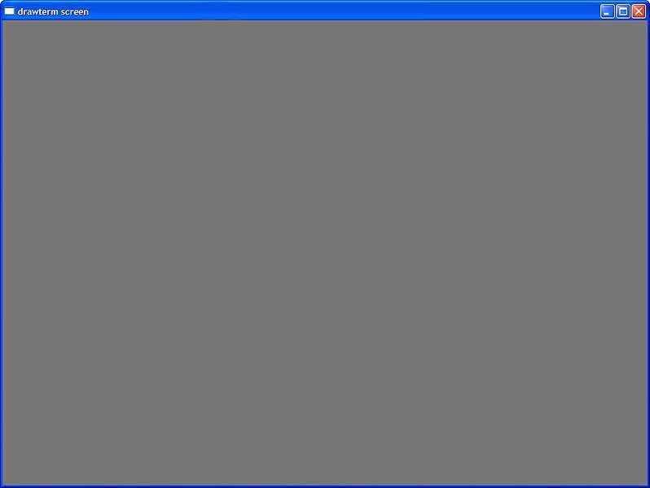
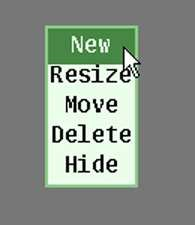
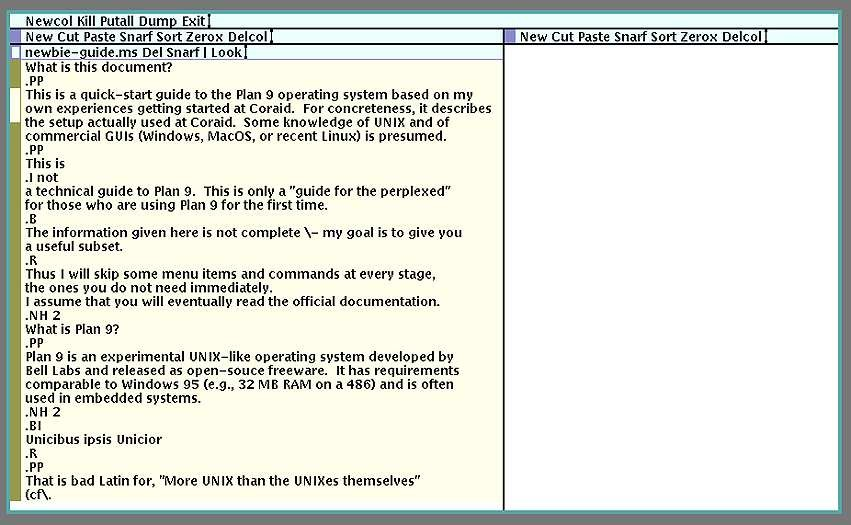
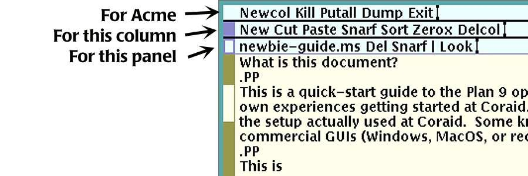
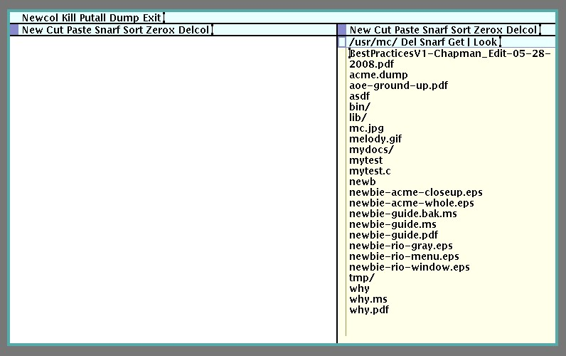

A Plan 9 Newbie’s Guide
---

> Michael A. Covington !
> for
> Coraid, Inc.
>
> 2008 July 10

# 1. Introduction

## 1.1. What is this document?

이 문서는 *Coraid* 에서 업무를 시작하면서 제가 직접 경험한 내용을 바탕으로 한 Plan 9 운영 체제의 사용자 인터페이스에 대한 빠른 시작 가이드입니다. 구체적인 내용을 전달하기 위해, Coraid에서 실제로 사용 중인 설정을 설명합니다. 

이 가이드를 읽기 위해서는 UNIX와 상용 GUI(Windows, MacOS 또는 최신 Linux)에 대한 기본적인 지식이 있다고 가정합니다. 이 문서는 Plan 9에 대한 기술 가이드가 아닙니다. 이는 단지 Plan 9를 시작하는 데 필요한 최소한의 지식만 알려주는 “혼란스러운 사람들을 위한 안내서” 일 뿐입니다.

여기에 제공된 정보는 완전하지 않습니다. 제 목표는 여러분에게 유용한 부분적인 정보만 제공하는 것입니다. 따라서 각 단계에서 당장 필요하지 않은 일부 메뉴 항목과 명령어는 생략할 것입니다. 여러분이 결국엔 공식 문서를 읽게 될 것이라고 가정합니다.


## 1.2. What is Plan 9?

Plan 9는 벨 연구소(Bell Labs)에서 개발한 실험적인 유닉스 계열 운영 체제로, 오픈소스 프리웨어로 공개되었습니다. 이 운영 체제의 시스템 요구 사항은 윈도우95와 비슷한 수준(예: 486 프로세서에 32MB RAM)이며, 임베디드 시스템에서 자주 사용됩니다.


## 1.3. Unicibus ipsis Unicior

이는 “유닉스 자체보다 더 유닉스다운” 이라는 뜻의 서툰 라틴어 표현(*Romanis ipsis Romanior* 참조)이며, Plan 9가 어떤 시스템인지 정확히 요약해 줍니다. Plan 9는 초기 유닉스와 동일한 이념—단순성, 간결성, 직교성—을 기반으로 하지만, 그 중 일부를 (제 생각에는) 오늘날의 일반적인 유닉스 구현체보다 유닉스의 정신에 더 가깝게 다르게 구현하고 있습니다. 구체적으로 말하면:

- NFS, SAMBA 대신, 일반적으로 `9P` 라고 불리는 단 하나의 파일 공유 프로토콜이 사용되며, 이는 사용자에게 투명하게 작동합니다. 사용자는 전체 파일 이름 공간을 한 CPU에서 다른 CPU로 그대로 옮기면 됩니다. `drawterm` 같은 터미널 프로그램을 사용할 때, 사용자의 로컬 PC는 /mnt/term 하위 디렉토리로 마운트되며, 기존에 있던 파일들과 나란히 배치됩니다.
- 파일 시스템 내에서 OS와 하드웨어의 좀 더 많은 부분이 사용자에게 노출됩니다. 예를 들어, /dev/screen 은 화면, /dev/mouse 는 마우스, /dev/time 은 시계입니다. 환경 변수는 /env 에 있는 “파일” 입니다. 제어 설정은 시스템(IOCTL) 호출을 사용하는 대신 특수 파일에 쓰기를 통해 수행할 수 있습니다.
- 기본 문자 집합은 UTF-8로 인코딩된 유니코드입니다. 즉, ASCII에 (대부분의) 유니코드를 위한 멀티바이트 인코딩이 추가된 형태입니다. 일부 소프트웨어(유닉스에서 포팅된 것)는 여전히 ASCII만 인식합니다.
- GUI는 매우 단순합니다. 이는 최소한의 프로그래밍으로, 결과적으로 최대의 신뢰성을 갖춘 GUI를 구축하는 방법의 모범 사례입니다.

일반적으로 Plan 9는 동일한 작업을 수행하는 방법이 여러 가지 존재하지 않습니다. 따라서 사용자는 자신이 처리하는 일을 수행하는 최선의 방법을 찾았다고 확신할 수 있습니다. UNIX와 마찬가지로, Plan 9의 주요 아키텍처 원칙 중 하나는 단순한 기능들의 직교적 조합입니다.


## 1.4. Gotchas

마우스 사용은 필수입니다. 예를 들어, acme 편집기를 사용할 때는 키보드에서 손을 자주 떼지 않고서는 작업할 수 없습니다. 3버튼 마우스를 사용하는 것을 전제로 합니다. 필요한 경우, Shift 키를 누른 상태에서 오른쪽 버튼을 눌러 가운데 버튼을 대신할 수 있습니다. 일반적으로:

- 왼쪽 버튼은 커서를 이동하거나 텍스트를 선택하는 데 사용됩니다;
- 가운데 버튼은 메뉴 항목을 선택(실행)하는 데 사용됩니다;
- 오른쪽 버튼은 상위 수준의 제어 작업을 수행하는 데 사용됩니다;
- 스크롤 휠이 있는 경우, 텍스트를 위아래로 스크롤합니다.

좀 더 자세한 내용은 실행 중인 소프트웨어에 따라 다릅니다. 이 문서는 버튼을 왼쪽, 가운데, 오른쪽이라 부르지만, Plan 9는 일반적으로 1, 2, 3 이라고 부릅니다.

키보드에서 ↑ 및 ↓ 키는 커서를 한 줄 위나 아래로 이동시키지 않습니다. 대신, PgUp 및 PgDn 키처럼 표시된 텍스트를 스크롤하지만, 이동 거리는 그만큼 길지 않습니다. 커서를 한 줄씩 위나 아래로 이동시키는 키는 없습니다. (← 및 → 키는 커서를 좌우로 이동시킵니다.)

Delete 키는 텍스트를 삭제하지 않고, 실행을 중단합니다(다른 운영 체제의 Ctrl-C 또는 Break 와 마찬가지입니다). 텍스트를 삭제하려면 해당 텍스트를 선택한 후 Backspace 키를 누릅니다. (매킨토시는 메인 키 그룹에 있는 Delete 키가 Backspace 이며, Home 및 End 키 근처에 있는
키가 Delete 입니다.)

Acme 편집기에서 Del 메뉴를 선택해도 선택된 텍스트는 삭제되지 않고, 편집 창이 닫힙니다!! 선택한 부분을 삭제(그리고 snarf 버퍼에 복사)하려면 Cut 을 사용합니다.


## 1.5. Logging in and out

로그인 절차는 UNIX와 유사합니다. 사용자의 터미널은 대개 Plan 9가 실행 중인 워크스테이션일 것입니다. `drawterm` 같은 PC용 터미널 프로그램을 사용하는 경우, 로그인하려는 서버뿐만 아니라 인증 서버도 반드시 지정해야 합니다.

로그아웃 명령어는 없습니다. 응용 프로그램을 종료한 후 연결을 끊거나 워크스테이션의 전원을 끄면 됩니다.


## 1.6. Jargon

다음 용어들은 Plan 9 환경 밖에서는 흔히 사용되지 않습니다:

- chord : 두 개 이상의 마우스 버튼을 동시에 누르는 것 (Acme에서 주로 사용됨)
- put : 디스크에 저장함.
- rune : 유니코드 문자(하나 이상의 UTF-8 바이트에 해당)
- snarf : snarf 버퍼에 복사(Windows 클립보드와 유사)
- sweep : 버튼을 누른 상태에서 마우스를 텍스트 위로 이동
- zerox : 창과 그 내용을 복제


# 2. The rio windowing system

Plan 9에 로그인하면 (텍스트) 콘솔 모드로 진입하지만, 일반적으로 /usr/username/lib/profile 파일에 있는 프로필에 의해 윈도우 시스템인 rio 가 즉시 실행됩니다(이 시스템은 8½ 라고 불리던 이전의 윈도우 시스템을 대체합니다).

Rio는 처음 화면이 텅 빈 회색 화면으로 나타나기 때문에 초보자들을 당황하게 만드는 경향이 있습니다 (그림 1).

무언가 동작하게 하려면 회색 화면 아무 곳이나 마우스 오른쪽 버튼으로 클릭한 다음 'New' 를 선택합니다(그림 2). 마우스 오른쪽 버튼을 뗀 후 다시 누르고 화면 위를 드래그해서 직사각형을 그립니다. 자, 이제 창이 생겼습니다(그림 3). 

창은 원하는 만큼 만들 수 있습니다. 어떤 창에서든 왼쪽 버튼을 클릭하면 해당 창을 최전면으로 가져올 수 있습니다.

  
그림 1. Rio 시작 화면 (터미널 창에서) 네, 화면은 온통 텅 빈 회색 뿐입니다.

  
그림 2. ‘New’ 를 마우스 오른쪽 버튼으로 클릭한 다음, 마우스 오른쪽 버튼을 누른 채로 드래그해서 창을 만듭니다.

  
그림 3. rio의 창.


## 2.1. Keyboard usage

rio는 ‘작업 제어’ 나 ‘커서 제어’ 기능이 없습니다. 창과 키보드는 단순히 문자 스트림일 뿐입니다. 창에서는 스트림의 일부를 선택할 수 있으며(다른 GUI와 마찬가지로), 선택 영역의 길이가 0 인 경우, 그 부분이 커서 또는 삽입 지점 역할을 합니다(이 또한 다른 GUI와 마찬가지로). 사용자가 입력하는 내용은 항상 선택된 텍스트를 대체합니다.

→ 및 ← 키는 커서를 왼쪽이나 오른쪽으로 이동시킵니다. Ctrl-A 는 커서를 줄 시작 부분, 즉 입력 지점(줄에서 입력할 수 있는 첫 번째 위치)으로 이동시키고, Ctrl-E 는 줄 끝으로 이동시킵니다. Backspace 키는 왼쪽으로 한 글자씩 지우고, Ctrl-U 는 커서 위치부터 줄 시작 부분까지 지우며, Ctrl-W 는 한 글자가 아닌 단어 전체를 뒤로 지웁니다.


## 2.2. It doesn’t scroll!

rio와 다른 종류의 콘솔 창 사이의 가장 큰 차이점 중 하나는 rio는 출력이 창 하단을 넘어가더라도 창이 스크롤되지 않는다는 점입니다. 대신, 출력을 생성하는 프로세스가 일시 정지된 상태로, 사용자가 ↓ 또는 PgDn 키를 누르거나 마우스를 사용해서 아래로 스크롤할 때까지 기다립니다.

이는 화면에 문자를 출력하는 모든 출력에 `| more` 명령어가 내장된 것과 비슷합니다. 이런 동작이 마음에 들지 않는다면, 기존 창에서
중간 마우스 버튼을 클릭하고 ‘스크롤(Scroll)’ 을 선택하거나, 프로필을 수정해서 일반 rio 대신 `rio -s` 를 실행하도록 설정하면 됩니다.


## 2.3. Mouse usage in rio

마우스 왼쪽 버튼을 클릭하면 어떤 창이든 최상단으로 가져올 수 있습니다. 창 가장자리나 모서리를 마우스 왼쪽 버튼으로 드래그하면 창 크기를 조정할 수 있습니다.

창에 표시되는 텍스트보다 더 많은 내용이 있는 경우, 창 왼쪽에 스크롤 막대가 나타납니다(그림 3). 스크롤 막대 위에 마우스를 올린 상태에서 왼쪽 버튼을 클릭하면 위로, 오른쪽 버튼을 클릭하면 아래로, 가운데 버튼을 누른 채 드래그하면 위아래로 이동할 수 있습니다. 또한 ↑ 및 ↓ 키를 사용해서 스크롤할 수도 있습니다.

창을 닫으려면 배경을 마우스 오른쪽 버튼으로 클릭한 다음 ‘Delete’ 를 선택하고, 창을 마우스 오른쪽 버튼으로 클릭합니다.

왼쪽 버튼은 텍스트를 선택하는 데도 사용됩니다. 한 번 클릭하면 커서(길이 0 의 선택 영역)가 클릭한 위치로 이동합니다. 두 번 클릭하면
단어 전체가 선택됩니다. 단어 하나 이상을 선택하려면 클릭한 상태에서 드래그합니다. 또는 따옴표나 괄호로 묶인 단어들을 선택하려면 따옴표나 괄호 바로 안쪽을 두 번 클릭합니다.

다른 GUI와 마찬가지로, 키보드로 입력하면 선택된 내용이 입력된 내용으로 대체됩니다. 중간 버튼을 누르면 다음과 같은 메뉴가 표시됩니다:

- cut : 선택 영역을 삭제하고 스나프 버퍼(클립보드)에 저장합니다.
- paste : 스나프 버퍼의 내용을 현재 삽입 지점에 붙여넣습니다.
- snarf : 선택 영역을 스나프 버퍼에 복사합니다.
- plumb : 선택 영역을 프로세스 간 통신 시스템인 plumber 로 보냅니다.
- send : 스나프 버퍼의 내용을 창 내 출력 지점 뒤(현재 선택 영역이 아닌, 창 내 텍스트의 끝)에 붙여넣고 Enter 키를 누른 것으로 시뮬레이션합니다. 이는 시스템에 명령을 전송하는 빠른 방법입니다.
- scroll : 하단에 텍스트가 추가될 때 창이 자동으로 스크롤되도록 처리할지 여부를 토글합니다.


## 2.4. Hold mode

일반적으로 다른 운영 체제와 마찬가지로, Enter 키를 누를 때마다 입력한 내용이 실행 중인 프로그램으로 전송됩니다. 하지만 “홀드 모드” 는 사용자가 처리를 승인할 때까지 여러 줄의 입력 내용을 편집할 수 있도록 보류됩니다.

홀드 모드는 창 내의 문자가 파란색으로 변합니다. 홀드 모드는 Esc 키를 눌러 시작하거나 중지할 수 있습니다. 메일 같은 일부 프로그램은 사용자가 입력하는 동안 자동으로 홀드 모드를 켭니다. 예를 들어 이메일을 보낼 때는 Esc 키를 눌러 홀드 모드를 종료한 다음, Ctrl-D 를 눌러 파일 끝을 표시해야 합니다.

오른쪽 버튼에 대해서는 이미 설명한 바 있습니다. 이 버튼은 주로 창을 생성하고 제거하는 용도로 사용됩니다. rio에 대한 자세한 내용은 `man rio` 명령을 입력하면 확인할 수 있으며, 이 명령은 UNIX의 `man` 명령과 똑같이 작동합니다.


# 3. The acme full-screen editor

니클라우스 비르트(Niklaus Wirth)의 오베론(Oberon) 시스템에서 영감을 받은 `acme` 는 미니멀한 전체 화면 편집·개발 시스템입니다. 실제 작동 모습은 그림 4와 비슷합니다.

  
그림 4. acme 편집 창.


## 3.1. Typing in acme

Acme는 생각보다 일반 텍스트 창과 좀 더 비슷합니다. 텍스트 선택과 스크롤 기능은 rio 와 똑같이 작동합니다. 드롭다운 메뉴는 없으며, 상단에 있는 명령은 마우스 중간 버튼을 클릭해서 실행합니다.

Acme와 Rio의 가장 큰 차이점은, Acme는 패널에 글을 입력하기 위해 “패널을 클릭할 필요가 없다” 는 점입니다. 마우스 커서를 패널 위에 올리기만 하면, 그 위치에 입력된 내용이 표시됩니다.


## 3.2. Quick start ? how to create or edit a file

기존 파일을 편집하는 한 가지 방법은 다음과 같은 명령을 입력하는 것입니다.

```
acme filename.txt
```

이제 Acme가 실행됩니다.

수정할 내용을 입력한 후, ‘Put’ 을 중간 버튼으로 클릭하고, 이어서 ‘Exit’ 을 중간 버튼으로 클릭합니다.

좀 더 일반적인 방법은 인수를 지정하지 않고 `acme` 를 입력한 다음, 디렉토리(폴더)나 파일 이름을 우클릭해서 편집할 대상을 선택하는 것입니다.

파일을 만들려면 인수를 지정하지 않고 `acme` 를 입력합니다. ‘New’ 를 중간 버튼으로 클릭합니다. 이때 커서는 메뉴 줄의 시작 부분으로 이동합니다. 그곳에 파일 이름을 입력한 후, ‘Put’ 을 중간 버튼으로 클릭합니다. 입력 영역은 마우스 포인터 위치에 따라 자동 선택되므로, 커서가 메뉴 줄에서 벗어나면 다시 그 위치로 이동시킵니다.


## 3.3. Columns and panels (acme windows)

Acme는 일반적으로 두 개의 패널(“창”) 열로 나뉘어 있습니다. 초보자라면 두 번째(오른쪽) 열을 없애고 싶을 수도 있습니다. 그렇게 처리하려면, 위에 있는 “Delcol” 이라는 단어를 마우스 가운데 버튼으로 클릭합니다.

새 패널이 원하는 위치에 나타나지 않을 수도 있습니다. 각 패널의 왼쪽 상단 모서리, 이름 바로 왼쪽에 있는 작은 사각형을 왼쪽 마우스 버튼으로 클릭한 채 드래그하면 패널을 원하는 위치로 이동할 수 있습니다.

왼쪽 열 상단의 메뉴(“태그”)는 세 줄로 구성되어 있습니다. 하나는 Acme 전체를 위한 것이고, 하나는 왼쪽 열을 위한 것이며, 나머지 하나는 현재 패널을 위한 것입니다(그림 5).

  
그림 5. Acme 왼쪽 상단의 메뉴(태그).

각 메뉴 항목의 기능은 다음과 같습니다.

**Main menu**

- Newcol : 패널 열을 하나 더 생성합니다.
- Kill : 현재 실행 중인 명령을 중단합니다.
- Putall : 열려 있는 모든 파일을 디스크에 저장합니다.
- Dump : Acme의 상태를 파일로 저장해서 나중에 다시 시작할 수 있도록 합니다.
- Exit : Acme를 종료합니다.

**Column menu**

- New : 이 열에 패널(창)을 하나 더 만듭니다.
- Cut : 선택한 텍스트를 화면에서 삭제하고 스나프 버퍼에 저장합니다.
- Paste : 스나프 버퍼의 내용을 삽입 지점의 텍스트에 붙여넣습니다.
- Snarf : 선택한 텍스트를 (열의 어느 위치에서든) snarf 버퍼로 복사합니다.
- Sort : 패널을 이름 순서대로 정렬합니다.
- Zerox : 현재 패널의 복사본을 생성합니다(이로써 동일한 파일을 볼 수 있는 두 개의 창이 생깁니다).
- Delcol : 이 열에 있는 패널 전체를 삭제합니다.

**Panel menu**

- filename : 편집 중인 파일의 이름입니다. 이 부분을 덮어쓰면 다음 Put 명령에서 다른 파일명을 사용하도록 지정할 수 있습니다.
- Del : 패널 전체를 삭제합니다(선택 영역은 제외!). 내용이 “변경된 상태”(저장이 필요한 상태)라면 경고 메시지가 표시되지만, Del 을
한 번 더 누르면 삭제됩니다.
- Snarf : 선택된 텍스트를 snarf 버퍼로 복사합니다(이 패널 내에서만 가능).
- Undo : 가장 최근 편집 변경 사항을 취소합니다.
- Put : 파일을 디스크에 저장합니다(파일을 저장할 필요가 없는 경우 표시되지 않음).
- Look : 검색(인수가 필요함; 아래 참조). 다른 명령어도 이곳에 추가할 수 있습니다.

  
그림 6. acme에서 파일 탐색.


## 3.4. Browsing files and directories

명령줄 인수를 지정하지 않고 `acme` 를 단독 실행하면, 그림 6과 같이 두 번째 열이 파일과 디렉터리를 선택할 수 있는 탐색 창으로 바뀝니다. 파일을 마우스 오른쪽 버튼으로 클릭하면 편집기에서 해당 파일을 열 수 있고, 디렉터리를 클릭하면 해당 디렉터리를 탐색할 수 있습니다.


## 3.5. Editing commands

각 패널 상단의 메뉴에서 | (수직바) 기호 뒤에 명령을 입력할 수 있습니다. “Look” 명령은 보통 기본적으로 여기에 제공됩니다. 이를
사용하는 방법은 두 가지가 있습니다:

- 뒤에 인수를 입력한 다음, 마우스 중간 버튼으로 “Look” 과 인수를 횡단하며 드래그할 수 있습니다;
- 인수를 지정하지 않고 “Look” 을 실행할 수 있으며, 이 경우 편집 패널에서 선택된 텍스트가 인수로 사용됩니다.

어느 쪽이든 “Look” 은 “이 텍스트가 다음에 나타나는 위치를 찾아 선택하라!” 는 의미입니다.

수직바 기호 뒤에 다른 명령어를 입력할 수도 있습니다. 특히,

```
Edit s/abc/def/g
```

를 입력하면 선택 영역 전체(파일 전체가 아님)에서 abc 가 나타나는 모든 부분을 def 로 변경합니다.

파일 전체에서 검색 및 바꾸기를 수행하려면

```
Edit ,s/abc/def/g
```

를 입력하면 되며, 여기서 쉼표는 줄 수에 제한이 없음을 나타냅니다.

sam 편집기의 모든 명령은 이런 방식으로 acme에서 입력할 수 있습니다.


## 3.6. Mouse usage

단어가 다음에 나오는 위치를 더 빨리 찾는 방법은 해당 단어 자체를
마우스 오른쪽 버튼으로 클릭하는 것입니다. 공백이 포함된 구에 이 작업을 수행하려면, 구를
오른쪽으로 쓸어내리거나(오른쪽 버튼을 누른 채로 구를 가로질러 드래그), 구를 선택한 후(왼쪽
드래그) 마우스 오른쪽 버튼을 클릭하면 됩니다.
왼쪽 및 가운데 버튼의 사용법은 이미 설명한 바 있습니다. (왼쪽 버튼은
rio에서 지원하는 모든 방식으로 텍스트를 선택합니다.) 마우스 버튼 “코드”(조합)의
사용을 포함하여 acme에 대한 훨씬 더 자세한 정보는
man acme에서 확인할 수 있습니다.


# 4. Communicating with personal computers

리눅스, 윈도우 또는 macOS 시스템에서 Plan 9 시스템에 접속하려면, /sys/src/cmd/unix/drawterm 또는 http://swtch.com 에서 구할 수 있는
`drawterm` 이라는 터미널 에뮬레이터를 실행해야 합니다. 일반적으로 올바른 CPU 서버와 인증 서버를 인수로 지정해서 drawterm을 시작하는 스크립트를 작성합니다. 예를 들면 다음과 같습니다.

```
drawterm -c minooka.coraid.com -a tyty.coraid.com
```

Windows는 명령어 맨 앞에 `start /w` 를 추가해서 drawterm이 별도의 창으로 실행되도록 처리합니다.

drawterm이 실행되면, PC의 특정 디렉터리로 “chdir할 수 없다!” 는 오류 메시지가 표시될 수 있습니다. 이는 문제되지 않습니다.

drawterm은 Plan 9 시스템의 콘솔처럼 작동하며, 평소와 동일한 방식으로 창을 생성할 수 있습니다. 또한, drawterm은 이미 마운트된 항목에 더해 PC의 (첫 번째) 하드 디스크의 루트 디렉터리를 /mnt/term 에 마운트합니다. 이를 통해 Plan 9와 PC 간에 파일을 투명하게 복사할 수 있습니다.

Windows용 drawterm은 알려진 문제가 있습니다. PC의 하드 디스크에 읽기 및 쓰기는 가능하지만 디렉터리를 나열할 수는 없습니다. 따라서

```
lc /mnt/term/Windows
```

명령은 아무것도 표시하지 않지만, PC에 있는 특정 파일은 파일 이름을 직접 지정해서 여전히 읽고 쓸 수 있습니다. 이 문제를 해결하려면 다음과 같은 Plan 9 명령을 시도합니다.

```
date >/mnt/term/myfile.txt
```

그리고 myfile.txt 파일이 어디에 저장되는지 확인합니다.


# 5. Reading documentation

`man` 명령어는 UNIX와 동일하게 작동하지만, Plan 9 화면은 (기본적으로) 스크롤되지 않으므로 `more` 에 페이징이나 파이프를 지정할 필요가 없습니다.

PostScript로 깔끔하게 변환된 man 페이지를 보려면 다음과 같이 -P 옵션을 사용합니다:

```
man -P lc
```

PostScript, PDF, JPEG 및 기타 다양한 그래픽 형식의 파일을 보려면 다음과 같이 `page` 명령어를 사용합니다:

```
page myfile.pdf
```

`page` 명령어는 다음 페이지로 넘어가는 등의 기능을 제공하는 중간 버튼 메뉴가 있습니다.


# 6. Creating documentation with troff

Plan 9는 고전적인 UNIX troff 프로그램을 사용할 수 있으며, 이 프로그램은 UTF-8로 인코딩된 유니코드(일반 Plan 9 텍스트)를 지원합니다. 여기서는 troff에 대한 간략한 개념적 개요만 제시하고, 보다 자세한 문서는 참고 자료로 안내합니다.


## 6.1. Running troff

Troff -ms 입력 파일의 이름은 일반적으로 .ms 확장자로 끝나며, 이는 troff -ms 매크로가 사용되었음을 나타냅니다. (Coraid에서) troff를 실행하는 일반적인 명령어는 다음과 같습니다.

```
troff -ms -mpictures myfile.ms | dpost -f | ps2pdf > myfile.pdf
```

즉, ms 및 mpictures 매크로 패키지를 불러와 myfile.ms 를 처리한 다음, dpost (이를 PostScript로 변환하는 프로그램)로 파이프하고, 이어서 PDF 변환기로 파이프하는 것입니다.


## 6.2. Kinds of troff markup

troff의 입력은 여러 종류의 명령어가 주석으로 달린 텍스트 파일이며, 그 중에는 다음과 같은 것들이 있습니다:

1. 줄 시작 부분에 있는 `.bp` 같이 troff 고유의 소문자 두 글자 명령어
2. 줄 시작 부분에 있는 `.PP` 같이 매크로 패키지에서 제공하는 대문자 두 글자 명령어
3. `\` 로 시작하며 텍스트 어디서나 나타날 수 있는 특수한 인라인 코드.

두 번째 유형이 주를 이루며, 사용자는 주로 “ms” 매크로 패키지에 정의된 코드를 사용하게 될 것입니다. 이 코드들은 `man ms` 에 요약되어 있으며, 다음 문서에 튜토리얼 형식으로 설명되어 있습니다:

```
Lesk, M. E. (1978), Typing documents on the UNIX system: using the -ms macros with
troff and nroff, reprinted in various places.
```

이 문서의 소스 파일은 유용한 troff 예제 모음입니다.


## 6.3. Some important but un-obvious codes

`\"` 는 해당 위치부터 줄 끝까지 주석을 표시합니다. 그러나 빈 줄은 의미가 있습니다. 줄 전체를 주석 처리하려면 줄 시작 부분에 `.\"` 를 입력합니다.

다음은 자주 사용되는 인라인 코드(들)입니다:

- `\c` (줄 끝) : 줄 바꿈을 무시합니다.
- `\-` : 대시 또는 마이너스 기호(하이픈보다 깁니다). 엠 대시나 위쪽 화살표를 직접 입력하는 방법은 `man kbd` 를 참조합니다.
- `\ ` :  필수 공백(`\ ` 뒤에 공백 입력); 단어를 연결해서 하나의 단어로 처리합니다.
- `\(ua` : 위쪽 화살표 (다른 많은 특수 문자 코드도 이와 유사합니다).
- `\fR` : 즉시 로마자 서체로 전환합니다.
- `\fI` : 즉시 이탤릭 서체로 전환합니다.
- `\fB` : 즉시 굵은 서체로 전환합니다.
- `\f(BI` : 즉시 굵은 이탤릭 서체로 전환합니다.

이탤릭체, 굵은체 등으로 전환하는 일반적인 방법은 `.I`, `.B`, `.R`(이탤릭체, 굵은체, 일반체) 같은 MS 매크로를 사용하는 것입니다. 이 매크로들은 세 가지 방식으로 사용됩니다. 

- 첫째, 다음과 같이 텍스트 블록의 시작을 `.I` 로, 끝을 `.R` 로 지정할 수 있습니다:

```
.I
This text will be
set in italics.
.R
Now we are back to roman.
```

- 둘째, 매크로 바로 뒤에 단어 하나(또는 백슬래시-공백으로 연결된 여러 단어)를 쓰는 방법입니다:

```
We will have just one
.I word
in italics.
```

- 셋째, 두 번째 인수를 추가할 수 있는데, 이는 이탤릭체로 표시된 단어 바로 뒤에 이어져야 하지만 공백 없이 로마체로 표시되야 하는 것(일반적으로 구두점)입니다:

```
Did you say
.I bonjour ?
I thought so.
```

troff에 대해 좀 더 자세히 알고 싶다면, troff, ms, man의 매뉴얼 페이지와 /sys/doc/troff.ps 를 참고한 다음, 월드 와이드 웹에 풍부하게 제공되는 문서와 튜토리얼을 활용해 보시기 바랍니다.


# 7. Programming in C

## 7.1. How to run the compiler

Plan 9는 표준 C의 약간 확장된 버전을 지원합니다. 다음은 예제 프로그램으로, 이것을 myfirst.c 라고 부르겠습니다:

```c
#include <u.h>
#include <libc.h>

void
main(void)
{
    print(“Greetings, earthlings!\n”);
    exits(0);
}
```

컴파일러와 링커의 이름은 CPU 아키텍처에 따라 다릅니다. 386의 경우, 컴파일러와 링커의 이름은 각각 8c 와 8l 입니다. (여기서 L은 소문자 L이며, 숫자 1이 아닙니다.)

myfirst.c 를 컴파일, 링크 및 실행하려면 다음과 같이 입력합니다:

```
minooka# 8c myfirst.c
minooka# 8l -o myfirst myfirst.8
minooka# myfirst
Greetings, earthlings!
```

- 첫 번째 단계는 myfirst.8 파일이 생성된다는 점에 유의합니다. 
- 두 번째 단계는 myfirst 를 생성하도록 지시하지 않았다면 8.out 파일이 생성됩니다. 
- 세 번째 단계는 Plan 9는 현재 디렉터리가 검색 경로에 포함되므로 ./myfirst 를 입력할 필요가 없습니다.


## 7.2. About u.h

예제 프로그램에서 다음 줄

```
#include <u.h>
```

은 uintptr 및 va_start 같은 아키텍처 의존적 유형과 매크로, 그리고 표준 시스템 헤더 파일에서 사용하는 vlong 같은 약어를 정의하므로,
항상 다른 헤더 파일보다 먼저 포함되어야 합니다. 

이 헤더 및 다른 헤더에 대해 자세히 알아보려면 `man 2 intro` 를 참조합니다.


## 7.3. For more information

C 컴파일러, 특히 유니코드 호환 I/O 시스템에 대해 자세히 알아보려면 Plan 9 시스템의 /sys/doc/comp.ps 및 /sys/doc/compiler.ps 를 참조합니다.


## 7.4. The low road: pcc

단순히 UNIX 프로그램을 컴파일해서 Plan 9에서 실행하기만 원하고, 최대 성능에 관심이 없다면, POSIX 호환 C 컴파일러인 `pcc` 를 사용할 수 있습니다. 이 경우 stdio.h 같은 유닉스 헤더와 printf 같은 함수를 사용하고, u.h 에 대한 언급은 모두 생략한 뒤, 다음과 같은 방식으로
프로그램을 컴파일하고 실행하면 됩니다:

```
minooka# pcc -o mysecond mysecond.c
minooka# mysecond
Hello, world!
```

이 코드는 Plan 9의 POSIX 호환 서브시스템인 APE를 사용합니다.

