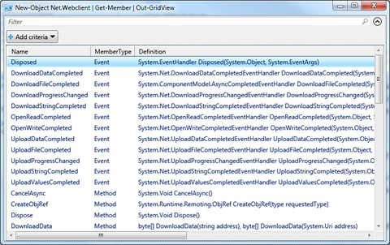
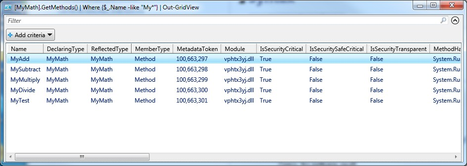
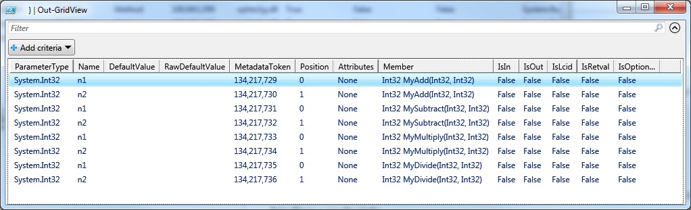

windows power shell for developers
---

# CHAPTER 1 Introduction

> 새로운 질서를 도입하는 데 앞장서는 일보다\
> 더 다루기 어렵고, 더 위험하며, 성공 여부가 더 불확실한\
> 일은 없다. 혁신가는 기존 체제 하에서 잘 지내온 모든 이들을\
> 적대자로 삼게 되며, 새로운 체제 하에서 잘 지낼 수 있는\
> 이들에게는 미지근한 지지자들만을 얻게 되기 때문이다.\
>\
> —니콜로 마키아벨리, 『군주론』

`PowerShell` 은 Microsoft Windows 환경에서 분산 자동화를 위한 차세대 플랫폼입니다. 이 플랫폼은 개발자, 테스터, 파워 유저 및 관리자에게 상당한 이점을 제공합니다. PowerShell은 .NET Framework를 활용해서 작동하며, 개발자, 테스터, 파워 사용자 및 관리자에게 상당한 이점을 제공합니다. PowerShell은 .NET을 활용해서 강력하고, 일관되며, 직관적이고, 확장 가능하며, 유용한 도구 모음을 제공함으로써 비용을 절감하고, Windows용 프로그래밍 및 자동화를 쉽게 만들어 줍니다.

PowerShell은 2002년에 'Monad' 라는 코드명으로 개발되었습니다. 2006년 Microsoft는 이 플랫폼의 릴리스 후보 1(RC1)을 공개하는 동시에 새로운 이름인 Windows PowerShell을 발표했습니다. 현재 PowerShell v3는 Windows 8 및 Windows Server 2012와 함께 제공되며, Windows 7도 사용할 수 있습니다.

> [!NOTE]
> 나중에 PowerShell 기술의 핵심 아이디어를 설명한 ‘Monad Manifesto’ 백서의 서두 부분을, 발명가 제프리 스노버(Jeffrey Snover)가 약간 수정해서 재구성한 버전을 보려면 http://bit.ly/n68k1X 을 참조하십시오.

PowerShell을 처음 접하는 개발자도 불과 몇 시간의 학습만으로 시간을 절약해 주는 스크립트를 만들 수 있는 경우가 많습니다. 기존 시스템 프로그래밍 언어에 비해 PowerShell을 사용해서 문제를 해결하는 데 소요되는 “시간이 크게 단축되었다!” 는 사례가 수없이 많습니다.

PowerShell의 또 다른 특징은 .NET 애플리케이션에 “PowerShell을 내장할 수 있다!” 는 점입니다. Windows .NET 애플리케이션에 PowerShell 스크립팅 엔진을 추가하면 해당 애플리케이션에 모든 기능을 갖춘 구성 및 매크로 언어를 제공할 수 있습니다. 이는 Microsoft Excel에서 작업을 자동화하기 위해 Visual Basic for Applications(VBA)를 추가하는 것과 대략적으로 유사합니다.


## This Is Just the Beginning

PowerShell을 익히면 PowerShell을 지원하는 모든 시스템용 스크립트를 작성할 수 있습니다. Windows Server 2012는 2,300개 이상의 `cmdlet` (PowerShell 기능의 기본 단위)이 포함되어 있는데, 이는 Windows 2008 R2에 포함된 400개 cmdlet 보다 크게 증가한 수치입니다.

게다가 타사 및 사용자 커뮤니티에서 제공하는 PowerShell 솔루션의 수도 눈부시게 증가하고 있습니다. PowerShell의 미래가 어떻게 펼쳐질지 가늠하려면, 사이드바에 실린 “PowerShell 스코어카드, 10년을 돌아보며” 를 확인해서 지난 10년 동안 PowerShell이 어떤 성과를 거두었는지 살펴보시기 바랍니다.

**PowerShell 출시 10년의 성과 평가**

- PowerShell v3는 Windows 8과 Windows Server 2012에 포함되어 출시될 예정입니다. 구형 Windows 플랫폼용 버전도 제공될 예정입니다.
- PowerShell v1은 2006년에 출시되었습니다.
- PowerShell v2는 2009년에 출시되었습니다.
- WS2012 는 곧바로 사용할 수 있는 2,300개 이상의 cmdlet 이 포함되어 출시됩니다.
- PowerShell은 SQL Server, IIS, Hyper-V, Microsoft Exchange, SharePoint, 서버 관리자 등 다양한 구성 요소와 통합되어 있습니다.
- PowerShell은 ‘출시 중단’ 기준이 적용되는 요소로, PowerShell 인터페이스가 구비되지 않은 Microsoft 서버 제품은 출시되지 않습니다.
- PowerShell은 백그라운드 작업 실행, PowerShell 스크립트의 원격 실행, 워크플로 등을 지원합니다.
- PowerShell은 VMWare, Intel, Cisco, Citrix, Red Hat, NetApp 등 타사 기업들과 통합되어 있습니다.
- PowerShell에는 IDE, Quest Software, Devfarm Software, Software/FX 등 다양한 타사 도구가 있습니다.
- PowerShell 콘솔 창은 브라우저에서 실행되며, 이를 PowerShell Web Access(PWA)라고 합니다.
- PowerShell에는 50명 이상의 PowerShell MVP(Most Valuable Professional), 블로거, 팟캐스트, 스크립트 저장소, 활발한 포럼 등 다채로운 활동을 펼치는 활발한 커뮤니티가 있습니다.


## Why Use PowerShell

저는 여러 가지 이유로 PowerShell을 사용합니다. 작업 속도를 높여주고, 사용하기 쉬우며, 기능이 포괄적이기 때문입니다. PowerShell은 컴파일된 .NET 코드와 속도 경쟁에서 이길 수 없겠지만, 충분히 빠릅니다.

> [!NOTE]
> PowerShell 스크립트에 .NET 코드를 직접 포함시켜 실행 시 곧바로 컴파일할 수 있습니다.

파워셸은 .NET에 뿌리를 두기 때문에 놀라운 접착제 같은 언어입니다. .NET 프레임워크와 이를 기반으로 구축된 애플리케이션은 파워셸이 서로 연결할 수 있는
강력한 구성 요소들을 제공합니다. 여기는 제가 현재 개발 중인 .NET 애플리케이션도 포함됩니다. 파워셸은 파이프라인을 통해 텍스트가 아닌 객체를 전달하므로,
몇 줄의 코드만으로 이전에는 불가능했던 프로그래밍 시나리오를 쉽게 구현할 수 있게 해줍니다.

PowerShell은 배우기 쉬우면서도 매우 강력합니다. 변수, 루프, 데이터 구조, 파일 I/O 등 시스템 언어에서 기대할 수 있는 모든 요소를 갖추고 있을 뿐만 아니라 그 이상의 기능도 제공합니다. 또한 .NET Framework에 대한 완전한 접근 권한을 가지며, 로컬 컴퓨터든 PowerShell 원격 실행을 통해서든 .NET DLL 을 원활하게 로드하고, 객체를 인스턴스화하며, 메타데이터를 가져올 수 있는 기능을 갖추고 있습니다.

마지막으로, PowerShell은 사용하기 재미있고, 만족스럽고, 보람을 주는 도구입니다. 지루한 작업을 자동화하거나, 기존 방식으로는 복잡했던 구현을 단순화하거나, (WPF 또는 WinForms 기반의) GUI를 만드는 데 사용하든, PowerShell은 프로그램을 완성하는 데 드는 노력과 시간 모두를 줄여줍니다.


## There’s a New Game in Town

파워셸을 새로운 “핀볼 게임” 으로 생각하시기 바랍니다. 물론 예전 게임도 계속 즐길 수 있습니다. 기계가 기울어지지 않도록 딱 알맞게 흔드는 법도 알고, 모든
세부 사항도 꿰뚫고 있으며, 추가 플레이 기회를 얻는 요령도 알고 있겠지만, 이 새로운 게임은 엄청난 잠재력을 지니고 있습니다.

하지만 한 가지 문제가 있습니다. PowerShell을 잘 다루기 위해서는, 잠시 동안 실력이 부족한 답답한 시기를 겪어야 합니다(즉, 그림 1-1에 표시된 S자 곡선의 ‘저점’ 단계). 이는 여러분이 자료를 찾아보고, 새로운 개념을 이해하며, PowerShell을 흔들면 “때로는 기계가 기울어질 수도 있다” 는 사실을 자연스럽게 받아들이게 될 것임을 의미합니다.

> [!NOTE]
> 보통 성능이 크게 향상되기 전에 일시적인 저하가 나타나는 것을 볼 수 있습니다.

 그림 1-1. 혁신의 S자 곡선


## An Underutilized Development Tool

스크립트 기반 애플리케이션은 기존 방식에 비해 코드량, 노력, 개발 시간이 덜 듭니다. 흥미로운 논의는 정적 언어 대 동적 언어의 대립이 아니라, 솔루션을 제공하기 위해 두 언어를 언제, 어디에 사용해야 하는지에 관한 것입니다. Tcl/Tk의 창시자인 존 오스터하우트(John Ousterhout)가 말한 것처럼:

> 스크립팅 언어는 시스템 프로그래밍 언어보다 더 높은 수준에 속하는데,\
> 이는 평균적으로 하나의 문장이 더 많은 작업을 수행한다는 의미에서입니다.\ 
> 스크립팅 언어의 일반적인 문장은 수백 또는 수천 개의 기계어 명령어를 실행하는 반면,\ 
> 시스템 프로그래밍 언어의 일반적인 문장은 대략 5개의 기계어 명령어만 실행합니다.

요약하면, 이 새로운 핀볼 머신을 직접 체험하는 것은 여러분 자신을 위한 일입니다.


# CHAPTER 2 Getting Started

## Installing PowerShell

PowerShell을 설치하는 것은 다른 응용 프로그램을 설치하는 것만큼 간단합니다. 더 좋은 점은, Windows 7, Windows Server 2008 R2, Windows 8 및 Windows Server 2012에 “기본으로 설치되어 있다!” 는 것입니다. 또한 PowerShell은 Windows XP, 2003 및 Vista 같은 이전 버전의 Windows도 사용할 수 있습니다.

앞서 언급했듯이, PowerShell v3는 Windows 8에 기본으로 설치되어 있습니다(이 글을 작성하는 시점에서 Windows 7용 RC 버전이 출시됐으며, http://bit.ly/MdfXPo 에서 다운로드할 수 있습니다). 더욱 강력해진 버전은 새로운 `cmdlet` 과 언어 기능이 풍부하게 포함되어 있으며, 이 모든 기능은 사용자의 생산성을 높이고 PowerShell 사용의 진입 장벽을 낮추기 위해 설계되었습니다.

구형 Microsoft Windows OS를 사용 중이라면 업데이트를 권장합니다. 다만, 이런 시스템도 PowerShell v2는 실행 가능합니다. v2는 http://bit.ly/2QfKYT 에서 다운로드할 수 있으며, 사용 중인 OS와 아키텍처에 맞는 PowerShell을 다운로드해야 합니다.

> [!NOTE]
> UNIX, Linux 또는 Mac용 PowerShell 버전은 현재는 없지만, Microsoft는 PowerShell 언어를 Community Promise(http://bit.ly/dLIHJ8)에 따라 라이선스를 부여했습니다. 앞으로 개발자들이 이를 바탕으로 Windows 이외의 시스템에 PowerShell을 구현할지 지켜봐야겠습니다.


### Checking the PowerShell Version

사용 중인 Windows OS에 따라 여러 가지 방법으로 PowerShell을 실행할 수 있습니다. 먼저, 명령 프롬프트를 열고 다음을 입력하세요:

```powershell
PS C:\> $PSVersionTable

이름                         값
----                         -----
WSManStackVersion            3.0
PSCompatibleVersions         {1.0, 2.0, 3.0}
SerializationVersion         1.1.0.1
BuildVersion                 6.2.8158.0
PSVersion                    3.0
CLRVersion                   4.0.30319.239
PSRemotingProtocolVersion    2.103
```

위의 명령을 실행하면 현재 시스템에 실행 중인 PowerShell 버전에 대한 유용한 정보를 확인할 수 있습니다. 여기는 PowerShell에서 *CLRVersion* 으로 표시되는 현재 사용 중인 .NET 버전도 포함됩니다. 저는 PowerShell v3 CTP3을 실행 중입니다. PowerShell을 버전 2 모드로 실행할 수도 있으며, 가능하다면 여러분도 그렇게 하시기 바랍니다.

`$PSVersionTable` 변수를 확인해 보니 다음과 같은 결과가 나옵니다. 호환되는 버전이 두 개 뿐이며 현재 .NET 2.0(CLRVersion)을 사용하고 있다는 점에 유의합니다. PowerShell v2가 출시될 당시는 .NET 2.0 만 공개됐습니다. PowerShell v3는 .NET Framework 4.0 과 호환됩니다.

```powershell
PS C:\> $PSVersionTable

Name                         Value
----                         -----
CLRVersion                   2.0.50727.5448
BuildVersion                 6.1.7601.17514
PSVersion                    2.0
WSManStackVersion            2.0
PSCompatibleVersions         {1.0, 2.0}
SerializationVersion         1.1.0.1
PSRemotingProtocolVersion    2.1
```


## Interactivity, the Key to PowerShell

이제 프롬프트가 표시됐으니, *PowerShell REPL* 을 사용해 보겠습니다. “REPL” (“레플” 이라 발음함)은 읽기-평가-출력(read-eval-print)의 루프를 의미합니다. 즉, PowerShell 명령을 입력하고 <kbd>Enter</kbd> 키를 누르면 해당 명령이 읽혀지고 평가되며, 결과(또는 오류)가 출력되고, 콘솔은 다시 루프로 돌아가서 다음 명령을 기다립니다. 한 번 해봅시다:

```powershell
PS C:\> 2 + 2 * 3
8
PS C:\>
```

그렇다면 PowerShell은 그저 거대한 계산기일 뿐일까요? 꼭 그렇지는 않습니다. 이 예제를 DOS 프롬프트에서 실행하면 어떻게 될까요? 오류가 발생합니다!! 여기서는 결과가 출력되고 프롬프트가 다시 나타나고, 다음 명령을 입력할 준비가 됩니다.

이제 따옴표로 묶인 “Hello World” 문자열을 입력합니다. Enter 키를 누르면, 입력한 것과 똑같은 내용이 따옴표 없이 반환됩니다. PowerShell이 이를 자동으로 평가한 것으로, REPL 의 'E' 를 시연한 것입니다. 또한, 출력하도록 명시적으로 지정할 필요도 없었습니다. PowerShell이 자동으로 출력해야 한다는 것을 “알고” 있었기 때문입니다. 이는 PowerShell의 훌륭한 시간 절약 기능이며, 키 입력 횟수도 줄여준다는 점은 말할 것도 없습니다.

```powershell
PS C:\> “Hello World”
Hello World
```

이제 .NET Framework를 활용하겠습니다. 다음을 입력합니다:

```powershell
PS C:\> [System.Math]::Pow(2, 3)
8
```

여기서는 System.Math 네임스페이스를 지정하고 정적 메서드 Pow() 를 호출했습니다. 이 구문에 익숙해져야 합니다. 앞으로 계속 사용할 것입니다. 완전한 유형 이름 주위에 대괄호(`[...]`)를 두르고 콜론(`::`)을 두 개 붙이면 “정적 메서드를 호출한다!” 는 의미입니다. 이것이 PowerShell 팀이 정한 구문입니다.

변수를 생성하고, 그 값을 문자열로 설정한 다음, 해당 변수의 유형을 확인합니다. C#의 GetType() 메서드에 익숙할 수도 있습니다.

```powershell
PS C:\> $a = “Hello”
PS C:\> $a.GetType()

IsPublic     IsSerial     Name      BaseType
--------     --------     ----      --------
True         True         String    System.Object
```

변수 $a 에 문자열 “Hello” 를 할당한 다음, GetType() 메서드를 사용해서 $a 변수가 문자열임을 확인할 수 있습니다. 이는 PowerShell 스크립트를 실행하거나 디버깅할 때 매우 유용합니다. 특정 변수에 GetType() 을 적용하면 유형이 정확히 무엇인지 알 수 있습니다. 

자, 이제 PowerShell 스크립트는 어떻게 실행할까요?


## Running a PowerShell Script

실행 정책(execution policy)은 PowerShell 보안 전략의 일부입니다. 이 정책은 구성 파일(PowerShell 프로필 포함)을 불러올 수 있는지 및 스크립트를 실행할 수 있는지 여부를 결정하며, 실행 전에 디지털 서명이 필요한 스크립트가 있는 경우 해당 스크립트를 지정합니다.

PowerShell을 설치하면 기본 실행 정책은 '제한됨' 으로 설정됩니다. 이는 PowerShell이 구성 파일을 로드하거나 스크립트를 실행하지 않음을 의미합니다. (PowerShell을 처음 사용하는 분이면, 차라리 안전을 택하는 편이 좋습니다.) 스크립트 사용이 제한되더라도 대화형 명령은 여전히 실행할 수 있습니다.

PowerShell 사용과 다른 사람이 작성한 스크립트에 익숙해지면, 이 설정을 변경할 수 있습니다.


### Changing the Execution Policy from the Command Line

`Set-ExecutionPolicy` cmdlet을 사용해서 실행 정책을 변경할 수 있습니다. `Set-ExecutionPolicy` cmdlet에 대한 자세한 정보는 다음 명령을 입력해서 확인할 수 있습니다.

```powershell
Get-Help Set-ExecutionPolicy -Online
```

특히 멋진 점은, –Online 매개변수를 사용하면 웹브라우저가 실행되고 해당 cmdlet의 “웹 페이지로 이동한다!” 는 것입니다.


#### RemoteSigned is good for you

`Set-ExecutionPolicy` cmdlet의 –ExecutionPolicy 매개변수와 함께 사용할 수 있는 몇 가지 옵션이 있습니다. 많은 사용자가 실행 정책을 `RemoteSigned` 로 설정하는데, 이는 인터넷에서 다운로드한 모든 스크립트와 구성 파일이 신뢰할 수 있는 게시자가 서명해야 함을 의미합니다. 이는 사용자를 “보호” 하기 위한 것으로, 스크립트를 다운로드하거나 이메일을 통해 받은 후 실행할 때 PowerShell이 진행하기 전에
사용자에게 확인 메시지를 표시합니다. 경험이 쌓이면 다음과 같이 `Unrestricted` 설정을 선택할 수도 있지만, 이 경우 시스템의 정보를 비활성화하거나 파괴할 수도 있는 스크립트가 실행될 위험이 있다는 점을 유의해야 합니다.

```powershell
PS C:\> Set-ExecutionPolicy Unrestricted
```

저는 ‘제한 없음’ 모드로 주로 실행하지만, 이미 몇 년 동안 PowerShell을 사용했습니다. 스크립트 작성자를 잘 알고 있으며, 스크립트를 다운로드한 사이트를 신뢰하기 때문에 실행하는 스크립트에 대해 안심하고 있습니다.

다음은 `RemoteSigned` 가 왜 좋은 아이디어인지 잘 보여주는 예시입니다. 에드 윌슨(Ed Wilson)은 마이크로소프트 직원이자 PowerShell 관련 서적의 저자이며, “Hey, Scripting Guy!” 블로그(http://bit.ly/b5qEhd)의 블로거이자 Windows PowerShell Scripting Games(http://bit.ly/AoGHwO)의 주축 인물입니다. 에드는 저를 이 대회의 심사위원으로 초대했습니다. 저는 심사할 출품작 중 하나를 다운로드해서 실행했습니다. 스크립트 작성자가 의도치 않게 WMI 코드를 추가한 탓에 이더넷 카드가 비활성화되어 버렸습니다. 스크립트를 실행한 이후 대략 한 시간 동안 왜 인터넷에 연결되지 않는지, 그리고 어떻게 카드를 다시 활성화할 수 있을지 알아내느라 애를 좀 먹었습니다.

만약 `RemoteSigned` 실행 정책이 설정되어 있었다면, PowerShell은 제가 다운로드한 스크립트를 실행하고 있다는 경고를 표시했을 것이고, 저는 실행하지 않기로 선택했을지도 모릅니다. 이는 다양한 출처의 스크립트가 섞여 있는 폴더를 다룰 때 특히 유용합니다.


#### Running scripts with the execution policy set to Restricted

실행 정책을 ‘제한됨(Restricted)’ 으로 설정하고 테스트 스크립트를 다시 실행합니다:

```powershell
PS C:\> .\test.ps1
File C:\test.ps1 cannot be loaded because the execution
of scripts is disabled on this system. For more information,
see about_Execution_Policies at
http://go.microsoft.com/fwlink/?LinkID=135170.
At line:1 char:1
+ .\test.ps1
+ ˜˜˜˜˜˜˜˜˜˜
    + CategoryInfo : NotSpecified: (:) [], PSSecurityException
    + FullyQualifiedErrorId : UnauthorizedAccess
```

이 메시지가 표시되지 않고 스크립트를 실행할 수 있도록 실행 정책을 여러 설정 중 하나로 지정할 수 있습니다. 자신에게 가장 적합한 설정이 무엇인지 파악하려면 약간의 조사가 필요합니다. `Set-ExecutionPolicy` 변경 사항은 레지스트리 설정이므로, 변경 사항을 적용하려면 콘솔을 “관리자 권한으로 실행” 해야 합니다.

다음은 `Set-ExecutionPolicy` cmdlet의 -ExecutionPolicy 매개변수에 사용할 수 있는 모든 옵션입니다.

옵션 | 설명
--- | ---
Restricted | 구성 파일을 로드하거나 스크립트를 실행하지 않습니다. 기본 실행 정책입니다.
AllSigned | 로컬 컴퓨터에서 작성한 스크립트를 포함해서 모든 스크립트와 구성 파일이 신뢰할 수 있는 게시자에 의해 서명되야 합니다.
RemoteSigned | 인터넷에서 다운로드한 모든 스크립트와 구성 파일이 신뢰할 수 있는 게시자에 의해 서명되야 합니다.
Unrestricted | 모든 구성 파일을 로드하고 모든 스크립트를 실행합니다. 인터넷에서 다운로드한 서명되지 않은 스크립트를 실행할 경우, 실행 전에 권한을 묻는 메시지가 표시됩니다.
Bypass | 아무것도 차단되지 않으며, 경고나 확인 메시지도 표시되지 않습니다.
Undefined | 현재 범위에 할당된 실행 정책을 제거합니다. 이 매개변수는 그룹 정책 범위로 설정된 실행 정책은 제거하지 않습니다.


#### Now we’re set to run a script

간단한 스크립트를 한 번 실행해 보겠습니다. test.ps1 스크립트는 따옴표로 묶인 문자열 “Hello World” 가 포함되어 있습니다.

```powershell
PS C:\> Get-Content .\test.ps1
“Hello World”

PS C:\> .\test.ps1
Hello World
```

PowerShell 스크립트를 실행하려면 스크립트 이름 앞에 “`.\`” 를 붙여서 해당 스크립트가 “현재 디렉터리에 있음” 을 나타내야 합니다. 또는 스크립트의 전체 경로를 지정할 수도 있습니다. 즉, 스크립트는 전체 경로나 상대 경로로 지정할 수 있습니다.

다시 말하지만, “컴파일 단계가 없다!” 는 점에 유의합니다. 그냥 실행하면 됩니다. 비록 컴파일 단계가 없고 PowerShell이 동적 언어지만, .NET을 기반이므로 여러 면에서 이점이 있습니다.

PowerShell은 .NET Framework 내에서 작동하므로, `Get-Member` 를 사용해서 명령줄에서 리플렉션을 수행할 수 있습니다(이 cmdlet에 대한 자세한 내용은 3장에서 확인합니다). 이는 `GetType()` 메서드를 사용해서 우리가 조작하는 기본 .NET 객체 유형을 확인하는 방식과 유사합니다. 리플렉션이란 런타임 시점에 객체의 구조와 동작을 관찰(즉, 타입 인스펙션)하고 수정할 수 있는 처리 과정을 말합니다. 여기서는 단순히 관찰만 했습니다.


## PowerShell ISE

Windows PowerShell 통합 스크립팅 환경(`ISE`; “아이스” 라고 발음)은 무료이며, PowerShell을 설치하는 즉시 사용할 수 있고, Windows 7이나 Windows 8 같이 PowerShell이 사전 설치된 Microsoft 운영 체제를 사용할 경우 곧바로 사용할 수 있습니다.

ISE는 PowerShell을 위한 그래픽 호스트 애플리케이션입니다. 이 애플리케이션을 사용하면 구문을 색상으로 표시하고 유니코드를 지원하는 환경에서 명령을 실행하고 스크립트를 작성, 편집, 실행, 테스트 및 디버그할 수 있습니다.

ISE는 모든 수준의 사용자를 위해 설계되었습니다. 초보자는 구문 색상 표시와 상황에 맞는 도움말 기능을 유용하게 사용할 수 있습니다. 다중 줄 편집 기능을 통해 도움말 항목이나 다른 출처에서 복사한 예제를 쉽게 시도할 수 있습니다. 고급 사용자는 다양한 실행 환경, 내장 디버거, 그리고 ISE 객체 모델의 확장성을 높이 평가할 것입니다.


## Other PowerShell Editors

PowerShell 환경과 연동되도록 특별히 설계된 몇 가지 무료 편집기가 있습니다. 또한 다양한 프로그래밍 언어의 편집을 지원하는 다른 편집기들도 많이 있으며, 일반적으로 PowerShell 커뮤니티는 구문 강조, 빌드 도구 등을 위한 확장 기능을 제공하기 위해 앞장서고 있습니다.

**PowerGUI**\
PowerGUI는 PowerShell 기반으로 시스템을 관리하기 위한 확장 가능한 그래픽 관리 콘솔입니다. 관리 대상 시스템은 Windows OS(XP, 2003, Vista), Exchange 2007, Operations Manager 2007 및 마이크로소프트의 기타 새로운 시스템이 포함됩니다. 이 도구를 사용하면 익숙하고 직관적인 GUI 콘솔에서 PowerShell의 풍부한 기능을 활용할 수 있습니다.

**PowerShell Analyzer**\
이 도구는 PowerShell을 동적 언어로 활용하는 데 중점을 둔 통합 개발 환경입니다. 이 도구의 목표는 PowerShell로 유명한 “한 줄 스크립트” 부터 본격적인 생산 환경 수준의 스크립트에 이르기까지 모든 것을 작성, 실행, 결과 해석 및 리팩토링하는 과정에서 최대의 생산성을 발휘할 수 있도록 만드는 것입니다.

**Professional PowerShell Script Editor (PowerSE)**\
PowerSE는 고급 IDE 콘솔로, 전문 편집기에서 기대할 수 있는 모든 기능을 갖추고 있습니다. 색상 구문 강조, IntelliSense(PowerShell, WMI 및 .NET), 탭 자동 완성, 상황에 맞는 도움말 등 다양한 기능을 지원합니다.

**PrimalScript**\
시스템, 데이터베이스, 네트워크 관리자, 웹 개발자, 또는 최종 사용자 개발자 등 어떤 역할을 맡고 계시든, 아마도 여러 기술, 언어 및 파일 형식을 동시에 다뤄야 할 것입니다. 사용하는 언어에 상관없이 스크립트 개발을 주도적으로 관리하고, PrimalScript의 강력한 편집 및 패키징 기능을 여러분의 스크립팅 기술과 결합해 보시기 바랍니다.

**PowerShell Plus**\
고급 PowerShell 개발 환경입니다. 이를 통해 대화형 학습 센터(Interactive Learning Center)를 이용해서 PowerShell을 빠르게 학습하고, 강력한 대화형 콘솔에서 PowerShell 명령을 실행하며, 고급 스크립트 편집기를 통해 PowerShell 디버깅 속도를 10배 가속화하고, 사용자 지정 구성을 사용해서 원격으로 스크립트를 실행하며, QuickClick 라이브러리에 미리 탑재된 수백 개의 스크립트에 액세스하고, 수천 개의 커뮤니티 스크립트를 검색 및 다운로드하며, 소스 제어(Source Control) 통합으로 팀 협업을 활성화할 수 있습니다.

시장에는 강력한 기능을 갖추고 사용자의 필요에 따라 고도로 맞춤 설정할 수 있는 다른 편집기들도 있습니다.

**Vim**\
“Vi improved” 의 약자인 Vim은 사실상의 표준 유닉스 편집기인 Vi의 기능을 더욱 완벽한 기능 세트로 보강하는 고급 텍스트 편집기입니다. Vim은
여기서 다운로드할 수 있습니다: http://www.vim.org/index.php. 또한 Windows PowerShell용 기본 구문 색상 지정 기능을 다운로드할 수 있습니다: http://www.vim.org/scripts/script.php?script_id=1327

**Notepad++**\
이 프로그램은 여러 프로그래밍 언어를 지원하는 무료(“표현의 자유” 라는 의미와 “무료 맥주” 라는 의미 모두에서) 소스 코드 편집기이자 메모장의 대체 프로그램입니다. Notepad++는 http://notepad-plus-plus.org/ 에서 다운로드할 수 있습니다.

이들은 PowerShell 스크립트를 편집, 실행 및 디버깅하는 데 사용할 수 있는 도구들의 일부 예시입니다. 각 도구는 기본 제공되는 옵션과 다양한 수준의 사용자 맞춤 기능이 있습니다.

직접 사용해 보시고 즐겨보세요!


## PowerShell and Visual Studio

Visual Studio는 C# 프로그래머가 콘솔을 만드는 데 사용하는 통합 개발 환경입니다. 또한 그래픽 사용자 인터페이스(GUI) 애플리케이션은 물론 Windows Forms 애플리케이션, 웹사이트, 웹 애플리케이션 및 웹 서비스를 개발하는 데도 사용됩니다. 이런 애플리케이션들은 Microsoft Windows, Windows Mobile, Windows CE 및 .NET Framework가 지원하는 모든 플랫폼을 위한 네이티브 코드와 매니지드 코드 모두로 개발됩니다.

C# 애플리케이션에 PowerShell을 임베드할 수 있기 때문에(5장 참조), Microsoft와 PowerShell MVP들은 Visual Studio 내에서 직접 작동하고 Visual Studio와 연동되는 PowerShell 콘솔을 개발했습니다:

**NuGet**\
이는 .NET 플랫폼을 위한 무료 오픈 소스 개발자 중심의 패키지 관리 시스템으로, 개발 과정에서 타사 라이브러리를 .NET 애플리케이션에 통합하는 과정을 간소화하기 위해 고안됐습니다. NuGet은 또한 Visual Studio 내에서 실행되는 PowerShell 콘솔을 제공합니다. NuGet은 다음에서 다운로드할 수 있습니다: http://nuget.codeplex.com/

**StudioShell**\
StudioShell은 PowerShell MVP인 Jim Christopher가 CodePlex(http://studioshell.codeplex.com/)에서 개발하고 유지 관리하고 있습니다. 애드인이나 패키지 같은 Visual Studio 확장 기능을 구현한 적이 있다면, 이 분야가 얼마나 복잡한지 잘 알 것입니다. 도구를 변경하려면 해당 도구에 대한 전문가가 되어야만 합니다. StudioShell은 Visual Studio의 확장 지점 대부분을 간단하고 일관된 방식으로 노출함으로써 이런 상황을 변화시킵니다. 이를 통해 Visual Studio IDE를 상호작용이 가능하고 탐색하기 쉬운 환경으로 만들어 줍니다.


## The PowerShell Community

PowerShell은 활발한 커뮤니티가 형성되어 있으므로, 오픈 소스 프로젝트와 스크립트 저장소, 포럼, 심지어 PowerShell 전문 잡지까지 제공하고 있습니다. 어디서부터 시작할지 막막하거나, 궁금한 점이 있거나, 필요한 도구가 이미 다른 사람에 의해 만들어졌는지 알고 싶다면, 이곳들을 확인합니다. 또한, PowerShell의 고급 활용 사례를 살펴보고 기존 솔루션을 바탕으로 새로운 해결책을 제안할 수도 있습니다.

**CodePlex**\
CodePlex에서 PowerShell(http://bit.ly/KMSAWk)을 검색하면, 450개 넘는 오픈 소스 프로젝트가 있으며 그 수는 계속 늘어나고 있음을 알 수 있습니다. 여기는 UNIX 환경의 기능을 도입하는 도구부터 Azure 관리 cmdlet, 테스트 프레임워크, SQL Server 통합 스크립트, Facebook 및 Twitter 통합에 이르기까지 모든 것을 찾을 수 있습니다.

**PoShCode.org**\
PowerShell 코드 저장소(http://poshcode.org/)는 PowerShell MVP인 Joel “Jaykul” Bennett이 관리하고 있습니다.

**PowershellCommunity.org**\
이곳은 커뮤니티가 운영하고 벤더가 후원하는 조직으로, 뉴스, 포럼, 사용자 그룹 활동, 스크립트 저장소 및 기타 리소스를 통해 PowerShell과 관련된 모든 것에 대한 홍보 활동을 펼치고 있습니다.

**PowerShell Magazine**\
저는 PowerShell Magazine(http://www.powershellmagazine.com/)의 공동 창립자이자 편집자로, 다른 네 명의 훌륭한 동료이자 PowerShell MVP인 라비칸트
차가티(Ravikanth Chaganti), 알렉산다르 니콜리치(Aleksandar Nikolić), 셰이 레비(Shay Levy), 스티븐 무라우스키(Steven Murawski)와 함께 활동하고 있습니다. 사이트를 둘러보시고, 기사를 투고하시거나, 커뮤니티 내 최고의 스크립터들이 제공하는 파워셸 관련 전문 콘텐츠를 즐겨보시기 바랍니다.

PowerShell 커뮤니티의 수많은 구성원들은 포럼에서 활동하며, StackOverflow에 질문에 답변하고(“powershell”로 검색), 트위터(#powershell)도 활발히 참여하고 있습니다.


## The Future of PowerShell on Windows 8

1장에서 언급했듯이, PowerShell의 창시자 중 한 명인 제프리 스노버(Jeffrey Snover)는 2002년 ‘모나드 선언문(Monad Manifesto, http://bit.ly/9uyHlY)’ 을 작성했습니다(모나드는 PowerShell의 코드명이었음을 기억하시기 바랍니다). PowerShell은 2006년 별도의 다운로드 형태로 출시됐습니다. 3년 후인
2009년, PowerShell은 Windows 7 운영 체제의 일부로 처음 선보였습니다. 출시 이후 수억 개에 달하는 Windows 7 라이선스가 판매됐으며, 이는 수억 개의 PowerShell 복사본이 설치되어 곧바로 사용할 수 있는 상태임을 의미합니다.

2012년은 Windows 8에 PowerShell v3가 함께 제공될 예정입니다. 또한, Windows Server 2012도 출시될 예정입니다. PowerShell v3는 제품 전반에 걸쳐 수많은 개선 사항이 적용되었으며, 클라이언트용으로 수백 개의 PowerShell cmdlet이 추가됐고, Windows Server 2012의 경우 2,300개 이상의 cmdlet이 제공됩니다.

이런 성장만으로도 충분히 인상적이지만, PowerShell을 지원하는 소프트웨어를 제공하는 회사는 마이크로소프트 뿐만이 아닙니다. VMware, Cisco, Intel, Citrix, SPLUNK 등 몇 가지 예만 들자면, 이들 기업도 마찬가지입니다.


## Summary

여기는 기본적인 내용만 간략히 다뤘을 뿐입니다. 우리 앞에는 PowerShell의 광활한 세계가 펼쳐져 있으며, 타사 PowerShell 시스템, 커뮤니티에서 제공하는 스크립트, 또는 자사 제품을 개발하는 마이크로소프트 내부 팀들이 만든 것은 포함되지도 않았습니다.

'모나드 선언문(Monad Manifesto)' 이 발표된 시점 기준으로 보면, PowerShell은 대략 10년 정도, 어쩌면 그보다 좀 더 오래된 역사로 볼 수 있습니다. PowerShell을 개발한 팀은 30여년 전 DEC와 IBM에서 개발된 시스템에서 영감을 얻었습니다. PowerShell은 Perl, Python, Ruby만큼 프로그래밍이 용이하며 UNIX 셸의 특징을 따르고 있습니다.

또한, 커뮤니티도 활발히 성장하고 있는데, 이는 모든 새로운 언어와 접근 방식의 근본적인 구성 요소입니다. 마이크로소프트는 전 세계적으로 50명 이상의 PowerShell MVP를 보유하고 있으며, 이들은 마이크로소프트 PowerShell 팀은 물론, cmdlet을 개발하고 PowerShell에서 손쉽게 사용할 수 있도록 API를 제공하는 다른 팀들에게 피드백을 제공하고 있습니다.

제프리 스노버(Jeffrey Snover)는 “내년 한 해 동안 마이크로소프트 시스템과 함께 일할 계획이면, 파워셸에 시간을 투자하세요. 그러면 여러분의 업무가 훨씬 수월해질 것입니다!” 라고 말했습니다. 다음 장들에서 그의 조언을 따라 강력한 플랫폼을 좀 더 깊이 있게 살펴보겠습니다.


# CHAPTER 3 The Dime Tour

> 스크립팅과 시스템 프로그래밍은 상호 보완적인 관계에 있습니다. \
> 이 둘을 함께 사용하면 매우 강력한 프로그래밍 환경을 구현할 수 있습니다.
> \
> —존 오스터하우트, Tcl 창시자

PowerShell은 여러 가지 이유로 개발 과정에서 신속한 처리를 가능하게 합니다. 이 도구는 컴파일 시간을 없애고, 인터프리터 방식이며, 애플리케이션 실행 중에 프로그래밍할 수 있으므로 개발의 유연성을 높여주며, .NET 프레임워크로 연결된 강력한 구성 요소들을 기반으로 합니다.

PowerShell 스크립트를 작성하려면 PowerShell 구문과 cmdlet 및 함수 같은 “기본 구성 요소” 를 익혀야 하며, .NET 프레임워크, 타사 DLL, 그리고 직접 만든 DLL을 포함한 PowerShell 생태계를 활용하는 방법도 배워야 합니다.

간단한 개요만 다루더라도 다룰 내용이 많으니, 이제부터 시작해 보겠습니다.


## The Object Pipeline: The Game Changer

다음 63개의 문자가 제가 처음으로 PowerShell 데모를 봤을 때 제 마음을 사로잡았던 부분입니다:

```powershell
Get-Process | Where {$_.Handles -gt 750} | Sort PM -Descending

Handles   NPM(K)   PM(K)   WS(K)   VM(M)   CPU(s)   Id   ProcessName
-------   ------   -----   -----   -----   ------   --   -----------
965       43       173992  107044  602     157.34   2460 MetroTwit
784       21       88196   83588   290     19.84    5776 chrome
952       44       39456   20100   287     29.27    2612 explorer
784       34       34268   2836    109     4.56     3712 SearchIndexer
1158      28       18868   14048   150     6.21     956  svchost
779       14       3784    3900    36      4.46     580  lsass
```

이런 “개체 파이프라인” 은 PowerShell이 제공하는 핵심 가치, 즉 “노력을 극대화하고 시간을 단축한다!” 는 점을 잘 보여줍니다. 

주요 내용은 다음과 같습니다.

- `cmdlet` (Get-Process, Where, Sort)을 사용해서 솔루션을 구성합니다.
- 텍스트뿐만 아니라 .NET 개체를 파이프라인으로 전달합니다.
- 구문 분석과 운에 맡기는 작업을 없앱니다. Handles 값을 추출한 후 비교 하기 위해 숫자로 변환하거나 공백, 탭 및 기타 백스페이스를 세어볼 필요가 없습니다.
- .NET 속성을 직접 사용합니다: Where 내의 $_.Handles 및 Sort 내의 PM
- 코드 취약성을 줄입니다. 누군가 `Get-Process` 의 출력에 속성을 추가해도 코드는 영향을 미치지 않습니다. 객체 지향 파이프라인을 사용하고 있습니다.


## Automation References

Visual Studio에서 콘솔 애플리케이션 프로젝트를 생성하면 마법사는 다음과 같은 using 문을 자동으로 추가합니다.

```csharp
using System;
using System.Collections.Generic;
using System.Linq;
using System.Text;
```

콘솔 또는 통합 스크립팅 환경(ISE)을 실행해서 시작하는 PowerShell 세션은 PowerShell이 좀 더 많은 작업을 대신 처리해 줍니다. 기본적으로
단일 PowerShell 세션에서 사용할 수 있는 기능은 매우 많습니다. 나중에 `Add-Type` cmdlet을 사용해서 포함되지 않은 DLL을 가져오는 방법이나 `[Reflection.Assembly]::Load*` 를 사용해서 .NET Framework를 직접 불러오는 방법에 대해 다루겠습니다.

ISE는 WPF 애플리케이션이므로, 이를 실행하면 PresentationCore, PresentationFramework, WindowsBase 같은 많은 DLL 및 네임스페이스에 액세스할 수 있습니다. 다음은 현재 참조 중인 DLL을 출력하기 위해 제가 사용한 PowerShell 스니펫입니다:

```powershell
[System.AppDomain]::CurrentDomain.GetAssemblies() |
Where {$_.location} |
ForEach { Split-Path -Leaf $_.location } |
Sort
```

이 스니펫의 결과는 다음과 같습니다:

```powershell
Microsoft.CSharp.dll
Microsoft.Management.Infrastructure.dll
Microsoft.PowerShell.Commands.Management.dll
Microsoft.PowerShell.Commands.Utility.dll
Microsoft.PowerShell.ConsoleHost.dll
Microsoft.PowerShell.Security.dll
mscorlib.dll
System.Configuration.Install.dll
System.Core.dll
System.Data.dll
System.DirectoryServices.dll
System.dll
System.Dynamic.dll
System.Management.Automation.dll
System.Management.dll
System.Numerics.dll
System.Transactions.dll
System.Xml.dll
```

PowerShell은 이런 기능들이 자동으로 포함되므로, 콘솔이나 편집기를 실행하면 곧바로 사용할 수 있습니다.


## Semicolons

세미콜론은 “선택 사항” 입니다. 저는 스크립트에 세미콜론을 사용하지 않습니다. 불필요한 요소이며 입력하기 번거롭기 때문입니다. 물론 세미콜론을 사용하는 것도 완전 허용되며, C#을 사용한 분이면 세미콜론을 추가하는 습관을 버리기 어렵게 느껴질 수도 있습니다.

```powershell
PS C:\> $s = “Hello”;
PS C:\> $s += “ World”; $s += “!”;
PS C:\> $s;
Hello World!
```

명령줄에 여러 문장이 있을 때는 세미콜론을 사용해야 합니다:

```powershell
PS C:\> clear; dir *.cs
```

좋은 소식은 C# 코드를 복사해서 붙여넣고 수정한 뒤 세미콜론을 빠뜨려도 PowerShell 코드는 여전히 잘 실행된다는 점입니다.

원한다면 사용합니다. 저는 타이핑을 줄이는 편을 선호하기 때문에 세미콜론을 생략합니다.


## Return Statements

`return` 문도 선택 사항입니다. 저는 뉴욕시에서 잠시 파워쉘 스크립트 클럽을 운영한 적이 있습니다. Start-Automating(http://start-automating.com/)의 창립자인 제임스 브런데지(James Brundage)는 파워쉘 팀에 소속되어 마이크로소프트의 다른 그룹을 육성하던 중 스크립트 클럽이라는 아이디어를 고안해 냈습니다. 클럽 규칙 중 하나는 필요한 스크립트만 작성하고, 그 이상은 쓰지 않는 것입니다.

따라서 다음 코드는 올바르지만:

```powershell
function SayHello ($p) {
    return “Hello $p”
}

SayHello World
```

다음 방식이 좀 더 바람직합니다:

```powershell
function SayHello ($p) {
    “Hello $p”
}

SayHello World
```

함수에서 `return` 을 사용하는 경우가 많을 것입니다. 이는 해당 지점에서 스크립트 실행을 단축시키기 때문입니다. 하지만 기억합니다. PowerShell 같은 동적 언어를 사용할 때는 ‘형식’ 과 ‘본질’ 에 대한 문제입니다. 항상 본질을 우선시해야 합니다.


## Datatypes

데이터 유형도 선택 사항입니다. 다음 예제에서 $a = “Hello” 는 C#의 var a = “Hello”; 와 동일합니다. 각 환경은 이 변수를 문자열로 인식합니다.

```powershell
$a = “Hello”
$a                # “Hello”를 출력합니다.
$a = 1
$a += 1
$a                # “2”를 출력합니다
$a = 1,2,3,“a”    # 서로 다른 유형의 배열 생성

[int]$a = “Hello” # 오류: 값 “Hello”를 “System.Int32” 유형으로 변환할 수 없습니다.
```

PowerShell은 변수의 유형을 명시적으로 정의할 필요가 없도록 처리해서 입력 작업을 줄여줍니다(형식보다 본질을 중시하는 또 다른 예입니다). 이는 상당한 시간을 절약하며, 혼자서 빠르게 프로토타입을 만들 때 매우 유용합니다. 좀 더 공식적인 단계로 넘어갈 때—예를 들어, 스크립트를 다른 사람과 공유하거나 프로덕션 환경에 배포할 때—변수에 강타입을 지정할 수 있으며, 이 기능은 손쉽게 사용할 수 있습니다. 매개변수 중 하나에 문자열을 전달하면 오류가 발생하며, 이 오류는 catch 구문으로 처리할 수 있습니다.

```powershell
function Do-PrecisionCalculation {
    param (
        [Double]$Latitude,
        [Double]$Longitude
    )
    
    [Math]::Sin($Latitude) * [Math]::Sin($Longitude)
}
```


## Exception Handling

PowerShell은 .NET 개발자들이 익숙할 법한 `try / catch / finally` 구문을 지원합니다. PowerShell v1은 trap 문을 도입했는데, 이 문도 여전히 작동하지만 저는 `try / catch / finally` 구문을 좀 더 선호합니다.

### Break

여기서는 PowerShell의 trap 문을 사용해서 오류를 포착하고, break 문을 통해 스크립트의 실행을 중지하겠습니다.

```powershell
trap {“trapped: $($error[0])”; break}
1/0
“done”
```

결과:

```powershell
trapped: 0으로 나누려고 했습니다.
0으로 나누려고 했습니다.
줄: 3, 문자: 1
+ 1/0
+ ˜˜˜
    + CategoryInfo : NotSpecified: (:) [], ParentContainsErrorRecordException
    + FullyQualifiedErrorId : RuntimeException
```

### Continue

다음은 동일한 trap 예제지만, 이번에는 continue 문을 사용합니다. “done” 이 출력되야 합니다.

```powershell
trap {“trapped: $($error[0])”; continue}
1/0
“done”
```

결과:

```powershell
trapped: 0으로 나누려고 했습니다.
done
```

### Try/Catch/Finally

```powershell
try {
    1/0
    “Hello World”
} catch {
    “오류 포착: $($error[0])”
} finally {
    “Finally, Hello World”
}
```

결과:

```powershell
오류 포착: 0으로 나누려고 했습니다.
Finally, Hello World
```


## Quoting Rules

다음 코드는 PowerShell의 “따옴표 사용 규칙” 을 잘 보여줍니다. 여기서 특히 주목할 점은 백틱(`)이 이스케이프 문자라는 점이며, 백슬래시(`\`)가 아닙니다.

> [!NOTE]
> 백슬래시는 여전히 정규 표현식의 이스케이프 문자로 사용되며, PowerShell은 .NET 정규 표현식을 지원합니다.

```powershell
“문자열”
문자열

“'따옴표'가 포함된 문자열”
'따옴표'가 포함된 문자열

“`”에스케이프된 따옴표`“가 포함된 문자열”"
“에스케이프된 따옴표”가 포함된 문자열

$s = “PowerShell”
“변수가 포함된 문자열: $s”
변수가 포함된 문자열: PowerShell

“따옴표로 묶인 변수가 포함된 문자열: ‘$s’”
따옴표로 묶인 변수가 포함된 문자열: ‘PowerShell’

'단일 따옴표 안에서는 변수가 대체되지 않습니다: $s'
단일 따옴표 안에서는 변수가 대체되지 않습니다: $s
```

## PowerShell Subexpressions in Strings

하위 표현식을 사용하면 확장 가능한 문자열에 임의의 표현식을 포함할 수 있습니다. 하위 표현식은 PowerShell 스크립트 코드의 일부로, 해당 코드를 평가한 결과로 얻은 값으로 대체됩니다.

```powershell
$process = (Get-Process)[0]

$process.PM        # 31793152를 출력합니다.
“$process.PM”      # System.Diagnostics.Process (AddInProcess32).PM
“$($process.PM)”   # 31793152를 출력합니다.
```

사용 환경에 따라 결과는 달라질 수 있습니다. 사용자의 시스템에서 PM 속성 값이 다를 수 있습니다. 여기서 중요한 점은 $process.PM 을 하위 표현식 $(...) 으로 감싸지 않으면, 예상치 못한 결과가 나올 수 있다는 것입니다.


## Here-Strings

Here-string 은 문자열 리터럴 블록을 지정하는 방법입니다. Here-string은 텍스트 내의 줄 바꿈과 들여쓰기를 포함한 기타 공백을 “그대로 유지” 합니다. 또한 문자열 내에서 변수 대입 및 명령어 대입을 허용합니다. Here-string은 앞서 설명한 인용 규칙을 따릅니다.

### Great Code Generation Techniques

다음 문자열 리터럴 블록은 작은따옴표와 큰따옴표가 어떻게 출력되는지 잘 보여줍니다. 또한 확장되는 변수 $name 을 삽입했습니다.

> [!NOTE]
> $name 을 Here-String 외부에서 “World” 로 설정했습니다.

```powershell
$name = “World”

$HereString = @"
이것은 히어스트링입니다.
여러 줄을 포함할 수 있습니다.
“따옴표는 이스케이프 처리할 필요가 없습니다.”
또한 변수를 포함할 수도 있습니다. ‘Hello $name’
"@
```

다음은 히어스트링의 출력 결과입니다:

```powershell
이것은 히어스트링입니다.
여러 줄을 포함할 수 있습니다.
“따옴표는 이스케이프 처리할 필요가 없습니다.”
또한 변수를 포함할 수도 있습니다. 'Hello World'
```


## C# Code

Here-string을 사용하면 코드 생성이 좀 더 쉬워지고 가독성도 높아집니다. C# 코드 조각을 복사해서 Here-string에 붙여넣고, 대체할 변수 몇 개만 넣으면 곧바로 작업을 시작할 수 있습니다.

```powershell
$methodName = “Test”
$code = @"
public void $methodName()
{
    System.Console.WriteLine(“This is from the $methodName method.”);
}
"@

$code
```

결과는 다음과 같습니다:

```powershell
public void Test()
{
    System.Console.WriteLine(“This is from the Test method.”);
}
```

## Closures, Functions, and Lambdas

클로저(렉시컬 클로저, 함수 클로저, 함수 값 또는 함수적 값이라 부름)는 해당 스크립트 블록의 비-로컬 변수에 대한 참조 환경과 결합된 PowerShell 스크립트 블록입니다. PowerShell 스크립트 블록을 사용하면 코드에서 (일반적인 범위) 외부의 변수에 접근할 수 있습니다. 스크립트 블록은 이름이 필요하지 않으며, 다음과 같이 호출 연산자(&)를 사용해서 호출할 수 있습니다.

```powershell
$n = “PowerShell”
$closure = {“Hello $n”}
& $closure
Hello PowerShell
```

스크립트 블록에 이름을 지정할 수 있으며, 이를 “함수” 라고 합니다:

```powershell
function Add5 ($num) {
    $num + 5
}

Add5 5
10
```

또는 이름이 없는(익명) 형태일 수도 있으며, 이를 “람다” 라고 합니다:

```powershell
$add5 = {param($num) $num + 5}
& $add5 5            # 호출 연산자는 매개변수와 함께 사용할 수 있습니다!
10
```

## Scriptblocks, Dynamic Languages, and Design Patterns

이 예제는 전략 디자인 패턴을 적용하는 한 가지 방법을 보여줍니다. PowerShell은 동적 언어이기 때문에 작업을 수행하는 데 필요한 구조가 훨씬 더 적습니다. 저는 두 가지 전략을 사용하는데, 둘 다 곱셈을 활용합니다. 하나는 곱셈 연산자를 사용하고, 다른 하나는 여러 번의 덧셈을 사용합니다. 각 스크립트 블록에 이름을 붙여 다음과 같이 함수를 만들 수도 있었을 것입니다:  `function CalcByMult($n,$m) {}` 

```powershell
# $sampleData는 다차원 배열입니다.
$sampleData = @(
    ,(3,4,12)
    ,(5,-5,-25)
)
# $strategies는 스크립트 블록 배열입니다.
$strategies =
{param($n,$m) $n*$m},
{
    param($n,$m)
    1..$n | ForEach {$result = 0} { $result += $m } {$result}
}
ForEach($dataset in $sampleData) {
    ForEach($strategy in $strategies) {
        & $strategy $dataset[0] $dataset[1]
    }
}
```

중첩된 `ForEach` 루프는 우선 샘플 데이터를 순회한 다음, 각 전략을 순회합니다. 첫 번째 반복에서, `& $strategy $Dataset[0] $Dataset[1]` 은 `& {param($n,$m) $n*$m} 3 4` 로 전개되어 실행됩니다. 이로 인해 결과 12 가 산출됩니다. 다음 번 내부 루프 반복은 동일한 매개변수가 사용되지만, 전략은 여러 번의 덧셈을 통해 결과를 계산하는 방식으로 변경됩니다.


## Arrays

PowerShell 배열은 .NET의 `System.Array` 와 동일합니다. PowerShell은 배열을 다루는 과정을 좀 더 간단하게 만들어 줍니다. 여전히 인덱스를 사용해서 기존 방식대로 배열을 다룰 수 있지만, 그 외에도 훨씬 더 다양한 작업을 수행할 수 있습니다.

PowerShell에서 배열을 만드는 방법은 매우 간단합니다. 항목을 쉼표로 구분하고, 텍스트인 경우 따옴표로 묶어주면 됩니다.

```powershell
$animals = “cat”, ‘dog’, “bat”
$animals.GetType()

IsPublic   IsSerial   Name       BaseType
--------   --------   ----       --------
True       True       Object[]   System.Array

$animals

cat
dog
bat
```

### Creating an Empty Array

항목이 포함된 배열을 만드는 것이 간단하듯이, `@()` 를 사용해서 빈 배열을 만드는 것도 마찬가지로 간단합니다. 이는 하위 표현식의 특수한 형태입니다.

```powershell
$animals = @()
$animals.Count
0
```

### Adding an Array Item

`+=` 연산자를 사용해서 배열에 요소를 쉽게 추가할 수 있습니다:

```powershell
$animals = “cat”, “dog”, ‘bat’
$animals += “bird”
$animals

cat
dog
bat
bird
```

### Retrieving an Element from an Array

인덱스를 사용해서 익숙한 방식으로 특정 배열 요소에 접근할 수 있습니다:

```powershell
$animals = “cat”, ‘dog’, “bat”
$animals[1]
dog
```

### Array Slicing

배열 슬라이싱은 배열에서 특정 요소를 추출해서 새로운 배열로 반환하는 연산입니다. PowerShell 범위 표기법 `0..1` 을 사용해서 처음 두 요소를 출력하거나, −1 을 사용해서 배열 마지막 요소를 출력할 수 있습니다.

```powershell
$animals = “cat”, ‘dog’, “bat”

$animals[0..1]
cat
dog

$animals[-1] # 마지막 요소 가져오기
bat

### Finding Array Elements

PowerShell 비교 연산자를 배열에 사용할 수도 있습니다. 여기는 배열에서 'cat' 과 `–ne` (불일치)인 요소를 검색하고 있습니다:

```powershell
$animals = “cat”, ‘dog’, “bat”
$animals -ne ‘cat’
dog
bat
```

–like 연산자를 사용해서 와일드카드를 적용합니다:

```powershell
$animals = “cat”, ‘dog’, “bat”
$animals -like ‘*a*’
cat
bat
```

### Reversing an Array

Array 클래스의 정적 메서드인 Reverse 를 사용하면 요소의 순서를 뒤집은 후 출력할 수 있습니다. 이는 PowerShell과 .NET Framework가 얼마나 매끄럽게 연동되는지 잘 보여주는 또 다른 예시입니다:

```powershell
$animals = “cat”, ‘dog’, “bat”
[array]::Reverse($animals)
$animals

# 출력 결과
bat
dog
cat
```

### Assigning Values to Multiple Variables in an Array

PowerShell은 한 번의 작업으로 여러 변수에 값을 할당할 수 있습니다. 여기는 5개의 요소를 가진 이종 배열을 사용해서 $FirstName, $Last
Name, $Rest 세 개의 변수를 한 줄로 설정합니다. 처음 두 변수는 각각 배열의 0번과 1번 항목이 할당되고, $Rest 은 배열의 나머지 항목인 2, 3, 4번 항목이 할당됩니다. 할당 후 $Rest 는 그 자체로 배열이 됩니다.

```powershell
PS C:\> $items = “Doug”, “Finke”, ‘NY’, “NY”, 10017
PS C:\> $FirstName, $LastName, $Rest = $items

PS C:\> $FirstName
Doug
PS C:\> $LastName
Finke
PS C:\> “$Rest”
NY NY 10017
```


## Parentheses and Commas

C#에서 PowerShell로 넘어오면, 괄호를 다루는 데 약간의 추가적인 “사고적 노력이 필요하다” 는 것을 알게될 것입니다. 괄호는 예상한 대로, 즉 함수의 매개변수 주위나 사이에 나타납니다.

```powershell
function Test ($p, $x) {
    “이것은 p의 값 $p와 x의 값 $x입니다”
}
```

Test 함수를 호출할 때 괄호를 사용하면 예상치 못한 결과가 나옵니다:

```powershell
Test (1, 2)
이것은 p의 값 1 2와 x의 값입니다.
```

예상한 결과를 얻으려면 이전 예제를 다음과 같이 수정하면 됩니다:

```powershell
Test 1 2
이것은 p의 값 1과 x의 값 2입니다
```

(1, 2)로 Test를 호출하면 실제로 숫자 1과 2가 배열 형태로 매개변수 $p 에 전달됩니다. PowerShell은 이를 전개한 후 문자열을 출력합니다.

이 부분은 연습이 필요하지만, 걱정하지 마세요. 투자할 만한 가치가 충분히 있습니다.


## Hash Tables

해시 테이블 또는 해시 맵은 키(예: 사람 이름)를 해당 값(예: 전화번호)에 매핑할 수 있는 데이터 구조입니다. 해시 테이블은 연관 배열을 구현합니다.


### Creating an Empty Hash Table

`@{}` 는 빈 배열을 생성하는 데 사용되는 `@()` 와 마찬가지로 빈 해시 테이블을 생성합니다.

```powershell
$h = @{}
$h.Count
0
$h.GetType()

IsPublic   IsSerial   Name       BaseType
--------   --------   ----       --------
True       True       Hashtable  System.Object
```

### Adding a Hash Table Item

빈 해시 테이블이 준비되면, 키와 값을 매핑할 수 있습니다. PowerShell은 전통적인 방식이나 점 표기법 둘 중 하나를 사용할 수 있습니다:

```powershell
$h = @{}
$h[“Item0”] = 0      # 좀 더 복잡한 방식
$h.Item1 = 1         # 점 표기법 사용
$h.Item2 = 2
$h                   # 해시 테이블 출력
Name   Value
----   -----
Item1  1
Item0  0
Item2  2
```

### Initializing a Hash Table with Items

여기는 해시 테이블과 값이 지정된 두 개의 키를 생성합니다. 그런 다음 점 표기법을 사용해서 ‘Item1’ 키의 값을 출력합니다.

```powershell
$h = @{Item1=1;Item2=2}
$h.Item1            # 점 표기법 사용, 형변환 없음
1
```

### Concatenating Hash Tables

더하기 연산자는 문자열과 배열뿐만 아니라 해시 테이블도 작동합니다.

```powershell
$h1 = @{a=1;b=2}
$h2 = @{c=3;d=4}
$h1+$h2
# 다음 결과가 출력됩니다.
Name Value
---- -----
d    4
c    3
b    2
a    1
```


## Get-Member

`Get-Member` 는 명령줄에서 개체의 멤버(속성 및 메서드)를 반환합니다. 이 명령은 정기적으로 사용하는 주요 cmdlet 중 하나입니다. 이 명령을 사용하면 객체에 대한 모든 정보(형식, 메서드, 속성, 이벤트 등)를 곧바로 확인할 수 있습니다. 스크립트를 작성할 때 이 명령이 “매우 유용하다!” 는 것을 알게 될 것입니다. 스크립트에  `$obj | Get-Member` 를 추가하면 현재 작업 중인 객체에 대한 모든 세부 정보를 확인할 수 있습니다.

```powershell
1.0 | Get-Member

TypeName: System.Double

Name          MemberType  Definition
----          ----------  ----------
CompareTo     Method      int CompareTo(System.Object value)
Equals        Method      bool Equals(System.Object obj), bo
GetHashCode   Method      int GetHashCode()
GetType       Method      type GetType()
GetTypeCode   Method      System.TypeCode GetTypeCode()
ToBoolean     Method      bool ToBoolean(System.IFormatProvi
ToByte        Method      byte ToByte(System.IFormatProvider
ToChar        Method      char ToChar(System.IFormatProvider
ToDateTime    Method      System.DateTime ToDateTime(System.
ToDecimal     Method      decimal ToDecimal(System.IFormatPr
ToDouble      Method      double ToDouble(System.IFormatProv
ToInt16       Method      System.Int16 ToInt16(System.IForma
ToInt32       Method      int ToInt32(System.IFormatProvider
ToInt64       Method      long ToInt64(System.IFormatProvide
ToSByte       Method      System.SByte ToSByte(System.IForma
ToSingle      Method      float ToSingle(System.IFormatProvi
ToString      Method      string ToString(), string ToString
ToType        Method      System.Object ToType(type conversi
ToUInt16      Method      System.UInt16 ToUInt16(System.IFor
ToUInt32      Method      System.UInt32 ToUInt32(System.IFor
ToUInt64      Method      System.UInt64 ToUInt64(System.IFor
```

### Filtering with Get-Member

앞서 살펴본 예제에서, 맨 위에 데이터 유형이 표시되는 것을 확인할 수 있습니다. 여기는 double 유형을 예시로 사용했지만, 만약 참조 유형을 사용했다면 속성, 이벤트 등이 표시됐을 것입니다. `Get-Member` 명령을 사용하면 MemberType 기준으로 필터링할 수도 있습니다.

```powershell
New-Object Net.Webclient | Get-Member -MemberType Property

   TypeName: System.Net.WebClient

Name                      MemberType Definition                                                      
----                      ---------- ----------                                                    
AllowReadStreamBuffering  Property   bool AllowReadStreamBuff
AllowWriteStreamBuffering Property   bool AllowWriteStreamBuf
BaseAddress               Property   string BaseAddress {get;
CachePolicy               Property   System.Net.Cache.Request
Container                 Property   System.ComponentModel.IC
Credentials               Property   System.Net.ICredentials 
Encoding                  Property   System.Text.Encoding Enc
Headers                   Property   System.Net.WebHeaderColl
IsBusy                    Property   bool IsBusy {get;}      
Proxy                     Property   System.Net.IWebProxy Pro
QueryString               Property   System.Collections.Speci
ResponseHeaders           Property   System.Net.WebHeaderColl
Site                      Property   System.ComponentModel.IS
UseDefaultCredentials     Property   bool UseDefaultCredentia
```

### Using Get-Member with Collections

다음은 유용하지만 때로는 원하는 결과를 얻지 못할 수도 있는 PowerShell의 마법 같은 기능입니다.

```powershell
$range = 1..10
$range | Get-Member
```

$range 를 `Get-Member` 로 파이프하면, PowerShell은 컬렉션 자체가 아니라 배열에 포함된 각 요소에 대한 세부 정보를 출력합니다. 이 경우, 범위 연산자 `1..10` 을 사용했기 때문에 모든 요소가 `Int32` 이므로, `Int32` 유형에 대한 세부 정보를 얻게 됩니다.

```powershell
   TypeName: System.Int32

Name        MemberType Definition                                                                                                                                                               
----        ---------- ----------                                                                                                                                                               
CompareTo   Method     int CompareTo(System.Object value), int              
Equals      Method     bool Equals(System.Object obj), bool Eq                                                     
GetHashCode Method     int GetHashCode()                                                                           
GetType     Method     type GetType()                                                                              
GetTypeCode Method     System.TypeCode GetTypeCode(), System.T                                                     
ToBoolean   Method     bool IConvertible.ToBoolean(System.IFor                                                     
ToByte      Method     byte IConvertible.ToByte(System.IFormat                                                     
ToChar      Method     char IConvertible.ToChar(System.IFormat
```

만약 $range 가 이종(heterogeneous)이면, `Get-Member` 는 각 유형에 대한 세부 정보를 반환할 것입니다. (좀 더 정확히 말하면, PowerShell 객체 엔진이 그렇게 처리하겠지만, 여기서는 객체 엔진은 다루지 않겠습니다.)

그렇다면 $range 에 대한 세부 정보를 얻으려면 어떻게 할까요? 간단합니다. `Get-Member` cmdlet에 –InputObject 매개변수를 사용하면 됩니다:

```powershell
$range = 1..10
Get-Member -InputObject $range
```

다음은 컬렉션 $range 에 대해 반환된 결과의 편집된 버전입니다.

```powershell
   TypeName: System.Object[]

Name           MemberType            Definition                                                                                                                                                 
----           ----------            ----------                                                                                                                                                 
Count          AliasProperty         Count = Length                                                                                                                                             
Add            Method                int IList.Add(System.Object value)                                                                                                                         
Address        Method                System.Object&, mscorlib, Version=                       
Clear          Method                void IList.Clear()                                       
Clone          Method                System.Object Clone(), System.Obje                       
CompareTo      Method                int IStructuralComparable.CompareT                       
Contains       Method                bool IList.Contains(System.Object                        
CopyTo         Method                void CopyTo(array array, int inde
Equals         Method                bool Equals(System.Object obj), b
Get            Method                System.Object Get(int )                                  
GetEnumerator  Method                System.Collections.IEnumerator Get
```

PowerShell cmdlet을 깊이 들여다보면, 파이프라인을 사용하거나 매개변수를 전달하는 것이—비록 처음 생각한 방식은 아니라도—원하는 결과를 가져다주는 경우가 종종 있습니다. 이는 PowerShell의 사고방식 변화를 보여주는 것이며, 시간을 투자할 만한 가치가 있습니다.


## Inject a GUI into the PowerShell Command Line

 그림 3-1. GUI 주입

명령줄에서 `Get-Member` 명령을 실행했을 때 출력 결과가 너무 많다고 가정합니다. 이것도 문제없습니다. `Out-GridView` 를 사용해서 GUI로 파이프라인을 연결합니다. `Out-GridView` 는 PowerShell에 기본으로 포함되어 있으므로 곧바로 사용할 수 있습니다(그림 3-1 참조).

```powershell
New-Object Net.Webclient | Get-Member | Out-GridView
```

`Out-GridView` 를 직접 사용해 보시기를 권장합니다. 이 도구는 입력 즉시 목록을 필터링하는 기능이 있습니다. 버전 3은 –PassThru 매개변수가 추가되어 항목을 선택하면 '확인' 을 클릭했을 때 해당 항목이 파이프라인을 통해 전달됩니다.

`Out-GridView` 는 디버깅 시 시간과 노력을 많이 절약해 줍니다. 여러 줄로 구성된 스크립트에서 객체 배열이 포함된 변수를 파이프라인으로 전달하는 줄을 추가한 후 스크립트를 실행하면 이 창이 나타납니다. `Out-GridView` 는 어떤 일이 발생했는지 확인하는 데 매우 유용한 방법입니다.


## New-Object

`New-Object` 는 Microsoft .NET Framework 개체의 인스턴스를 생성합니다. 이 섹션은 COM(컴포넌트 개체 모델) 개체를 “new” 로 생성해서 Internet Explorer를 실행한 다음, 네이티브 PowerShell 개체인 `PSObject` 를 생성하고 속성을 추가하겠습니다. 그 후 간소화된 PowerShell v3 구문을 살펴보고, 마지막으로 .NET Framework 개체를 다뤄보겠습니다.

### Launching Internet Explorer

여기는 PowerShell 세 줄만으로 COM 개체를 생성하고, 해당 개체의 메서드를 호출하며, 속성을 설정할 수 있습니다. C#으로 이 작업을 수행하려면 몇 줄이 필요한지 잘 모르겠습니다. ProgID 를 기억하시나요? 예전에는 ProgID 를 통해 COM 개체와 상호작용하곤 했습니다. 여기는 InternetExplorer.Application ProgID를 사용하며, Google 페이지로 이동한 뒤 IE 창을 표시하고 있습니다. ProgID만 있다면, PowerShell을 사용해서 이 작업을 순식간에 처리할 수 있습니다.

```powershell
$ie = New-Object -ComObject InternetExplorer.Application
$ie.Navigate2(“http://www.google.com”)
$ie.Visible = $true
```

### Creating a New PowerShell Object

`PSObject` 는 PowerShell 객체입니다. 이는 PowerShell의 합성 타입 시스템의 루트입니다. 여기는 새로운 객체를 생성하고, Name 과 Age 두 가지 속성을 추가한 뒤, 해당 속성에 값을 할당하고 있습니다:

```powershell
$obj = New-Object PSObject -Property @{
    Name = "John"
    Age = 10
}

$obj.GetType()
IsPublic   IsSerial   Name            BaseType
--------   --------   ----            --------
True       False      PSCustomObject  System.Object

$obj
Age Name
--- ----
10 John
```

#### PowerShell v3 is more pithy

PowerShell 버전 3은 수많은 새로운 기능이 포함되어 있습니다. 여기는 이전 예제와 동일한 결과를 얻으면서도 입력할 내용을 줄였습니다. 입력은 줄이고 결과는 더 많이 얻는 것, 바로 이것이 PowerShell의 핵심입니다.

```powershell
[PSCustomObject] @{
    Name = "John"
    Age = 10
}

Name Age
---- ---
John 10
```

### Using the .NET Framework

또한 .NET Framework 구성 요소를 인스턴스화할 수도 있습니다. 이는 .NET 개발자에게 있어 중요한 사용 사례입니다. 저는 이 기능을 활용해서 제가 작성하고 DLL 형태로 제공하는 구성 요소를 인스턴스화합니다.

```powershell
$wc = New-Object Net.WebClient
[xml]$resp = $wc.DownloadString("http://feeds.feedburner.com/DevelopmentInABlink")
$resp.rss.channel.item| ForEach {$_.Title}

NumPy 1.5 Beginner's Guide
Design Patterns in Dynamic Languages–PowerShell
Using PowerShell in Roslyn’s C# Interactive Window
PowerShell – Handling CSV and JSON
PowerShell for .Net Developers–A Survey
PowerShell vNext – Web Service Entities
Reading RSS Feeds–Even easier in PowerShell V3
```


## Add-Member

여기는 `Add-Member` 를 사용해서 .NET 문자열 객체를 확장하고, 문자열의 문자를 반대로 바꾸는 Reverse 속성을 추가했습니다. 새로운 ScriptProperty 를 생성했으며(`Add-Member` 를 사용하면 NoteProperty 같은 다른 유형도 추가할 수 있습니다), 스크립트 블록 내에서 $this 변수를 사용해서 객체와 속성을 참조했습니다.

```powershell
$s = "Hello World" |
Add-Member -PassThru ScriptProperty Reverse {$this[$this.Length..0] -join ""}

$s
Hello World

$s.Reverse
dlroW olleH
```

## Add-Type

`Add-Type` cmdlet은 Microsoft .NET Framework 유형(클래스)을 Windows PowerShell 세션에 추가합니다. `Add-Type` 은 이 섹션에서 시연할 몇 가지 매개변수가 있습니다. 예를 들어, `TypeDefinition` 을 사용하면 C# 코드를 즉시 컴파일할 수 있으며, VB.NET도 지원합니다. 또한 DLL을 PowerShell 세션에 로드할 수 있는 `Path` 매개변수도 보여드리겠습니다.


### Compiling C# on the Fly

다음 예제에서, here-string 내부의 텍스트, 즉 `@"..."@` 사이의 내용을 확인할 수 있습니다. 이는 Add 라는 단일 메서드를 가진 C# MyMathClass 클래스입니다. 저는 here-string을 –TypeDefinition 매개변수에 전달하며, `Add-Type` cmdlet은 이를 메모리 내에서 즉석에서 컴파일해서 현재 PowerShell 세션에 적용합니다. 스크립트를 실행할 경우, 해당 스크립트의 수명 동안만 코드가 컴파일됩니다.

```powershell
Add-Type -TypeDefinition @"
public class MyMathClass {
    public int Add(int n1, int n2) {
        return n1 + n2;
    }
}
"@
```

### Newing Up the Class

C# 코드를 컴파일한 후 이를 사용하려면 `New-Object` cmdlet을 사용합니다. 이는 `var obj = new MyMathClass();` 와 동일합니다. 그런 다음, 해당 객체의 유형을 출력하고 `Get-Member` 를 사용해서 현재 작업 중인 객체의 세부 정보를 확인합니다.

```powershell
$obj = New-Object MyMathClass
$obj.GetType()

IsPublic IsSerial Name        BaseType
-------- -------- ----        --------
True     False    MyMathClass System.Object

$obj | Get-Member

   TypeName: MyMathClass

Name        MemberType Definition
----        ---------- ----------
Add         Method     int Add(int n1, int n2)
Equals      Method     bool Equals(System.Object obj)
GetHashCode Method     int GetHashCode()
GetType     Method     type GetType()
ToString    Method     string ToString()
```

### Calling the Add Method on MyMathClass

방금 작성한 코드를 실행하겠습니다. 1부터 5까지 숫자에 그 숫자 자체를 더한 뒤 결과를 출력하겠습니다. 여기서 주목할 점은, 제가 PowerShell에 출력 방법이나 반복 처리를 어떻게 하는지 지시하지 않았다는 것입니다. 스트림의 끝이나 파일의 끝을 확인하지도 않았습니다. 그냥 작동할 뿐입니다!!

```powershell
1..5 | ForEach {$obj.Add($_,$_)}
2
4
6
8
10
```

### Wait, I Don’t Have the Source

만약 C# 소스 코드를 제공하지 않으면 어떻게 될까요? 문제없습니다. –Path 매개변수를 사용하고 나머지는 `Add-Type` 이 알아서 처리합니다.

```powershell
Add-Type -Path C:\Temp\MyMathClass.dll
```

이는 프로젝트에 참조를 추가한 다음 using 문을 추가하는 것과 비슷합니다. 앞서 소개한 PowerShell 명령어를 사용해도 동일한 결과를 얻을 수 있습니다. .NET Framework을 사용해서 이 작업을 수행할 수도 있었습니다.

```powershell
[Reflection.Assembly]::LoadFile(“C:\Temp\MyMathClass.dll”)
```

자세한 내용은 제 블로그 게시물인 “PowerShell 세션에서 .NET 어셈블리를 로드하는 방법” (http://bit.ly/c6H1a8)을 확인합니다.


## “What Does % Do?” and Other Aliases

PowerShell은 cmdlet이나 함수, 스크립트, 파일, 기타 실행 파일과 같은 명령 요소에 대한 “별칭” 을 생성하거나 변경할 수 있는 별칭 시스템이 있습니다.

따라서 `%` 문자는 `ForEach` 의 별칭이고, `?` 문자는 `Where` 의 별칭입니다. 다음 두 PowerShell 명령어는 동일한 기능을 수행합니다. 짝수를 찾아 2를 곱한 후 출력합니다:

```powershell
1..10 | ? {$_ % 2 -eq 0} | % {$_*2}
1..10 | Where {$_ % 2 -eq 0} | ForEach {$_*2}
4
8
12
16
20
```

제 PowerShell 프로필인 $PROFILE 에서 vs 를 Visual Studio 실행 파일에 대한 별칭으로 지정했습니다. 따라서 실행할 때마다 vs 를 입력하고 Enter 키를 누르면 됩니다:

```powershell
Set-Alias vs
“C:\Program Files\Microsoft Visual Studio 10.0\Common7\ide\devenv.exe”
```


## Modules

PowerShell 모듈은 스크립트를 체계적으로 정리하는 데 필수적입니다. 스크립트를 하위 폴더에 저장하면, 모듈에서 재귀적으로 모든 스크립트를 찾아 PowerShell 세션에 닷-소스(dot-source) 방식으로 불러올 수 있습니다. 이는 개발 속도를 높이는 훌륭한 방법입니다. 스크립트를 모듈(확장자가 .psm1 인) 아래의 디렉터리에 넣은 다음, `Import-Module –Force 모듈 이름` 을 실행하면 곧바로 사용할 수 있습니다.

다음은 제 컴퓨터에 설치된 모듈 목록입니다. 제 컴퓨터는 Windows 7에 PowerShell v3 CTP2가 설치되어 있으므로, 여러분의 환경과 다를 수 있습니다.

```powershell
Get-Module -ListAvailable | Select Name
AppLocker
BitsTransfer
CimCmdlets
Microsoft.PowerShell.Core
Microsoft.PowerShell.Diagnostics
Microsoft.PowerShell.Host
Microsoft.PowerShell.Management
Microsoft.PowerShell.Security
Microsoft.PowerShell.Utility
Microsoft.WSMan.Management
PSDiagnostics
PSScheduledJob
PSWorkflow
TroubleshootingPack
```

모듈은 여러분의 든든한 친구입니다. 모듈을 익히고, 사랑하며, 적극적으로 활용해야 합니다. 모듈은 마이크로소프트 팀이 PowerShell 기능을 제공하는 핵심 수단입니다. 상호작용 하는 몇 개의 스크립트를 넘어서는 단계에 이르면, 모듈이 가장 선호되는 패키징 방식이 됩니다.

가령, 저의 스크립트 디렉터리인 C:\Scripts 에 \MyCountScript.ps1 이라는 PowerShell 파일에 스크립트가 저장되어 있다고 가정합니다.

```powershell
$count = 0
function Add-OneTocount { $count += 1 }
function Get-Count { $count }
```

다음과 같이 점(`.`) 뒤에 스크립트의 완전한 파일명을 입력해서 이 스크립트를 소스 처리할 수 있습니다: `. C:\Scripts\MyCountScript.ps1` `.` 점 소싱을 처리하면 스크립트가 로드되어 실행되며, 변수와 함수는 전역 변수로 처리됩니다. 이는 좋은 소식이자 나쁜 소식입니다. 좋은 소식은 이를 통해 신속하게 반복 작업과 문제를 해결할 수 있다는 점입니다. 나쁜 소식은, 만약 제가 이 스크립트를 있는그대로 동료나 고객에게 전달했는데, 그 사람이 점 소싱하는 스크립트에서 $count 를 사용하고 있었다면 “충돌이 발생한다” 는 것입니다.

모듈은 범위(scope) 관리에 도움되지만, 이는 모듈이 처리하는 일의 시작에 불과합니다(기억하세요, 이건 아주 간단한 개요입니다). 모듈을 쉽게 활용하는 방법을 간단히 설명하겠습니다. 스크립트 이름을 C:\Scripts\MyCountScript.psm1 로 변경할 수 있습니다(참고: ps1 을 psm1 로 변경했습니다). 이제 이 스크립트를 “로드” 해야 하는데, 점-소스(dot-source)로 불러올 수 없으므로 `Import-Module` 을 사용하겠습니다.

```powershell
Import-Module C:\Scripts\MyCountScript.psm1
```

이것으로 끝입니다!! 이제 $count 변수는 모듈 외부에서 볼 수 없으므로 안전하게 사용할 수 있습니다.

앞서 언급했듯이 모듈에 대해 배울 점이 훨씬 더 많지만, 다시 말해 가장 중요한 것은 모듈을 배우고, 애정을 갖고, 실제로 사용하는 것입니다.


## Summary

자, 이제 간단한 소개는 여기까지입니다. 표면을 가볍게 헤엄쳐 보고, 수면 아래로 몇 피트 정도 잠수하기도 했으며, 조금 더 깊이 잠수하기도 했습니다. 기억하세요. PowerShell v2는 수백 개의 cmdlet이 있었고, PowerShell v3은 400개가 넘었으며, Windows Server 2012는 2,300개가 넘는 cmdlet을 제공합니다. 정말 수많은 유용한 기능들입니다. 게다가 여기는 PowerShell 원격 실행, 백그라운드 작업, Windows Workflow, 관용적 사용법, 모범 사례, 팁과
요령 등 수많은 기능이 포함되지도 않았습니다.

PowerShell을 익히려면 여러분의 노력이 많이 필요합니다. 좋은 소식은 몇 가지 기본 사항만 배워도 “매우 빠르게 높은 생산성을 발휘할 수 있다” 는 점입니다. PowerShell 기술을 한 단계 더 발전시킬 준비가 되면, 이를 활용해서 개발 프로세스를 지원하고, 좀 더 강력한 제품을 제공하며, 제품의 관리 편의성을 높이고, 좀 더 빠르고 우수한 기능을 제공할 수 있을 뿐만 아니라, 시스템 통합 업체와 최종 사용자가 여러분이 제공하는 소프트웨어를 기반으로 맞춤형 솔루션을 생성할 수 있도록 지원할 수 있습니다.

어떻게 하는지 알고 싶으신가요? 계속해서 읽어보세요.


# CHAPTER 4 Accelerating Delivery

이 장은 다양한 유형의 텍스트 추출 및 조작 방법을 단계별로 살펴보겠습니다. 이 기능은 반복적인 인프라 코드 작성 작업을 대신 수행해서 번거로운 작업을 없애주는 코드 생성기 제작과 밀접한 관련이 있습니다. PowerShell이 텍스트, XML 및 DLL 메타데이터를 읽어들이는 이런 기능을 통해 생산성과
일관성을 높이는 동시에 결과물의 품질을 향상시킬 수 있습니다.

수많은 소스 코드 파일을 훑어보며 특정 문맥에서 텍스트를 찾고 핵심 정보를 추출할 수 있다는 점은 매우 유용합니다. 무엇보다, 이를 통해 핵심 정보를 신속하게 찾아낼 수 있습니다. 또한, 속성을 가진 .NET 객체를 생성할 수 있으므로, 결과를 파이프라인으로 쉽게 전달해서 추가 작업을 수월하게 수행할 수 있습니다. 예를 들어, 다음과 같은 작업을 수행할 수 있습니다.

- 결과를 CSV로 내보내서 Excel에서 분석합니다.
- QA/QC에서 사용할 수 있도록 문자열을 목록화할 수 있습니다.
- 클래스, 메서드 및 함수 목록을 생성할 수 있습니다.

이렇게 유용하고 시간을 절약하는 기능을 살펴보는 것을 시작해 보겠습니다.


## Scanning for const Definitions

이 섹션의 예제는 C# 파일을 읽고 ‘const’ 단어가 포함된 문자열을 찾아 변수명과 값을 추출합니다. 파일 전반에 걸쳐 문자열을 스캔하는 방법은 다양한 형태가 있는데, SQL 파일, PowerShell 스크립트, JavaScript 파일, HTML 파일 등을 검색하는 것이 그 예입니다. 정보가 추출되면 이를 다양한 방식으로 재사용할 수 있습니다. 예를 들어, 국제화를 위한 문자열 목록 작성, 코드 분석, 클래스 메서드 및 함수 색인 생성, 전역 변수 찾기 등이 있습니다. 그 용도는 끝이 없습니다.

```powershell
public const int Name = “Dog”;
const double Freezing = 32;
```

이 리더는 앞서 본 예제 같이 C# 파일에서 const 정의들을 찾아 다음과 같은 출력을 생성합니다:

```powershell
FileName Name      Value
-------- ----      -----
test1.cs Name      "Dog"
test1.cs Freezing  32
```

이 코드의 두 가지 버전을 보여 드리겠습니다. 첫 번째는 단일 파일을 읽는 것이고, 두 번째는 디렉터리 내의 모든 C# 파일을 검색해서 처리하는 것입니다. 두 예제는 거의 동일하며, `Select-String` cmdlet을 다루는 방식만 다릅니다.


### Reading a Single C# File

다음은 ‘test.cs’ 라는 단일 C# 파일의 예시입니다. 이 파일에는 세 개의 const 변수가 정의되어 있는데, 그중 두 개는 클래스 수준에서, 하나는 메서드 수준에서 정의되었습니다.

```csharp
using System;
using System.Collections.Generic;
using System.Linq;
using System.Text;

namespace ConsoleApplication1
{
    class Program
    {
        public const string Test = “test”;
        public const int TestX = 1;

        static void Main(string[] args)
        {
            const double PI = 3.14;
        }
    }
}
```

다음으로, const 패턴을 스캔하고 추출하는 PowerShell 스크립트에 대해 다룰 것입니다.


#### Using Select-String

여기는 구문 분석이 아닌 “패턴 매칭을 수행하고 있다” 는 점을 유의합니다. 만약 이런 코드 줄 중 하나가 주석에 포함되면, 이 리더는 주석과 “실제” 코드 줄을 구분할 수 없기 때문에 이를 찾아낼 것입니다.

이 리더는 이런 const 정의들을 찾아낸 다음, 이 형식으로 출력합니다. 이는 PowerShell 개체 배열로, 각 개체는 FileName, Name, Value 세 가지 속성을 가지고 있습니다.

```powershell
$regex = “\s+const\s+\w+\s+(?<name>.*)\s+=\s+(?<value>.*);”

Select-String $regex .\test.cs |
    ForEach {
        $fileName = $_.Path
        ForEach($match in $_.Matches) {
            New-Object PSObject -Property @{
                FileName = $fileName
                Name = $match.Groups[“name”].Value
                Value = $match.Groups[“value”].Value
            }
    }
}
```

결과는 다음과 같습니다:

```powershell
FileName  Name   Value
--------  ----   -----
test.cs   Test   “test”
test.cs   TestX  1
test.cs   PI     3.14
```

`Select-String` 은 파일이나 문자열에서 텍스트를 찾습니다. UNIX 사용자는 `grep` 명령과 동일합니다. 이 예제는 “name” 및 “value” 라는 명명된 그룹이 포함된 정규식을 사용하고 있습니다. `Select-String` 은 –SimpleMatch 키워드를 사용해서 텍스트를 찾을 수도 있는데, 이는 `Select-String` 이 해당 패턴을 정규식 구문으로 해석하지 않음을 의미합니다.

따라서 전달하는 매개변수는 패턴과 파일 이름입니다. 일치 항목이 발견되면, 이들은 `ForEach` 로 파이프됩니다. `$_.Path` 속성에서 $fileName 을 추출하고(`$_` 는 파이프라인의 현재 항목입니다), 일치 항목(`$_.Matches`)을 또 다른 `ForEach` 로 파이프합니다. `ForEach` 내에서 세 가지 속성(FileName, Name, Value)을 가진 새로운 `PSObject` 를 즉석에서 생성합니다. Name 과 Value 는 어디서 온 것일까요? 이들은 정규 표현식의 명명된 그룹에서 가져온 것입니다.

우리는 데이터를 추출하고 `Select-String` 및 `New-Object PSObject` 를 사용해서 사용자 정의 출력 유형을 생성했습니다. 텍스트 기반 파일이라면 어떤 것이든 빠르게 훑어보며 정보를 검색한 후, 이를 속성을 가진 .NET 객체로 제시할 수 있습니다. 이 데이터를 `Export-Csv .\MyFile.CSV` 로 파이프 처리해서 쉼표로 구분된 값(CSV)으로 변환하고 파일에 저장할 수도 있었습니다. 그런 다음 `Invoke-Item .\MyFile.CSV` 를 실행해서, 파싱이 완료된 파일을 Excel에서 곧바로 열 수 있습니다.


### Reading C# Files in a Directory

이 예제는 다시 `Select-String` 을 사용합니다. 차이점은 .cs 로 끝나는 파일을 대상으로 `dir` 명령을 실행한 다음, 그 결과를 `Select-String` 으로 파이프 처리한다는 점입니다. 그 이후의 과정은 앞서 설명한 것과 동일합니다.

```powershell
$regex = “\s+const\s+\w+\s+(?<name>.*)\s+=\s+(?<value>.*);”

dir *.cs | Select-String $regex |
    ForEach {
        $fileName = $_.Path
        ForEach($match in $_.Matches) {
            New-Object PSObject -Property @{
                FileName = $fileName
                Name = $match.Groups[“name”].Value
                Value = $match.Groups[“value”].Value
            }
    }
}
```

결과는 다음과 같습니다.

```powershell
FileName  Name     Value
--------  ----     -----
test.cs   Test     “test”
test.cs   TestX    1
test.cs   PI       3.14
test1.cs  Color    “Red”
test1.cs  Name     “Dog”
test1.cs  Freezing 32
```

PowerShell은 디렉터리를 탐색해서 텍스트에서 패턴을 검색하고, 그 결과를 속성을 가진 개체로 변환하는 과정을 간소화합니다. 또한 이 결과를
다른 PowerShell 내장 cmdlet이나 사용자 정의 함수로 파이프해서 다양한 작업을 수행할 수도 있습니다.

검색할 정규식이나 파일을 변경하되, 출력 형식은 동일하게 유지하면서 이 스크립트를 리팩토링해 보시기 바랍니다.

이 글은 PowerShell의 `Select-String`, 정규 표현식, 속성을 가진 개체를 활용해서 무엇을 처리할 수 있는지 간략히 살펴보겠습니다. 텍스트 파일에 이런 추출 기법을 적용할 수 있는 가능성은 정말 무궁무진합니다. 문자열이 추출되어 PowerShell 개체 목록 형태로 변환되면, HTML 문서나 그 밖의 다양한 프로그래밍 요소를 포함해서 폭넓은 출력 결과를 생성할 수 있습니다.


## Working with Template Engines

템플릿 엔진은 템플릿과 콘텐츠를 처리해서 출력 문서를 생성하도록 설계된 소프트웨어입니다. PowerShell에서 간단한 템플릿 엔진을 작성하는 것은
매우 간단합니다. 이 방법을 사용하면 다양한 유형의 템플릿을 텍스트로 작성한 다음, PowerShell을 활용해서 변수나 좀 더 복잡한 논리에 따라 파일 내용을 동적으로 생성할 수 있습니다.


### The Engine

템플릿 엔진은 일반적으로 대부분의 고수준 프로그래밍 언어에 공통적으로 있는 기능을 포함하며, 특히 일반 텍스트를 처리하는 기능에 중점을 둡니다. 이런 기능에는 다음이 포함됩니다.

- 변수 및 함수
- 텍스트 치환
- 파일 포함
- 조건부 평가 및 반복문

PowerShell을 사용해서 엔진을 작성하기 때문에 이런 모든 이점을 누릴 수 있을 뿐만 아니라, PowerShell의 모든 기능, cmdlet 및 기능을 활용할 수도 있습니다.

매개변수 $ScriptBlock 은 나중에 예제에 전달할 스크립트 블록입니다. 이를 실행하기 위해 `&` (호출 연산자)를 사용합니다. `Invoke-Template` 은 `Get-Template` 키워드를 지원합니다. 이 키워드는 단순히 `Get-Template` 이라는 이름의 함수를 생성해서 정의합니다. 여기서는 해당 함수를 `Invoke-Template` 함수 내에 중첩합니다. `Get-Template` 은 하나의 매개변수인 $TemplateFileName 을 받습니다.

```powershell
function Invoke-Template {
    param(
        [string]$Path,
        [Scriptblock]$ScriptBlock
    )

    function Get-Template {
        param ($TemplateFileName)

        $content = [IO.File]::ReadAllText(
            (Join-Path $Path $TemplateFileName) )
        Invoke-Expression “@`”`r`n$content`r`n`“@”
    }
    
    & $ScriptBlock
}
```

본질적으로 이 예제는 세 가지 주요 구성 요소가 있습니다. 첫째, `Get-Template` 을 호출하는 스크립트 블록의 실행, 둘째, .NET Framework의 `System.IO.File.ReadAllText` 정적 메서드를 사용해서 해당 파일의 내용을 읽는 과정, 그리고 마지막으로, 방금 읽은 내용을 마치 here-string인 것처럼 평가하는 PowerShell의 `Invoke-Expression` 입니다.

`Invoke-Template` 가 두 번째 매개변수로 -ScriptBlock 을 받는 점에 주목합니다. 실질적으로 말하면, `Invoke-Template` 은 내부 도메인 특정 언어(DSL)로, 즉 전체 PowerShell 생태계를 활용할 수 있으므로 이 스크립트 블록 내에서 cmdlet 호출, 템플릿 가져오기, 코드 생성 등 매우 창의적인 작업을 수행할 수 있습니다. 이는 다양한 자동화 가능성을 열어주어 시간과 노력을 절약하고 결과물의 결함을 줄여줍니다.


### A Single Variable

간단한 예제를 통해 템플릿 엔진을 사용하겠습니다. 저는 etc 하위 디렉터리에 있는 TestHtml.htm 파일에 이 템플릿을 설정했습니다.

```html
<h1>Hello $name</h1>
```

HTML 태그와 PowerShell 구문을 함께 사용해서 대체할 변수인 $name 을 정의합니다. 다음은 TestHtml.htm 의 내용입니다. 참고로, 상세 출력 버전입니다. 매개변수 이름인  –Path, -ScriptBlock, -TemplateName 을 명시적으로 지정합니다.

```powershell
# dot-source로 실행
. .\Invoke-Template.ps1

Invoke-Template -Path “$pwd\etc” -ScriptBlock {
    $name = “World”
    Get-Template -TemplateFileName TestHtml.htm
}
```

다음은 PowerShell이 매개변수를 자동으로 바인딩하는 간결한 방식입니다.

```powershell
# 도트 소스(dot-source) 적용
. .\Invoke-Template.ps1

Invoke-Template “$pwd\etc” {
    $name = “World”
    Get-Template TestHtml.htm
}
```

명명된 매개변수를 사용하면 코드의 의도가 명확하지만, 저는 입력량을 줄이는 것을 선호하며 일반적으로 코드를 가능한 한 간결하게 작성합니다. PowerShell의 매개변수 바인딩 기능 덕분에 두 버전 모두 유효합니다.

결과는 다음과 같습니다:

```html
<h1>Hello World</h1>
```

### Multiple Variables

변수 대체 주제를 좀 더 확장해서, 두 개의 변수를 대체하겠습니다. 이 템플릿은 C#과 PowerShell 변수가 혼합된 형태이며, 변수 대체가 완료되면
C# 속성이 됩니다.

```csharp
public $type $name {get; set;}
```

이제 스크립트를 살펴보겠습니다.

```powershell
Invoke-Template “$pwd\etc” {
    $type = “string”
    $name = “FirstName”
    Get-Template properties.txt
}
```

`Invoke-Template` 은 변수와 템플릿을 결합하며, 여기서 한 가지 중요한 점을 추론할 필요가 있습니다. 단일 스크립트 내에서 `Invoke-Template` 호출을 원하는 만큼 포함할 수 있으며, 각 호출은 서로 다른 파일 경로의 템플릿 세트를 참조할 수 있습니다. 또한, 스크립트 블록 내부의 코드는 수많은 변수를 설정하고 `Get-Template` 을 여러 번 호출해서 원하는 수의 템플릿을 불러오는 등 훨씬 더 복잡하게 구성될 수 있습니다.

다음은 처리 결과입니다:

```csharp
public string FirstName {get; set;}
```


### Multiple Templates

공용 및 비공용 C# 변수를 모두 생성하고 싶다고 가정해 봅시다. 이를 위해서는
서로 다른 템플릿을 호출하면 됩니다. 이 예제에서는 여러 템플릿을 시연해 보겠습니다.
두 개의 속성, 즉 문자열형 FirstName과 DateTime형 Date를 생성하고자 합니다. 다만 Date 속성의 경우,

get 메서드와 비공용 set 메서드를 포함하고 싶습니다. etc 디렉터리에 privateSet.txt라는 파일을 생성하고
생성하고자 하는 내용을 스텁으로 작성합니다.
Test-MultipleVariableTemplate.ps1 파일의 내용은 다음과 같습니다.
# dot-source로 실행
. .\Invoke-Template.ps1
Invoke-Template “$pwd\etc” {
$type = “string”
$name = “FirstName”
Get-Template properties.txt
$type = “DateTime”
$name = “Date”
Get-Template privateSet.txt
}
이 기능은 놀라울 정도로 유용합니다. 예를 들어, SQL 테이블의
스키마를 읽고, 열 이름과 데이터형을 추출한 다음, 테이블을 객체에 매핑하는 전체
C# 클래스를 생성하는 PowerShell 코드를 작성할 수 있습니다. 물론 이와 같은 기능을 제공하는 다른 도구들도 있지만,
단 몇 줄의 PowerShell 코드만으로도 이러한 핵심 프로세스를 처리하고
전체 워크플로를 제어할 수 있습니다. 게다가 대부분의 상용 제품은 결과의 수집,
처리 및 출력에 대해 세밀한
제어 기능을 항상 제공하지는 못합니다. 물론 예외는
항상 있습니다.
다음은 그 결과입니다:
public string FirstName {get; set;}
public DateTime Date {get; private set;}
이는 Invoke-Template을 통해 가능한 작업의 극히 일부에 불과합니다. 이는 간단한 텍스트 치환을 체계화하고 많은 작업을 처리할 수 있는 매우
강력한 방법입니다. 이제 좀 더
복잡한 스크립트로 넘어가 보겠습니다.


### Complex Logic

이 예제에서는 기본 제공되는 Import-Csv cmdlet을 사용하여 CSV(쉼표로
구분된 값) 파일을 읽습니다.
Type, Name
string, LastName
int, Age
여기서는 CSV의 내용을 ForEach로 파이프하고, 적절한 변수를 설정한 다음,
마지막으로 properties.txt 템플릿을 호출합니다.
Invoke-Template “$pwd\etc” {
Import-Csv $pwd\properties.csv | ForEach {
$type = $_.Type
$name = $_.Name
Get-Template properties.txt
}
}
결과는 다음과 같습니다.
public string LastName {get; set;}
public int Age {get; set;}
이 템플릿은 앞선 예제와 동일하며, 이를 생성하는 PowerShell 스크립트도
거의 동일합니다. 주요 차이점은 여기서는 CSV 파일에서 데이터를 입력으로 사용한다는 점입니다.
CSV 파일에 속성을 계속 추가하고, 스크립트를 다시 실행하여 필요한 만큼의 C# 속성을
코드 생성할 수 있습니다. 약간의 창의력을 발휘한다면, 이를 컴파일 준비가 완료된 전체 C# 클래스를
코드 생성하는 첫 단계로 볼 수도 있습니다.


### UML Style Syntax

PowerShell이 얼마나 유연한지 보여주기 위해, UML 구문으로 된 속성이 포함된 파일을
만들고, 내장된 PowerShell cmdlet인 Import-Csv를 사용하여 해당 파일을 읽어
각각 Name 및
Type 속성을 가진 PowerShell 개체 배열로 변환했습니다. 기본적으로 Import-Csv는 첫 번째 줄을 읽어 이를 바탕으로 속성 이름을 지정합니다. 저는
–Header 속성에 Name과 Type을 지정하여 이 동작을 재정의했습니다. 또한
기본 구분 기호인 “ , ”를 –Delimiter 속성을 “ : ”로 설정하여 재정의했습니다.
LastName : string
FirstName : string
Age : int
City : string
State : string
Zip : int
. .\Invoke-Template.ps1
Invoke-Template “$pwd\etc” {
Import-Csv -Path .\Uml.txt -Header “Name”,‘Type’ -Delimiter “:” |
ForEach {
$name = $_.Name
$type = $_.Type
Get-Template properties.txt
}
}
약간의 상상력을 발휘하면, 정보를 간단하게 표현하고 이를 다양한 다른 유형의
출력으로 변환할 수 있는 흥미롭고 유용한 형식을 여러 가지 만들어낼 수 있습니다.
다음은 그 결과입니다:

public string LastName {get; set;}
public string FirstName {get; set;}
public int Age {get; set;}
public string City {get; set;}
public string State {get; set;}
public int Zip {get; set;}


### Reading XML

PowerShell은 CSV 파일 읽기에만 국한되지 않으므로 여러 가지 선택지가 있습니다. 개발자로서 저는
XML을 매일 다루는 일의 일부로 활용합니다. 여기서는 앞서 소개한 C# 속성 생성 예제를 바탕으로,
이번에는 XML을 사용하여 프로세스에 입력 데이터를 전달해 보겠습니다.
<properties>
<property>
<type>string</type>
<name>City</name>
</property>
<property>
<type>string</type>
<name>State</name>
</property>
<property>
<type>string</type>
<name>Zip</name>
</property>
</properties>
이제 XML을 읽어와 변환해 보겠습니다.
Invoke-Template “$pwd\etc” {
([xml](Get-Content .\Properties.xml)).properties.property |
ForEach {
$type = $_.type
$name = $_.name
Get-Template properties.txt
}
}
이 스크립트는 앞선 예제의 복잡한 논리 버전과 동일하지만,
Import-Csv를 사용하여 CSV 파일에서 데이터를 읽어들이는 대신, 이제 Get-Content를 사용하여 파일을 읽고,
노드에 대해 PowerShell [xml] 가속기 및 점 표기법을 적용합니다.
결과는 다음과 같습니다.
public string City {get; set;}
public string State {get; set;}
public string Zip {get; set;}
이것이 바로 XML 데이터를 C# 속성으로 변환한 결과입니다.
입력을 처리하는 PowerShell 코드와 대체될 텍스트를 분리함으로써
PowerShell 사용의 본질을 명확히 보여줍니다. 이 몇 줄의 스크립트만으로도 정보를 처리하고
매우 가독성이 높고 유지 관리가 용이한 C# 코드로 변환할 수 있습니다.


### Bonus Round

다음으로 세 개의 스크립트를 차례로 실행해 보겠습니다. PowerShell 엔진이
이 모든 스크립트의 출력을 처리해 줍니다. 우리는 서로 다른
세 곳의 소스에서 정보를 통합하고 있는 것입니다.
.\Test-MultipleVariableTemplate.ps1
.\Test-ComplexLogicTemplate.ps1
.\Test-ReadXMLTemplate.ps1
이 결과를 Set-Content Person.cs로 쉽게 파이프할 수 있으며, 컴파일 가능한 코드를
생성하는 데 한 걸음 더 다가섰습니다. 결과는 다음과 같습니다.
public string FirstName {get; set;}
public string LastName {get; set;}
public int Age {get; set;}
public string City {get; set;}
public string State {get; set;}
public string Zip {get; set;}
템플릿 엔진과 PowerShell을 사용하면 매우 광범위한 기능을 활용할 수 있습니다. 데이터베이스, Excel, 웹 서비스, 웹 페이지 등
수많은 소스에서 정보를 가져올 수 있습니다.
또한, 동일한 스크립트 내에서 Get-Template을 여러 번 호출하여
각 호출마다 서로 다른 템플릿을 지정함으로써 다양한
출력 결과를 생성할 수 있습니다.


## Generating PowerShell Functions from C# Methods

다음으로, 내장된 Add-
Type cmdlet을 사용하여 C# 클래스인 MyMath를 즉석에서 컴파일해 보겠습니다. 참고로, Add-Type을 사용하면 DLL이나 C# 소스 파일도 불러올 수 있습니다. 이제
PowerShell 세션에 MyMath라는 새로운 유형이 로드되었습니다. 이 타입에 대해 .NET Framework의 `System.Type` 클래스에 있는 `GetMethods()`와 같은 메서드를 사용하여 정보를
얻을 수 있습니다.
$code = @"
public class MyMath
{
public int MyAdd(int n1, int n2) { return n1 + n2; }
public int MySubtract(int n1, int n2) { return n1 - n2; }
public int MyMultiply(int n1, int n2) { return n1 * n2; }
public int MyDivide(int n1, int n2) { return n1 / n2; }
public void MyTest() {System.Console.WriteLine(“Test”);}
}
"@
Add-Type -TypeDefinition $code
여기서는 GetMethods()의 출력 결과를 가져와 Out-GridView를 사용하여 GUI에 표시합니다
(그림 4-1 참조).



[MyMath].GetMethods() | Where {$_.Name -like “My*”} | Out-GridView

아시다시피 PowerShell은 .NET을 기반으로 하므로, 여기서는 이 프레임워크를 활용하여
MyMath 타입에 대해 GetMethods()를 사용합니다. 먼저, C#
클래스와 그 메서드를 담을 변수 $code를 생성합니다. 그런 다음 Add-Type을 사용하여 현재 PowerShell
세션에서 코드를 컴파일합니다. 마지막으로, 클래스 MyMath의 이름 주위에 대괄호 []를 사용하여
PowerShell에 이것이 타입임을 알린 다음, GetMethods()를 호출할 수 있습니다. 저는 명령줄에서 C# 코드나 DLL을 다룰 때 이
방법을 자주 사용합니다. 명확성을 위해 스크립트 예제에서는



코드의 “긴 형식”을 사용했습니다. 명령줄에서 이 작업을 할 때는
시간과 노력, 키 입력을 절약할 수 있는 간결한 버전을 더 선호합니다.
PowerShell v3에서는 더 간단해집니다. 더 깔끔하고, 불필요한 요소가 적으며, 키 입력 횟수도 줄어들고,
핵심만 남게 됩니다. 여기서는 Where 구문에서 중괄호가 사라지고, $_가 사용됩니다:
[MyMath].GetMethods() | Where Name -like “My*” | Out-GridView


### Get Parameters

이제 이전 예제의 PowerShell 마지막 줄을 가져와
ForEach로 파이프하여 .NET의 GetParameters() 메서드를 호출하겠습니다. 그런 다음 이를 Out-Grid
View로 파이프하여 그림 4-2에 표시된 것처럼 MyMath 코드 구현에 대한 매개변수 정보의
정리된 요약 결과를 얻겠습니다.
[MyMath].GetMethods() | Where {$_.Name -like “My*”} |
ForEach {
$_.GetParameters()
} | Out-GridView


### Pulling It All Together

원한다면, PowerShell에서 MyMath에 대한 모든 기능을 이용하기 위해 이 명령을 직접 입력할 수도 있습니다.
PowerShell은 자동화 플랫폼입니다. 저는 게으른 프로그래머라서, 이를 구현하기 위해
스크립트를 작성하겠습니다.

$MyMath = New-Object MyMath
function Invoke-MyAdd ($n1, $n2) {$MyMath.MyAdd($n1, $n2)}
function Invoke-MySubtract ($n1, $n2) {$MyMath.MySubtract($n1, $n2)}
function Invoke-MyMultiply ($n1, $n2) {$MyMath.MyMultiply($n1, $n2)}
function Invoke-MyDivide ($n1, $n2) {$MyMath.MyDivide($n1, $n2)}
function Invoke-MyTest () {$MyMath.MyTest()}

PowerShell 함수 내에서 MyMath를 래핑하면 다양한 기능을 활용할 수 있는 길이 열립니다. 예를 들어,
명령줄이나 스크립트에서 MyMath와 상호 작용하고, 테스트를 작성하며,
결과를 PowerShell 생태계의 다른 부분으로 파이프할 수 있습니다. PowerShell을 사용하면 C#과 같은 시스템 언어에서는 불가능한 방식으로
코드를 구성할 수 있습니다. 이 간단한 예제에서는
파라미터 바인딩을 통해 PowerShell이 파라미터를 처리하도록 하여,
기술적인 세부 사항보다는 문제 해결에 더 집중할 수 있게 했습니다:
Invoke-MyAdd 1 3
1..10 |
ForEach {Invoke-MyAdd $_ $_} |
ForEach {Invoke-MyMultiply $_ $_}
PowerShell 세션에 로드된 객체의 메서드와 매개변수를 가져올 수 있는 PowerShell 코드를
보여드렸습니다. 다음 스크립트에서는 이 두 가지를 결합하고,
here-string을 사용하여 MyMath 시그니처를 PowerShell 방식으로 완전히 감싸는
PowerShell 함수를 생성할 것입니다.
하지만 한 줄은 다소 특이합니다. Get-Parameter 함수에서 "`$$
($_.Name)"을 사용했는데, 이는 $n1을 생성하기 위해 필요합니다. 첫 번째 $ 앞에 PowerShell 이스케이프
문자 `를 사용했습니다. 그렇지 않으면 PowerShell이 이를 $$로 해석할 것이기 때문입니다. $$는
PowerShell 자동 변수로, 수신된 마지막 줄의 마지막 토큰을 포함합니다.
$($_.Name)은 하위 표현식이며, 문자열 내에서 변수를
확장하고자 할 때 기억해 두면 좋은 간단한 규칙입니다.

function Get-Parameter ($target) {
($target.GetParameters() |
ForEach {
"`$$($_.Name)"
}
) -join ", "
}
@"
`$MyMath = New-Object MyMath
$([MyMath].GetMethods() | Where {$_.Name -like "My*"} | ForEach {
$params = Get-Parameter $_
@"
function Invoke-$($_.Name) ($params) {`$MyMath.$($_.Name)($($params))}
"@
})
"@

PowerShell 래퍼를 생성하는 것은 C# 메서드 시그니처를 수동으로
PowerShell 함수로 변환하는 것에 비해 확장성이 뛰어난 방법입니다. 또한, C#
코드가 여전히 변경되고 있는 경우, 단일 스크립트 솔루션으로 C# 함수를 래핑하여
PowerShell에서 바로 사용할 수 있게 만들 수 있습니다. 이는 시간과 노력을 절약해 줄 뿐만 아니라,
입력 오류도 줄일 수 있습니다.
다음은 그 결과입니다:

function Invoke-MyAdd ($n1, $n2) {$MyMath.MyAdd($n1, $n2)}
function Invoke-MySubtract ($n1, $n2) {$MyMath.MySubtract($n1, $n2)}
function Invoke-MyMultiply ($n1, $n2) {$MyMath.MyMultiply($n1, $n2)}
function Invoke-MyDivide ($n1, $n2) {$MyMath.MyDivide($n1, $n2)}
function Invoke-MyTest () {$MyMath.MyTest()}

이 예제는 설명을 위한 것입니다. 하지만 약간의 추가적인 고려와 작업을 통해
마지막 코드 조각을 매개변수화하여 범용적으로 만들 수 있습니다. 다음과 같이 할 수 있습니다:
• $Type 매개변수를 추가하여, 검사할 임의의 유형을 전달할 수 있게 합니다.
• 메서드가 GetMethods에서 파이프라인으로 전달될 때 사용할 Where 필터 매개변수를 추가합니다.
• 변수 이름 매개변수를 추가하여 $MyMath를 하드코딩할 필요가 없도록 합니다
마지막으로 한 가지 더 말씀드리자면, PowerShell이 제공하는 텍스트 조작 도구는
다양한 유형의 변환 작업을 수행하는 데 있어 매우 귀중합니다. 다음 섹션에서는 몇 가지
추가적인 예제를 살펴보게 될 것입니다. 이러한 아이디어는 새로운 것이 아닙니다. PowerShell이 Windows 및
.NET Framework와 깊이 통합되어 있기 때문에 개발자들이 작업 효율을 극대화할 수 있는 것입니다.


## Calling PowerShell Functions from C#

다음으로, C# 코드를 더 작성한 후 New-Module과 –AsCustomObject 속성을 사용하여
PSModuleInfo 객체 대신 사용자 정의 객체를 생성해 보겠습니다. test라는
단일 PowerShell 함수를 생성하여 $module 변수에 저장한 다음, 이를
C# 클래스의 생성자에 전달할 것입니다. 마지막으로, C#의 InvokeTestMethod를 호출하겠습니다.
InvokeTestMethod는 생성자에 전달된 모듈에서 PowerShell test 함수를
찾습니다. 함수가 발견되면 Invoke가 호출되고, 모든 조건이 충족되면
PowerShell이 “Hello World”를 출력합니다.
Add-Type을 사용하는 다음 예제는 PowerShell
v3을 사용하는 경우 작동합니다.
PowerShell v2를 사용 중이고 powershell.exe.config 파일을 수정하여 .NET 4.0을
지정하지 않은 경우, 부록 A를 참조하십시오.
현재 세션에서 어떤 버전의 .NET 런타임을 사용하고 있는지 확실하지 않다면,
$PSVersionTable을 입력하고 CLRVersion 항목을 확인하십시오.

Add-Type @"
using System.Management.Automation;
public class InvokePSModuleMethod
{
PSObject module;
public InvokePSModuleMethod(PSObject module)
{
this.module = module;
}
public void InvokeTestMethod()
{
var method = module.Methods["test"];
if(method != null) method.Invoke();
}
}
"@
$module = New-Module -AsCustomObject {
function test { "Hello World" | Out-Host }
}
(New-Object InvokePSModuleMethod $module).InvokeTestMethod()

‘Hello World’를 출력하기까지 꽤 긴 과정을 거쳤습니다. 어차피 명령줄에 그냥 “Hello
World”라고 입력만 해도 됐을 텐데요. 하지만 이 모든 과정에는 나름의 이유가 있습니다.
다음 섹션에서는 이 요소들을 활용하여 PowerShell v3의
새로운 추상 구문 트리(AST) 접근 기능을 사용하는 비지터를 만들 것입니다. 단순히 텍스트 패턴을 스캔하는 것이 아니라, PowerShell 소스 코드를 읽고
구문 분석을 통해 정보를 추출할 것입니다.
이 기법을 공유해 주신 PowerShell 팀의 언어
전문가 중 한 분인 Jason Shirk 님께 감사의 말씀을 전합니다.


## Overriding C# Methods with PowerShell Functions


