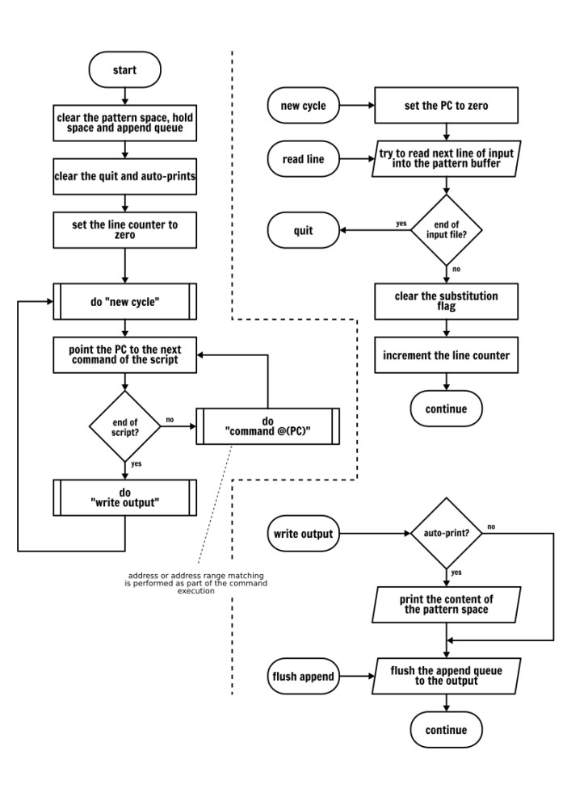
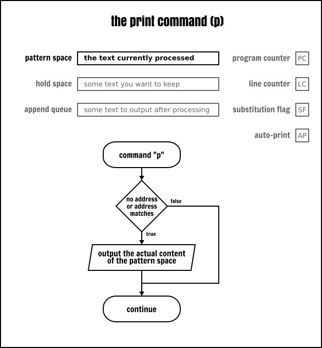

#+TITLE: SED — Completed Command Reference Guide 
#+AUTHOR: PilJin Kwon
#+EMAIL:  piljin.kwon@gmail.com

#+DESCRIPTION: 이 문서는 SED 명령어 완전 가이드입니다
#+KEYWORDS:  sed, regex, regular expression, gnu sed
#+LANGUAGE:  ko
#+OPTIONS:   H:4
#+TOC: headlines 2
#+TOC: tables

[[https://github.com/LCTT/TranslateProject/blob/master/published/201811/20180615%20Complete%20Sed%20Command%20Guide%20%5BExplained%20with%20Practical%20Examples%5D.md][Ref]]

이전 글에서 sed의 기본 사용법을 소개했습니다. sed는 매우 실용적인 스트림 편집기(/stream editor/)입니다. 오늘은 sed를 좀 더 깊이 알아보고 sed의 작동 방식을 자세히 살펴보겠습니다. 이번 기회에 sed를 종합적으로 이해하고 작동 원리와 미묘한 점까지 깊이 파헤쳐 보겠습니다. 

준비가 되셨다면 터미널을 열고 [[https://gist.github.com/s-leroux/5cb36435bac46c10cfced26e4bf5588c][테스트 파일을 다운로드]]한 뒤, 컴퓨터에 앉아서 탐험을 시작하겠습니다! (또는 다음의 파일을 사용합니다)

#+begin_example
root:x:0:0:root:/root:/bin/bash
daemon:x:1:1:daemon:/usr/sbin:/usr/sbin/nologin
bin:x:2:2:bin:/bin:/usr/sbin/nologin
sys:x:3:3:sys:/dev:/usr/sbin/nologin
sync:x:4:65534:sync:/bin:/bin/sync
games:x:5:60:games:/usr/games:/usr/sbin/nologin
man:x:6:12:man:/var/cache/man:/usr/sbin/nologin
lp:x:7:7:lp:/var/spool/lpd:/usr/sbin/nologin
mail:x:8:8:mail:/var/mail:/usr/sbin/nologin
news:x:9:9:news:/var/spool/news:/usr/sbin/nologin
uucp:x:10:10:uucp:/var/spool/uucp:/usr/sbin/nologin
proxy:x:13:13:proxy:/bin:/usr/sbin/nologin
www-data:x:33:33:www-data:/var/www:/usr/sbin/nologin
backup:x:34:34:backup:/var/backups:/usr/sbin/nologin
list:x:38:38:Mailing List Manager:/var/list:/usr/sbin/nologin
irc:x:39:39:ircd:/var/run/ircd:/usr/sbin/nologin
gnats:x:41:41:Gnats Bug-Reporting System (admin):/var/lib/gnats:/usr/sbin/nologin
nobody:x:65534:65534:nobody:/nonexistent:/usr/sbin/nologin
systemd-timesync:x:100:102:systemd Time Synchronization,,,:/run/systemd:/bin/false
systemd-network:x:101:103:systemd Network Management,,,:/run/systemd/netif:/bin/false
systemd-resolve:x:102:104:systemd Resolver,,,:/run/systemd/resolve:/bin/false
systemd-bus-proxy:x:103:105:systemd Bus Proxy,,,:/run/systemd:/bin/false
syslog:x:104:108::/home/syslog:/bin/false
_apt:x:105:65534::/nonexistent:/bin/false
messagebus:x:106:110::/var/run/dbus:/bin/false
uuidd:x:107:111::/run/uuidd:/bin/false
lightdm:x:108:114:Light Display Manager:/var/lib/lightdm:/bin/false
whoopsie:x:109:116::/nonexistent:/bin/false
avahi:x:110:119:Avahi mDNS daemon,,,:/var/run/avahi-daemon:/bin/false
dnsmasq:x:111:65534:dnsmasq,,,:/var/lib/misc:/bin/false
colord:x:112:122:colord colour management daemon,,,:/var/lib/colord:/bin/false
speech-dispatcher:x:113:29:Speech Dispatcher,,,:/var/run/speech-dispatcher:/bin/false
hplip:x:114:7:HPLIP system user,,,:/var/run/hplip:/bin/false
kernoops:x:115:65534:Kernel Oops Tracking Daemon,,,:/:/bin/false
pulse:x:116:123:PulseAudio daemon,,,:/var/run/pulse:/bin/false
nm-openvpn:x:117:125:NetworkManager OpenVPN,,,:/var/lib/openvpn/chroot:/bin/false
rtkit:x:118:126:RealtimeKit,,,:/proc:/bin/false
saned:x:119:127::/var/lib/saned:/bin/false
usbmux:x:120:46:usbmux daemon,,,:/var/lib/usbmux:/bin/false
mc:x:666:46:daemon for the usb Magic Carpet,,,:/var/lib/mc:/bin/false
sylvain:x:1000:1000:Sylvain,,,:/home/sylvain:/bin/bash
guest-j7yfbw:x:999:999:Guest:/tmp/guest-j7yfbw:/bin/bash
sonia:x:1001:1001:Sonia,,,:/home/sonia:/bin/bash
guest-4lnfbb:x:998:998:Guest:/tmp/guest-4lnfbb:/bin/bash
#+end_example

* sed에 대한 약간의 이론적인 지식

** sed의 작동 방식

먼저 sed를 이해하려면 이 도구의 작동 방식을 알아야 합니다.

sed는 데이터를 처리할 때 입력(/STDIN/) 소스에서 한 줄씩 읽고 소위, 패턴 공간(/pattern space/)에 저장합니다. sed의 모든 변환 작업은 패턴 공간 내에서 이루어집니다. 변환 작업은 명령줄이나 sed 스크립트 파일에서 제공되는 한 글자 명령어로 설명됩니다. 대부분의 sed 명령어는 주소 하나 또는 주소 범위를 접두사(/prefix/)로 붙여서 "적용 범위를 제한" 할 수 있습니다.

기본적으로 sed는 처리 루프(실행 주기)가 끝날 때마다 패턴 공간의 내용을 출력합니다. 즉, 입력 소스의 다음 행이 패턴 공간를 덮어쓰기 전에 출력이 이루어집니다. 이런 작동 방식은 다음과 같이 요약할 수 있습니다:

1. 다음 행을 패턴 공간으로 읽으려고 시도합니다.
2. 읽기가 성공하면:
    1. 스크립트에 명시된 대로 주소와 일치하는 현재의 입력 행에 모든 명령을 적용합니다.
    2. sed가 무음 모드(~-n~)로 실행되지 않는 경우, 패턴 공간의 모든 내용(수정됐을 수도 있음)을 출력합니다.
    3. 1 단계로 다시 돌아갑니다.

따라서 각 행의 처리가 완료된 후, 패턴 공간의 내용은 버려지므로 내용을 보관하는 용도로는 적합하지 않습니다. sed는 이런 목적을 위한 두 번째 버퍼인 홀드 공간(/hold space/)이 있습니다. 데이터를 홀드 공간에 명시적으로 저장하거나 홀드 공간에서 데이터를 (패턴 공간으로) 가져오도록 요청하지 않는 한 sed는 홀드 공간의 내용을 절대 지우지 않습니다. 나중에 /exchange/, /get/, /hold/ 명령어를 학습할 때 자세히 살펴보겠습니다.

** sed의 추상화 메커니즘

위의 설명 패턴은 대부분의 sed 튜토리얼에서 많이 접했을 것입니다. 실제로 이는 기본적인 sed 프로그램을 이해하는 데 필수적인 내용입니다. 하지만 고급 명령어를 연구하다 보면 이런 지식만으로 부족하다는 것을 깨닫게 됩니다. 따라서 이제부터 좀 더 심층적인 내용을 살펴보겠습니다.

사실 sed는 추상화 메커니즘의 구현체로 볼 수 있으며 상태(/state/)는 세 개의 버퍼(/buffer/), 두 개의 레지스터(/register/) 그리고 두 개의 플래그(/flag/)로 정의됩니다:

- *세 개의 버퍼* :: 가변 길이의 텍스트를 저장하는 용도로 사용됩니다. 네, 세 개입니다!! 앞서 설명한 기본 설명에선 두 가지 즉, 패턴 공간과 홀드 공간만 다뤘지만, sed는 세 번째 버퍼인 추가 큐(/append queue/)가 있습니다. sed 관점에서 보면 "쓰기 전용 버퍼" 로 sed는 실행 중 사전 정의 단계에서 이를 자동으로 갱신합니다(일반적으로 입력 소스에서 새 줄을 읽기 전이나 실행 종료 직전).

- *두 개의 레지스터* :: 행 카운터(/line counter -LC/)는 입력 소스에서 읽은 행 수를 저장하며, 프로그램 카운터(/program counter - PC/)는 다음에 실행할 명령의 인덱스(즉, 스크립트 내의 위치)를 저장하며 sed는 메인 루프의 일부로 /PC/ 를 자동으로 증가시킵니다. 하지만 특정 명령을 사용할 때 스크립트에서 /PC/ 를 수정해서 프로그램의 일부를 건너뛰거나 반복할 수 있습니다. 이는 sed로 구현한 루프나 조건문과 유사합니다. 자세한 내용은 '분기' 섹션에서 설명하겠습니다.

- *두 개의 플래그* :: 특정 sed 명령어의 동작을 변경합니다: 자동 출력(/auto-print - AP/) 플래그와 대체(substitution -SF/) 플래그입니다. 자동 출력 플래그 /AP/ 가 설정되면 sed는 패턴 공간의 내용을 덮어쓰기 전에(특히, 입력 소스에서 새 줄을 읽기 전을 포함하되 이에 국한되진 않음) 자동으로 출력합니다. 자동 출력 플래그가 해제된 경우(즉, 설정되지 않은 경우) sed는 스크립트에 명시적인 출력 명령이 없는 한 패턴 공간의 내용을 출력하지 않습니다. "무음 모드" (명령줄 옵션 ~-n~ 을 사용하거나 스크립트 첫 번째 줄에 특수 주석 ~#n~ 을 사용)로 sed를 실행해서 자동 출력 플래그를 해제할 수 있습니다. 주소와 검색 패턴이 패턴 공간의 내용과 일치할 때 대체 플래그 /SF/ 는 대체 명령(~s~ 명령)에 의해 설정됩니다. 대체 플래그는 새로운 반복을 시작할 때, 입력 소스에서 새 줄을 읽을 때 또는 조건 분기를 통과한 후에 지워집니다. 이 주제는 '분기' 섹션에서 자세히 살펴보겠습니다.

또한, sed는 주소 범위(주소 범위는 '주소 범위' 섹션에서 설명합니다)에 들어온 명령어 목록과 데이터를 읽고 쓸 때 사용하는 두 개의 파일 핸들(/file handle/)을 관리합니다(파일 핸들은 '읽기 및 쓰기 명령어' 섹션에서 확인할 수 있습니다).

** 보다 정확한 sed 실행 모델

"그림 한 장이 천마디 말보다 더 낫다!" 고 말합니다. 그래서 sed 실행 모델을 설명하기 위한 흐름도(/flow chart/)를 그렸습니다. 여러 입력 파일 처리나 오류 처리 같은 두 가지 요소를 옆에 배치했지만 이 정도면 어떤 sed 프로그램의 동작도 이해하는 데 충분할 뿐만 아니라 sed 스크립트를 작성할 때 시행착오로 낭비하는 시간도 줄일 수 있을 것입니다.

이미 눈치챘겠지만 위의 흐름도는 명령어의 동작을 묘사하지 않았습니다. 명령어는 이후 하나씩 자세히 설명합니다. 그러니 서두르지 마시고 바로 시작하겠습니다!

* 출력 명령어 - /print/

출력 명령어(~p~)는 실행되는 순간 패턴 공간의 내용을 출력합니다. 이 명령어는 sed의 추상 메커니즘의 상태(/state/)를 어떤 식으로든 변경하지 않습니다.

예시:

#+begin_src 
sed -e 'p' inputfile
#+end_src

위의 명령어는 입력 파일의 각 줄의 내용을 출력합니다. 하지만 두 번 중복 출력합니다... ~p~ 명령어를 명시적으로 요청하면 처리 루프가 끝날 때마다 출력하기 때문입니다(sed를 "무음 모드" 로 실행하지 않았기 때문입니다).

줄을 두 번씩 출력하지 않으려면 다음 두 가지 방법으로 해결합니다:

#+begin_src 
sed -n -e 'p' inputfile     # 무음 모드에서 명시적으로 출력
sed -e '' inputfile         # "아무것도 처리하지 않는" 빈 프로그램. (암시적으로 출력)
#+end_src

#+begin_quote
[!NOTE]
~-e~ 옵션은 sed 명령을 도입하는 역할을 처리합니다. 이는 명령과 파일명을 구분합니다. sed는 적어도 하나의 명령을 포함해야 하므로 첫 번째 명령의 `-e` 플래그는 필수가 아닙니다. 하지만 개인적인 습관상 여기서 다루는 '명령줄에서 여러 개의 sed 표현식을 지정하는' 복잡한 사례와의 일관성을 위해 추가했습니다. 이것이 좋은 습관인지 나쁜 습관인지는 여러분이 판단하시기 바랍니다. 이 글 뒷부분에도 이런 습관을 계속 따릅니다.
#+end_quote
